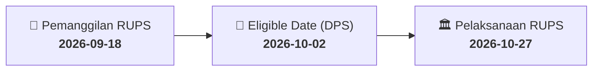

# ⚡ Laporan Intelijen Aksi Korporasi: [[MKPI]] - RUPS

⬅️ [[knowledge-base/daily-digests/Daily_Digest_20260918|Kembali ke Daily Digest]] | 📅 **2026-09-18** | 🎛️ [[Dashboard|Ke Dashboard Utama]]

> [!IMPORTANT]
> Laporan ini disusun secara otomatis oleh **Corporate Action Intelligence Agent** untuk memetakan implikasi strategis, rasio keuangan, alokasi dana, jadwal penting, dan panduan investor.

---

## 📌 1. Ringkasan Eksekutif & Katalis Strategis
- **Kode & Nama Emiten**: `[[MKPI]]`
- **Kategori Aksi Korporasi**: `RUPS`
- **Dokumen Resmi Bursa**: `Pengumuman RUPS`
- **Ringkasan Inti Aksi**: Metropolitan Kentjana Tbk (MKPI) menyampaikan pemberitahuan rencana Rapat Umum Pemegang Saham Luar Biasa (RUPSLB) yang akan diselenggarakan pada Selasa, 27 Oktober 2026 pukul 14:00 di Pondok Indah Office Tower-3, Ruang Duta - Lantai LG, Jln Iskandar Muda Kav. V-TA. Tanggal Daftar Pemegang Saham yang berhak hadir adalah 02 Oktober 2026.

---

## 📊 2. Matriks Parameter Material & Angka Kunci
| Parameter Utama | Nilai / Keterangan Resmi |
| :--- | :--- |
| **Jenis RUPS** | `Rapat Umum Pemegang Saham Luar Biasa` |
| **Nomor Pengumuman** | `0881/CS/MK/IX/2026` |
| **Surat Referensi** | `0859/CS/MK/IX/2026` |
| **Tanggal RUPS** | `2026-10-27` |
| **Hari RUPS** | `Selasa` |
| **Waktu RUPS** | `14:00` |
| **Lokasi RUPS** | `Pondok Indah Office Tower-3, Ruang Duta - Lantai LG, Jln Iskandar Muda Kav. V-TA` |
| **Tanggal Daftar Pemegang Saham (DPS)** | `2026-10-02` |
| **Nama Pengirim** | `Jeffri Sandra Tanudjaja` |
| **Jabatan Pengirim** | `Metropolitan Kentjana Tbk` |
| **Tanggal Pelaporan** | `2026-09-18` |

---

## 📌 3. Detail Pelaksanaan RUPS / RUPSLB
- **Hari, Tanggal Pelaksanaan**: `2026-10-27`
- **Waktu Pelaksanaan**: `14:00`
- **Lokasi / Tempat Pelaksanaan**: `Pondok Indah Office Tower-3, Ruang Duta - Lantai LG, Jln Iskandar Muda Kav. V-TA`
- **Batas Hak Suara (Eligible Date / Recording Date)**: `2026-10-02`

## 📝 4. Matriks Agenda & Mata Acara Rapat
| No | Agenda / Mata Acara | Penjelasan & Sub-Acara |
| :-: | :--- | :--- |
| 1 | **Agenda Utama RUPS** | Metropolitan Kentjana Tbk (MKPI) menyampaikan pemberitahuan rencana Rapat Umum Pemegang Saham Luar Biasa (RUPSLB) yang akan diselenggarakan pada Selasa, 27 Oktober 2026 pukul 14:00 di Pondok Indah Office Tower-3, Ruang Duta - Lantai LG, Jln Iskandar Muda Kav. V-TA. Tanggal Daftar Pemegang Saham yang berhak hadir adalah 02 Oktober 2026. |

## 🗓️ 5. Timeline Investor & Ketentuan Kehadiran

## 💡 6. Panduan Investor & E-Voting
- 👥 **Hak Suara**: Pemegang saham yang berhak hadir/memberikan suara adalah yang terdaftar dalam DPS pada **Eligible Date (2026-10-02)**.
- 🗳️ **E-Voting eASY.KSEI**: Pemegang saham dapat memberikan kuasa/suara secara elektronik melalui sistem eASY.KSEI.

---

## 🔗 Hubungan Note Terkait (Knowledge Graph)
- [[knowledge-base/daily-digests/Daily_Digest_20260918|📄 Daily Digest 2026-09-18]]
- [[knowledge-base/trading-signals/Trading_Signals_20260918|🎯 Sinyal Cuan 2026-09-18]]
- [[Dashboard|🎛️ Kembali ke Dashboard]]