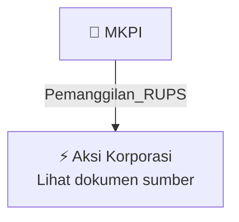

# 📢 Pemanggilan RUPS / RUPSLB — [[MKPI]]

⬅️ [[knowledge-base/daily-digests/Daily_Digest_20261005|Kembali ke Daily Digest]] | 📅 **2026-10-05** | 🎛️ [[Dashboard|Ke Dashboard Utama]]

> [!IMPORTANT]
> Laporan ini disusun secara otomatis oleh **Corporate Action Intelligence Agent** pada **2026-10-05**.
> Sumber dokumen: `20261005_MKPI_20261005_MKPI_Pemanggilan RUPS_32162970.pdf`

---

## 📌 1. Ringkasan Eksekutif & Tujuan Strategis

- **Kode & Nama Emiten**: `[[MKPI]]`
- **Kategori Aksi Korporasi**: `Pemanggilan_RUPS`
- **Dokumen Sumber**: `20261005_MKPI_20261005_MKPI_Pemanggilan RUPS_32162970.pdf`
- **Tanggal Laporan**: `2026-10-05`

[Analisis LLM tidak tersedia — isi manual]

---

## 📊 2. Fakta Material & Parameter Keuangan

| Parameter Utama | Nilai / Keterangan |
| :--- | :--- |
| **Nomor Surat** | `0968/CS/MK/X/2026` |
| **Tanggal Surat** | `2026-10-05` |
| **Jenis Rapat** | `Rapat Umum Pemegang Saham Luar Biasa` |
| **Tanggal RUPS** | `2026-10-27` |
| **Waktu RUPS** | `14:00` |
| **Lokasi RUPS** | `Pondok Indah Office Tower-3, Ruang Duta - Lantai LG, Jln Iskandar Muda Kav. V-TA, Pondok Indah, Jakarta Selatan` |
| **Recording Date** | `2026-10-02` |
| **Agenda 1** | `Persetujuan Perubahan Anggaran Dasar` |
| **Agenda 2** | `Penegasan Susunan Pemegang Saham` |
| **Pengirim** | `Jeffri Sandra Tanudjaja` |
| **Jabatan Pengirim** | `Metropolitan Kentjana Tbk` |
| **Telepon** | `(021) 7505757, 021-7690308` |
| **Fax** | `(021) 7694989` |
| **Website** | `www.Metropolitan Kentjana Tbk` |

---

## 👥 3. Struktur Kepemilikan, Pengendali & Pembeli Siaga

- **Emiten**: `MKPI` | Informasi kepemilikan mengacu pada dokumen resmi sumber.

---

## 🎯 4. Alokasi & Rencana Penggunaan Dana

- Informasi alokasi dana belum tersedia — lihat prospektus / dokumen resmi.

---

## 📅 5. Timeline & Jadwal Pelaksanaan

| Tahapan / Event | Tanggal |
| :--- | :---: |
| **Jadwal** | Lihat dokumen sumber. |

---

## 📈 6. Diagram Visual Flowchart (Mermaid)

---

## 💡 7. Rekomendasi Investor & Strategi Trading

[Analisis LLM tidak tersedia — isi manual]

---

## 🔗 8. Hubungan Note Terkait (Knowledge Graph)

- [[knowledge-base/daily-digests/Daily_Digest_20261005|📄 Daily Digest 2026-10-05]]
- [[knowledge-base/trading-signals/Trading_Signals_20261005|🎯 Sinyal Cuan 2026-10-05]]
- [[MKPI|🏬 Halaman Emiten MKPI]]
- [[Dashboard|🎛️ Kembali ke Dashboard Utama]]

---

*Laporan dibuat otomatis oleh Corporate Action Intelligence Agent · 2026-10-05*