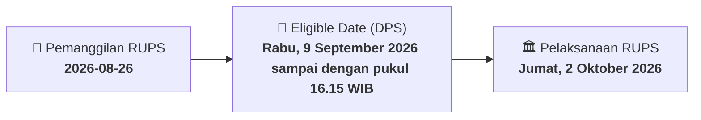

# ⚡ Laporan Intelijen Aksi Korporasi: [[NAYZ]] - RUPS

⬅️ [[knowledge-base/daily-digests/Daily_Digest_20260826|Kembali ke Daily Digest]] | 📅 **2026-08-26** | 🎛️ [[Dashboard|Ke Dashboard Utama]]

> [!IMPORTANT]
> Laporan ini disusun secara otomatis oleh **Corporate Action Intelligence Agent** untuk memetakan implikasi strategis, rasio keuangan, alokasi dana, jadwal penting, dan panduan investor.

---

## 📌 1. Ringkasan Eksekutif & Katalis Strategis
- **Kode & Nama Emiten**: `[[NAYZ]]`
- **Kategori Aksi Korporasi**: `RUPS`
- **Dokumen Resmi Bursa**: `Pengumuman RUPS lamp1`
- **Ringkasan Inti Aksi**: PT Hassana Boga Sejahtera Tbk mengumumkan akan menyelenggarakan Rapat Umum Pemegang Saham Luar Biasa pada Jumat, 2 Oktober 2026, dengan waktu dan tempat yang akan ditentukan kemudian. Pemanggilan resmi RUPS akan disampaikan pada Kamis, 10 September 2026, dan pemegang saham yang berhak hadir adalah yang tercatat pada Rabu, 9 September 2026 hingga pukul 16.15 WIB. Rapat akan dilaksanakan secara elektronik menggunakan fasilitas e-Proxy.

---

## 📊 2. Matriks Parameter Material & Angka Kunci
| Parameter Utama | Nilai / Keterangan Resmi |
| :--- | :--- |
| **Nama Perseroan** | `PT Hassana Boga Sejahtera Tbk` |
| **Jenis Rapat** | `Rapat Umum Pemegang Saham Luar Biasa` |
| **Hari, Tanggal Rapat** | `Jumat, 2 Oktober 2026` |
| **Waktu Rapat** | `Akan ditentukan kemudian` |
| **Tempat Rapat** | `Akan ditentukan kemudian` |
| **Tanggal Pemanggilan Rapat** | `Kamis, 10 September 2026` |
| **Recording Date** | `Rabu, 9 September 2026 sampai dengan pukul 16.15 WIB` |
| **Batas Penyampaian Usulan Mata Acara** | `7 hari kalender sebelum tanggal Pemanggilan Rapat` |
| **Mekanisme Rapat** | `Elektronik menggunakan e-Proxy` |
| **Tanggal Pengumuman** | `26 Agustus 2026` |

---

## 📌 3. Detail Pelaksanaan RUPS / RUPSLB
- **Hari, Tanggal Pelaksanaan**: `Jumat, 2 Oktober 2026`
- **Waktu Pelaksanaan**: `Akan ditentukan kemudian`
- **Lokasi / Tempat Pelaksanaan**: `Akan ditentukan kemudian`
- **Batas Hak Suara (Eligible Date / Recording Date)**: `Rabu, 9 September 2026 sampai dengan pukul 16.15 WIB`

## 📝 4. Matriks Agenda & Mata Acara Rapat
| No | Agenda / Mata Acara | Penjelasan & Sub-Acara |
| :-: | :--- | :--- |
| 1 | **Batas Penyampaian Usulan Mata Acara** | 7 hari kalender sebelum tanggal Pemanggilan Rapat |

## 🗓️ 5. Timeline Investor & Ketentuan Kehadiran

## 💡 6. Panduan Investor & E-Voting
- 👥 **Hak Suara**: Pemegang saham yang berhak hadir/memberikan suara adalah yang terdaftar dalam DPS pada **Eligible Date (Rabu, 9 September 2026 sampai dengan pukul 16.15 WIB)**.
- 🗳️ **E-Voting eASY.KSEI**: Pemegang saham dapat memberikan kuasa/suara secara elektronik melalui sistem eASY.KSEI.

---

## 🔗 Hubungan Note Terkait (Knowledge Graph)
- [[knowledge-base/daily-digests/Daily_Digest_20260826|📄 Daily Digest 2026-08-26]]
- [[knowledge-base/trading-signals/Trading_Signals_20260826|🎯 Sinyal Cuan 2026-08-26]]
- [[Dashboard|🎛️ Kembali ke Dashboard]]