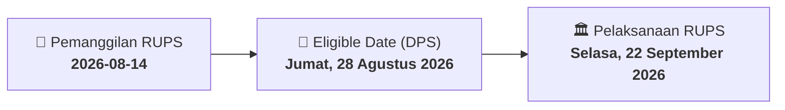

# ⚡ Laporan Intelijen Aksi Korporasi: [[OILS]] - RUPS

⬅️ [[knowledge-base/daily-digests/Daily_Digest_20260814|Kembali ke Daily Digest]] | 📅 **2026-08-14** | 🎛️ [[Dashboard|Ke Dashboard Utama]]

> [!IMPORTANT]
> Laporan ini disusun secara otomatis oleh **Corporate Action Intelligence Agent** untuk memetakan implikasi strategis, rasio keuangan, alokasi dana, jadwal penting, dan panduan investor.

---

## 📌 1. Ringkasan Eksekutif & Katalis Strategis
- **Kode & Nama Emiten**: `[[OILS]]`
- **Kategori Aksi Korporasi**: `RUPS`
- **Dokumen Resmi Bursa**: `Pengumuman RUPS lamp1`
- **Ringkasan Inti Aksi**: PT Indo Oil Perkasa Tbk mengumumkan akan menyelenggarakan Rapat Umum Pemegang Saham Luar Biasa (RUPSLB) pada Selasa, 22 September 2026, secara elektronik (E-RUPS). Pemegang saham yang berhak hadir adalah yang tercatat pada 28 Agustus 2026. Panggilan Rapat akan dilakukan pada 31 Agustus 2026. Pemegang saham yang memiliki minimal 1/10 saham dapat mengusulkan agenda rapat paling lambat 28 Agustus 2026.

---

## 📊 2. Matriks Parameter Material & Angka Kunci
| Parameter Utama | Nilai / Keterangan Resmi |
| :--- | :--- |
| **Jenis Rapat** | `Rapat Umum Pemegang Saham Luar Biasa (RUPSLB)` |
| **Hari/Tanggal Rapat** | `Selasa, 22 September 2026` |
| **Tempat Rapat** | `E-RUPS` |
| **Waktu Rapat** | `10.30 - Selesai` |
| **Tanggal Daftar Pemegang Saham (Recording Date)** | `Jumat, 28 Agustus 2026` |
| **Tanggal Panggilan Rapat** | `Senin, 31 Agustus 2026` |
| **Batas Akhir Pengajuan Usulan Agenda oleh Pemegang Saham** | `Jumat, 28 Agustus 2026` |
| **Syarat Pengajuan Usulan Agenda** | `Minimal 1/10 dari seluruh saham dengan hak suara yang sah` |
| **Mekanisme Rapat** | `Menggunakan fasilitas elektronik (e-Proxy) untuk pengambilan suara` |

---

## 📌 3. Detail Pelaksanaan RUPS / RUPSLB
- **Hari, Tanggal Pelaksanaan**: `Selasa, 22 September 2026`
- **Waktu Pelaksanaan**: `10.30 - Selesai`
- **Lokasi / Tempat Pelaksanaan**: `E-RUPS`
- **Batas Hak Suara (Eligible Date / Recording Date)**: `Jumat, 28 Agustus 2026`

## 📝 4. Matriks Agenda & Mata Acara Rapat
| No | Agenda / Mata Acara | Penjelasan & Sub-Acara |
| :-: | :--- | :--- |
| 1 | **Batas Akhir Pengajuan Usulan Agenda oleh Pemegang Saham** | Jumat, 28 Agustus 2026 |
| 2 | **Syarat Pengajuan Usulan Agenda** | Minimal 1/10 dari seluruh saham dengan hak suara yang sah |

## 🗓️ 5. Timeline Investor & Ketentuan Kehadiran

## 💡 6. Panduan Investor & E-Voting
- 👥 **Hak Suara**: Pemegang saham yang berhak hadir/memberikan suara adalah yang terdaftar dalam DPS pada **Eligible Date (Jumat, 28 Agustus 2026)**.
- 🗳️ **E-Voting eASY.KSEI**: Pemegang saham dapat memberikan kuasa/suara secara elektronik melalui sistem eASY.KSEI.

---

## 🔗 Hubungan Note Terkait (Knowledge Graph)
- [[knowledge-base/daily-digests/Daily_Digest_20260814|📄 Daily Digest 2026-08-14]]
- [[knowledge-base/trading-signals/Trading_Signals_20260814|🎯 Sinyal Cuan 2026-08-14]]
- [[Dashboard|🎛️ Kembali ke Dashboard]]