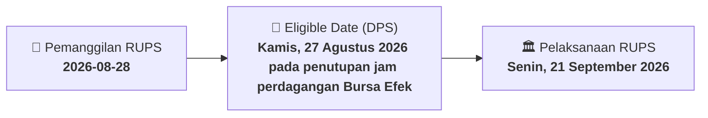

# ⚡ Laporan Intelijen Aksi Korporasi: [[PGUN]] - RUPS

⬅️ [[knowledge-base/daily-digests/Daily_Digest_20260828|Kembali ke Daily Digest]] | 📅 **2026-08-28** | 🎛️ [[Dashboard|Ke Dashboard Utama]]

> [!IMPORTANT]
> Laporan ini disusun secara otomatis oleh **Corporate Action Intelligence Agent** untuk memetakan implikasi strategis, rasio keuangan, alokasi dana, jadwal penting, dan panduan investor.

---

## 📌 1. Ringkasan Eksekutif & Katalis Strategis
- **Kode & Nama Emiten**: `[[PGUN]]`
- **Kategori Aksi Korporasi**: `RUPS`
- **Dokumen Resmi Bursa**: `Pemanggilan RUPS lamp1`
- **Ringkasan Inti Aksi**: Perseroan mengumumkan Rapat Umum Pemegang Saham Luar Biasa yang akan diselenggarakan pada Senin, 21 September 2026 pukul 10.00 WIB secara elektronik melalui e-RUPS/e-Voting, dengan mata acara persetujuan penyesuaian KBLI Tahun 2025.

---

## 📊 2. Matriks Parameter Material & Angka Kunci
| Parameter Utama | Nilai / Keterangan Resmi |
| :--- | :--- |
| **Jenis Rapat** | `Rapat Umum Pemegang Saham Luar Biasa (RUPSLB)` |
| **Hari/Tanggal Rapat** | `Senin, 21 September 2026` |
| **Waktu Rapat** | `10.00 WIB - Selesai` |
| **Mekanisme Kehadiran** | `Elektronik melalui e-RUPS, e-Proxy, dan e-Voting` |
| **Mata Acara Rapat** | `Persetujuan Penyesuaian KBLI Tahun 2025` |
| **Penjelasan Mata Acara** | `Penyesuaian KBLI dalam rangka penyesuaian KBLI tahun 2025 tanpa adanya penambahan/perubahan bidang usaha Perseroan` |
| **Tanggal Pemanggilan** | `Kamis, 27 Agustus 2026` |
| **Recording Date** | `Kamis, 27 Agustus 2026 pada penutupan jam perdagangan Bursa Efek` |
| **Batas Waktu Deklarasi Kehadiran/Kuasa/Suara** | `20 September 2026` |
| **Ketentuan Kuorum dan Hak Suara** | `Pemegang saham yang tercatat pada recording date berhak hadir; pemegang saham yang telah memberikan suara minimal untuk 1 mata acara tidak perlu registrasi ulang dan kepemilikan sahamnya otomatis dihitung sebagai kuorum kehadiran` |

---

## 📌 3. Detail Pelaksanaan RUPS / RUPSLB
- **Hari, Tanggal Pelaksanaan**: `Senin, 21 September 2026`
- **Waktu Pelaksanaan**: `20 September 2026`
- **Lokasi / Tempat Pelaksanaan**: `Aplikasi eASY.KSEI / Kantor Perseroan`
- **Batas Hak Suara (Eligible Date / Recording Date)**: `Kamis, 27 Agustus 2026 pada penutupan jam perdagangan Bursa Efek`

## 📝 4. Matriks Agenda & Mata Acara Rapat
| No | Agenda / Mata Acara | Penjelasan & Sub-Acara |
| :-: | :--- | :--- |
| 1 | **Mata Acara Rapat** | Persetujuan Penyesuaian KBLI Tahun 2025 |
| 2 | **Penjelasan Mata Acara** | Penyesuaian KBLI dalam rangka penyesuaian KBLI tahun 2025 tanpa adanya penambahan/perubahan bidang usaha Perseroan |

## 🗓️ 5. Timeline Investor & Ketentuan Kehadiran

## 💡 6. Panduan Investor & E-Voting
- 👥 **Hak Suara**: Pemegang saham yang berhak hadir/memberikan suara adalah yang terdaftar dalam DPS pada **Eligible Date (Kamis, 27 Agustus 2026 pada penutupan jam perdagangan Bursa Efek)**.
- 🗳️ **E-Voting eASY.KSEI**: Pemegang saham dapat memberikan kuasa/suara secara elektronik melalui sistem eASY.KSEI.

---

## 🔗 Hubungan Note Terkait (Knowledge Graph)
- [[knowledge-base/daily-digests/Daily_Digest_20260828|📄 Daily Digest 2026-08-28]]
- [[knowledge-base/trading-signals/Trading_Signals_20260828|🎯 Sinyal Cuan 2026-08-28]]
- [[Dashboard|🎛️ Kembali ke Dashboard]]