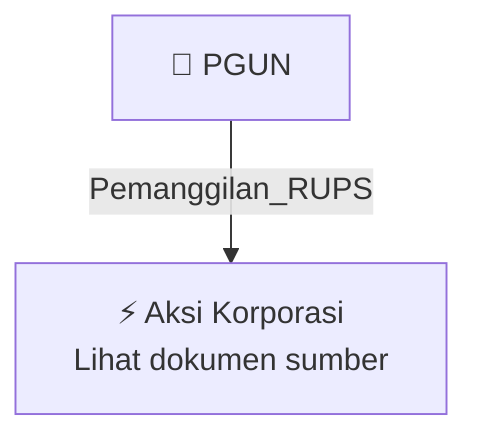

# 📢 Pemanggilan RUPS / RUPSLB — [[PGUN]]

⬅️ [[knowledge-base/daily-digests/Daily_Digest_20260924|Kembali ke Daily Digest]] | 📅 **2026-09-24** | 🎛️ [[Dashboard|Ke Dashboard Utama]]

> [!IMPORTANT]
> Laporan ini disusun secara otomatis oleh **Corporate Action Intelligence Agent** pada **2026-09-24**.
> Sumber dokumen: `20260923_PGUN_20260923_PGUN_Ringkasan RisalahRisalah RUPS_32150506.pdf`

---

## 📌 1. Ringkasan Eksekutif & Tujuan Strategis

- **Kode & Nama Emiten**: `[[PGUN]]`
- **Kategori Aksi Korporasi**: `Pemanggilan_RUPS`
- **Dokumen Sumber**: `20260923_PGUN_20260923_PGUN_Ringkasan RisalahRisalah RUPS_32150506.pdf`
- **Tanggal Laporan**: `2026-09-24`

[Analisis LLM tidak tersedia — isi manual]

---

## 📊 2. Fakta Material & Parameter Keuangan

| Parameter Utama | Nilai / Keterangan |
| :--- | :--- |
| **Tanggal RUPS** | `2026-09-21` |
| **Kuorum Kehadiran** | `5.300.387.032 saham (92,38%)` |
| **Agenda RUPS** | `Persetujuan Penyesuaian KBLI Tahun 2025` |
| **Hasil Keputusan Agenda 1** | `Setuju (100% dari suara hadir, 0 tidak setuju, 0 abstain)` |
| **Poin Keputusan 1a** | `Menyetujui penyesuaian Pasal 3 Anggaran Dasar tentang Maksud dan Tujuan serta Kegiatan Usaha sesuai Peraturan BPS Nomor 7 Tahun 2025` |
| **Poin Keputusan 1b** | `Memberi kuasa kepada Direksi untuk melakukan segala tindakan sehubungan dengan penyesuaian Pasal 3 Anggaran Dasar` |
| **Direktur Utama** | `Bapak Jonet Budiarto (Periode 11 Maret 2026 - 30 Juni 2026, Periode ke-1)` |
| **Direktur** | `Bapak Tamlikho (Periode 30 Mei 2026 - 30 Juni 2029, Periode ke-3)` |
| **Komisaris Utama** | `Ibu Liana Saputri (Periode 30 Mei 2026 - 30 Juni 2029, Periode ke-3)` |
| **Komisaris** | `Bapak Indra Surya (Periode 30 Mei 2026 - 30 Juni 2029, Periode ke-3)` |
| **Tanggal Pengumuman RUPS** | `2026-08-28` |
| **Nomor Surat Pengumuman** | `100A/DIR-PG/EXT-CORSEC/VIII/2026` |

---

## 👥 3. Struktur Kepemilikan, Pengendali & Pembeli Siaga

- **Emiten**: `PGUN` | Informasi kepemilikan mengacu pada dokumen resmi sumber.

---

## 🎯 4. Alokasi & Rencana Penggunaan Dana

- Informasi alokasi dana belum tersedia — lihat prospektus / dokumen resmi.

---

## 📅 5. Timeline & Jadwal Pelaksanaan

| Tahapan / Event | Tanggal |
| :--- | :---: |
| **Jadwal** | Lihat dokumen sumber. |

---

## 📈 6. Diagram Visual Flowchart (Mermaid)

---

## 💡 7. Rekomendasi Investor & Strategi Trading

[Analisis LLM tidak tersedia — isi manual]

---

## 🔗 8. Hubungan Note Terkait (Knowledge Graph)

- [[knowledge-base/daily-digests/Daily_Digest_20260924|📄 Daily Digest 2026-09-24]]
- [[knowledge-base/trading-signals/Trading_Signals_20260924|🎯 Sinyal Cuan 2026-09-24]]
- [[PGUN|🏬 Halaman Emiten PGUN]]
- [[Dashboard|🎛️ Kembali ke Dashboard Utama]]

---

*Laporan dibuat otomatis oleh Corporate Action Intelligence Agent · 2026-09-24*