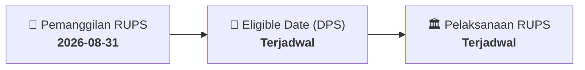

# ⚡ Laporan Intelijen Aksi Korporasi: [[POOL]] - RUPS

⬅️ [[knowledge-base/daily-digests/Daily_Digest_20260831|Kembali ke Daily Digest]] | 📅 **2026-08-31** | 🎛️ [[Dashboard|Ke Dashboard Utama]]

> [!IMPORTANT]
> Laporan ini disusun secara otomatis oleh **Corporate Action Intelligence Agent** untuk memetakan implikasi strategis, rasio keuangan, alokasi dana, jadwal penting, dan panduan investor.

---

## 📌 1. Ringkasan Eksekutif & Katalis Strategis
- **Kode & Nama Emiten**: `[[POOL]]`
- **Kategori Aksi Korporasi**: `RUPS`
- **Dokumen Resmi Bursa**: `Pemanggilan RUPS lamp2`
- **Ringkasan Inti Aksi**: Informasi dan fakta material POOL: PT POOL ADVISTA INDONESIA Tbk (“Perseroan”) RALAT PEMANGGILAN DAN PEMANGGILAN ULANG RAPAT UMUM PEMEGANG SAHAM LUAR BIASA Dengan ini diberitahukan kepada para pemegang saham PT. Pool Advista Indonesia Tbk (“Perseroan”) bahwa Perseroan telah melakukan Pengumuman Rapat Umum Pemegang Saham Luar Biasa (“RUPSLB”) pada tanggal 28 Juli 2026 dan Pemanggilan RUPSLB pada tanggal 12 Agustus 2026, yang semula akan diselenggarakan pada: Hari/tanggal : Kamis, 03 September 2026 Waktu : 14.00 - 15.30 WIB Tempat

---

## 📊 2. Matriks Parameter Material & Angka Kunci
| Parameter Utama | Nilai / Keterangan Resmi |
| :--- | :--- |
| **Uraian Kejadian** | `PT POOL ADVISTA INDONESIA Tbk (“Perseroan”) RALAT PEMANGGILAN DAN PEMANGGILAN ULANG RAPAT UMUM PEMEGANG SAHAM LUAR BIASA Dengan ini diberitahukan kepada para pemegang saham PT. Pool Advista Indonesia Tbk (“Perseroan”) bahwa Perseroan telah melakukan Pengumuman Rapat Umum Pemegang Saham Luar Biasa (“RUPSLB”) pada tanggal 28 Juli 2026 dan Pemanggilan RUPSLB pada tanggal 12 Agustus 2026, yang semula akan diselenggarakan pada: Hari/tanggal : Kamis, 03 September 2026 Waktu : 14.00 - 15.30 WIB Tempat` |

---

## 📌 3. Detail Pelaksanaan RUPS / RUPSLB
- **Hari, Tanggal Pelaksanaan**: `Terjadwal`
- **Waktu Pelaksanaan**: `09.00 WIB s.d. selesai`
- **Lokasi / Tempat Pelaksanaan**: `Aplikasi eASY.KSEI / Kantor Perseroan`
- **Batas Hak Suara (Eligible Date / Recording Date)**: `Terjadwal`

## 📝 4. Matriks Agenda & Mata Acara Rapat
| No | Agenda / Mata Acara | Penjelasan & Sub-Acara |
| :-: | :--- | :--- |
| 1 | **Agenda Utama RUPS** | Informasi dan fakta material POOL: PT POOL ADVISTA INDONESIA Tbk (“Perseroan”) RALAT PEMANGGILAN DAN PEMANGGILAN ULANG RAPAT UMUM PEMEGANG SAHAM LUAR BIASA Dengan ini diberitahukan kepada para pemegang saham PT. Pool Advista Indonesia Tbk (“Perseroan”) bahwa Perseroan telah melakukan Pengumuman Rapat Umum Pemegang Saham Luar Biasa (“RUPSLB”) pada tanggal 28 Juli 2026 dan Pemanggilan RUPSLB pada tanggal 12 Agustus 2026, yang semula akan diselenggarakan pada: Hari/tanggal : Kamis, 03 September 2026 Waktu : 14.00 - 15.30 WIB Tempat |

## 🗓️ 5. Timeline Investor & Ketentuan Kehadiran

## 💡 6. Panduan Investor & E-Voting
- 👥 **Hak Suara**: Pemegang saham yang berhak hadir/memberikan suara adalah yang terdaftar dalam DPS pada **Eligible Date (Terjadwal)**.
- 🗳️ **E-Voting eASY.KSEI**: Pemegang saham dapat memberikan kuasa/suara secara elektronik melalui sistem eASY.KSEI.

---

## 🔗 Hubungan Note Terkait (Knowledge Graph)
- [[knowledge-base/daily-digests/Daily_Digest_20260831|📄 Daily Digest 2026-08-31]]
- [[knowledge-base/trading-signals/Trading_Signals_20260831|🎯 Sinyal Cuan 2026-08-31]]
- [[Dashboard|🎛️ Kembali ke Dashboard]]