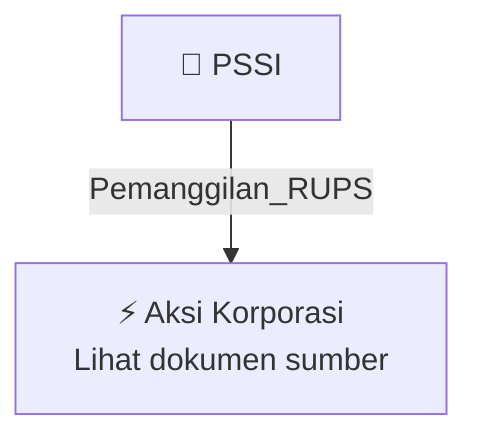

# 📢 Pemanggilan RUPS / RUPSLB — [[PSSI]]

⬅️ [[knowledge-base/daily-digests/Daily_Digest_20261006|Kembali ke Daily Digest]] | 📅 **2026-10-06** | 🎛️ [[Dashboard|Ke Dashboard Utama]]

> [!IMPORTANT]
> Laporan ini disusun secara otomatis oleh **Corporate Action Intelligence Agent** pada **2026-10-06**.
> Sumber dokumen: `20261006_PSSI_20261006_PSSI_Pemanggilan RUPS_32163600.pdf`

---

## 📌 1. Ringkasan Eksekutif & Tujuan Strategis

- **Kode & Nama Emiten**: `[[PSSI]]`
- **Kategori Aksi Korporasi**: `Pemanggilan_RUPS`
- **Dokumen Sumber**: `20261006_PSSI_20261006_PSSI_Pemanggilan RUPS_32163600.pdf`
- **Tanggal Laporan**: `2026-10-06`

[Analisis LLM tidak tersedia — isi manual]

---

## 📊 2. Fakta Material & Parameter Keuangan

| Parameter Utama | Nilai / Keterangan |
| :--- | :--- |
| **Nomor Surat Pemanggilan** | `057/PLOG-Corsec/X/2026` |
| **Nomor Surat Referensi** | `054/PLOG-Corsec/IX/2026` |
| **Tanggal Surat Referensi** | `2026-09-21` |
| **Jenis Rapat** | `Rapat Umum Pemegang Saham Luar Biasa (RUPSLB)` |
| **Tanggal Penyelenggaraan RUPS** | `2026-10-28` |
| **Waktu Penyelenggaraan RUPS** | `10:00` |
| **Lokasi Penyelenggaraan RUPS** | `Graha Irama Lantai 8, Jl. H.R. Rasuna Said Blok X-1 Kav. 1 & 2, Kuningan Timur, Setiabudi, Jakarta Selatan 12950` |
| **Tanggal Daftar Pemegang Saham (Recording Date)** | `2026-10-05` |
| **Agenda 1** | `Persetujuan Pengalihan Saham Hasil Pembelian Kembali (Saham Treasuri) Perseroan melalui Mekanisme Pembagian Saham Bonus` |
| **Agenda 2** | `Persetujuan Perubahan Pasal 3 Anggaran Dasar Perseroan tentang Maksud dan Tujuan serta Kegiatan Usaha` |
| **Nama Pengirim/Approver** | `Desi Femilinda Safitri` |
| **Fungsi Approver** | `Approver` |
| **Tanggal dan Waktu Dokumen** | `2026-10-06 12:04` |
| **Lampiran** | `Pemanggilan RUPSLB-final.pdf` |

---

## 👥 3. Struktur Kepemilikan, Pengendali & Pembeli Siaga

- **Emiten**: `PSSI` | Informasi kepemilikan mengacu pada dokumen resmi sumber.

---

## 🎯 4. Alokasi & Rencana Penggunaan Dana

- Informasi alokasi dana belum tersedia — lihat prospektus / dokumen resmi.

---

## 📅 5. Timeline & Jadwal Pelaksanaan

| Tahapan / Event | Tanggal |
| :--- | :---: |
| **Jadwal** | Lihat dokumen sumber. |

---

## 📈 6. Diagram Visual Flowchart (Mermaid)

---

## 💡 7. Rekomendasi Investor & Strategi Trading

[Analisis LLM tidak tersedia — isi manual]

---

## 🔗 8. Hubungan Note Terkait (Knowledge Graph)

- [[knowledge-base/daily-digests/Daily_Digest_20261006|📄 Daily Digest 2026-10-06]]
- [[knowledge-base/trading-signals/Trading_Signals_20261006|🎯 Sinyal Cuan 2026-10-06]]
- [[PSSI|🏬 Halaman Emiten PSSI]]
- [[Dashboard|🎛️ Kembali ke Dashboard Utama]]

---

*Laporan dibuat otomatis oleh Corporate Action Intelligence Agent · 2026-10-06*