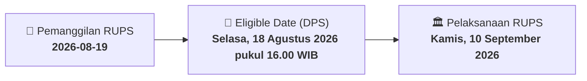

# ⚡ Laporan Intelijen Aksi Korporasi: [[RANS]] - RUPS

⬅️ [[knowledge-base/daily-digests/Daily_Digest_20260819|Kembali ke Daily Digest]] | 📅 **2026-08-19** | 🎛️ [[Dashboard|Ke Dashboard Utama]]

> [!IMPORTANT]
> Laporan ini disusun secara otomatis oleh **Corporate Action Intelligence Agent** untuk memetakan implikasi strategis, rasio keuangan, alokasi dana, jadwal penting, dan panduan investor.

---

## 📌 1. Ringkasan Eksekutif & Katalis Strategis
- **Kode & Nama Emiten**: `[[RANS]]`
- **Kategori Aksi Korporasi**: `RUPS`
- **Dokumen Resmi Bursa**: `Pemanggilan RUPS lamp1`
- **Ringkasan Inti Aksi**: Perseroan mengumumkan pemanggilan Rapat Umum Pemegang Saham Luar Biasa yang akan diselenggarakan secara hybrid pada Kamis, 10 September 2026 pukul 11.00 WIB di RANS Office Building, Bumi Serpong Damai, Tangerang Selatan, dengan mata acara persetujuan perubahan susunan anggota Direksi Perseroan.

---

## 📊 2. Matriks Parameter Material & Angka Kunci
| Parameter Utama | Nilai / Keterangan Resmi |
| :--- | :--- |
| **Hari/Tanggal RUPS** | `Kamis, 10 September 2026` |
| **Waktu RUPS** | `11.00 WIB - selesai` |
| **Tempat RUPS** | `RANS Office Building, Bumi Serpong Damai, Blok CBD Lot VIII No. 12, Kel. Lengkong Gudang, Kec. Serpong, Kota Tangerang Selatan, Banten 15321` |
| **Mekanisme Rapat** | `Hybrid (fisik dan elektronik)` |
| **Pembatasan Kehadiran Fisik** | `Maksimal 10 pemegang saham, first come first served` |
| **Mata Acara Rapat** | `Persetujuan atas perubahan susunan anggota Direksi Perseroan` |
| **Recording Date** | `Selasa, 18 Agustus 2026 pukul 16.00 WIB` |
| **Batas Waktu e-Proxy** | `Rabu, 9 September 2026 pukul 12.00 WIB` |
| **Batas Waktu Surat Kuasa Konvensional** | `Kamis, 10 September 2026 pukul 09.00 WIB` |
| **Biro Administrasi Efek** | `PT Adimitra Jasa Korpora, Kirana Boutique Office Blok F3 No. 5, Jl. Kirana Avenue III, Kelapa Gading, Jakarta Utara 14250, Email: opr@adimitra-jk.co.id, Telepon: (021) 29745222` |

---

## 📌 3. Detail Pelaksanaan RUPS / RUPSLB
- **Hari, Tanggal Pelaksanaan**: `Kamis, 10 September 2026`
- **Waktu Pelaksanaan**: `Kamis, 10 September 2026 pukul 09.00 WIB`
- **Lokasi / Tempat Pelaksanaan**: `RANS Office Building, Bumi Serpong Damai, Blok CBD Lot VIII No. 12, Kel. Lengkong Gudang, Kec. Serpong, Kota Tangerang Selatan, Banten 15321`
- **Batas Hak Suara (Eligible Date / Recording Date)**: `Selasa, 18 Agustus 2026 pukul 16.00 WIB`

## 📝 4. Matriks Agenda & Mata Acara Rapat
| No | Agenda / Mata Acara | Penjelasan & Sub-Acara |
| :-: | :--- | :--- |
| 1 | **Mata Acara Rapat** | Persetujuan atas perubahan susunan anggota Direksi Perseroan |

## 🗓️ 5. Timeline Investor & Ketentuan Kehadiran

## 💡 6. Panduan Investor & E-Voting
- 👥 **Hak Suara**: Pemegang saham yang berhak hadir/memberikan suara adalah yang terdaftar dalam DPS pada **Eligible Date (Selasa, 18 Agustus 2026 pukul 16.00 WIB)**.
- 🗳️ **E-Voting eASY.KSEI**: Pemegang saham dapat memberikan kuasa/suara secara elektronik melalui sistem eASY.KSEI.

---

## 🔗 Hubungan Note Terkait (Knowledge Graph)
- [[knowledge-base/daily-digests/Daily_Digest_20260819|📄 Daily Digest 2026-08-19]]
- [[knowledge-base/trading-signals/Trading_Signals_20260819|🎯 Sinyal Cuan 2026-08-19]]
- [[Dashboard|🎛️ Kembali ke Dashboard]]