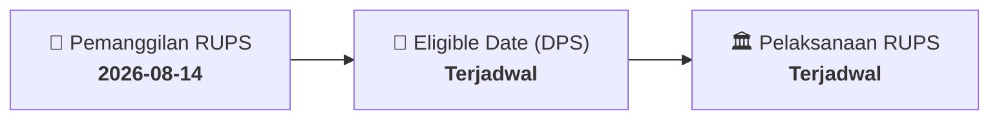

# ⚡ Laporan Intelijen Aksi Korporasi: [[RATU]] - RUPS

⬅️ [[knowledge-base/daily-digests/Daily_Digest_20260814|Kembali ke Daily Digest]] | 📅 **2026-08-14** | 🎛️ [[Dashboard|Ke Dashboard Utama]]

> [!IMPORTANT]
> Laporan ini disusun secara otomatis oleh **Corporate Action Intelligence Agent** untuk memetakan implikasi strategis, rasio keuangan, alokasi dana, jadwal penting, dan panduan investor.

---

## 📌 1. Ringkasan Eksekutif & Katalis Strategis
- **Kode & Nama Emiten**: `[[RATU]]`
- **Kategori Aksi Korporasi**: `RUPS`
- **Dokumen Resmi Bursa**: `Pemanggilan RUPS`
- **Ringkasan Inti Aksi**: Informasi dan fakta material RATU: REC/CO/14.243/VIII/2026 PT Raharja Energi Cepu Tbk RATU 1 Pemanggilan Rapat Umum Pemegang Saham Luar Biasa Merujuk pada surat Perseroan Nomor REC/DIR/30.225/VII/2026 , Tanggal 30 Juli 2026, Perseroan menyampaikan pemberitahuan penyelenggaraan Rapat Umum Pemegang Saham pada Pemanggilan Rencana RUPS Lokasi Penyelenggaraan RUPS (bila sudah dapat diumumkan dan sesuai iklan) : Hari/Tanggal/Waktu : Waktu : 08 September 2026 10:00 Cityloog Hotel Tebet Jl. Dr. Saharjo No.191, Manggarai Sel, Jakarta 1296

---

## 📊 2. Matriks Parameter Material & Angka Kunci
| Parameter Utama | Nilai / Keterangan Resmi |
| :--- | :--- |
| **Uraian Kejadian** | `REC/CO/14.243/VIII/2026 PT Raharja Energi Cepu Tbk RATU 1 Pemanggilan Rapat Umum Pemegang Saham Luar Biasa Merujuk pada surat Perseroan Nomor REC/DIR/30.225/VII/2026 , Tanggal 30 Juli 2026, Perseroan menyampaikan pemberitahuan penyelenggaraan Rapat Umum Pemegang Saham pada Pemanggilan Rencana RUPS Lokasi Penyelenggaraan RUPS (bila sudah dapat diumumkan dan sesuai iklan) : Hari/Tanggal/Waktu : Waktu : 08 September 2026 10:00 Cityloog Hotel Tebet Jl. Dr. Saharjo No.191, Manggarai Sel, Jakarta 1296` |

---

## 📌 3. Detail Pelaksanaan RUPS / RUPSLB
- **Hari, Tanggal Pelaksanaan**: `Terjadwal`
- **Waktu Pelaksanaan**: `09.00 WIB s.d. selesai`
- **Lokasi / Tempat Pelaksanaan**: `Aplikasi eASY.KSEI / Kantor Perseroan`
- **Batas Hak Suara (Eligible Date / Recording Date)**: `Terjadwal`

## 📝 4. Matriks Agenda & Mata Acara Rapat
| No | Agenda / Mata Acara | Penjelasan & Sub-Acara |
| :-: | :--- | :--- |
| 1 | **Agenda Utama RUPS** | Informasi dan fakta material RATU: REC/CO/14.243/VIII/2026 PT Raharja Energi Cepu Tbk RATU 1 Pemanggilan Rapat Umum Pemegang Saham Luar Biasa Merujuk pada surat Perseroan Nomor REC/DIR/30.225/VII/2026 , Tanggal 30 Juli 2026, Perseroan menyampaikan pemberitahuan penyelenggaraan Rapat Umum Pemegang Saham pada Pemanggilan Rencana RUPS Lokasi Penyelenggaraan RUPS (bila sudah dapat diumumkan dan sesuai iklan) : Hari/Tanggal/Waktu : Waktu : 08 September 2026 10:00 Cityloog Hotel Tebet Jl. Dr. Saharjo No.191, Manggarai Sel, Jakarta 1296 |

## 🗓️ 5. Timeline Investor & Ketentuan Kehadiran

## 💡 6. Panduan Investor & E-Voting
- 👥 **Hak Suara**: Pemegang saham yang berhak hadir/memberikan suara adalah yang terdaftar dalam DPS pada **Eligible Date (Terjadwal)**.
- 🗳️ **E-Voting eASY.KSEI**: Pemegang saham dapat memberikan kuasa/suara secara elektronik melalui sistem eASY.KSEI.

---

## 🔗 Hubungan Note Terkait (Knowledge Graph)
- [[knowledge-base/daily-digests/Daily_Digest_20260814|📄 Daily Digest 2026-08-14]]
- [[knowledge-base/trading-signals/Trading_Signals_20260814|🎯 Sinyal Cuan 2026-08-14]]
- [[Dashboard|🎛️ Kembali ke Dashboard]]