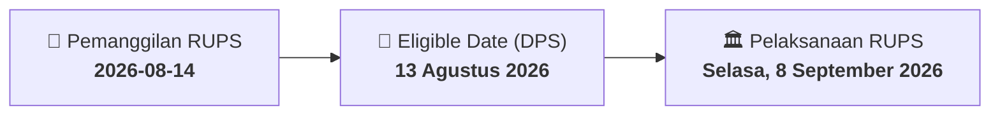

# ⚡ Laporan Intelijen Aksi Korporasi: [[SCCO]] - RUPS

⬅️ [[knowledge-base/daily-digests/Daily_Digest_20260814|Kembali ke Daily Digest]] | 📅 **2026-08-14** | 🎛️ [[Dashboard|Ke Dashboard Utama]]

> [!IMPORTANT]
> Laporan ini disusun secara otomatis oleh **Corporate Action Intelligence Agent** untuk memetakan implikasi strategis, rasio keuangan, alokasi dana, jadwal penting, dan panduan investor.

---

## 📌 1. Ringkasan Eksekutif & Katalis Strategis
- **Kode & Nama Emiten**: `[[SCCO]]`
- **Kategori Aksi Korporasi**: `RUPS`
- **Dokumen Resmi Bursa**: `Pemanggilan RUPS lamp1`
- **Ringkasan Inti Aksi**: PT Supreme Cable Manufacturing & Commerce Tbk (PT SUCACO Tbk) mengundang pemegang saham untuk menghadiri Rapat Umum Pemegang Saham Luar Biasa (RUPSLB) yang akan diselenggarakan pada Selasa, 8 September 2026. Agenda utama rapat adalah perubahan Pasal 3 Anggaran Dasar untuk penyesuaian dengan Klasifikasi Baku Lapangan Usaha Indonesia (KBLI) 2025, yang bersifat administratif dan tidak mengubah kegiatan usaha. Pemegang saham yang berhak hadir adalah yang tercatat pada 13 Agustus 2026.

---

## 📊 2. Matriks Parameter Material & Angka Kunci
| Parameter Utama | Nilai / Keterangan Resmi |
| :--- | :--- |
| **Hari/Tanggal Rapat** | `Selasa, 8 September 2026` |
| **Waktu Rapat** | `Pukul 10.00 WIB s/d selesai` |
| **Tempat Rapat** | `PT Supreme Cable Manufacturing & Commerce Tbk (PT SUCACO Tbk)` |
| **Mata Acara Rapat** | `Perubahan Pasal 3 Anggaran Dasar dalam rangka penyesuaian dengan KBLI 2025` |
| **Tanggal Pencatatan Pemegang Saham (Recording Date)** | `13 Agustus 2026` |
| **Batas Akhir Penerimaan Surat Kuasa** | `3 September 2026` |
| **Tanggal Pemanggilan** | `14 Agustus 2026` |
| **Biro Administrasi Efek (BAE)** | `PT Sinartama Gunita` |

---

## 📌 3. Detail Pelaksanaan RUPS / RUPSLB
- **Hari, Tanggal Pelaksanaan**: `Selasa, 8 September 2026`
- **Waktu Pelaksanaan**: `Pukul 10.00 WIB s/d selesai`
- **Lokasi / Tempat Pelaksanaan**: `PT Supreme Cable Manufacturing & Commerce Tbk (PT SUCACO Tbk)`
- **Batas Hak Suara (Eligible Date / Recording Date)**: `13 Agustus 2026`

## 📝 4. Matriks Agenda & Mata Acara Rapat
| No | Agenda / Mata Acara | Penjelasan & Sub-Acara |
| :-: | :--- | :--- |
| 1 | **Mata Acara Rapat** | Perubahan Pasal 3 Anggaran Dasar dalam rangka penyesuaian dengan KBLI 2025 |

## 🗓️ 5. Timeline Investor & Ketentuan Kehadiran

## 💡 6. Panduan Investor & E-Voting
- 👥 **Hak Suara**: Pemegang saham yang berhak hadir/memberikan suara adalah yang terdaftar dalam DPS pada **Eligible Date (13 Agustus 2026)**.
- 🗳️ **E-Voting eASY.KSEI**: Pemegang saham dapat memberikan kuasa/suara secara elektronik melalui sistem eASY.KSEI.

---

## 🔗 Hubungan Note Terkait (Knowledge Graph)
- [[knowledge-base/daily-digests/Daily_Digest_20260814|📄 Daily Digest 2026-08-14]]
- [[knowledge-base/trading-signals/Trading_Signals_20260814|🎯 Sinyal Cuan 2026-08-14]]
- [[Dashboard|🎛️ Kembali ke Dashboard]]