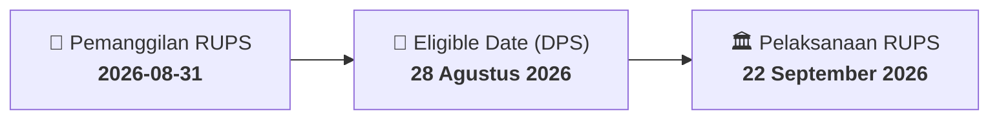

# ⚡ Laporan Intelijen Aksi Korporasi: [[SILO]] - RUPS

⬅️ [[knowledge-base/daily-digests/Daily_Digest_20260831|Kembali ke Daily Digest]] | 📅 **2026-08-31** | 🎛️ [[Dashboard|Ke Dashboard Utama]]

> [!IMPORTANT]
> Laporan ini disusun secara otomatis oleh **Corporate Action Intelligence Agent** untuk memetakan implikasi strategis, rasio keuangan, alokasi dana, jadwal penting, dan panduan investor.

---

## 📌 1. Ringkasan Eksekutif & Katalis Strategis
- **Kode & Nama Emiten**: `[[SILO]]`
- **Kategori Aksi Korporasi**: `RUPS`
- **Dokumen Resmi Bursa**: `Pemanggilan RUPS`
- **Ringkasan Inti Aksi**: PT Siloam International Hospitals Tbk. menyampaikan pemanggilan Rapat Umum Pemegang Saham Luar Biasa yang akan diselenggarakan pada 22 September 2026 pukul 09:00 di MRIN Hall, Lippo Karawaci, Tangerang, dengan agenda perubahan anggaran dasar dan persetujuan transaksi material.

---

## 📊 2. Matriks Parameter Material & Angka Kunci
| Parameter Utama | Nilai / Keterangan Resmi |
| :--- | :--- |
| **Nomor Surat Pemanggilan** | `118/CorSec-SIH/VIII/2026` |
| **Referensi Surat Pemberitahuan** | `111/Corsec-SIH/VIII/2026 tanggal 14 Agustus 2026` |
| **Hari/Tanggal RUPS Luar Biasa** | `22 September 2026` |
| **Waktu RUPS Luar Biasa** | `09:00` |
| **Lokasi RUPS Luar Biasa** | `Mochtar Riady Institute for Nanotechnology (MRIN) Hall, Jalan Jend. Sudirman No. 15, Lippo Karawaci, Tangerang 15811` |
| **Recording Date** | `28 Agustus 2026` |
| **Agenda 1** | `Persetujuan Perubahan Anggaran Dasar` |
| **Agenda 2** | `Persetujuan atas rencana Perseroan untuk mengambil alih saham dalam perusahaan-perusahaan yang memiliki portofolio aset rumah sakit dan penunjangnya, baik melalui pembelian saham maupun hak opsi atas saham, yang merupakan transaksi material berdasarkan POJK Nomor 17/POJK.04/2020` |
| **Agenda 3** | `Persetujuan Rencana Transaksi Material Di Atas 50% (Transaksi Material)` |
| **Nama Pengirim** | `Lewi Aga Basoeki` |

---

## 📌 3. Detail Pelaksanaan RUPS / RUPSLB
- **Hari, Tanggal Pelaksanaan**: `22 September 2026`
- **Waktu Pelaksanaan**: `09:00`
- **Lokasi / Tempat Pelaksanaan**: `Mochtar Riady Institute for Nanotechnology (MRIN) Hall, Jalan Jend. Sudirman No. 15, Lippo Karawaci, Tangerang 15811`
- **Batas Hak Suara (Eligible Date / Recording Date)**: `28 Agustus 2026`

## 📝 4. Matriks Agenda & Mata Acara Rapat
| No | Agenda / Mata Acara | Penjelasan & Sub-Acara |
| :-: | :--- | :--- |
| 1 | **Agenda 1** | Persetujuan Perubahan Anggaran Dasar |
| 2 | **Agenda 2** | Persetujuan atas rencana Perseroan untuk mengambil alih saham dalam perusahaan-perusahaan yang memiliki portofolio aset rumah sakit dan penunjangnya, baik melalui pembelian saham maupun hak opsi atas saham, yang merupakan transaksi material berdasarkan POJK Nomor 17/POJK.04/2020 |
| 3 | **Agenda 3** | Persetujuan Rencana Transaksi Material Di Atas 50% (Transaksi Material) |

## 🗓️ 5. Timeline Investor & Ketentuan Kehadiran

## 💡 6. Panduan Investor & E-Voting
- 👥 **Hak Suara**: Pemegang saham yang berhak hadir/memberikan suara adalah yang terdaftar dalam DPS pada **Eligible Date (28 Agustus 2026)**.
- 🗳️ **E-Voting eASY.KSEI**: Pemegang saham dapat memberikan kuasa/suara secara elektronik melalui sistem eASY.KSEI.

---

## 🔗 Hubungan Note Terkait (Knowledge Graph)
- [[knowledge-base/daily-digests/Daily_Digest_20260831|📄 Daily Digest 2026-08-31]]
- [[knowledge-base/trading-signals/Trading_Signals_20260831|🎯 Sinyal Cuan 2026-08-31]]
- [[Dashboard|🎛️ Kembali ke Dashboard]]