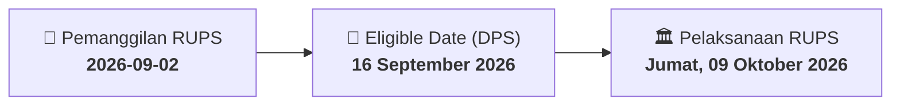

# ⚡ Laporan Intelijen Aksi Korporasi: [[SLIS]] - RUPS

⬅️ [[knowledge-base/daily-digests/Daily_Digest_20260902|Kembali ke Daily Digest]] | 📅 **2026-09-02** | 🎛️ [[Dashboard|Ke Dashboard Utama]]

> [!IMPORTANT]
> Laporan ini disusun secara otomatis oleh **Corporate Action Intelligence Agent** untuk memetakan implikasi strategis, rasio keuangan, alokasi dana, jadwal penting, dan panduan investor.

---

## 📌 1. Ringkasan Eksekutif & Katalis Strategis
- **Kode & Nama Emiten**: `[[SLIS]]`
- **Kategori Aksi Korporasi**: `RUPS`
- **Dokumen Resmi Bursa**: `Pengumuman RUPS`
- **Ringkasan Inti Aksi**: PT Gaya Abadi Sempurna Tbk (SLIS) mengumumkan rencana penyelenggaraan Rapat Umum Pemegang Saham Luar Biasa (RUPSLB) yang akan diadakan pada Jumat, 09 Oktober 2026, pukul 14:00 WIB, bertempat di Hotel Santika Kelapa Gading, Jl. Raya Kelapa Gading Nias, Mahaka Square Blok 16. Tanggal Daftar Pemegang Saham (DPS) yang berhak hadir adalah 16 September 2026. Pengumuman ini merujuk pada surat No. 057/SLIS/VIII/2026.

---

## 📊 2. Matriks Parameter Material & Angka Kunci
| Parameter Utama | Nilai / Keterangan Resmi |
| :--- | :--- |
| **Nomor Surat** | `059/SLIS/IX/2026` |
| **Tanggal Pengumuman** | `02-09-2026` |
| **Jenis Rapat** | `Rapat Umum Pemegang Saham Luar Biasa (RUPSLB)` |
| **Hari/Tanggal RUPS** | `Jumat, 09 Oktober 2026` |
| **Waktu RUPS** | `14:00` |
| **Lokasi RUPS** | `Hotel Santika Kelapa Gading, Jl. Raya Kelapa Gading Nias, Mahaka Square Blok 16` |
| **Tanggal Daftar Pemegang Saham (DPS)** | `16 September 2026` |
| **Pengirim** | `Wilson, Direktur Operasional` |
| **Referensi Surat** | `057/SLIS/VIII/2026` |

---

## 📌 3. Detail Pelaksanaan RUPS / RUPSLB
- **Hari, Tanggal Pelaksanaan**: `Jumat, 09 Oktober 2026`
- **Waktu Pelaksanaan**: `14:00`
- **Lokasi / Tempat Pelaksanaan**: `Hotel Santika Kelapa Gading, Jl. Raya Kelapa Gading Nias, Mahaka Square Blok 16`
- **Batas Hak Suara (Eligible Date / Recording Date)**: `16 September 2026`

## 📝 4. Matriks Agenda & Mata Acara Rapat
| No | Agenda / Mata Acara | Penjelasan & Sub-Acara |
| :-: | :--- | :--- |
| 1 | **Agenda Utama RUPS** | PT Gaya Abadi Sempurna Tbk (SLIS) mengumumkan rencana penyelenggaraan Rapat Umum Pemegang Saham Luar Biasa (RUPSLB) yang akan diadakan pada Jumat, 09 Oktober 2026, pukul 14:00 WIB, bertempat di Hotel Santika Kelapa Gading, Jl. Raya Kelapa Gading Nias, Mahaka Square Blok 16. Tanggal Daftar Pemegang Saham (DPS) yang berhak hadir adalah 16 September 2026. Pengumuman ini merujuk pada surat No. 057/SLIS/VIII/2026. |

## 🗓️ 5. Timeline Investor & Ketentuan Kehadiran

## 💡 6. Panduan Investor & E-Voting
- 👥 **Hak Suara**: Pemegang saham yang berhak hadir/memberikan suara adalah yang terdaftar dalam DPS pada **Eligible Date (16 September 2026)**.
- 🗳️ **E-Voting eASY.KSEI**: Pemegang saham dapat memberikan kuasa/suara secara elektronik melalui sistem eASY.KSEI.

---

## 🔗 Hubungan Note Terkait (Knowledge Graph)
- [[knowledge-base/daily-digests/Daily_Digest_20260902|📄 Daily Digest 2026-09-02]]
- [[knowledge-base/trading-signals/Trading_Signals_20260902|🎯 Sinyal Cuan 2026-09-02]]
- [[Dashboard|🎛️ Kembali ke Dashboard]]