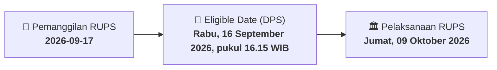

# ⚡ Laporan Intelijen Aksi Korporasi: [[SLIS]] - RUPS

⬅️ [[knowledge-base/daily-digests/Daily_Digest_20260917|Kembali ke Daily Digest]] | 📅 **2026-09-17** | 🎛️ [[Dashboard|Ke Dashboard Utama]]

> [!IMPORTANT]
> Laporan ini disusun secara otomatis oleh **Corporate Action Intelligence Agent** untuk memetakan implikasi strategis, rasio keuangan, alokasi dana, jadwal penting, dan panduan investor.

---

## 📌 1. Ringkasan Eksekutif & Katalis Strategis
- **Kode & Nama Emiten**: `[[SLIS]]`
- **Kategori Aksi Korporasi**: `RUPS`
- **Dokumen Resmi Bursa**: `Pemanggilan RUPS lamp1`
- **Ringkasan Inti Aksi**: Direksi PT Gaya Abadi Sempurna Tbk mengundang pemegang saham untuk menghadiri Rapat Umum Pemegang Saham Luar Biasa (RUPSLB) yang akan diselenggarakan secara elektronik pada Jumat, 09 Oktober 2026, pukul 14.00 WIB di Hotel Santika Kelapa Gading. Agenda tunggal rapat adalah persetujuan perubahan Pasal 3 Anggaran Dasar Perseroan untuk penyesuaian dengan Klasifikasi Baku Lapangan Usaha Indonesia (KBLI) 2025, sebagai pemenuhan layanan perizinan melalui Online Single Submission (OSS) sesuai Peraturan Pemerintah Nomor 28 Tahun 2025. Pemegang saham yang berhak hadir adalah mereka yang tercatat dalam DPS pada 16 September 2026.

---

## 📊 2. Matriks Parameter Material & Angka Kunci
| Parameter Utama | Nilai / Keterangan Resmi |
| :--- | :--- |
| **Jenis Rapat** | `Rapat Umum Pemegang Saham Luar Biasa (RUPSLB)` |
| **Hari dan Tanggal Rapat** | `Jumat, 09 Oktober 2026` |
| **Waktu Rapat** | `14.00 WIB - selesai` |
| **Tempat Rapat** | `Hotel Santika Kelapa Gading, Mahaka Square Blok HF3` |
| **Mekanisme Rapat** | `Rapat secara elektronik` |
| **Agenda Rapat** | `Persetujuan atas Perubahan Pasal 3 Anggaran Dasar Perseroan sehubungan penyesuaian dengan Klasifikasi Baku Lapangan Usaha Indonesia (KBLI) 2025` |
| **Dasar Hukum Penyesuaian** | `Peraturan Pemerintah Republik Indonesia Nomor 28 Tahun 2025 tentang Penyelenggaraan Perizinan Berusaha Berbasis Risiko` |
| **Tanggal Pencatatan Pemegang Saham (Recording Date)** | `Rabu, 16 September 2026, pukul 16.15 WIB` |
| **Batas Akhir Pemberian Kuasa Elektronik (e-Proxy)** | `Kamis, 08 Oktober 2026, pukul 12.00 WIB` |
| **Peraturan OJK Terkait** | `Peraturan OJK No. 16/POJK.04/2020 tentang Pelaksanaan Rapat Umum Pemegang Saham Perusahaan Terbuka Secara Elektronik` |

---

## 📌 3. Detail Pelaksanaan RUPS / RUPSLB
- **Hari, Tanggal Pelaksanaan**: `Jumat, 09 Oktober 2026`
- **Waktu Pelaksanaan**: `14.00 WIB - selesai`
- **Lokasi / Tempat Pelaksanaan**: `Hotel Santika Kelapa Gading, Mahaka Square Blok HF3`
- **Batas Hak Suara (Eligible Date / Recording Date)**: `Rabu, 16 September 2026, pukul 16.15 WIB`

## 📝 4. Matriks Agenda & Mata Acara Rapat
| No | Agenda / Mata Acara | Penjelasan & Sub-Acara |
| :-: | :--- | :--- |
| 1 | **Agenda Rapat** | Persetujuan atas Perubahan Pasal 3 Anggaran Dasar Perseroan sehubungan penyesuaian dengan Klasifikasi Baku Lapangan Usaha Indonesia (KBLI) 2025 |

## 🗓️ 5. Timeline Investor & Ketentuan Kehadiran

## 💡 6. Panduan Investor & E-Voting
- 👥 **Hak Suara**: Pemegang saham yang berhak hadir/memberikan suara adalah yang terdaftar dalam DPS pada **Eligible Date (Rabu, 16 September 2026, pukul 16.15 WIB)**.
- 🗳️ **E-Voting eASY.KSEI**: Pemegang saham dapat memberikan kuasa/suara secara elektronik melalui sistem eASY.KSEI.

---

## 🔗 Hubungan Note Terkait (Knowledge Graph)
- [[knowledge-base/daily-digests/Daily_Digest_20260917|📄 Daily Digest 2026-09-17]]
- [[knowledge-base/trading-signals/Trading_Signals_20260917|🎯 Sinyal Cuan 2026-09-17]]
- [[Dashboard|🎛️ Kembali ke Dashboard]]