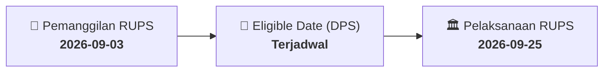

# ⚡ Laporan Intelijen Aksi Korporasi: [[SMCB]] - RUPS

⬅️ [[knowledge-base/daily-digests/Daily_Digest_20260903|Kembali ke Daily Digest]] | 📅 **2026-09-03** | 🎛️ [[Dashboard|Ke Dashboard Utama]]

> [!IMPORTANT]
> Laporan ini disusun secara otomatis oleh **Corporate Action Intelligence Agent** untuk memetakan implikasi strategis, rasio keuangan, alokasi dana, jadwal penting, dan panduan investor.

---

## 📌 1. Ringkasan Eksekutif & Katalis Strategis
- **Kode & Nama Emiten**: `[[SMCB]]`
- **Kategori Aksi Korporasi**: `RUPS`
- **Dokumen Resmi Bursa**: `Pemanggilan RUPS lamp5`
- **Ringkasan Inti Aksi**: PT Solusi Bangun Indonesia Tbk akan menyelenggarakan Rapat Umum Pemegang Saham Luar Biasa di Jakarta pada 25 September 2026 dengan tiga mata acara utama: penyesuaian Pasal 3 Anggaran Dasar terhadap KBLI 2025, pendelegasian kewenangan persetujuan RJPP 2026-2030 dan RKAP 2026 kepada Dewan Komisaris, serta perubahan pengurus perseroan.

---

## 📊 2. Matriks Parameter Material & Angka Kunci
| Parameter Utama | Nilai / Keterangan Resmi |
| :--- | :--- |
| **Jenis Rapat** | `Rapat Umum Pemegang Saham Luar Biasa` |
| **Tanggal RUPS** | `2026-09-25` |
| **Lokasi RUPS** | `Jakarta` |
| **Mata Acara 1** | `Persetujuan penyusunan kembali Pasal 3 Anggaran Dasar tentang Maksud dan Tujuan serta Kegiatan Usaha untuk penyesuaian KBLI 2025` |
| **Mata Acara 2** | `Persetujuan pendelegasian kewenangan persetujuan perubahan/penyesuaian RJPP 2026-2030 dan RKAP 2026 kepada Dewan Komisaris Perseroan` |
| **Mata Acara 3** | `Persetujuan Perubahan Pengurus Perseroan` |
| **Dasar Hukum Mata Acara 1** | `PP Nomor 28 Tahun 2025 tentang Penyelenggaraan Perizinan Berusaha Berbasis Risiko dan Peraturan Kepala BPS Nomor 7 Tahun 2025 tentang KBLI 2025` |

---

## 📌 3. Detail Pelaksanaan RUPS / RUPSLB
- **Hari, Tanggal Pelaksanaan**: `2026-09-25`
- **Waktu Pelaksanaan**: `09.00 WIB s.d. selesai`
- **Lokasi / Tempat Pelaksanaan**: `Jakarta`
- **Batas Hak Suara (Eligible Date / Recording Date)**: `Terjadwal`

## 📝 4. Matriks Agenda & Mata Acara Rapat
| No | Agenda / Mata Acara | Penjelasan & Sub-Acara |
| :-: | :--- | :--- |
| 1 | **Mata Acara 1** | Persetujuan penyusunan kembali Pasal 3 Anggaran Dasar tentang Maksud dan Tujuan serta Kegiatan Usaha untuk penyesuaian KBLI 2025 |
| 2 | **Mata Acara 2** | Persetujuan pendelegasian kewenangan persetujuan perubahan/penyesuaian RJPP 2026-2030 dan RKAP 2026 kepada Dewan Komisaris Perseroan |
| 3 | **Mata Acara 3** | Persetujuan Perubahan Pengurus Perseroan |
| 4 | **Dasar Hukum Mata Acara 1** | PP Nomor 28 Tahun 2025 tentang Penyelenggaraan Perizinan Berusaha Berbasis Risiko dan Peraturan Kepala BPS Nomor 7 Tahun 2025 tentang KBLI 2025 |

## 🗓️ 5. Timeline Investor & Ketentuan Kehadiran

## 💡 6. Panduan Investor & E-Voting
- 👥 **Hak Suara**: Pemegang saham yang berhak hadir/memberikan suara adalah yang terdaftar dalam DPS pada **Eligible Date (Terjadwal)**.
- 🗳️ **E-Voting eASY.KSEI**: Pemegang saham dapat memberikan kuasa/suara secara elektronik melalui sistem eASY.KSEI.

---

## 🔗 Hubungan Note Terkait (Knowledge Graph)
- [[knowledge-base/daily-digests/Daily_Digest_20260903|📄 Daily Digest 2026-09-03]]
- [[knowledge-base/trading-signals/Trading_Signals_20260903|🎯 Sinyal Cuan 2026-09-03]]
- [[Dashboard|🎛️ Kembali ke Dashboard]]