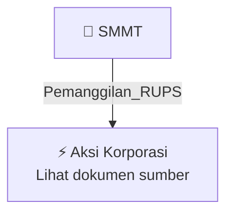

# 📢 Pemanggilan RUPS / RUPSLB — [[SMMT]]

⬅️ [[knowledge-base/daily-digests/Daily_Digest_20260929|Kembali ke Daily Digest]] | 📅 **2026-09-29** | 🎛️ [[Dashboard|Ke Dashboard Utama]]

> [!IMPORTANT]
> Laporan ini disusun secara otomatis oleh **Corporate Action Intelligence Agent** pada **2026-09-29**.
> Sumber dokumen: `20260928_SMMT_20260928_SMMT_Pemanggilan RUPS_32161412_lamp1.pdf`

---

## 📌 1. Ringkasan Eksekutif & Tujuan Strategis

- **Kode & Nama Emiten**: `[[SMMT]]`
- **Kategori Aksi Korporasi**: `Pemanggilan_RUPS`
- **Dokumen Sumber**: `20260928_SMMT_20260928_SMMT_Pemanggilan RUPS_32161412_lamp1.pdf`
- **Tanggal Laporan**: `2026-09-29`

[Analisis LLM tidak tersedia — isi manual]

---

## 📊 2. Fakta Material & Parameter Keuangan

| Parameter Utama | Nilai / Keterangan |
| :--- | :--- |
| **Uraian Kejadian** | `PT GOLDEN EAGLE ENERGY Tbk PEMANGGILAN RAPAT UMUM PEMEGANG SAHAM LUAR BIASA Direksi PT Golden Eagle Energy Tbk (“Perseroan”) dengan ini mengundang para pemegang saham Perseroan untuk menghadiri Rapat Umum Pemegang Saham Luar Biasa (“RUPSLB”) Perseroan, yang akan diselenggarakan pada: Hari, Tanggal : Selasa, 20 Oktober 2026 Pukul : 14.00 WIB – selesai Tempat Rapat Fisik Link mengikuti Rapat : : ADR Tower lantai 21 Jakarta Online melalui Electronic General Meeting System dari PT Kustodian Sentral` |

---

## 👥 3. Struktur Kepemilikan, Pengendali & Pembeli Siaga

- **Emiten**: `SMMT` | Informasi kepemilikan mengacu pada dokumen resmi sumber.

---

## 🎯 4. Alokasi & Rencana Penggunaan Dana

- Informasi alokasi dana belum tersedia — lihat prospektus / dokumen resmi.

---

## 📅 5. Timeline & Jadwal Pelaksanaan

| Tahapan / Event | Tanggal |
| :--- | :---: |
| **Jadwal** | Lihat dokumen sumber. |

---

## 📈 6. Diagram Visual Flowchart (Mermaid)

---

## 💡 7. Rekomendasi Investor & Strategi Trading

[Analisis LLM tidak tersedia — isi manual]

---

## 🔗 8. Hubungan Note Terkait (Knowledge Graph)

- [[knowledge-base/daily-digests/Daily_Digest_20260929|📄 Daily Digest 2026-09-29]]
- [[knowledge-base/trading-signals/Trading_Signals_20260929|🎯 Sinyal Cuan 2026-09-29]]
- [[SMMT|🏬 Halaman Emiten SMMT]]
- [[Dashboard|🎛️ Kembali ke Dashboard Utama]]

---

*Laporan dibuat otomatis oleh Corporate Action Intelligence Agent · 2026-09-29*