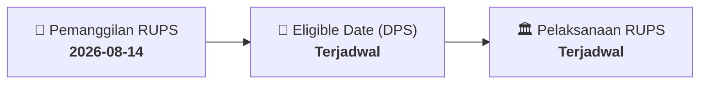

# ⚡ Laporan Intelijen Aksi Korporasi: [[SQMI]] - RUPS

⬅️ [[knowledge-base/daily-digests/Daily_Digest_20260814|Kembali ke Daily Digest]] | 📅 **2026-08-14** | 🎛️ [[Dashboard|Ke Dashboard Utama]]

> [!IMPORTANT]
> Laporan ini disusun secara otomatis oleh **Corporate Action Intelligence Agent** untuk memetakan implikasi strategis, rasio keuangan, alokasi dana, jadwal penting, dan panduan investor.

---

## 📌 1. Ringkasan Eksekutif & Katalis Strategis
- **Kode & Nama Emiten**: `[[SQMI]]`
- **Kategori Aksi Korporasi**: `RUPS`
- **Dokumen Resmi Bursa**: `Pemanggilan RUPS lamp2`
- **Ringkasan Inti Aksi**: Informasi dan fakta material SQMI: CURRICULUM VITAE YULIAN HADROMI, SH, LL.M, MM Curriculum Vitae PROFESSIONAL HIGHLIGHTS • Pengalaman Perbankan Multinasional yang Luas Eksekutif senior dengan pengalaman lebih dari 20 tahun di bidang kepatuhan perbankan, hukum, dan tata kelola di berbagai lembaga keuangan multinasional terkemuka—Bank Danamon, Maybank Indonesia, Citibank, Bank of America, Standard Chartered Bank, dan ABN AMRO Bank. Memiliki rekam jejak yang kuat dalam memimpin penyelarasan regulasi,memperkuat kerangka kepatuhan, d

---

## 📊 2. Matriks Parameter Material & Angka Kunci
| Parameter Utama | Nilai / Keterangan Resmi |
| :--- | :--- |
| **Uraian Kejadian** | `CURRICULUM VITAE YULIAN HADROMI, SH, LL.M, MM Curriculum Vitae PROFESSIONAL HIGHLIGHTS • Pengalaman Perbankan Multinasional yang Luas Eksekutif senior dengan pengalaman lebih dari 20 tahun di bidang kepatuhan perbankan, hukum, dan tata kelola di berbagai lembaga keuangan multinasional terkemuka—Bank Danamon, Maybank Indonesia, Citibank, Bank of America, Standard Chartered Bank, dan ABN AMRO Bank. Memiliki rekam jejak yang kuat dalam memimpin penyelarasan regulasi,memperkuat kerangka kepatuhan, d` |

---

## 📌 3. Detail Pelaksanaan RUPS / RUPSLB
- **Hari, Tanggal Pelaksanaan**: `Terjadwal`
- **Waktu Pelaksanaan**: `09.00 WIB s.d. selesai`
- **Lokasi / Tempat Pelaksanaan**: `Aplikasi eASY.KSEI / Kantor Perseroan`
- **Batas Hak Suara (Eligible Date / Recording Date)**: `Terjadwal`

## 📝 4. Matriks Agenda & Mata Acara Rapat
| No | Agenda / Mata Acara | Penjelasan & Sub-Acara |
| :-: | :--- | :--- |
| 1 | **Agenda Utama RUPS** | Informasi dan fakta material SQMI: CURRICULUM VITAE YULIAN HADROMI, SH, LL.M, MM Curriculum Vitae PROFESSIONAL HIGHLIGHTS • Pengalaman Perbankan Multinasional yang Luas Eksekutif senior dengan pengalaman lebih dari 20 tahun di bidang kepatuhan perbankan, hukum, dan tata kelola di berbagai lembaga keuangan multinasional terkemuka—Bank Danamon, Maybank Indonesia, Citibank, Bank of America, Standard Chartered Bank, dan ABN AMRO Bank. Memiliki rekam jejak yang kuat dalam memimpin penyelarasan regulasi,memperkuat kerangka kepatuhan, d |

## 🗓️ 5. Timeline Investor & Ketentuan Kehadiran

## 💡 6. Panduan Investor & E-Voting
- 👥 **Hak Suara**: Pemegang saham yang berhak hadir/memberikan suara adalah yang terdaftar dalam DPS pada **Eligible Date (Terjadwal)**.
- 🗳️ **E-Voting eASY.KSEI**: Pemegang saham dapat memberikan kuasa/suara secara elektronik melalui sistem eASY.KSEI.

---

## 🔗 Hubungan Note Terkait (Knowledge Graph)
- [[knowledge-base/daily-digests/Daily_Digest_20260814|📄 Daily Digest 2026-08-14]]
- [[knowledge-base/trading-signals/Trading_Signals_20260814|🎯 Sinyal Cuan 2026-08-14]]
- [[Dashboard|🎛️ Kembali ke Dashboard]]