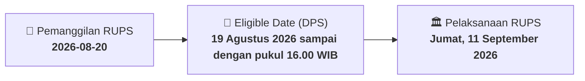

# ⚡ Laporan Intelijen Aksi Korporasi: [[SWAT]] - RUPS

⬅️ [[knowledge-base/daily-digests/Daily_Digest_20260820|Kembali ke Daily Digest]] | 📅 **2026-08-20** | 🎛️ [[Dashboard|Ke Dashboard Utama]]

> [!IMPORTANT]
> Laporan ini disusun secara otomatis oleh **Corporate Action Intelligence Agent** untuk memetakan implikasi strategis, rasio keuangan, alokasi dana, jadwal penting, dan panduan investor.

---

## 📌 1. Ringkasan Eksekutif & Katalis Strategis
- **Kode & Nama Emiten**: `[[SWAT]]`
- **Kategori Aksi Korporasi**: `RUPS`
- **Dokumen Resmi Bursa**: `Pemanggilan RUPS lamp1`
- **Ringkasan Inti Aksi**: PT Sriwahana Adityakarta Tbk mengumumkan pemanggilan Rapat Umum Pemegang Saham Tahunan yang akan diselenggarakan pada Jumat, 11 September 2026 pukul 10.00-11.30 WIB di Hotel Aston Solo, dengan agenda persetujuan laporan tahunan dan pengesahan laporan keuangan tahun buku 2025 serta pemberian acquit et de charge kepada Direksi dan Dewan Komisaris.

---

## 📊 2. Matriks Parameter Material & Angka Kunci
| Parameter Utama | Nilai / Keterangan Resmi |
| :--- | :--- |
| **Nama Perseroan** | `PT Sriwahana Adityakarta Tbk` |
| **Jenis Rapat** | `Rapat Umum Pemegang Saham Tahunan (RUPST)` |
| **Hari, Tanggal Rapat** | `Jumat, 11 September 2026` |
| **Waktu Rapat** | `10.00 WIB - 11.30 WIB` |
| **Tempat Rapat** | `Hotel Aston Solo` |
| **Recording Date** | `19 Agustus 2026 sampai dengan pukul 16.00 WIB` |
| **Agenda** | `Persetujuan Laporan Tahunan dan pengesahan Laporan Keuangan tahun buku yang berakhir 31 Desember 2025 serta pemberian acquit et de charge kepada Direksi dan Dewan Komisaris` |
| **Tahun Buku** | `31 Desember 2025` |
| **Sistem Rapat** | `Electronic General Meeting System Sentral Efek Indonesia` |
| **Batas Penyampaian Kehadiran/Kuasa** | `Pukul 12.00 WIB pada 1 hari kerja sebelum tanggal Rapat` |
| **Ketersediaan Bahan Rapat** | `Tersedia di situs web Perseroan sejak tanggal pemanggilan sampai tanggal Rapat; tidak tersedia dalam bentuk hardcopy` |

---

## 📌 3. Detail Pelaksanaan RUPS / RUPSLB
- **Hari, Tanggal Pelaksanaan**: `Jumat, 11 September 2026`
- **Waktu Pelaksanaan**: `10.00 WIB - 11.30 WIB`
- **Lokasi / Tempat Pelaksanaan**: `Hotel Aston Solo`
- **Batas Hak Suara (Eligible Date / Recording Date)**: `19 Agustus 2026 sampai dengan pukul 16.00 WIB`

## 📝 4. Matriks Agenda & Mata Acara Rapat
| No | Agenda / Mata Acara | Penjelasan & Sub-Acara |
| :-: | :--- | :--- |
| 1 | **Agenda** | Persetujuan Laporan Tahunan dan pengesahan Laporan Keuangan tahun buku yang berakhir 31 Desember 2025 serta pemberian acquit et de charge kepada Direksi dan Dewan Komisaris |

## 🗓️ 5. Timeline Investor & Ketentuan Kehadiran

## 💡 6. Panduan Investor & E-Voting
- 👥 **Hak Suara**: Pemegang saham yang berhak hadir/memberikan suara adalah yang terdaftar dalam DPS pada **Eligible Date (19 Agustus 2026 sampai dengan pukul 16.00 WIB)**.
- 🗳️ **E-Voting eASY.KSEI**: Pemegang saham dapat memberikan kuasa/suara secara elektronik melalui sistem eASY.KSEI.

---

## 🔗 Hubungan Note Terkait (Knowledge Graph)
- [[knowledge-base/daily-digests/Daily_Digest_20260820|📄 Daily Digest 2026-08-20]]
- [[knowledge-base/trading-signals/Trading_Signals_20260820|🎯 Sinyal Cuan 2026-08-20]]
- [[Dashboard|🎛️ Kembali ke Dashboard]]