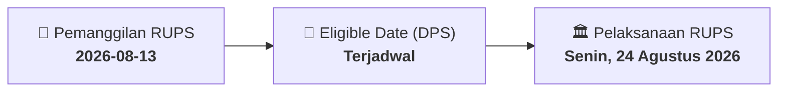

# ⚡ Laporan Intelijen Aksi Korporasi: [[TBIG]] - RUPS

⬅️ [[knowledge-base/daily-digests/Daily_Digest_20260813|Kembali ke Daily Digest]] | 📅 **2026-08-13** | 🎛️ [[Dashboard|Ke Dashboard Utama]]

> [!IMPORTANT]
> Laporan ini disusun secara otomatis oleh **Corporate Action Intelligence Agent** untuk memetakan implikasi strategis, rasio keuangan, alokasi dana, jadwal penting, dan panduan investor.

---

## 📌 1. Ringkasan Eksekutif & Katalis Strategis
- **Kode & Nama Emiten**: `[[TBIG]]`
- **Kategori Aksi Korporasi**: `RUPS`
- **Dokumen Resmi Bursa**: `Pemanggilan RUPS lamp1`
- **Ringkasan Inti Aksi**: PT Tower Bersama Infrastructure Tbk mengundang pemegang saham untuk menghadiri Rapat Umum Pemegang Saham Luar Biasa (RUPSLB) yang akan diselenggarakan secara elektronik (e-GMS) pada Senin, 24 Agustus 2026, pukul 10.00 WIB. Agenda rapat meliputi persetujuan perubahan kegiatan usaha PT Tower Bersama (entitas anak) dengan menambah kegiatan usaha Network Access Point (KBLI:61107) sesuai POJK No. 17/POJK.04/2020, serta persetujuan perubahan Pasal 3 Anggaran Dasar Perseroan untuk penyesuaian dengan KBLI 2025 berdasarkan Peraturan Badan Pusat Statistik Nomor 7 Tahun 2025. Pemegang saham yang berhak hadir adalah yang tercatat dalam Daftar Pemegang Saham pada 30 Juli 2026.

---

## 📊 2. Matriks Parameter Material & Angka Kunci
| Parameter Utama | Nilai / Keterangan Resmi |
| :--- | :--- |
| **Hari dan Tanggal RUPS** | `Senin, 24 Agustus 2026` |
| **Waktu RUPS** | `10.00 Waktu Indonesia Barat` |
| **Tempat RUPS** | `The Convergence Indonesia (TCI) Building, 18th Floor, Kawasan Rasuna Epicentrum, Jl. H.R. Rasuna Said, South Jakarta – 12940` |
| **Agenda 1** | `Persetujuan rencana perubahan kegiatan usaha (termasuk pembahasan studi kelayakan usaha terkait) yang akan dilakukan oleh PT Tower Bersama, perusahaan yang dikendalikan Perseroan, dengan menambah kegiatan usaha Network Access Point, untuk memenuhi ketentuan Pasal 32 juncto Pasal 22 ayat (1) huruf a POJK No. 17/POJK.04/2020 tentang Transaksi Material dan Perubahan Kegiatan Usaha` |
| **Agenda 2** | `Persetujuan Perubahan Pasal 3 Anggaran Dasar Perseroan dalam rangka sinkronisasi dan penyesuaian dengan ketentuan Klasifikasi Baku Lapangan Usaha Indonesia (KBLI) 2025` |
| **Tanggal Daftar Pemegang Saham yang Berhak Hadir** | `30 Juli 2026` |
| **Batas Akhir Pemberian Kuasa** | `Jumat, 21 Agustus 2026` |
| **Dasar Hukum Penyelenggaraan** | `POJK No. 15/POJK.04/2020 dan POJK No. 14/2025` |
| **Tanggal Pengumuman Informasi Perubahan Kegiatan Usaha** | `16 Juli 2026` |

---

## 📌 3. Detail Pelaksanaan RUPS / RUPSLB
- **Hari, Tanggal Pelaksanaan**: `Senin, 24 Agustus 2026`
- **Waktu Pelaksanaan**: `10.00 Waktu Indonesia Barat`
- **Lokasi / Tempat Pelaksanaan**: `The Convergence Indonesia (TCI) Building, 18th Floor, Kawasan Rasuna Epicentrum, Jl. H.R. Rasuna Said, South Jakarta – 12940`
- **Batas Hak Suara (Eligible Date / Recording Date)**: `Terjadwal`

## 📝 4. Matriks Agenda & Mata Acara Rapat
| No | Agenda / Mata Acara | Penjelasan & Sub-Acara |
| :-: | :--- | :--- |
| 1 | **Agenda 1** | Persetujuan rencana perubahan kegiatan usaha (termasuk pembahasan studi kelayakan usaha terkait) yang akan dilakukan oleh PT Tower Bersama, perusahaan yang dikendalikan Perseroan, dengan menambah kegiatan usaha Network Access Point, untuk memenuhi ketentuan Pasal 32 juncto Pasal 22 ayat (1) huruf a POJK No. 17/POJK.04/2020 tentang Transaksi Material dan Perubahan Kegiatan Usaha |
| 2 | **Agenda 2** | Persetujuan Perubahan Pasal 3 Anggaran Dasar Perseroan dalam rangka sinkronisasi dan penyesuaian dengan ketentuan Klasifikasi Baku Lapangan Usaha Indonesia (KBLI) 2025 |

## 🗓️ 5. Timeline Investor & Ketentuan Kehadiran

## 💡 6. Panduan Investor & E-Voting
- 👥 **Hak Suara**: Pemegang saham yang berhak hadir/memberikan suara adalah yang terdaftar dalam DPS pada **Eligible Date (Terjadwal)**.
- 🗳️ **E-Voting eASY.KSEI**: Pemegang saham dapat memberikan kuasa/suara secara elektronik melalui sistem eASY.KSEI.

---

## 🔗 Hubungan Note Terkait (Knowledge Graph)
- [[knowledge-base/daily-digests/Daily_Digest_20260813|📄 Daily Digest 2026-08-13]]
- [[knowledge-base/trading-signals/Trading_Signals_20260813|🎯 Sinyal Cuan 2026-08-13]]
- [[Dashboard|🎛️ Kembali ke Dashboard]]