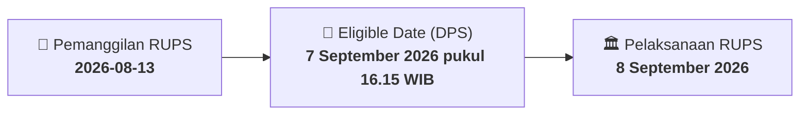

# ⚡ Laporan Intelijen Aksi Korporasi: [[TLKM]] - RUPS

⬅️ [[knowledge-base/daily-digests/Daily_Digest_20260813|Kembali ke Daily Digest]] | 📅 **2026-08-13** | 🎛️ [[Dashboard|Ke Dashboard Utama]]

> [!IMPORTANT]
> Laporan ini disusun secara otomatis oleh **Corporate Action Intelligence Agent** untuk memetakan implikasi strategis, rasio keuangan, alokasi dana, jadwal penting, dan panduan investor.

---

## 📌 1. Ringkasan Eksekutif & Katalis Strategis
- **Kode & Nama Emiten**: `[[TLKM]]`
- **Kategori Aksi Korporasi**: `RUPS`
- **Dokumen Resmi Bursa**: `Pengumuman RUPS lamp2`
- **Ringkasan Inti Aksi**: PT Telkom Indonesia (Persero) Tbk mengumumkan akan menyelenggarakan Rapat Umum Pemegang Saham Luar Biasa (RUPSLB) Tahun 2026 pada Rabu, 30 September 2026 pukul 14.00 WIB. Pemegang saham yang berhak hadir adalah yang tercatat dalam Daftar Pemegang Saham pada 7 September 2026 pukul 16.15 WIB. Pemanggilan RUPSLB akan diumumkan pada 8 September 2026 melalui situs web penyedia e-RUPS, dan usulan mata acara harus disampaikan kepada Direksi selambat-lambatnya 1 September 2026.

---

## 📊 2. Matriks Parameter Material & Angka Kunci
| Parameter Utama | Nilai / Keterangan Resmi |
| :--- | :--- |
| **Nomor Pengumuman** | `Tel.66/PR 000/COP-M0000000/2026` |
| **Jenis Rapat** | `Rapat Umum Pemegang Saham Luar Biasa (RUPSLB) Tahun 2026` |
| **Hari dan Tanggal RUPSLB** | `Rabu, 30 September 2026` |
| **Waktu Pelaksanaan** | `14.00 WIB - Selesai` |
| **Tanggal Pengumuman** | `7 Agustus 2026` |
| **Tanggal Pemanggilan RUPSLB** | `8 September 2026` |
| **Recording Date / Daftar Pemegang Saham** | `7 September 2026 pukul 16.15 WIB` |
| **Batas Akhir Pengajuan Usulan Mata Acara** | `1 September 2026` |
| **Pihak yang Berhak Mengusulkan Mata Acara** | `Pemegang saham Seri A Dwiwarna; 1 (satu) atau lebih pemegang saham yang mewakili minimal 1/20 dari seluruh saham dengan hak suara sah.` |
| **Syarat Usulan Mata Acara** | `Diajukan dengan itikad baik; mempertimbangkan kepentingan Perseroan; merupakan mata acara yang membutuhkan keputusan RUPSLB; menyertakan alasan dan bahan usulan; tidak bertentangan dengan peraturan perundang-undangan dan Anggaran Dasar.` |
| **Dasar Hukum** | `Pasal 24 ayat (5) Anggaran Dasar, POJK 15/2020, dan POJK 14/2025` |

---

## 📌 3. Detail Pelaksanaan RUPS / RUPSLB
- **Hari, Tanggal Pelaksanaan**: `8 September 2026`
- **Waktu Pelaksanaan**: `14.00 WIB - Selesai`
- **Lokasi / Tempat Pelaksanaan**: `Aplikasi eASY.KSEI / Kantor Perseroan`
- **Batas Hak Suara (Eligible Date / Recording Date)**: `7 September 2026 pukul 16.15 WIB`

## 📝 4. Matriks Agenda & Mata Acara Rapat
| No | Agenda / Mata Acara | Penjelasan & Sub-Acara |
| :-: | :--- | :--- |
| 1 | **Batas Akhir Pengajuan Usulan Mata Acara** | 1 September 2026 |
| 2 | **Pihak yang Berhak Mengusulkan Mata Acara** | Pemegang saham Seri A Dwiwarna; 1 (satu) atau lebih pemegang saham yang mewakili minimal 1/20 dari seluruh saham dengan hak suara sah. |
| 3 | **Syarat Usulan Mata Acara** | Diajukan dengan itikad baik; mempertimbangkan kepentingan Perseroan; merupakan mata acara yang membutuhkan keputusan RUPSLB; menyertakan alasan dan bahan usulan; tidak bertentangan dengan peraturan perundang-undangan dan Anggaran Dasar. |

## 🗓️ 5. Timeline Investor & Ketentuan Kehadiran

## 💡 6. Panduan Investor & E-Voting
- 👥 **Hak Suara**: Pemegang saham yang berhak hadir/memberikan suara adalah yang terdaftar dalam DPS pada **Eligible Date (7 September 2026 pukul 16.15 WIB)**.
- 🗳️ **E-Voting eASY.KSEI**: Pemegang saham dapat memberikan kuasa/suara secara elektronik melalui sistem eASY.KSEI.

---

## 🔗 Hubungan Note Terkait (Knowledge Graph)
- [[knowledge-base/daily-digests/Daily_Digest_20260813|📄 Daily Digest 2026-08-13]]
- [[knowledge-base/trading-signals/Trading_Signals_20260813|🎯 Sinyal Cuan 2026-08-13]]
- [[Dashboard|🎛️ Kembali ke Dashboard]]