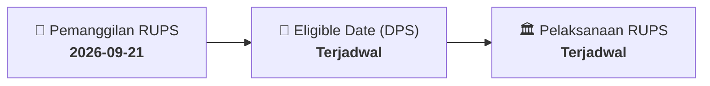

# ⚡ Laporan Intelijen Aksi Korporasi: [[TNCA]] - RUPS

⬅️ [[knowledge-base/daily-digests/Daily_Digest_20260921|Kembali ke Daily Digest]] | 📅 **2026-09-21** | 🎛️ [[Dashboard|Ke Dashboard Utama]]

> [!IMPORTANT]
> Laporan ini disusun secara otomatis oleh **Corporate Action Intelligence Agent** untuk memetakan implikasi strategis, rasio keuangan, alokasi dana, jadwal penting, dan panduan investor.

---

## 📌 1. Ringkasan Eksekutif & Katalis Strategis
- **Kode & Nama Emiten**: `[[TNCA]]`
- **Kategori Aksi Korporasi**: `RUPS`
- **Dokumen Resmi Bursa**: `Pemanggilan RUPS lamp1`
- **Ringkasan Inti Aksi**: Informasi dan fakta material TNCA: PT TRIMUDA NUANSA CITRA, Tbk 1/8 Wisma Intra Asia, Ground Floor Ph. +62 (21) 837 03700/03800 – Fax +62 (21) 837 00023 PT TRIMUDA NUANSA CITRA TBK (“PERSEROAN”) PEMANGGILAN RAPAT UMUM PEMEGANG SAHAM LUAR BIASA KEDUA PT TRIMUDA NUANSA CITRA TBK (“THE COMPANY”) INVITATION THE SECOND EXTRAORDINARY GENERAL MEETING OF SHAREHOLDERS Direksi Perseroan dengan ini menyampaikan kepada para Pemegang Saham Perseroan bahwa pada tanggal 16 September 2026 telah diselenggarakan Rapat Umum Pemegang Saham Luar Bias

---

## 📊 2. Matriks Parameter Material & Angka Kunci
| Parameter Utama | Nilai / Keterangan Resmi |
| :--- | :--- |
| **Uraian Kejadian** | `PT TRIMUDA NUANSA CITRA, Tbk 1/8 Wisma Intra Asia, Ground Floor Ph. +62 (21) 837 03700/03800 – Fax +62 (21) 837 00023 PT TRIMUDA NUANSA CITRA TBK (“PERSEROAN”) PEMANGGILAN RAPAT UMUM PEMEGANG SAHAM LUAR BIASA KEDUA PT TRIMUDA NUANSA CITRA TBK (“THE COMPANY”) INVITATION THE SECOND EXTRAORDINARY GENERAL MEETING OF SHAREHOLDERS Direksi Perseroan dengan ini menyampaikan kepada para Pemegang Saham Perseroan bahwa pada tanggal 16 September 2026 telah diselenggarakan Rapat Umum Pemegang Saham Luar Bias` |

---

## 📌 3. Detail Pelaksanaan RUPS / RUPSLB
- **Hari, Tanggal Pelaksanaan**: `Terjadwal`
- **Waktu Pelaksanaan**: `09.00 WIB s.d. selesai`
- **Lokasi / Tempat Pelaksanaan**: `Aplikasi eASY.KSEI / Kantor Perseroan`
- **Batas Hak Suara (Eligible Date / Recording Date)**: `Terjadwal`

## 📝 4. Matriks Agenda & Mata Acara Rapat
| No | Agenda / Mata Acara | Penjelasan & Sub-Acara |
| :-: | :--- | :--- |
| 1 | **Agenda Utama RUPS** | Informasi dan fakta material TNCA: PT TRIMUDA NUANSA CITRA, Tbk 1/8 Wisma Intra Asia, Ground Floor Ph. +62 (21) 837 03700/03800 – Fax +62 (21) 837 00023 PT TRIMUDA NUANSA CITRA TBK (“PERSEROAN”) PEMANGGILAN RAPAT UMUM PEMEGANG SAHAM LUAR BIASA KEDUA PT TRIMUDA NUANSA CITRA TBK (“THE COMPANY”) INVITATION THE SECOND EXTRAORDINARY GENERAL MEETING OF SHAREHOLDERS Direksi Perseroan dengan ini menyampaikan kepada para Pemegang Saham Perseroan bahwa pada tanggal 16 September 2026 telah diselenggarakan Rapat Umum Pemegang Saham Luar Bias |

## 🗓️ 5. Timeline Investor & Ketentuan Kehadiran

## 💡 6. Panduan Investor & E-Voting
- 👥 **Hak Suara**: Pemegang saham yang berhak hadir/memberikan suara adalah yang terdaftar dalam DPS pada **Eligible Date (Terjadwal)**.
- 🗳️ **E-Voting eASY.KSEI**: Pemegang saham dapat memberikan kuasa/suara secara elektronik melalui sistem eASY.KSEI.

---

## 🔗 Hubungan Note Terkait (Knowledge Graph)
- [[knowledge-base/daily-digests/Daily_Digest_20260921|📄 Daily Digest 2026-09-21]]
- [[knowledge-base/trading-signals/Trading_Signals_20260921|🎯 Sinyal Cuan 2026-09-21]]
- [[Dashboard|🎛️ Kembali ke Dashboard]]