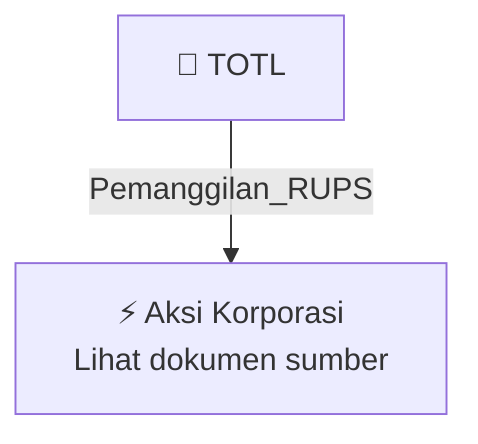

# 📢 Pemanggilan RUPS / RUPSLB — [[TOTL]]

⬅️ [[knowledge-base/daily-digests/Daily_Digest_20261009|Kembali ke Daily Digest]] | 📅 **2026-10-09** | 🎛️ [[Dashboard|Ke Dashboard Utama]]

> [!IMPORTANT]
> Laporan ini disusun secara otomatis oleh **Corporate Action Intelligence Agent** pada **2026-10-09**.
> Sumber dokumen: `20261008_TOTL_20261007_TOTL_Pengumuman RUPS_32164337_lamp1.pdf`

---

## 📌 1. Ringkasan Eksekutif & Tujuan Strategis

- **Kode & Nama Emiten**: `[[TOTL]]`
- **Kategori Aksi Korporasi**: `Pemanggilan_RUPS`
- **Dokumen Sumber**: `20261008_TOTL_20261007_TOTL_Pengumuman RUPS_32164337_lamp1.pdf`
- **Tanggal Laporan**: `2026-10-09`

[Analisis LLM tidak tersedia — isi manual]

---

## 📊 2. Fakta Material & Parameter Keuangan

| Parameter Utama | Nilai / Keterangan |
| :--- | :--- |
| **Jenis Rapat** | `Rapat Umum Pemegang Saham Luar Biasa (RUPSLB)` |
| **Nama Perseroan** | `PT Total Bangun Persada Tbk` |
| **Hari/Tanggal Rapat** | `Senin, 16 November 2026` |
| **Penyelenggaraan Rapat** | `Sistem Rapat Umum Pemegang Saham Elektronik yang dikelola oleh PT Kustodian Sentral Efek Indonesia` |
| **Dasar Hukum** | `POJK 15/2020 dan POJK 14/2025` |
| **Pemegang Saham yang Berhak Hadir** | `Pemegang Saham yang namanya tercatat dalam Daftar Pemegang Saham 1 hari kerja sebelum pemanggilan Rapat, yaitu 22 Oktober 2026, dan/atau pemilik saham dalam perdagangan saham Perseroan di Bursa Efek Indonesia pada 22 Oktober 2026` |
| **Batas Usulan Pemegang Saham** | `Paling lambat 7 hari kalender sebelum Pemanggilan Rapat` |
| **Tanggal Pemanggilan Rapat** | `22 Oktober 2026` |
| **Publikasi Pemanggilan Rapat** | `Situs web Bursa Efek Indonesia, situs web Perseroan, dan fasilitas Electronic General Meeting System PT Kustodian Sentral Efek Indonesia pada 23 Oktober 2026` |
| **Batas Penggunaan e-Proxy** | `Sampai dengan penutupan perdagangan saham Perseroan di Bursa Efek Indonesia 1 hari kerja sebelum hari penyelenggaraan Rapat, yaitu Jumat, 13 November 2026` |
| **Himbauan kepada Pemegang Saham** | `Hadir secara elektronik dan memberikan suara melalui aplikasi atau memberikan kuasa kepada pihak independen yang ditunjuk Perseroan atau pihak lain melalui e-Proxy` |

---

## 👥 3. Struktur Kepemilikan, Pengendali & Pembeli Siaga

- **Emiten**: `TOTL` | Informasi kepemilikan mengacu pada dokumen resmi sumber.

---

## 🎯 4. Alokasi & Rencana Penggunaan Dana

- Informasi alokasi dana belum tersedia — lihat prospektus / dokumen resmi.

---

## 📅 5. Timeline & Jadwal Pelaksanaan

| Tahapan / Event | Tanggal |
| :--- | :---: |
| **Jadwal** | Lihat dokumen sumber. |

---

## 📈 6. Diagram Visual Flowchart (Mermaid)

---

## 💡 7. Rekomendasi Investor & Strategi Trading

[Analisis LLM tidak tersedia — isi manual]

---

## 🔗 8. Hubungan Note Terkait (Knowledge Graph)

- [[knowledge-base/daily-digests/Daily_Digest_20261009|📄 Daily Digest 2026-10-09]]
- [[knowledge-base/trading-signals/Trading_Signals_20261009|🎯 Sinyal Cuan 2026-10-09]]
- [[TOTL|🏬 Halaman Emiten TOTL]]
- [[Dashboard|🎛️ Kembali ke Dashboard Utama]]

---

*Laporan dibuat otomatis oleh Corporate Action Intelligence Agent · 2026-10-09*