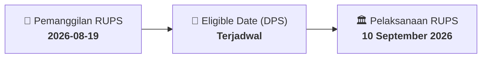

# ⚡ Laporan Intelijen Aksi Korporasi: [[UNIC]] - RUPS

⬅️ [[knowledge-base/daily-digests/Daily_Digest_20260819|Kembali ke Daily Digest]] | 📅 **2026-08-19** | 🎛️ [[Dashboard|Ke Dashboard Utama]]

> [!IMPORTANT]
> Laporan ini disusun secara otomatis oleh **Corporate Action Intelligence Agent** untuk memetakan implikasi strategis, rasio keuangan, alokasi dana, jadwal penting, dan panduan investor.

---

## 📌 1. Ringkasan Eksekutif & Katalis Strategis
- **Kode & Nama Emiten**: `[[UNIC]]`
- **Kategori Aksi Korporasi**: `RUPS`
- **Dokumen Resmi Bursa**: `Pemanggilan RUPS lamp2`
- **Ringkasan Inti Aksi**: RUPSLB UNIC akan meminta persetujuan penyesuaian Pasal 3 Anggaran Dasar tentang Maksud dan Tujuan serta Kegiatan Usaha agar sesuai dengan KBLI 2025. Perubahan bersifat administratif mandatori dan bukan merupakan penambahan atau pengurangan kegiatan usaha.

---

## 📊 2. Matriks Parameter Material & Angka Kunci
| Parameter Utama | Nilai / Keterangan Resmi |
| :--- | :--- |
| **Agenda RUPSLB** | `Persetujuan atas Penyesuaian Pasal 3 Anggaran Dasar Perseroan tentang Maksud dan Tujuan serta Kegiatan Usaha untuk disesuaikan dengan Klasifikasi Baku Lapangan Usaha Indonesia (KBLI) 2025` |
| **Tanggal RUPSLB** | `10 September 2026` |
| **Lokasi RUPSLB** | `Jakarta` |
| **Dasar Penyesuaian** | `Peraturan Badan Pusat Statistik No. 7 Tahun 2025 tentang Klasifikasi Baku Lapangan Usaha Indonesia` |
| **Sifat Perubahan** | `Bukan merupakan penambahan dan/atau pengurangan kegiatan usaha sebagaimana diatur dalam Peraturan OJK No. 17/POJK.04/2020 tentang Transaksi Material dan Perubahan Kegiatan Usaha` |
| **Bidang Usaha Baru** | `Industri kimia dasar dari minyak bumi, gas alam dan batu bara; pergudangan dan penyimpanan lainnya; perdagangan besar berbagai macam barang di grosir/perkulakan swalayan; perdagangan besar berbagai macam barang selain di grosir/perkulakan swalayan; aktivitas pengembangan bangunan dan lahan hunian; aktivitas penyewaan bangunan dan lahan hunian milik sendiri atau sewa; pengelolaan pusat perbelanjaan; penyewaan gudang dan fasilitas penyimpanan mandiri; pengelolaan gedung perkantoran; angkutan bermotor untuk barang umum` |
| **Kode KBLI 2025** | `20116, 52109, 46901, 46902, 68111, 68112, 68125, 68126, 68127, 49231` |
| **Kegiatan Usaha Utama** | `Industri kimia dasar dari minyak bumi, gas alam dan batu bara (20116); pergudangan dan penyimpanan lainnya (52109); perdagangan besar berbagai macam barang di grosir/perkulakan swalayan (46901); perdagangan besar berbagai macam barang selain di grosir/perkulakan swalayan (46902); aktivitas pengembangan bangunan dan lahan hunian (68111); aktivitas penyewaan bangunan dan lahan hunian milik sendiri atau sewa (68112); pengelolaan pusat perbelanjaan (68125); penyewaan gudang dan fasilitas penyimpanan mandiri (68126); pengelolaan gedung dan perkantoran (68127); angkutan bermotor untuk barang umum (49231)` |
| **Kegiatan Usaha Penunjang** | `Menjalankan usaha-usaha lain yang berkaitan dan menunjang kegiatan usaha utama sesuai dengan peraturan perundang-undangan yang berlaku` |

---

## 📌 3. Detail Pelaksanaan RUPS / RUPSLB
- **Hari, Tanggal Pelaksanaan**: `10 September 2026`
- **Waktu Pelaksanaan**: `09.00 WIB s.d. selesai`
- **Lokasi / Tempat Pelaksanaan**: `Jakarta`
- **Batas Hak Suara (Eligible Date / Recording Date)**: `Terjadwal`

## 📝 4. Matriks Agenda & Mata Acara Rapat
| No | Agenda / Mata Acara | Penjelasan & Sub-Acara |
| :-: | :--- | :--- |
| 1 | **Agenda RUPSLB** | Persetujuan atas Penyesuaian Pasal 3 Anggaran Dasar Perseroan tentang Maksud dan Tujuan serta Kegiatan Usaha untuk disesuaikan dengan Klasifikasi Baku Lapangan Usaha Indonesia (KBLI) 2025 |

## 🗓️ 5. Timeline Investor & Ketentuan Kehadiran

## 💡 6. Panduan Investor & E-Voting
- 👥 **Hak Suara**: Pemegang saham yang berhak hadir/memberikan suara adalah yang terdaftar dalam DPS pada **Eligible Date (Terjadwal)**.
- 🗳️ **E-Voting eASY.KSEI**: Pemegang saham dapat memberikan kuasa/suara secara elektronik melalui sistem eASY.KSEI.

---

## 🔗 Hubungan Note Terkait (Knowledge Graph)
- [[knowledge-base/daily-digests/Daily_Digest_20260819|📄 Daily Digest 2026-08-19]]
- [[knowledge-base/trading-signals/Trading_Signals_20260819|🎯 Sinyal Cuan 2026-08-19]]
- [[Dashboard|🎛️ Kembali ke Dashboard]]