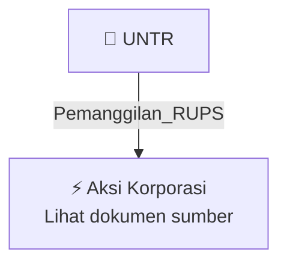

# 📢 Pemanggilan RUPS / RUPSLB — [[UNTR]]

⬅️ [[knowledge-base/daily-digests/Daily_Digest_20261002|Kembali ke Daily Digest]] | 📅 **2026-10-02** | 🎛️ [[Dashboard|Ke Dashboard Utama]]

> [!IMPORTANT]
> Laporan ini disusun secara otomatis oleh **Corporate Action Intelligence Agent** pada **2026-10-02**.
> Sumber dokumen: `20261001_UNTR_20261001_UNTR_Pengumuman RUPS_32162490_lamp1.pdf`

---

## 📌 1. Ringkasan Eksekutif & Tujuan Strategis

- **Kode & Nama Emiten**: `[[UNTR]]`
- **Kategori Aksi Korporasi**: `Pemanggilan_RUPS`
- **Dokumen Sumber**: `20261001_UNTR_20261001_UNTR_Pengumuman RUPS_32162490_lamp1.pdf`
- **Tanggal Laporan**: `2026-10-02`

[Analisis LLM tidak tersedia — isi manual]

---

## 📊 2. Fakta Material & Parameter Keuangan

| Parameter Utama | Nilai / Keterangan |
| :--- | :--- |
| **Jenis rapat** | `Rapat Umum Pemegang Saham Luar Biasa (RUPSLB)` |
| **Tanggal rapat** | `Senin, 9 November 2026` |
| **Waktu rapat** | `09.00 WIB - selesai` |
| **Tempat rapat** | `Mengacu pada ketentuan POJK 15/2020 dan POJK 14/2025; informasi lokasi mencakup United Tractors Grand Ballroom, Jl. Raya Bekasi Km 22, Cakung Barat, Kecamatan Cakung, Kota Jakarta Timur, DKI Jakarta 13910` |
| **Tanggal pemanggilan RUPS** | `16 Oktober 2026` |
| **Tanggal pencatatan pemegang saham yang berhak hadir** | `15 Oktober 2026 sampai dengan pukul 16.00 WIB` |
| **Batas pengajuan usulan mata acara rapat oleh pemegang saham** | `9 Oktober 2026, selambat-lambatnya pukul 16.00 WIB` |
| **Syarat kepemilikan saham untuk usulan mata acara rapat** | `Sekurang-kurangnya 5% dari jumlah seluruh saham dengan hak suara yang sah` |
| **Mekanisme rapat** | `Menggunakan fasilitas elektronik rapat umum, termasuk e-Proxy dan e-Voting sesuai POJK 14/2025` |
| **Tanggal pengumuman** | `1 Oktober 2026` |

---

## 👥 3. Struktur Kepemilikan, Pengendali & Pembeli Siaga

- **Emiten**: `UNTR` | Informasi kepemilikan mengacu pada dokumen resmi sumber.

---

## 🎯 4. Alokasi & Rencana Penggunaan Dana

- Informasi alokasi dana belum tersedia — lihat prospektus / dokumen resmi.

---

## 📅 5. Timeline & Jadwal Pelaksanaan

| Tahapan / Event | Tanggal |
| :--- | :---: |
| **Jadwal** | Lihat dokumen sumber. |

---

## 📈 6. Diagram Visual Flowchart (Mermaid)

---

## 💡 7. Rekomendasi Investor & Strategi Trading

[Analisis LLM tidak tersedia — isi manual]

---

## 🔗 8. Hubungan Note Terkait (Knowledge Graph)

- [[knowledge-base/daily-digests/Daily_Digest_20261002|📄 Daily Digest 2026-10-02]]
- [[knowledge-base/trading-signals/Trading_Signals_20261002|🎯 Sinyal Cuan 2026-10-02]]
- [[UNTR|🏬 Halaman Emiten UNTR]]
- [[Dashboard|🎛️ Kembali ke Dashboard Utama]]

---

*Laporan dibuat otomatis oleh Corporate Action Intelligence Agent · 2026-10-02*