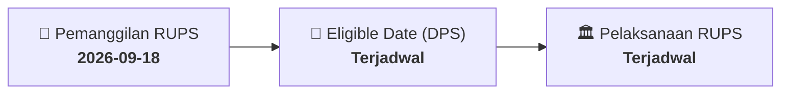

# ⚡ Laporan Intelijen Aksi Korporasi: [[UVCR]] - RUPS

⬅️ [[knowledge-base/daily-digests/Daily_Digest_20260918|Kembali ke Daily Digest]] | 📅 **2026-09-18** | 🎛️ [[Dashboard|Ke Dashboard Utama]]

> [!IMPORTANT]
> Laporan ini disusun secara otomatis oleh **Corporate Action Intelligence Agent** untuk memetakan implikasi strategis, rasio keuangan, alokasi dana, jadwal penting, dan panduan investor.

---

## 📌 1. Ringkasan Eksekutif & Katalis Strategis
- **Kode & Nama Emiten**: `[[UVCR]]`
- **Kategori Aksi Korporasi**: `RUPS`
- **Dokumen Resmi Bursa**: `Pengumuman RUPS lamp1`
- **Ringkasan Inti Aksi**: Informasi dan fakta material UVCR: PT TRIMEGAH KARYA PRATAMA TBK ​ (“Perseroan”) ​ PENGUMUMAN KEPADA PARA PEMEGANG SAHAM RAPAT UMUM PEMEGANG SAHAM LUAR BIASA Dengan ini diumumkan kepada Para Pemegang Saham PT TRIMEGAH KARYA PRATAMA Tbk (“Perseroan”), bahwa Perseroan akan mengadakan Rapat Umum Pemegang Saham Luar Biasa (“Rapat”) pada hari Selasa, tanggal 27 Oktober 2026. Sesuai dengan ketentuan Peraturan Otoritas Jasa Keuangan Nomor 15/POJK.04/2020 tentang Rencana dan Penyelenggaraan Rapat Umum Pemegang Saham Perusahaan Terbuka se

---

## 📊 2. Matriks Parameter Material & Angka Kunci
| Parameter Utama | Nilai / Keterangan Resmi |
| :--- | :--- |
| **Uraian Kejadian** | `PT TRIMEGAH KARYA PRATAMA TBK ​ (“Perseroan”) ​ PENGUMUMAN KEPADA PARA PEMEGANG SAHAM RAPAT UMUM PEMEGANG SAHAM LUAR BIASA Dengan ini diumumkan kepada Para Pemegang Saham PT TRIMEGAH KARYA PRATAMA Tbk (“Perseroan”), bahwa Perseroan akan mengadakan Rapat Umum Pemegang Saham Luar Biasa (“Rapat”) pada hari Selasa, tanggal 27 Oktober 2026. Sesuai dengan ketentuan Peraturan Otoritas Jasa Keuangan Nomor 15/POJK.04/2020 tentang Rencana dan Penyelenggaraan Rapat Umum Pemegang Saham Perusahaan Terbuka se` |

---

## 📌 3. Detail Pelaksanaan RUPS / RUPSLB
- **Hari, Tanggal Pelaksanaan**: `Terjadwal`
- **Waktu Pelaksanaan**: `09.00 WIB s.d. selesai`
- **Lokasi / Tempat Pelaksanaan**: `Aplikasi eASY.KSEI / Kantor Perseroan`
- **Batas Hak Suara (Eligible Date / Recording Date)**: `Terjadwal`

## 📝 4. Matriks Agenda & Mata Acara Rapat
| No | Agenda / Mata Acara | Penjelasan & Sub-Acara |
| :-: | :--- | :--- |
| 1 | **Agenda Utama RUPS** | Informasi dan fakta material UVCR: PT TRIMEGAH KARYA PRATAMA TBK ​ (“Perseroan”) ​ PENGUMUMAN KEPADA PARA PEMEGANG SAHAM RAPAT UMUM PEMEGANG SAHAM LUAR BIASA Dengan ini diumumkan kepada Para Pemegang Saham PT TRIMEGAH KARYA PRATAMA Tbk (“Perseroan”), bahwa Perseroan akan mengadakan Rapat Umum Pemegang Saham Luar Biasa (“Rapat”) pada hari Selasa, tanggal 27 Oktober 2026. Sesuai dengan ketentuan Peraturan Otoritas Jasa Keuangan Nomor 15/POJK.04/2020 tentang Rencana dan Penyelenggaraan Rapat Umum Pemegang Saham Perusahaan Terbuka se |

## 🗓️ 5. Timeline Investor & Ketentuan Kehadiran

## 💡 6. Panduan Investor & E-Voting
- 👥 **Hak Suara**: Pemegang saham yang berhak hadir/memberikan suara adalah yang terdaftar dalam DPS pada **Eligible Date (Terjadwal)**.
- 🗳️ **E-Voting eASY.KSEI**: Pemegang saham dapat memberikan kuasa/suara secara elektronik melalui sistem eASY.KSEI.

---

## 🔗 Hubungan Note Terkait (Knowledge Graph)
- [[knowledge-base/daily-digests/Daily_Digest_20260918|📄 Daily Digest 2026-09-18]]
- [[knowledge-base/trading-signals/Trading_Signals_20260918|🎯 Sinyal Cuan 2026-09-18]]
- [[Dashboard|🎛️ Kembali ke Dashboard]]