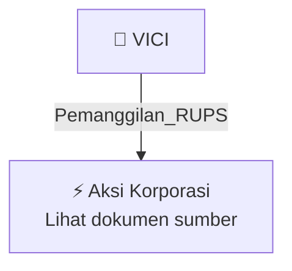

# 📢 Pemanggilan RUPS / RUPSLB — [[VICI]]

⬅️ [[knowledge-base/daily-digests/Daily_Digest_20260923|Kembali ke Daily Digest]] | 📅 **2026-09-23** | 🎛️ [[Dashboard|Ke Dashboard Utama]]

> [!IMPORTANT]
> Laporan ini disusun secara otomatis oleh **Corporate Action Intelligence Agent** pada **2026-09-23**.
> Sumber dokumen: `20260922_VICI_20260922_VICI_Pengumuman RUPS_32150223_lamp2.pdf`

---

## 📌 1. Ringkasan Eksekutif & Tujuan Strategis

- **Kode & Nama Emiten**: `[[VICI]]`
- **Kategori Aksi Korporasi**: `Pemanggilan_RUPS`
- **Dokumen Sumber**: `20260922_VICI_20260922_VICI_Pengumuman RUPS_32150223_lamp2.pdf`
- **Tanggal Laporan**: `2026-09-23`

[Analisis LLM tidak tersedia — isi manual]

---

## 📊 2. Fakta Material & Parameter Keuangan

| Parameter Utama | Nilai / Keterangan |
| :--- | :--- |
| **Uraian Kejadian** | `PT VICTORIA CARE INDONESIA Tbk (“Perseroan”) Berkedudukan Hukum di Jakarta Barat PENGUMUMAN KEPADA PARA PEMEGANG SAHAM Dengan ini diberitahukan kepada pemegang saham Perseroan bahwa Perseroan akan mengadakan Rapat Umum Pemegang Saham Luar Biasa (“Rapat”) yang akan diselenggarakan pada hari Kamis, 29 Oktober 2026. Sesuai dengan ketentuan Pasal 52 ayat 1 Peraturan Otoritas Jasa Keuangan No.15/POJK.04/2020 Tentang Rencana dan Penyelenggaraan Rapat Umum Pemegang Saham Perusahaan Terbuka (“POJK No.15` |

---

## 👥 3. Struktur Kepemilikan, Pengendali & Pembeli Siaga

- **Emiten**: `VICI` | Informasi kepemilikan mengacu pada dokumen resmi sumber.

---

## 🎯 4. Alokasi & Rencana Penggunaan Dana

- Informasi alokasi dana belum tersedia — lihat prospektus / dokumen resmi.

---

## 📅 5. Timeline & Jadwal Pelaksanaan

| Tahapan / Event | Tanggal |
| :--- | :---: |
| **Jadwal** | Lihat dokumen sumber. |

---

## 📈 6. Diagram Visual Flowchart (Mermaid)

---

## 💡 7. Rekomendasi Investor & Strategi Trading

[Analisis LLM tidak tersedia — isi manual]

---

## 🔗 8. Hubungan Note Terkait (Knowledge Graph)

- [[knowledge-base/daily-digests/Daily_Digest_20260923|📄 Daily Digest 2026-09-23]]
- [[knowledge-base/trading-signals/Trading_Signals_20260923|🎯 Sinyal Cuan 2026-09-23]]
- [[VICI|🏬 Halaman Emiten VICI]]
- [[Dashboard|🎛️ Kembali ke Dashboard Utama]]

---

*Laporan dibuat otomatis oleh Corporate Action Intelligence Agent · 2026-09-23*