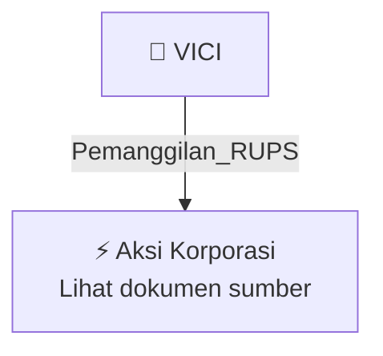

# 📢 Pemanggilan RUPS / RUPSLB — [[VICI]]

⬅️ [[knowledge-base/daily-digests/Daily_Digest_20261009|Kembali ke Daily Digest]] | 📅 **2026-10-09** | 🎛️ [[Dashboard|Ke Dashboard Utama]]

> [!IMPORTANT]
> Laporan ini disusun secara otomatis oleh **Corporate Action Intelligence Agent** pada **2026-10-09**.
> Sumber dokumen: `20261007_VICI_20261007_VICI_Pemanggilan RUPS_32164204_lamp2.pdf`

---

## 📌 1. Ringkasan Eksekutif & Tujuan Strategis

- **Kode & Nama Emiten**: `[[VICI]]`
- **Kategori Aksi Korporasi**: `Pemanggilan_RUPS`
- **Dokumen Sumber**: `20261007_VICI_20261007_VICI_Pemanggilan RUPS_32164204_lamp2.pdf`
- **Tanggal Laporan**: `2026-10-09`

[Analisis LLM tidak tersedia — isi manual]

---

## 📊 2. Fakta Material & Parameter Keuangan

| Parameter Utama | Nilai / Keterangan |
| :--- | :--- |
| **Jenis Rapat** | `Rapat Umum Pemegang Saham Luar Biasa (RUPSLB)` |
| **Hari/Tanggal Rapat** | `Kamis, 29 Oktober 2026` |
| **Waktu Rapat** | `10:00 WIB – selesai` |
| **Tempat Rapat** | `Marqen Hotel - Heritage Hall Lt. 2, Jalan Kembangan Selatan No. 2, Jakarta Barat - 11610` |
| **Agenda 1** | `Perubahan susunan Dewan Komisaris Perseroan` |
| **Penjelasan Agenda 1** | `Sehubungan dengan pengunduran diri 3 (tiga) anggota Dewan Komisaris Perseroan dan memperhatikan POJK Nomor 33/POJK.04/2014, persetujuan atas pengunduran diri, pengangkatan, pemberhentian, dan/atau penggantian anggota Dewan Komisaris ditetapkan melalui RUPS` |
| **Agenda 2** | `Perubahan isi Pasal 3 Anggaran Dasar Perseroan tentang Maksud dan Tujuan serta Kegiatan Usaha` |
| **Penjelasan Agenda 2** | `Penyesuaian isi dan/atau ketentuan Pasal 3 Anggaran Dasar Perseroan sesuai KBLI 2025 berdasarkan Peraturan Badan Pusat Statistik Nomor 7 Tahun 2025` |
| **Agenda 3** | `Perubahan isi Pasal 10 Anggaran Dasar Perseroan tentang Tugas, Tanggung Jawab dan Wewenang Direksi` |
| **Penjelasan Agenda 3** | `Perubahan pada Pasal 10 Ayat 3, Pasal 10 Ayat 4, dan Pasal 10 Ayat 6 Anggaran Dasar Perseroan serta pernyataan kembali seluruh ketentuan Anggaran Dasar Perseroan` |
| **Daftar Pemegang Saham yang Berhak Hadir** | `Pemegang Saham yang namanya tercatat dalam Daftar Pemegang Saham Perseroan di PT Bima Registra dan/atau pemegang rekening atau bank kustodian di PT Kustodian Indonesia per 6 Oktober 2026` |
| **Batas Pemberian Kuasa Elektronik** | `Selambat-lambatnya 1 (satu) hari kerja sebelum tanggal pelaksanaan Rapat pukul 12.00 WIB` |
| **Mekanisme Kehadiran** | `Hadir secara elektronik melalui fasilitas dan/atau aplikasi dan/atau hadir secara fisik` |
| **Pengecekan dan Perhitungan Suara** | `Dilakukan oleh Notaris dengan dibantu Biro Administrasi Efek Perseroan berdasarkan suara Pemegang Saham yang hadir dan kuasa yang telah disampaikan` |
| **Dasar Penyediaan Bahan Mata Acara** | `Pasal 18 POJK No. 15/POJK.04/2020; bahan mata acara tersedia sejak tanggal Pemanggilan Rapat sampai dengan penyelenggaraan Rapat` |

---

## 👥 3. Struktur Kepemilikan, Pengendali & Pembeli Siaga

- **Emiten**: `VICI` | Informasi kepemilikan mengacu pada dokumen resmi sumber.

---

## 🎯 4. Alokasi & Rencana Penggunaan Dana

- Informasi alokasi dana belum tersedia — lihat prospektus / dokumen resmi.

---

## 📅 5. Timeline & Jadwal Pelaksanaan

| Tahapan / Event | Tanggal |
| :--- | :---: |
| **Jadwal** | Lihat dokumen sumber. |

---

## 📈 6. Diagram Visual Flowchart (Mermaid)

---

## 💡 7. Rekomendasi Investor & Strategi Trading

[Analisis LLM tidak tersedia — isi manual]

---

## 🔗 8. Hubungan Note Terkait (Knowledge Graph)

- [[knowledge-base/daily-digests/Daily_Digest_20261009|📄 Daily Digest 2026-10-09]]
- [[knowledge-base/trading-signals/Trading_Signals_20261009|🎯 Sinyal Cuan 2026-10-09]]
- [[VICI|🏬 Halaman Emiten VICI]]
- [[Dashboard|🎛️ Kembali ke Dashboard Utama]]

---

*Laporan dibuat otomatis oleh Corporate Action Intelligence Agent · 2026-10-09*