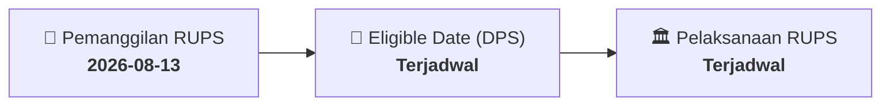

# ⚡ Laporan Intelijen Aksi Korporasi: [[VICO]] - RUPS

⬅️ [[knowledge-base/daily-digests/Daily_Digest_20260813|Kembali ke Daily Digest]] | 📅 **2026-08-13** | 🎛️ [[Dashboard|Ke Dashboard Utama]]

> [!IMPORTANT]
> Laporan ini disusun secara otomatis oleh **Corporate Action Intelligence Agent** untuk memetakan implikasi strategis, rasio keuangan, alokasi dana, jadwal penting, dan panduan investor.

---

## 📌 1. Ringkasan Eksekutif & Katalis Strategis
- **Kode & Nama Emiten**: `[[VICO]]`
- **Kategori Aksi Korporasi**: `RUPS`
- **Dokumen Resmi Bursa**: `Pengumuman RUPS lamp1`
- **Ringkasan Inti Aksi**: PT Victoria Investama Tbk mengumumkan akan menyelenggarakan Rapat Umum Pemegang Saham Luar Biasa (RUPSLB) pada hari Jumat, 18 September 2026 pukul 14:00 WIB di Jakarta, yang juga akan diselenggarakan secara elektronik. Pemegang saham yang berhak hadir adalah yang tercatat dalam Daftar Pemegang Saham pada 26 Agustus 2026. Usulan mata acara rapat dari pemegang saham harus diterima Direksi selambat-lambatnya 20 Agustus 2026, dengan ketentuan mewakili minimal 1/20 bagian dari seluruh saham dengan hak suara.

---

## 📊 2. Matriks Parameter Material & Angka Kunci
| Parameter Utama | Nilai / Keterangan Resmi |
| :--- | :--- |
| **Jenis Rapat** | `Rapat Umum Pemegang Saham Luar Biasa (RUPSLB)` |
| **Tanggal Pelaksanaan Rapat** | `Jumat, 18 September 2026` |
| **Waktu Pelaksanaan Rapat** | `14:00 WIB` |
| **Tempat Pelaksanaan Rapat** | `Jakarta` |
| **Metode Pelaksanaan Rapat** | `Secara fisik dan elektronik melalui fasilitas Electronic General Meeting System` |
| **Dasar Hukum Pelaksanaan Rapat Elektronik** | `Peraturan OJK Nomor 14 Tahun 2025 tentang Pelaksanaan Rapat Umum Pemegang Saham, Rapat Umum Pemegang Obligasi, dan Rapat Umum Pemegang Sukuk Secara Elektronik` |
| **Tanggal Daftar Pemegang Saham yang Berhak Hadir** | `Rabu, 26 Agustus 2026 sampai dengan pukul 16:00 WIB` |
| **Batas Akhir Penerimaan Usulan Mata Acara Rapat** | `Kamis, 20 Agustus 2026 pukul 16.00 WIB` |
| **Ketentuan Pengajuan Usulan Mata Acara** | `Diajukan oleh 1 (satu) pemegang saham atau lebih yang mewakili paling sedikit 1/20 (satu per dua puluh) bagian atau lebih dari jumlah seluruh saham dengan hak suara` |
| **Dasar Hukum Pengajuan Usulan Mata Acara** | `Peraturan Otoritas Jasa Keuangan No.15/POJK.04/2020 tentang Rencana dan Penyelenggaraan Rapat Umum Pemegang Saham Perusahaan Terbuka dan Pasal 12 ayat 7 Anggaran Dasar Perseroan` |

---

## 📌 3. Detail Pelaksanaan RUPS / RUPSLB
- **Hari, Tanggal Pelaksanaan**: `Terjadwal`
- **Waktu Pelaksanaan**: `14:00 WIB`
- **Lokasi / Tempat Pelaksanaan**: `Jakarta`
- **Batas Hak Suara (Eligible Date / Recording Date)**: `Terjadwal`

## 📝 4. Matriks Agenda & Mata Acara Rapat
| No | Agenda / Mata Acara | Penjelasan & Sub-Acara |
| :-: | :--- | :--- |
| 1 | **Batas Akhir Penerimaan Usulan Mata Acara Rapat** | Kamis, 20 Agustus 2026 pukul 16.00 WIB |
| 2 | **Ketentuan Pengajuan Usulan Mata Acara** | Diajukan oleh 1 (satu) pemegang saham atau lebih yang mewakili paling sedikit 1/20 (satu per dua puluh) bagian atau lebih dari jumlah seluruh saham dengan hak suara |
| 3 | **Dasar Hukum Pengajuan Usulan Mata Acara** | Peraturan Otoritas Jasa Keuangan No.15/POJK.04/2020 tentang Rencana dan Penyelenggaraan Rapat Umum Pemegang Saham Perusahaan Terbuka dan Pasal 12 ayat 7 Anggaran Dasar Perseroan |

## 🗓️ 5. Timeline Investor & Ketentuan Kehadiran

## 💡 6. Panduan Investor & E-Voting
- 👥 **Hak Suara**: Pemegang saham yang berhak hadir/memberikan suara adalah yang terdaftar dalam DPS pada **Eligible Date (Terjadwal)**.
- 🗳️ **E-Voting eASY.KSEI**: Pemegang saham dapat memberikan kuasa/suara secara elektronik melalui sistem eASY.KSEI.

---

## 🔗 Hubungan Note Terkait (Knowledge Graph)
- [[knowledge-base/daily-digests/Daily_Digest_20260813|📄 Daily Digest 2026-08-13]]
- [[knowledge-base/trading-signals/Trading_Signals_20260813|🎯 Sinyal Cuan 2026-08-13]]
- [[Dashboard|🎛️ Kembali ke Dashboard]]