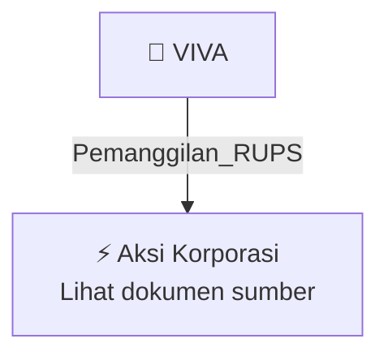

# 📢 Pemanggilan RUPS / RUPSLB — [[VIVA]]

⬅️ [[knowledge-base/daily-digests/Daily_Digest_20261012|Kembali ke Daily Digest]] | 📅 **2026-10-12** | 🎛️ [[Dashboard|Ke Dashboard Utama]]

> [!IMPORTANT]
> Laporan ini disusun secara otomatis oleh **Corporate Action Intelligence Agent** pada **2026-10-12**.
> Sumber dokumen: `20261009_VIVA_20261009_VIVA_Pengumuman RUPS_32165220_lamp1.pdf`

---

## 📌 1. Ringkasan Eksekutif & Tujuan Strategis

- **Kode & Nama Emiten**: `[[VIVA]]`
- **Kategori Aksi Korporasi**: `Pemanggilan_RUPS`
- **Dokumen Sumber**: `20261009_VIVA_20261009_VIVA_Pengumuman RUPS_32165220_lamp1.pdf`
- **Tanggal Laporan**: `2026-10-12`

[Analisis LLM tidak tersedia — isi manual]

---

## 📊 2. Fakta Material & Parameter Keuangan

| Parameter Utama | Nilai / Keterangan |
| :--- | :--- |
| **Jenis Rapat** | `Rapat Umum Pemegang Saham Tahunan dan Rapat Umum Pemegang Saham Luar Biasa` |
| **Tahun Buku RUPS Tahunan** | `2025` |
| **Hari dan Tanggal RUPS** | `Selasa, 17 November 2026` |
| **Lokasi RUPS** | `Jakarta` |
| **Tanggal Pemanggilan RUPS** | `26 Oktober 2026` |
| **Tanggal Pencatatan Pemegang Saham yang Berhak Hadir** | `23 Oktober 2026 sampai dengan pukul 16.00 WIB` |
| **Batas Pengajuan Usulan Pemegang Saham** | `Selambat-lambatnya 7 hari kalender sebelum tanggal pemanggilan Rapat` |
| **Dasar Hukum** | `POJK No. 15/POJK.04/2020` |
| **Tanggal Pengumuman** | `9 Oktober 2026` |

---

## 👥 3. Struktur Kepemilikan, Pengendali & Pembeli Siaga

- **Emiten**: `VIVA` | Informasi kepemilikan mengacu pada dokumen resmi sumber.

---

## 🎯 4. Alokasi & Rencana Penggunaan Dana

- Informasi alokasi dana belum tersedia — lihat prospektus / dokumen resmi.

---

## 📅 5. Timeline & Jadwal Pelaksanaan

| Tahapan / Event | Tanggal |
| :--- | :---: |
| **Jadwal** | Lihat dokumen sumber. |

---

## 📈 6. Diagram Visual Flowchart (Mermaid)

---

## 💡 7. Rekomendasi Investor & Strategi Trading

[Analisis LLM tidak tersedia — isi manual]

---

## 🔗 8. Hubungan Note Terkait (Knowledge Graph)

- [[knowledge-base/daily-digests/Daily_Digest_20261012|📄 Daily Digest 2026-10-12]]
- [[knowledge-base/trading-signals/Trading_Signals_20261012|🎯 Sinyal Cuan 2026-10-12]]
- [[VIVA|🏬 Halaman Emiten VIVA]]
- [[Dashboard|🎛️ Kembali ke Dashboard Utama]]

---

*Laporan dibuat otomatis oleh Corporate Action Intelligence Agent · 2026-10-12*