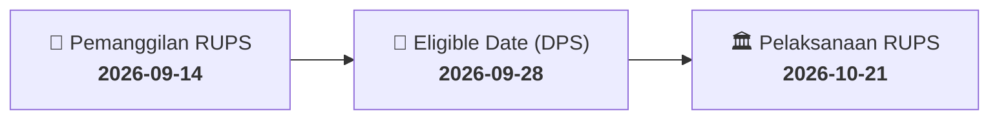

# ⚡ Laporan Intelijen Aksi Korporasi: [[WGSH]] - RUPS

⬅️ [[knowledge-base/daily-digests/Daily_Digest_20260914|Kembali ke Daily Digest]] | 📅 **2026-09-14** | 🎛️ [[Dashboard|Ke Dashboard Utama]]

> [!IMPORTANT]
> Laporan ini disusun secara otomatis oleh **Corporate Action Intelligence Agent** untuk memetakan implikasi strategis, rasio keuangan, alokasi dana, jadwal penting, dan panduan investor.

---

## 📌 1. Ringkasan Eksekutif & Katalis Strategis
- **Kode & Nama Emiten**: `[[WGSH]]`
- **Kategori Aksi Korporasi**: `RUPS`
- **Dokumen Resmi Bursa**: `Pengumuman RUPS`
- **Ringkasan Inti Aksi**: PT Wira Global Solusi Tbk (WGSH) mengumumkan rencana penyelenggaraan Rapat Umum Pemegang Saham Luar Biasa (RUPSLB) yang akan diadakan pada Rabu, 21 Oktober 2026, pukul 09:30, bertempat di Babakan Ciparay, Kec. Babakan Ciparay. Tanggal Daftar Pemegang Saham (DPS) yang berhak hadir ditetapkan pada 28 September 2026. Pengumuman ini disampaikan melalui surat nomor 04/SK-WIRA/IX-10/2026 dan ditandatangani oleh Direktur Utama, Hendy Rusli.

---

## 📊 2. Matriks Parameter Material & Angka Kunci
| Parameter Utama | Nilai / Keterangan Resmi |
| :--- | :--- |
| **Nomor Surat Pengumuman** | `04/SK-WIRA/IX-10/2026` |
| **Jenis Rapat** | `Rapat Umum Pemegang Saham Luar Biasa (RUPSLB)` |
| **Tanggal Penyelenggaraan RUPS** | `2026-10-21` |
| **Waktu Penyelenggaraan RUPS** | `09:30` |
| **Lokasi Penyelenggaraan RUPS** | `Babakan Ciparay, Kec. Babakan Ciparay` |
| **Tanggal Daftar Pemegang Saham (DPS)** | `2026-09-28` |
| **Nama Pengirim / Penandatangan** | `Hendy Rusli` |
| **Jabatan Pengirim** | `Direktur Utama` |
| **Tanggal Pengumuman** | `2026-09-14` |

---

## 📌 3. Detail Pelaksanaan RUPS / RUPSLB
- **Hari, Tanggal Pelaksanaan**: `2026-10-21`
- **Waktu Pelaksanaan**: `09:30`
- **Lokasi / Tempat Pelaksanaan**: `Babakan Ciparay, Kec. Babakan Ciparay`
- **Batas Hak Suara (Eligible Date / Recording Date)**: `2026-09-28`

## 📝 4. Matriks Agenda & Mata Acara Rapat
| No | Agenda / Mata Acara | Penjelasan & Sub-Acara |
| :-: | :--- | :--- |
| 1 | **Agenda Utama RUPS** | PT Wira Global Solusi Tbk (WGSH) mengumumkan rencana penyelenggaraan Rapat Umum Pemegang Saham Luar Biasa (RUPSLB) yang akan diadakan pada Rabu, 21 Oktober 2026, pukul 09:30, bertempat di Babakan Ciparay, Kec. Babakan Ciparay. Tanggal Daftar Pemegang Saham (DPS) yang berhak hadir ditetapkan pada 28 September 2026. Pengumuman ini disampaikan melalui surat nomor 04/SK-WIRA/IX-10/2026 dan ditandatangani oleh Direktur Utama, Hendy Rusli. |

## 🗓️ 5. Timeline Investor & Ketentuan Kehadiran

## 💡 6. Panduan Investor & E-Voting
- 👥 **Hak Suara**: Pemegang saham yang berhak hadir/memberikan suara adalah yang terdaftar dalam DPS pada **Eligible Date (2026-09-28)**.
- 🗳️ **E-Voting eASY.KSEI**: Pemegang saham dapat memberikan kuasa/suara secara elektronik melalui sistem eASY.KSEI.

---

## 🔗 Hubungan Note Terkait (Knowledge Graph)
- [[knowledge-base/daily-digests/Daily_Digest_20260914|📄 Daily Digest 2026-09-14]]
- [[knowledge-base/trading-signals/Trading_Signals_20260914|🎯 Sinyal Cuan 2026-09-14]]
- [[Dashboard|🎛️ Kembali ke Dashboard]]