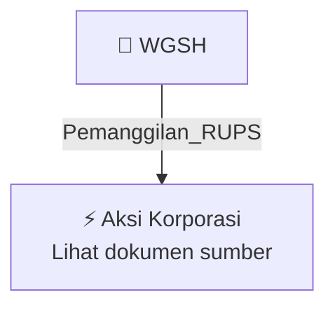

# 📢 Pemanggilan RUPS / RUPSLB — [[WGSH]]

⬅️ [[knowledge-base/daily-digests/Daily_Digest_20260929|Kembali ke Daily Digest]] | 📅 **2026-09-29** | 🎛️ [[Dashboard|Ke Dashboard Utama]]

> [!IMPORTANT]
> Laporan ini disusun secara otomatis oleh **Corporate Action Intelligence Agent** pada **2026-09-29**.
> Sumber dokumen: `20260929_WGSH_20260929_WGSH_Pemanggilan RUPS_32161685_lamp2.pdf`

---

## 📌 1. Ringkasan Eksekutif & Tujuan Strategis

- **Kode & Nama Emiten**: `[[WGSH]]`
- **Kategori Aksi Korporasi**: `Pemanggilan_RUPS`
- **Dokumen Sumber**: `20260929_WGSH_20260929_WGSH_Pemanggilan RUPS_32161685_lamp2.pdf`
- **Tanggal Laporan**: `2026-09-29`

[Analisis LLM tidak tersedia — isi manual]

---

## 📊 2. Fakta Material & Parameter Keuangan

| Parameter Utama | Nilai / Keterangan |
| :--- | :--- |
| **Uraian Kejadian** | `PT. Wira Global Solusi Tbk. Holland Village Jakarta Lt. 29 Unit 11 Cempaka Putih, Jakarta Pusat 10510 PEMANGGILAN RAPAT UMUM PEMEGANG SAHAM LUAR BIASA PT WIRA GLOBAL SOLUSI Tbk. (”Perseroan”) Dengan ini Direksi Perseroan mengundang Para Pemegang Saham Perseroan (”Pemegang Saham”) untuk menghadiri Rapat Umum Pemegang Saham Luar Biasa (”Rapat”) yang akan diselenggarakan pada : Hari/ Tanggal : Rabu, 21 Oktober 2026 Waktu : Pukul 09.30 – selesai Tempat : Gedung WGS, Jl. Soekarno Hatta No.104, Babaka` |

---

## 👥 3. Struktur Kepemilikan, Pengendali & Pembeli Siaga

- **Emiten**: `WGSH` | Informasi kepemilikan mengacu pada dokumen resmi sumber.

---

## 🎯 4. Alokasi & Rencana Penggunaan Dana

- Informasi alokasi dana belum tersedia — lihat prospektus / dokumen resmi.

---

## 📅 5. Timeline & Jadwal Pelaksanaan

| Tahapan / Event | Tanggal |
| :--- | :---: |
| **Jadwal** | Lihat dokumen sumber. |

---

## 📈 6. Diagram Visual Flowchart (Mermaid)

---

## 💡 7. Rekomendasi Investor & Strategi Trading

[Analisis LLM tidak tersedia — isi manual]

---

## 🔗 8. Hubungan Note Terkait (Knowledge Graph)

- [[knowledge-base/daily-digests/Daily_Digest_20260929|📄 Daily Digest 2026-09-29]]
- [[knowledge-base/trading-signals/Trading_Signals_20260929|🎯 Sinyal Cuan 2026-09-29]]
- [[WGSH|🏬 Halaman Emiten WGSH]]
- [[Dashboard|🎛️ Kembali ke Dashboard Utama]]

---

*Laporan dibuat otomatis oleh Corporate Action Intelligence Agent · 2026-09-29*