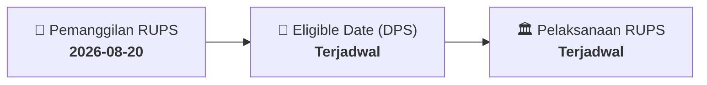

# ⚡ Laporan Intelijen Aksi Korporasi: [[WIFI]] - RUPS

⬅️ [[knowledge-base/daily-digests/Daily_Digest_20260820|Kembali ke Daily Digest]] | 📅 **2026-08-20** | 🎛️ [[Dashboard|Ke Dashboard Utama]]

> [!IMPORTANT]
> Laporan ini disusun secara otomatis oleh **Corporate Action Intelligence Agent** untuk memetakan implikasi strategis, rasio keuangan, alokasi dana, jadwal penting, dan panduan investor.

---

## 📌 1. Ringkasan Eksekutif & Katalis Strategis
- **Kode & Nama Emiten**: `[[WIFI]]`
- **Kategori Aksi Korporasi**: `RUPS`
- **Dokumen Resmi Bursa**: `Pengumuman RUPS lamp1`
- **Ringkasan Inti Aksi**: PT Solusi Sinergi Digital Tbk mengumumkan perubahan jadwal RUPS Luar Biasa dari Jumat, 11 September 2026 menjadi Rabu, 23 September 2026. Batas usulan mata acara ditetapkan pada Senin, 24 Agustus 2026 pukul 16:00 WIB, dan pemberian kuasa elektronik (e-Proxy) hingga Selasa, 22 September 2026 pukul 12:00 WIB.

---

## 📊 2. Matriks Parameter Material & Angka Kunci
| Parameter Utama | Nilai / Keterangan Resmi |
| :--- | :--- |
| **Jadwal RUPSLB Semula** | `Jumat, 11 September 2026` |
| **Jadwal RUPSLB Baru** | `Rabu, 23 September 2026` |
| **Tanggal Pengumuman Awal** | `Jumat, 7 Agustus 2026` |
| **Batas Usulan Mata Acara** | `Senin, 24 Agustus 2026 pukul 16:00 WIB` |
| **Batas e-Proxy** | `Selasa, 22 September 2026 pukul 12:00 WIB` |
| **Dasar Hukum** | `POJK No.15/POJK.04/2020 dan POJK No.16/POJK.04/2020` |
| **Bahasa Pemanggilan** | `Indonesia dan Inggris` |
| **Nama Perseroan** | `PT Solusi Sinergi Digital Tbk` |

---

## 📌 3. Detail Pelaksanaan RUPS / RUPSLB
- **Hari, Tanggal Pelaksanaan**: `Terjadwal`
- **Waktu Pelaksanaan**: `09.00 WIB s.d. selesai`
- **Lokasi / Tempat Pelaksanaan**: `Aplikasi eASY.KSEI / Kantor Perseroan`
- **Batas Hak Suara (Eligible Date / Recording Date)**: `Terjadwal`

## 📝 4. Matriks Agenda & Mata Acara Rapat
| No | Agenda / Mata Acara | Penjelasan & Sub-Acara |
| :-: | :--- | :--- |
| 1 | **Batas Usulan Mata Acara** | Senin, 24 Agustus 2026 pukul 16:00 WIB |

## 🗓️ 5. Timeline Investor & Ketentuan Kehadiran

## 💡 6. Panduan Investor & E-Voting
- 👥 **Hak Suara**: Pemegang saham yang berhak hadir/memberikan suara adalah yang terdaftar dalam DPS pada **Eligible Date (Terjadwal)**.
- 🗳️ **E-Voting eASY.KSEI**: Pemegang saham dapat memberikan kuasa/suara secara elektronik melalui sistem eASY.KSEI.

---

## 🔗 Hubungan Note Terkait (Knowledge Graph)
- [[knowledge-base/daily-digests/Daily_Digest_20260820|📄 Daily Digest 2026-08-20]]
- [[knowledge-base/trading-signals/Trading_Signals_20260820|🎯 Sinyal Cuan 2026-08-20]]
- [[Dashboard|🎛️ Kembali ke Dashboard]]