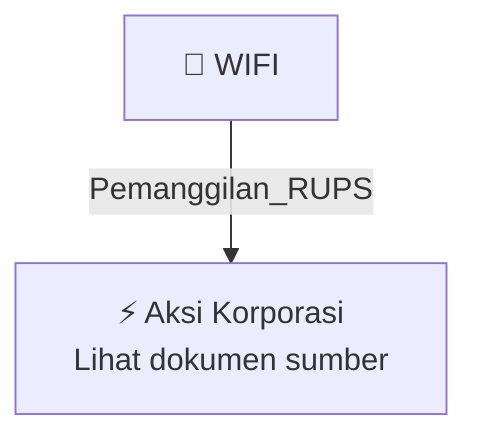

# 📢 Pemanggilan RUPS / RUPSLB — [[WIFI]]

⬅️ [[knowledge-base/daily-digests/Daily_Digest_20260925|Kembali ke Daily Digest]] | 📅 **2026-09-25** | 🎛️ [[Dashboard|Ke Dashboard Utama]]

> [!IMPORTANT]
> Laporan ini disusun secara otomatis oleh **Corporate Action Intelligence Agent** pada **2026-09-25**.
> Sumber dokumen: `20260924_WIFI_20260923_WIFI_Pengumuman RUPS_32150678_lamp1.pdf`

---

## 📌 1. Ringkasan Eksekutif & Tujuan Strategis

- **Kode & Nama Emiten**: `[[WIFI]]`
- **Kategori Aksi Korporasi**: `Pemanggilan_RUPS`
- **Dokumen Sumber**: `20260924_WIFI_20260923_WIFI_Pengumuman RUPS_32150678_lamp1.pdf`
- **Tanggal Laporan**: `2026-09-25`

[Analisis LLM tidak tersedia — isi manual]

---

## 📊 2. Fakta Material & Parameter Keuangan

| Parameter Utama | Nilai / Keterangan |
| :--- | :--- |
| **Uraian Kejadian** | `PENGUMUMAN PERUBAHAN JADWAL RAPAT UMUM PEMEGANG SAHAM LUAR BIASA PT SOLUSI SINERGI DIGITAL TBK Merujuk kepada Pengumuman Rapat Umum Pemegang Saham Luar Biasa (“Rapat”) PT Solusi Sinergi Digital Tbk (“Perseroan”) yang telah diumumkan pada hari Jumat, 7 Agustus 2026 dan Pengumuman Perubahan Jadwal Rapat yang telah diumumkan pada hari Kamis, 20 Agustus 2026, dengan ini Direksi Perseroan mengumumkan bahwa pelaksanaan Rapat yang semula akan diselenggarakan pada hari Jumat, tanggal 11 September 2026,` |

---

## 👥 3. Struktur Kepemilikan, Pengendali & Pembeli Siaga

- **Emiten**: `WIFI` | Informasi kepemilikan mengacu pada dokumen resmi sumber.

---

## 🎯 4. Alokasi & Rencana Penggunaan Dana

- Informasi alokasi dana belum tersedia — lihat prospektus / dokumen resmi.

---

## 📅 5. Timeline & Jadwal Pelaksanaan

| Tahapan / Event | Tanggal |
| :--- | :---: |
| **Jadwal** | Lihat dokumen sumber. |

---

## 📈 6. Diagram Visual Flowchart (Mermaid)

---

## 💡 7. Rekomendasi Investor & Strategi Trading

[Analisis LLM tidak tersedia — isi manual]

---

## 🔗 8. Hubungan Note Terkait (Knowledge Graph)

- [[knowledge-base/daily-digests/Daily_Digest_20260925|📄 Daily Digest 2026-09-25]]
- [[knowledge-base/trading-signals/Trading_Signals_20260925|🎯 Sinyal Cuan 2026-09-25]]
- [[WIFI|🏬 Halaman Emiten WIFI]]
- [[Dashboard|🎛️ Kembali ke Dashboard Utama]]

---

*Laporan dibuat otomatis oleh Corporate Action Intelligence Agent · 2026-09-25*