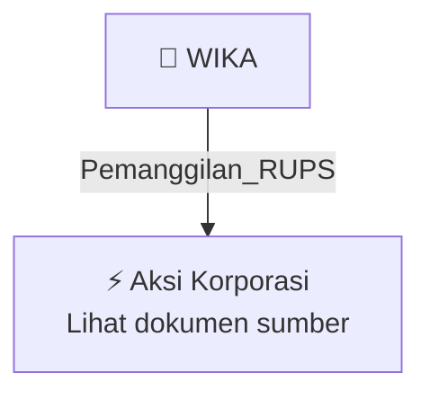

# 📢 Pemanggilan RUPS / RUPSLB — [[WIKA]]

⬅️ [[knowledge-base/daily-digests/Daily_Digest_20261006|Kembali ke Daily Digest]] | 📅 **2026-10-06** | 🎛️ [[Dashboard|Ke Dashboard Utama]]

> [!IMPORTANT]
> Laporan ini disusun secara otomatis oleh **Corporate Action Intelligence Agent** pada **2026-10-06**.
> Sumber dokumen: `20261006_WIKA_20261005_WIKA_Pemberitahuan RencanaPenyampaian PanggilanHasil RUPORUPSURUP EBA-SP_32163007_lamp1.pdf`

---

## 📌 1. Ringkasan Eksekutif & Tujuan Strategis

- **Kode & Nama Emiten**: `[[WIKA]]`
- **Kategori Aksi Korporasi**: `Pemanggilan_RUPS`
- **Dokumen Sumber**: `20261006_WIKA_20261005_WIKA_Pemberitahuan RencanaPenyampaian PanggilanHasil RUPORUPSURUP EBA-SP_32163007_lamp1.pdf`
- **Tanggal Laporan**: `2026-10-06`

[Analisis LLM tidak tersedia — isi manual]

---

## 📊 2. Fakta Material & Parameter Keuangan

| Parameter Utama | Nilai / Keterangan |
| :--- | :--- |
| **Jenis aksi korporasi** | `Panggilan RUPSU Sukuk Mudharabah Berkelanjutan II Wijaya Karya Tahap I Tahun 2021` |
| **Emiten** | `PT Wijaya Karya (Persero) Tbk` |
| **Wali Amanat** | `PT Bank Mega Tbk` |
| **Tanggal surat/panggilan** | `2026-10-05` |
| **Hari/tanggal RUPSU** | `Senin, 19 Oktober 2026` |
| **Waktu RUPSU** | `14.00 WIB s.d selesai` |
| **Tempat RUPSU** | `WIKA Tower 2, Jl. D.I Panjaitan Kavling 9-10` |
| **Agenda 1** | `Penjelasan Emiten atas kelalaian tidak dipenuhinya kewajiban pembayaran Pendapatan Bagi Hasil ke-20 Sukuk Mudharabah Berkelanjutan II Wijaya Karya Tahap I Tahun 2021 Seri B dan Seri C` |
| **Agenda 1b** | `Kewajiban pembayaran kembali Dana Sukuk Mudharabah Berkelanjutan II Wijaya Karya Tahap I Tahun 2022 Seri B` |
| **Agenda 2** | `Penentuan sikap/keputusan Pemegang Sukuk terhadap penjelasan dan usulan Emiten terkait kelalaian pembayaran Pendapatan Bagi Hasil ke-20 Seri B dan Seri C serta pembayaran kembali Dana Sukuk Tahap I Tahun 2022 Seri B` |
| **Dasar penyelenggaraan RUPSU** | `Permintaan PT Bank Mega Tbk selaku Wali Amanat` |
| **Kuorum kehadiran RUPSU** | `Minimal 3/4 bagian dari jumlah Sukuk yang masih belum dilunasi` |
| **Kuorum pengambilan keputusan** | `Disetujui paling sedikit 3/4 bagian dari jumlah Sukuk yang hadir dalam RUPSU` |
| **Hak suara** | `Sukuk yang dimiliki Emiten dan/atau Afiliasi Emiten tidak memiliki hak suara dan tidak diperhitungkan dalam kuorum, kecuali Afiliasi karena kepemilikan atau penyertaan modal Pemerintah` |
| **Pemegang Sukuk yang berhak hadir** | `Pemegang Sukuk yang namanya tercatat pada hari kerja sebelum tanggal penyelenggaraan RUPSU` |
| **Ketentuan kehadiran** | `Pemegang Sukuk atau kuasanya diharapkan hadir 30 menit sebelum RUPSU dimulai` |

---

## 👥 3. Struktur Kepemilikan, Pengendali & Pembeli Siaga

- **Emiten**: `WIKA` | Informasi kepemilikan mengacu pada dokumen resmi sumber.

---

## 🎯 4. Alokasi & Rencana Penggunaan Dana

- Informasi alokasi dana belum tersedia — lihat prospektus / dokumen resmi.

---

## 📅 5. Timeline & Jadwal Pelaksanaan

| Tahapan / Event | Tanggal |
| :--- | :---: |
| **Jadwal** | Lihat dokumen sumber. |

---

## 📈 6. Diagram Visual Flowchart (Mermaid)

---

## 💡 7. Rekomendasi Investor & Strategi Trading

[Analisis LLM tidak tersedia — isi manual]

---

## 🔗 8. Hubungan Note Terkait (Knowledge Graph)

- [[knowledge-base/daily-digests/Daily_Digest_20261006|📄 Daily Digest 2026-10-06]]
- [[knowledge-base/trading-signals/Trading_Signals_20261006|🎯 Sinyal Cuan 2026-10-06]]
- [[WIKA|🏬 Halaman Emiten WIKA]]
- [[Dashboard|🎛️ Kembali ke Dashboard Utama]]

---

*Laporan dibuat otomatis oleh Corporate Action Intelligence Agent · 2026-10-06*