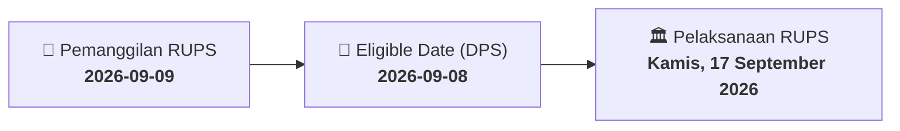

# ⚡ Laporan Intelijen Aksi Korporasi: [[YELO]] - RUPS

⬅️ [[knowledge-base/daily-digests/Daily_Digest_20260909|Kembali ke Daily Digest]] | 📅 **2026-09-09** | 🎛️ [[Dashboard|Ke Dashboard Utama]]

> [!IMPORTANT]
> Laporan ini disusun secara otomatis oleh **Corporate Action Intelligence Agent** untuk memetakan implikasi strategis, rasio keuangan, alokasi dana, jadwal penting, dan panduan investor.

---

## 📌 1. Ringkasan Eksekutif & Katalis Strategis
- **Kode & Nama Emiten**: `[[YELO]]`
- **Kategori Aksi Korporasi**: `RUPS`
- **Dokumen Resmi Bursa**: `Pemanggilan RUPS lamp1`
- **Ringkasan Inti Aksi**: PT YELOOO INTEGRA DATANET Tbk (YELO) memanggil pemegang saham untuk menghadiri Rapat Umum Pemegang Saham Luar Biasa (RUPSLB) Kedua yang akan diselenggarakan pada 17 September 2026. RUPSLB ini merupakan tindak lanjut dari RUPSLB pertama yang gagal mencapai kuorum pada 3 September 2026. Agenda utama rapat adalah persetujuan perubahan Pasal 3 Anggaran Dasar terkait penyesuaian Klasifikasi Baku Lapangan Usaha Indonesia (KBLI) sesuai Peraturan BPS Nomor 7 Tahun 2025.

---

## 📊 2. Matriks Parameter Material & Angka Kunci
| Parameter Utama | Nilai / Keterangan Resmi |
| :--- | :--- |
| **Tanggal RUPSLB Pertama** | `2026-09-03` |
| **Alasan RUPSLB Pertama Gagal** | `Kuorum kehadiran tidak tercapai` |
| **Hari/Tanggal RUPSLB Kedua** | `Kamis, 17 September 2026` |
| **Waktu RUPSLB Kedua** | `14.00 WIB sampai selesai` |
| **Tempat RUPSLB Kedua** | `Ruang Jawa, AXA Tower Lantai 42` |
| **Mata Acara Rapat** | `Persetujuan Perubahan Pasal 3 Anggaran Dasar terkait Penyesuaian Peraturan BPS Nomor 7 Tahun 2025 tentang KBLI` |
| **Tanggal Pemanggilan** | `2026-09-09` |
| **Batas Akhir Pencatatan Pemegang Saham (Recording Date)** | `2026-09-08` |
| **Dasar Hukum** | `POJK Nomor 15/POJK.04/2020` |

---

## 📌 3. Detail Pelaksanaan RUPS / RUPSLB
- **Hari, Tanggal Pelaksanaan**: `Kamis, 17 September 2026`
- **Waktu Pelaksanaan**: `14.00 WIB sampai selesai`
- **Lokasi / Tempat Pelaksanaan**: `Ruang Jawa, AXA Tower Lantai 42`
- **Batas Hak Suara (Eligible Date / Recording Date)**: `2026-09-08`

## 📝 4. Matriks Agenda & Mata Acara Rapat
| No | Agenda / Mata Acara | Penjelasan & Sub-Acara |
| :-: | :--- | :--- |
| 1 | **Mata Acara Rapat** | Persetujuan Perubahan Pasal 3 Anggaran Dasar terkait Penyesuaian Peraturan BPS Nomor 7 Tahun 2025 tentang KBLI |

## 🗓️ 5. Timeline Investor & Ketentuan Kehadiran

## 💡 6. Panduan Investor & E-Voting
- 👥 **Hak Suara**: Pemegang saham yang berhak hadir/memberikan suara adalah yang terdaftar dalam DPS pada **Eligible Date (2026-09-08)**.
- 🗳️ **E-Voting eASY.KSEI**: Pemegang saham dapat memberikan kuasa/suara secara elektronik melalui sistem eASY.KSEI.

---

## 🔗 Hubungan Note Terkait (Knowledge Graph)
- [[knowledge-base/daily-digests/Daily_Digest_20260909|📄 Daily Digest 2026-09-09]]
- [[knowledge-base/trading-signals/Trading_Signals_20260909|🎯 Sinyal Cuan 2026-09-09]]
- [[Dashboard|🎛️ Kembali ke Dashboard]]