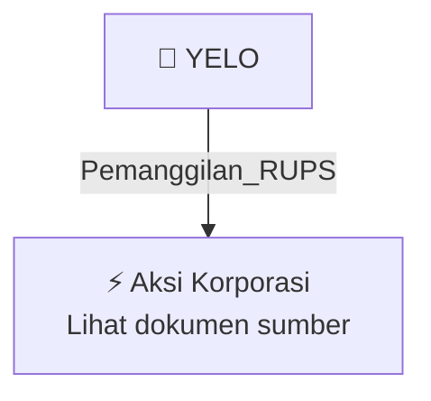

# 📢 Pemanggilan RUPS / RUPSLB — [[YELO]]

⬅️ [[knowledge-base/daily-digests/Daily_Digest_20261005|Kembali ke Daily Digest]] | 📅 **2026-10-05** | 🎛️ [[Dashboard|Ke Dashboard Utama]]

> [!IMPORTANT]
> Laporan ini disusun secara otomatis oleh **Corporate Action Intelligence Agent** pada **2026-10-05**.
> Sumber dokumen: `20261002_YELO_20261002_YELO_Pemanggilan RUPS_32162684_lamp2.pdf`

---

## 📌 1. Ringkasan Eksekutif & Tujuan Strategis

- **Kode & Nama Emiten**: `[[YELO]]`
- **Kategori Aksi Korporasi**: `Pemanggilan_RUPS`
- **Dokumen Sumber**: `20261002_YELO_20261002_YELO_Pemanggilan RUPS_32162684_lamp2.pdf`
- **Tanggal Laporan**: `2026-10-05`

[Analisis LLM tidak tersedia — isi manual]

---

## 📊 2. Fakta Material & Parameter Keuangan

| Parameter Utama | Nilai / Keterangan |
| :--- | :--- |
| **Mata Acara Rapat** | `Persetujuan perubahan Pasal 4 Anggaran Dasar Perseroan sehubungan dengan Peningkatan Modal Dasar Perseroan` |
| **Hari/Tanggal Rapat** | `Senin, 26 Oktober 2026` |
| **Waktu Rapat** | `14.00 WIB s/d selesai` |
| **Tempat Rapat** | `Axa Tower Lantai 42, Jl. Prof. DR. Satrio, Kuningan, Karet Kuningan` |
| **Modal Dasar Semula** | `Rp275.200.000.000` |
| **Jumlah Saham Semula** | `2.752.000.000 saham` |
| **Modal Dasar Baru** | `Rp765.109.762.000` |
| **Jumlah Saham Baru** | `7.651.097.620 saham` |
| **Tanggal Pencatatan Pemegang Saham yang Berhak Hadir** | `Kamis, 01 Oktober 2026` |
| **Mekanisme Keikutsertaan Rapat** | `Hadir secara fisik dan/atau elektronik sesuai ketentuan Perseroan` |

---

## 👥 3. Struktur Kepemilikan, Pengendali & Pembeli Siaga

- **Emiten**: `YELO` | Informasi kepemilikan mengacu pada dokumen resmi sumber.

---

## 🎯 4. Alokasi & Rencana Penggunaan Dana

- Informasi alokasi dana belum tersedia — lihat prospektus / dokumen resmi.

---

## 📅 5. Timeline & Jadwal Pelaksanaan

| Tahapan / Event | Tanggal |
| :--- | :---: |
| **Jadwal** | Lihat dokumen sumber. |

---

## 📈 6. Diagram Visual Flowchart (Mermaid)

---

## 💡 7. Rekomendasi Investor & Strategi Trading

[Analisis LLM tidak tersedia — isi manual]

---

## 🔗 8. Hubungan Note Terkait (Knowledge Graph)

- [[knowledge-base/daily-digests/Daily_Digest_20261005|📄 Daily Digest 2026-10-05]]
- [[knowledge-base/trading-signals/Trading_Signals_20261005|🎯 Sinyal Cuan 2026-10-05]]
- [[YELO|🏬 Halaman Emiten YELO]]
- [[Dashboard|🎛️ Kembali ke Dashboard Utama]]

---

*Laporan dibuat otomatis oleh Corporate Action Intelligence Agent · 2026-10-05*