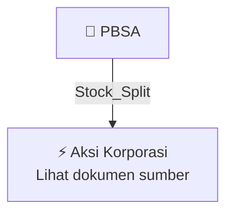

# ✂️ Pemecahan Nilai Nominal Saham (Stock Split) — [[PBSA]]

⬅️ [[knowledge-base/daily-digests/Daily_Digest_20261009|Kembali ke Daily Digest]] | 📅 **2026-10-09** | 🎛️ [[Dashboard|Ke Dashboard Utama]]

> [!IMPORTANT]
> Laporan ini disusun secara otomatis oleh **Corporate Action Intelligence Agent** pada **2026-10-09**.
> Sumber dokumen: `20261008_PBSA_20261008_PBSA_Keterbukaan Informasi terkait Aksi Korporasi_32164716_lamp1.pdf`

---

## 📌 1. Ringkasan Eksekutif & Tujuan Strategis

- **Kode & Nama Emiten**: `[[PBSA]]`
- **Kategori Aksi Korporasi**: `Stock_Split`
- **Dokumen Sumber**: `20261008_PBSA_20261008_PBSA_Keterbukaan Informasi terkait Aksi Korporasi_32164716_lamp1.pdf`
- **Tanggal Laporan**: `2026-10-09`

[Analisis LLM tidak tersedia — isi manual]

---

## 📊 2. Fakta Material & Parameter Keuangan

| Parameter Utama | Nilai / Keterangan |
| :--- | :--- |
| **Nama Perseroan** | `PT Paramita Bangun Sarana Tbk` |
| **Kode Emiten** | `PBSA` |
| **Jenis Aksi Korporasi** | `Stock Split / Pemecahan Saham` |
| **Tanggal RUPSLB Persetujuan Stock Split** | `18 September 2026` |
| **Tanggal Keterbukaan Informasi** | `8 Oktober 2026` |
| **Nilai Nominal Saham Sebelum Stock Split** | `Rp50 per saham` |
| **Nilai Nominal Saham Setelah Stock Split** | `Rp25 per saham` |
| **Dasar Hukum** | `POJK Nomor 15/POJK.04/2022 dan Surat Keputusan Direksi BEI Nomor KEP-00044/BEI/04-2024` |
| **Tujuan Stock Split** | `Meningkatkan keterjangkauan harga saham bagi investor serta mendukung peningkatan likuiditas perdagangan saham Perseroan di Bursa Efek Indonesia` |
| **Persetujuan Perubahan Anggaran Dasar** | `Menyetujui perubahan Pasal 4 Anggaran Dasar Perseroan sehubungan dengan perubahan nilai nominal saham dalam rangka Stock Split` |
| **Pemberian Kuasa kepada Direksi** | `Memberikan wewenang dan kuasa dengan hak substitusi kepada salah seorang anggota Direksi untuk melaksanakan Stock Split, termasuk mengatur tata cara dan jadwal pelaksanaan, menyatakan keputusan dalam Akta Notaris, serta memohon persetujuan perubahan anggaran dasar kepada instansi berwenang` |
| **Kegiatan Usaha Utama** | `Jasa konstruksi dan aktivitas usaha terkait` |
| **Kantor Pusat** | `Plaza Paramita, DKI Jakarta 10130, Indonesia` |

---

## 👥 3. Struktur Kepemilikan, Pengendali & Pembeli Siaga

- **Emiten**: `PBSA` | Informasi kepemilikan mengacu pada dokumen resmi sumber.

---

## 🎯 4. Alokasi & Rencana Penggunaan Dana

- Informasi alokasi dana belum tersedia — lihat prospektus / dokumen resmi.

---

## 📅 5. Timeline & Jadwal Pelaksanaan

| Tahapan / Event | Tanggal |
| :--- | :---: |
| **Jadwal** | Lihat dokumen sumber. |

---

## 📈 6. Diagram Visual Flowchart (Mermaid)

---

## 💡 7. Rekomendasi Investor & Strategi Trading

[Analisis LLM tidak tersedia — isi manual]

---

## 🔗 8. Hubungan Note Terkait (Knowledge Graph)

- [[knowledge-base/daily-digests/Daily_Digest_20261009|📄 Daily Digest 2026-10-09]]
- [[knowledge-base/trading-signals/Trading_Signals_20261009|🎯 Sinyal Cuan 2026-10-09]]
- [[PBSA|🏬 Halaman Emiten PBSA]]
- [[Dashboard|🎛️ Kembali ke Dashboard Utama]]

---

*Laporan dibuat otomatis oleh Corporate Action Intelligence Agent · 2026-10-09*