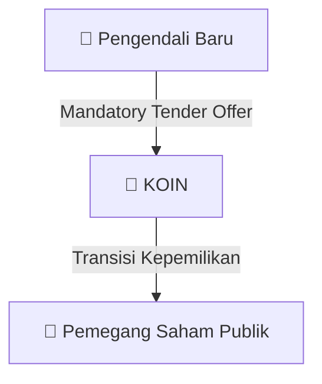

# ⚡ Laporan Intelijen Aksi Korporasi: [[KOIN]] - Aksi Korporasi

⬅️ [[knowledge-base/daily-digests/Daily_Digest_20260917|Kembali ke Daily Digest]] | 📅 **2026-09-17** | 🎛️ [[Dashboard|Ke Dashboard Utama]]

> [!IMPORTANT]
> Laporan ini disusun secara otomatis oleh **Corporate Action Intelligence Agent** untuk memetakan implikasi strategis, rasio keuangan, alokasi dana, jadwal penting, dan panduan investor.

---

## 📌 1. Ringkasan Eksekutif & Katalis Strategis
- **Kode & Nama Emiten**: `[[KOIN]]`
- **Kategori Aksi Korporasi**: `Aksi Korporasi`
- **Dokumen Resmi Bursa**: `Keterbukaan Informasi Tentang PengambilalihanPenawaran Tender WajibRefloat`
- **Ringkasan Inti Aksi**: Pencatatan saham tambahan hasil konversi waran KOIN.

---

## 📊 2. Matriks Parameter Material & Angka Kunci
- **Detail Dokumen**: Rincian angka terlampir pada dokumen resmi `20260917_KOIN_20260917_KOIN_Keterbukaan Informasi Tentang PengambilalihanPenawaran Tender WajibRefloat_32149263.pdf`.

---

## 🏢 3. Struktur Akuisisi & Pengendali Baru
- **Pengendali Baru**: `[[Pengendali Baru]]`
- **Aksi Korporasi**: Pelaksanaan Penawaran Tender Wajib (MTO) & penyesuaian porsi *Free Float* publik.

## 📈 4. Visualisasi Alur MTO

## 💡 5. Panduan Strategi Investor (Risk-Free Arbitrase MTO)
- 🎯 **Strategi Arbitrase**: Bandingkan harga penawaran MTO resmi vs harga pasar reguler. Jika harga MTO lebih tinggi, manfaatkan untuk arbitrase risiko rendah!

---

## 🔗 Hubungan Note Terkait (Knowledge Graph)
- [[knowledge-base/daily-digests/Daily_Digest_20260917|📄 Daily Digest 2026-09-17]]
- [[knowledge-base/trading-signals/Trading_Signals_20260917|🎯 Sinyal Cuan 2026-09-17]]
- [[Dashboard|🎛️ Kembali ke Dashboard]]