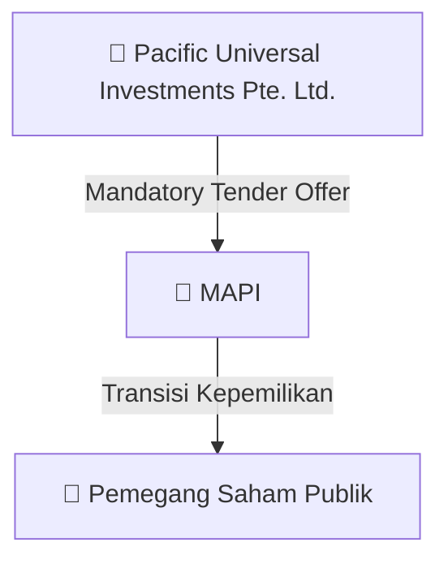

# ⚡ Laporan Aksi Korporasi Khusus: [[MAPI]] - Mandatory Tender Offer

⬅️ [[knowledge-base/daily-digests/Daily_Digest_20260804|Kembali ke Daily Digest]] | 📅 **2026-08-04** | 🎛️ [[Dashboard|Ke Dashboard Utama]]

> [!IMPORTANT]
> Dokumen ini disatukan secara otomatis oleh **Corporate Action Intelligence Agent** untuk memetakan implikasi strategis, rasio keuangan, alokasi dana, dan panduan investor.

---

## 📌 1. Ringkasan Eksekutif & Tujuan Strategis
- **Emiten**: `[[MAPI]]`
- **Kategori Aksi**: `Mandatory Tender Offer`
- **Judul Dokumen Resmi**: `Tanggapan BEI MTO Pacific Universal Investments`
- **Ringkasan Utama**: Pengumuman aksi korporasi Mandatory Tender Offer oleh MAPI.

---

## 📊 2. Fakta Material & Parameter Utama
- **Detail**: Informasi lengkap terlampir pada dokumen resmi MAPI_MTO.pdf.

---

## 🏢 3. Struktur Akuisisi & Pengendali Baru
- **Pengendali Baru**: `[[Pacific Universal Investments Pte. Ltd.]]`
- **Aksi Korporasi**: Pelaksanaan Penawaran Tender Wajib (MTO) & penyesuaian porsi *Free Float* publik.

## 📈 4. Visualisasi Alur MTO

## 💡 6. Panduan Strategi Investor & Arbitrase
- 🎯 **Strategi Arbitrase**: Bandingkan harga penawaran MTO resmi vs harga pasar reguler. Jika harga MTO lebih tinggi, manfaatkan untuk arbitrase risiko rendah!

---

## 🔗 Hubungan Note Terkait (Knowledge Graph)
- [[knowledge-base/daily-digests/Daily_Digest_20260804|📄 Daily Digest 2026-08-04]]
- [[knowledge-base/trading-signals/Trading_Signals_20260804|🎯 Sinyal Cuan 2026-08-04]]
- [[Dashboard|🎛️ Kembali ke Dashboard]]