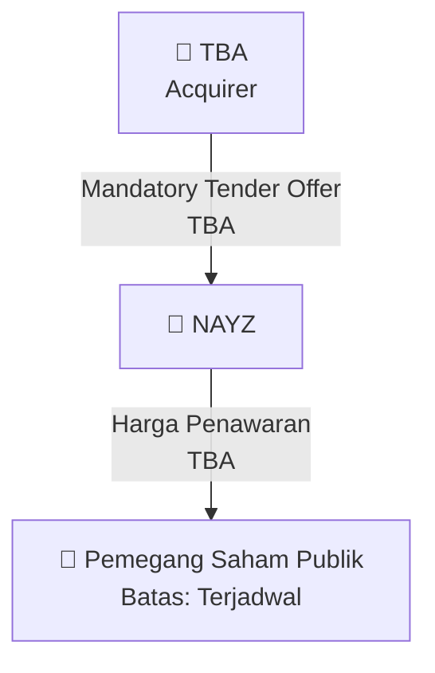

# 🎯 Mandatory Tender Offer (MTO) — [[NAYZ]]

⬅️ [[knowledge-base/daily-digests/Daily_Digest_20261005|Kembali ke Daily Digest]] | 📅 **2026-10-05** | 🎛️ [[Dashboard|Ke Dashboard Utama]]

> [!IMPORTANT]
> Laporan ini disusun secara otomatis oleh **Corporate Action Intelligence Agent** pada **2026-10-05**.
> Sumber dokumen: `20261002_NAYZ_20261001_NAYZ_Keterbukaan Informasi Tentang PengambilalihanPenawaran Tender WajibRefloat_32162428_lamp2.pdf`

---

## 📌 1. Ringkasan Eksekutif & Tujuan Strategis

- **Kode & Nama Emiten**: `[[NAYZ]]`
- **Kategori Aksi Korporasi**: `Tender_Offer`
- **Dokumen Sumber**: `20261002_NAYZ_20261001_NAYZ_Keterbukaan Informasi Tentang PengambilalihanPenawaran Tender WajibRefloat_32162428_lamp2.pdf`
- **Tanggal Laporan**: `2026-10-05`

[Analisis LLM tidak tersedia — isi manual]

---

## 📊 2. Fakta Material & Parameter Keuangan

| Parameter Utama | Nilai / Keterangan |
| :--- | :--- |
| **Pengendali Baru** | `TBA` |
| **Pihak Pembeli** | `TBA` |
| **Harga Penawaran MTO** | `TBA` |
| **Persentase Akuisisi** | `TBA` |
| **Batas Waktu Tender** | `Terjadwal` |

---

## 👥 3. Struktur Kepemilikan, Pengendali & Pembeli Siaga

- **Pengendali Baru / Acquirer**: `TBA`
- **Persentase Saham Diakuisisi**: `TBA`
- **Harga Penawaran**: `TBA`

---

## 🎯 4. Alokasi & Rencana Penggunaan Dana

- **Harga Penawaran MTO**: `TBA` per saham
- **Tujuan**: Konsolidasi kepemilikan pasca perubahan pengendali.

---

## 📅 5. Timeline & Jadwal Pelaksanaan

| Tahapan / Event | Tanggal |
| :--- | :---: |
| **Batas Waktu Tender** | `Terjadwal` |

---

## 📈 6. Diagram Visual Flowchart (Mermaid)

---

## 💡 7. Rekomendasi Investor & Strategi Trading

[Analisis LLM tidak tersedia — isi manual]

---

## 🔗 8. Hubungan Note Terkait (Knowledge Graph)

- [[knowledge-base/daily-digests/Daily_Digest_20261005|📄 Daily Digest 2026-10-05]]
- [[knowledge-base/trading-signals/Trading_Signals_20261005|🎯 Sinyal Cuan 2026-10-05]]
- [[NAYZ|🏬 Halaman Emiten NAYZ]]
- [[Dashboard|🎛️ Kembali ke Dashboard Utama]]

---

*Laporan dibuat otomatis oleh Corporate Action Intelligence Agent · 2026-10-05*