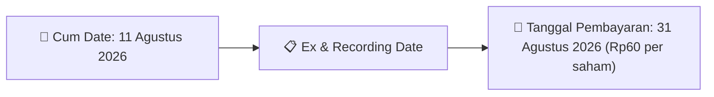

# Ikhtisar Pasar Harian (Daily Digest) - 2026-08-03

⬅️ [[Daily_Digest_20260731]] | 📅 **2026-08-03** | ➡️ [[Daily_Digest_20260804]]

## 1. Radar Pasar & Sentimen Harian (Executive Dashboard)
> [!NOTE]
> Terdeteksi sebanyak **141 pengumuman baru** dari 61 emiten pantauan pada (2026-08-03).

| Metric | Jumlah | Status Radar |
| :--- | :---: | :--- |
| **🟢 Sentimen Bullish / Positif** | `6` | [[Dividen Interim]], [[Mandatory Tender Offer]], Kinerja Positif |
| **⚪ Sentimen Netral / Routine** | `58` | [[Tanggapan Penjelasan Bursa]], [[RUPS]], [[Pendaftaran Unit]] |
| **🔴 Sentimen Bearish / Alert** | `1` | Sengketa Hukum, Defisit / Gugatan (Nihil hari ini) |
| **📄 [[Laporan Keuangan]] Baru** | `0` | Memicu Analisis Keuangan Otomatis |

> [!NOTE]
> Tidak dideteksi adanya publikasi laporan keuangan baru hari ini. Rangkuman per emiten secara terperinci tidak diperlukan.

---

## 2. Sorotan Utama & Watchlist Strategis (Strategic Watchlist)
#### 💰 Watchlist Dividen & Distribution
- **[[AMAR]]**: Nominal Dividen = Rp3,9 per saham
- **[[AMAR]]**: Total Dividen = Rp70.25 Miliar
- **[[AMAR]]**: Cum Date = 11 Agustus 2026
- **[[AMAR]]**: Ex Date = 12 Agustus 2026
- **[[AMAR]]**: Recording Date = 13 Agustus 2026
- **[[AMAR]]**: Tanggal Pembayaran = 28 Agustus 2026

#### 📈 Watchlist Konversi Waran & Potensi Dilusi
- **[[HUMI]]**: Jumlah Waran Dikonversi = 2,381 lembar
- **[[HUMI]]**: Jumlah Saham Setelah Konversi = 18,063,334,341 lembar
- **[[HUMI]]**: Sisa Waran = 2,381 lembar
- **[[INET]]**: Jumlah Waran Dikonversi = 7,855 lembar
- **[[INET]]**: Jumlah Saham Setelah Konversi = 22,375,066,403 lembar
- **[[INET]]**: Sisa Waran = 7,855 lembar

---

## 3. Matriks Pengumuman Pasar (Announcements Intelligence Table)
| Emiten | Sentimen | Jenis Pengumuman | Judul Pengumuman | Berkas |
| :--- | :---: | :--- | :--- | :--- |
| **[[CSIS]]** | ⚪ NEUTRAL | Aksi Korporasi | LK-03082026-7171-00 | [Utama](file:///g:/My%20Drive/Model2/reports/raw/CSIS/20260803_CSIS_LK-03082026-7171-00.pdf) |
| **[[R-ABFII]]** | ⚪ NEUTRAL | Aksi Korporasi | R-ABFII R-ABFII Pencatatan AwalTambahan ETF | [Utama](file:///g:/My%20Drive/Model2/reports/raw/R-ABFII/20260803_R-ABFII_20260731_R-ABFII_Pencatatan AwalTambahan ETF_32116579.pdf) · [Lamp 1](file:///g:/My%20Drive/Model2/reports/raw/R-ABFII/20260803_R-ABFII_20260731_R-ABFII_Pencatatan AwalTambahan ETF_32116579_lamp1.pdf) |
| **[[R-ABFII]]** | ⚪ NEUTRAL | Aksi Korporasi | R-ABFII R-ABFII Laporan Jumlah Peredaran Unit Penyertaan | [Utama](file:///g:/My%20Drive/Model2/reports/raw/R-ABFII/20260803_R-ABFII_20260803_R-ABFII_Laporan Jumlah Peredaran Unit Penyertaan_32117200.pdf) |
| **[[DR]]** | ⚪ NEUTRAL | Aksi Korporasi | DR DR Keterbukaan Informasi | [Utama](file:///g:/My%20Drive/Model2/reports/raw/DR/20260803_DR_20260803_DR_Keterbukaan Informasi_32117202.pdf) · [Lamp 1](file:///g:/My%20Drive/Model2/reports/raw/DR/20260803_DR_20260803_DR_Keterbukaan Informasi_32117202_lamp1.pdf) |
| **[[HUMI]]** | ⚪ NEUTRAL | Aksi Korporasi | Pencatatan Saham Tambahan dari Konversi | [Utama](file:///g:/My%20Drive/Model2/reports/raw/HUMI/20260803_HUMI_20260731_HUMI_Pencatatan Saham Tambahan dari Konversi_32116612.pdf) · [Lamp 1](file:///g:/My%20Drive/Model2/reports/raw/HUMI/20260803_HUMI_20260731_HUMI_Pencatatan Saham Tambahan dari Konversi_32116612_lamp1.pdf) |
| **[[ANTM]]** | ⚪ NEUTRAL | Aksi Korporasi | Laporan Informasi dan Fakta Material | [Utama](file:///g:/My%20Drive/Model2/reports/raw/ANTM/20260803_ANTM_20260803_ANTM_Laporan Informasi dan Fakta Material_32116999.pdf) · [Lamp 2](file:///g:/My%20Drive/Model2/reports/raw/ANTM/20260803_ANTM_20260803_ANTM_Laporan Informasi dan Fakta Material_32116999_lamp2.pdf) · [Lamp 1](file:///g:/My%20Drive/Model2/reports/raw/ANTM/20260803_ANTM_20260803_ANTM_Laporan Informasi dan Fakta Material_32116999_lamp1.pdf) |
| **[[INET]]** | ⚪ NEUTRAL | Aksi Korporasi | Pencatatan Saham Tambahan dari Konversi | [Utama](file:///g:/My%20Drive/Model2/reports/raw/INET/20260803_INET_20260731_INET_Pencatatan Saham Tambahan dari Konversi_32116636.pdf) |
| **[[GENERAL]]** | ⚪ NEUTRAL | Aksi Korporasi | Pemantauan Khusus | [Utama](file:///g:/My%20Drive/Model2/reports/raw/GENERAL/20260803__20260803_Pemantauan Khusus_32117206.pdf) |
| **[[ISAP]]** | ⚪ NEUTRAL | Aksi Korporasi | Pencatatan Saham Tambahan dari Konversi | [Utama](file:///g:/My%20Drive/Model2/reports/raw/ISAP/20260803_ISAP_20260731_ISAP_Pencatatan Saham Tambahan dari Konversi_32116531.pdf) · [Lamp 1](file:///g:/My%20Drive/Model2/reports/raw/ISAP/20260803_ISAP_20260731_ISAP_Pencatatan Saham Tambahan dari Konversi_32116531_lamp1.pdf) |
| **[[HAIS]]** | ⚪ NEUTRAL | RUPS | Pengumuman RUPS | [Utama](file:///g:/My%20Drive/Model2/reports/raw/HAIS/20260803_HAIS_20260803_HAIS_Pengumuman RUPS_32117153.pdf) · [Lamp 1](file:///g:/My%20Drive/Model2/reports/raw/HAIS/20260803_HAIS_20260803_HAIS_Pengumuman RUPS_32117153_lamp1.pdf) |
| **[[DOOH]]** | ⚪ NEUTRAL | Aksi Korporasi | LK-03082026-5405-00 | [Utama](file:///g:/My%20Drive/Model2/reports/raw/DOOH/20260803_DOOH_LK-03082026-5405-00.pdf) |
| **[[DOOH]]** | ⚪ NEUTRAL | Aksi Korporasi | LK-03082026-4115-00 | [Utama](file:///g:/My%20Drive/Model2/reports/raw/DOOH/20260803_DOOH_LK-03082026-4115-00.pdf) |
| **[[XRDN]]** | ⚪ NEUTRAL | Aksi Korporasi | Pencatatan AwalTambahan ETF | [Utama](file:///g:/My%20Drive/Model2/reports/raw/XRDN/20260803_XRDN_20260731_XRDN_Pencatatan AwalTambahan ETF_32116614.pdf) · [Lamp 1](file:///g:/My%20Drive/Model2/reports/raw/XRDN/20260803_XRDN_20260731_XRDN_Pencatatan AwalTambahan ETF_32116614_lamp1.pdf) |
| **[[XRDN]]** | ⚪ NEUTRAL | Aksi Korporasi | Laporan Jumlah Peredaran Unit Penyertaan | [Utama](file:///g:/My%20Drive/Model2/reports/raw/XRDN/20260803_XRDN_20260803_XRDN_Laporan Jumlah Peredaran Unit Penyertaan_32117159.pdf) |
| **[[MGNA]]** | ⚪ NEUTRAL | Aksi Korporasi | Laporan Penggunaan Dana Hasil Penawaran Umum | [Utama](file:///g:/My%20Drive/Model2/reports/raw/MGNA/20260803_MGNA_20260803_MGNA_Laporan Penggunaan Dana Hasil Penawaran Umum_32117045.pdf) |
| **[[MBSS]]** | ⚪ NEUTRAL | Aksi Korporasi | LK-03082026-1158-00 | [Utama](file:///g:/My%20Drive/Model2/reports/raw/MBSS/20260803_MBSS_LK-03082026-1158-00.pdf) |
| **[[BDMN]]** | ⚪ NEUTRAL | Aksi Korporasi | Laporan Informasi dan Fakta Material | [Utama](file:///g:/My%20Drive/Model2/reports/raw/BDMN/20260803_BDMN_20260803_BDMN_Laporan Informasi dan Fakta Material_32117127.pdf) |
| **[[ELSA]]** | ⚪ NEUTRAL | RUPS | Pengumuman RUPS | [Utama](file:///g:/My%20Drive/Model2/reports/raw/ELSA/20260803_ELSA_20260803_ELSA_Pengumuman RUPS_32117251.pdf) |
| **[[SRTG]]** | 🟢 BULLISH | Buyback | Laporan Pengalihan Saham Hasil Buy Back | [Utama](file:///g:/My%20Drive/Model2/reports/raw/SRTG/20260803_SRTG_20260803_SRTG_Laporan Pengalihan Saham Hasil Buy Back_32117154.pdf) |
| **[[TBIG]]** | ⚪ NEUTRAL | Aksi Korporasi | Penyampaian ProspektusInformasi Tambahan | [Utama](file:///g:/My%20Drive/Model2/reports/raw/TBIG/20260803_TBIG_20260803_TBIG_Penyampaian ProspektusInformasi Tambahan_32116945.pdf) · [Lamp 1](file:///g:/My%20Drive/Model2/reports/raw/TBIG/20260803_TBIG_20260803_TBIG_Penyampaian ProspektusInformasi Tambahan_32116945_lamp1.pdf) |
| **[[WINS]]** | ⚪ NEUTRAL | Aksi Korporasi | Laporan Informasi dan Fakta Material | [Utama](file:///g:/My%20Drive/Model2/reports/raw/WINS/20260803_WINS_20260803_WINS_Laporan Informasi dan Fakta Material_32117254.pdf) · [Lamp 1](file:///g:/My%20Drive/Model2/reports/raw/WINS/20260803_WINS_20260803_WINS_Laporan Informasi dan Fakta Material_32117254_lamp1.pdf) |
| **[[NSSS]]** | ⚪ NEUTRAL | Aksi Korporasi | LK-03082026-6177-00 | [Utama](file:///g:/My%20Drive/Model2/reports/raw/NSSS/20260803_NSSS_LK-03082026-6177-00.pdf) |
| **[[CYBR]]** | ⚪ NEUTRAL | Aksi Korporasi | Pencatatan Saham Tambahan dari Konversi | [Utama](file:///g:/My%20Drive/Model2/reports/raw/CYBR/20260803_CYBR_20260731_CYBR_Pencatatan Saham Tambahan dari Konversi_32116548.pdf) |
| **[[INPP]]** | ⚪ NEUTRAL | Aksi Korporasi | Laporan Informasi dan Fakta Material | [Utama](file:///g:/My%20Drive/Model2/reports/raw/INPP/20260803_INPP_20260803_INPP_Laporan Informasi dan Fakta Material_32117182.pdf) · [Lamp 1](file:///g:/My%20Drive/Model2/reports/raw/INPP/20260803_INPP_20260803_INPP_Laporan Informasi dan Fakta Material_32117182_lamp1.pdf) |
| **[[DMAS]]** | ⚪ NEUTRAL | Aksi Korporasi | Laporan Informasi dan Fakta Material | [Utama](file:///g:/My%20Drive/Model2/reports/raw/DMAS/20260803_DMAS_20260803_DMAS_Laporan Informasi dan Fakta Material_32116986.pdf) · [Lamp 1](file:///g:/My%20Drive/Model2/reports/raw/DMAS/20260803_DMAS_20260803_DMAS_Laporan Informasi dan Fakta Material_32116986_lamp1.pdf) |
| **[[XIML]]** | ⚪ NEUTRAL | Aksi Korporasi | Laporan Jumlah Peredaran Unit Penyertaan | [Utama](file:///g:/My%20Drive/Model2/reports/raw/XIML/20260803_XIML_20260803_XIML_Laporan Jumlah Peredaran Unit Penyertaan_32117158.pdf) |
| **[[XIJI]]** | ⚪ NEUTRAL | Aksi Korporasi | Pencatatan AwalTambahan ETF | [Utama](file:///g:/My%20Drive/Model2/reports/raw/XIJI/20260803_XIJI_20260731_XIJI_Pencatatan AwalTambahan ETF_32116596.pdf) · [Lamp 1](file:///g:/My%20Drive/Model2/reports/raw/XIJI/20260803_XIJI_20260731_XIJI_Pencatatan AwalTambahan ETF_32116596_lamp1.pdf) |
| **[[CASH]]** | ⚪ NEUTRAL | Aksi Korporasi | Laporan Informasi dan Fakta Material | [Utama](file:///g:/My%20Drive/Model2/reports/raw/CASH/20260803_CASH_20260803_CASH_Laporan Informasi dan Fakta Material_32116970.pdf) · [Lamp 2](file:///g:/My%20Drive/Model2/reports/raw/CASH/20260803_CASH_20260803_CASH_Laporan Informasi dan Fakta Material_32116970_lamp2.pdf) |
| **[[DNRK]]** | ⚪ NEUTRAL | Aksi Korporasi | Laporan Informasi dan Fakta Material | [Utama](file:///g:/My%20Drive/Model2/reports/raw/DNRK/20260803_DNRK_20260803_DNRK_Laporan Informasi dan Fakta Material_32116974.pdf) · [Lamp 1](file:///g:/My%20Drive/Model2/reports/raw/DNRK/20260803_DNRK_20260803_DNRK_Laporan Informasi dan Fakta Material_32116974_lamp1.pdf) |
| **[[ASMI]]** | 🔴 BEARISH | Aksi Korporasi | Suspensi dan Pembukaan Suspensi | [Utama](file:///g:/My%20Drive/Model2/reports/raw/ASMI/20260803_ASMI_20260803_Suspensi dan Pembukaan Suspensi_32116938.pdf) · [Lamp 1](file:///g:/My%20Drive/Model2/reports/raw/ASMI/20260803_ASMI_20260803_Suspensi dan Pembukaan Suspensi_32116938_lamp1.pdf) |
| **[[WINR]]** | ⚪ NEUTRAL | Aksi Korporasi | LK-03082026-1543-00 | [Utama](file:///g:/My%20Drive/Model2/reports/raw/WINR/20260803_WINR_LK-03082026-1543-00.pdf) |
| **[[KPIG]]** | ⚪ NEUTRAL | Aksi Korporasi | Laporan Informasi dan Fakta Material | [Utama](file:///g:/My%20Drive/Model2/reports/raw/KPIG/20260803_KPIG_20260803_KPIG_Laporan Informasi dan Fakta Material_32116929.pdf) · [Lamp 1](file:///g:/My%20Drive/Model2/reports/raw/KPIG/20260803_KPIG_20260803_KPIG_Laporan Informasi dan Fakta Material_32116929_lamp1.pdf) · [Lamp 2](file:///g:/My%20Drive/Model2/reports/raw/KPIG/20260803_KPIG_20260803_KPIG_Laporan Informasi dan Fakta Material_32116929_lamp2.pdf) |
| **[[BHIT]]** | ⚪ NEUTRAL | Aksi Korporasi | Laporan Informasi dan Fakta Material | [Utama](file:///g:/My%20Drive/Model2/reports/raw/BHIT/20260803_BHIT_20260802_BHIT_Laporan Informasi dan Fakta Material_32116927.pdf) · [Lamp 1](file:///g:/My%20Drive/Model2/reports/raw/BHIT/20260803_BHIT_20260802_BHIT_Laporan Informasi dan Fakta Material_32116928_lamp1.pdf) · [Lamp 2](file:///g:/My%20Drive/Model2/reports/raw/BHIT/20260803_BHIT_20260802_BHIT_Laporan Informasi dan Fakta Material_32116928_lamp2.pdf) · [Lamp 1](file:///g:/My%20Drive/Model2/reports/raw/BHIT/20260803_BHIT_20260802_BHIT_Laporan Informasi dan Fakta Material_32116927_lamp1.pdf) · [Lamp 2](file:///g:/My%20Drive/Model2/reports/raw/BHIT/20260803_BHIT_20260802_BHIT_Laporan Informasi dan Fakta Material_32116927_lamp2.pdf) |
| **[[BCAP]]** | ⚪ NEUTRAL | Aksi Korporasi | Laporan Informasi dan Fakta Material | [Utama](file:///g:/My%20Drive/Model2/reports/raw/BCAP/20260803_BCAP_20260802_BCAP_Laporan Informasi dan Fakta Material_32116926.pdf) · [Lamp 2](file:///g:/My%20Drive/Model2/reports/raw/BCAP/20260803_BCAP_20260802_BCAP_Laporan Informasi dan Fakta Material_32116926_lamp2.pdf) · [Lamp 1](file:///g:/My%20Drive/Model2/reports/raw/BCAP/20260803_BCAP_20260802_BCAP_Laporan Informasi dan Fakta Material_32116926_lamp1.pdf) |
| **[[BUMI]]** | ⚪ NEUTRAL | Aksi Korporasi | Laporan Informasi dan Fakta Material | [Utama](file:///g:/My%20Drive/Model2/reports/raw/BUMI/20260803_BUMI_20260802_BUMI_Laporan Informasi dan Fakta Material_32116922.pdf) |
| **[[DJPU]]** | ⚪ NEUTRAL | Aksi Korporasi | Pengumuman Pencatatan Awal Obligasi dan Sukuk | [Utama](file:///g:/My%20Drive/Model2/reports/raw/DJPU/20260803_DJPU_20260730_DJPU_Pengumuman Pencatatan Awal Obligasi dan Sukuk_32116295.pdf) · [Lamp 2](file:///g:/My%20Drive/Model2/reports/raw/DJPU/20260803_DJPU_20260730_DJPU_Pengumuman Pencatatan Awal Obligasi dan Sukuk_32116295_lamp2.pdf) · [Lamp 1](file:///g:/My%20Drive/Model2/reports/raw/DJPU/20260803_DJPU_20260730_DJPU_Pengumuman Pencatatan Awal Obligasi dan Sukuk_32116295_lamp1.pdf) |
| **[[PPLN]]** | ⚪ NEUTRAL | Aksi Korporasi | Pengumuman Jatuh Tempo Obligasi dan Sukuk | [Utama](file:///g:/My%20Drive/Model2/reports/raw/PPLN/20260803_PPLN_20260731_PPLN_Pengumuman Jatuh Tempo Obligasi dan Sukuk_32116558.pdf) · [Lamp 2](file:///g:/My%20Drive/Model2/reports/raw/PPLN/20260803_PPLN_20260731_PPLN_Pengumuman Jatuh Tempo Obligasi dan Sukuk_32116558_lamp2.pdf) · [Lamp 1](file:///g:/My%20Drive/Model2/reports/raw/PPLN/20260803_PPLN_20260731_PPLN_Pengumuman Jatuh Tempo Obligasi dan Sukuk_32116558_lamp1.pdf) |
| **[[PACK]]** | ⚪ NEUTRAL | Aksi Korporasi | Pencatatan Saham Tambahan dari Konversi | [Utama](file:///g:/My%20Drive/Model2/reports/raw/PACK/20260803_PACK_20260731_PACK_Pencatatan Saham Tambahan dari Konversi_32116564.pdf) |
| **[[PJHB]]** | ⚪ NEUTRAL | Aksi Korporasi | Pencatatan Saham Tambahan dari Konversi | [Utama](file:///g:/My%20Drive/Model2/reports/raw/PJHB/20260803_PJHB_20260731_PJHB_Pencatatan Saham Tambahan dari Konversi_32116598.pdf) |
| **[[MANG]]** | ⚪ NEUTRAL | Aksi Korporasi | Pencatatan Saham Tambahan dari Konversi | [Utama](file:///g:/My%20Drive/Model2/reports/raw/MANG/20260803_MANG_20260731_MANG_Pencatatan Saham Tambahan dari Konversi_32116468.pdf) · [Lamp 1](file:///g:/My%20Drive/Model2/reports/raw/MANG/20260803_MANG_20260731_MANG_Pencatatan Saham Tambahan dari Konversi_32116468_lamp1.pdf) |
| **[[BNBR]]** | ⚪ NEUTRAL | Aksi Korporasi | Pencatatan Saham Tambahan dari Konversi | [Utama](file:///g:/My%20Drive/Model2/reports/raw/BNBR/20260803_BNBR_20260731_BNBR_Pencatatan Saham Tambahan dari Konversi_32116588.pdf) · [Lamp 1](file:///g:/My%20Drive/Model2/reports/raw/BNBR/20260803_BNBR_20260731_BNBR_Pencatatan Saham Tambahan dari Konversi_32116588_lamp1.pdf) |
| **[[IFII]]** | ⚪ NEUTRAL | Aksi Korporasi | Tanggapan atas Permintaan Penjelasan Bursa | [Utama](file:///g:/My%20Drive/Model2/reports/raw/IFII/20260803_IFII_20260803_IFII_Tanggapan atas Permintaan Penjelasan Bursa_32116931.pdf) |
| **[[NICK]]** | ⚪ NEUTRAL | Aksi Korporasi | Tanggapan atas Permintaan Penjelasan Bursa | [Utama](file:///g:/My%20Drive/Model2/reports/raw/NICK/20260803_NICK_20260803_NICK_Tanggapan atas Permintaan Penjelasan Bursa_32116933.pdf) |
| **[[LPLI]]** | ⚪ NEUTRAL | Aksi Korporasi | Tanggapan atas Permintaan Penjelasan Bursa | [Utama](file:///g:/My%20Drive/Model2/reports/raw/LPLI/20260803_LPLI_20260803_LPLI_Tanggapan atas Permintaan Penjelasan Bursa_32117211.pdf) |
| **[[OILS]]** | ⚪ NEUTRAL | RUPS | Pemanggilan RUPS | [Utama](file:///g:/My%20Drive/Model2/reports/raw/OILS/20260803_OILS_20260803_OILS_Pemanggilan RUPS_32117060.pdf) · [Lamp 1](file:///g:/My%20Drive/Model2/reports/raw/OILS/20260803_OILS_20260803_OILS_Pemanggilan RUPS_32117060_lamp1.pdf) |
| **[[OMED]]** | ⚪ NEUTRAL | Aksi Korporasi | Laporan Informasi dan Fakta Material | [Utama](file:///g:/My%20Drive/Model2/reports/raw/OMED/20260803_OMED_20260803_OMED_Laporan Informasi dan Fakta Material_32116930.pdf) · [Lamp 3](file:///g:/My%20Drive/Model2/reports/raw/OMED/20260803_OMED_20260803_OMED_Laporan Informasi dan Fakta Material_32116930_lamp3.pdf) · [Lamp 2](file:///g:/My%20Drive/Model2/reports/raw/OMED/20260803_OMED_20260803_OMED_Laporan Informasi dan Fakta Material_32116930_lamp2.pdf) · [Lamp 1](file:///g:/My%20Drive/Model2/reports/raw/OMED/20260803_OMED_20260803_OMED_Laporan Informasi dan Fakta Material_32116930_lamp1.pdf) |
| **[[AMAR]]** | 🟢 BULLISH | Dividen | Jadwal Aksi Korporasi (Khusus Penyampaian Dividen Interim) | [Utama](file:///g:/My%20Drive/Model2/reports/raw/AMAR/20260803_AMAR_20260803_AMAR_Jadwal Aksi Korporasi (Khusus Penyampaian Dividen Interim)_32117190.pdf) |
| **[[ALKA]]** | ⚪ NEUTRAL | Aksi Korporasi | Tanggapan atas Permintaan Penjelasan Bursa | [Utama](file:///g:/My%20Drive/Model2/reports/raw/ALKA/20260803_ALKA_20260803_ALKA_Tanggapan atas Permintaan Penjelasan Bursa_32117198.pdf) |
| **[[CBDK]]** | ⚪ NEUTRAL | Aksi Korporasi | Laporan Informasi dan Fakta Material | [Utama](file:///g:/My%20Drive/Model2/reports/raw/CBDK/20260803_CBDK_20260803_CBDK_Laporan Informasi dan Fakta Material_32117192.pdf) · [Lamp 1](file:///g:/My%20Drive/Model2/reports/raw/CBDK/20260803_CBDK_20260803_CBDK_Laporan Informasi dan Fakta Material_32117192_lamp1.pdf) |
| **[[TOWR]]** | ⚪ NEUTRAL | Aksi Korporasi | Laporan Informasi dan Fakta Material | [Utama](file:///g:/My%20Drive/Model2/reports/raw/TOWR/20260803_TOWR_20260803_TOWR_Laporan Informasi dan Fakta Material_32116981.pdf) · [Lamp 2](file:///g:/My%20Drive/Model2/reports/raw/TOWR/20260803_TOWR_20260803_TOWR_Laporan Informasi dan Fakta Material_32116981_lamp2.pdf) · [Lamp 3](file:///g:/My%20Drive/Model2/reports/raw/TOWR/20260803_TOWR_20260803_TOWR_Laporan Informasi dan Fakta Material_32116981_lamp3.pdf) |
| **[[TRGU]]** | ⚪ NEUTRAL | Aksi Korporasi | Tanggapan atas Permintaan Penjelasan Bursa | [Utama](file:///g:/My%20Drive/Model2/reports/raw/TRGU/20260803_TRGU_20260803_TRGU_Tanggapan atas Permintaan Penjelasan Bursa_32117167.pdf) · [Lamp 1](file:///g:/My%20Drive/Model2/reports/raw/TRGU/20260803_TRGU_20260803_TRGU_Tanggapan atas Permintaan Penjelasan Bursa_32117167_lamp1.pdf) |
| **[[TAPG]]** | 🟢 BULLISH | Dividen | Jadwal Aksi Korporasi (Khusus Penyampaian Dividen Interim) | [Utama](file:///g:/My%20Drive/Model2/reports/raw/TAPG/20260803_TAPG_20260803_TAPG_Jadwal Aksi Korporasi (Khusus Penyampaian Dividen Interim)_32117081.pdf) |
| **[[PANI]]** | ⚪ NEUTRAL | Aksi Korporasi | Laporan Informasi dan Fakta Material | [Utama](file:///g:/My%20Drive/Model2/reports/raw/PANI/20260803_PANI_20260803_PANI_Laporan Informasi dan Fakta Material_32117166.pdf) · [Lamp 1](file:///g:/My%20Drive/Model2/reports/raw/PANI/20260803_PANI_20260803_PANI_Laporan Informasi dan Fakta Material_32117166_lamp1.pdf) |
| **[[MAPI]]** | 🟢 BULLISH | Aksi Korporasi | Tanggapan atas Permintaan Penjelasan Bursa | [Utama](file:///g:/My%20Drive/Model2/reports/raw/MAPI/20260803_MAPI_20260803_MAPI_Tanggapan atas Permintaan Penjelasan Bursa_32117079.pdf) |
| **[[PADI]]** | ⚪ NEUTRAL | Aksi Korporasi | LK-03082026-2866-00 | [Utama](file:///g:/My%20Drive/Model2/reports/raw/PADI/20260803_PADI_LK-03082026-2866-00.pdf) |
| **[[BEKS]]** | ⚪ NEUTRAL | Aksi Korporasi | Laporan Informasi dan Fakta Material | [Utama](file:///g:/My%20Drive/Model2/reports/raw/BEKS/20260803_BEKS_20260803_BEKS_Laporan Informasi dan Fakta Material_32117155.pdf) |
| **[[WGSH]]** | ⚪ NEUTRAL | Aksi Korporasi | Laporan Informasi dan Fakta Material | [Utama](file:///g:/My%20Drive/Model2/reports/raw/WGSH/20260803_WGSH_20260803_WGSH_Laporan Informasi dan Fakta Material_32117124.pdf) · [Lamp 1](file:///g:/My%20Drive/Model2/reports/raw/WGSH/20260803_WGSH_20260803_WGSH_Laporan Informasi dan Fakta Material_32117124_lamp1.pdf) |
| **[[AKPI]]** | ⚪ NEUTRAL | Aksi Korporasi | LK-03082026-8567-00 | [Utama](file:///g:/My%20Drive/Model2/reports/raw/AKPI/20260803_AKPI_LK-03082026-8567-00.pdf) |
| **[[BUVA]]** | ⚪ NEUTRAL | Aksi Korporasi | Laporan Informasi dan Fakta Material | [Utama](file:///g:/My%20Drive/Model2/reports/raw/BUVA/20260803_BUVA_20260803_BUVA_Laporan Informasi dan Fakta Material_32117152.pdf) · [Lamp 1](file:///g:/My%20Drive/Model2/reports/raw/BUVA/20260803_BUVA_20260803_BUVA_Laporan Informasi dan Fakta Material_32117073_lamp1.pdf) · [Lamp 1](file:///g:/My%20Drive/Model2/reports/raw/BUVA/20260803_BUVA_20260803_BUVA_Laporan Informasi dan Fakta Material_32117152_lamp1.pdf) |
| **[[KRAS]]** | ⚪ NEUTRAL | RUPS | Pemanggilan RUPS | [Utama](file:///g:/My%20Drive/Model2/reports/raw/KRAS/20260803_KRAS_20260803_KRAS_Pemanggilan RUPS_32117219.pdf) · [Lamp 1](file:///g:/My%20Drive/Model2/reports/raw/KRAS/20260803_KRAS_20260803_KRAS_Pemanggilan RUPS_32117219_lamp1.pdf) · [Lamp 2](file:///g:/My%20Drive/Model2/reports/raw/KRAS/20260803_KRAS_20260803_KRAS_Pemanggilan RUPS_32117219_lamp2.pdf) |
| **[[XIIC]]** | ⚪ NEUTRAL | Aksi Korporasi | Laporan Jumlah Peredaran Unit Penyertaan | [Utama](file:///g:/My%20Drive/Model2/reports/raw/XIIC/20260803_XIIC_20260803_XIIC_Laporan Jumlah Peredaran Unit Penyertaan_32117228.pdf) |
| **[[IBST]]** | ⚪ NEUTRAL | Aksi Korporasi | Laporan Informasi dan Fakta Material | [Utama](file:///g:/My%20Drive/Model2/reports/raw/IBST/20260803_IBST_20260803_IBST_Laporan Informasi dan Fakta Material_32117235.pdf) · [Lamp 1](file:///g:/My%20Drive/Model2/reports/raw/IBST/20260803_IBST_20260803_IBST_Laporan Informasi dan Fakta Material_32117235_lamp1.pdf) · [Lamp 2](file:///g:/My%20Drive/Model2/reports/raw/IBST/20260803_IBST_20260803_IBST_Laporan Informasi dan Fakta Material_32117235_lamp2.pdf) · [Lamp 3](file:///g:/My%20Drive/Model2/reports/raw/IBST/20260803_IBST_20260803_IBST_Laporan Informasi dan Fakta Material_32117235_lamp3.pdf) |
| **[[NPGF]]** | 🟢 BULLISH | RUPS | Ringkasan RisalahRisalah RUPS | [Utama](file:///g:/My%20Drive/Model2/reports/raw/NPGF/20260803_NPGF_20260803_NPGF_Ringkasan RisalahRisalah RUPS_32117248.pdf) · [Lamp 2](file:///g:/My%20Drive/Model2/reports/raw/NPGF/20260803_NPGF_20260803_NPGF_Ringkasan RisalahRisalah RUPS_32117248_lamp2.pdf) |
| **[[NPGF]]** | 🟢 BULLISH | Aksi Korporasi | Keterbukaan Informasi terkait Aksi Korporasi | [Utama](file:///g:/My%20Drive/Model2/reports/raw/NPGF/20260803_NPGF_20260803_NPGF_Keterbukaan Informasi terkait Aksi Korporasi_32117267.pdf) · [Lamp 1](file:///g:/My%20Drive/Model2/reports/raw/NPGF/20260803_NPGF_20260803_NPGF_Keterbukaan Informasi terkait Aksi Korporasi_32117267_lamp1.pdf) |
| **[[SHID]]** | ⚪ NEUTRAL | Aksi Korporasi | Tanggapan atas Permintaan Penjelasan Bursa | [Utama](file:///g:/My%20Drive/Model2/reports/raw/SHID/20260803_SHID_20260730_SHID_Tanggapan atas Permintaan Penjelasan Bursa_32116085.pdf) |

---

## 4. Detail Informasi per Emiten (Grouped by Emiten)
### 🔵 [[CSIS]]
- **[Aksi Korporasi]** [LK-03082026-7171-00](file:///g:/My%20Drive/Model2/reports/raw/CSIS/20260803_CSIS_LK-03082026-7171-00.pdf)
  - 📌 *Deskripsi*: Laporan perubahan kepemilikan saham insider CSIS
  - 📊 **Fakta Material**:
    - **Nama Insider**: TJOEA AUBINTORO

### 🔵 [[R-ABFII]]
- **[Aksi Korporasi]** [R-ABFII R-ABFII Pencatatan AwalTambahan ETF](file:///g:/My%20Drive/Model2/reports/raw/R-ABFII/20260803_R-ABFII_20260731_R-ABFII_Pencatatan AwalTambahan ETF_32116579.pdf) *(Attachment: [Lamp 1](file:///g:/My%20Drive/Model2/reports/raw/R-ABFII/20260803_R-ABFII_20260731_R-ABFII_Pencatatan AwalTambahan ETF_32116579_lamp1.pdf))*
  - 📌 *Deskripsi*: Pencatatan unit tambahan ETF / Reksa Dana R-ABFII
  - 📊 **Fakta Material**:
    - **Nama KIK**: Nama KIK Reksa Dana KIK ETF ABF IBI Fund Pencatatan Tambahan
    - **Jumlah Unit Tambahan**: 45,056 unit
    - **Total Unit Tercatat**: 131,266,285 unit
- **[Aksi Korporasi]** [R-ABFII R-ABFII Laporan Jumlah Peredaran Unit Penyertaan](file:///g:/My%20Drive/Model2/reports/raw/R-ABFII/20260803_R-ABFII_20260803_R-ABFII_Laporan Jumlah Peredaran Unit Penyertaan_32117200.pdf)
  - 📌 *Deskripsi*: Pencatatan unit tambahan ETF / Reksa Dana R-ABFII
  - 📊 **Fakta Material**:
    - **Total Unit Tercatat**: 3 unit

### 🔵 [[DR]]
- **[Aksi Korporasi]** [DR DR Keterbukaan Informasi](file:///g:/My%20Drive/Model2/reports/raw/DR/20260803_DR_20260803_DR_Keterbukaan Informasi_32117202.pdf) *(Attachment: [Lamp 1](file:///g:/My%20Drive/Model2/reports/raw/DR/20260803_DR_20260803_DR_Keterbukaan Informasi_32117202_lamp1.pdf))*
  - 📌 *Deskripsi*: Pencatatan saham tambahan hasil konversi waran DR

### 🔵 [[HUMI]]
- **[Aksi Korporasi]** [Pencatatan Saham Tambahan dari Konversi](file:///g:/My%20Drive/Model2/reports/raw/HUMI/20260803_HUMI_20260731_HUMI_Pencatatan Saham Tambahan dari Konversi_32116612.pdf) *(Attachment: [Lamp 1](file:///g:/My%20Drive/Model2/reports/raw/HUMI/20260803_HUMI_20260731_HUMI_Pencatatan Saham Tambahan dari Konversi_32116612_lamp1.pdf))*
  - 📌 *Deskripsi*: Pencatatan saham tambahan hasil konversi waran HUMI
  - 📊 **Fakta Material**:
    - **Jumlah Waran Dikonversi**: 2,381 lembar
    - **Jumlah Saham Setelah Konversi**: 18,063,334,341 lembar
    - **Sisa Waran**: 2,381 lembar
    - **Tanggal Pencatatan**: 03 Agustus 2026

### 🔵 [[ANTM]]
- **[Aksi Korporasi]** [Laporan Informasi dan Fakta Material](file:///g:/My%20Drive/Model2/reports/raw/ANTM/20260803_ANTM_20260803_ANTM_Laporan Informasi dan Fakta Material_32116999.pdf) *(Attachment: [Lamp 2](file:///g:/My%20Drive/Model2/reports/raw/ANTM/20260803_ANTM_20260803_ANTM_Laporan Informasi dan Fakta Material_32116999_lamp2.pdf) · [Lamp 1](file:///g:/My%20Drive/Model2/reports/raw/ANTM/20260803_ANTM_20260803_ANTM_Laporan Informasi dan Fakta Material_32116999_lamp1.pdf))*
  - 📌 *Deskripsi*: Informasi dan fakta material ANTM
  - 📊 **Fakta Material**:
    - **Uraian Kejadian**: Penyampaian rilis dengan judul Gerak Hijau 2026 Satukan Pemerintah, Dunia Usaha, dan Masyarakat untuk Aksi Nyata Peduli Lingkungan Dampak kejadian, informasi atau fakta material tersebut terhadap kegiatan operasional, hukum, kondisi keuangan, atau ke

### 🔵 [[INET]]
- **[Aksi Korporasi]** [Pencatatan Saham Tambahan dari Konversi](file:///g:/My%20Drive/Model2/reports/raw/INET/20260803_INET_20260731_INET_Pencatatan Saham Tambahan dari Konversi_32116636.pdf)
  - 📌 *Deskripsi*: Pencatatan saham tambahan hasil konversi waran INET
  - 📊 **Fakta Material**:
    - **Jumlah Waran Dikonversi**: 7,855 lembar
    - **Jumlah Saham Setelah Konversi**: 22,375,066,403 lembar
    - **Sisa Waran**: 7,855 lembar
    - **Tanggal Pencatatan**: 03 Agustus 2026

### 🔵 [[GENERAL]]
- **[Aksi Korporasi]** [Pemantauan Khusus](file:///g:/My%20Drive/Model2/reports/raw/GENERAL/20260803__20260803_Pemantauan Khusus_32117206.pdf)
  - 📌 *Deskripsi*: Siaran pers kinerja keuangan & update bisnis GENERAL (Anak Perusahaan yang) Periode 2026

### 🔵 [[ISAP]]
- **[Aksi Korporasi]** [Pencatatan Saham Tambahan dari Konversi](file:///g:/My%20Drive/Model2/reports/raw/ISAP/20260803_ISAP_20260731_ISAP_Pencatatan Saham Tambahan dari Konversi_32116531.pdf) *(Attachment: [Lamp 1](file:///g:/My%20Drive/Model2/reports/raw/ISAP/20260803_ISAP_20260731_ISAP_Pencatatan Saham Tambahan dari Konversi_32116531_lamp1.pdf))*
  - 📌 *Deskripsi*: Pencatatan saham tambahan hasil konversi waran ISAP
  - 📊 **Fakta Material**:
    - **Jumlah Waran Dikonversi**: 50 lembar
    - **Jumlah Saham Setelah Konversi**: 4,020,355,514 lembar
    - **Sisa Waran**: 50 lembar
    - **Tanggal Pencatatan**: 03 Agustus 2026

### 🔵 [[HAIS]]
- **[RUPS]** [Pengumuman RUPS](file:///g:/My%20Drive/Model2/reports/raw/HAIS/20260803_HAIS_20260803_HAIS_Pengumuman RUPS_32117153.pdf) *(Attachment: [Lamp 1](file:///g:/My%20Drive/Model2/reports/raw/HAIS/20260803_HAIS_20260803_HAIS_Pengumuman RUPS_32117153_lamp1.pdf))*
  - 📌 *Deskripsi*: Informasi dan fakta material HAIS
  - 📊 **Fakta Material**:
    - **Uraian Kejadian**: No Surat Nama Perusahaan Kode Emiten Lampiran Perihal 280/HIS-JKT/DIR-LGL06/VIII/2026 PT Hasnur Internasional Shipping Tbk HAIS 1 Pemberitahuan Rencana Rapat Umum Pemegang Saham Lu

### 🔵 [[DOOH]]
- **[Aksi Korporasi]** [LK-03082026-5405-00](file:///g:/My%20Drive/Model2/reports/raw/DOOH/20260803_DOOH_LK-03082026-5405-00.pdf)
  - 📌 *Deskripsi*: Laporan perubahan kepemilikan saham insider DOOH
  - 📊 **Fakta Material**:
    - **Nama Insider**: PT SINERGI INTERNASIONAL INVESTAMA
    - **Jabatan**: Tidak
- **[Aksi Korporasi]** [LK-03082026-4115-00](file:///g:/My%20Drive/Model2/reports/raw/DOOH/20260803_DOOH_LK-03082026-4115-00.pdf)
  - 📌 *Deskripsi*: Laporan perubahan kepemilikan saham insider DOOH
  - 📊 **Fakta Material**:
    - **Nama Insider**: PRAMBANAN INVESTASI SUKSES
    - **Jabatan**: Tidak

### 🔵 [[XRDN]]
- **[Aksi Korporasi]** [Pencatatan AwalTambahan ETF](file:///g:/My%20Drive/Model2/reports/raw/XRDN/20260803_XRDN_20260731_XRDN_Pencatatan AwalTambahan ETF_32116614.pdf) *(Attachment: [Lamp 1](file:///g:/My%20Drive/Model2/reports/raw/XRDN/20260803_XRDN_20260731_XRDN_Pencatatan AwalTambahan ETF_32116614_lamp1.pdf))*
  - 📌 *Deskripsi*: Pencatatan unit tambahan ETF / Reksa Dana XRDN
  - 📊 **Fakta Material**:
    - **Nama KIK**: Nama KIK REKSA DANA INDO ETF RDN KAS BERTUMBUH Pencatatan Ta
    - **Total Unit Tercatat**: 22,893,300,000 unit
- **[Aksi Korporasi]** [Laporan Jumlah Peredaran Unit Penyertaan](file:///g:/My%20Drive/Model2/reports/raw/XRDN/20260803_XRDN_20260803_XRDN_Laporan Jumlah Peredaran Unit Penyertaan_32117159.pdf)
  - 📌 *Deskripsi*: Pencatatan unit tambahan ETF / Reksa Dana XRDN
  - 📊 **Fakta Material**:
    - **Total Unit Tercatat**: 3 unit

### 🔵 [[MGNA]]
- **[Aksi Korporasi]** [Laporan Penggunaan Dana Hasil Penawaran Umum](file:///g:/My%20Drive/Model2/reports/raw/MGNA/20260803_MGNA_20260803_MGNA_Laporan Penggunaan Dana Hasil Penawaran Umum_32117045.pdf)
  - 📌 *Deskripsi*: Pencatatan saham tambahan hasil konversi waran MGNA
  - 📊 **Fakta Material**:
    - **Jumlah Waran Dikonversi**: 3 lembar

### 🔵 [[MBSS]]
- **[Aksi Korporasi]** [LK-03082026-1158-00](file:///g:/My%20Drive/Model2/reports/raw/MBSS/20260803_MBSS_LK-03082026-1158-00.pdf)
  - 📌 *Deskripsi*: Laporan perubahan kepemilikan saham insider MBSS
  - 📊 **Fakta Material**:
    - **Nama Insider**: PT WIBOWO GROUP CAPITAL
    - **Jabatan**: Tidak

### 🔵 [[BDMN]]
- **[Aksi Korporasi]** [Laporan Informasi dan Fakta Material](file:///g:/My%20Drive/Model2/reports/raw/BDMN/20260803_BDMN_20260803_BDMN_Laporan Informasi dan Fakta Material_32117127.pdf)
  - 📌 *Deskripsi*: Informasi dan fakta material BDMN
  - 📊 **Fakta Material**:
    - **Uraian Kejadian**: Terlampir Dampak kejadian, informasi atau fakta material tersebut terhadap kegiatan operasional, hukum, kondisi keuangan, atau kelangsungan usaha Emiten atau Perusahaan Publik - Menara Bank Danamon, Jl
    - **Dampak Kejadian**: 08-2026 14:59 1

### 🔵 [[ELSA]]
- **[RUPS]** [Pengumuman RUPS](file:///g:/My%20Drive/Model2/reports/raw/ELSA/20260803_ELSA_20260803_ELSA_Pengumuman RUPS_32117251.pdf)
  - 📌 *Deskripsi*: Informasi dan fakta material ELSA
  - 📊 **Fakta Material**:
    - **Uraian Kejadian**: No Surat Nama Perusahaan Kode Emiten Lampiran Perihal L9.000D.013C-2026.142 Elnusa Tbk ELSA 2 Pemberitahuan Rencana Rapat Umum Pemegang Saham Luar Biasa Pengumuman Rencana RUPS Mer

### 🔵 [[SRTG]]
- **[Buyback]** [Laporan Pengalihan Saham Hasil Buy Back](file:///g:/My%20Drive/Model2/reports/raw/SRTG/20260803_SRTG_20260803_SRTG_Laporan Pengalihan Saham Hasil Buy Back_32117154.pdf)
  - 📌 *Deskripsi*: Informasi dan fakta material SRTG
  - 📊 **Fakta Material**:
    - **Uraian Kejadian**: Nama Perusahaan Kode Emiten Lampiran Perihal 033/CorpSec-SRTG/VIII/2026 PT Saratoga Investama Sedaya Tbk. SRTG 2 Rencana Pengalihan Kembali Saham Hasil Buy Back Rencana Pengalihan

### 🔵 [[TBIG]]
- **[Aksi Korporasi]** [Penyampaian ProspektusInformasi Tambahan](file:///g:/My%20Drive/Model2/reports/raw/TBIG/20260803_TBIG_20260803_TBIG_Penyampaian ProspektusInformasi Tambahan_32116945.pdf) *(Attachment: [Lamp 1](file:///g:/My%20Drive/Model2/reports/raw/TBIG/20260803_TBIG_20260803_TBIG_Penyampaian ProspektusInformasi Tambahan_32116945_lamp1.pdf))*
  - 📌 *Deskripsi*: Pencatatan saham tambahan hasil konversi waran TBIG

### 🔵 [[WINS]]
- **[Aksi Korporasi]** [Laporan Informasi dan Fakta Material](file:///g:/My%20Drive/Model2/reports/raw/WINS/20260803_WINS_20260803_WINS_Laporan Informasi dan Fakta Material_32117254.pdf) *(Attachment: [Lamp 1](file:///g:/My%20Drive/Model2/reports/raw/WINS/20260803_WINS_20260803_WINS_Laporan Informasi dan Fakta Material_32117254_lamp1.pdf))*
  - 📌 *Deskripsi*: Laporan perubahan kepemilikan saham insider WINS

### 🔵 [[NSSS]]
- **[Aksi Korporasi]** [LK-03082026-6177-00](file:///g:/My%20Drive/Model2/reports/raw/NSSS/20260803_NSSS_LK-03082026-6177-00.pdf)
  - 📌 *Deskripsi*: Laporan perubahan kepemilikan saham insider NSSS
  - 📊 **Fakta Material**:
    - **Nama Insider**: SAMUEL TUMBUH BERSAMA

### 🔵 [[CYBR]]
- **[Aksi Korporasi]** [Pencatatan Saham Tambahan dari Konversi](file:///g:/My%20Drive/Model2/reports/raw/CYBR/20260803_CYBR_20260731_CYBR_Pencatatan Saham Tambahan dari Konversi_32116548.pdf)
  - 📌 *Deskripsi*: Pencatatan saham tambahan hasil konversi waran CYBR
  - 📊 **Fakta Material**:
    - **Jumlah Waran Dikonversi**: 250,700 lembar
    - **Jumlah Saham Setelah Konversi**: 13,480,951,004 lembar
    - **Sisa Waran**: 250,700 lembar
    - **Tanggal Pencatatan**: 03 Agustus 2026

### 🔵 [[INPP]]
- **[Aksi Korporasi]** [Laporan Informasi dan Fakta Material](file:///g:/My%20Drive/Model2/reports/raw/INPP/20260803_INPP_20260803_INPP_Laporan Informasi dan Fakta Material_32117182.pdf) *(Attachment: [Lamp 1](file:///g:/My%20Drive/Model2/reports/raw/INPP/20260803_INPP_20260803_INPP_Laporan Informasi dan Fakta Material_32117182_lamp1.pdf))*
  - 📌 *Deskripsi*: Informasi dan fakta material INPP
  - 📊 **Fakta Material**:
    - **Uraian Kejadian**: terlampir Dampak kejadian, informasi atau fakta material tersebut terhadap kegiatan operasional, hukum, kondisi keuangan, atau kelangsungan usaha Emiten atau Perusahaan Publik Pembelian saham SDA tidak memberikan dampak terhadap kegiatan operasional
    - **Dampak Kejadian**: 08-2026 16:25 1

### 🔵 [[DMAS]]
- **[Aksi Korporasi]** [Laporan Informasi dan Fakta Material](file:///g:/My%20Drive/Model2/reports/raw/DMAS/20260803_DMAS_20260803_DMAS_Laporan Informasi dan Fakta Material_32116986.pdf) *(Attachment: [Lamp 1](file:///g:/My%20Drive/Model2/reports/raw/DMAS/20260803_DMAS_20260803_DMAS_Laporan Informasi dan Fakta Material_32116986_lamp1.pdf))*
  - 📌 *Deskripsi*: Informasi dan fakta material DMAS
  - 📊 **Fakta Material**:
    - **Uraian Kejadian**: Terlampir Dampak kejadian, informasi atau fakta material tersebut terhadap kegiatan operasional, hukum, kondisi keuangan, atau kelangsungan usaha Emiten atau Perusahaan Publik Terlampir Kawasan Kota Deltamas, Jl Tol Jakarta Cikampek KM 37, Hegarmukti
    - **Dampak Kejadian**: 08-2026 17:19 1

### 🔵 [[XIML]]
- **[Aksi Korporasi]** [Laporan Jumlah Peredaran Unit Penyertaan](file:///g:/My%20Drive/Model2/reports/raw/XIML/20260803_XIML_20260803_XIML_Laporan Jumlah Peredaran Unit Penyertaan_32117158.pdf)
  - 📌 *Deskripsi*: Pencatatan unit tambahan ETF / Reksa Dana XIML
  - 📊 **Fakta Material**:
    - **Total Unit Tercatat**: 3 unit

### 🔵 [[XIJI]]
- **[Aksi Korporasi]** [Pencatatan AwalTambahan ETF](file:///g:/My%20Drive/Model2/reports/raw/XIJI/20260803_XIJI_20260731_XIJI_Pencatatan AwalTambahan ETF_32116596.pdf) *(Attachment: [Lamp 1](file:///g:/My%20Drive/Model2/reports/raw/XIJI/20260803_XIJI_20260731_XIJI_Pencatatan AwalTambahan ETF_32116596_lamp1.pdf))*
  - 📌 *Deskripsi*: Pencatatan unit tambahan ETF / Reksa Dana XIJI
  - 📊 **Fakta Material**:
    - **Nama KIK**: Nama KIK Reksa Dana KIK Syariah Premier ETF JII Pencatatan T
    - **Total Unit Tercatat**: 48,800,000 unit

### 🔵 [[CASH]]
- **[Aksi Korporasi]** [Laporan Informasi dan Fakta Material](file:///g:/My%20Drive/Model2/reports/raw/CASH/20260803_CASH_20260803_CASH_Laporan Informasi dan Fakta Material_32116970.pdf) *(Attachment: [Lamp 2](file:///g:/My%20Drive/Model2/reports/raw/CASH/20260803_CASH_20260803_CASH_Laporan Informasi dan Fakta Material_32116970_lamp2.pdf))*
  - 📌 *Deskripsi*: Informasi dan fakta material CASH
  - 📊 **Fakta Material**:
    - **Uraian Kejadian**: Pada tanggal 31 Juli 2026 Perseroan menerima surat pengunduran diri Bapak Oktavianus selaku Direktur yang berlaku efektif mengikuti keputusan Rapat Umum Pemegang Saham Luar Biasa Perseroan 2026
    - **Dampak Kejadian**: 08-2026 10:06 1

### 🔵 [[DNRK]]
- **[Aksi Korporasi]** [Laporan Informasi dan Fakta Material](file:///g:/My%20Drive/Model2/reports/raw/DNRK/20260803_DNRK_20260803_DNRK_Laporan Informasi dan Fakta Material_32116974.pdf) *(Attachment: [Lamp 1](file:///g:/My%20Drive/Model2/reports/raw/DNRK/20260803_DNRK_20260803_DNRK_Laporan Informasi dan Fakta Material_32116974_lamp1.pdf))*
  - 📌 *Deskripsi*: Laporan perubahan kepemilikan saham insider DNRK

### 🔵 [[ASMI]]
- **[Aksi Korporasi]** [Suspensi dan Pembukaan Suspensi](file:///g:/My%20Drive/Model2/reports/raw/ASMI/20260803_ASMI_20260803_Suspensi dan Pembukaan Suspensi_32116938.pdf) *(Attachment: [Lamp 1](file:///g:/My%20Drive/Model2/reports/raw/ASMI/20260803_ASMI_20260803_Suspensi dan Pembukaan Suspensi_32116938_lamp1.pdf))*
  - 📌 *Deskripsi*: Informasi dan fakta material ASMI
  - 📊 **Fakta Material**:
    - **Uraian Kejadian**: PENGUMUMAN BURSA Pembukaan Penghentian Sementara Perdagangan Efek Bursa Mengumumkan Pembukaan Penghentian Sementara Perdagangan Efek sebagai berikut Pembukaan Penghentian Sementara

### 🔵 [[WINR]]
- **[Aksi Korporasi]** [LK-03082026-1543-00](file:///g:/My%20Drive/Model2/reports/raw/WINR/20260803_WINR_LK-03082026-1543-00.pdf)
  - 📌 *Deskripsi*: Laporan perubahan kepemilikan saham insider WINR
  - 📊 **Fakta Material**:
    - **Nama Insider**: PEMENANG NUSANTARA INTERNASIONAL
    - **Jabatan**: Tidak

### 🔵 [[KPIG]]
- **[Aksi Korporasi]** [Laporan Informasi dan Fakta Material](file:///g:/My%20Drive/Model2/reports/raw/KPIG/20260803_KPIG_20260803_KPIG_Laporan Informasi dan Fakta Material_32116929.pdf) *(Attachment: [Lamp 1](file:///g:/My%20Drive/Model2/reports/raw/KPIG/20260803_KPIG_20260803_KPIG_Laporan Informasi dan Fakta Material_32116929_lamp1.pdf) · [Lamp 2](file:///g:/My%20Drive/Model2/reports/raw/KPIG/20260803_KPIG_20260803_KPIG_Laporan Informasi dan Fakta Material_32116929_lamp2.pdf))*
  - 📌 *Deskripsi*: Siaran pers kinerja keuangan & update bisnis KPIG Periode 2026

### 🔵 [[BHIT]]
- **[Aksi Korporasi]** [Laporan Informasi dan Fakta Material](file:///g:/My%20Drive/Model2/reports/raw/BHIT/20260803_BHIT_20260802_BHIT_Laporan Informasi dan Fakta Material_32116927.pdf) *(Attachment: [Lamp 1](file:///g:/My%20Drive/Model2/reports/raw/BHIT/20260803_BHIT_20260802_BHIT_Laporan Informasi dan Fakta Material_32116928_lamp1.pdf) · [Lamp 2](file:///g:/My%20Drive/Model2/reports/raw/BHIT/20260803_BHIT_20260802_BHIT_Laporan Informasi dan Fakta Material_32116928_lamp2.pdf) · [Lamp 1](file:///g:/My%20Drive/Model2/reports/raw/BHIT/20260803_BHIT_20260802_BHIT_Laporan Informasi dan Fakta Material_32116927_lamp1.pdf) · [Lamp 2](file:///g:/My%20Drive/Model2/reports/raw/BHIT/20260803_BHIT_20260802_BHIT_Laporan Informasi dan Fakta Material_32116927_lamp2.pdf))*
  - 📌 *Deskripsi*: Siaran pers kinerja keuangan & update bisnis BHIT Periode 2026

### 🔵 [[BCAP]]
- **[Aksi Korporasi]** [Laporan Informasi dan Fakta Material](file:///g:/My%20Drive/Model2/reports/raw/BCAP/20260803_BCAP_20260802_BCAP_Laporan Informasi dan Fakta Material_32116926.pdf) *(Attachment: [Lamp 2](file:///g:/My%20Drive/Model2/reports/raw/BCAP/20260803_BCAP_20260802_BCAP_Laporan Informasi dan Fakta Material_32116926_lamp2.pdf) · [Lamp 1](file:///g:/My%20Drive/Model2/reports/raw/BCAP/20260803_BCAP_20260802_BCAP_Laporan Informasi dan Fakta Material_32116926_lamp1.pdf))*
  - 📌 *Deskripsi*: Siaran pers kinerja keuangan & update bisnis BCAP Periode 2026

### 🔵 [[BUMI]]
- **[Aksi Korporasi]** [Laporan Informasi dan Fakta Material](file:///g:/My%20Drive/Model2/reports/raw/BUMI/20260803_BUMI_20260802_BUMI_Laporan Informasi dan Fakta Material_32116922.pdf)
  - 📌 *Deskripsi*: Informasi dan fakta material BUMI
  - 📊 **Fakta Material**:
    - **Uraian Kejadian**: Meninggalnya Komisaris Independen Perseroan
    - **Dampak Kejadian**: 08-2026 06:57 1

### 🔵 [[DJPU]]
- **[Aksi Korporasi]** [Pengumuman Pencatatan Awal Obligasi dan Sukuk](file:///g:/My%20Drive/Model2/reports/raw/DJPU/20260803_DJPU_20260730_DJPU_Pengumuman Pencatatan Awal Obligasi dan Sukuk_32116295.pdf) *(Attachment: [Lamp 2](file:///g:/My%20Drive/Model2/reports/raw/DJPU/20260803_DJPU_20260730_DJPU_Pengumuman Pencatatan Awal Obligasi dan Sukuk_32116295_lamp2.pdf) · [Lamp 1](file:///g:/My%20Drive/Model2/reports/raw/DJPU/20260803_DJPU_20260730_DJPU_Pengumuman Pencatatan Awal Obligasi dan Sukuk_32116295_lamp1.pdf))*
  - 📌 *Deskripsi*: Pengumuman pencatatan / jatuh tempo Obligasi & Sukuk Negara RI (DJPU Kemenkeu
  - 📊 **Fakta Material**:
    - **Kategori Efek**: Surat Berharga Negara (SBN) RI
    - **Penerbit**: Direktorat Jenderal Pengelolaan Pembiayaan dan Risiko (DJPU) Kemenkeu

### 🔵 [[PPLN]]
- **[Aksi Korporasi]** [Pengumuman Jatuh Tempo Obligasi dan Sukuk](file:///g:/My%20Drive/Model2/reports/raw/PPLN/20260803_PPLN_20260731_PPLN_Pengumuman Jatuh Tempo Obligasi dan Sukuk_32116558.pdf) *(Attachment: [Lamp 2](file:///g:/My%20Drive/Model2/reports/raw/PPLN/20260803_PPLN_20260731_PPLN_Pengumuman Jatuh Tempo Obligasi dan Sukuk_32116558_lamp2.pdf) · [Lamp 1](file:///g:/My%20Drive/Model2/reports/raw/PPLN/20260803_PPLN_20260731_PPLN_Pengumuman Jatuh Tempo Obligasi dan Sukuk_32116558_lamp1.pdf))*
  - 📌 *Deskripsi*: Informasi dan fakta material PPLN
  - 📊 **Fakta Material**:
    - **Uraian Kejadian**: PENGUMUMAN BURSA Jatuh Tempo OBLIGASI / SUKUK KORPORASI PT Perusahaan Listrik Negara (Persero) (PPLN) Sukuk Ijarah Berkelanjutan III PLN Tahap IV Tahun 2019 Seri B; Obligasi Berkel

### 🔵 [[PACK]]
- **[Aksi Korporasi]** [Pencatatan Saham Tambahan dari Konversi](file:///g:/My%20Drive/Model2/reports/raw/PACK/20260803_PACK_20260731_PACK_Pencatatan Saham Tambahan dari Konversi_32116564.pdf)
  - 📌 *Deskripsi*: Informasi dan fakta material PACK
  - 📊 **Fakta Material**:
    - **Uraian Kejadian**: PT Abadi Nusantara Hijau Investama Tbk (PACK) PENGUMUMAN BURSA Pencatatan Saham Papan Pencatatan Akselerasi Dengan ini Bursa mengumumkan sebagai berikut: Obligasi Wajib Konversi Si

### 🔵 [[PJHB]]
- **[Aksi Korporasi]** [Pencatatan Saham Tambahan dari Konversi](file:///g:/My%20Drive/Model2/reports/raw/PJHB/20260803_PJHB_20260731_PJHB_Pencatatan Saham Tambahan dari Konversi_32116598.pdf)
  - 📌 *Deskripsi*: Pencatatan saham tambahan hasil konversi waran PJHB
  - 📊 **Fakta Material**:
    - **Jumlah Waran Dikonversi**: 3,546 lembar
    - **Jumlah Saham Setelah Konversi**: 1,920,703,607 lembar
    - **Sisa Waran**: 3,546 lembar
    - **Tanggal Pencatatan**: 03 Agustus 2026

### 🔵 [[MANG]]
- **[Aksi Korporasi]** [Pencatatan Saham Tambahan dari Konversi](file:///g:/My%20Drive/Model2/reports/raw/MANG/20260803_MANG_20260731_MANG_Pencatatan Saham Tambahan dari Konversi_32116468.pdf) *(Attachment: [Lamp 1](file:///g:/My%20Drive/Model2/reports/raw/MANG/20260803_MANG_20260731_MANG_Pencatatan Saham Tambahan dari Konversi_32116468_lamp1.pdf))*
  - 📌 *Deskripsi*: Pencatatan saham tambahan hasil konversi waran MANG
  - 📊 **Fakta Material**:
    - **Jumlah Waran Dikonversi**: 1 lembar
    - **Jumlah Saham Setelah Konversi**: 3,812,605,621 lembar
    - **Sisa Waran**: 1 lembar
    - **Tanggal Pencatatan**: 03 Agustus 2026

### 🔵 [[BNBR]]
- **[Aksi Korporasi]** [Pencatatan Saham Tambahan dari Konversi](file:///g:/My%20Drive/Model2/reports/raw/BNBR/20260803_BNBR_20260731_BNBR_Pencatatan Saham Tambahan dari Konversi_32116588.pdf) *(Attachment: [Lamp 1](file:///g:/My%20Drive/Model2/reports/raw/BNBR/20260803_BNBR_20260731_BNBR_Pencatatan Saham Tambahan dari Konversi_32116588_lamp1.pdf))*
  - 📌 *Deskripsi*: RIGHTS ISSUE KEDUA BNBR, TARGET RAUP RP1,54 TRILIUN UNTUK GARAP ULUWATU DAN BINTAN
  - 📊 **Fakta Material**:
    - **Jenis Aksi Korporasi**: Penambahan Modal HMETD II (Rights Issue II
    - **Target Total Dana**: Rp1,54 Triliun
    - **Jumlah Saham Baru & Dilusi**: 6,15 Miliar saham baru (20% dilusi
    - **Rasio HMETD**: Setiap 4 saham lama berhak 1 HMETD
    - **Harga Pelaksanaan**: Rp 250 per lembar
    - **Pembeli Siaga (Standby Buyers)**: PT Henan Putihrai Sekuritas (Rp100M), PT Tata Tirta Datun (Rp350M), Bapak Hapsoro (Rp100M), Bapak Ferry Sudjono (Rp388,57M
    - **Pos Alokasi Dana 1 (27,33%)**: Rp420,49 Miliar untuk modal PT Bukit Bali Permai (Akuisisi PT Royal Uluwatu Residence & pengembangan 3,9 Ha Uluwatu
    - **Pos Alokasi Dana 2 (27,16%)**: Rp417,80 Miliar untuk pelunasan utang pembiayaan
    - **Pos Alokasi Dana 3 (35,50%)**: Rp546,19 Miliar untuk infrastruktur Uluwatu Estate & Renovasi Alila Ubud
    - **Pos Alokasi Dana 4 (9,75%)**: Rp150 Miliar untuk penyertaan modal di PT Bukit Lagoi Villa (Kawasan wisata Lagoi, Bintan
    - **📅 Cum HMETD**: 24 September 2026
    - **📅 Periode Pelaksanaan**: 1 – 14 Oktober 2026

### 🔵 [[IFII]]
- **[Aksi Korporasi]** [Tanggapan atas Permintaan Penjelasan Bursa](file:///g:/My%20Drive/Model2/reports/raw/IFII/20260803_IFII_20260803_IFII_Tanggapan atas Permintaan Penjelasan Bursa_32116931.pdf)
  - 📌 *Deskripsi*: Perseroan mengonfirmasi TIDAK MENGETAHUI adanya informasi/fakta material lain atau rencana aksi korporasi yang mempengaruhi volatilitas saham

### 🔵 [[NICK]]
- **[Aksi Korporasi]** [Tanggapan atas Permintaan Penjelasan Bursa](file:///g:/My%20Drive/Model2/reports/raw/NICK/20260803_NICK_20260803_NICK_Tanggapan atas Permintaan Penjelasan Bursa_32116933.pdf)
  - 📌 *Deskripsi*: Perseroan mengonfirmasi TIDAK MENGETAHUI adanya informasi/fakta material lain atau rencana aksi korporasi yang mempengaruhi volatilitas saham

### 🔵 [[LPLI]]
- **[Aksi Korporasi]** [Tanggapan atas Permintaan Penjelasan Bursa](file:///g:/My%20Drive/Model2/reports/raw/LPLI/20260803_LPLI_20260803_LPLI_Tanggapan atas Permintaan Penjelasan Bursa_32117211.pdf)
  - 📌 *Deskripsi*: Perseroan mengonfirmasi TIDAK MENGETAHUI adanya informasi/fakta material lain atau rencana aksi korporasi yang mempengaruhi volatilitas saham

### 🔵 [[OILS]]
- **[RUPS]** [Pemanggilan RUPS](file:///g:/My%20Drive/Model2/reports/raw/OILS/20260803_OILS_20260803_OILS_Pemanggilan RUPS_32117060.pdf) *(Attachment: [Lamp 1](file:///g:/My%20Drive/Model2/reports/raw/OILS/20260803_OILS_20260803_OILS_Pemanggilan RUPS_32117060_lamp1.pdf))*
  - 📌 *Deskripsi*: Informasi dan fakta material OILS
  - 📊 **Fakta Material**:
    - **Uraian Kejadian**: No Surat Nama Perusahaan Kode Emiten Lampiran Perihal 001/SK/IOP/VIII/2026 PT Indo Oil Perkasa Tbk OILS 1 Pemanggilan Rapat Umum Pemegang Saham Luar Biasa Menunjuk surat Perseroan

### 🔵 [[OMED]]
- **[Aksi Korporasi]** [Laporan Informasi dan Fakta Material](file:///g:/My%20Drive/Model2/reports/raw/OMED/20260803_OMED_20260803_OMED_Laporan Informasi dan Fakta Material_32116930.pdf) *(Attachment: [Lamp 3](file:///g:/My%20Drive/Model2/reports/raw/OMED/20260803_OMED_20260803_OMED_Laporan Informasi dan Fakta Material_32116930_lamp3.pdf) · [Lamp 2](file:///g:/My%20Drive/Model2/reports/raw/OMED/20260803_OMED_20260803_OMED_Laporan Informasi dan Fakta Material_32116930_lamp2.pdf) · [Lamp 1](file:///g:/My%20Drive/Model2/reports/raw/OMED/20260803_OMED_20260803_OMED_Laporan Informasi dan Fakta Material_32116930_lamp1.pdf))*
  - 📌 *Deskripsi*: Siaran pers kinerja keuangan & update bisnis OMED Periode 0064

### 🔵 [[AMAR]]
- **[Dividen]** [Jadwal Aksi Korporasi (Khusus Penyampaian Dividen Interim)](file:///g:/My%20Drive/Model2/reports/raw/AMAR/20260803_AMAR_20260803_AMAR_Jadwal Aksi Korporasi (Khusus Penyampaian Dividen Interim)_32117190.pdf)
  - 📌 *Deskripsi*: Pembagian dividen tunai AMAR
  - 📊 **Fakta Material**:
    - **Nominal Dividen**: Rp3,9 per saham
    - **Total Dividen**: Rp70.25 Miliar
    - **Cum Date**: 11 Agustus 2026
    - **Ex Date**: 12 Agustus 2026
    - **Recording Date**: 13 Agustus 2026
    - **Tanggal Pembayaran**: 28 Agustus 2026

### 🔵 [[ALKA]]
- **[Aksi Korporasi]** [Tanggapan atas Permintaan Penjelasan Bursa](file:///g:/My%20Drive/Model2/reports/raw/ALKA/20260803_ALKA_20260803_ALKA_Tanggapan atas Permintaan Penjelasan Bursa_32117198.pdf)
  - 📌 *Deskripsi*: Perseroan mengonfirmasi TIDAK MENGETAHUI adanya informasi/fakta material lain atau rencana aksi korporasi yang mempengaruhi volatilitas saham

### 🔵 [[CBDK]]
- **[Aksi Korporasi]** [Laporan Informasi dan Fakta Material](file:///g:/My%20Drive/Model2/reports/raw/CBDK/20260803_CBDK_20260803_CBDK_Laporan Informasi dan Fakta Material_32117192.pdf) *(Attachment: [Lamp 1](file:///g:/My%20Drive/Model2/reports/raw/CBDK/20260803_CBDK_20260803_CBDK_Laporan Informasi dan Fakta Material_32117192_lamp1.pdf))*
  - 📌 *Deskripsi*: Siaran pers kinerja keuangan & update bisnis CBDK Periode 2026
  - 📊 **Fakta Material**:
    - **Pendapatan**: pendapatan sebesar Rp2,2 triliun
    - **Laba Bersih**: laba bersih sebesar Rp 1,68 triliun

### 🔵 [[TOWR]]
- **[Aksi Korporasi]** [Laporan Informasi dan Fakta Material](file:///g:/My%20Drive/Model2/reports/raw/TOWR/20260803_TOWR_20260803_TOWR_Laporan Informasi dan Fakta Material_32116981.pdf) *(Attachment: [Lamp 2](file:///g:/My%20Drive/Model2/reports/raw/TOWR/20260803_TOWR_20260803_TOWR_Laporan Informasi dan Fakta Material_32116981_lamp2.pdf) · [Lamp 3](file:///g:/My%20Drive/Model2/reports/raw/TOWR/20260803_TOWR_20260803_TOWR_Laporan Informasi dan Fakta Material_32116981_lamp3.pdf))*
  - 📌 *Deskripsi*: Pencatatan saham tambahan hasil konversi waran TOWR

### 🔵 [[TRGU]]
- **[Aksi Korporasi]** [Tanggapan atas Permintaan Penjelasan Bursa](file:///g:/My%20Drive/Model2/reports/raw/TRGU/20260803_TRGU_20260803_TRGU_Tanggapan atas Permintaan Penjelasan Bursa_32117167.pdf) *(Attachment: [Lamp 1](file:///g:/My%20Drive/Model2/reports/raw/TRGU/20260803_TRGU_20260803_TRGU_Tanggapan atas Permintaan Penjelasan Bursa_32117167_lamp1.pdf))*
  - 📌 *Deskripsi*: Perseroan mengonfirmasi TIDAK MENGETAHUI adanya informasi/fakta material lain atau rencana aksi korporasi yang mempengaruhi volatilitas saham

### 🔵 [[TAPG]]
- **[Dividen]** [Jadwal Aksi Korporasi (Khusus Penyampaian Dividen Interim)](file:///g:/My%20Drive/Model2/reports/raw/TAPG/20260803_TAPG_20260803_TAPG_Jadwal Aksi Korporasi (Khusus Penyampaian Dividen Interim)_32117081.pdf)
  - 📌 *Deskripsi*: Pembagian dividen tunai TAPG
  - 📊 **Fakta Material**:
    - **Nominal Dividen**: Rp60 per saham
    - **Total Dividen**: Rp1.19 Triliun
    - **Cum Date**: 11 Agustus 2026
    - **Ex Date**: 12 Agustus 2026
    - **Recording Date**: 13 Agustus 2026
    - **Tanggal Pembayaran**: 31 Agustus 2026

### 🔵 [[PANI]]
- **[Aksi Korporasi]** [Laporan Informasi dan Fakta Material](file:///g:/My%20Drive/Model2/reports/raw/PANI/20260803_PANI_20260803_PANI_Laporan Informasi dan Fakta Material_32117166.pdf) *(Attachment: [Lamp 1](file:///g:/My%20Drive/Model2/reports/raw/PANI/20260803_PANI_20260803_PANI_Laporan Informasi dan Fakta Material_32117166_lamp1.pdf))*
  - 📌 *Deskripsi*: Siaran pers kinerja keuangan & update bisnis PANI Periode 2026
  - 📊 **Fakta Material**:
    - **Pendapatan**: pendapatan usaha sebesar Rp2,9 triliun
    - **Laba Bersih**: Laba Bersih Tembus Rp1,7 Triliun

### 🔵 [[MAPI]]
- **[Aksi Korporasi]** [Tanggapan atas Permintaan Penjelasan Bursa](file:///g:/My%20Drive/Model2/reports/raw/MAPI/20260803_MAPI_20260803_MAPI_Tanggapan atas Permintaan Penjelasan Bursa_32117079.pdf)
  - 📌 *Deskripsi*: Penjelasan atas Permintaan BEI terkait Penawaran Tender Wajib (MTO) oleh Pengendali Baru (yaitu Pacific Universal Investments Pte. Ltd
  - 📊 **Fakta Material**:
    - **Topik Utama**: Pelaksanaan Penawaran Tender Wajib (MTO) oleh Pengendali Baru (yaitu Pacific Universal Investments Pte. Ltd
    - **Informasi yang Disampaikan**: Jumlah saham dibeli dalam MTO & Komposisi Kepemilikan Saham Publik (Free Float) sebelum & sesudah MTO

### 🔵 [[PADI]]
- **[Aksi Korporasi]** [LK-03082026-2866-00](file:///g:/My%20Drive/Model2/reports/raw/PADI/20260803_PADI_LK-03082026-2866-00.pdf)
  - 📌 *Deskripsi*: Laporan perubahan kepemilikan saham insider PADI
  - 📊 **Fakta Material**:
    - **Nama Insider**: DJOKO JOELIJANTO

### 🔵 [[BEKS]]
- **[Aksi Korporasi]** [Laporan Informasi dan Fakta Material](file:///g:/My%20Drive/Model2/reports/raw/BEKS/20260803_BEKS_20260803_BEKS_Laporan Informasi dan Fakta Material_32117155.pdf)
  - 📌 *Deskripsi*: Informasi dan fakta material BEKS
  - 📊 **Fakta Material**:
    - **Uraian Kejadian**: Informasi sebagaimana terlampir Dampak kejadian, informasi atau fakta material tersebut terhadap kegiatan operasional, hukum, kondisi keuangan, atau kelangsungan usaha Emiten atau Perusahaan Publik Informasi sebagaimana terlampir Nama Pengirim PT Ban
    - **Dampak Kejadian**: 08-2026 15:08 1

### 🔵 [[WGSH]]
- **[Aksi Korporasi]** [Laporan Informasi dan Fakta Material](file:///g:/My%20Drive/Model2/reports/raw/WGSH/20260803_WGSH_20260803_WGSH_Laporan Informasi dan Fakta Material_32117124.pdf) *(Attachment: [Lamp 1](file:///g:/My%20Drive/Model2/reports/raw/WGSH/20260803_WGSH_20260803_WGSH_Laporan Informasi dan Fakta Material_32117124_lamp1.pdf))*
  - 📌 *Deskripsi*: Informasi dan fakta material WGSH
  - 📊 **Fakta Material**:
    - **Uraian Kejadian**: Bersama ini kami informasikan bahwa pada hari Kamis, tanggal 23 Juli 2026, Perseroan telah menerima surat pengunduran diri dari Bapak Moch Sajoang dari jabatannya sebagai Direktur
    - **Dampak Kejadian**: 08-2026 14:19 1

### 🔵 [[AKPI]]
- **[Aksi Korporasi]** [LK-03082026-8567-00](file:///g:/My%20Drive/Model2/reports/raw/AKPI/20260803_AKPI_LK-03082026-8567-00.pdf)
  - 📌 *Deskripsi*: Laporan perubahan kepemilikan saham insider AKPI
  - 📊 **Fakta Material**:
    - **Nama Insider**: HENRY LIEM

### 🔵 [[BUVA]]
- **[Aksi Korporasi]** [Laporan Informasi dan Fakta Material](file:///g:/My%20Drive/Model2/reports/raw/BUVA/20260803_BUVA_20260803_BUVA_Laporan Informasi dan Fakta Material_32117152.pdf) *(Attachment: [Lamp 1](file:///g:/My%20Drive/Model2/reports/raw/BUVA/20260803_BUVA_20260803_BUVA_Laporan Informasi dan Fakta Material_32117073_lamp1.pdf) · [Lamp 1](file:///g:/My%20Drive/Model2/reports/raw/BUVA/20260803_BUVA_20260803_BUVA_Laporan Informasi dan Fakta Material_32117152_lamp1.pdf))*
  - 📌 *Deskripsi*: RIGHTS ISSUE KEDUA BUVA, TARGET RAUP RP1,54 TRILIUN UNTUK GARAP ULUWATU DAN BINTAN
  - 📊 **Fakta Material**:
    - **Jenis Aksi Korporasi**: Penambahan Modal HMETD II (Rights Issue II
    - **Target Total Dana**: Rp1,54 Triliun
    - **Jumlah Saham Baru & Dilusi**: 6,15 Miliar saham baru (20% dilusi
    - **Rasio HMETD**: Setiap 4 saham lama berhak 1 HMETD
    - **Harga Pelaksanaan**: Rp 250 per lembar
    - **Pembeli Siaga (Standby Buyers)**: PT Henan Putihrai Sekuritas (Rp100M), PT Tata Tirta Datun (Rp350M), Bapak Hapsoro (Rp100M), Bapak Ferry Sudjono (Rp388,57M
    - **Pos Alokasi Dana 1 (27,33%)**: Rp420,49 Miliar untuk modal PT Bukit Bali Permai (Akuisisi PT Royal Uluwatu Residence & pengembangan 3,9 Ha Uluwatu
    - **Pos Alokasi Dana 2 (27,16%)**: Rp417,80 Miliar untuk pelunasan utang pembiayaan
    - **Pos Alokasi Dana 3 (35,50%)**: Rp546,19 Miliar untuk infrastruktur Uluwatu Estate & Renovasi Alila Ubud
    - **Pos Alokasi Dana 4 (9,75%)**: Rp150 Miliar untuk penyertaan modal di PT Bukit Lagoi Villa (Kawasan wisata Lagoi, Bintan
    - **📅 Cum HMETD**: 24 September 2026
    - **📅 Periode Pelaksanaan**: 1 – 14 Oktober 2026

### 🔵 [[KRAS]]
- **[RUPS]** [Pemanggilan RUPS](file:///g:/My%20Drive/Model2/reports/raw/KRAS/20260803_KRAS_20260803_KRAS_Pemanggilan RUPS_32117219.pdf) *(Attachment: [Lamp 1](file:///g:/My%20Drive/Model2/reports/raw/KRAS/20260803_KRAS_20260803_KRAS_Pemanggilan RUPS_32117219_lamp1.pdf) · [Lamp 2](file:///g:/My%20Drive/Model2/reports/raw/KRAS/20260803_KRAS_20260803_KRAS_Pemanggilan RUPS_32117219_lamp2.pdf))*
  - 📌 *Deskripsi*: Informasi dan fakta material KRAS
  - 📊 **Fakta Material**:
    - **Uraian Kejadian**: No Surat Nama Perusahaan Kode Emiten Lampiran Perihal 075/Corsec-KS/2026 Krakatau Steel (Persero) Tbk KRAS 2 Perubahan Jadwal Rapat Umum Pemegang Saham Luar Biasa Merujuk pada sura

### 🔵 [[XIIC]]
- **[Aksi Korporasi]** [Laporan Jumlah Peredaran Unit Penyertaan](file:///g:/My%20Drive/Model2/reports/raw/XIIC/20260803_XIIC_20260803_XIIC_Laporan Jumlah Peredaran Unit Penyertaan_32117228.pdf)
  - 📌 *Deskripsi*: Pencatatan unit tambahan ETF / Reksa Dana XIIC
  - 📊 **Fakta Material**:
    - **Total Unit Tercatat**: 3 unit

### 🔵 [[IBST]]
- **[Aksi Korporasi]** [Laporan Informasi dan Fakta Material](file:///g:/My%20Drive/Model2/reports/raw/IBST/20260803_IBST_20260803_IBST_Laporan Informasi dan Fakta Material_32117235.pdf) *(Attachment: [Lamp 1](file:///g:/My%20Drive/Model2/reports/raw/IBST/20260803_IBST_20260803_IBST_Laporan Informasi dan Fakta Material_32117235_lamp1.pdf) · [Lamp 2](file:///g:/My%20Drive/Model2/reports/raw/IBST/20260803_IBST_20260803_IBST_Laporan Informasi dan Fakta Material_32117235_lamp2.pdf) · [Lamp 3](file:///g:/My%20Drive/Model2/reports/raw/IBST/20260803_IBST_20260803_IBST_Laporan Informasi dan Fakta Material_32117235_lamp3.pdf))*
  - 📌 *Deskripsi*: Pencatatan saham tambahan hasil konversi waran IBST

### 🔵 [[NPGF]]
- **[RUPS]** [Ringkasan RisalahRisalah RUPS](file:///g:/My%20Drive/Model2/reports/raw/NPGF/20260803_NPGF_20260803_NPGF_Ringkasan RisalahRisalah RUPS_32117248.pdf) *(Attachment: [Lamp 2](file:///g:/My%20Drive/Model2/reports/raw/NPGF/20260803_NPGF_20260803_NPGF_Ringkasan RisalahRisalah RUPS_32117248_lamp2.pdf))*
  - 📌 *Deskripsi*: Pembagian dividen tunai NPGF
  - 📊 **Fakta Material**:
    - **Cum Date**: 31 Desember 2025
    - **Ex Date**: 31 Desember 2025
    - **Recording Date**: 30 Juli 2026
    - **Tanggal Pembayaran**: 49 Tahun 2025
- **[Aksi Korporasi]** [Keterbukaan Informasi terkait Aksi Korporasi](file:///g:/My%20Drive/Model2/reports/raw/NPGF/20260803_NPGF_20260803_NPGF_Keterbukaan Informasi terkait Aksi Korporasi_32117267.pdf) *(Attachment: [Lamp 1](file:///g:/My%20Drive/Model2/reports/raw/NPGF/20260803_NPGF_20260803_NPGF_Keterbukaan Informasi terkait Aksi Korporasi_32117267_lamp1.pdf))*
  - 📌 *Deskripsi*: Pembagian dividen tunai NPGF
  - 📊 **Fakta Material**:
    - **Nominal Dividen**: Rp0,3 per saham
    - **Total Dividen**: Rp972.070.752
    - **Cum Date**: 07 Agustus 2026
    - **Ex Date**: 10 Agustus 2026
    - **Recording Date**: 11 Agustus 2026
    - **Tanggal Pembayaran**: 02 September 2026

### 🔵 [[SHID]]
- **[Aksi Korporasi]** [Tanggapan atas Permintaan Penjelasan Bursa](file:///g:/My%20Drive/Model2/reports/raw/SHID/20260803_SHID_20260730_SHID_Tanggapan atas Permintaan Penjelasan Bursa_32116085.pdf)
  - 📌 *Deskripsi*: Perseroan mengonfirmasi TIDAK MENGETAHUI adanya informasi/fakta material lain atau rencana aksi korporasi yang mempengaruhi volatilitas saham

---

## 5. Rekomendasi & Langkah Analisis Selanjutnya (Next Steps)
> [!TIP]
> **Instruksi Otomatis Swarm Agent**:
> 1. **Dividen Action**: Pantau *Recording Date & Payment Date* untuk emiten pembagi [[Dividen Interim]] (`[[TAPG]]`, `[[AMAR]]`).
> 2. **Tender Offer Action**: Pantau keterbukaan informasi lanjutan untuk `[[MAPI]]` terkait harga [[Mandatory Tender Offer]] oleh `[[Pacific Universal Investments Pte. Ltd.]]`.
> 3. **Financial Statement Deep-Dive**: Jika ada [[Laporan Keuangan]] baru di Section 1, jalankan agen `financial-summarizer-agent` untuk menghitung margin dan rasio valuasi.
