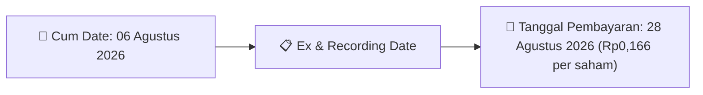

# Ikhtisar Pasar Harian (Daily Digest) - 2026-08-10

⬅️ [[Daily_Digest_20260731]] | 📅 **2026-08-10** | ➡️ [[Daily_Digest_20260804]]

## 1. Radar Pasar & Sentimen Harian (Executive Dashboard)
> [!NOTE]
> Terdeteksi sebanyak **67 pengumuman baru** dari 36 emiten pantauan pada (2026-08-10).

| Metric | Jumlah | Status Radar |
| :--- | :---: | :--- |
| **🟢 Sentimen Bullish / Positif** | `2` | [[Dividen Interim]], [[Mandatory Tender Offer]], Kinerja Positif |
| **⚪ Sentimen Netral / Routine** | `34` | [[Tanggapan Penjelasan Bursa]], [[RUPS]], [[Pendaftaran Unit]] |
| **🔴 Sentimen Bearish / Alert** | `0` | Sengketa Hukum, Defisit / Gugatan (Nihil hari ini) |
| **📄 [[Laporan Keuangan]] Baru** | `0` | Memicu Analisis Keuangan Otomatis |

> [!NOTE]
> Tidak dideteksi adanya publikasi laporan keuangan baru hari ini. Rangkuman per emiten secara terperinci tidak diperlukan.

---

## 2. Sorotan Utama & Watchlist Strategis (Strategic Watchlist)
#### 💰 Watchlist Dividen & Distribution
- **[[HUMI]]**: Nominal Dividen = Rp0,166 per saham
- **[[HUMI]]**: Total Dividen = Rp3.00 Miliar
- **[[HUMI]]**: Cum Date = 06 Agustus 2026
- **[[HUMI]]**: Ex Date = 07 Agustus 2026
- **[[HUMI]]**: Recording Date = 10 Agustus 2026
- **[[HUMI]]**: Tanggal Pembayaran = 28 Agustus 2026

#### 📈 Watchlist Konversi Waran & Potensi Dilusi
- **[[INET]]**: Jumlah Waran Dikonversi = 14,789 lembar
- **[[INET]]**: Jumlah Saham Setelah Konversi = 22,375,162,387 lembar
- **[[INET]]**: Sisa Waran = 14,789 lembar
- **[[ISAP]]**: Jumlah Waran Dikonversi = 79 lembar
- **[[ISAP]]**: Jumlah Saham Setelah Konversi = 4,020,355,803 lembar
- **[[ISAP]]**: Sisa Waran = 79 lembar

---

## 3. Matriks Pengumuman Pasar (Announcements Intelligence Table)
| Emiten | Sentimen | Jenis Pengumuman | Judul Pengumuman | Berkas |
| :--- | :---: | :--- | :--- | :--- |
| **[[CSIS]]** | ⚪ NEUTRAL | Aksi Korporasi | LK-10082026-9458-00 | [Utama](file:///g:/My%20Drive/Model2/reports/raw/CSIS/20260810_CSIS_LK-10082026-9458-00.pdf) |
| **[[R-ABFII]]** | ⚪ NEUTRAL | Aksi Korporasi | R-ABFII R-ABFII Pencatatan AwalTambahan ETF | [Utama](file:///g:/My%20Drive/Model2/reports/raw/R-ABFII/20260810_R-ABFII_20260810_R-ABFII_Pencatatan AwalTambahan ETF_32119392.pdf) |
| **[[XCLQ]]** | ⚪ NEUTRAL | Aksi Korporasi | Pencatatan AwalTambahan ETF | [Utama](file:///g:/My%20Drive/Model2/reports/raw/XCLQ/20260810_XCLQ_20260810_XCLQ_Pencatatan AwalTambahan ETF_32119370.pdf) |
| **[[HUMI]]** | 🟢 BULLISH | Dividen | Keterbukaan Informasi terkait Aksi Korporasi | [Utama](file:///g:/My%20Drive/Model2/reports/raw/HUMI/20260810_HUMI_20260810_HUMI_Keterbukaan Informasi terkait Aksi Korporasi_32119463.pdf) |
| **[[ANTM]]** | ⚪ NEUTRAL | Aksi Korporasi | Laporan Informasi dan Fakta Material | [Utama](file:///g:/My%20Drive/Model2/reports/raw/ANTM/20260810_ANTM_20260810_ANTM_Laporan Informasi dan Fakta Material_32119580.pdf) · [Lamp 1](file:///g:/My%20Drive/Model2/reports/raw/ANTM/20260810_ANTM_20260810_ANTM_Laporan Informasi dan Fakta Material_32119580_lamp1.pdf) · [Lamp 2](file:///g:/My%20Drive/Model2/reports/raw/ANTM/20260810_ANTM_20260810_ANTM_Laporan Informasi dan Fakta Material_32119580_lamp2.pdf) |
| **[[INET]]** | ⚪ NEUTRAL | Aksi Korporasi | Pencatatan Saham Tambahan dari Konversi | [Utama](file:///g:/My%20Drive/Model2/reports/raw/INET/20260810_INET_20260810_INET_Pencatatan Saham Tambahan dari Konversi_32119432.pdf) |
| **[[GENERAL]]** | ⚪ NEUTRAL | Aksi Korporasi | Pemantauan Khusus | [Utama](file:///g:/My%20Drive/Model2/reports/raw/GENERAL/20260810__20260810_Pemantauan Khusus_32119476.pdf) |
| **[[ISAP]]** | ⚪ NEUTRAL | Aksi Korporasi | Pencatatan Saham Tambahan dari Konversi | [Utama](file:///g:/My%20Drive/Model2/reports/raw/ISAP/20260810_ISAP_20260810_ISAP_Pencatatan Saham Tambahan dari Konversi_32119401.pdf) |
| **[[XRDN]]** | ⚪ NEUTRAL | Aksi Korporasi | Pencatatan AwalTambahan ETF | [Utama](file:///g:/My%20Drive/Model2/reports/raw/XRDN/20260810_XRDN_20260810_XRDN_Pencatatan AwalTambahan ETF_32119355.pdf) · [Lamp 1](file:///g:/My%20Drive/Model2/reports/raw/XRDN/20260810_XRDN_20260810_XRDN_Pencatatan AwalTambahan ETF_32119355_lamp1.pdf) |
| **[[NSSS]]** | ⚪ NEUTRAL | Aksi Korporasi | LK-10082026-6267-00 | [Utama](file:///g:/My%20Drive/Model2/reports/raw/NSSS/20260810_NSSS_LK-10082026-6267-00.pdf) |
| **[[CYBR]]** | ⚪ NEUTRAL | Aksi Korporasi | Pencatatan Saham Tambahan dari Konversi | [Utama](file:///g:/My%20Drive/Model2/reports/raw/CYBR/20260810_CYBR_20260810_CYBR_Pencatatan Saham Tambahan dari Konversi_32119385.pdf) · [Lamp 1](file:///g:/My%20Drive/Model2/reports/raw/CYBR/20260810_CYBR_20260810_CYBR_Pencatatan Saham Tambahan dari Konversi_32119385_lamp1.pdf) |
| **[[XIPI]]** | ⚪ NEUTRAL | Aksi Korporasi | Pencatatan AwalTambahan ETF | [Utama](file:///g:/My%20Drive/Model2/reports/raw/XIPI/20260810_XIPI_20260810_XIPI_Pencatatan AwalTambahan ETF_32119348.pdf) · [Lamp 1](file:///g:/My%20Drive/Model2/reports/raw/XIPI/20260810_XIPI_20260810_XIPI_Pencatatan AwalTambahan ETF_32119348_lamp1.pdf) |
| **[[TAMU]]** | ⚪ NEUTRAL | Public Expose | Public Expose | [Utama](file:///g:/My%20Drive/Model2/reports/raw/TAMU/20260810_TAMU_20260810_TAMU_Public Expose_32119606.pdf) · [Lamp 2](file:///g:/My%20Drive/Model2/reports/raw/TAMU/20260810_TAMU_20260810_TAMU_Public Expose_32119606_lamp2.pdf) · [Lamp 1](file:///g:/My%20Drive/Model2/reports/raw/TAMU/20260810_TAMU_20260810_TAMU_Public Expose_32119606_lamp1.pdf) |
| **[[FILM]]** | ⚪ NEUTRAL | Aksi Korporasi | LK-10082026-0387-00 | [Utama](file:///g:/My%20Drive/Model2/reports/raw/FILM/20260810_FILM_LK-10082026-0387-00.pdf) |
| **[[TOWR]]** | ⚪ NEUTRAL | Aksi Korporasi | Laporan Informasi dan Fakta Material | [Utama](file:///g:/My%20Drive/Model2/reports/raw/TOWR/20260810_TOWR_20260810_TOWR_Laporan Informasi dan Fakta Material_32119521.pdf) |
| **[[PADI]]** | ⚪ NEUTRAL | RUPS | Ringkasan RisalahRisalah RUPS | [Utama](file:///g:/My%20Drive/Model2/reports/raw/PADI/20260810_PADI_20260810_PADI_Ringkasan RisalahRisalah RUPS_32119449.pdf) · [Lamp 3](file:///g:/My%20Drive/Model2/reports/raw/PADI/20260810_PADI_20260810_PADI_Ringkasan RisalahRisalah RUPS_32119449_lamp3.pdf) · [Lamp 1](file:///g:/My%20Drive/Model2/reports/raw/PADI/20260810_PADI_20260810_PADI_Ringkasan RisalahRisalah RUPS_32119449_lamp1.pdf) |
| **[[HELI]]** | ⚪ NEUTRAL | Aksi Korporasi | LK-10082026-6322-00 | [Utama](file:///g:/My%20Drive/Model2/reports/raw/HELI/20260810_HELI_LK-10082026-6322-00.pdf) |
| **[[ISAT]]** | ⚪ NEUTRAL | Aksi Korporasi | Laporan Informasi dan Fakta Material | [Utama](file:///g:/My%20Drive/Model2/reports/raw/ISAT/20260810_ISAT_20260810_ISAT_Laporan Informasi dan Fakta Material_32119330.pdf) |
| **[[PYFA]]** | ⚪ NEUTRAL | Aksi Korporasi | Pencatatan Saham Tambahan dari Konversi | [Utama](file:///g:/My%20Drive/Model2/reports/raw/PYFA/20260810_PYFA_20260810_PYFA_Pencatatan Saham Tambahan dari Konversi_32119318.pdf) |
| **[[SONA]]** | ⚪ NEUTRAL | Aksi Korporasi | Laporan Informasi dan Fakta Material | [Utama](file:///g:/My%20Drive/Model2/reports/raw/SONA/20260810_SONA_20260810_SONA_Laporan Informasi dan Fakta Material_32119469.pdf) |
| **[[MEDS]]** | ⚪ NEUTRAL | Aksi Korporasi | LK-10082026-8951-00 | [Utama](file:///g:/My%20Drive/Model2/reports/raw/MEDS/20260810_MEDS_LK-10082026-8951-00.pdf) |
| **[[EDGE]]** | ⚪ NEUTRAL | Aksi Korporasi | LK-10082026-4341-00 | [Utama](file:///g:/My%20Drive/Model2/reports/raw/EDGE/20260810_EDGE_LK-10082026-4341-00.pdf) |
| **[[SOLA]]** | ⚪ NEUTRAL | Aksi Korporasi | Tanggapan atas Permintaan Penjelasan Bursa | [Utama](file:///g:/My%20Drive/Model2/reports/raw/SOLA/20260810_SOLA_20260810_SOLA_Tanggapan atas Permintaan Penjelasan Bursa_32119558.pdf) · [Lamp 1](file:///g:/My%20Drive/Model2/reports/raw/SOLA/20260810_SOLA_20260810_SOLA_Tanggapan atas Permintaan Penjelasan Bursa_32119409_lamp1.pdf) · [Lamp 1](file:///g:/My%20Drive/Model2/reports/raw/SOLA/20260810_SOLA_20260810_SOLA_Tanggapan atas Permintaan Penjelasan Bursa_32119558_lamp1.pdf) |
| **[[MPPA]]** | ⚪ NEUTRAL | Aksi Korporasi | Laporan Informasi dan Fakta Material | [Utama](file:///g:/My%20Drive/Model2/reports/raw/MPPA/20260810_MPPA_20260810_MPPA_Laporan Informasi dan Fakta Material_32119480.pdf) · [Lamp 1](file:///g:/My%20Drive/Model2/reports/raw/MPPA/20260810_MPPA_20260810_MPPA_Laporan Informasi dan Fakta Material_32119480_lamp1.pdf) |
| **[[MDIY]]** | ⚪ NEUTRAL | Aksi Korporasi | Laporan Informasi dan Fakta Material | [Utama](file:///g:/My%20Drive/Model2/reports/raw/MDIY/20260810_MDIY_20260810_MDIY_Laporan Informasi dan Fakta Material_32119383.pdf) · [Lamp 1](file:///g:/My%20Drive/Model2/reports/raw/MDIY/20260810_MDIY_20260810_MDIY_Laporan Informasi dan Fakta Material_32119383_lamp1.pdf) |
| **[[BUDI]]** | ⚪ NEUTRAL | Aksi Korporasi | LK-10082026-9747-00 | [Utama](file:///g:/My%20Drive/Model2/reports/raw/BUDI/20260810_BUDI_LK-10082026-9747-00.pdf) |
| **[[OKAS]]** | ⚪ NEUTRAL | Aksi Korporasi | LK-10082026-7997-00 | [Utama](file:///g:/My%20Drive/Model2/reports/raw/OKAS/20260810_OKAS_LK-10082026-7997-00.pdf) |
| **[[EXCL]]** | ⚪ NEUTRAL | Aksi Korporasi | Pembayaran KuponBagi HasilIjarahPokok | [Utama](file:///g:/My%20Drive/Model2/reports/raw/EXCL/20260810_EXCL_20260810_EXCL_Pembayaran KuponBagi HasilIjarahPokok_32119436.pdf) · [Lamp 1](file:///g:/My%20Drive/Model2/reports/raw/EXCL/20260810_EXCL_20260810_EXCL_Pembayaran KuponBagi HasilIjarahPokok_32119441_lamp1.pdf) |
| **[[TRJA]]** | ⚪ NEUTRAL | Aksi Korporasi | LK-10082026-7086-00 | [Utama](file:///g:/My%20Drive/Model2/reports/raw/TRJA/20260810_TRJA_LK-10082026-7086-00.pdf) |
| **[[UANG]]** | ⚪ NEUTRAL | Aksi Korporasi | Laporan Informasi dan Fakta Material | [Utama](file:///g:/My%20Drive/Model2/reports/raw/UANG/20260810_UANG_20260810_UANG_Laporan Informasi dan Fakta Material_32119584.pdf) |
| **[[ADHI]]** | ⚪ NEUTRAL | RUPS | Pemberitahuan RencanaPenyampaian PanggilanHasil RUPORUPSURUP EBA-SP | [Utama](file:///g:/My%20Drive/Model2/reports/raw/ADHI/20260810_ADHI_20260810_ADHI_Pemberitahuan RencanaPenyampaian PanggilanHasil RUPORUPSURUP EBA-SP_32119550.pdf) · [Lamp 1](file:///g:/My%20Drive/Model2/reports/raw/ADHI/20260810_ADHI_20260810_ADHI_Pemberitahuan RencanaPenyampaian PanggilanHasil RUPORUPSURUP EBA-SP_32119557_lamp1.pdf) · [Lamp 1](file:///g:/My%20Drive/Model2/reports/raw/ADHI/20260810_ADHI_20260810_ADHI_Pemberitahuan RencanaPenyampaian PanggilanHasil RUPORUPSURUP EBA-SP_32119550_lamp1.pdf) |
| **[[MLJK]]** | ⚪ NEUTRAL | Aksi Korporasi | Laporan Hasil Pemeringkatan | [Utama](file:///g:/My%20Drive/Model2/reports/raw/MLJK/20260810_MLJK_20260810_MLJK_Laporan Hasil Pemeringkatan_32119524.pdf) |
| **[[RLCO]]** | ⚪ NEUTRAL | Aksi Korporasi | LK-10082026-0725-00 | [Utama](file:///g:/My%20Drive/Model2/reports/raw/RLCO/20260810_RLCO_LK-10082026-0725-00.pdf) |
| **[[LABS]]** | 🟢 BULLISH | Buyback | Laporan Informasi dan Fakta Material | [Utama](file:///g:/My%20Drive/Model2/reports/raw/LABS/20260810_LABS_20260807_LABS_Laporan Informasi dan Fakta Material_32118775.pdf) · [Lamp 1](file:///g:/My%20Drive/Model2/reports/raw/LABS/20260810_LABS_20260807_LABS_Laporan Informasi dan Fakta Material_32118775_lamp1.pdf) |
| **[[PTRO]]** | ⚪ NEUTRAL | Aksi Korporasi | Tanggapan atas Permintaan Penjelasan Bursa | [Utama](file:///g:/My%20Drive/Model2/reports/raw/PTRO/20260810_PTRO_20260810_PTRO_Tanggapan atas Permintaan Penjelasan Bursa_32119472.pdf) |
| **[[AVIA]]** | ⚪ NEUTRAL | Aksi Korporasi | Laporan Informasi dan Fakta Material | [Utama](file:///g:/My%20Drive/Model2/reports/raw/AVIA/20260810_AVIA_20260810_AVIA_Laporan Informasi dan Fakta Material_32119338.pdf) · [Lamp 1](file:///g:/My%20Drive/Model2/reports/raw/AVIA/20260810_AVIA_20260810_AVIA_Laporan Informasi dan Fakta Material_32119338_lamp1.pdf) |

---

## 4. Detail Informasi per Emiten (Grouped by Emiten)
### 🔵 [[CSIS]]
- **[Aksi Korporasi]** [LK-10082026-9458-00](file:///g:/My%20Drive/Model2/reports/raw/CSIS/20260810_CSIS_LK-10082026-9458-00.pdf)
  - 📌 *Deskripsi*: Laporan perubahan kepemilikan saham insider CSIS
  - 📊 **Fakta Material**:
    - **Nama Insider**: TJOEA AUBINTORO

### 🔵 [[R-ABFII]]
- **[Aksi Korporasi]** [R-ABFII R-ABFII Pencatatan AwalTambahan ETF](file:///g:/My%20Drive/Model2/reports/raw/R-ABFII/20260810_R-ABFII_20260810_R-ABFII_Pencatatan AwalTambahan ETF_32119392.pdf)
  - 📌 *Deskripsi*: Pencatatan unit tambahan ETF / Reksa Dana R-ABFII
  - 📊 **Fakta Material**:
    - **Nama KIK**: Nama KIK Reksa Dana KIK ETF ABF IBI Fund Pencatatan Tambahan
    - **Jumlah Unit Tambahan**: 4,744 unit
    - **Total Unit Tercatat**: 132,880,381 unit

### 🔵 [[XCLQ]]
- **[Aksi Korporasi]** [Pencatatan AwalTambahan ETF](file:///g:/My%20Drive/Model2/reports/raw/XCLQ/20260810_XCLQ_20260810_XCLQ_Pencatatan AwalTambahan ETF_32119370.pdf)
  - 📌 *Deskripsi*: Pencatatan unit tambahan ETF / Reksa Dana XCLQ
  - 📊 **Fakta Material**:
    - **Nama KIK**: Nama KIK Reksa Dana Indeks Cipta ETF Index LQ45 Pencatatan T
    - **Jumlah Unit Tambahan**: 45 unit
    - **Total Unit Tercatat**: 125,100,000 unit

### 🔵 [[HUMI]]
- **[Dividen]** [Keterbukaan Informasi terkait Aksi Korporasi](file:///g:/My%20Drive/Model2/reports/raw/HUMI/20260810_HUMI_20260810_HUMI_Keterbukaan Informasi terkait Aksi Korporasi_32119463.pdf)
  - 📌 *Deskripsi*: Pembagian dividen tunai HUMI
  - 📊 **Fakta Material**:
    - **Nominal Dividen**: Rp0,166 per saham
    - **Total Dividen**: Rp3.00 Miliar
    - **Cum Date**: 06 Agustus 2026
    - **Ex Date**: 07 Agustus 2026
    - **Recording Date**: 10 Agustus 2026
    - **Tanggal Pembayaran**: 28 Agustus 2026

### 🔵 [[ANTM]]
- **[Aksi Korporasi]** [Laporan Informasi dan Fakta Material](file:///g:/My%20Drive/Model2/reports/raw/ANTM/20260810_ANTM_20260810_ANTM_Laporan Informasi dan Fakta Material_32119580.pdf) *(Attachment: [Lamp 1](file:///g:/My%20Drive/Model2/reports/raw/ANTM/20260810_ANTM_20260810_ANTM_Laporan Informasi dan Fakta Material_32119580_lamp1.pdf) · [Lamp 2](file:///g:/My%20Drive/Model2/reports/raw/ANTM/20260810_ANTM_20260810_ANTM_Laporan Informasi dan Fakta Material_32119580_lamp2.pdf))*
  - 📌 *Deskripsi*: Informasi dan fakta material ANTM
  - 📊 **Fakta Material**:
    - **Uraian Kejadian**: Penyampaian rilis dengan judul ANTAM Hadirkan Emas Kemerdekaan Pertama di Indonesia dengan Relief Tiga Dimensi Dampak kejadian, informasi atau fakta material tersebut terhadap kegiatan operasional, hukum, kondisi keuangan, atau kelangsungan usaha Emi

### 🔵 [[INET]]
- **[Aksi Korporasi]** [Pencatatan Saham Tambahan dari Konversi](file:///g:/My%20Drive/Model2/reports/raw/INET/20260810_INET_20260810_INET_Pencatatan Saham Tambahan dari Konversi_32119432.pdf)
  - 📌 *Deskripsi*: Pencatatan saham tambahan hasil konversi waran INET
  - 📊 **Fakta Material**:
    - **Jumlah Waran Dikonversi**: 14,789 lembar
    - **Jumlah Saham Setelah Konversi**: 22,375,162,387 lembar
    - **Sisa Waran**: 14,789 lembar
    - **Tanggal Pencatatan**: 11 Agustus 2026

### 🔵 [[GENERAL]]
- **[Aksi Korporasi]** [Pemantauan Khusus](file:///g:/My%20Drive/Model2/reports/raw/GENERAL/20260810__20260810_Pemantauan Khusus_32119476.pdf)
  - 📌 *Deskripsi*: Siaran pers kinerja keuangan & update bisnis GENERAL (Anak Perusahaan yang) Periode 2026

### 🔵 [[ISAP]]
- **[Aksi Korporasi]** [Pencatatan Saham Tambahan dari Konversi](file:///g:/My%20Drive/Model2/reports/raw/ISAP/20260810_ISAP_20260810_ISAP_Pencatatan Saham Tambahan dari Konversi_32119401.pdf)
  - 📌 *Deskripsi*: Pencatatan saham tambahan hasil konversi waran ISAP
  - 📊 **Fakta Material**:
    - **Jumlah Waran Dikonversi**: 79 lembar
    - **Jumlah Saham Setelah Konversi**: 4,020,355,803 lembar
    - **Sisa Waran**: 79 lembar
    - **Tanggal Pencatatan**: 11 Agustus 2026

### 🔵 [[XRDN]]
- **[Aksi Korporasi]** [Pencatatan AwalTambahan ETF](file:///g:/My%20Drive/Model2/reports/raw/XRDN/20260810_XRDN_20260810_XRDN_Pencatatan AwalTambahan ETF_32119355.pdf) *(Attachment: [Lamp 1](file:///g:/My%20Drive/Model2/reports/raw/XRDN/20260810_XRDN_20260810_XRDN_Pencatatan AwalTambahan ETF_32119355_lamp1.pdf))*
  - 📌 *Deskripsi*: Pencatatan unit tambahan ETF / Reksa Dana XRDN
  - 📊 **Fakta Material**:
    - **Nama KIK**: Nama KIK REKSA DANA INDO ETF RDN KAS BERTUMBUH Pencatatan Ta
    - **Jumlah Unit Tambahan**: 379,400,000 unit
    - **Total Unit Tercatat**: 22,830,300,000 unit

### 🔵 [[NSSS]]
- **[Aksi Korporasi]** [LK-10082026-6267-00](file:///g:/My%20Drive/Model2/reports/raw/NSSS/20260810_NSSS_LK-10082026-6267-00.pdf)
  - 📌 *Deskripsi*: Laporan perubahan kepemilikan saham insider NSSS
  - 📊 **Fakta Material**:
    - **Nama Insider**: SAMUEL SEKURITAS INDONESIA

### 🔵 [[CYBR]]
- **[Aksi Korporasi]** [Pencatatan Saham Tambahan dari Konversi](file:///g:/My%20Drive/Model2/reports/raw/CYBR/20260810_CYBR_20260810_CYBR_Pencatatan Saham Tambahan dari Konversi_32119385.pdf) *(Attachment: [Lamp 1](file:///g:/My%20Drive/Model2/reports/raw/CYBR/20260810_CYBR_20260810_CYBR_Pencatatan Saham Tambahan dari Konversi_32119385_lamp1.pdf))*
  - 📌 *Deskripsi*: Pencatatan saham tambahan hasil konversi waran CYBR
  - 📊 **Fakta Material**:
    - **Jumlah Waran Dikonversi**: 1,200 lembar
    - **Jumlah Saham Setelah Konversi**: 13,481,596,304 lembar
    - **Sisa Waran**: 1,200 lembar
    - **Tanggal Pencatatan**: 11 Agustus 2026

### 🔵 [[XIPI]]
- **[Aksi Korporasi]** [Pencatatan AwalTambahan ETF](file:///g:/My%20Drive/Model2/reports/raw/XIPI/20260810_XIPI_20260810_XIPI_Pencatatan AwalTambahan ETF_32119348.pdf) *(Attachment: [Lamp 1](file:///g:/My%20Drive/Model2/reports/raw/XIPI/20260810_XIPI_20260810_XIPI_Pencatatan AwalTambahan ETF_32119348_lamp1.pdf))*
  - 📌 *Deskripsi*: Pencatatan unit tambahan ETF / Reksa Dana XIPI
  - 📊 **Fakta Material**:
    - **Nama KIK**: Nama KIK Reksa Dana Indeks Premier ETF PEFINDO i-Grade Penca
    - **Jumlah Unit Tambahan**: 200,000 unit
    - **Total Unit Tercatat**: 3,577,000,000 unit

### 🔵 [[TAMU]]
- **[Public Expose]** [Public Expose](file:///g:/My%20Drive/Model2/reports/raw/TAMU/20260810_TAMU_20260810_TAMU_Public Expose_32119606.pdf) *(Attachment: [Lamp 2](file:///g:/My%20Drive/Model2/reports/raw/TAMU/20260810_TAMU_20260810_TAMU_Public Expose_32119606_lamp2.pdf) · [Lamp 1](file:///g:/My%20Drive/Model2/reports/raw/TAMU/20260810_TAMU_20260810_TAMU_Public Expose_32119606_lamp1.pdf))*
  - 📌 *Deskripsi*: Informasi dan fakta material TAMU
  - 📊 **Fakta Material**:
    - **Uraian Kejadian**: Nama Perusahaan Kode Emiten Lampiran Perihal 0060/PTS-CS/BEI/VIII/2026 PT Pelayaran Tamarin Samudra Tbk. TAMU 2 Laporan Hasil Public Expose Tahunan Mengoreksi surat kami nomor : 06

### 🔵 [[FILM]]
- **[Aksi Korporasi]** [LK-10082026-0387-00](file:///g:/My%20Drive/Model2/reports/raw/FILM/20260810_FILM_LK-10082026-0387-00.pdf)
  - 📌 *Deskripsi*: Laporan perubahan kepemilikan saham insider FILM
  - 📊 **Fakta Material**:
    - **Nama Insider**: SAMUEL SEKURITAS INDONESIA

### 🔵 [[TOWR]]
- **[Aksi Korporasi]** [Laporan Informasi dan Fakta Material](file:///g:/My%20Drive/Model2/reports/raw/TOWR/20260810_TOWR_20260810_TOWR_Laporan Informasi dan Fakta Material_32119521.pdf)
  - 📌 *Deskripsi*: Informasi dan fakta material TOWR
  - 📊 **Fakta Material**:
    - **Uraian Kejadian**: Nama Perusahaan Kode Emiten Lampiran Perihal 120/CS-OJK/SMN/VIII/26 Sarana Menara Nusantara Tbk TOWR 1 Penandatanganan Perjanjian Kredit dan Perjanjian Penanggungan Perusahaan dan
    - **Dampak Kejadian**: 08-2026 17:45 1

### 🔵 [[PADI]]
- **[RUPS]** [Ringkasan RisalahRisalah RUPS](file:///g:/My%20Drive/Model2/reports/raw/PADI/20260810_PADI_20260810_PADI_Ringkasan RisalahRisalah RUPS_32119449.pdf) *(Attachment: [Lamp 3](file:///g:/My%20Drive/Model2/reports/raw/PADI/20260810_PADI_20260810_PADI_Ringkasan RisalahRisalah RUPS_32119449_lamp3.pdf) · [Lamp 1](file:///g:/My%20Drive/Model2/reports/raw/PADI/20260810_PADI_20260810_PADI_Ringkasan RisalahRisalah RUPS_32119449_lamp1.pdf))*
  - 📌 *Deskripsi*: Informasi dan fakta material PADI
  - 📊 **Fakta Material**:
    - **Uraian Kejadian**: Nama Perusahaan Kode Emiten Lampiran Perihal 065/CS-PADI/VIII/2026 Minna Padi Investama Sekuritas Tbk PADI 3 Ringkasan Risalah Rapat Umum Para Pemegang Saham Luar Biasa Merujuk pad

### 🔵 [[HELI]]
- **[Aksi Korporasi]** [LK-10082026-6322-00](file:///g:/My%20Drive/Model2/reports/raw/HELI/20260810_HELI_LK-10082026-6322-00.pdf)
  - 📌 *Deskripsi*: Laporan perubahan kepemilikan saham insider HELI
  - 📊 **Fakta Material**:
    - **Nama Insider**: AVIA NUSANTARA KHATULISTIWA
    - **Jabatan**: Tidak

### 🔵 [[ISAT]]
- **[Aksi Korporasi]** [Laporan Informasi dan Fakta Material](file:///g:/My%20Drive/Model2/reports/raw/ISAT/20260810_ISAT_20260810_ISAT_Laporan Informasi dan Fakta Material_32119330.pdf)
  - 📌 *Deskripsi*: Informasi dan fakta material ISAT
  - 📊 **Fakta Material**:
    - **Uraian Kejadian**: Mohon merujuk pada surat terlampir
    - **Dampak Kejadian**: 021) 3000 3001, , indosatooredoo

### 🔵 [[PYFA]]
- **[Aksi Korporasi]** [Pencatatan Saham Tambahan dari Konversi](file:///g:/My%20Drive/Model2/reports/raw/PYFA/20260810_PYFA_20260810_PYFA_Pencatatan Saham Tambahan dari Konversi_32119318.pdf)
  - 📌 *Deskripsi*: Pencatatan saham tambahan hasil konversi waran PYFA
  - 📊 **Fakta Material**:
    - **Jumlah Waran Dikonversi**: 12 lembar
    - **Jumlah Saham Setelah Konversi**: 11,236,750,584 lembar
    - **Sisa Waran**: 12 lembar
    - **Tanggal Pencatatan**: 11 Agustus 2026

### 🔵 [[SONA]]
- **[Aksi Korporasi]** [Laporan Informasi dan Fakta Material](file:///g:/My%20Drive/Model2/reports/raw/SONA/20260810_SONA_20260810_SONA_Laporan Informasi dan Fakta Material_32119469.pdf)
  - 📌 *Deskripsi*: Pencatatan saham tambahan hasil konversi waran SONA

### 🔵 [[MEDS]]
- **[Aksi Korporasi]** [LK-10082026-8951-00](file:///g:/My%20Drive/Model2/reports/raw/MEDS/20260810_MEDS_LK-10082026-8951-00.pdf)
  - 📌 *Deskripsi*: Laporan perubahan kepemilikan saham insider MEDS
  - 📊 **Fakta Material**:
    - **Nama Insider**: JEMMY KURNIAWAN

### 🔵 [[EDGE]]
- **[Aksi Korporasi]** [LK-10082026-4341-00](file:///g:/My%20Drive/Model2/reports/raw/EDGE/20260810_EDGE_LK-10082026-4341-00.pdf)
  - 📌 *Deskripsi*: Pencatatan saham tambahan hasil konversi waran EDGE

### 🔵 [[SOLA]]
- **[Aksi Korporasi]** [Tanggapan atas Permintaan Penjelasan Bursa](file:///g:/My%20Drive/Model2/reports/raw/SOLA/20260810_SOLA_20260810_SOLA_Tanggapan atas Permintaan Penjelasan Bursa_32119558.pdf) *(Attachment: [Lamp 1](file:///g:/My%20Drive/Model2/reports/raw/SOLA/20260810_SOLA_20260810_SOLA_Tanggapan atas Permintaan Penjelasan Bursa_32119409_lamp1.pdf) · [Lamp 1](file:///g:/My%20Drive/Model2/reports/raw/SOLA/20260810_SOLA_20260810_SOLA_Tanggapan atas Permintaan Penjelasan Bursa_32119558_lamp1.pdf))*
  - 📌 *Deskripsi*: Tanggapan Penjelasan Bursa SOLA [FAKTA MATERIAL DITEMUKAN
  - 📊 **Fakta Material**:
    - **Pernyataan Emiten**: Perseroan menyampaikan tanggapan atas Permintaan Penjelasan Bursa dalam Lampiran I dari surat ini. · Perseroan menyampaikan tanggapan atas Permintaan Penjelasan Bursa dalam Lampiran I dari surat ini

### 🔵 [[MPPA]]
- **[Aksi Korporasi]** [Laporan Informasi dan Fakta Material](file:///g:/My%20Drive/Model2/reports/raw/MPPA/20260810_MPPA_20260810_MPPA_Laporan Informasi dan Fakta Material_32119480.pdf) *(Attachment: [Lamp 1](file:///g:/My%20Drive/Model2/reports/raw/MPPA/20260810_MPPA_20260810_MPPA_Laporan Informasi dan Fakta Material_32119480_lamp1.pdf))*
  - 📌 *Deskripsi*: Informasi dan fakta material MPPA
  - 📊 **Fakta Material**:
    - **Uraian Kejadian**: Perubahan Anggaran Dasar PT Matahari Putra Prima Tbk Dampak kejadian, informasi atau fakta material tersebut terhadap kegiatan operasional, hukum, kondisi keuangan, atau kelangsungan usaha Emiten atau Perusahaan Publik - Hypermart Cyberpark - Lantai
    - **Dampak Kejadian**: 08-2026 16:31 1

### 🔵 [[MDIY]]
- **[Aksi Korporasi]** [Laporan Informasi dan Fakta Material](file:///g:/My%20Drive/Model2/reports/raw/MDIY/20260810_MDIY_20260810_MDIY_Laporan Informasi dan Fakta Material_32119383.pdf) *(Attachment: [Lamp 1](file:///g:/My%20Drive/Model2/reports/raw/MDIY/20260810_MDIY_20260810_MDIY_Laporan Informasi dan Fakta Material_32119383_lamp1.pdf))*
  - 📌 *Deskripsi*: Laporan perubahan kepemilikan saham insider MDIY

### 🔵 [[BUDI]]
- **[Aksi Korporasi]** [LK-10082026-9747-00](file:///g:/My%20Drive/Model2/reports/raw/BUDI/20260810_BUDI_LK-10082026-9747-00.pdf)
  - 📌 *Deskripsi*: Laporan perubahan kepemilikan saham insider BUDI
  - 📊 **Fakta Material**:
    - **Nama Insider**: PT BUDI DELTA SWAKARYA
    - **Jabatan**: Tidak

### 🔵 [[OKAS]]
- **[Aksi Korporasi]** [LK-10082026-7997-00](file:///g:/My%20Drive/Model2/reports/raw/OKAS/20260810_OKAS_LK-10082026-7997-00.pdf)
  - 📌 *Deskripsi*: Laporan perubahan kepemilikan saham insider OKAS
  - 📊 **Fakta Material**:
    - **Nama Insider**: PT BUMI ARSANA MULIA
    - **Jabatan**: Tidak

### 🔵 [[EXCL]]
- **[Aksi Korporasi]** [Pembayaran KuponBagi HasilIjarahPokok](file:///g:/My%20Drive/Model2/reports/raw/EXCL/20260810_EXCL_20260810_EXCL_Pembayaran KuponBagi HasilIjarahPokok_32119436.pdf) *(Attachment: [Lamp 1](file:///g:/My%20Drive/Model2/reports/raw/EXCL/20260810_EXCL_20260810_EXCL_Pembayaran KuponBagi HasilIjarahPokok_32119441_lamp1.pdf))*
  - 📌 *Deskripsi*: Informasi dan fakta material EXCL
  - 📊 **Fakta Material**:
    - **Uraian Kejadian**: Nama Perusahaan Kode Emiten Lampiran Perihal 0605/EXT/CSEC/CEOD/2026 PT XLSMART Telecom Sejahtera Tbk EXCL 1 Informasi Kupon Direksi PT XLSMART Telecom Sejahtera Tbk memberitahukan

### 🔵 [[TRJA]]
- **[Aksi Korporasi]** [LK-10082026-7086-00](file:///g:/My%20Drive/Model2/reports/raw/TRJA/20260810_TRJA_LK-10082026-7086-00.pdf)
  - 📌 *Deskripsi*: Laporan perubahan kepemilikan saham insider TRJA
  - 📊 **Fakta Material**:
    - **Nama Insider**: R HESTHI SAMBODO

### 🔵 [[UANG]]
- **[Aksi Korporasi]** [Laporan Informasi dan Fakta Material](file:///g:/My%20Drive/Model2/reports/raw/UANG/20260810_UANG_20260810_UANG_Laporan Informasi dan Fakta Material_32119584.pdf)
  - 📌 *Deskripsi*: Informasi dan fakta material UANG
  - 📊 **Fakta Material**:
    - **Uraian Kejadian**: Pada tanggal 8 Agustus 2026, PT Pakuan Tbk ("Perseroan") telah menerima surat pengunduran diri Bapak Aditya Wisnu Wardhani dari jabatannya sebagai Wakil Presiden Direktur Perseroan
    - **Dampak Kejadian**: 08-2026 19:44 1

### 🔵 [[ADHI]]
- **[RUPS]** [Pemberitahuan RencanaPenyampaian PanggilanHasil RUPORUPSURUP EBA-SP](file:///g:/My%20Drive/Model2/reports/raw/ADHI/20260810_ADHI_20260810_ADHI_Pemberitahuan RencanaPenyampaian PanggilanHasil RUPORUPSURUP EBA-SP_32119550.pdf) *(Attachment: [Lamp 1](file:///g:/My%20Drive/Model2/reports/raw/ADHI/20260810_ADHI_20260810_ADHI_Pemberitahuan RencanaPenyampaian PanggilanHasil RUPORUPSURUP EBA-SP_32119557_lamp1.pdf) · [Lamp 1](file:///g:/My%20Drive/Model2/reports/raw/ADHI/20260810_ADHI_20260810_ADHI_Pemberitahuan RencanaPenyampaian PanggilanHasil RUPORUPSURUP EBA-SP_32119550_lamp1.pdf))*
  - 📌 *Deskripsi*: Informasi dan fakta material ADHI
  - 📊 **Fakta Material**:
    - **Uraian Kejadian**: Nama Perusahaan Kode Emiten Lampiran Perihal 314/SP-VIII/2026 PT Adhi Karya (Persero) Tbk. ADHI 1 Pemberitahuan Hasil RUPO PT Adhi Karya (Persero) Tbk. Perseroan Memberitahukan kep

### 🔵 [[MLJK]]
- **[Aksi Korporasi]** [Laporan Hasil Pemeringkatan](file:///g:/My%20Drive/Model2/reports/raw/MLJK/20260810_MLJK_20260810_MLJK_Laporan Hasil Pemeringkatan_32119524.pdf)
  - 📌 *Deskripsi*: Informasi dan fakta material MLJK
  - 📊 **Fakta Material**:
    - **Uraian Kejadian**: Nama Perusahaan Kode Emiten Lampiran Perihal 691-690/AB/MLJ/VIII/2026 PT Marga Lingkar Jakarta MLJK 2 Laporan Hasil Pemeringkatan Pemeringkatan Tahunan Nama Efek Jumlah Pokok Tangg

### 🔵 [[RLCO]]
- **[Aksi Korporasi]** [LK-10082026-0725-00](file:///g:/My%20Drive/Model2/reports/raw/RLCO/20260810_RLCO_LK-10082026-0725-00.pdf)
  - 📌 *Deskripsi*: Laporan perubahan kepemilikan saham insider RLCO
  - 📊 **Fakta Material**:
    - **Nama Insider**: SAMUEL SEKURITAS INDONESIA

### 🔵 [[LABS]]
- **[Buyback]** [Laporan Informasi dan Fakta Material](file:///g:/My%20Drive/Model2/reports/raw/LABS/20260810_LABS_20260807_LABS_Laporan Informasi dan Fakta Material_32118775.pdf) *(Attachment: [Lamp 1](file:///g:/My%20Drive/Model2/reports/raw/LABS/20260810_LABS_20260807_LABS_Laporan Informasi dan Fakta Material_32118775_lamp1.pdf))*
  - 📌 *Deskripsi*: Informasi dan fakta material LABS
  - 📊 **Fakta Material**:
    - **Uraian Kejadian**: Keterbukaan Informasi Terkait Rencana Pembelian Kembali Saham Dalam Kondisi Pasar Berfluktuasi Signifikan
    - **Dampak Kejadian**: 08-2026 17:13 1

### 🔵 [[PTRO]]
- **[Aksi Korporasi]** [Tanggapan atas Permintaan Penjelasan Bursa](file:///g:/My%20Drive/Model2/reports/raw/PTRO/20260810_PTRO_20260810_PTRO_Tanggapan atas Permintaan Penjelasan Bursa_32119472.pdf)
  - 📌 *Deskripsi*: Perseroan mengonfirmasi TIDAK MENGETAHUI adanya informasi/fakta material lain atau rencana aksi korporasi yang mempengaruhi volatilitas saham

### 🔵 [[AVIA]]
- **[Aksi Korporasi]** [Laporan Informasi dan Fakta Material](file:///g:/My%20Drive/Model2/reports/raw/AVIA/20260810_AVIA_20260810_AVIA_Laporan Informasi dan Fakta Material_32119338.pdf) *(Attachment: [Lamp 1](file:///g:/My%20Drive/Model2/reports/raw/AVIA/20260810_AVIA_20260810_AVIA_Laporan Informasi dan Fakta Material_32119338_lamp1.pdf))*
  - 📌 *Deskripsi*: Siaran pers kinerja keuangan & update bisnis AVIA Periode 2026

---

## 5. Rekomendasi & Langkah Analisis Selanjutnya (Next Steps)
> [!TIP]
> **Instruksi Otomatis Swarm Agent**:
> 1. **Dividen Action**: Pantau *Recording Date & Payment Date* untuk emiten pembagi [[Dividen Interim]] (`[[TAPG]]`, `[[AMAR]]`).
> 2. **Tender Offer Action**: Pantau keterbukaan informasi lanjutan untuk `[[MAPI]]` terkait harga [[Mandatory Tender Offer]] oleh `[[Pacific Universal Investments Pte. Ltd.]]`.
> 3. **Financial Statement Deep-Dive**: Jika ada [[Laporan Keuangan]] baru di Section 1, jalankan agen `financial-summarizer-agent` untuk menghitung margin dan rasio valuasi.
