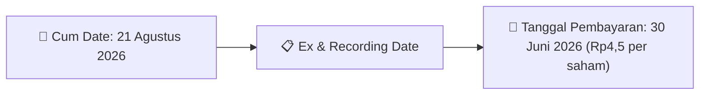

# Ikhtisar Pasar Harian (Daily Digest) - 2026-08-11

⬅️ [[Daily_Digest_20260731]] | 📅 **2026-08-11** | ➡️ [[Daily_Digest_20260804]]

## 1. Radar Pasar & Sentimen Harian (Executive Dashboard)
> [!NOTE]
> Terdeteksi sebanyak **128 pengumuman baru** dari 58 emiten pantauan pada (2026-08-11).

| Metric | Jumlah | Status Radar |
| :--- | :---: | :--- |
| **🟢 Sentimen Bullish / Positif** | `1` | [[Dividen Interim]], [[Mandatory Tender Offer]], Kinerja Positif |
| **⚪ Sentimen Netral / Routine** | `69` | [[Tanggapan Penjelasan Bursa]], [[RUPS]], [[Pendaftaran Unit]] |
| **🔴 Sentimen Bearish / Alert** | `0` | Sengketa Hukum, Defisit / Gugatan (Nihil hari ini) |
| **📄 [[Laporan Keuangan]] Baru** | `0` | Memicu Analisis Keuangan Otomatis |

> [!NOTE]
> Tidak dideteksi adanya publikasi laporan keuangan baru hari ini. Rangkuman per emiten secara terperinci tidak diperlukan.

---

## 2. Sorotan Utama & Watchlist Strategis (Strategic Watchlist)
#### 💰 Watchlist Dividen & Distribution
- **[[INPP]]**: Nominal Dividen = Rp4,5 per saham
- **[[INPP]]**: Total Dividen = Rp50.32 Miliar
- **[[INPP]]**: Cum Date = 21 Agustus 2026
- **[[INPP]]**: Ex Date = 24 Agustus 2026
- **[[INPP]]**: Recording Date = 20 Agustus 2026
- **[[INPP]]**: Tanggal Pembayaran = 30 Juni 2026

#### 📈 Watchlist Konversi Waran & Potensi Dilusi
- **[[HUMI]]**: Jumlah Waran Dikonversi = 80,128 lembar
- **[[HUMI]]**: Jumlah Saham Setelah Konversi = 18,063,771,579 lembar
- **[[HUMI]]**: Sisa Waran = 80,128 lembar
- **[[ISAP]]**: Jumlah Waran Dikonversi = 58 lembar
- **[[ISAP]]**: Jumlah Saham Setelah Konversi = 4,020,355,861 lembar
- **[[ISAP]]**: Sisa Waran = 58 lembar

---

## 3. Matriks Pengumuman Pasar (Announcements Intelligence Table)
| Emiten | Sentimen | Jenis Pengumuman | Judul Pengumuman | Berkas |
| :--- | :---: | :--- | :--- | :--- |
| **[[R-ABFII]]** | ⚪ NEUTRAL | Aksi Korporasi | R-ABFII R-ABFII Pencatatan AwalTambahan ETF | [Utama](file:///g:/My%20Drive/Model2/reports/raw/R-ABFII/20260811_R-ABFII_20260811_R-ABFII_Pencatatan AwalTambahan ETF_32119670.pdf) |
| **[[HEXA]]** | ⚪ NEUTRAL | RUPS | Pengumuman RUPS | [Utama](file:///g:/My%20Drive/Model2/reports/raw/HEXA/20260811_HEXA_20260811_HEXA_Pengumuman RUPS_32119624.pdf) · [Lamp 1](file:///g:/My%20Drive/Model2/reports/raw/HEXA/20260811_HEXA_20260811_HEXA_Pengumuman RUPS_32119624_lamp1.pdf) · [Lamp 2](file:///g:/My%20Drive/Model2/reports/raw/HEXA/20260811_HEXA_20260811_HEXA_Pengumuman RUPS_32119624_lamp2.pdf) |
| **[[XCLQ]]** | ⚪ NEUTRAL | Aksi Korporasi | Pencatatan AwalTambahan ETF | [Utama](file:///g:/My%20Drive/Model2/reports/raw/XCLQ/20260811_XCLQ_20260811_XCLQ_Pencatatan AwalTambahan ETF_32119691.pdf) |
| **[[HUMI]]** | ⚪ NEUTRAL | Aksi Korporasi | Pencatatan Saham Tambahan dari Konversi | [Utama](file:///g:/My%20Drive/Model2/reports/raw/HUMI/20260811_HUMI_20260810_HUMI_Pencatatan Saham Tambahan dari Konversi_32119367.pdf) · [Lamp 1](file:///g:/My%20Drive/Model2/reports/raw/HUMI/20260811_HUMI_20260810_HUMI_Pencatatan Saham Tambahan dari Konversi_32119367_lamp1.pdf) |
| **[[GENERAL]]** | ⚪ NEUTRAL | Aksi Korporasi | Pemantauan Khusus | [Utama](file:///g:/My%20Drive/Model2/reports/raw/GENERAL/20260811__20260811_Pemantauan Khusus_32119742.pdf) |
| **[[ISAP]]** | ⚪ NEUTRAL | Aksi Korporasi | Pencatatan Saham Tambahan dari Konversi | [Utama](file:///g:/My%20Drive/Model2/reports/raw/ISAP/20260811_ISAP_20260811_ISAP_Pencatatan Saham Tambahan dari Konversi_32119672.pdf) |
| **[[MREI]]** | ⚪ NEUTRAL | Public Expose | Public Expose | [Utama](file:///g:/My%20Drive/Model2/reports/raw/MREI/20260811_MREI_20260811_MREI_Public Expose_32119739.pdf) · [Lamp 2](file:///g:/My%20Drive/Model2/reports/raw/MREI/20260811_MREI_20260811_MREI_Public Expose_32119739_lamp2.pdf) · [Lamp 1](file:///g:/My%20Drive/Model2/reports/raw/MREI/20260811_MREI_20260811_MREI_Public Expose_32119739_lamp1.pdf) |
| **[[MBSS]]** | ⚪ NEUTRAL | RUPS | Pengumuman RUPS | [Utama](file:///g:/My%20Drive/Model2/reports/raw/MBSS/20260811_MBSS_20260811_MBSS_Pengumuman RUPS_32119661.pdf) |
| **[[MBSS]]** | ⚪ NEUTRAL | Aksi Korporasi | Laporan Informasi dan Fakta Material | [Utama](file:///g:/My%20Drive/Model2/reports/raw/MBSS/20260811_MBSS_20260811_MBSS_Laporan Informasi dan Fakta Material_32119677.pdf) |
| **[[BDMN]]** | ⚪ NEUTRAL | Aksi Korporasi | Laporan Informasi dan Fakta Material | [Utama](file:///g:/My%20Drive/Model2/reports/raw/BDMN/20260811_BDMN_20260811_BDMN_Laporan Informasi dan Fakta Material_32119782.pdf) |
| **[[TBIG]]** | ⚪ NEUTRAL | RUPS | Pemanggilan RUPS | [Utama](file:///g:/My%20Drive/Model2/reports/raw/TBIG/20260811_TBIG_20260811_TBIG_Pemanggilan RUPS_32119758.pdf) · [Lamp 2](file:///g:/My%20Drive/Model2/reports/raw/TBIG/20260811_TBIG_20260811_TBIG_Pemanggilan RUPS_32119758_lamp2.pdf) · [Lamp 1](file:///g:/My%20Drive/Model2/reports/raw/TBIG/20260811_TBIG_20260811_TBIG_Pemanggilan RUPS_32119758_lamp1.pdf) |
| **[[AHAP]]** | ⚪ NEUTRAL | Aksi Korporasi | Tanggapan atas Permintaan Penjelasan Bursa | [Utama](file:///g:/My%20Drive/Model2/reports/raw/AHAP/20260811_AHAP_20260810_AHAP_Tanggapan atas Permintaan Penjelasan Bursa_32119504.pdf) · [Lamp 1](file:///g:/My%20Drive/Model2/reports/raw/AHAP/20260811_AHAP_20260810_AHAP_Tanggapan atas Permintaan Penjelasan Bursa_32119504_lamp1.pdf) |
| **[[CYBR]]** | ⚪ NEUTRAL | Aksi Korporasi | Pencatatan Saham Tambahan dari Konversi | [Utama](file:///g:/My%20Drive/Model2/reports/raw/CYBR/20260811_CYBR_20260811_CYBR_Pencatatan Saham Tambahan dari Konversi_32119692.pdf) |
| **[[CYBR]]** | ⚪ NEUTRAL | Aksi Korporasi | LK-11082026-6880-00 | [Utama](file:///g:/My%20Drive/Model2/reports/raw/CYBR/20260811_CYBR_LK-11082026-6880-00.pdf) |
| **[[DAAZ]]** | ⚪ NEUTRAL | Aksi Korporasi | Informasi Transaksi Afiliasi | [Utama](file:///g:/My%20Drive/Model2/reports/raw/DAAZ/20260811_DAAZ_20260811_DAAZ_Informasi Transaksi Afiliasi_32119698.pdf) |
| **[[INPP]]** | 🟢 BULLISH | Dividen | Jadwal Aksi Korporasi (Khusus Penyampaian Dividen Interim) | [Utama](file:///g:/My%20Drive/Model2/reports/raw/INPP/20260811_INPP_20260811_INPP_Jadwal Aksi Korporasi (Khusus Penyampaian Dividen Interim)_32119741.pdf) |
| **[[KDTN]]** | ⚪ NEUTRAL | Aksi Korporasi | LK-11082026-7440-00 | [Utama](file:///g:/My%20Drive/Model2/reports/raw/KDTN/20260811_KDTN_LK-11082026-7440-00.pdf) |
| **[[ASMI]]** | ⚪ NEUTRAL | RUPS | Pemanggilan RUPS | [Utama](file:///g:/My%20Drive/Model2/reports/raw/ASMI/20260811_ASMI_20260811_ASMI_Pemanggilan RUPS_32119878.pdf) · [Lamp 1](file:///g:/My%20Drive/Model2/reports/raw/ASMI/20260811_ASMI_20260811_ASMI_Pemanggilan RUPS_32119878_lamp1.pdf) |
| **[[WINR]]** | ⚪ NEUTRAL | Aksi Korporasi | Laporan Informasi dan Fakta Material | [Utama](file:///g:/My%20Drive/Model2/reports/raw/WINR/20260811_WINR_20260811_WINR_Laporan Informasi dan Fakta Material_32119697.pdf) · [Lamp 1](file:///g:/My%20Drive/Model2/reports/raw/WINR/20260811_WINR_20260811_WINR_Laporan Informasi dan Fakta Material_32119697_lamp1.pdf) |
| **[[PACK]]** | ⚪ NEUTRAL | Aksi Korporasi | Pencatatan Saham Tambahan dari Konversi | [Utama](file:///g:/My%20Drive/Model2/reports/raw/PACK/20260811_PACK_20260810_PACK_Pencatatan Saham Tambahan dari Konversi_32119394.pdf) · [Lamp 1](file:///g:/My%20Drive/Model2/reports/raw/PACK/20260811_PACK_20260810_PACK_Pencatatan Saham Tambahan dari Konversi_32119394_lamp1.pdf) |
| **[[PJHB]]** | ⚪ NEUTRAL | Aksi Korporasi | Pencatatan Saham Tambahan dari Konversi | [Utama](file:///g:/My%20Drive/Model2/reports/raw/PJHB/20260811_PJHB_20260810_PJHB_Pencatatan Saham Tambahan dari Konversi_32119304.pdf) |
| **[[EMAS]]** | ⚪ NEUTRAL | Aksi Korporasi | Laporan Informasi dan Fakta Material | [Utama](file:///g:/My%20Drive/Model2/reports/raw/EMAS/20260811_EMAS_20260811_EMAS_Laporan Informasi dan Fakta Material_32119866.pdf) · [Lamp 1](file:///g:/My%20Drive/Model2/reports/raw/EMAS/20260811_EMAS_20260811_EMAS_Laporan Informasi dan Fakta Material_32119866_lamp1.pdf) |
| **[[FILM]]** | ⚪ NEUTRAL | Aksi Korporasi | LK-11082026-3063-00 | [Utama](file:///g:/My%20Drive/Model2/reports/raw/FILM/20260811_FILM_LK-11082026-3063-00.pdf) |
| **[[FILM]]** | ⚪ NEUTRAL | Aksi Korporasi | LK-11082026-4372-00 | [Utama](file:///g:/My%20Drive/Model2/reports/raw/FILM/20260811_FILM_LK-11082026-4372-00.pdf) |
| **[[AKPI]]** | ⚪ NEUTRAL | Aksi Korporasi | LK-11082026-8923-00 | [Utama](file:///g:/My%20Drive/Model2/reports/raw/AKPI/20260811_AKPI_LK-11082026-8923-00.pdf) |
| **[[SDRA]]** | ⚪ NEUTRAL | Aksi Korporasi | Laporan Informasi dan Fakta Material | [Utama](file:///g:/My%20Drive/Model2/reports/raw/SDRA/20260811_SDRA_20260811_SDRA_Laporan Informasi dan Fakta Material_32119613.pdf) · [Lamp 3](file:///g:/My%20Drive/Model2/reports/raw/SDRA/20260811_SDRA_20260811_SDRA_Laporan Informasi dan Fakta Material_32119613_lamp3.pdf) |
| **[[TAMA]]** | ⚪ NEUTRAL | Aksi Korporasi | LK-11082026-3796-00 | [Utama](file:///g:/My%20Drive/Model2/reports/raw/TAMA/20260811_TAMA_LK-11082026-3796-00.pdf) |
| **[[MGLV]]** | ⚪ NEUTRAL | Aksi Korporasi | LK-11082026-3121-00 | [Utama](file:///g:/My%20Drive/Model2/reports/raw/MGLV/20260811_MGLV_LK-11082026-3121-00.pdf) |
| **[[PGJO]]** | ⚪ NEUTRAL | RUPS | Transaksi Material Tanpa Persetujuan RUPS | [Utama](file:///g:/My%20Drive/Model2/reports/raw/PGJO/20260811_PGJO_20260811_PGJO_Transaksi Material Tanpa Persetujuan RUPS_32119869.pdf) · [Lamp 3](file:///g:/My%20Drive/Model2/reports/raw/PGJO/20260811_PGJO_20260811_PGJO_Transaksi Material Tanpa Persetujuan RUPS_32119869_lamp3.pdf) · [Lamp 1](file:///g:/My%20Drive/Model2/reports/raw/PGJO/20260811_PGJO_20260811_PGJO_Transaksi Material Tanpa Persetujuan RUPS_32119869_lamp1.pdf) |
| **[[ENAK]]** | ⚪ NEUTRAL | RUPS | Pemanggilan RUPS | [Utama](file:///g:/My%20Drive/Model2/reports/raw/ENAK/20260811_ENAK_20260810_ENAK_Pemanggilan RUPS_32119488.pdf) · [Lamp 1](file:///g:/My%20Drive/Model2/reports/raw/ENAK/20260811_ENAK_20260810_ENAK_Pemanggilan RUPS_32119488_lamp1.pdf) · [Lamp 2](file:///g:/My%20Drive/Model2/reports/raw/ENAK/20260811_ENAK_20260810_ENAK_Pemanggilan RUPS_32119488_lamp2.pdf) |
| **[[ICON]]** | ⚪ NEUTRAL | Aksi Korporasi | Tanggapan atas Permintaan Penjelasan Bursa | [Utama](file:///g:/My%20Drive/Model2/reports/raw/ICON/20260811_ICON_20260811_ICON_Tanggapan atas Permintaan Penjelasan Bursa_32119764.pdf) |
| **[[ADCP]]** | ⚪ NEUTRAL | Aksi Korporasi | Laporan Informasi dan Fakta Material | [Utama](file:///g:/My%20Drive/Model2/reports/raw/ADCP/20260811_ADCP_20260811_ADCP_Laporan Informasi dan Fakta Material_32119793.pdf) · [Lamp 1](file:///g:/My%20Drive/Model2/reports/raw/ADCP/20260811_ADCP_20260811_ADCP_Laporan Informasi dan Fakta Material_32119793_lamp1.pdf) |
| **[[MEDS]]** | ⚪ NEUTRAL | Aksi Korporasi | LK-11082026-2031-00 | [Utama](file:///g:/My%20Drive/Model2/reports/raw/MEDS/20260811_MEDS_LK-11082026-2031-00.pdf) |
| **[[BMAS]]** | ⚪ NEUTRAL | Aksi Korporasi | Tanggapan atas Permintaan Penjelasan Bursa | [Utama](file:///g:/My%20Drive/Model2/reports/raw/BMAS/20260811_BMAS_20260811_BMAS_Tanggapan atas Permintaan Penjelasan Bursa_32119773.pdf) · [Lamp 1](file:///g:/My%20Drive/Model2/reports/raw/BMAS/20260811_BMAS_20260811_BMAS_Tanggapan atas Permintaan Penjelasan Bursa_32119773_lamp1.pdf) · [Lamp 2](file:///g:/My%20Drive/Model2/reports/raw/BMAS/20260811_BMAS_20260811_BMAS_Tanggapan atas Permintaan Penjelasan Bursa_32119773_lamp2.pdf) |
| **[[BWPT]]** | ⚪ NEUTRAL | Aksi Korporasi | Laporan Penggunaan Dana Hasil Penawaran Umum | [Utama](file:///g:/My%20Drive/Model2/reports/raw/BWPT/20260811_BWPT_20260811_BWPT_Laporan Penggunaan Dana Hasil Penawaran Umum_32119730.pdf) |
| **[[PANS]]** | ⚪ NEUTRAL | Aksi Korporasi | LK-11082026-5711-00 | [Utama](file:///g:/My%20Drive/Model2/reports/raw/PANS/20260811_PANS_LK-11082026-5711-00.pdf) |
| **[[PANS]]** | ⚪ NEUTRAL | Aksi Korporasi | LK-11082026-1881-00 | [Utama](file:///g:/My%20Drive/Model2/reports/raw/PANS/20260811_PANS_LK-11082026-1881-00.pdf) |
| **[[PANS]]** | ⚪ NEUTRAL | Aksi Korporasi | LK-11082026-9630-00 | [Utama](file:///g:/My%20Drive/Model2/reports/raw/PANS/20260811_PANS_LK-11082026-9630-00.pdf) |
| **[[PANS]]** | ⚪ NEUTRAL | Aksi Korporasi | LK-11082026-6081-00 | [Utama](file:///g:/My%20Drive/Model2/reports/raw/PANS/20260811_PANS_LK-11082026-6081-00.pdf) |
| **[[TOTL]]** | ⚪ NEUTRAL | Aksi Korporasi | Tanggapan atas Permintaan Penjelasan Bursa | [Lamp 1](file:///g:/My%20Drive/Model2/reports/raw/TOTL/20260811_TOTL_20260811_TOTL_Tanggapan atas Permintaan Penjelasan Bursa_32119746_lamp1.pdf) |
| **[[SINI]]** | ⚪ NEUTRAL | Aksi Korporasi | LK-11082026-9910-00 | [Utama](file:///g:/My%20Drive/Model2/reports/raw/SINI/20260811_SINI_LK-11082026-9910-00.pdf) |
| **[[SINI]]** | ⚪ NEUTRAL | Aksi Korporasi | LK-11082026-9170-00 | [Utama](file:///g:/My%20Drive/Model2/reports/raw/SINI/20260811_SINI_LK-11082026-9170-00.pdf) |
| **[[SINI]]** | ⚪ NEUTRAL | Aksi Korporasi | LK-11082026-7275-00 | [Utama](file:///g:/My%20Drive/Model2/reports/raw/SINI/20260811_SINI_LK-11082026-7275-00.pdf) |
| **[[SINI]]** | ⚪ NEUTRAL | Aksi Korporasi | LK-11082026-6845-00 | [Utama](file:///g:/My%20Drive/Model2/reports/raw/SINI/20260811_SINI_LK-11082026-6845-00.pdf) |
| **[[GDST]]** | ⚪ NEUTRAL | Aksi Korporasi | Tanggapan atas Permintaan Penjelasan Bursa | [Utama](file:///g:/My%20Drive/Model2/reports/raw/GDST/20260811_GDST_20260811_GDST_Tanggapan atas Permintaan Penjelasan Bursa_32119779.pdf) · [Lamp 1](file:///g:/My%20Drive/Model2/reports/raw/GDST/20260811_GDST_20260811_GDST_Tanggapan atas Permintaan Penjelasan Bursa_32119779_lamp1.pdf) |
| **[[AIMS]]** | ⚪ NEUTRAL | RUPS | Pengumuman RUPS | [Utama](file:///g:/My%20Drive/Model2/reports/raw/AIMS/20260811_AIMS_20260811_AIMS_Pengumuman RUPS_32119678.pdf) · [Lamp 1](file:///g:/My%20Drive/Model2/reports/raw/AIMS/20260811_AIMS_20260811_AIMS_Pengumuman RUPS_32119678_lamp1.pdf) |
| **[[CBRE]]** | ⚪ NEUTRAL | Aksi Korporasi | LK-11082026-9277-00 | [Utama](file:///g:/My%20Drive/Model2/reports/raw/CBRE/20260811_CBRE_LK-11082026-9277-00.pdf) |
| **[[NANO]]** | ⚪ NEUTRAL | Aksi Korporasi | LK-11082026-7562-00 | [Utama](file:///g:/My%20Drive/Model2/reports/raw/NANO/20260811_NANO_LK-11082026-7562-00.pdf) |
| **[[FLMC]]** | ⚪ NEUTRAL | Aksi Korporasi | LK-11082026-7353-00 | [Utama](file:///g:/My%20Drive/Model2/reports/raw/FLMC/20260811_FLMC_LK-11082026-7353-00.pdf) |
| **[[BMBL]]** | ⚪ NEUTRAL | Aksi Korporasi | LK-11082026-0526-00 | [Utama](file:///g:/My%20Drive/Model2/reports/raw/BMBL/20260811_BMBL_LK-11082026-0526-00.pdf) |
| **[[TINS]]** | ⚪ NEUTRAL | Aksi Korporasi | AnnualReport2025-TINS-att1 | [Utama](file:///g:/My%20Drive/Model2/reports/raw/TINS/20260811_TINS_AnnualReport2025-TINS-att1.pdf) |
| **[[TINS]]** | ⚪ NEUTRAL | Aksi Korporasi | AnnualReport2025-TINS-att2 | [Utama](file:///g:/My%20Drive/Model2/reports/raw/TINS/20260811_TINS_AnnualReport2025-TINS-att2.pdf) |
| **[[BAJA]]** | ⚪ NEUTRAL | Aksi Korporasi | Pengumuman Bursa | [Utama](file:///g:/My%20Drive/Model2/reports/raw/BAJA/20260811_BAJA_20260810_BAJA_Pengumuman Bursa_32119601.pdf) · [Lamp 1](file:///g:/My%20Drive/Model2/reports/raw/BAJA/20260811_BAJA_20260810_BAJA_Pengumuman Bursa_32119601_lamp1.pdf) |
| **[[TRUK]]** | ⚪ NEUTRAL | Aksi Korporasi | Tanggapan atas Permintaan Penjelasan Bursa | [Utama](file:///g:/My%20Drive/Model2/reports/raw/TRUK/20260811_TRUK_20260811_TRUK_Tanggapan atas Permintaan Penjelasan Bursa_32119711.pdf) |
| **[[TBMS]]** | ⚪ NEUTRAL | Aksi Korporasi | Tanggapan atas Permintaan Penjelasan Bursa | [Utama](file:///g:/My%20Drive/Model2/reports/raw/TBMS/20260811_TBMS_20260811_TBMS_Tanggapan atas Permintaan Penjelasan Bursa_32119726.pdf) |
| **[[ADHI]]** | ⚪ NEUTRAL | Aksi Korporasi | Laporan Informasi dan Fakta Material | [Utama](file:///g:/My%20Drive/Model2/reports/raw/ADHI/20260811_ADHI_20260811_ADHI_Laporan Informasi dan Fakta Material_32119891.pdf) · [Lamp 1](file:///g:/My%20Drive/Model2/reports/raw/ADHI/20260811_ADHI_20260811_ADHI_Laporan Informasi dan Fakta Material_32119891_lamp1.pdf) |
| **[[PALM]]** | ⚪ NEUTRAL | Aksi Korporasi | Laporan Informasi dan Fakta Material | [Utama](file:///g:/My%20Drive/Model2/reports/raw/PALM/20260811_PALM_20260811_PALM_Laporan Informasi dan Fakta Material_32119745.pdf) · [Lamp 1](file:///g:/My%20Drive/Model2/reports/raw/PALM/20260811_PALM_20260811_PALM_Laporan Informasi dan Fakta Material_32119745_lamp1.pdf) |
| **[[IATA]]** | ⚪ NEUTRAL | Aksi Korporasi | Laporan Informasi dan Fakta Material | [Utama](file:///g:/My%20Drive/Model2/reports/raw/IATA/20260811_IATA_20260811_IATA_Laporan Informasi dan Fakta Material_32119650.pdf) · [Lamp 2](file:///g:/My%20Drive/Model2/reports/raw/IATA/20260811_IATA_20260811_IATA_Laporan Informasi dan Fakta Material_32119650_lamp2.pdf) · [Lamp 1](file:///g:/My%20Drive/Model2/reports/raw/IATA/20260811_IATA_20260811_IATA_Laporan Informasi dan Fakta Material_32119650_lamp1.pdf) |
| **[[IATA]]** | ⚪ NEUTRAL | Aksi Korporasi | LK-11082026-7144-00 | [Utama](file:///g:/My%20Drive/Model2/reports/raw/IATA/20260811_IATA_LK-11082026-7144-00.pdf) |
| **[[ASBI]]** | ⚪ NEUTRAL | Aksi Korporasi | Laporan Informasi dan Fakta Material | [Utama](file:///g:/My%20Drive/Model2/reports/raw/ASBI/20260811_ASBI_20260811_ASBI_Laporan Informasi dan Fakta Material_32119645.pdf) |
| **[[RICY]]** | ⚪ NEUTRAL | RUPS | Pemanggilan RUPS | [Utama](file:///g:/My%20Drive/Model2/reports/raw/RICY/20260811_RICY_20260811_RICY_Pemanggilan RUPS_32119628.pdf) · [Lamp 1](file:///g:/My%20Drive/Model2/reports/raw/RICY/20260811_RICY_20260811_RICY_Pemanggilan RUPS_32119628_lamp1.pdf) · [Lamp 2](file:///g:/My%20Drive/Model2/reports/raw/RICY/20260811_RICY_20260811_RICY_Pemanggilan RUPS_32119628_lamp2.pdf) |
| **[[SMGA]]** | ⚪ NEUTRAL | Aksi Korporasi | Tanggapan atas Permintaan Penjelasan Bursa | [Utama](file:///g:/My%20Drive/Model2/reports/raw/SMGA/20260811_SMGA_20260807_SMGA_Tanggapan atas Permintaan Penjelasan Bursa_32119128.pdf) · [Lamp 1](file:///g:/My%20Drive/Model2/reports/raw/SMGA/20260811_SMGA_20260807_SMGA_Tanggapan atas Permintaan Penjelasan Bursa_32119128_lamp1.pdf) |
| **[[MABA]]** | ⚪ NEUTRAL | Aksi Korporasi | Laporan Informasi dan Fakta Material | [Utama](file:///g:/My%20Drive/Model2/reports/raw/MABA/20260811_MABA_20260811_MABA_Laporan Informasi dan Fakta Material_32119686.pdf) · [Lamp 1](file:///g:/My%20Drive/Model2/reports/raw/MABA/20260811_MABA_20260811_MABA_Laporan Informasi dan Fakta Material_32119719_lamp1.pdf) · [Lamp 1](file:///g:/My%20Drive/Model2/reports/raw/MABA/20260811_MABA_20260811_MABA_Laporan Informasi dan Fakta Material_32119686_lamp1.pdf) |
| **[[BPFI]]** | ⚪ NEUTRAL | Aksi Korporasi | Tanggapan atas Permintaan Penjelasan Bursa | [Utama](file:///g:/My%20Drive/Model2/reports/raw/BPFI/20260811_BPFI_20260811_BPFI_Tanggapan atas Permintaan Penjelasan Bursa_32119787.pdf) |
| **[[MPMF]]** | ⚪ NEUTRAL | Aksi Korporasi | Pengumuman Jatuh Tempo Obligasi dan Sukuk | [Utama](file:///g:/My%20Drive/Model2/reports/raw/MPMF/20260811_MPMF_20260810_MPMF_Pengumuman Jatuh Tempo Obligasi dan Sukuk_32119287.pdf) |
| **[[TRUE]]** | ⚪ NEUTRAL | Aksi Korporasi | Laporan Informasi dan Fakta Material | [Utama](file:///g:/My%20Drive/Model2/reports/raw/TRUE/20260811_TRUE_20260811_TRUE_Laporan Informasi dan Fakta Material_32119889.pdf) · [Lamp 1](file:///g:/My%20Drive/Model2/reports/raw/TRUE/20260811_TRUE_20260811_TRUE_Laporan Informasi dan Fakta Material_32119889_lamp1.pdf) |
| **[[CUAN]]** | ⚪ NEUTRAL | Aksi Korporasi | LK-11082026-3956-00 | [Utama](file:///g:/My%20Drive/Model2/reports/raw/CUAN/20260811_CUAN_LK-11082026-3956-00.pdf) |
| **[[KOTA]]** | ⚪ NEUTRAL | Aksi Korporasi | Tanggapan atas Permintaan Penjelasan Bursa | [Utama](file:///g:/My%20Drive/Model2/reports/raw/KOTA/20260811_KOTA_20260811_KOTA_Tanggapan atas Permintaan Penjelasan Bursa_32119821.pdf) · [Lamp 1](file:///g:/My%20Drive/Model2/reports/raw/KOTA/20260811_KOTA_20260811_KOTA_Tanggapan atas Permintaan Penjelasan Bursa_32119821_lamp1.pdf) |
| **[[MICE]]** | ⚪ NEUTRAL | Aksi Korporasi | LK-11082026-0439-00 | [Utama](file:///g:/My%20Drive/Model2/reports/raw/MICE/20260811_MICE_LK-11082026-0439-00.pdf) |
| **[[MICE]]** | ⚪ NEUTRAL | Aksi Korporasi | LK-11082026-4921-00 | [Utama](file:///g:/My%20Drive/Model2/reports/raw/MICE/20260811_MICE_LK-11082026-4921-00.pdf) |

---

## 4. Detail Informasi per Emiten (Grouped by Emiten)
### 🔵 [[R-ABFII]]
- **[Aksi Korporasi]** [R-ABFII R-ABFII Pencatatan AwalTambahan ETF](file:///g:/My%20Drive/Model2/reports/raw/R-ABFII/20260811_R-ABFII_20260811_R-ABFII_Pencatatan AwalTambahan ETF_32119670.pdf)
  - 📌 *Deskripsi*: Pencatatan unit tambahan ETF / Reksa Dana R-ABFII
  - 📊 **Fakta Material**:
    - **Nama KIK**: Nama KIK Reksa Dana KIK ETF ABF IBI Fund Pencatatan Tambahan
    - **Total Unit Tercatat**: 133,045,626 unit

### 🔵 [[HEXA]]
- **[RUPS]** [Pengumuman RUPS](file:///g:/My%20Drive/Model2/reports/raw/HEXA/20260811_HEXA_20260811_HEXA_Pengumuman RUPS_32119624.pdf) *(Attachment: [Lamp 1](file:///g:/My%20Drive/Model2/reports/raw/HEXA/20260811_HEXA_20260811_HEXA_Pengumuman RUPS_32119624_lamp1.pdf) · [Lamp 2](file:///g:/My%20Drive/Model2/reports/raw/HEXA/20260811_HEXA_20260811_HEXA_Pengumuman RUPS_32119624_lamp2.pdf))*
  - 📌 *Deskripsi*: Informasi dan fakta material HEXA
  - 📊 **Fakta Material**:
    - **Uraian Kejadian**: No Surat Nama Perusahaan Kode Emiten Lampiran Perihal 039/HEXA/9034/VIII/2026 Hexindo Adiperkasa Tbk HEXA 2 Pemberitahuan Rencana Rapat Umum Pemegang Saham Tahunan dan Luar Biasa P

### 🔵 [[XCLQ]]
- **[Aksi Korporasi]** [Pencatatan AwalTambahan ETF](file:///g:/My%20Drive/Model2/reports/raw/XCLQ/20260811_XCLQ_20260811_XCLQ_Pencatatan AwalTambahan ETF_32119691.pdf)
  - 📌 *Deskripsi*: Pencatatan unit tambahan ETF / Reksa Dana XCLQ
  - 📊 **Fakta Material**:
    - **Nama KIK**: Nama KIK Reksa Dana Indeks Cipta ETF Index LQ45 Pencatatan T
    - **Jumlah Unit Tambahan**: 45 unit
    - **Total Unit Tercatat**: 125,200,000 unit

### 🔵 [[HUMI]]
- **[Aksi Korporasi]** [Pencatatan Saham Tambahan dari Konversi](file:///g:/My%20Drive/Model2/reports/raw/HUMI/20260811_HUMI_20260810_HUMI_Pencatatan Saham Tambahan dari Konversi_32119367.pdf) *(Attachment: [Lamp 1](file:///g:/My%20Drive/Model2/reports/raw/HUMI/20260811_HUMI_20260810_HUMI_Pencatatan Saham Tambahan dari Konversi_32119367_lamp1.pdf))*
  - 📌 *Deskripsi*: Pencatatan saham tambahan hasil konversi waran HUMI
  - 📊 **Fakta Material**:
    - **Jumlah Waran Dikonversi**: 80,128 lembar
    - **Jumlah Saham Setelah Konversi**: 18,063,771,579 lembar
    - **Sisa Waran**: 80,128 lembar
    - **Tanggal Pencatatan**: 11 Agustus 2026

### 🔵 [[GENERAL]]
- **[Aksi Korporasi]** [Pemantauan Khusus](file:///g:/My%20Drive/Model2/reports/raw/GENERAL/20260811__20260811_Pemantauan Khusus_32119742.pdf)
  - 📌 *Deskripsi*: Siaran pers kinerja keuangan & update bisnis GENERAL (Anak Perusahaan yang) Periode 2026

### 🔵 [[ISAP]]
- **[Aksi Korporasi]** [Pencatatan Saham Tambahan dari Konversi](file:///g:/My%20Drive/Model2/reports/raw/ISAP/20260811_ISAP_20260811_ISAP_Pencatatan Saham Tambahan dari Konversi_32119672.pdf)
  - 📌 *Deskripsi*: Pencatatan saham tambahan hasil konversi waran ISAP
  - 📊 **Fakta Material**:
    - **Jumlah Waran Dikonversi**: 58 lembar
    - **Jumlah Saham Setelah Konversi**: 4,020,355,861 lembar
    - **Sisa Waran**: 58 lembar
    - **Tanggal Pencatatan**: 12 Agustus 2026

### 🔵 [[MREI]]
- **[Public Expose]** [Public Expose](file:///g:/My%20Drive/Model2/reports/raw/MREI/20260811_MREI_20260811_MREI_Public Expose_32119739.pdf) *(Attachment: [Lamp 2](file:///g:/My%20Drive/Model2/reports/raw/MREI/20260811_MREI_20260811_MREI_Public Expose_32119739_lamp2.pdf) · [Lamp 1](file:///g:/My%20Drive/Model2/reports/raw/MREI/20260811_MREI_20260811_MREI_Public Expose_32119739_lamp1.pdf))*
  - 📌 *Deskripsi*: Informasi dan fakta material MREI
  - 📊 **Fakta Material**:
    - **Uraian Kejadian**: Nama Perusahaan Kode Emiten Lampiran Perihal 136/SEKPER/RUPS/082026 Maskapai Reasuransi Indonesia Tbk MREI 2 Penyampaian Materi Public Expose Insidentil Latar Belakang Pelaksanaan

### 🔵 [[MBSS]]
- **[RUPS]** [Pengumuman RUPS](file:///g:/My%20Drive/Model2/reports/raw/MBSS/20260811_MBSS_20260811_MBSS_Pengumuman RUPS_32119661.pdf)
  - 📌 *Deskripsi*: Informasi dan fakta material MBSS
  - 📊 **Fakta Material**:
    - **Uraian Kejadian**: No Surat Nama Perusahaan Kode Emiten Lampiran Perihal 035/MBSS-Corsec/VIII/2026 Mitrabahtera Segara Sejati Tbk MBSS 2 Pemberitahuan Rencana Rapat Umum Pemegang Saham Luar Biasa Pen
- **[Aksi Korporasi]** [Laporan Informasi dan Fakta Material](file:///g:/My%20Drive/Model2/reports/raw/MBSS/20260811_MBSS_20260811_MBSS_Laporan Informasi dan Fakta Material_32119677.pdf)
  - 📌 *Deskripsi*: Informasi dan fakta material MBSS
  - 📊 **Fakta Material**:
    - **Uraian Kejadian**: Penerimaan Pengunduran diri Dewan Komisaris dan Direksi Perseroan Pada tanggal 10 Agustus 2026, Perseroan telah menerima surat permohonan pengunduran diri masing-masing tertanggal 23 Juli 2026 dari anggota Dewan Komisaris dan DIreksi Perseroan sebaga
    - **Dampak Kejadian**: 08-2026 12:39 1

### 🔵 [[BDMN]]
- **[Aksi Korporasi]** [Laporan Informasi dan Fakta Material](file:///g:/My%20Drive/Model2/reports/raw/BDMN/20260811_BDMN_20260811_BDMN_Laporan Informasi dan Fakta Material_32119782.pdf)
  - 📌 *Deskripsi*: Informasi dan fakta material BDMN
  - 📊 **Fakta Material**:
    - **Uraian Kejadian**: Terlampir Dampak kejadian, informasi atau fakta material tersebut terhadap kegiatan operasional, hukum, kondisi keuangan, atau kelangsungan usaha Emiten atau Perusahaan Publik - Menara Bank Danamon, Jl
    - **Dampak Kejadian**: 08-2026 17:07 1

### 🔵 [[TBIG]]
- **[RUPS]** [Pemanggilan RUPS](file:///g:/My%20Drive/Model2/reports/raw/TBIG/20260811_TBIG_20260811_TBIG_Pemanggilan RUPS_32119758.pdf) *(Attachment: [Lamp 2](file:///g:/My%20Drive/Model2/reports/raw/TBIG/20260811_TBIG_20260811_TBIG_Pemanggilan RUPS_32119758_lamp2.pdf) · [Lamp 1](file:///g:/My%20Drive/Model2/reports/raw/TBIG/20260811_TBIG_20260811_TBIG_Pemanggilan RUPS_32119758_lamp1.pdf))*
  - 📌 *Deskripsi*: Informasi dan fakta material TBIG
  - 📊 **Fakta Material**:
    - **Uraian Kejadian**: No Surat Nama Perusahaan Kode Emiten Lampiran Perihal 4388a/TBIG-TBI-00/CSI/05/VII/2026 PT Tower Bersama Infrastructure Tbk TBIG 2 Pemanggilan Rapat Umum Pemegang Saham Luar Biasa

### 🔵 [[AHAP]]
- **[Aksi Korporasi]** [Tanggapan atas Permintaan Penjelasan Bursa](file:///g:/My%20Drive/Model2/reports/raw/AHAP/20260811_AHAP_20260810_AHAP_Tanggapan atas Permintaan Penjelasan Bursa_32119504.pdf) *(Attachment: [Lamp 1](file:///g:/My%20Drive/Model2/reports/raw/AHAP/20260811_AHAP_20260810_AHAP_Tanggapan atas Permintaan Penjelasan Bursa_32119504_lamp1.pdf))*
  - 📌 *Deskripsi*: Perseroan mengonfirmasi TIDAK MENGETAHUI adanya informasi/fakta material lain atau rencana aksi korporasi yang mempengaruhi volatilitas saham

### 🔵 [[CYBR]]
- **[Aksi Korporasi]** [Pencatatan Saham Tambahan dari Konversi](file:///g:/My%20Drive/Model2/reports/raw/CYBR/20260811_CYBR_20260811_CYBR_Pencatatan Saham Tambahan dari Konversi_32119692.pdf)
  - 📌 *Deskripsi*: Pencatatan saham tambahan hasil konversi waran CYBR
  - 📊 **Fakta Material**:
    - **Jumlah Waran Dikonversi**: 227,100 lembar
    - **Jumlah Saham Setelah Konversi**: 13,481,823,404 lembar
    - **Sisa Waran**: 227,100 lembar
    - **Tanggal Pencatatan**: 12 Agustus 2026
- **[Aksi Korporasi]** [LK-11082026-6880-00](file:///g:/My%20Drive/Model2/reports/raw/CYBR/20260811_CYBR_LK-11082026-6880-00.pdf)
  - 📌 *Deskripsi*: Laporan perubahan kepemilikan saham insider CYBR
  - 📊 **Fakta Material**:
    - **Nama Insider**: PATRICK RUDOLF DANNACHER

### 🔵 [[DAAZ]]
- **[Aksi Korporasi]** [Informasi Transaksi Afiliasi](file:///g:/My%20Drive/Model2/reports/raw/DAAZ/20260811_DAAZ_20260811_DAAZ_Informasi Transaksi Afiliasi_32119698.pdf)
  - 📌 *Deskripsi*: Informasi dan fakta material DAAZ
  - 📊 **Fakta Material**:
    - **Uraian Kejadian**: Nama Perusahaan Kode Emiten Lampiran Perihal 076/DIR-VIII/2026 PT Daaz Bara Lestari Tbk DAAZ 0 Transaksi Afiliasi Perseroan menyampaikan informasi tentang Transaksi Afiliasi sebaga

### 🔵 [[INPP]]
- **[Dividen]** [Jadwal Aksi Korporasi (Khusus Penyampaian Dividen Interim)](file:///g:/My%20Drive/Model2/reports/raw/INPP/20260811_INPP_20260811_INPP_Jadwal Aksi Korporasi (Khusus Penyampaian Dividen Interim)_32119741.pdf)
  - 📌 *Deskripsi*: Pembagian dividen tunai INPP
  - 📊 **Fakta Material**:
    - **Nominal Dividen**: Rp4,5 per saham
    - **Total Dividen**: Rp50.32 Miliar
    - **Cum Date**: 21 Agustus 2026
    - **Ex Date**: 24 Agustus 2026
    - **Recording Date**: 20 Agustus 2026
    - **Tanggal Pembayaran**: 30 Juni 2026

### 🔵 [[KDTN]]
- **[Aksi Korporasi]** [LK-11082026-7440-00](file:///g:/My%20Drive/Model2/reports/raw/KDTN/20260811_KDTN_LK-11082026-7440-00.pdf)
  - 📌 *Deskripsi*: Laporan perubahan kepemilikan saham insider KDTN
  - 📊 **Fakta Material**:
    - **Nama Insider**: PUTRASAKTI MANDIRI
    - **Jabatan**: Tidak

### 🔵 [[ASMI]]
- **[RUPS]** [Pemanggilan RUPS](file:///g:/My%20Drive/Model2/reports/raw/ASMI/20260811_ASMI_20260811_ASMI_Pemanggilan RUPS_32119878.pdf) *(Attachment: [Lamp 1](file:///g:/My%20Drive/Model2/reports/raw/ASMI/20260811_ASMI_20260811_ASMI_Pemanggilan RUPS_32119878_lamp1.pdf))*
  - 📌 *Deskripsi*: Informasi dan fakta material ASMI
  - 📊 **Fakta Material**:
    - **Uraian Kejadian**: No Surat Nama Perusahaan Kode Emiten Lampiran Perihal Maximus/718/CRP/19/08/2026(i) PT Asuransi Maximus Graha Persada Tbk. ASMI 1 Pemanggilan Rapat Umum Pemegang Saham Luar Biasa(K

### 🔵 [[WINR]]
- **[Aksi Korporasi]** [Laporan Informasi dan Fakta Material](file:///g:/My%20Drive/Model2/reports/raw/WINR/20260811_WINR_20260811_WINR_Laporan Informasi dan Fakta Material_32119697.pdf) *(Attachment: [Lamp 1](file:///g:/My%20Drive/Model2/reports/raw/WINR/20260811_WINR_20260811_WINR_Laporan Informasi dan Fakta Material_32119697_lamp1.pdf))*
  - 📌 *Deskripsi*: Pencatatan unit tambahan ETF / Reksa Dana WINR

### 🔵 [[PACK]]
- **[Aksi Korporasi]** [Pencatatan Saham Tambahan dari Konversi](file:///g:/My%20Drive/Model2/reports/raw/PACK/20260811_PACK_20260810_PACK_Pencatatan Saham Tambahan dari Konversi_32119394.pdf) *(Attachment: [Lamp 1](file:///g:/My%20Drive/Model2/reports/raw/PACK/20260811_PACK_20260810_PACK_Pencatatan Saham Tambahan dari Konversi_32119394_lamp1.pdf))*
  - 📌 *Deskripsi*: Informasi dan fakta material PACK
  - 📊 **Fakta Material**:
    - **Uraian Kejadian**: PT Abadi Nusantara Hijau Investama Tbk (PACK) PENGUMUMAN BURSA Pencatatan Saham Papan Pencatatan Akselerasi Dengan ini Bursa mengumumkan sebagai berikut: Obligasi Wajib Konversi Si

### 🔵 [[PJHB]]
- **[Aksi Korporasi]** [Pencatatan Saham Tambahan dari Konversi](file:///g:/My%20Drive/Model2/reports/raw/PJHB/20260811_PJHB_20260810_PJHB_Pencatatan Saham Tambahan dari Konversi_32119304.pdf)
  - 📌 *Deskripsi*: Pencatatan saham tambahan hasil konversi waran PJHB
  - 📊 **Fakta Material**:
    - **Jumlah Waran Dikonversi**: 3,746 lembar
    - **Jumlah Saham Setelah Konversi**: 1,920,724,610 lembar
    - **Sisa Waran**: 3,746 lembar
    - **Tanggal Pencatatan**: 11 Agustus 2026

### 🔵 [[EMAS]]
- **[Aksi Korporasi]** [Laporan Informasi dan Fakta Material](file:///g:/My%20Drive/Model2/reports/raw/EMAS/20260811_EMAS_20260811_EMAS_Laporan Informasi dan Fakta Material_32119866.pdf) *(Attachment: [Lamp 1](file:///g:/My%20Drive/Model2/reports/raw/EMAS/20260811_EMAS_20260811_EMAS_Laporan Informasi dan Fakta Material_32119866_lamp1.pdf))*
  - 📌 *Deskripsi*: Informasi dan fakta material EMAS
  - 📊 **Fakta Material**:
    - **Uraian Kejadian**: Mohon merujuk pada dokumen terlampir untuk informasi yang lebih rinci
    - **Dampak Kejadian**: 08-2026 20:43 1

### 🔵 [[FILM]]
- **[Aksi Korporasi]** [LK-11082026-3063-00](file:///g:/My%20Drive/Model2/reports/raw/FILM/20260811_FILM_LK-11082026-3063-00.pdf)
  - 📌 *Deskripsi*: Laporan perubahan kepemilikan saham insider FILM
  - 📊 **Fakta Material**:
    - **Nama Insider**: SAMUEL SEKURITAS INDONESIA
- **[Aksi Korporasi]** [LK-11082026-4372-00](file:///g:/My%20Drive/Model2/reports/raw/FILM/20260811_FILM_LK-11082026-4372-00.pdf)
  - 📌 *Deskripsi*: Laporan perubahan kepemilikan saham insider FILM
  - 📊 **Fakta Material**:
    - **Nama Insider**: SANJEVA ADVANI

### 🔵 [[AKPI]]
- **[Aksi Korporasi]** [LK-11082026-8923-00](file:///g:/My%20Drive/Model2/reports/raw/AKPI/20260811_AKPI_LK-11082026-8923-00.pdf)
  - 📌 *Deskripsi*: Laporan perubahan kepemilikan saham insider AKPI
  - 📊 **Fakta Material**:
    - **Nama Insider**: HENRY LIEM

### 🔵 [[SDRA]]
- **[Aksi Korporasi]** [Laporan Informasi dan Fakta Material](file:///g:/My%20Drive/Model2/reports/raw/SDRA/20260811_SDRA_20260811_SDRA_Laporan Informasi dan Fakta Material_32119613.pdf) *(Attachment: [Lamp 3](file:///g:/My%20Drive/Model2/reports/raw/SDRA/20260811_SDRA_20260811_SDRA_Laporan Informasi dan Fakta Material_32119613_lamp3.pdf))*
  - 📌 *Deskripsi*: Informasi dan fakta material SDRA
  - 📊 **Fakta Material**:
    - **Uraian Kejadian**: Berdasarkan Rapat Umum Pemegang Saham Tahunan Perseroan pada tanggal 26 Mei 2026 (Rapat) diantaranya telah menyetujui untuk: Mengangkat Bapak Adityo Kristianto selaku Direktur Perseroan terhitung sejak ditutupnya Rapat, yang akan berlaku efektif sete
    - **Dampak Kejadian**: 08-2026 11:09 1

### 🔵 [[TAMA]]
- **[Aksi Korporasi]** [LK-11082026-3796-00](file:///g:/My%20Drive/Model2/reports/raw/TAMA/20260811_TAMA_LK-11082026-3796-00.pdf)
  - 📌 *Deskripsi*: Laporan perubahan kepemilikan saham insider TAMA
  - 📊 **Fakta Material**:
    - **Nama Insider**: VERAH WAHYUDI S WONG
    - **Jabatan**: Tidak

### 🔵 [[MGLV]]
- **[Aksi Korporasi]** [LK-11082026-3121-00](file:///g:/My%20Drive/Model2/reports/raw/MGLV/20260811_MGLV_LK-11082026-3121-00.pdf)
  - 📌 *Deskripsi*: Laporan perubahan kepemilikan saham insider MGLV
  - 📊 **Fakta Material**:
    - **Nama Insider**: PT NEXTIER DATAMATE CENTER
    - **Jabatan**: Tidak

### 🔵 [[PGJO]]
- **[RUPS]** [Transaksi Material Tanpa Persetujuan RUPS](file:///g:/My%20Drive/Model2/reports/raw/PGJO/20260811_PGJO_20260811_PGJO_Transaksi Material Tanpa Persetujuan RUPS_32119869.pdf) *(Attachment: [Lamp 3](file:///g:/My%20Drive/Model2/reports/raw/PGJO/20260811_PGJO_20260811_PGJO_Transaksi Material Tanpa Persetujuan RUPS_32119869_lamp3.pdf) · [Lamp 1](file:///g:/My%20Drive/Model2/reports/raw/PGJO/20260811_PGJO_20260811_PGJO_Transaksi Material Tanpa Persetujuan RUPS_32119869_lamp1.pdf))*
  - 📌 *Deskripsi*: Informasi dan fakta material PGJO
  - 📊 **Fakta Material**:
    - **Uraian Kejadian**: Nama Perusahaan Kode Emiten Lampiran Perihal 055/BBR-CORP/VIII/2026 PT Bahtera Bumi Raya Tbk PGJO 3 Transaksi Material Tanpa Persetujuan RUPS Perseroan menyampaikan informasi tenta

### 🔵 [[ENAK]]
- **[RUPS]** [Pemanggilan RUPS](file:///g:/My%20Drive/Model2/reports/raw/ENAK/20260811_ENAK_20260810_ENAK_Pemanggilan RUPS_32119488.pdf) *(Attachment: [Lamp 1](file:///g:/My%20Drive/Model2/reports/raw/ENAK/20260811_ENAK_20260810_ENAK_Pemanggilan RUPS_32119488_lamp1.pdf) · [Lamp 2](file:///g:/My%20Drive/Model2/reports/raw/ENAK/20260811_ENAK_20260810_ENAK_Pemanggilan RUPS_32119488_lamp2.pdf))*
  - 📌 *Deskripsi*: Informasi dan fakta material ENAK
  - 📊 **Fakta Material**:
    - **Uraian Kejadian**: No Surat Nama Perusahaan Kode Emiten Lampiran Perihal 054/CORPSEC/Aug/2026 PT Champ Resto Indonesia Tbk ENAK 2 Pemanggilan Rapat Umum Pemegang Saham Luar Biasa Merujuk pada surat P

### 🔵 [[ICON]]
- **[Aksi Korporasi]** [Tanggapan atas Permintaan Penjelasan Bursa](file:///g:/My%20Drive/Model2/reports/raw/ICON/20260811_ICON_20260811_ICON_Tanggapan atas Permintaan Penjelasan Bursa_32119764.pdf)
  - 📌 *Deskripsi*: Tanggapan Penjelasan Bursa ICON [FAKTA MATERIAL DITEMUKAN
  - 📊 **Fakta Material**:
    - **Pernyataan Emiten**: Tidak ada. · Perseroan

### 🔵 [[ADCP]]
- **[Aksi Korporasi]** [Laporan Informasi dan Fakta Material](file:///g:/My%20Drive/Model2/reports/raw/ADCP/20260811_ADCP_20260811_ADCP_Laporan Informasi dan Fakta Material_32119793.pdf) *(Attachment: [Lamp 1](file:///g:/My%20Drive/Model2/reports/raw/ADCP/20260811_ADCP_20260811_ADCP_Laporan Informasi dan Fakta Material_32119793_lamp1.pdf))*
  - 📌 *Deskripsi*: Informasi dan fakta material ADCP
  - 📊 **Fakta Material**:
    - **Uraian Kejadian**: Sehubungan dengan telah diselenggarakannya Rapat Umum Pemegang Obligasi (RUPO) Obligasi II Adhi Commuter Properti Tahun 2022 Seri B, serta sebagai tindak lanjut atas keputusan yang telah diambil dalam RUPO tersebut, bersama ini PT Adhi Commuter Prope
    - **Dampak Kejadian**: 08-2026 21:24 1

### 🔵 [[MEDS]]
- **[Aksi Korporasi]** [LK-11082026-2031-00](file:///g:/My%20Drive/Model2/reports/raw/MEDS/20260811_MEDS_LK-11082026-2031-00.pdf)
  - 📌 *Deskripsi*: Laporan perubahan kepemilikan saham insider MEDS
  - 📊 **Fakta Material**:
    - **Nama Insider**: JEMMY KURNIAWAN

### 🔵 [[BMAS]]
- **[Aksi Korporasi]** [Tanggapan atas Permintaan Penjelasan Bursa](file:///g:/My%20Drive/Model2/reports/raw/BMAS/20260811_BMAS_20260811_BMAS_Tanggapan atas Permintaan Penjelasan Bursa_32119773.pdf) *(Attachment: [Lamp 1](file:///g:/My%20Drive/Model2/reports/raw/BMAS/20260811_BMAS_20260811_BMAS_Tanggapan atas Permintaan Penjelasan Bursa_32119773_lamp1.pdf) · [Lamp 2](file:///g:/My%20Drive/Model2/reports/raw/BMAS/20260811_BMAS_20260811_BMAS_Tanggapan atas Permintaan Penjelasan Bursa_32119773_lamp2.pdf))*
  - 📌 *Deskripsi*: Tanggapan Penjelasan Bursa BMAS [FAKTA MATERIAL DITEMUKAN
  - 📊 **Fakta Material**:
    - **Pernyataan Emiten**: Perseroan berencana melakukan aksi korporasi berupa Penambahan Modal dengan Memberikan Hak · Perseroan sampai saat ini belum memiliki rencana atas suatu kejadian penting lainnya yang material dan

### 🔵 [[BWPT]]
- **[Aksi Korporasi]** [Laporan Penggunaan Dana Hasil Penawaran Umum](file:///g:/My%20Drive/Model2/reports/raw/BWPT/20260811_BWPT_20260811_BWPT_Laporan Penggunaan Dana Hasil Penawaran Umum_32119730.pdf)
  - 📌 *Deskripsi*: Pencatatan saham tambahan hasil konversi waran BWPT

### 🔵 [[PANS]]
- **[Aksi Korporasi]** [LK-11082026-5711-00](file:///g:/My%20Drive/Model2/reports/raw/PANS/20260811_PANS_LK-11082026-5711-00.pdf)
  - 📌 *Deskripsi*: Laporan perubahan kepemilikan saham insider PANS
  - 📊 **Fakta Material**:
    - **Nama Insider**: TJIANG JEFRY
- **[Aksi Korporasi]** [LK-11082026-1881-00](file:///g:/My%20Drive/Model2/reports/raw/PANS/20260811_PANS_LK-11082026-1881-00.pdf)
  - 📌 *Deskripsi*: Laporan perubahan kepemilikan saham insider PANS
  - 📊 **Fakta Material**:
    - **Nama Insider**: INDRA CHRISTANTO
- **[Aksi Korporasi]** [LK-11082026-9630-00](file:///g:/My%20Drive/Model2/reports/raw/PANS/20260811_PANS_LK-11082026-9630-00.pdf)
  - 📌 *Deskripsi*: Laporan perubahan kepemilikan saham insider PANS
  - 📊 **Fakta Material**:
    - **Nama Insider**: ROSMINI LIDARJONO
- **[Aksi Korporasi]** [LK-11082026-6081-00](file:///g:/My%20Drive/Model2/reports/raw/PANS/20260811_PANS_LK-11082026-6081-00.pdf)
  - 📌 *Deskripsi*: Laporan perubahan kepemilikan saham insider PANS
  - 📊 **Fakta Material**:
    - **Nama Insider**: PRAMA NUGRAHA

### 🔵 [[TOTL]]
- **[Aksi Korporasi]** [Tanggapan atas Permintaan Penjelasan Bursa](file:///g:/My%20Drive/Model2/reports/raw/TOTL/20260811_TOTL_20260811_TOTL_Tanggapan atas Permintaan Penjelasan Bursa_32119746_lamp1.pdf)
  - 📌 *Deskripsi*: Perseroan mengonfirmasi TIDAK MENGETAHUI adanya informasi/fakta material lain atau rencana aksi korporasi yang mempengaruhi volatilitas saham

### 🔵 [[SINI]]
- **[Aksi Korporasi]** [LK-11082026-9910-00](file:///g:/My%20Drive/Model2/reports/raw/SINI/20260811_SINI_LK-11082026-9910-00.pdf)
  - 📌 *Deskripsi*: Pencatatan unit tambahan ETF / Reksa Dana SINI
- **[Aksi Korporasi]** [LK-11082026-9170-00](file:///g:/My%20Drive/Model2/reports/raw/SINI/20260811_SINI_LK-11082026-9170-00.pdf)
  - 📌 *Deskripsi*: Pencatatan unit tambahan ETF / Reksa Dana SINI
- **[Aksi Korporasi]** [LK-11082026-7275-00](file:///g:/My%20Drive/Model2/reports/raw/SINI/20260811_SINI_LK-11082026-7275-00.pdf)
  - 📌 *Deskripsi*: Pencatatan unit tambahan ETF / Reksa Dana SINI
- **[Aksi Korporasi]** [LK-11082026-6845-00](file:///g:/My%20Drive/Model2/reports/raw/SINI/20260811_SINI_LK-11082026-6845-00.pdf)
  - 📌 *Deskripsi*: Pencatatan unit tambahan ETF / Reksa Dana SINI

### 🔵 [[GDST]]
- **[Aksi Korporasi]** [Tanggapan atas Permintaan Penjelasan Bursa](file:///g:/My%20Drive/Model2/reports/raw/GDST/20260811_GDST_20260811_GDST_Tanggapan atas Permintaan Penjelasan Bursa_32119779.pdf) *(Attachment: [Lamp 1](file:///g:/My%20Drive/Model2/reports/raw/GDST/20260811_GDST_20260811_GDST_Tanggapan atas Permintaan Penjelasan Bursa_32119779_lamp1.pdf))*
  - 📌 *Deskripsi*: Tanggapan Penjelasan Bursa GDST [FAKTA MATERIAL DITEMUKAN
  - 📊 **Fakta Material**:
    - **Pernyataan Emiten**: Perseroan tidak memiliki informasi atau fakta material yang dapat mempengaruhi nilai efek perusahaan atau · Perseroan tidak memiliki informasi atau fakta material yang dapat mempengaruhi harga efek Perseroan

### 🔵 [[AIMS]]
- **[RUPS]** [Pengumuman RUPS](file:///g:/My%20Drive/Model2/reports/raw/AIMS/20260811_AIMS_20260811_AIMS_Pengumuman RUPS_32119678.pdf) *(Attachment: [Lamp 1](file:///g:/My%20Drive/Model2/reports/raw/AIMS/20260811_AIMS_20260811_AIMS_Pengumuman RUPS_32119678_lamp1.pdf))*
  - 📌 *Deskripsi*: Informasi dan fakta material AIMS
  - 📊 **Fakta Material**:
    - **Uraian Kejadian**: No Surat Nama Perusahaan Kode Emiten Lampiran Perihal 002/-PRUPS-AIMS/VIII/2026 PT Artha Mahiya Investama Tbk AIMS 1 Pemberitahuan Rencana Rapat Umum Pemegang Saham Tahunan Pengumu

### 🔵 [[CBRE]]
- **[Aksi Korporasi]** [LK-11082026-9277-00](file:///g:/My%20Drive/Model2/reports/raw/CBRE/20260811_CBRE_LK-11082026-9277-00.pdf)
  - 📌 *Deskripsi*: Pencatatan unit tambahan ETF / Reksa Dana CBRE

### 🔵 [[NANO]]
- **[Aksi Korporasi]** [LK-11082026-7562-00](file:///g:/My%20Drive/Model2/reports/raw/NANO/20260811_NANO_LK-11082026-7562-00.pdf)
  - 📌 *Deskripsi*: Laporan perubahan kepemilikan saham insider NANO
  - 📊 **Fakta Material**:
    - **Nama Insider**: SOFTBANK VENTURA INDONESIA
    - **Jabatan**: Tidak

### 🔵 [[FLMC]]
- **[Aksi Korporasi]** [LK-11082026-7353-00](file:///g:/My%20Drive/Model2/reports/raw/FLMC/20260811_FLMC_LK-11082026-7353-00.pdf)
  - 📌 *Deskripsi*: Laporan perubahan kepemilikan saham insider FLMC
  - 📊 **Fakta Material**:
    - **Nama Insider**: HANS SAPUTRA
    - **Jabatan**: Tidak

### 🔵 [[BMBL]]
- **[Aksi Korporasi]** [LK-11082026-0526-00](file:///g:/My%20Drive/Model2/reports/raw/BMBL/20260811_BMBL_LK-11082026-0526-00.pdf)
  - 📌 *Deskripsi*: Pencatatan unit tambahan ETF / Reksa Dana BMBL

### 🔵 [[TINS]]
- **[Aksi Korporasi]** [AnnualReport2025-TINS-att1](file:///g:/My%20Drive/Model2/reports/raw/TINS/20260811_TINS_AnnualReport2025-TINS-att1.pdf)
  - 📌 *Deskripsi*: Informasi dan fakta material TINS
  - 📊 **Fakta Material**:
    - **Uraian Kejadian**: PT TIMAH (Persero) Tbk Annual Report 2025 Laporan Tahunan 2025 Laporan Tahunan 2025 Annual Report - PT TIMAH (Persero) Tbk 2 Pendahuluan Introduction Ikhtisar Kinerja Performance H
- **[Aksi Korporasi]** [AnnualReport2025-TINS-att2](file:///g:/My%20Drive/Model2/reports/raw/TINS/20260811_TINS_AnnualReport2025-TINS-att2.pdf)
  - 📌 *Deskripsi*: Informasi dan fakta material TINS
  - 📊 **Fakta Material**:
    - **Uraian Kejadian**: Nomor : 0245/Tbk/PTH-0010/26-S0.4.1 Jakarta, 07 Agustus/August 2026 Sifat : Biasa/General Lampiran : 1 (satu) berkas/1 (one) Document Perihal : Penyampaian Revisi Laporan Tahunan P

### 🔵 [[BAJA]]
- **[Aksi Korporasi]** [Pengumuman Bursa](file:///g:/My%20Drive/Model2/reports/raw/BAJA/20260811_BAJA_20260810_BAJA_Pengumuman Bursa_32119601.pdf) *(Attachment: [Lamp 1](file:///g:/My%20Drive/Model2/reports/raw/BAJA/20260811_BAJA_20260810_BAJA_Pengumuman Bursa_32119601_lamp1.pdf))*
  - 📌 *Deskripsi*: Laporan perubahan kepemilikan saham insider BAJA

### 🔵 [[TRUK]]
- **[Aksi Korporasi]** [Tanggapan atas Permintaan Penjelasan Bursa](file:///g:/My%20Drive/Model2/reports/raw/TRUK/20260811_TRUK_20260811_TRUK_Tanggapan atas Permintaan Penjelasan Bursa_32119711.pdf)
  - 📌 *Deskripsi*: Tanggapan Penjelasan Bursa TRUK [FAKTA MATERIAL DITEMUKAN
  - 📊 **Fakta Material**:
    - **Pernyataan Emiten**: Perseroan senantiasa berkomitmen untuk memenuhi kewajiban keterbukaan informasi sesuai dengan · Perseroan senantiasa mengacu pada informasi dan laporan yang diterima sesuai dengan ketentuan

### 🔵 [[TBMS]]
- **[Aksi Korporasi]** [Tanggapan atas Permintaan Penjelasan Bursa](file:///g:/My%20Drive/Model2/reports/raw/TBMS/20260811_TBMS_20260811_TBMS_Tanggapan atas Permintaan Penjelasan Bursa_32119726.pdf)
  - 📌 *Deskripsi*: Tanggapan Penjelasan Bursa TBMS [FAKTA MATERIAL DITEMUKAN
  - 📊 **Fakta Material**:
    - **Pernyataan Emiten**: Perseroan mengetahui dan memahami ketentuan III.2.1 Peraturan nomor I-E Lampiran Keputusan DIreksi · Perseroan mengetahui dan memahami ketentuan III.2.1 Peraturan nomor I-E Lampiran Keputusan DIreksi

### 🔵 [[ADHI]]
- **[Aksi Korporasi]** [Laporan Informasi dan Fakta Material](file:///g:/My%20Drive/Model2/reports/raw/ADHI/20260811_ADHI_20260811_ADHI_Laporan Informasi dan Fakta Material_32119891.pdf) *(Attachment: [Lamp 1](file:///g:/My%20Drive/Model2/reports/raw/ADHI/20260811_ADHI_20260811_ADHI_Laporan Informasi dan Fakta Material_32119891_lamp1.pdf))*
  - 📌 *Deskripsi*: Informasi dan fakta material ADHI
  - 📊 **Fakta Material**:
    - **Uraian Kejadian**: Dampak kejadian, informasi atau fakta material tersebut terhadap kegiatan operasional, hukum, kondisi keuangan, atau kelangsungan usaha Emiten atau Perusahaan Publik Nama Pengirim PT Adhi Karya (Persero) Tbk
    - **Dampak Kejadian**: 08-2026 22:17 1

### 🔵 [[PALM]]
- **[Aksi Korporasi]** [Laporan Informasi dan Fakta Material](file:///g:/My%20Drive/Model2/reports/raw/PALM/20260811_PALM_20260811_PALM_Laporan Informasi dan Fakta Material_32119745.pdf) *(Attachment: [Lamp 1](file:///g:/My%20Drive/Model2/reports/raw/PALM/20260811_PALM_20260811_PALM_Laporan Informasi dan Fakta Material_32119745_lamp1.pdf))*
  - 📌 *Deskripsi*: Informasi dan fakta material PALM
  - 📊 **Fakta Material**:
    - **Uraian Kejadian**: Mohon merujuk pada informasi sebagaimana terlampir
    - **Dampak Kejadian**: 08-2026 19:16 1

### 🔵 [[IATA]]
- **[Aksi Korporasi]** [Laporan Informasi dan Fakta Material](file:///g:/My%20Drive/Model2/reports/raw/IATA/20260811_IATA_20260811_IATA_Laporan Informasi dan Fakta Material_32119650.pdf) *(Attachment: [Lamp 2](file:///g:/My%20Drive/Model2/reports/raw/IATA/20260811_IATA_20260811_IATA_Laporan Informasi dan Fakta Material_32119650_lamp2.pdf) · [Lamp 1](file:///g:/My%20Drive/Model2/reports/raw/IATA/20260811_IATA_20260811_IATA_Laporan Informasi dan Fakta Material_32119650_lamp1.pdf))*
  - 📌 *Deskripsi*: Informasi dan fakta material IATA
  - 📊 **Fakta Material**:
    - **Uraian Kejadian**: Karya Pacific Energy Resmi Luncurkan Logo Baru Dampak kejadian, informasi atau fakta material tersebut terhadap kegiatan operasional, hukum, kondisi keuangan, atau kelangsungan usaha Emiten atau Perusahaan Publik - MNC Tower Lantai 22 Jl
    - **Dampak Kejadian**: 08-2026 09:58 1
- **[Aksi Korporasi]** [LK-11082026-7144-00](file:///g:/My%20Drive/Model2/reports/raw/IATA/20260811_IATA_LK-11082026-7144-00.pdf)
  - 📌 *Deskripsi*: Laporan perubahan kepemilikan saham insider IATA
  - 📊 **Fakta Material**:
    - **Nama Insider**: KARYA PACIFIC INVESTAMA
    - **Jabatan**: Tidak

### 🔵 [[ASBI]]
- **[Aksi Korporasi]** [Laporan Informasi dan Fakta Material](file:///g:/My%20Drive/Model2/reports/raw/ASBI/20260811_ASBI_20260811_ASBI_Laporan Informasi dan Fakta Material_32119645.pdf)
  - 📌 *Deskripsi*: Pengumuman pencatatan / jatuh tempo Obligasi & Sukuk Negara RI (DJPU Kemenkeu
  - 📊 **Fakta Material**:
    - **Kategori Efek**: Surat Berharga Negara (SBN) RI
    - **Penerbit**: Direktorat Jenderal Pengelolaan Pembiayaan dan Risiko (DJPU) Kemenkeu

### 🔵 [[RICY]]
- **[RUPS]** [Pemanggilan RUPS](file:///g:/My%20Drive/Model2/reports/raw/RICY/20260811_RICY_20260811_RICY_Pemanggilan RUPS_32119628.pdf) *(Attachment: [Lamp 1](file:///g:/My%20Drive/Model2/reports/raw/RICY/20260811_RICY_20260811_RICY_Pemanggilan RUPS_32119628_lamp1.pdf) · [Lamp 2](file:///g:/My%20Drive/Model2/reports/raw/RICY/20260811_RICY_20260811_RICY_Pemanggilan RUPS_32119628_lamp2.pdf))*
  - 📌 *Deskripsi*: Siaran pers kinerja keuangan & update bisnis RICY Periode 0042

### 🔵 [[SMGA]]
- **[Aksi Korporasi]** [Tanggapan atas Permintaan Penjelasan Bursa](file:///g:/My%20Drive/Model2/reports/raw/SMGA/20260811_SMGA_20260807_SMGA_Tanggapan atas Permintaan Penjelasan Bursa_32119128.pdf) *(Attachment: [Lamp 1](file:///g:/My%20Drive/Model2/reports/raw/SMGA/20260811_SMGA_20260807_SMGA_Tanggapan atas Permintaan Penjelasan Bursa_32119128_lamp1.pdf))*
  - 📌 *Deskripsi*: Perseroan mengonfirmasi TIDAK MENGETAHUI adanya informasi/fakta material lain atau rencana aksi korporasi yang mempengaruhi volatilitas saham

### 🔵 [[MABA]]
- **[Aksi Korporasi]** [Laporan Informasi dan Fakta Material](file:///g:/My%20Drive/Model2/reports/raw/MABA/20260811_MABA_20260811_MABA_Laporan Informasi dan Fakta Material_32119686.pdf) *(Attachment: [Lamp 1](file:///g:/My%20Drive/Model2/reports/raw/MABA/20260811_MABA_20260811_MABA_Laporan Informasi dan Fakta Material_32119719_lamp1.pdf) · [Lamp 1](file:///g:/My%20Drive/Model2/reports/raw/MABA/20260811_MABA_20260811_MABA_Laporan Informasi dan Fakta Material_32119686_lamp1.pdf))*
  - 📌 *Deskripsi*: Perseroan mengonfirmasi TIDAK MENGETAHUI adanya informasi/fakta material lain atau rencana aksi korporasi yang mempengaruhi volatilitas saham

### 🔵 [[BPFI]]
- **[Aksi Korporasi]** [Tanggapan atas Permintaan Penjelasan Bursa](file:///g:/My%20Drive/Model2/reports/raw/BPFI/20260811_BPFI_20260811_BPFI_Tanggapan atas Permintaan Penjelasan Bursa_32119787.pdf)
  - 📌 *Deskripsi*: Perseroan mengonfirmasi TIDAK MENGETAHUI adanya informasi/fakta material lain atau rencana aksi korporasi yang mempengaruhi volatilitas saham

### 🔵 [[MPMF]]
- **[Aksi Korporasi]** [Pengumuman Jatuh Tempo Obligasi dan Sukuk](file:///g:/My%20Drive/Model2/reports/raw/MPMF/20260811_MPMF_20260810_MPMF_Pengumuman Jatuh Tempo Obligasi dan Sukuk_32119287.pdf)
  - 📌 *Deskripsi*: Informasi dan fakta material MPMF
  - 📊 **Fakta Material**:
    - **Uraian Kejadian**: PENGUMUMAN BURSA Jatuh Tempo OBLIGASI / SUKUK KORPORASI PT JACCS Mitra Pinasthika Mustika Finance Indonesia (MPMF) Obligasi Berkelanjutan I JACCS MPM Finance Indonesia Tahap II Tah

### 🔵 [[TRUE]]
- **[Aksi Korporasi]** [Laporan Informasi dan Fakta Material](file:///g:/My%20Drive/Model2/reports/raw/TRUE/20260811_TRUE_20260811_TRUE_Laporan Informasi dan Fakta Material_32119889.pdf) *(Attachment: [Lamp 1](file:///g:/My%20Drive/Model2/reports/raw/TRUE/20260811_TRUE_20260811_TRUE_Laporan Informasi dan Fakta Material_32119889_lamp1.pdf))*
  - 📌 *Deskripsi*: Informasi dan fakta material TRUE
  - 📊 **Fakta Material**:
    - **Uraian Kejadian**: PT Triniti Dinamik Tbk (Perseroan) dengan ini menyampaikan bahwa penyampaian atas: a
    - **Dampak Kejadian**: 08-2026 22:10 1

### 🔵 [[CUAN]]
- **[Aksi Korporasi]** [LK-11082026-3956-00](file:///g:/My%20Drive/Model2/reports/raw/CUAN/20260811_CUAN_LK-11082026-3956-00.pdf)
  - 📌 *Deskripsi*: Laporan perubahan kepemilikan saham insider CUAN
  - 📊 **Fakta Material**:
    - **Nama Insider**: PRAJOGO PANGESTU
    - **Jabatan**: Tidak

### 🔵 [[KOTA]]
- **[Aksi Korporasi]** [Tanggapan atas Permintaan Penjelasan Bursa](file:///g:/My%20Drive/Model2/reports/raw/KOTA/20260811_KOTA_20260811_KOTA_Tanggapan atas Permintaan Penjelasan Bursa_32119821.pdf) *(Attachment: [Lamp 1](file:///g:/My%20Drive/Model2/reports/raw/KOTA/20260811_KOTA_20260811_KOTA_Tanggapan atas Permintaan Penjelasan Bursa_32119821_lamp1.pdf))*
  - 📌 *Deskripsi*: Tanggapan Penjelasan Bursa KOTA [FAKTA MATERIAL DITEMUKAN
  - 📊 **Fakta Material**:
    - **Pernyataan Emiten**: Perseroan menegaskan bahwa informasi yang wajib disampaikan kepada publik sebagaimana dimaksud · Perseroan, telah diungkapkan melalui mekanisme keterbukaan informasi sesuai dengan peraturan yang

### 🔵 [[MICE]]
- **[Aksi Korporasi]** [LK-11082026-0439-00](file:///g:/My%20Drive/Model2/reports/raw/MICE/20260811_MICE_LK-11082026-0439-00.pdf)
  - 📌 *Deskripsi*: Laporan perubahan kepemilikan saham insider MICE
  - 📊 **Fakta Material**:
    - **Nama Insider**: SIWIE HONORIS
    - **Jabatan**: Tidak
- **[Aksi Korporasi]** [LK-11082026-4921-00](file:///g:/My%20Drive/Model2/reports/raw/MICE/20260811_MICE_LK-11082026-4921-00.pdf)
  - 📌 *Deskripsi*: Laporan perubahan kepemilikan saham insider MICE
  - 📊 **Fakta Material**:
    - **Nama Insider**: BUANA GRAHA UTAMA
    - **Jabatan**: Tidak

---

## 5. Rekomendasi & Langkah Analisis Selanjutnya (Next Steps)
> [!TIP]
> **Instruksi Otomatis Swarm Agent**:
> 1. **Dividen Action**: Pantau *Recording Date & Payment Date* untuk emiten pembagi [[Dividen Interim]] (`[[TAPG]]`, `[[AMAR]]`).
> 2. **Tender Offer Action**: Pantau keterbukaan informasi lanjutan untuk `[[MAPI]]` terkait harga [[Mandatory Tender Offer]] oleh `[[Pacific Universal Investments Pte. Ltd.]]`.
> 3. **Financial Statement Deep-Dive**: Jika ada [[Laporan Keuangan]] baru di Section 1, jalankan agen `financial-summarizer-agent` untuk menghitung margin dan rasio valuasi.
