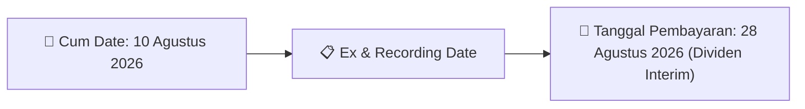
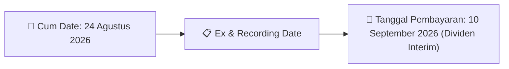

# Ikhtisar Pasar Harian (Daily Digest) - 2026-08-12

⬅️ [[Daily_Digest_20260731]] | 📅 **2026-08-12** | ➡️ [[Daily_Digest_20260804]]

## 1. Radar Pasar & Sentimen Harian (Executive Dashboard)
> [!NOTE]
> Terdeteksi sebanyak **341 pengumuman baru** dari 149 emiten pantauan pada (2026-08-12).

| Metric | Jumlah | Status Radar |
| :--- | :---: | :--- |
| **🟢 Sentimen Bullish / Positif** | `4` | [[Dividen Interim]], [[Mandatory Tender Offer]], Kinerja Positif |
| **⚪ Sentimen Netral / Routine** | `173` | [[Tanggapan Penjelasan Bursa]], [[RUPS]], [[Pendaftaran Unit]] |
| **🔴 Sentimen Bearish / Alert** | `9` | Sengketa Hukum, Defisit / Gugatan (Nihil hari ini) |
| **📄 [[Laporan Keuangan]] Baru** | `0` | Memicu Analisis Keuangan Otomatis |

> [!NOTE]
> Tidak dideteksi adanya publikasi laporan keuangan baru hari ini. Rangkuman per emiten secara terperinci tidak diperlukan.

---

## 2. Sorotan Utama & Watchlist Strategis (Strategic Watchlist)
#### 💰 Watchlist Dividen & Distribution
- **[[HUMI]]**: Total Nilai Dividen = IDR 3.000.000.000
- **[[HUMI]]**: Dividen Per Saham = IDR 0,166
- **[[HUMI]]**: Tanggal Cum Dividen di Pasar Reguler dan Pasar Negosiasi = 06 Agustus 2026
- **[[HUMI]]**: Tanggal Ex Dividen di Pasar Reguler dan Pasar Negosiasi = 07 Agustus 2026
- **[[HUMI]]**: Tanggal Cum Dividen di Pasar Tunai = 10 Agustus 2026
- **[[HUMI]]**: Tanggal Ex Dividen di Pasar Tunai = 11 Agustus 2026

#### 🎯 Watchlist Penawaran Tender Wajib (MTO) & Strategis
- **[[MKNT]]**: Perubahan Pengendalian = [[Perubahan pengendalian atas Perseroan setelah pelaksanaan PMTHMETD dijelaskan dalam dokumen]]
- **[[MREI]]**: Pemegang Saham Pengendali = [[PT Graha Sentosa Persada]]
- **[[SINI]]**: Nama Pengendali = [[PT DELI INDONESIA RAYA]]
- **[[SONA]]**: Pengendali Baru = [[PT Pratama Citra Karunia]]

#### 📈 Watchlist Konversi Waran & Potensi Dilusi
- **[[CYBR]]**: Jumlah Waran Dikonversi = 1.000 lembar
- **[[CYBR]]**: Jumlah Saham Setelah Konversi = 13.481.595.104 lembar
- **[[CYBR]]**: Sisa Waran = 1.000 lembar
- **[[HUMI]]**: Tanggal Exercise Waran = 07 Agustus 2026
- **[[HUMI]]**: Sisa Waran Seri-1 yang Belum Diexercise = 1.336.178.421 lembar
- **[[INET]]**: Jumlah Waran yang Dikonversi = 9.392

---

## 3. Matriks Pengumuman Pasar (Announcements Intelligence Table)
| Emiten | Sentimen | Jenis Pengumuman | Judul Pengumuman | Berkas |
| :--- | :---: | :--- | :--- | :--- |
| **[[ADCP]]** | ⚪ NEUTRAL | Aksi Korporasi | Laporan Informasi dan Fakta Material | [Utama](file:///g:/My%20Drive/Model2/reports/raw/ADCP/20260811_ADCP_20260811_ADCP_Laporan Informasi dan Fakta Material_32119793.pdf) · [Lamp 1](file:///g:/My%20Drive/Model2/reports/raw/ADCP/20260811_ADCP_20260811_ADCP_Laporan Informasi dan Fakta Material_32119793_lamp1.pdf) |
| **[[ADHI]]** | ⚪ NEUTRAL | RUPS | Pemberitahuan RencanaPenyampaian PanggilanHasil RUPORUPSURUP EBA-SP | [Utama](file:///g:/My%20Drive/Model2/reports/raw/ADHI/20260810_ADHI_20260810_ADHI_Pemberitahuan RencanaPenyampaian PanggilanHasil RUPORUPSURUP EBA-SP_32119550.pdf) · [Lamp 1](file:///g:/My%20Drive/Model2/reports/raw/ADHI/20260810_ADHI_20260810_ADHI_Pemberitahuan RencanaPenyampaian PanggilanHasil RUPORUPSURUP EBA-SP_32119557_lamp1.pdf) · [Lamp 1](file:///g:/My%20Drive/Model2/reports/raw/ADHI/20260810_ADHI_20260810_ADHI_Pemberitahuan RencanaPenyampaian PanggilanHasil RUPORUPSURUP EBA-SP_32119550_lamp1.pdf) |
| **[[ADHI]]** | ⚪ NEUTRAL | Aksi Korporasi | Laporan Informasi dan Fakta Material | [Utama](file:///g:/My%20Drive/Model2/reports/raw/ADHI/20260811_ADHI_20260811_ADHI_Laporan Informasi dan Fakta Material_32119891.pdf) · [Lamp 1](file:///g:/My%20Drive/Model2/reports/raw/ADHI/20260811_ADHI_20260811_ADHI_Laporan Informasi dan Fakta Material_32119891_lamp1.pdf) |
| **[[AHAP]]** | ⚪ NEUTRAL | Aksi Korporasi | Tanggapan atas Permintaan Penjelasan Bursa | [Utama](file:///g:/My%20Drive/Model2/reports/raw/AHAP/20260811_AHAP_20260810_AHAP_Tanggapan atas Permintaan Penjelasan Bursa_32119504.pdf) · [Lamp 1](file:///g:/My%20Drive/Model2/reports/raw/AHAP/20260811_AHAP_20260810_AHAP_Tanggapan atas Permintaan Penjelasan Bursa_32119504_lamp1.pdf) |
| **[[AIMS]]** | ⚪ NEUTRAL | RUPS | Pengumuman RUPS | [Utama](file:///g:/My%20Drive/Model2/reports/raw/AIMS/20260811_AIMS_20260811_AIMS_Pengumuman RUPS_32119678.pdf) · [Lamp 1](file:///g:/My%20Drive/Model2/reports/raw/AIMS/20260811_AIMS_20260811_AIMS_Pengumuman RUPS_32119678_lamp1.pdf) |
| **[[AKPI]]** | ⚪ NEUTRAL | RUPS | Pemanggilan RUPS | [Utama](file:///g:/My%20Drive/Model2/reports/raw/AKPI/20260812_AKPI_20260812_AKPI_Pemanggilan RUPS_32119933.pdf) · [Lamp 2](file:///g:/My%20Drive/Model2/reports/raw/AKPI/20260812_AKPI_20260812_AKPI_Pemanggilan RUPS_32119933_lamp2.pdf) |
| **[[AKPI]]** | ⚪ NEUTRAL | Aksi Korporasi | LK-11082026-8923-00 | [Utama](file:///g:/My%20Drive/Model2/reports/raw/AKPI/20260811_AKPI_LK-11082026-8923-00.pdf) |
| **[[ANTM]]** | ⚪ NEUTRAL | Aksi Korporasi | Laporan Informasi dan Fakta Material | [Utama](file:///g:/My%20Drive/Model2/reports/raw/ANTM/20260810_ANTM_20260810_ANTM_Laporan Informasi dan Fakta Material_32119580.pdf) · [Lamp 2](file:///g:/My%20Drive/Model2/reports/raw/ANTM/20260810_ANTM_20260810_ANTM_Laporan Informasi dan Fakta Material_32119580_lamp2.pdf) · [Lamp 1](file:///g:/My%20Drive/Model2/reports/raw/ANTM/20260810_ANTM_20260810_ANTM_Laporan Informasi dan Fakta Material_32119580_lamp1.pdf) |
| **[[ARKO]]** | ⚪ NEUTRAL | Aksi Korporasi | Pengumuman Jatuh Tempo Obligasi dan Sukuk | [Utama](file:///g:/My%20Drive/Model2/reports/raw/ARKO/20260807_ARKO_20260807_ARKO_Pengumuman Jatuh Tempo Obligasi dan Sukuk_32118834.pdf) · [Lamp 1](file:///g:/My%20Drive/Model2/reports/raw/ARKO/20260807_ARKO_20260807_ARKO_Pengumuman Jatuh Tempo Obligasi dan Sukuk_32118834_lamp1.pdf) |
| **[[ASBI]]** | ⚪ NEUTRAL | Aksi Korporasi | Laporan Informasi dan Fakta Material | [Utama](file:///g:/My%20Drive/Model2/reports/raw/ASBI/20260811_ASBI_20260811_ASBI_Laporan Informasi dan Fakta Material_32119645.pdf) |
| **[[ASMI]]** | ⚪ NEUTRAL | RUPS | Pemanggilan RUPS | [Utama](file:///g:/My%20Drive/Model2/reports/raw/ASMI/20260811_ASMI_20260811_ASMI_Pemanggilan RUPS_32119878.pdf) · [Lamp 1](file:///g:/My%20Drive/Model2/reports/raw/ASMI/20260811_ASMI_20260811_ASMI_Pemanggilan RUPS_32119878_lamp1.pdf) |
| **[[AVIA]]** | ⚪ NEUTRAL | Aksi Korporasi | Laporan Informasi dan Fakta Material | [Utama](file:///g:/My%20Drive/Model2/reports/raw/AVIA/20260810_AVIA_20260810_AVIA_Laporan Informasi dan Fakta Material_32119338.pdf) · [Lamp 1](file:///g:/My%20Drive/Model2/reports/raw/AVIA/20260810_AVIA_20260810_AVIA_Laporan Informasi dan Fakta Material_32119338_lamp1.pdf) |
| **[[BAJA]]** | ⚪ NEUTRAL | Aksi Korporasi | Pengumuman Bursa | [Utama](file:///g:/My%20Drive/Model2/reports/raw/BAJA/20260811_BAJA_20260810_BAJA_Pengumuman Bursa_32119601.pdf) · [Lamp 1](file:///g:/My%20Drive/Model2/reports/raw/BAJA/20260811_BAJA_20260810_BAJA_Pengumuman Bursa_32119601_lamp1.pdf) |
| **[[BAJA]]** | ⚪ NEUTRAL | Aksi Korporasi | Tanggapan atas Permintaan Penjelasan Bursa | [Utama](file:///g:/My%20Drive/Model2/reports/raw/BAJA/20260812_BAJA_20260812_BAJA_Tanggapan atas Permintaan Penjelasan Bursa_32119983.pdf) |
| **[[BDMN]]** | ⚪ NEUTRAL | Aksi Korporasi | Laporan Informasi dan Fakta Material | [Utama](file:///g:/My%20Drive/Model2/reports/raw/BDMN/20260811_BDMN_20260811_BDMN_Laporan Informasi dan Fakta Material_32119782.pdf) |
| **[[BESS]]** | ⚪ NEUTRAL | Aksi Korporasi | Laporan Informasi dan Fakta Material | [Utama](file:///g:/My%20Drive/Model2/reports/raw/BESS/20260807_BESS_20260807_BESS_Laporan Informasi dan Fakta Material_32119056.pdf) |
| **[[BESS]]** | ⚪ NEUTRAL | RUPS | Pemanggilan RUPS | [Utama](file:///g:/My%20Drive/Model2/reports/raw/BESS/20260807_BESS_20260807_BESS_Pemanggilan RUPS_32119001.pdf) |
| **[[BKDP]]** | ⚪ NEUTRAL | Aksi Korporasi | Tanggapan atas Permintaan Penjelasan Bursa | [Utama](file:///g:/My%20Drive/Model2/reports/raw/BKDP/20260807_BKDP_20260807_BKDP_Tanggapan atas Permintaan Penjelasan Bursa_32118964.pdf) |
| **[[BMAS]]** | ⚪ NEUTRAL | Aksi Korporasi | Tanggapan atas Permintaan Penjelasan Bursa | [Utama](file:///g:/My%20Drive/Model2/reports/raw/BMAS/20260811_BMAS_20260811_BMAS_Tanggapan atas Permintaan Penjelasan Bursa_32119773.pdf) · [Lamp 1](file:///g:/My%20Drive/Model2/reports/raw/BMAS/20260811_BMAS_20260811_BMAS_Tanggapan atas Permintaan Penjelasan Bursa_32119773_lamp1.pdf) · [Lamp 2](file:///g:/My%20Drive/Model2/reports/raw/BMAS/20260811_BMAS_20260811_BMAS_Tanggapan atas Permintaan Penjelasan Bursa_32119773_lamp2.pdf) |
| **[[BMBL]]** | ⚪ NEUTRAL | Aksi Korporasi | LK-11082026-0526-00 | [Utama](file:///g:/My%20Drive/Model2/reports/raw/BMBL/20260811_BMBL_LK-11082026-0526-00.pdf) |
| **[[BNII]]** | ⚪ NEUTRAL | Aksi Korporasi | Laporan Informasi dan Fakta Material | [Utama](file:///g:/My%20Drive/Model2/reports/raw/BNII/20260807_BNII_20260807_BNII_Laporan Informasi dan Fakta Material_32119115.pdf) · [Lamp 2](file:///g:/My%20Drive/Model2/reports/raw/BNII/20260807_BNII_20260807_BNII_Laporan Informasi dan Fakta Material_32119115_lamp2.pdf) · [Lamp 3](file:///g:/My%20Drive/Model2/reports/raw/BNII/20260807_BNII_20260807_BNII_Laporan Informasi dan Fakta Material_32119115_lamp3.pdf) |
| **[[BPFI]]** | ⚪ NEUTRAL | Aksi Korporasi | Tanggapan atas Permintaan Penjelasan Bursa | [Utama](file:///g:/My%20Drive/Model2/reports/raw/BPFI/20260811_BPFI_20260811_BPFI_Tanggapan atas Permintaan Penjelasan Bursa_32119787.pdf) |
| **[[BUDI]]** | ⚪ NEUTRAL | Aksi Korporasi | LK-10082026-9747-00 | [Utama](file:///g:/My%20Drive/Model2/reports/raw/BUDI/20260810_BUDI_LK-10082026-9747-00.pdf) |
| **[[BWPT]]** | ⚪ NEUTRAL | Aksi Korporasi | Laporan Penggunaan Dana Hasil Penawaran Umum | [Utama](file:///g:/My%20Drive/Model2/reports/raw/BWPT/20260811_BWPT_20260811_BWPT_Laporan Penggunaan Dana Hasil Penawaran Umum_32119730.pdf) |
| **[[BWPT]]** | ⚪ NEUTRAL | Public Expose | Public Expose | [Utama](file:///g:/My%20Drive/Model2/reports/raw/BWPT/20260812_BWPT_20260812_BWPT_Public Expose_32120023.pdf) · [Lamp 1](file:///g:/My%20Drive/Model2/reports/raw/BWPT/20260812_BWPT_20260812_BWPT_Public Expose_32120023_lamp1.pdf) |
| **[[CBRE]]** | ⚪ NEUTRAL | Aksi Korporasi | LK-11082026-9277-00 | [Utama](file:///g:/My%20Drive/Model2/reports/raw/CBRE/20260811_CBRE_LK-11082026-9277-00.pdf) |
| **[[COAL]]** | 🔴 BEARISH | Aksi Korporasi | Suspensi dan Pembukaan Suspensi | [Utama](file:///g:/My%20Drive/Model2/reports/raw/COAL/20260812_COAL_20260812_Suspensi dan Pembukaan Suspensi_32120015.pdf) · [Lamp 1](file:///g:/My%20Drive/Model2/reports/raw/COAL/20260812_COAL_20260812_Suspensi dan Pembukaan Suspensi_32120015_lamp1.pdf) |
| **[[CRSN]]** | ⚪ NEUTRAL | Aksi Korporasi | Tanggapan atas Permintaan Penjelasan Bursa | [Utama](file:///g:/My%20Drive/Model2/reports/raw/CRSN/20260812_CRSN_20260812_CRSN_Tanggapan atas Permintaan Penjelasan Bursa_32120002.pdf) |
| **[[CSIS]]** | ⚪ NEUTRAL | Aksi Korporasi | LK-10082026-9458-00 | [Utama](file:///g:/My%20Drive/Model2/reports/raw/CSIS/20260810_CSIS_LK-10082026-9458-00.pdf) |
| **[[CSIS]]** | ⚪ NEUTRAL | Aksi Korporasi | LK-12082026-0386-00 | [Utama](file:///g:/My%20Drive/Model2/reports/raw/CSIS/20260812_CSIS_LK-12082026-0386-00.pdf) |
| **[[CUAN]]** | ⚪ NEUTRAL | Aksi Korporasi | LK-11082026-3956-00 | [Utama](file:///g:/My%20Drive/Model2/reports/raw/CUAN/20260811_CUAN_LK-11082026-3956-00.pdf) |
| **[[CYBR]]** | ⚪ NEUTRAL | Aksi Korporasi | LK-11082026-6880-00 | [Utama](file:///g:/My%20Drive/Model2/reports/raw/CYBR/20260811_CYBR_LK-11082026-6880-00.pdf) |
| **[[CYBR]]** | ⚪ NEUTRAL | Aksi Korporasi | LK-07082026-3532-00 | [Utama](file:///g:/My%20Drive/Model2/reports/raw/CYBR/20260807_CYBR_LK-07082026-3532-00.pdf) |
| **[[CYBR]]** | ⚪ NEUTRAL | Aksi Korporasi | Pencatatan Saham Tambahan dari Konversi | [Utama](file:///g:/My%20Drive/Model2/reports/raw/CYBR/20260807_CYBR_20260807_CYBR_Pencatatan Saham Tambahan dari Konversi_32118836.pdf) · [Lamp 1](file:///g:/My%20Drive/Model2/reports/raw/CYBR/20260810_CYBR_20260810_CYBR_Pencatatan Saham Tambahan dari Konversi_32119385_lamp1.pdf) · [Lamp 1](file:///g:/My%20Drive/Model2/reports/raw/CYBR/20260807_CYBR_20260807_CYBR_Pencatatan Saham Tambahan dari Konversi_32118836_lamp1.pdf) |
| **[[DAAZ]]** | ⚪ NEUTRAL | Aksi Korporasi | Informasi Transaksi Afiliasi | [Utama](file:///g:/My%20Drive/Model2/reports/raw/DAAZ/20260811_DAAZ_20260811_DAAZ_Informasi Transaksi Afiliasi_32119698.pdf) |
| **[[DJPU]]** | ⚪ NEUTRAL | Aksi Korporasi | Pengumuman Pencatatan Awal Obligasi dan Sukuk | [Utama](file:///g:/My%20Drive/Model2/reports/raw/DJPU/20260807_DJPU_20260807_DJPU_Pengumuman Pencatatan Awal Obligasi dan Sukuk_32119018.pdf) |
| **[[DJPU]]** | ⚪ NEUTRAL | Aksi Korporasi | Pengumuman Jatuh Tempo Obligasi dan Sukuk | [Utama](file:///g:/My%20Drive/Model2/reports/raw/DJPU/20260807_DJPU_20260807_DJPU_Pengumuman Jatuh Tempo Obligasi dan Sukuk_32118788.pdf) |
| **[[DJPU]]** | ⚪ NEUTRAL | Aksi Korporasi | Pengumuman Bursa | [Utama](file:///g:/My%20Drive/Model2/reports/raw/DJPU/20260807_DJPU_20260807_DJPU_Pengumuman Bursa_32118643.pdf) |
| **[[DSSA]]** | ⚪ NEUTRAL | RUPS | Pemanggilan RUPS | [Utama](file:///g:/My%20Drive/Model2/reports/raw/DSSA/20260812_DSSA_20260812_DSSA_Pemanggilan RUPS_32120050.pdf) · [Lamp 2](file:///g:/My%20Drive/Model2/reports/raw/DSSA/20260812_DSSA_20260812_DSSA_Pemanggilan RUPS_32120050_lamp2.pdf) |
| **[[DSSA]]** | ⚪ NEUTRAL | Aksi Korporasi | Tanggapan atas Permintaan Penjelasan Bursa | [Utama](file:///g:/My%20Drive/Model2/reports/raw/DSSA/20260812_DSSA_20260812_DSSA_Tanggapan atas Permintaan Penjelasan Bursa_32120068.pdf) |
| **[[DUCK]]** | ⚪ NEUTRAL | Aksi Korporasi | Laporan Informasi dan Fakta Material | [Utama](file:///g:/My%20Drive/Model2/reports/raw/DUCK/20260812_DUCK_20260812_DUCK_Laporan Informasi dan Fakta Material_32120140.pdf) |
| **[[EDGE]]** | ⚪ NEUTRAL | Aksi Korporasi | LK-10082026-4341-00 | [Utama](file:///g:/My%20Drive/Model2/reports/raw/EDGE/20260810_EDGE_LK-10082026-4341-00.pdf) |
| **[[EKAD]]** | ⚪ NEUTRAL | Aksi Korporasi | Laporan Informasi dan Fakta Material | [Utama](file:///g:/My%20Drive/Model2/reports/raw/EKAD/20260812_EKAD_20260812_EKAD_Laporan Informasi dan Fakta Material_32120001.pdf) |
| **[[ELSA]]** | ⚪ NEUTRAL | Aksi Korporasi | Laporan Informasi dan Fakta Material | [Utama](file:///g:/My%20Drive/Model2/reports/raw/ELSA/20260807_ELSA_20260807_ELSA_Laporan Informasi dan Fakta Material_32118844.pdf) · [Lamp 1](file:///g:/My%20Drive/Model2/reports/raw/ELSA/20260807_ELSA_20260807_ELSA_Laporan Informasi dan Fakta Material_32118844_lamp1.pdf) · [Lamp 2](file:///g:/My%20Drive/Model2/reports/raw/ELSA/20260807_ELSA_20260807_ELSA_Laporan Informasi dan Fakta Material_32118844_lamp2.pdf) |
| **[[EMAS]]** | ⚪ NEUTRAL | Aksi Korporasi | Laporan Informasi dan Fakta Material | [Utama](file:///g:/My%20Drive/Model2/reports/raw/EMAS/20260811_EMAS_20260811_EMAS_Laporan Informasi dan Fakta Material_32119866.pdf) · [Lamp 1](file:///g:/My%20Drive/Model2/reports/raw/EMAS/20260811_EMAS_20260811_EMAS_Laporan Informasi dan Fakta Material_32119866_lamp1.pdf) |
| **[[EMTK]]** | ⚪ NEUTRAL | RUPS | Ringkasan RisalahRisalah RUPS | [Utama](file:///g:/My%20Drive/Model2/reports/raw/EMTK/20260812_EMTK_20260812_EMTK_Ringkasan RisalahRisalah RUPS_32120134.pdf) · [Lamp 1](file:///g:/My%20Drive/Model2/reports/raw/EMTK/20260812_EMTK_20260812_EMTK_Ringkasan RisalahRisalah RUPS_32120134_lamp1.pdf) · [Lamp 2](file:///g:/My%20Drive/Model2/reports/raw/EMTK/20260812_EMTK_20260812_EMTK_Ringkasan RisalahRisalah RUPS_32120134_lamp2.pdf) |
| **[[ENAK]]** | ⚪ NEUTRAL | RUPS | Pemanggilan RUPS | [Utama](file:///g:/My%20Drive/Model2/reports/raw/ENAK/20260811_ENAK_20260810_ENAK_Pemanggilan RUPS_32119488.pdf) · [Lamp 1](file:///g:/My%20Drive/Model2/reports/raw/ENAK/20260811_ENAK_20260810_ENAK_Pemanggilan RUPS_32119488_lamp1.pdf) · [Lamp 2](file:///g:/My%20Drive/Model2/reports/raw/ENAK/20260811_ENAK_20260810_ENAK_Pemanggilan RUPS_32119488_lamp2.pdf) |
| **[[EURO]]** | ⚪ NEUTRAL | RUPS | Pengumuman RUPS | [Utama](file:///g:/My%20Drive/Model2/reports/raw/EURO/20260812_EURO_20260812_EURO_Pengumuman RUPS_32120057.pdf) · [Lamp 1](file:///g:/My%20Drive/Model2/reports/raw/EURO/20260812_EURO_20260812_EURO_Pengumuman RUPS_32120057_lamp1.pdf) |
| **[[EXCL]]** | 🔴 BEARISH | Aksi Korporasi | Pembayaran KuponBagi HasilIjarahPokok | [Utama](file:///g:/My%20Drive/Model2/reports/raw/EXCL/20260810_EXCL_20260810_EXCL_Pembayaran KuponBagi HasilIjarahPokok_32119436.pdf) · [Lamp 1](file:///g:/My%20Drive/Model2/reports/raw/EXCL/20260810_EXCL_20260810_EXCL_Pembayaran KuponBagi HasilIjarahPokok_32119441_lamp1.pdf) |
| **[[FILM]]** | ⚪ NEUTRAL | Aksi Korporasi | LK-10082026-0387-00 | [Utama](file:///g:/My%20Drive/Model2/reports/raw/FILM/20260810_FILM_LK-10082026-0387-00.pdf) |
| **[[FILM]]** | ⚪ NEUTRAL | Aksi Korporasi | LK-11082026-3063-00 | [Utama](file:///g:/My%20Drive/Model2/reports/raw/FILM/20260811_FILM_LK-11082026-3063-00.pdf) |
| **[[FILM]]** | ⚪ NEUTRAL | Aksi Korporasi | LK-11082026-4372-00 | [Utama](file:///g:/My%20Drive/Model2/reports/raw/FILM/20260811_FILM_LK-11082026-4372-00.pdf) |
| **[[FLMC]]** | ⚪ NEUTRAL | Aksi Korporasi | LK-11082026-7353-00 | [Utama](file:///g:/My%20Drive/Model2/reports/raw/FLMC/20260811_FLMC_LK-11082026-7353-00.pdf) |
| **[[GDST]]** | ⚪ NEUTRAL | Aksi Korporasi | Tanggapan atas Permintaan Penjelasan Bursa | [Utama](file:///g:/My%20Drive/Model2/reports/raw/GDST/20260811_GDST_20260811_GDST_Tanggapan atas Permintaan Penjelasan Bursa_32119779.pdf) · [Lamp 1](file:///g:/My%20Drive/Model2/reports/raw/GDST/20260811_GDST_20260811_GDST_Tanggapan atas Permintaan Penjelasan Bursa_32119779_lamp1.pdf) |
| **[[GENERAL]]** | ⚪ NEUTRAL | Aksi Korporasi | Pemantauan Khusus | [Utama](file:///g:/My%20Drive/Model2/reports/raw/GENERAL/20260811__20260811_Pemantauan Khusus_32119742.pdf) |
| **[[GIAA]]** | ⚪ NEUTRAL | Aksi Korporasi | Laporan Informasi dan Fakta Material | [Utama](file:///g:/My%20Drive/Model2/reports/raw/GIAA/20260807_GIAA_20260807_GIAA_Laporan Informasi dan Fakta Material_32119147.pdf) · [Lamp 3](file:///g:/My%20Drive/Model2/reports/raw/GIAA/20260807_GIAA_20260807_GIAA_Laporan Informasi dan Fakta Material_32119147_lamp3.pdf) · [Lamp 2](file:///g:/My%20Drive/Model2/reports/raw/GIAA/20260807_GIAA_20260807_GIAA_Laporan Informasi dan Fakta Material_32119147_lamp2.pdf) · [Lamp 1](file:///g:/My%20Drive/Model2/reports/raw/GIAA/20260807_GIAA_20260807_GIAA_Laporan Informasi dan Fakta Material_32119147_lamp1.pdf) |
| **[[HD]]** | ⚪ NEUTRAL | Aksi Korporasi | HD HD Keterbukaan Informasi | [Utama](file:///g:/My%20Drive/Model2/reports/raw/HD/20260812_HD_20260812_HD_Keterbukaan Informasi_32120128.pdf) · [Lamp 9](file:///g:/My%20Drive/Model2/reports/raw/HD/20260812_HD_20260812_HD_Keterbukaan Informasi_32120128_lamp9.pdf) · [Lamp 8](file:///g:/My%20Drive/Model2/reports/raw/HD/20260812_HD_20260812_HD_Keterbukaan Informasi_32120128_lamp8.pdf) · [Lamp 3](file:///g:/My%20Drive/Model2/reports/raw/HD/20260812_HD_20260812_HD_Keterbukaan Informasi_32120128_lamp3.pdf) |
| **[[HEAL]]** | ⚪ NEUTRAL | Aksi Korporasi | LK-12082026-2752-00 | [Utama](file:///g:/My%20Drive/Model2/reports/raw/HEAL/20260812_HEAL_LK-12082026-2752-00.pdf) |
| **[[HELI]]** | ⚪ NEUTRAL | Aksi Korporasi | LK-10082026-6322-00 | [Utama](file:///g:/My%20Drive/Model2/reports/raw/HELI/20260810_HELI_LK-10082026-6322-00.pdf) |
| **[[HEXA]]** | ⚪ NEUTRAL | RUPS | Pengumuman RUPS | [Utama](file:///g:/My%20Drive/Model2/reports/raw/HEXA/20260811_HEXA_20260811_HEXA_Pengumuman RUPS_32119624.pdf) · [Lamp 1](file:///g:/My%20Drive/Model2/reports/raw/HEXA/20260811_HEXA_20260811_HEXA_Pengumuman RUPS_32119624_lamp1.pdf) · [Lamp 2](file:///g:/My%20Drive/Model2/reports/raw/HEXA/20260811_HEXA_20260811_HEXA_Pengumuman RUPS_32119624_lamp2.pdf) |
| **[[HIFI]]** | ⚪ NEUTRAL | Aksi Korporasi | Pembayaran KuponBagi HasilIjarahPokok | [Utama](file:///g:/My%20Drive/Model2/reports/raw/HIFI/20260812_HIFI_20260810_HIFI_Pembayaran KuponBagi HasilIjarahPokok_32119406.pdf) |
| **[[HRUM]]** | ⚪ NEUTRAL | RUPS | Pengumuman RUPS | [Utama](file:///g:/My%20Drive/Model2/reports/raw/HRUM/20260812_HRUM_20260810_HRUM_Pengumuman RUPS_32119230.pdf) · [Lamp 1](file:///g:/My%20Drive/Model2/reports/raw/HRUM/20260812_HRUM_20260810_HRUM_Pengumuman RUPS_32119230_lamp1.pdf) |
| **[[HUMI]]** | ⚪ NEUTRAL | Aksi Korporasi | Pencatatan Saham Tambahan dari Konversi | [Utama](file:///g:/My%20Drive/Model2/reports/raw/HUMI/20260811_HUMI_20260810_HUMI_Pencatatan Saham Tambahan dari Konversi_32119367.pdf) · [Lamp 1](file:///g:/My%20Drive/Model2/reports/raw/HUMI/20260811_HUMI_20260810_HUMI_Pencatatan Saham Tambahan dari Konversi_32119367_lamp1.pdf) |
| **[[HUMI]]** | 🟢 BULLISH | Dividen | Keterbukaan Informasi terkait Aksi Korporasi | [Utama](file:///g:/My%20Drive/Model2/reports/raw/HUMI/20260810_HUMI_20260810_HUMI_Keterbukaan Informasi terkait Aksi Korporasi_32119463.pdf) |
| **[[HYGN]]** | ⚪ NEUTRAL | Aksi Korporasi | Laporan Informasi dan Fakta Material | [Utama](file:///g:/My%20Drive/Model2/reports/raw/HYGN/20260812_HYGN_20260812_HYGN_Laporan Informasi dan Fakta Material_32119910.pdf) · [Lamp 1](file:///g:/My%20Drive/Model2/reports/raw/HYGN/20260812_HYGN_20260812_HYGN_Laporan Informasi dan Fakta Material_32119910_lamp1.pdf) |
| **[[IATA]]** | ⚪ NEUTRAL | Aksi Korporasi | Laporan Informasi dan Fakta Material | [Utama](file:///g:/My%20Drive/Model2/reports/raw/IATA/20260811_IATA_20260811_IATA_Laporan Informasi dan Fakta Material_32119650.pdf) · [Lamp 2](file:///g:/My%20Drive/Model2/reports/raw/IATA/20260811_IATA_20260811_IATA_Laporan Informasi dan Fakta Material_32119650_lamp2.pdf) · [Lamp 1](file:///g:/My%20Drive/Model2/reports/raw/IATA/20260811_IATA_20260811_IATA_Laporan Informasi dan Fakta Material_32119650_lamp1.pdf) |
| **[[IATA]]** | ⚪ NEUTRAL | Aksi Korporasi | LK-11082026-7144-00 | [Utama](file:///g:/My%20Drive/Model2/reports/raw/IATA/20260811_IATA_LK-11082026-7144-00.pdf) |
| **[[ICON]]** | 🔴 BEARISH | Aksi Korporasi | Laporan Informasi dan Fakta Material | [Utama](file:///g:/My%20Drive/Model2/reports/raw/ICON/20260808_ICON_20260808_ICON_Laporan Informasi dan Fakta Material_32119150.pdf) · [Lamp 1](file:///g:/My%20Drive/Model2/reports/raw/ICON/20260808_ICON_20260808_ICON_Laporan Informasi dan Fakta Material_32119150_lamp1.pdf) |
| **[[ICON]]** | ⚪ NEUTRAL | Aksi Korporasi | Tanggapan atas Permintaan Penjelasan Bursa | [Utama](file:///g:/My%20Drive/Model2/reports/raw/ICON/20260811_ICON_20260811_ICON_Tanggapan atas Permintaan Penjelasan Bursa_32119764.pdf) |
| **[[IMPC]]** | ⚪ NEUTRAL | Aksi Korporasi | LK-07082026-8035-00 | [Utama](file:///g:/My%20Drive/Model2/reports/raw/IMPC/20260807_IMPC_LK-07082026-8035-00.pdf) |
| **[[INCF]]** | 🔴 BEARISH | Aksi Korporasi | Suspensi dan Pembukaan Suspensi | [Utama](file:///g:/My%20Drive/Model2/reports/raw/INCF/20260812_INCF_20260812_Suspensi dan Pembukaan Suspensi_32120014.pdf) · [Lamp 1](file:///g:/My%20Drive/Model2/reports/raw/INCF/20260812_INCF_20260812_Suspensi dan Pembukaan Suspensi_32120014_lamp1.pdf) |
| **[[INET]]** | 🟢 BULLISH | Aksi Korporasi | Pencatatan Saham Tambahan dari Konversi | [Utama](file:///g:/My%20Drive/Model2/reports/raw/INET/20260807_INET_20260807_INET_Pencatatan Saham Tambahan dari Konversi_32118932.pdf) |
| **[[INPP]]** | 🟢 BULLISH | Dividen | Jadwal Aksi Korporasi (Khusus Penyampaian Dividen Interim) | [Utama](file:///g:/My%20Drive/Model2/reports/raw/INPP/20260811_INPP_20260811_INPP_Jadwal Aksi Korporasi (Khusus Penyampaian Dividen Interim)_32119741.pdf) |
| **[[IPCC]]** | ⚪ NEUTRAL | RUPS | Pemanggilan RUPS | [Utama](file:///g:/My%20Drive/Model2/reports/raw/IPCC/20260812_IPCC_20260812_IPCC_Pemanggilan RUPS_32120037.pdf) · [Lamp 1](file:///g:/My%20Drive/Model2/reports/raw/IPCC/20260812_IPCC_20260812_IPCC_Pemanggilan RUPS_32120037_lamp1.pdf) |
| **[[IRSX]]** | ⚪ NEUTRAL | Aksi Korporasi | Laporan Informasi dan Fakta Material | [Utama](file:///g:/My%20Drive/Model2/reports/raw/IRSX/20260812_IRSX_20260812_IRSX_Laporan Informasi dan Fakta Material_32120051.pdf) · [Lamp 1](file:///g:/My%20Drive/Model2/reports/raw/IRSX/20260812_IRSX_20260812_IRSX_Laporan Informasi dan Fakta Material_32120051_lamp1.pdf) |
| **[[ISAP]]** | ⚪ NEUTRAL | Aksi Korporasi | Pencatatan Saham Tambahan dari Konversi | [Utama](file:///g:/My%20Drive/Model2/reports/raw/ISAP/20260807_ISAP_20260807_ISAP_Pencatatan Saham Tambahan dari Konversi_32118759.pdf) · [Lamp 1](file:///g:/My%20Drive/Model2/reports/raw/ISAP/20260807_ISAP_20260807_ISAP_Pencatatan Saham Tambahan dari Konversi_32118759_lamp1.pdf) |
| **[[ISAT]]** | ⚪ NEUTRAL | Aksi Korporasi | Laporan Informasi dan Fakta Material | [Utama](file:///g:/My%20Drive/Model2/reports/raw/ISAT/20260810_ISAT_20260810_ISAT_Laporan Informasi dan Fakta Material_32119330.pdf) |
| **[[ISAT]]** | ⚪ NEUTRAL | Aksi Korporasi | Pembayaran KuponBagi HasilIjarahPokok | [Utama](file:///g:/My%20Drive/Model2/reports/raw/ISAT/20260812_ISAT_20260812_ISAT_Pembayaran KuponBagi HasilIjarahPokok_32120019.pdf) · [Lamp 1](file:///g:/My%20Drive/Model2/reports/raw/ISAT/20260812_ISAT_20260812_ISAT_Pembayaran KuponBagi HasilIjarahPokok_32120019_lamp1.pdf) |
| **[[JARR]]** | ⚪ NEUTRAL | Aksi Korporasi | Tanggapan atas Permintaan Penjelasan Bursa | [Utama](file:///g:/My%20Drive/Model2/reports/raw/JARR/20260812_JARR_20260812_JARR_Tanggapan atas Permintaan Penjelasan Bursa_32120125.pdf) · [Lamp 1](file:///g:/My%20Drive/Model2/reports/raw/JARR/20260812_JARR_20260812_JARR_Tanggapan atas Permintaan Penjelasan Bursa_32120125_lamp1.pdf) |
| **[[KDTN]]** | ⚪ NEUTRAL | Aksi Korporasi | LK-11082026-7440-00 | [Utama](file:///g:/My%20Drive/Model2/reports/raw/KDTN/20260811_KDTN_LK-11082026-7440-00.pdf) |
| **[[KDTN]]** | ⚪ NEUTRAL | Aksi Korporasi | LK-07082026-6200-00 | [Utama](file:///g:/My%20Drive/Model2/reports/raw/KDTN/20260807_KDTN_LK-07082026-6200-00.pdf) |
| **[[KOTA]]** | ⚪ NEUTRAL | Aksi Korporasi | Tanggapan atas Permintaan Penjelasan Bursa | [Utama](file:///g:/My%20Drive/Model2/reports/raw/KOTA/20260811_KOTA_20260811_KOTA_Tanggapan atas Permintaan Penjelasan Bursa_32119821.pdf) · [Lamp 1](file:///g:/My%20Drive/Model2/reports/raw/KOTA/20260811_KOTA_20260811_KOTA_Tanggapan atas Permintaan Penjelasan Bursa_32119821_lamp1.pdf) |
| **[[KPIG]]** | ⚪ NEUTRAL | Aksi Korporasi | Laporan Informasi dan Fakta Material | [Utama](file:///g:/My%20Drive/Model2/reports/raw/KPIG/20260807_KPIG_20260807_KPIG_Laporan Informasi dan Fakta Material_32119084.pdf) |
| **[[LPKR]]** | ⚪ NEUTRAL | Aksi Korporasi | Tanggapan atas Permintaan Penjelasan Bursa | [Utama](file:///g:/My%20Drive/Model2/reports/raw/LPKR/20260812_LPKR_20260812_LPKR_Tanggapan atas Permintaan Penjelasan Bursa_32120094.pdf) · [Lamp 1](file:///g:/My%20Drive/Model2/reports/raw/LPKR/20260812_LPKR_20260812_LPKR_Tanggapan atas Permintaan Penjelasan Bursa_32120094_lamp1.pdf) |
| **[[MABA]]** | ⚪ NEUTRAL | Aksi Korporasi | Laporan Informasi dan Fakta Material | [Utama](file:///g:/My%20Drive/Model2/reports/raw/MABA/20260811_MABA_20260811_MABA_Laporan Informasi dan Fakta Material_32119686.pdf) · [Lamp 1](file:///g:/My%20Drive/Model2/reports/raw/MABA/20260811_MABA_20260811_MABA_Laporan Informasi dan Fakta Material_32119719_lamp1.pdf) · [Lamp 1](file:///g:/My%20Drive/Model2/reports/raw/MABA/20260811_MABA_20260811_MABA_Laporan Informasi dan Fakta Material_32119686_lamp1.pdf) |
| **[[MANG]]** | ⚪ NEUTRAL | Aksi Korporasi | Pencatatan Saham Tambahan dari Konversi | [Utama](file:///g:/My%20Drive/Model2/reports/raw/MANG/20260812_MANG_20260811_MANG_Pencatatan Saham Tambahan dari Konversi_32119690.pdf) · [Lamp 1](file:///g:/My%20Drive/Model2/reports/raw/MANG/20260812_MANG_20260811_MANG_Pencatatan Saham Tambahan dari Konversi_32119690_lamp1.pdf) |
| **[[MBSS]]** | ⚪ NEUTRAL | RUPS | Pengumuman RUPS | [Utama](file:///g:/My%20Drive/Model2/reports/raw/MBSS/20260811_MBSS_20260811_MBSS_Pengumuman RUPS_32119661.pdf) |
| **[[MBSS]]** | 🔴 BEARISH | Aksi Korporasi | Laporan Informasi dan Fakta Material | [Utama](file:///g:/My%20Drive/Model2/reports/raw/MBSS/20260811_MBSS_20260811_MBSS_Laporan Informasi dan Fakta Material_32119677.pdf) |
| **[[MDIY]]** | ⚪ NEUTRAL | Aksi Korporasi | Laporan Informasi dan Fakta Material | [Utama](file:///g:/My%20Drive/Model2/reports/raw/MDIY/20260810_MDIY_20260810_MDIY_Laporan Informasi dan Fakta Material_32119383.pdf) · [Lamp 1](file:///g:/My%20Drive/Model2/reports/raw/MDIY/20260810_MDIY_20260810_MDIY_Laporan Informasi dan Fakta Material_32119383_lamp1.pdf) |
| **[[MEDS]]** | ⚪ NEUTRAL | Aksi Korporasi | LK-10082026-8951-00 | [Utama](file:///g:/My%20Drive/Model2/reports/raw/MEDS/20260810_MEDS_LK-10082026-8951-00.pdf) |
| **[[MEDS]]** | ⚪ NEUTRAL | Aksi Korporasi | LK-11082026-2031-00 | [Utama](file:///g:/My%20Drive/Model2/reports/raw/MEDS/20260811_MEDS_LK-11082026-2031-00.pdf) |
| **[[MEDS]]** | ⚪ NEUTRAL | Aksi Korporasi | LK-07082026-2894-00 | [Utama](file:///g:/My%20Drive/Model2/reports/raw/MEDS/20260807_MEDS_LK-07082026-2894-00.pdf) |
| **[[MGLV]]** | 🔴 BEARISH | Aksi Korporasi | LK-11082026-3121-00 | [Utama](file:///g:/My%20Drive/Model2/reports/raw/MGLV/20260811_MGLV_LK-11082026-3121-00.pdf) |
| **[[MGLV]]** | ⚪ NEUTRAL | RUPS | Pemanggilan RUPS | [Utama](file:///g:/My%20Drive/Model2/reports/raw/MGLV/20260812_MGLV_20260812_MGLV_Pemanggilan RUPS_32120075.pdf) · [Lamp 1](file:///g:/My%20Drive/Model2/reports/raw/MGLV/20260812_MGLV_20260812_MGLV_Pemanggilan RUPS_32120075_lamp1.pdf) |
| **[[MGNA]]** | ⚪ NEUTRAL | Aksi Korporasi | Pencatatan Saham Tambahan dari Konversi | [Utama](file:///g:/My%20Drive/Model2/reports/raw/MGNA/20260807_MGNA_20260807_MGNA_Pencatatan Saham Tambahan dari Konversi_32118870.pdf) · [Lamp 1](file:///g:/My%20Drive/Model2/reports/raw/MGNA/20260807_MGNA_20260807_MGNA_Pencatatan Saham Tambahan dari Konversi_32118870_lamp1.pdf) |
| **[[MICE]]** | ⚪ NEUTRAL | Aksi Korporasi | LK-11082026-0439-00 | [Utama](file:///g:/My%20Drive/Model2/reports/raw/MICE/20260811_MICE_LK-11082026-0439-00.pdf) |
| **[[MICE]]** | ⚪ NEUTRAL | Aksi Korporasi | LK-11082026-4921-00 | [Utama](file:///g:/My%20Drive/Model2/reports/raw/MICE/20260811_MICE_LK-11082026-4921-00.pdf) |
| **[[MINE]]** | ⚪ NEUTRAL | RUPS | Pemanggilan RUPS | [Utama](file:///g:/My%20Drive/Model2/reports/raw/MINE/20260807_MINE_20260807_MINE_Pemanggilan RUPS_32119038.pdf) · [Lamp 2](file:///g:/My%20Drive/Model2/reports/raw/MINE/20260807_MINE_20260807_MINE_Pemanggilan RUPS_32119038_lamp2.pdf) · [Lamp 1](file:///g:/My%20Drive/Model2/reports/raw/MINE/20260807_MINE_20260807_MINE_Pemanggilan RUPS_32119038_lamp1.pdf) |
| **[[MKNT]]** | ⚪ NEUTRAL | Aksi Korporasi | Perubahan danatau Tambahan Keterbukaan Informasi terkait Aksi Korporasi | [Utama](file:///g:/My%20Drive/Model2/reports/raw/MKNT/20260807_MKNT_20260807_MKNT_Perubahan danatau Tambahan Keterbukaan Informasi terkait Aksi Korporasi_32119138.pdf) · [Lamp 2](file:///g:/My%20Drive/Model2/reports/raw/MKNT/20260807_MKNT_20260807_MKNT_Perubahan danatau Tambahan Keterbukaan Informasi terkait Aksi Korporasi_32119138_lamp2.pdf) · [Lamp 3](file:///g:/My%20Drive/Model2/reports/raw/MKNT/20260807_MKNT_20260807_MKNT_Perubahan danatau Tambahan Keterbukaan Informasi terkait Aksi Korporasi_32119138_lamp3.pdf) · [Lamp 1](file:///g:/My%20Drive/Model2/reports/raw/MKNT/20260807_MKNT_20260807_MKNT_Perubahan danatau Tambahan Keterbukaan Informasi terkait Aksi Korporasi_32119138_lamp1.pdf) |
| **[[MLJK]]** | ⚪ NEUTRAL | Aksi Korporasi | Laporan Hasil Pemeringkatan | [Utama](file:///g:/My%20Drive/Model2/reports/raw/MLJK/20260810_MLJK_20260810_MLJK_Laporan Hasil Pemeringkatan_32119524.pdf) |
| **[[MPMF]]** | ⚪ NEUTRAL | Aksi Korporasi | Pengumuman Jatuh Tempo Obligasi dan Sukuk | [Utama](file:///g:/My%20Drive/Model2/reports/raw/MPMF/20260811_MPMF_20260810_MPMF_Pengumuman Jatuh Tempo Obligasi dan Sukuk_32119287.pdf) |
| **[[MPPA]]** | ⚪ NEUTRAL | Aksi Korporasi | Laporan Informasi dan Fakta Material | [Utama](file:///g:/My%20Drive/Model2/reports/raw/MPPA/20260810_MPPA_20260810_MPPA_Laporan Informasi dan Fakta Material_32119480.pdf) · [Lamp 1](file:///g:/My%20Drive/Model2/reports/raw/MPPA/20260810_MPPA_20260810_MPPA_Laporan Informasi dan Fakta Material_32119480_lamp1.pdf) |
| **[[MREI]]** | ⚪ NEUTRAL | Public Expose | Public Expose | [Utama](file:///g:/My%20Drive/Model2/reports/raw/MREI/20260811_MREI_20260811_MREI_Public Expose_32119739.pdf) · [Lamp 2](file:///g:/My%20Drive/Model2/reports/raw/MREI/20260811_MREI_20260811_MREI_Public Expose_32119739_lamp2.pdf) · [Lamp 1](file:///g:/My%20Drive/Model2/reports/raw/MREI/20260811_MREI_20260811_MREI_Public Expose_32119739_lamp1.pdf) |
| **[[NANO]]** | ⚪ NEUTRAL | Aksi Korporasi | LK-11082026-7562-00 | [Utama](file:///g:/My%20Drive/Model2/reports/raw/NANO/20260811_NANO_LK-11082026-7562-00.pdf) |
| **[[NANO]]** | ⚪ NEUTRAL | Aksi Korporasi | Laporan Informasi dan Fakta Material | [Utama](file:///g:/My%20Drive/Model2/reports/raw/NANO/20260807_NANO_20260807_NANO_Laporan Informasi dan Fakta Material_32118999.pdf) · [Lamp 1](file:///g:/My%20Drive/Model2/reports/raw/NANO/20260807_NANO_20260807_NANO_Laporan Informasi dan Fakta Material_32118999_lamp1.pdf) |
| **[[NICK]]** | ⚪ NEUTRAL | Aksi Korporasi | LK-12082026-7560-00 | [Utama](file:///g:/My%20Drive/Model2/reports/raw/NICK/20260812_NICK_LK-12082026-7560-00.pdf) |
| **[[NSSS]]** | ⚪ NEUTRAL | Aksi Korporasi | LK-10082026-6267-00 | [Utama](file:///g:/My%20Drive/Model2/reports/raw/NSSS/20260810_NSSS_LK-10082026-6267-00.pdf) |
| **[[NSSS]]** | ⚪ NEUTRAL | Aksi Korporasi | LK-07082026-3626-00 | [Utama](file:///g:/My%20Drive/Model2/reports/raw/NSSS/20260807_NSSS_LK-07082026-3626-00.pdf) |
| **[[OASA]]** | 🔴 BEARISH | Aksi Korporasi | LK-07082026-2388-00 | [Utama](file:///g:/My%20Drive/Model2/reports/raw/OASA/20260807_OASA_LK-07082026-2388-00.pdf) |
| **[[OILS]]** | ⚪ NEUTRAL | RUPS | Ringkasan RisalahRisalah RUPS | [Utama](file:///g:/My%20Drive/Model2/reports/raw/OILS/20260812_OILS_20260812_OILS_Ringkasan RisalahRisalah RUPS_32120085.pdf) |
| **[[OKAS]]** | ⚪ NEUTRAL | Aksi Korporasi | LK-10082026-7997-00 | [Utama](file:///g:/My%20Drive/Model2/reports/raw/OKAS/20260810_OKAS_LK-10082026-7997-00.pdf) |
| **[[OKAS]]** | ⚪ NEUTRAL | Aksi Korporasi | LK-07082026-4238-00 | [Utama](file:///g:/My%20Drive/Model2/reports/raw/OKAS/20260807_OKAS_LK-07082026-4238-00.pdf) |
| **[[PACK]]** | ⚪ NEUTRAL | Aksi Korporasi | Pencatatan Saham Tambahan dari Konversi | [Utama](file:///g:/My%20Drive/Model2/reports/raw/PACK/20260812_PACK_20260811_PACK_Pencatatan Saham Tambahan dari Konversi_32119668.pdf) · [Lamp 1](file:///g:/My%20Drive/Model2/reports/raw/PACK/20260811_PACK_20260810_PACK_Pencatatan Saham Tambahan dari Konversi_32119394_lamp1.pdf) |
| **[[PADI]]** | ⚪ NEUTRAL | RUPS | Ringkasan RisalahRisalah RUPS | [Utama](file:///g:/My%20Drive/Model2/reports/raw/PADI/20260810_PADI_20260810_PADI_Ringkasan RisalahRisalah RUPS_32119449.pdf) · [Lamp 3](file:///g:/My%20Drive/Model2/reports/raw/PADI/20260810_PADI_20260810_PADI_Ringkasan RisalahRisalah RUPS_32119449_lamp3.pdf) · [Lamp 1](file:///g:/My%20Drive/Model2/reports/raw/PADI/20260810_PADI_20260810_PADI_Ringkasan RisalahRisalah RUPS_32119449_lamp1.pdf) |
| **[[PALM]]** | ⚪ NEUTRAL | Aksi Korporasi | Laporan Informasi dan Fakta Material | [Utama](file:///g:/My%20Drive/Model2/reports/raw/PALM/20260811_PALM_20260811_PALM_Laporan Informasi dan Fakta Material_32119745.pdf) · [Lamp 1](file:///g:/My%20Drive/Model2/reports/raw/PALM/20260811_PALM_20260811_PALM_Laporan Informasi dan Fakta Material_32119745_lamp1.pdf) |
| **[[PANI]]** | 🟢 BULLISH | Aksi Korporasi | Laporan Informasi dan Fakta Material | [Utama](file:///g:/My%20Drive/Model2/reports/raw/PANI/20260807_PANI_20260807_PANI_Laporan Informasi dan Fakta Material_32118970.pdf) · [Lamp 2](file:///g:/My%20Drive/Model2/reports/raw/PANI/20260807_PANI_20260807_PANI_Laporan Informasi dan Fakta Material_32118970_lamp2.pdf) · [Lamp 3](file:///g:/My%20Drive/Model2/reports/raw/PANI/20260807_PANI_20260807_PANI_Laporan Informasi dan Fakta Material_32118970_lamp3.pdf) |
| **[[PANS]]** | ⚪ NEUTRAL | Aksi Korporasi | LK-11082026-5711-00 | [Utama](file:///g:/My%20Drive/Model2/reports/raw/PANS/20260811_PANS_LK-11082026-5711-00.pdf) |
| **[[PANS]]** | ⚪ NEUTRAL | Aksi Korporasi | LK-11082026-1881-00 | [Utama](file:///g:/My%20Drive/Model2/reports/raw/PANS/20260811_PANS_LK-11082026-1881-00.pdf) |
| **[[PANS]]** | ⚪ NEUTRAL | Aksi Korporasi | LK-11082026-9630-00 | [Utama](file:///g:/My%20Drive/Model2/reports/raw/PANS/20260811_PANS_LK-11082026-9630-00.pdf) |
| **[[PANS]]** | ⚪ NEUTRAL | Aksi Korporasi | LK-11082026-6081-00 | [Utama](file:///g:/My%20Drive/Model2/reports/raw/PANS/20260811_PANS_LK-11082026-6081-00.pdf) |
| **[[PGEO]]** | ⚪ NEUTRAL | Aksi Korporasi | Laporan Informasi dan Fakta Material | [Utama](file:///g:/My%20Drive/Model2/reports/raw/PGEO/20260807_PGEO_20260807_PGEO_Laporan Informasi dan Fakta Material_32119146.pdf) · [Lamp 2](file:///g:/My%20Drive/Model2/reports/raw/PGEO/20260807_PGEO_20260807_PGEO_Laporan Informasi dan Fakta Material_32119146_lamp2.pdf) · [Lamp 1](file:///g:/My%20Drive/Model2/reports/raw/PGEO/20260807_PGEO_20260807_PGEO_Laporan Informasi dan Fakta Material_32119146_lamp1.pdf) |
| **[[PGJO]]** | ⚪ NEUTRAL | RUPS | Transaksi Material Tanpa Persetujuan RUPS | [Utama](file:///g:/My%20Drive/Model2/reports/raw/PGJO/20260811_PGJO_20260811_PGJO_Transaksi Material Tanpa Persetujuan RUPS_32119869.pdf) · [Lamp 3](file:///g:/My%20Drive/Model2/reports/raw/PGJO/20260811_PGJO_20260811_PGJO_Transaksi Material Tanpa Persetujuan RUPS_32119869_lamp3.pdf) · [Lamp 1](file:///g:/My%20Drive/Model2/reports/raw/PGJO/20260811_PGJO_20260811_PGJO_Transaksi Material Tanpa Persetujuan RUPS_32119869_lamp1.pdf) |
| **[[PJHB]]** | ⚪ NEUTRAL | Aksi Korporasi | Pencatatan Saham Tambahan dari Konversi | [Utama](file:///g:/My%20Drive/Model2/reports/raw/PJHB/20260812_PJHB_20260811_PJHB_Pencatatan Saham Tambahan dari Konversi_32119710.pdf) |
| **[[POOL]]** | ⚪ NEUTRAL | RUPS | Pemanggilan RUPS | [Utama](file:///g:/My%20Drive/Model2/reports/raw/POOL/20260812_POOL_20260812_POOL_Pemanggilan RUPS_32120007.pdf) · [Lamp 1](file:///g:/My%20Drive/Model2/reports/raw/POOL/20260812_POOL_20260812_POOL_Pemanggilan RUPS_32120007_lamp1.pdf) |
| **[[PPGD]]** | ⚪ NEUTRAL | Aksi Korporasi | Pembayaran KuponBagi HasilIjarahPokok | [Utama](file:///g:/My%20Drive/Model2/reports/raw/PPGD/20260812_PPGD_20260812_PPGD_Pembayaran KuponBagi HasilIjarahPokok_32120100.pdf) · [Lamp 1](file:///g:/My%20Drive/Model2/reports/raw/PPGD/20260812_PPGD_20260812_PPGD_Pembayaran KuponBagi HasilIjarahPokok_32120100_lamp1.pdf) |
| **[[PTRO]]** | ⚪ NEUTRAL | Aksi Korporasi | Tanggapan atas Permintaan Penjelasan Bursa | [Utama](file:///g:/My%20Drive/Model2/reports/raw/PTRO/20260810_PTRO_20260810_PTRO_Tanggapan atas Permintaan Penjelasan Bursa_32119472.pdf) |
| **[[PYFA]]** | ⚪ NEUTRAL | Aksi Korporasi | Pencatatan Saham Tambahan dari Konversi | [Utama](file:///g:/My%20Drive/Model2/reports/raw/PYFA/20260810_PYFA_20260810_PYFA_Pencatatan Saham Tambahan dari Konversi_32119318.pdf) |
| **[[R-ABFII]]** | ⚪ NEUTRAL | Aksi Korporasi | R-ABFII R-ABFII Pencatatan AwalTambahan ETF | [Utama](file:///g:/My%20Drive/Model2/reports/raw/R-ABFII/20260811_R-ABFII_20260811_R-ABFII_Pencatatan AwalTambahan ETF_32119670.pdf) |
| **[[RELI]]** | ⚪ NEUTRAL | Aksi Korporasi | LK-07082026-5951-00 | [Utama](file:///g:/My%20Drive/Model2/reports/raw/RELI/20260807_RELI_LK-07082026-5951-00.pdf) |
| **[[RICY]]** | ⚪ NEUTRAL | RUPS | Pemanggilan RUPS | [Utama](file:///g:/My%20Drive/Model2/reports/raw/RICY/20260811_RICY_20260811_RICY_Pemanggilan RUPS_32119628.pdf) · [Lamp 1](file:///g:/My%20Drive/Model2/reports/raw/RICY/20260811_RICY_20260811_RICY_Pemanggilan RUPS_32119628_lamp1.pdf) · [Lamp 2](file:///g:/My%20Drive/Model2/reports/raw/RICY/20260811_RICY_20260811_RICY_Pemanggilan RUPS_32119628_lamp2.pdf) |
| **[[RLCO]]** | ⚪ NEUTRAL | Aksi Korporasi | LK-10082026-0725-00 | [Utama](file:///g:/My%20Drive/Model2/reports/raw/RLCO/20260810_RLCO_LK-10082026-0725-00.pdf) |
| **[[RUIS]]** | ⚪ NEUTRAL | Aksi Korporasi | Laporan Informasi dan Fakta Material | [Utama](file:///g:/My%20Drive/Model2/reports/raw/RUIS/20260807_RUIS_20260807_RUIS_Laporan Informasi dan Fakta Material_32119121.pdf) · [Lamp 1](file:///g:/My%20Drive/Model2/reports/raw/RUIS/20260807_RUIS_20260807_RUIS_Laporan Informasi dan Fakta Material_32119121_lamp1.pdf) · [Lamp 1](file:///g:/My%20Drive/Model2/reports/raw/RUIS/20260807_RUIS_20260807_RUIS_Laporan Informasi dan Fakta Material_32119111_lamp1.pdf) |
| **[[RUNS]]** | 🔴 BEARISH | Aksi Korporasi | LK-07082026-2454-00 | [Utama](file:///g:/My%20Drive/Model2/reports/raw/RUNS/20260807_RUNS_LK-07082026-2454-00.pdf) |
| **[[SCMA]]** | ⚪ NEUTRAL | Aksi Korporasi | Pencatatan Saham Tambahan dari Konversi | [Utama](file:///g:/My%20Drive/Model2/reports/raw/SCMA/20260807_SCMA_20260807_SCMA_Pencatatan Saham Tambahan dari Konversi_32118785.pdf) |
| **[[SDMU]]** | ⚪ NEUTRAL | Aksi Korporasi | Laporan Informasi dan Fakta Material | [Utama](file:///g:/My%20Drive/Model2/reports/raw/SDMU/20260812_SDMU_20260812_SDMU_Laporan Informasi dan Fakta Material_32120092.pdf) |
| **[[SDRA]]** | ⚪ NEUTRAL | Aksi Korporasi | Laporan Informasi dan Fakta Material | [Utama](file:///g:/My%20Drive/Model2/reports/raw/SDRA/20260811_SDRA_20260811_SDRA_Laporan Informasi dan Fakta Material_32119613.pdf) · [Lamp 3](file:///g:/My%20Drive/Model2/reports/raw/SDRA/20260811_SDRA_20260811_SDRA_Laporan Informasi dan Fakta Material_32119613_lamp3.pdf) |
| **[[SINI]]** | ⚪ NEUTRAL | Aksi Korporasi | LK-11082026-6845-00 | [Utama](file:///g:/My%20Drive/Model2/reports/raw/SINI/20260811_SINI_LK-11082026-6845-00.pdf) |
| **[[SINI]]** | ⚪ NEUTRAL | Aksi Korporasi | LK-11082026-9910-00 | [Utama](file:///g:/My%20Drive/Model2/reports/raw/SINI/20260811_SINI_LK-11082026-9910-00.pdf) |
| **[[SINI]]** | ⚪ NEUTRAL | Aksi Korporasi | LK-11082026-9170-00 | [Utama](file:///g:/My%20Drive/Model2/reports/raw/SINI/20260811_SINI_LK-11082026-9170-00.pdf) |
| **[[SINI]]** | ⚪ NEUTRAL | Aksi Korporasi | LK-11082026-7275-00 | [Utama](file:///g:/My%20Drive/Model2/reports/raw/SINI/20260811_SINI_LK-11082026-7275-00.pdf) |
| **[[SMFP]]** | ⚪ NEUTRAL | Aksi Korporasi | Laporan Informasi dan Fakta Material | [Utama](file:///g:/My%20Drive/Model2/reports/raw/SMFP/20260812_SMFP_20260812_SMFP_Laporan Informasi dan Fakta Material_32119948.pdf) · [Lamp 2](file:///g:/My%20Drive/Model2/reports/raw/SMFP/20260812_SMFP_20260812_SMFP_Laporan Informasi dan Fakta Material_32119938_lamp2.pdf) · [Lamp 1](file:///g:/My%20Drive/Model2/reports/raw/SMFP/20260812_SMFP_20260812_SMFP_Laporan Informasi dan Fakta Material_32119938_lamp1.pdf) · [Lamp 1](file:///g:/My%20Drive/Model2/reports/raw/SMFP/20260812_SMFP_20260812_SMFP_Laporan Informasi dan Fakta Material_32119940_lamp1.pdf) · [Lamp 2](file:///g:/My%20Drive/Model2/reports/raw/SMFP/20260812_SMFP_20260812_SMFP_Laporan Informasi dan Fakta Material_32119940_lamp2.pdf) · [Lamp 2](file:///g:/My%20Drive/Model2/reports/raw/SMFP/20260812_SMFP_20260812_SMFP_Laporan Informasi dan Fakta Material_32119943_lamp2.pdf) · [Lamp 2](file:///g:/My%20Drive/Model2/reports/raw/SMFP/20260812_SMFP_20260812_SMFP_Laporan Informasi dan Fakta Material_32119948_lamp2.pdf) · [Lamp 1](file:///g:/My%20Drive/Model2/reports/raw/SMFP/20260812_SMFP_20260812_SMFP_Laporan Informasi dan Fakta Material_32119948_lamp1.pdf) · [Lamp 2](file:///g:/My%20Drive/Model2/reports/raw/SMFP/20260812_SMFP_20260812_SMFP_Laporan Informasi dan Fakta Material_32119949_lamp2.pdf) · [Lamp 2](file:///g:/My%20Drive/Model2/reports/raw/SMFP/20260812_SMFP_20260812_SMFP_Laporan Informasi dan Fakta Material_32119951_lamp2.pdf) · [Lamp 2](file:///g:/My%20Drive/Model2/reports/raw/SMFP/20260812_SMFP_20260812_SMFP_Laporan Informasi dan Fakta Material_32119959_lamp2.pdf) · [Lamp 1](file:///g:/My%20Drive/Model2/reports/raw/SMFP/20260812_SMFP_20260812_SMFP_Laporan Informasi dan Fakta Material_32119959_lamp1.pdf) · [Lamp 1](file:///g:/My%20Drive/Model2/reports/raw/SMFP/20260812_SMFP_20260812_SMFP_Laporan Informasi dan Fakta Material_32119943_lamp1.pdf) · [Lamp 1](file:///g:/My%20Drive/Model2/reports/raw/SMFP/20260812_SMFP_20260812_SMFP_Laporan Informasi dan Fakta Material_32119949_lamp1.pdf) · [Lamp 1](file:///g:/My%20Drive/Model2/reports/raw/SMFP/20260812_SMFP_20260812_SMFP_Laporan Informasi dan Fakta Material_32119951_lamp1.pdf) |
| **[[SMGA]]** | ⚪ NEUTRAL | Aksi Korporasi | Tanggapan atas Permintaan Penjelasan Bursa | [Utama](file:///g:/My%20Drive/Model2/reports/raw/SMGA/20260811_SMGA_20260807_SMGA_Tanggapan atas Permintaan Penjelasan Bursa_32119128.pdf) · [Lamp 1](file:///g:/My%20Drive/Model2/reports/raw/SMGA/20260811_SMGA_20260807_SMGA_Tanggapan atas Permintaan Penjelasan Bursa_32119128_lamp1.pdf) |
| **[[SMGR]]** | ⚪ NEUTRAL | Aksi Korporasi | Laporan Hasil Pemeringkatan | [Utama](file:///g:/My%20Drive/Model2/reports/raw/SMGR/20260812_SMGR_20260812_SMGR_Laporan Hasil Pemeringkatan_32120076.pdf) · [Lamp 1](file:///g:/My%20Drive/Model2/reports/raw/SMGR/20260812_SMGR_20260812_SMGR_Laporan Hasil Pemeringkatan_32120076_lamp1.pdf) · [Lamp 2](file:///g:/My%20Drive/Model2/reports/raw/SMGR/20260812_SMGR_20260812_SMGR_Laporan Hasil Pemeringkatan_32120076_lamp2.pdf) |
| **[[SOHO]]** | ⚪ NEUTRAL | RUPS | Pemanggilan RUPS | [Utama](file:///g:/My%20Drive/Model2/reports/raw/SOHO/20260807_SOHO_20260724_SOHO_Pemanggilan RUPS_32114604.pdf) · [Lamp 1](file:///g:/My%20Drive/Model2/reports/raw/SOHO/20260807_SOHO_20260724_SOHO_Pemanggilan RUPS_32114604_lamp1.pdf) |
| **[[SOLA]]** | ⚪ NEUTRAL | Aksi Korporasi | Tanggapan atas Permintaan Penjelasan Bursa | [Utama](file:///g:/My%20Drive/Model2/reports/raw/SOLA/20260810_SOLA_20260810_SOLA_Tanggapan atas Permintaan Penjelasan Bursa_32119558.pdf) · [Lamp 1](file:///g:/My%20Drive/Model2/reports/raw/SOLA/20260810_SOLA_20260810_SOLA_Tanggapan atas Permintaan Penjelasan Bursa_32119409_lamp1.pdf) · [Lamp 1](file:///g:/My%20Drive/Model2/reports/raw/SOLA/20260810_SOLA_20260810_SOLA_Tanggapan atas Permintaan Penjelasan Bursa_32119558_lamp1.pdf) |
| **[[SONA]]** | ⚪ NEUTRAL | Aksi Korporasi | Laporan Informasi dan Fakta Material | [Utama](file:///g:/My%20Drive/Model2/reports/raw/SONA/20260810_SONA_20260810_SONA_Laporan Informasi dan Fakta Material_32119469.pdf) |
| **[[SULI]]** | ⚪ NEUTRAL | Aksi Korporasi | Laporan Informasi dan Fakta Material | [Utama](file:///g:/My%20Drive/Model2/reports/raw/SULI/20260812_SULI_20260812_SULI_Laporan Informasi dan Fakta Material_32120069.pdf) |
| **[[SUPA]]** | ⚪ NEUTRAL | Aksi Korporasi | LK-12082026-5260-00 | [Utama](file:///g:/My%20Drive/Model2/reports/raw/SUPA/20260812_SUPA_LK-12082026-5260-00.pdf) |
| **[[SUPA]]** | ⚪ NEUTRAL | Aksi Korporasi | LK-12082026-2431-00 | [Utama](file:///g:/My%20Drive/Model2/reports/raw/SUPA/20260812_SUPA_LK-12082026-2431-00.pdf) |
| **[[SUPA]]** | ⚪ NEUTRAL | Aksi Korporasi | LK-12082026-1773-00 | [Utama](file:///g:/My%20Drive/Model2/reports/raw/SUPA/20260812_SUPA_LK-12082026-1773-00.pdf) |
| **[[SUPA]]** | ⚪ NEUTRAL | Aksi Korporasi | LK-12082026-3645-00 | [Utama](file:///g:/My%20Drive/Model2/reports/raw/SUPA/20260812_SUPA_LK-12082026-3645-00.pdf) |
| **[[SUPA]]** | ⚪ NEUTRAL | Aksi Korporasi | LK-12082026-6539-00 | [Utama](file:///g:/My%20Drive/Model2/reports/raw/SUPA/20260812_SUPA_LK-12082026-6539-00.pdf) |
| **[[TAMA]]** | ⚪ NEUTRAL | Aksi Korporasi | LK-11082026-3796-00 | [Utama](file:///g:/My%20Drive/Model2/reports/raw/TAMA/20260811_TAMA_LK-11082026-3796-00.pdf) |
| **[[TAMU]]** | ⚪ NEUTRAL | Public Expose | Public Expose | [Utama](file:///g:/My%20Drive/Model2/reports/raw/TAMU/20260810_TAMU_20260810_TAMU_Public Expose_32119606.pdf) · [Lamp 2](file:///g:/My%20Drive/Model2/reports/raw/TAMU/20260810_TAMU_20260810_TAMU_Public Expose_32119606_lamp2.pdf) · [Lamp 1](file:///g:/My%20Drive/Model2/reports/raw/TAMU/20260810_TAMU_20260810_TAMU_Public Expose_32119606_lamp1.pdf) |
| **[[TBIG]]** | ⚪ NEUTRAL | RUPS | Pemanggilan RUPS | [Utama](file:///g:/My%20Drive/Model2/reports/raw/TBIG/20260811_TBIG_20260811_TBIG_Pemanggilan RUPS_32119758.pdf) · [Lamp 2](file:///g:/My%20Drive/Model2/reports/raw/TBIG/20260811_TBIG_20260811_TBIG_Pemanggilan RUPS_32119758_lamp2.pdf) · [Lamp 1](file:///g:/My%20Drive/Model2/reports/raw/TBIG/20260811_TBIG_20260811_TBIG_Pemanggilan RUPS_32119758_lamp1.pdf) |
| **[[TBMS]]** | ⚪ NEUTRAL | Aksi Korporasi | Tanggapan atas Permintaan Penjelasan Bursa | [Utama](file:///g:/My%20Drive/Model2/reports/raw/TBMS/20260811_TBMS_20260811_TBMS_Tanggapan atas Permintaan Penjelasan Bursa_32119726.pdf) |
| **[[TGKA]]** | ⚪ NEUTRAL | Aksi Korporasi | Pengumuman Bursa | [Utama](file:///g:/My%20Drive/Model2/reports/raw/TGKA/20260807_TGKA_20260807_TGKA_Pengumuman Bursa_32118917.pdf) · [Lamp 1](file:///g:/My%20Drive/Model2/reports/raw/TGKA/20260807_TGKA_20260807_TGKA_Pengumuman Bursa_32118917_lamp1.pdf) |
| **[[TINS]]** | ⚪ NEUTRAL | Aksi Korporasi | AnnualReport2025-TINS-att1 | [Utama](file:///g:/My%20Drive/Model2/reports/raw/TINS/20260811_TINS_AnnualReport2025-TINS-att1.pdf) |
| **[[TINS]]** | ⚪ NEUTRAL | Aksi Korporasi | AnnualReport2025-TINS-att2 | [Utama](file:///g:/My%20Drive/Model2/reports/raw/TINS/20260811_TINS_AnnualReport2025-TINS-att2.pdf) |
| **[[TLKM]]** | ⚪ NEUTRAL | RUPS | Pengumuman RUPS | [Utama](file:///g:/My%20Drive/Model2/reports/raw/TLKM/20260807_TLKM_20260807_TLKM_Pengumuman RUPS_32118890.pdf) · [Lamp 1](file:///g:/My%20Drive/Model2/reports/raw/TLKM/20260807_TLKM_20260807_TLKM_Pengumuman RUPS_32118890_lamp1.pdf) · [Lamp 2](file:///g:/My%20Drive/Model2/reports/raw/TLKM/20260807_TLKM_20260807_TLKM_Pengumuman RUPS_32118890_lamp2.pdf) |
| **[[TOTL]]** | ⚪ NEUTRAL | Aksi Korporasi | Tanggapan atas Permintaan Penjelasan Bursa | [Lamp 1](file:///g:/My%20Drive/Model2/reports/raw/TOTL/20260811_TOTL_20260811_TOTL_Tanggapan atas Permintaan Penjelasan Bursa_32119746_lamp1.pdf) |
| **[[TOWR]]** | 🔴 BEARISH | Aksi Korporasi | Laporan Informasi dan Fakta Material | [Utama](file:///g:/My%20Drive/Model2/reports/raw/TOWR/20260810_TOWR_20260810_TOWR_Laporan Informasi dan Fakta Material_32119521.pdf) |
| **[[TRJA]]** | ⚪ NEUTRAL | Aksi Korporasi | LK-10082026-7086-00 | [Utama](file:///g:/My%20Drive/Model2/reports/raw/TRJA/20260810_TRJA_LK-10082026-7086-00.pdf) |
| **[[TRUE]]** | ⚪ NEUTRAL | Aksi Korporasi | Laporan Informasi dan Fakta Material | [Utama](file:///g:/My%20Drive/Model2/reports/raw/TRUE/20260811_TRUE_20260811_TRUE_Laporan Informasi dan Fakta Material_32119889.pdf) · [Lamp 1](file:///g:/My%20Drive/Model2/reports/raw/TRUE/20260811_TRUE_20260811_TRUE_Laporan Informasi dan Fakta Material_32119889_lamp1.pdf) |
| **[[TRUK]]** | ⚪ NEUTRAL | Aksi Korporasi | Tanggapan atas Permintaan Penjelasan Bursa | [Utama](file:///g:/My%20Drive/Model2/reports/raw/TRUK/20260811_TRUK_20260811_TRUK_Tanggapan atas Permintaan Penjelasan Bursa_32119711.pdf) |
| **[[UANG]]** | ⚪ NEUTRAL | Aksi Korporasi | Laporan Informasi dan Fakta Material | [Utama](file:///g:/My%20Drive/Model2/reports/raw/UANG/20260810_UANG_20260810_UANG_Laporan Informasi dan Fakta Material_32119584.pdf) |
| **[[VICO]]** | ⚪ NEUTRAL | RUPS | Pengumuman RUPS | [Utama](file:///g:/My%20Drive/Model2/reports/raw/VICO/20260812_VICO_20260812_VICO_Pengumuman RUPS_32120000.pdf) · [Lamp 1](file:///g:/My%20Drive/Model2/reports/raw/VICO/20260812_VICO_20260812_VICO_Pengumuman RUPS_32120000_lamp1.pdf) |
| **[[WEGE]]** | ⚪ NEUTRAL | Aksi Korporasi | Laporan Informasi dan Fakta Material | [Utama](file:///g:/My%20Drive/Model2/reports/raw/WEGE/20260807_WEGE_20260807_WEGE_Laporan Informasi dan Fakta Material_32119142.pdf) · [Lamp 1](file:///g:/My%20Drive/Model2/reports/raw/WEGE/20260807_WEGE_20260807_WEGE_Laporan Informasi dan Fakta Material_32119142_lamp1.pdf) · [Lamp 2](file:///g:/My%20Drive/Model2/reports/raw/WEGE/20260807_WEGE_20260807_WEGE_Laporan Informasi dan Fakta Material_32119142_lamp2.pdf) |
| **[[WIDI]]** | ⚪ NEUTRAL | Aksi Korporasi | Informasi Transaksi Afiliasi | [Utama](file:///g:/My%20Drive/Model2/reports/raw/WIDI/20260812_WIDI_20260811_WIDI_Informasi Transaksi Afiliasi_32119687.pdf) |
| **[[WIFI]]** | ⚪ NEUTRAL | Aksi Korporasi | Laporan Informasi dan Fakta Material | [Utama](file:///g:/My%20Drive/Model2/reports/raw/WIFI/20260808_WIFI_20260808_WIFI_Laporan Informasi dan Fakta Material_32119152.pdf) · [Lamp 1](file:///g:/My%20Drive/Model2/reports/raw/WIFI/20260808_WIFI_20260808_WIFI_Laporan Informasi dan Fakta Material_32119152_lamp1.pdf) |
| **[[WINE]]** | ⚪ NEUTRAL | Aksi Korporasi | Tanggapan atas Permintaan Penjelasan Bursa | [Utama](file:///g:/My%20Drive/Model2/reports/raw/WINE/20260807_WINE_20260807_WINE_Tanggapan atas Permintaan Penjelasan Bursa_32118651.pdf) |
| **[[WINR]]** | ⚪ NEUTRAL | Aksi Korporasi | Laporan Informasi dan Fakta Material | [Utama](file:///g:/My%20Drive/Model2/reports/raw/WINR/20260811_WINR_20260811_WINR_Laporan Informasi dan Fakta Material_32119697.pdf) · [Lamp 1](file:///g:/My%20Drive/Model2/reports/raw/WINR/20260811_WINR_20260811_WINR_Laporan Informasi dan Fakta Material_32119697_lamp1.pdf) |
| **[[WIRG]]** | ⚪ NEUTRAL | Aksi Korporasi | Laporan Informasi dan Fakta Material | [Utama](file:///g:/My%20Drive/Model2/reports/raw/WIRG/20260807_WIRG_20260806_WIRG_Laporan Informasi dan Fakta Material_32118495.pdf) · [Lamp 1](file:///g:/My%20Drive/Model2/reports/raw/WIRG/20260807_WIRG_20260806_WIRG_Laporan Informasi dan Fakta Material_32118495_lamp1.pdf) |
| **[[WOMF]]** | ⚪ NEUTRAL | Public Expose | Public Expose | [Utama](file:///g:/My%20Drive/Model2/reports/raw/WOMF/20260812_WOMF_20260812_WOMF_Public Expose_32119955.pdf) |
| **[[XBSK]]** | ⚪ NEUTRAL | Aksi Korporasi | Pencatatan AwalTambahan ETF | [Utama](file:///g:/My%20Drive/Model2/reports/raw/XBSK/20260807_XBSK_20260807_XBSK_Pencatatan AwalTambahan ETF_32118918.pdf) · [Lamp 1](file:///g:/My%20Drive/Model2/reports/raw/XBSK/20260807_XBSK_20260807_XBSK_Pencatatan AwalTambahan ETF_32118918_lamp1.pdf) |
| **[[XCLQ]]** | ⚪ NEUTRAL | Aksi Korporasi | Pencatatan AwalTambahan ETF | [Utama](file:///g:/My%20Drive/Model2/reports/raw/XCLQ/20260811_XCLQ_20260811_XCLQ_Pencatatan AwalTambahan ETF_32119691.pdf) |
| **[[XDES]]** | ⚪ NEUTRAL | Aksi Korporasi | Pencatatan AwalTambahan ETF | [Utama](file:///g:/My%20Drive/Model2/reports/raw/XDES/20260807_XDES_20260807_XDES_Pencatatan AwalTambahan ETF_32119027.pdf) · [Lamp 1](file:///g:/My%20Drive/Model2/reports/raw/XDES/20260807_XDES_20260807_XDES_Pencatatan AwalTambahan ETF_32119027_lamp1.pdf) |
| **[[XGLD]]** | ⚪ NEUTRAL | Aksi Korporasi | Pencatatan AwalTambahan ETF | [Utama](file:///g:/My%20Drive/Model2/reports/raw/XGLD/20260807_XGLD_20260807_XGLD_Pencatatan AwalTambahan ETF_32119096.pdf) · [Lamp 1](file:///g:/My%20Drive/Model2/reports/raw/XGLD/20260807_XGLD_20260807_XGLD_Pencatatan AwalTambahan ETF_32119096_lamp1.pdf) |
| **[[XIFE]]** | ⚪ NEUTRAL | Aksi Korporasi | Pencatatan AwalTambahan ETF | [Utama](file:///g:/My%20Drive/Model2/reports/raw/XIFE/20260807_XIFE_20260806_XIFE_Pencatatan AwalTambahan ETF_32118428.pdf) |
| **[[XIIT]]** | ⚪ NEUTRAL | Aksi Korporasi | Pencatatan AwalTambahan ETF | [Utama](file:///g:/My%20Drive/Model2/reports/raw/XIIT/20260812_XIIT_20260811_XIIT_Pencatatan AwalTambahan ETF_32119657.pdf) · [Lamp 1](file:///g:/My%20Drive/Model2/reports/raw/XIIT/20260812_XIIT_20260811_XIIT_Pencatatan AwalTambahan ETF_32119657_lamp1.pdf) |
| **[[XIPB]]** | ⚪ NEUTRAL | Aksi Korporasi | Pencatatan AwalTambahan ETF | [Utama](file:///g:/My%20Drive/Model2/reports/raw/XIPB/20260807_XIPB_20260807_XIPB_Pencatatan AwalTambahan ETF_32118756.pdf) |
| **[[XIPI]]** | ⚪ NEUTRAL | Aksi Korporasi | Pencatatan AwalTambahan ETF | [Utama](file:///g:/My%20Drive/Model2/reports/raw/XIPI/20260810_XIPI_20260810_XIPI_Pencatatan AwalTambahan ETF_32119348.pdf) · [Lamp 1](file:///g:/My%20Drive/Model2/reports/raw/XIPI/20260810_XIPI_20260810_XIPI_Pencatatan AwalTambahan ETF_32119348_lamp1.pdf) |
| **[[XMES]]** | ⚪ NEUTRAL | Aksi Korporasi | Pencatatan AwalTambahan ETF | [Utama](file:///g:/My%20Drive/Model2/reports/raw/XMES/20260807_XMES_20260807_XMES_Pencatatan AwalTambahan ETF_32119029.pdf) · [Lamp 1](file:///g:/My%20Drive/Model2/reports/raw/XMES/20260807_XMES_20260807_XMES_Pencatatan AwalTambahan ETF_32119029_lamp1.pdf) |
| **[[XRDN]]** | ⚪ NEUTRAL | Aksi Korporasi | Pencatatan AwalTambahan ETF | [Utama](file:///g:/My%20Drive/Model2/reports/raw/XRDN/20260807_XRDN_20260807_XRDN_Pencatatan AwalTambahan ETF_32118910.pdf) · [Lamp 1](file:///g:/My%20Drive/Model2/reports/raw/XRDN/20260810_XRDN_20260810_XRDN_Pencatatan AwalTambahan ETF_32119355_lamp1.pdf) · [Lamp 1](file:///g:/My%20Drive/Model2/reports/raw/XRDN/20260807_XRDN_20260807_XRDN_Pencatatan AwalTambahan ETF_32118910_lamp1.pdf) |
| **[[XSGO]]** | ⚪ NEUTRAL | Aksi Korporasi | Pencatatan AwalTambahan ETF | [Utama](file:///g:/My%20Drive/Model2/reports/raw/XSGO/20260807_XSGO_20260807_XSGO_Pencatatan AwalTambahan ETF_32119101.pdf) · [Lamp 1](file:///g:/My%20Drive/Model2/reports/raw/XSGO/20260807_XSGO_20260807_XSGO_Pencatatan AwalTambahan ETF_32119101_lamp1.pdf) |
| **[[XTRA]]** | ⚪ NEUTRAL | Aksi Korporasi | Pencatatan AwalTambahan ETF | [Utama](file:///g:/My%20Drive/Model2/reports/raw/XTRA/20260807_XTRA_20260807_XTRA_Pencatatan AwalTambahan ETF_32119026.pdf) · [Lamp 1](file:///g:/My%20Drive/Model2/reports/raw/XTRA/20260807_XTRA_20260807_XTRA_Pencatatan AwalTambahan ETF_32119026_lamp1.pdf) |

---

## 4. Detail Informasi per Emiten (Grouped by Emiten)
### 🔵 [[ADCP]]
- **[Aksi Korporasi]** [Laporan Informasi dan Fakta Material](file:///g:/My%20Drive/Model2/reports/raw/ADCP/20260811_ADCP_20260811_ADCP_Laporan Informasi dan Fakta Material_32119793.pdf) *(Attachment: [Lamp 1](file:///g:/My%20Drive/Model2/reports/raw/ADCP/20260811_ADCP_20260811_ADCP_Laporan Informasi dan Fakta Material_32119793_lamp1.pdf))*
  - 📌 *Deskripsi*: PT Adhi Commuter Properti Tbk (ADCP) melaporkan hasil Rapat Umum Pemegang Obligasi (RUPO) Obligasi II Adhi Commuter Properti Tahun 2022 Seri B. RUPO menyetujui pengesampingan (waiver) kewajiban pemeliharaan rasio keuangan dan penundaan pembayaran kupon (bunga) untuk periode Mei 2026 sampai dengan Februari 2027. Kupon yang ditunda akan dibayarkan bersamaan dengan jatuh tempo pokok pada bulan Mei 2027, dengan consent fee sebesar 0,15% dari nilai pokok yang dibayarkan satu kali pada periode Mei 2026.
  - 📊 **Fakta Material**:
    - **Nomor Surat**: 377/ADCP-VIII/2026
    - **Tanggal Surat**: 11 Agustus 2026
    - **Jenis Obligasi**: Obligasi II Adhi Commuter Properti Tahun 2022 Seri B
    - **Dasar Pelaporan**: Keputusan Direksi Bursa Efek Indonesia No. Kep-00087/BEI/12-2025 tanggal 12 Desember 2025 tentang Peraturan Nomor I-E tentang Kewajiban Penyampaian Informasi; Peraturan Otoritas Jasa Keuangan Republik Indonesia Nomor 31/POJK.04/2015 tentang Keterbukaan atas Informasi atau Fakta Material
    - **Akta RUPO**: Akta Berita Acara Rapat Umum Pemegang Obligasi II Adhi Commuter Properti Tahun 2022 Seri B No. 53 Tanggal 14 April 2026
    - **Akta Adendum**: Akta Adendum X dan Pernyataan Kembali Perjanjian Perwaliamanatan Obligasi II Adhi Commuter Properti Tahun 2022 No. 54 Tanggal 14 April 2026
    - **Keputusan RUPO 1**: Menyetujui atas pengesampingan (Waiver) pemenuhan kewajiban PT Adhi Commuter Properti Tbk untuk memelihara rasio keuangan sesuai ketentuan dalam Pasal 6 ayat 6.3 angka (vi) huruf a dan huruf c Perjanjian Perwaliamanatan Obligasi II Adhi Commuter Properti Tahun 2022
    - **Keputusan RUPO 2**: Menyetujui atas penundaan pembayaran kupon (bunga) untuk periode Mei 2026 sampai dengan Februari 2027, dengan ketentuan bahwa kupon (bunga) yang ditunda tersebut akan dibayarkan bersamaan dengan jatuh tempo pokok pada bulan Mei 2027
    - **Consent Fee**: 0,15% (nol koma lima belas persen) dari nilai pokok, yang dibayarkan sebanyak 1 (satu) kali pada Periode Mei 2026
    - **Dampak Keputusan RUPO**: Perseroan memperoleh pengesampingan atas kewajiban pemenuhan rasio keuangan dan penundaan kewajiban pembayaran kupon (bunga) untuk periode Mei 2026 sampai dengan Februari 2027, serta memiliki kewajiban untuk membayarkan consent fee sebesar 0,15% dari nilai pokok Obligasi
    - **Penyampaian Informasi Sebelumnya**: Surat No. 158/ADCP-IV/2026 tanggal 16 April 2026 kepada Otoritas Jasa Keuangan dan Bursa Efek Indonesia; Surat No. 163A/ADCP-IV/2026 tanggal 16 April 2026 kepada PT Kustodian Sentral Efek Indonesia; Surat No. 121-0/005/IV/2026 tanggal 16 April 2026 Penyampaian Bukti Iklan Hasil RUPO; Penayangan iklan melalui Media Indonesia tanggal 16 April 2026

### 🔵 [[ADHI]]
- **[RUPS]** [Pemberitahuan RencanaPenyampaian PanggilanHasil RUPORUPSURUP EBA-SP](file:///g:/My%20Drive/Model2/reports/raw/ADHI/20260810_ADHI_20260810_ADHI_Pemberitahuan RencanaPenyampaian PanggilanHasil RUPORUPSURUP EBA-SP_32119550.pdf) *(Attachment: [Lamp 1](file:///g:/My%20Drive/Model2/reports/raw/ADHI/20260810_ADHI_20260810_ADHI_Pemberitahuan RencanaPenyampaian PanggilanHasil RUPORUPSURUP EBA-SP_32119557_lamp1.pdf) · [Lamp 1](file:///g:/My%20Drive/Model2/reports/raw/ADHI/20260810_ADHI_20260810_ADHI_Pemberitahuan RencanaPenyampaian PanggilanHasil RUPORUPSURUP EBA-SP_32119550_lamp1.pdf))*
  - 📌 *Deskripsi*: PT Adhi Karya (Persero) Tbk menyampaikan Ringkasan Risalah Rapat Umum Pemegang Obligasi (RUPO) Obligasi Berkelanjutan III Adhi Karya Tahap III Tahun 2022 yang diselenggarakan pada Kamis, 6 Agustus 2026. RUPO dihadiri oleh pemegang obligasi yang mewakili 93,542% dari total obligasi yang beredar. Agenda utama RUPO adalah persetujuan perubahan ketentuan Perjanjian Perwaliamanatan terkait perubahan dan/atau penundaan jadwal pembayaran bunga ke-17, ke-18, dan ke-19 Obligasi Berkelanjutan III Adhi Karya Tahap III Tahun 2022.
  - 📊 **Fakta Material**:
    - **Nomor Surat**: 314/SP-VIII/2026
    - **Tanggal Surat**: 10 Agustus 2026
    - **Jenis Rapat**: Rapat Umum Pemegang Obligasi (RUPO)
    - **Nama Obligasi**: Obligasi Berkelanjutan III Adhi Karya Tahap III Tahun 2022
    - **Tanggal Pelaksanaan RUPO**: Kamis, 6 Agustus 2026
    - **Waktu Pelaksanaan RUPO**: Pukul 10.15 s.d 13.19 WIB
    - **Tempat Pelaksanaan RUPO**: ADHI Tower Lantai 16
    - **Wali Amanat**: PT Bank Mega Tbk
    - **Perjanjian Perwaliamanatan**: Akta No. 53, tanggal 22 April 2022, dibuat di hadapan Ashoya Ratam, S.H., M.Kn., Notaris di Kota Administrasi Jakarta Selatan
    - **Agenda RUPO 1**: Persetujuan perubahan ketentuan dalam Perjanjian Perwaliamanatan pada Pasal 5 ayat 4, mengenai Perubahan dan/atau Penundaan Jadwal Pembayaran Bunga ke-17 Obligasi Berkelanjutan III Adhi Karya Tahap III Tahun 2022
    - **Agenda RUPO 2**: Persetujuan perubahan ketentuan dalam Perjanjian Perwaliamanatan pada Pasal 5 ayat 4, mengenai Perubahan dan/atau Penundaan Jadwal Pembayaran Bunga ke-18 Obligasi Berkelanjutan III Adhi Karya Tahap III Tahun 2022
    - **Agenda RUPO 3**: Persetujuan perubahan ketentuan dalam Perjanjian Perwaliamanatan pada Pasal 5 ayat 4, mengenai Perubahan dan/atau Penundaan Jadwal Pembayaran Bunga ke-19 Obligasi Berkelanjutan III Adhi Karya Tahap III Tahun 2022
    - **Perwakilan Emiten yang Hadir**: Bapak Bani Iqbal selaku Direktur Keuangan dan Bapak Rozi Sparta selaku Direktur Portofolio Bisnis dan Risiko
    - **Notaris Pembuat Berita Acara RUPO**: Notaris Dewantari Handayani, SH, MPA
    - **Nilai Pokok Obligasi yang Hadir**: Rp2.304.700.000.000,00
    - **Jumlah Suara yang Hadir**: 2.304.700.000.000 suara
    - **Persentase Kehadiran Pemegang Obligasi**: 93,542% dari jumlah Obligasi yang telah diterbitkan oleh Emiten yang masih belum dilunasi
- **[Aksi Korporasi]** [Laporan Informasi dan Fakta Material](file:///g:/My%20Drive/Model2/reports/raw/ADHI/20260811_ADHI_20260811_ADHI_Laporan Informasi dan Fakta Material_32119891.pdf) *(Attachment: [Lamp 1](file:///g:/My%20Drive/Model2/reports/raw/ADHI/20260811_ADHI_20260811_ADHI_Laporan Informasi dan Fakta Material_32119891_lamp1.pdf))*
  - 📌 *Deskripsi*: PT Adhi Karya (Persero) Tbk. melaporkan pelaksanaan Rapat Umum Pemegang Obligasi (RUPO) Berkelanjutan IV Adhi Karya Tahap I Tahun 2024 yang terjadi pada tanggal 06 Agustus 2026. Informasi ini disampaikan sebagai Laporan Informasi atau Fakta Material sesuai ketentuan yang berlaku.
  - 📊 **Fakta Material**:
    - **Nomor Surat**: 320/SP-VIII/2026
    - **Nama Emiten**: PT Adhi Karya (Persero) Tbk.
    - **Bidang Usaha**: Konstruksi
    - **Telepon**: 021-7975312
    - **Faksimili**: 021-7975311
    - **Alamat Surat Elektronik**: adhi@adhi.co.id
    - **Tanggal Kejadian**: 06 Agustus 2026
    - **Jenis Informasi atau Fakta Material**: Pelaksanaan Rapat Umum Pemegang Obligasi Berkelanjutan IV Adhi Karya Tahap I Tahun 2024
    - **Nama Pengirim**: PT Adhi Karya (Persero) Tbk.
    - **Nama Pelapor**: Rozi Sparta
    - **Jabatan Pelapor**: Rozi Sparta
    - **Tanggal dan Waktu Pelaporan**: 11-08-2026 22:17
    - **Lampiran**: 1. KI Pelaksanaan RUPO atas PUB IV Tahap I 2024.pdf

### 🔵 [[AHAP]]
- **[Aksi Korporasi]** [Tanggapan atas Permintaan Penjelasan Bursa](file:///g:/My%20Drive/Model2/reports/raw/AHAP/20260811_AHAP_20260810_AHAP_Tanggapan atas Permintaan Penjelasan Bursa_32119504.pdf) *(Attachment: [Lamp 1](file:///g:/My%20Drive/Model2/reports/raw/AHAP/20260811_AHAP_20260810_AHAP_Tanggapan atas Permintaan Penjelasan Bursa_32119504_lamp1.pdf))*
  - 📌 *Deskripsi*: PT Asuransi Harta Aman Pratama Tbk (AHAP) memberikan tanggapan atas permintaan penjelasan dari Bursa Efek Indonesia (BEI) terkait rencana Penambahan Modal dengan Memberikan Hak Memesan Efek Terlebih Dahulu V (PMHMETD V). Dokumen ini merupakan pengkinian informasi atas rencana perseroan dalam melakukan penambahan modal melalui penerbitan HMETD, sebagai tindak lanjut dari surat keterbukaan informasi sebelumnya dan surat penjelasan atas permintaan penjelasan bursa.
  - 📊 **Fakta Material**:
    - **Nomor Surat**: 0265/EXT-DIR/SRT/08/2026
    - **Tanggal Surat**: 2026-08-11
    - **Jenis Aksi Korporasi**: Penambahan Modal dengan Memberikan Hak Memesan Efek Terlebih Dahulu V (PMHMETD V)
    - **Referensi Surat Keterbukaan Informasi**: Nomor 0259/EXT-DIR/SRT/07/2026 tanggal 31 Juli 2026
    - **Referensi Surat Penjelasan Sebelumnya**: Nomor 0231/EXT-DIR/SRT/07/2026 tanggal 10 Juli 2026
    - **Nama Pengirim**: Sutjianta
    - **Jabatan Pengirim**: Asuransi Harta Aman Pratama Tbk
    - **Waktu Pelaporan**: 11-08-2026 18:46
    - **Lampiran**: Surat Tanggapan Penjelasan PMHMETD - signed.pdf

### 🔵 [[AIMS]]
- **[RUPS]** [Pengumuman RUPS](file:///g:/My%20Drive/Model2/reports/raw/AIMS/20260811_AIMS_20260811_AIMS_Pengumuman RUPS_32119678.pdf) *(Attachment: [Lamp 1](file:///g:/My%20Drive/Model2/reports/raw/AIMS/20260811_AIMS_20260811_AIMS_Pengumuman RUPS_32119678_lamp1.pdf))*
  - 📌 *Deskripsi*: PT Artha Mahiya Investama Tbk (AIMS) mengumumkan rencana penyelenggaraan Rapat Umum Pemegang Saham Tahunan (RUPST) untuk Tahun Buku yang berakhir pada 31 Desember 2025. RUPS akan diselenggarakan pada Kamis, 17 September 2026, pukul 10:00 WIB. Tanggal Daftar Pemegang Saham (DPS) yang berhak hadir akan ditentukan kemudian, dengan informasi lebih lanjut akan diumumkan pada 24 Agustus 2026. Pengumuman ini merujuk pada surat No. 001/SPMRUPST/VIII/2026.
  - 📊 **Fakta Material**:
    - **Nomor Surat**: 002/-PRUPS-AIMS/VIII/2026
    - **Tahun Buku**: 31 Desember 2025
    - **Tanggal Daftar Pemegang Saham (DPS)**: akan ditentukan kemudian; 24 Agustus 2026
    - **Hari/Tanggal RUPS**: Kamis, 17 September 2026
    - **Waktu RUPS**: 10:00
    - **Nama Pengirim**: PT Artha Mahiya Investama Tbk
    - **Nama Kontak**: Anton Hidayat
    - **Jabatan**: Tidak disebutkan
    - **Tanggal Pengumuman**: 11-08-2026
    - **Lampiran**: PENGUMUMANRUPST_AIMS2025.pdf

### 🔵 [[AKPI]]
- **[RUPS]** [Pemanggilan RUPS](file:///g:/My%20Drive/Model2/reports/raw/AKPI/20260812_AKPI_20260812_AKPI_Pemanggilan RUPS_32119933.pdf) *(Attachment: [Lamp 2](file:///g:/My%20Drive/Model2/reports/raw/AKPI/20260812_AKPI_20260812_AKPI_Pemanggilan RUPS_32119933_lamp2.pdf))*
  - 📌 *Deskripsi*: PT Argha Karya Prima Industry Tbk (AKPI) mengundang pemegang saham untuk menghadiri Rapat Umum Pemegang Saham Luar Biasa (RUPSLB) yang akan diselenggarakan secara elektronik pada tanggal 3 September 2026 pukul 15:00 WIB. Agenda tunggal rapat adalah persetujuan perubahan Anggaran Dasar Perseroan. Pemegang saham yang berhak hadir adalah mereka yang tercatat dalam Daftar Pemegang Saham (DPS) pada tanggal 11 Agustus 2026. Pemanggilan ini merujuk pada surat Perseroan Nomor 035/LD/OL/VII/2026 tanggal 28 Juli 2026.
  - 📊 **Fakta Material**:
    - **Nomor Surat Pemanggilan**: 036/LD/OL/VIII/2026
    - **Tanggal Surat Pemanggilan**: 12 Agustus 2026
    - **Nomor Surat Pemberitahuan Sebelumnya**: 035/LD/OL/VII/2026
    - **Tanggal Surat Pemberitahuan Sebelumnya**: 28 Juli 2026
    - **Hari/Tanggal RUPS**: 03 September 2026
    - **Waktu RUPS**: 15:00
    - **Lokasi Penyelenggaraan RUPS**: Secara elektronik melalui fasilitas Electronic
    - **Tanggal Daftar Pemegang Saham (Recording Date)**: 11 Agustus 2026
    - **Agenda RUPS**: Persetujuan Perubahan Anggaran Dasar
    - **Nama Pengirim**: Argha Karya Prima Ind. Tbk
    - **Nama Penanggung Jawab**: Tjoe Mun Lie
    - **Jabatan Penanggung Jawab**: Tjoe Mun Lie
    - **Tanggal dan Waktu Pengiriman**: 12-08-2026 10:23
    - **Lampiran**: 1. Bukti Upload Pemanggilan RUPS Luar Biasa.pdf; 2. Pemanggilan RUPS LB 3 Sep 26.pdf
- **[Aksi Korporasi]** [LK-11082026-8923-00](file:///g:/My%20Drive/Model2/reports/raw/AKPI/20260811_AKPI_LK-11082026-8923-00.pdf)
  - 📌 *Deskripsi*: Laporan kepemilikan saham oleh Dewan Komisaris Henry Liem atas saham PT Argha Karya Prima Industry Tbk (AKPI) pada tanggal 11 Agustus 2026. Terjadi transaksi penjualan saham sebanyak 2.500 unit dengan harga Rp520 per saham melalui Repurchase Agreement, sehingga jumlah saham yang dimiliki berkurang dari 11.435.359 unit menjadi 11.432.859 unit, dan hak suara turun dari 1,8678% menjadi 1,8674%.
  - 📊 **Fakta Material**:
    - **Nama Pelapor**: HENRY LIEM
    - **Jabatan**: Dewan Komisaris
    - **Kewarganegaraan**: WNI
    - **Emiten**: AKPI - ARGHA KARYA PRIMA INDUSTRY Tbk, PT
    - **Jumlah Saham Sebelum Transaksi**: 11.435.359,00 Unit
    - **Hak Suara Sebelum Transaksi**: 1,8678%
    - **Jumlah Saham Setelah Transaksi**: 11.432.859,00 Unit
    - **Hak Suara Setelah Transaksi**: 1,8674%
    - **Jenis Transaksi**: Repurchase Agreement
    - **Jumlah Saham yang Ditransaksikan**: 2.500,00 Unit
    - **Klasifikasi Saham**: Saham Biasa
    - **Harga Transaksi**: Rp520,00
    - **Tanggal Transaksi**: 10 Agustus 2026
    - **Tujuan Transaksi**: jual saham
    - **Status Kepemilikan**: Tidak Langsung
    - **Nomor Laporan**: LK/11082026/0004/1

### 🔵 [[ANTM]]
- **[Aksi Korporasi]** [Laporan Informasi dan Fakta Material](file:///g:/My%20Drive/Model2/reports/raw/ANTM/20260810_ANTM_20260810_ANTM_Laporan Informasi dan Fakta Material_32119580.pdf) *(Attachment: [Lamp 2](file:///g:/My%20Drive/Model2/reports/raw/ANTM/20260810_ANTM_20260810_ANTM_Laporan Informasi dan Fakta Material_32119580_lamp2.pdf) · [Lamp 1](file:///g:/My%20Drive/Model2/reports/raw/ANTM/20260810_ANTM_20260810_ANTM_Laporan Informasi dan Fakta Material_32119580_lamp1.pdf))*
  - 📌 *Deskripsi*: ANTAM meluncurkan Produk Tematik Edisi Kemerdekaan 2026 pertama di Indonesia dengan relief tiga dimensi, terdiri dari Emas Batangan Karapan Sapi 17 gram dan Koin Perak Gunung Bromo 1 Troy Ounce, untuk memperingati HUT ke-81 Kemerdekaan RI. Produk ini menampilkan desain inovatif dengan teknologi 3D relief, fitur keamanan, dan kemasan eksklusif, serta mendukung komitmen ESG dan standar LBMA.
  - 📊 **Fakta Material**:
    - **Tanggal Peluncuran Produk**: 7 Agustus 2026
    - **Jenis Produk**: Emas Batangan Karapan Sapi dan Koin Perak Gunung Bromo
    - **Gramasi Emas Batangan**: 17 gram
    - **Berat Koin Perak**: 1 Troy Ounce (31,103 gram)
    - **Kemurnian Emas**: Fine Gold 999.9
    - **Kemurnian Perak**: Fine Silver 999.5
    - **Fitur Keamanan Emas**: 3D relief dan micro text 'ANTAM'
    - **Fitur Keamanan Perak**: Rainbow effect, micro graphic, micro text 'ANTAM', 3D relief, dan QR code
    - **Makna Gramasi 17 gram**: Merepresentasikan tanggal proklamasi kemerdekaan Indonesia
    - **Kanal Penjualan**: Seluruh kanal penjualan ANTAM
    - **Kontak Layanan**: Contact Center 0804-1-888-888, WhatsApp ALMIRA 0811-1002-002, Instagram @antamlogammulia
    - **Komitmen ESG**: Penerapan rantai pasok sesuai standar London Bullion Market Association (LBMA)

### 🔵 [[ARKO]]
- **[Aksi Korporasi]** [Pengumuman Jatuh Tempo Obligasi dan Sukuk](file:///g:/My%20Drive/Model2/reports/raw/ARKO/20260807_ARKO_20260807_ARKO_Pengumuman Jatuh Tempo Obligasi dan Sukuk_32118834.pdf) *(Attachment: [Lamp 1](file:///g:/My%20Drive/Model2/reports/raw/ARKO/20260807_ARKO_20260807_ARKO_Pengumuman Jatuh Tempo Obligasi dan Sukuk_32118834_lamp1.pdf))*
  - 📌 *Deskripsi*: PT Arkora Hydro Tbk. (ARKO) mengumumkan jatuh tempo Obligasi Berwawasan Lingkungan I Arkora Hydro Tahun 2023 Seri A dengan kode ARKO01AGN. Efek tersebut akan dihapus pencatatannya dan tidak dapat diperdagangkan lagi di Bursa Efek Indonesia mulai 08 Agustus 2026.
  - 📊 **Fakta Material**:
    - **Nama Efek**: Obligasi Berwawasan Lingkungan I Arkora Hydro Tahun 2023 Seri A
    - **Kode Seri**: ARKO01AGN
    - **Nilai Seri (Jutaan)**: 318060
    - **Tanggal Terbit**: 2023-08-08
    - **Tanggal Jatuh Tempo**: 2026-08-08
    - **Tanggal Penghapusan Pencatatan**: 2026-08-08
    - **Tanggal Prospektus**: 2023-08-02

### 🔵 [[ASBI]]
- **[Aksi Korporasi]** [Laporan Informasi dan Fakta Material](file:///g:/My%20Drive/Model2/reports/raw/ASBI/20260811_ASBI_20260811_ASBI_Laporan Informasi dan Fakta Material_32119645.pdf)
  - 📌 *Deskripsi*: Asuransi Bintang Tbk (ASBI) melaporkan dugaan tindak pidana penggelapan uang dan investasi yang melibatkan oknum internal dan eksternal, yang berdampak pada berkurangnya investasi berupa Surat Berharga Negara (SBN) dan kas perseroan.
  - 📊 **Fakta Material**:
    - **Nomor Surat**: 018/SK/KI-CORSEC/VIII/2026
    - **Tanggal Kejadian**: 10 Agustus 2026
    - **Jenis Informasi Material**: Dugaan Tindak Pidana Penggelapan Uang dan Investasi
    - **Pihak Terlibat**: Oknum internal dan eksternal
    - **Dampak**: Berkurangnya investasi berupa Surat Berharga Negara (SBN) dan kas perseroan
    - **Nama Pelapor**: Jenry Cardo Manurung
    - **Jabatan Pelapor**: Tidak disebutkan
    - **Tanggal Pelaporan**: 11 Agustus 2026

### 🔵 [[ASMI]]
- **[RUPS]** [Pemanggilan RUPS](file:///g:/My%20Drive/Model2/reports/raw/ASMI/20260811_ASMI_20260811_ASMI_Pemanggilan RUPS_32119878.pdf) *(Attachment: [Lamp 1](file:///g:/My%20Drive/Model2/reports/raw/ASMI/20260811_ASMI_20260811_ASMI_Pemanggilan RUPS_32119878_lamp1.pdf))*
  - 📌 *Deskripsi*: PT Asuransi Maximus Graha Persada Tbk. (ASMI) mengumumkan pemanggilan Rapat Umum Pemegang Saham Luar Biasa (RUPSLB) kedua yang merupakan koreksi atas pengumuman sebelumnya. RUPSLB akan diselenggarakan pada 14 Agustus 2026 secara elektronik (e-RUPS) di 18 Parc Place, SCBD, Jakarta. Agenda tunggal RUPSLB adalah persetujuan atas rencana pembelian kembali saham perseroan sesuai dengan POJK No. 29 Tahun 2023. Pemanggilan ini dilakukan karena RUPS sebelumnya pada 27 Juli 2026 tidak mencapai kuorum.
  - 📊 **Fakta Material**:
    - **Nomor Surat Pemanggilan**: Maximus/718/CRP/19/08/2026(i)
    - **Tanggal Surat Pemanggilan**: 2026-08-11
    - **Jenis Rapat**: Rapat Umum Pemegang Saham Luar Biasa (RUPSLB) - Pemanggilan Kedua
    - **Tanggal Pelaksanaan RUPSLB**: 2026-08-14
    - **Waktu Pelaksanaan RUPSLB**: 14:00 WIB
    - **Tempat Pelaksanaan RUPSLB**: 18 Parc Place, Sudirman Central Business District (SCBD), Tower B, Lantai 8 Suite A, Jakarta (secara elektronik/e-RUPS)
    - **Tanggal Daftar Pemegang Saham (Recording Date)**: 2026-08-06
    - **Agenda RUPSLB**: Persetujuan atas Rencana Pembelian Kembali Saham Perseroan sesuai dengan Peraturan Otoritas Jasa Keuangan No. 29 Tahun 2023 tentang Pembelian Kembali Saham Yang Dikeluarkan Oleh Perusahaan Terbuka
    - **Hasil RUPS Sebelumnya (27 Juli 2026)**: Tidak Mencapai Kuorum
    - **Nama Pengirim**: Norvin Osel
    - **Jabatan Pengirim**: Fungsi (Function)

### 🔵 [[AVIA]]
- **[Aksi Korporasi]** [Laporan Informasi dan Fakta Material](file:///g:/My%20Drive/Model2/reports/raw/AVIA/20260810_AVIA_20260810_AVIA_Laporan Informasi dan Fakta Material_32119338.pdf) *(Attachment: [Lamp 1](file:///g:/My%20Drive/Model2/reports/raw/AVIA/20260810_AVIA_20260810_AVIA_Laporan Informasi dan Fakta Material_32119338_lamp1.pdf))*
  - 📌 *Deskripsi*: PT Avia Avian Tbk (AVIA) menyampaikan siaran pers mengenai penguatan budaya kepatuhan dan tata kelola perusahaan melalui Program Kepatuhan Persaingan Usaha KPPU. Informasi ini disampaikan sebagai laporan informasi atau fakta material pada tanggal 10 Agustus 2026.
  - 📊 **Fakta Material**:
    - **Nomor Surat**: 080/AA/CORSEC/VIII/2026
    - **Tanggal Kejadian**: 10 Agustus 2026
    - **Jenis Informasi**: Siaran Pers
    - **Judul Siaran Pers**: Avian Brands Perkuat Budaya Kepatuhan dan Tata Kelola Perusahaan melalui Program Kepatuhan Persaingan Usaha KPPU
    - **Nama Pengirim**: PT Avia Avian Tbk
    - **Nama Pelapor**: Kurnia Hadi Sinanto
    - **Jabatan Pelapor**: Direktur
    - **Waktu Pelaporan**: 10-08-2026 16:45
    - **Lampiran**: AVIA_080_Keterbukaan Informasi Siaran Pers.pdf

### 🔵 [[BAJA]]
- **[Aksi Korporasi]** [Pengumuman Bursa](file:///g:/My%20Drive/Model2/reports/raw/BAJA/20260811_BAJA_20260810_BAJA_Pengumuman Bursa_32119601.pdf) *(Attachment: [Lamp 1](file:///g:/My%20Drive/Model2/reports/raw/BAJA/20260811_BAJA_20260810_BAJA_Pengumuman Bursa_32119601_lamp1.pdf))*
  - 📌 *Deskripsi*: Bursa Efek Indonesia mengumumkan bahwa PT Saranacentral Bajatama Tbk (BAJA) memiliki kepemilikan saham terkonsentrasi tinggi per 6 Agustus 2026, di mana sekelompok pemegang saham secara agregat menguasai 93,89% dari total saham BAJA dalam bentuk warkat dan tanpa warkat. Pengumuman ini tidak mengindikasikan pelanggaran peraturan pasar modal.
  - 📊 **Fakta Material**:
    - **Tanggal Pengumuman**: 10 Agustus 2026
    - **Tanggal Kepemilikan Efektif**: 6 Agustus 2026
    - **Persentase Kepemilikan Agregat**: 93,89%
    - **Jenis Saham**: Warkat dan Tanpa Warkat
    - **Nomor Pengumuman BEI**: Peng-HSC-00057/BEI.WAS/08-2026
    - **Nomor Pengumuman KSEI**: KEI-5817/DIR/0826
- **[Aksi Korporasi]** [Tanggapan atas Permintaan Penjelasan Bursa](file:///g:/My%20Drive/Model2/reports/raw/BAJA/20260812_BAJA_20260812_BAJA_Tanggapan atas Permintaan Penjelasan Bursa_32119983.pdf)
  - 📌 *Deskripsi*: PT Saranacentral Bajatama Tbk (BAJA) menanggapi permintaan penjelasan dari Bursa Efek Indonesia (BEI) terkait pemantauan bursa. Tanggapan ini mencakup 16 pertanyaan dari BEI yang terbagi dalam dua kategori: pertanyaan 1-10 yang bersifat publik (disampaikan melalui Form E023) dan pertanyaan 11-16 yang bersifat non-publik (disampaikan melalui Form E074). Pertanyaan-pertanyaan tersebut meliputi kinerja keuangan, perolehan kontrak baru, perkembangan bisnis, rencana strategis 2026, faktor makroekonomi, kondisi persaingan usaha, perkara hukum, rencana rights issue, analisis pergerakan harga saham, informasi material di media massa, susunan pemegang saham hingga ultimate beneficial owner, rencana divestasi pemegang saham mayoritas, aktivitas gadai saham (repo), sentimen peningkatan harga saham, rencana aksi korporasi 2026, dan rencana lainnya. Dokumen ini merupakan surat pengantar yang merujuk pada dua lampiran tanggapan terpisah.
  - 📊 **Fakta Material**:
    - **Nomor Surat**: 112/SCB/OJK/IDX/VIII/2026
    - **Jumlah Pertanyaan Bursa**: 16 pertanyaan
    - **Kategori Pertanyaan Publik (Form E023)**: Pertanyaan nomor 1-10
    - **Kategori Pertanyaan Non-Publik (Form E074)**: Pertanyaan nomor 11-16
    - **Nama Pengirim**: Handaja Susanto
    - **Jabatan Pengirim**: Direktur Utama
    - **Alamat Perseroan**: Jl Pangeran Jayakarta 55 Jakarta Pusat 10730
    - **Lampiran Dokumen**: 1. Surat Tanggapan.pdf, 2. Tanggapan No 1-10.pdf
    - **Rencana Aksi Korporasi yang Ditanyakan Bursa**: Penambahan Modal dengan Hak Memesan Efek Terlebih Dahulu (Rights Issue)

### 🔵 [[BDMN]]
- **[Aksi Korporasi]** [Laporan Informasi dan Fakta Material](file:///g:/My%20Drive/Model2/reports/raw/BDMN/20260811_BDMN_20260811_BDMN_Laporan Informasi dan Fakta Material_32119782.pdf)
  - 📌 *Deskripsi*: Informasi dan fakta material BDMN: S.042-CSEC.2026 PT Bank Danamon Indonesia Tbk BDMN 1 Hasil Penilaian Kemampuan dan Kepatutan Anggota Dewan Komisaris Perseroan Dengan ini kami untuk dan atas menyampaikan Laporan Informasi atau Fakta Material sebagai berikut: Nama Emiten atau Perusahaan Publik PT Bank Danamon Indonesia Tbk Bidang Usaha Jasa Perbankan Telepon (021) 80645000 Faksimili (021) 80645033 Alamat Surat Elektronik (email) corporate.secretary@danamon.co.id Tanggal Kejadian 10 Agustus 2026 Jenis Informasi atau Fakta Materia
  - 📊 **Fakta Material**:
    - **Uraian Kejadian**: S.042-CSEC.2026 PT Bank Danamon Indonesia Tbk BDMN 1 Hasil Penilaian Kemampuan dan Kepatutan Anggota Dewan Komisaris Perseroan Dengan ini kami untuk dan atas menyampaikan Laporan Informasi atau Fakta Material sebagai berikut: Nama Emiten atau Perusahaan Publik PT Bank Danamon Indonesia Tbk Bidang Usaha Jasa Perbankan Telepon (021) 80645000 Faksimili (021) 80645033 Alamat Surat Elektronik (email) corporate.secretary@danamon.co.id Tanggal Kejadian 10 Agustus 2026 Jenis Informasi atau Fakta Materia

### 🔵 [[BESS]]
- **[Aksi Korporasi]** [Laporan Informasi dan Fakta Material](file:///g:/My%20Drive/Model2/reports/raw/BESS/20260807_BESS_20260807_BESS_Laporan Informasi dan Fakta Material_32119056.pdf)
  - 📌 *Deskripsi*: PT Batulicin Nusantara Maritim Tbk. (BESS) mengumumkan penundaan pelaksanaan Rapat Umum Pemegang Saham Luar Biasa (RUPSLB) yang semula dijadwalkan pada 21 Agustus 2026. Penundaan ini tidak berdampak material terhadap kegiatan operasional, kondisi keuangan, kelangsungan usaha, atau pemenuhan kewajiban Perseroan.
  - 📊 **Fakta Material**:
    - **Jenis Informasi atau Fakta Material**: Penundaan pelaksanaan RUPSLB
    - **Tanggal Kejadian**: 07 Agustus 2026
    - **Hari/Tanggal RUPSLB yang Ditunda**: Jumat, 21 Agustus 2026
    - **Waktu RUPSLB yang Ditunda**: Pukul 10.00 WIB - selesai
    - **Tempat RUPSLB yang Ditunda**: Friendly Room, Harris Suites FX Sudirman, Jl. Jenderal Sudirman, Pintu Satu Senayan, Jakarta Pusat 10270
    - **Dampak terhadap Operasional, Hukum, Keuangan, atau Kelangsungan Usaha**: Tidak memiliki dampak material terhadap kegiatan usaha, kondisi keuangan, kelangsungan usaha, dan pemenuhan kewajiban Perseroan
    - **Nama Pengirim**: Yuliana
    - **Jabatan Pengirim**: Direktur
- **[RUPS]** [Pemanggilan RUPS](file:///g:/My%20Drive/Model2/reports/raw/BESS/20260807_BESS_20260807_BESS_Pemanggilan RUPS_32119001.pdf)
  - 📌 *Deskripsi*: PT Batulicin Nusantara Maritim Tbk. mengumumkan penundaan Rapat Umum Pemegang Saham Luar Biasa (RUPSLB) yang sebelumnya direncanakan berdasarkan surat No. 594/BNM-PST/VII/2026 tanggal 30 Juli 2026. Penundaan dilakukan sampai dengan pengumuman lebih lanjut. Agenda RUPSLB mencakup pembahasan studi kelayakan tentang perubahan kegiatan usaha dan persetujuan rencana perubahan dan/atau penambahan kegiatan usaha utama (transaksi material).
  - 📊 **Fakta Material**:
    - **Nomor Surat Pengumuman**: 602/BNM-PST/VIII/2026
    - **Tanggal Pengumuman**: 2026-08-07
    - **Nomor Surat Pemanggilan RUPSLB Sebelumnya**: 594/BNM-PST/VII/2026
    - **Tanggal Pemanggilan RUPSLB Sebelumnya**: 2026-07-30
    - **Status RUPSLB**: Ditunda sampai pengumuman lebih lanjut
    - **Agenda 1**: Pembahasan Studi Kelayakan Tentang Perubahan Kegiatan Usaha
    - **Agenda 2**: Persetujuan Rencana Perubahan dan/atau Penambahan Kegiatan Usaha Utama (Transaksi Material)
    - **Nama Pengirim**: Yuliana
    - **Jabatan Pengirim**: Direktur

### 🔵 [[BKDP]]
- **[Aksi Korporasi]** [Tanggapan atas Permintaan Penjelasan Bursa](file:///g:/My%20Drive/Model2/reports/raw/BKDP/20260807_BKDP_20260807_BKDP_Tanggapan atas Permintaan Penjelasan Bursa_32118964.pdf)
  - 📌 *Deskripsi*: PT Bukit Darmo Property Tbk (BKDP) menanggapi permintaan penjelasan dari Bursa Efek Indonesia (BEI) yang diajukan melalui surat nomor S-10363/BEI.PP2/08-2026. Tanggapan ini disampaikan pada 7 Agustus 2026 dan mencakup penjelasan atas poin 1-5 dari permintaan tersebut, dengan lampiran berjudul 'BKDP - Pejelasan partial permint BEI point 1-5.pdf'.
  - 📊 **Fakta Material**:
    - **Nomor Surat Permintaan Penjelasan Bursa**: S-10363/BEI.PP2/08-2026
    - **Tanggal Pelaporan**: 2026-08-07
    - **Waktu Pelaporan**: 18:25
    - **Nomor Surat Tanggapan**: 26a/BDP/CORSEC/VIII/2026
    - **Nama Pengirim Tanggapan**: Brasada Chandra
    - **Jabatan Pengirim**: Tidak disebutkan secara eksplisit
    - **Alamat Kantor Pusat**: Jl. Kramat Raya No.81 Kramat, Senen - Jakarta Pusat 10450
    - **Alamat Kantor Surabaya**: Surabaya (alamat lengkap tidak disebutkan)
    - **Telepon**: 021 23599081 ; 021 23599173 ; 021 23599175 ; 021 23599218

### 🔵 [[BMAS]]
- **[Aksi Korporasi]** [Tanggapan atas Permintaan Penjelasan Bursa](file:///g:/My%20Drive/Model2/reports/raw/BMAS/20260811_BMAS_20260811_BMAS_Tanggapan atas Permintaan Penjelasan Bursa_32119773.pdf) *(Attachment: [Lamp 1](file:///g:/My%20Drive/Model2/reports/raw/BMAS/20260811_BMAS_20260811_BMAS_Tanggapan atas Permintaan Penjelasan Bursa_32119773_lamp1.pdf) · [Lamp 2](file:///g:/My%20Drive/Model2/reports/raw/BMAS/20260811_BMAS_20260811_BMAS_Tanggapan atas Permintaan Penjelasan Bursa_32119773_lamp2.pdf))*
  - 📌 *Deskripsi*: PT Bank Kasikorn Indonesia Tbk (BMAS) menanggapi permintaan penjelasan Bursa Efek Indonesia (BEI) terkait volatilitas transaksi efek. Perseroan menyatakan tidak mengetahui adanya fakta material yang mempengaruhi nilai efek, namun mengonfirmasi rencana aksi korporasi Penambahan Modal dengan Hak Memesan Efek Terlebih Dahulu IV (PMHMETD IV) yang akan dibahas dalam RUPSLB pada 27 Agustus 2026. Pemegang saham utama dan pengendali, KASIKORN VISION FINANCIAL (KVF), akan berpartisipasi dalam aksi korporasi tersebut.
  - 📊 **Fakta Material**:
    - **Nomor Surat BEI**: S-10397/BEI.PP1/08-2026
    - **Tanggal Surat BEI**: 6 Agustus 2026
    - **Rencana Aksi Korporasi**: Penambahan Modal dengan Memberikan Hak Memesan Efek Terlebih Dahulu IV (PMHMETD IV)
    - **Tanggal RUPSLB**: 27 Agustus 2026
    - **Agenda RUPSLB**: Persetujuan Penambahan Modal dengan Memberikan Hak Memesan Efek Terlebih Dahulu IV (PMHMETD IV)
    - **Partisipasi Pemegang Saham Utama**: KASIKORN VISION FINANCIAL (KVF) akan melaksanakan haknya dalam PMHMETD IV
    - **Pengetahuan Fakta Material**: Perseroan tidak mengetahui adanya informasi atau fakta material yang mempengaruhi nilai efek
    - **Rencana Korporasi Lainnya**: Tidak ada rencana kejadian penting lainnya yang material

### 🔵 [[BMBL]]
- **[Aksi Korporasi]** [LK-11082026-0526-00](file:///g:/My%20Drive/Model2/reports/raw/BMBL/20260811_BMBL_LK-11082026-0526-00.pdf)
  - 📌 *Deskripsi*: Dokumen tidak dapat diekstrak karena teks mentah terlalu singkat dan tidak memuat informasi material yang cukup.

### 🔵 [[BNII]]
- **[Aksi Korporasi]** [Laporan Informasi dan Fakta Material](file:///g:/My%20Drive/Model2/reports/raw/BNII/20260807_BNII_20260807_BNII_Laporan Informasi dan Fakta Material_32119115.pdf) *(Attachment: [Lamp 2](file:///g:/My%20Drive/Model2/reports/raw/BNII/20260807_BNII_20260807_BNII_Laporan Informasi dan Fakta Material_32119115_lamp2.pdf) · [Lamp 3](file:///g:/My%20Drive/Model2/reports/raw/BNII/20260807_BNII_20260807_BNII_Laporan Informasi dan Fakta Material_32119115_lamp3.pdf))*
  - 📌 *Deskripsi*: Maybank Indonesia (BNII) melaporkan hasil keuangan untuk semester pertama tahun 2026 yang berakhir pada 30 Juni 2026. Dokumen ini menyajikan tinjauan ekonomi makro Indonesia, kinerja keuangan perusahaan, perkembangan unit usaha syariah, serta pencapaian digital banking. Perekonomian Indonesia diproyeksikan tumbuh 4,9% hingga 5,7% pada 2026 dengan inflasi terkendali di kisaran 2,5% ± 1%. Perusahaan mencatat total aset sebesar Rp213,8 triliun dengan peringkat idAAA dari PEFINDO.
  - 📊 **Fakta Material**:
    - **Periode Pelaporan**: Semester 1 2026 (1H 2026) berakhir 30 Juni 2026
    - **Total Aset**: Rp213,8 triliun
    - **Proyeksi Pertumbuhan Ekonomi Indonesia 2026**: 4,9% hingga 5,7%
    - **Proyeksi Inflasi Indonesia 2026**: 2,5% ± 1%
    - **Proyeksi Defisit APBN 2026**: 2,68% dari PDB
    - **Proyeksi Pertumbuhan Kredit 2026**: 8% hingga 12%
    - **Proyeksi Current Account 2026**: -0,9% hingga -0,1% dari PDB
    - **Peringkat PEFINDO**: idAAA
    - **Jumlah Karyawan**: Lebih dari 6.100 Maybankers
    - **Jumlah Cabang**: 266 cabang (termasuk syariah dan cabang Mumbai)
    - **Jumlah ATM**: 634 ATM termasuk 26 Cash Recycle Machines (CRM)
    - **Pengguna Aktif M2U**: Lebih dari 107.000 pengguna aktif
    - **Pengguna Aktif M2E**: Lebih dari 4.100 pengguna aktif
    - **Pangsa Pasar Kredit (per Maret 2026)**: Peringkat 13 dari Top 6 bank (Mandiri 19,2%, BRI 17,3%, BCA 14,3%, BNI 12,2%, BTN 4,7%, CIMBN 2,9%, MBI 1,3%)
    - **Pangsa Pasar Deposito (per Maret 2026)**: Peringkat 16 dari Top 6 bank (Mandiri 20,4%, BRI 19,8%, BCA 12,6%, BNI 11,6%, BTN 5,1%, CIMBN 3,0%, MBI 1,5%)
    - **Pertumbuhan Kredit Kuartalan (YoY)**: Maret 2026: 8,45% (terakhir tercatat)
    - **Pertumbuhan Deposito Kuartalan (YoY)**: Maret 2026: 7,04% (terakhir tercatat)
    - **Pertumbuhan Pembiayaan Syariah Kuartalan (YoY)**: Maret 2026: 10,41% (terakhir tercatat)
    - **Pertumbuhan Dana Syariah Kuartalan (YoY)**: Maret 2026: 12,04% (terakhir tercatat)
    - **Pencapaian 2026**: TIME Asia-Pacific's Best Companies of 2026 – Maybank Group

### 🔵 [[BPFI]]
- **[Aksi Korporasi]** [Tanggapan atas Permintaan Penjelasan Bursa](file:///g:/My%20Drive/Model2/reports/raw/BPFI/20260811_BPFI_20260811_BPFI_Tanggapan atas Permintaan Penjelasan Bursa_32119787.pdf)
  - 📌 *Deskripsi*: PT Woori Finance Indonesia Tbk (BPFI) menanggapi permintaan penjelasan dari Bursa Efek Indonesia (BEI) terkait volatilitas transaksi efek. Perseroan menyatakan tidak mengetahui adanya informasi atau fakta material yang mempengaruhi nilai efek atau keputusan investasi, tidak mengetahui aktivitas pemegang saham tertentu, tidak memiliki rencana aksi korporasi dalam waktu dekat, tidak ada informasi material lain yang belum diungkapkan, dan pemegang saham utama belum memiliki rencana terkait kepemilikan sahamnya.
  - 📊 **Fakta Material**:
    - **Nomor Surat BEI**: S-10473/BEI.PP2/08-2026
    - **Tanggal Surat BEI**: 2026-08-11
    - **Pengetahuan Informasi Material (POJK 31/POJK.04/2015)**: Tidak mengetahui adanya informasi atau fakta material
    - **Pengetahuan Informasi Material (Peraturan I-E, Kep-00087/BEI/12-2025)**: Tidak mengetahui adanya informasi atau fakta material
    - **Aktivitas Pemegang Saham Tertentu**: Tidak mengetahui adanya aktivitas pemegang saham tertentu
    - **Rencana Aksi Korporasi**: Tidak memiliki rencana aksi korporasi dalam waktu dekat (3 bulan)
    - **Informasi Material Lainnya**: Tidak ada informasi/fakta/kejadian penting lainnya yang material
    - **Rencana Pemegang Saham Utama**: Belum memiliki rencana apapun terkait kepemilikan sahamnya
    - **Nama Pengirim**: LISA AZIZAH SUBAGIYO
    - **Jabatan Pengirim**: PT Woori Finance Indonesia Tbk

### 🔵 [[BUDI]]
- **[Aksi Korporasi]** [LK-10082026-9747-00](file:///g:/My%20Drive/Model2/reports/raw/BUDI/20260810_BUDI_LK-10082026-9747-00.pdf)
  - 📌 *Deskripsi*: Laporan kepemilikan saham PT BUDI DELTA SWAKARYA, pemegang saham pengendali BUDI, terkait transaksi Repurchase Agreement (pembelian) sebanyak 203.695.899 saham biasa pada tanggal 5 Agustus 2026 dengan harga Rp210 per saham, meningkatkan jumlah saham dari 1.487.271.833 unit (33,11% hak suara) menjadi 1.690.967.732 unit (37,65% hak suara).
  - 📊 **Fakta Material**:
    - **Nama Pelapor**: PT BUDI DELTA SWAKARYA
    - **Jenis Transaksi**: Repurchase Agreement
    - **Jumlah Saham Sebelum Transaksi**: 1.487.271.833 unit
    - **Hak Suara Sebelum Transaksi**: 33,11%
    - **Jumlah Saham Setelah Transaksi**: 1.690.967.732 unit
    - **Hak Suara Setelah Transaksi**: 37,65%
    - **Jumlah Saham yang Dibeli**: 203.695.899 unit
    - **Klasifikasi Saham**: Saham Biasa
    - **Harga Transaksi**: Rp210,00 per saham
    - **Tanggal Transaksi**: 2026-08-05
    - **Tujuan Transaksi**: Investasi jangka panjang
    - **Status Kepemilikan**: Langsung

### 🔵 [[BWPT]]
- **[Aksi Korporasi]** [Laporan Penggunaan Dana Hasil Penawaran Umum](file:///g:/My%20Drive/Model2/reports/raw/BWPT/20260811_BWPT_20260811_BWPT_Laporan Penggunaan Dana Hasil Penawaran Umum_32119730.pdf)
  - 📌 *Deskripsi*: Dokumen tidak dapat diekstraksi secara memadai. Teks yang tersedia hanya menyebutkan pencatatan saham tambahan hasil konversi waran BWPT tanpa rincian jumlah, tanggal, atau keputusan strategis lainnya.
- **[Public Expose]** [Public Expose](file:///g:/My%20Drive/Model2/reports/raw/BWPT/20260812_BWPT_20260812_BWPT_Public Expose_32120023.pdf) *(Attachment: [Lamp 1](file:///g:/My%20Drive/Model2/reports/raw/BWPT/20260812_BWPT_20260812_BWPT_Public Expose_32120023_lamp1.pdf))*
  - 📌 *Deskripsi*: PT Eagle High Plantations Tbk (BWPT) menyampaikan informasi dan fakta material mengenai rencana penyelenggaraan Public Expose. Pengumuman ini ditujukan kepada PT Bursa Efek dan ditandatangani di Jakarta pada 12 Agustus 2026 dengan nomor surat 100/BOD/EHP/VIII/2026.
  - 📊 **Fakta Material**:
    - **Nama Perseroan**: PT Eagle High Plantations Tbk
    - **Perihal**: Rencana Penyelenggaraan Public Expose
    - **Tanggal Surat**: 12 Agustus 2026
    - **Nomor Surat**: 100/BOD/EHP/VIII/2026
    - **Ditujukan Kepada**: PT Bursa Ef

### 🔵 [[CBRE]]
- **[Aksi Korporasi]** [LK-11082026-9277-00](file:///g:/My%20Drive/Model2/reports/raw/CBRE/20260811_CBRE_LK-11082026-9277-00.pdf)
  - 📌 *Deskripsi*: Dokumen tidak dapat diekstrak secara memadai karena teks mentah terlalu minim dan tidak mengandung informasi material yang cukup untuk dianalisis.

### 🔵 [[COAL]]
- **[Aksi Korporasi]** [Suspensi dan Pembukaan Suspensi](file:///g:/My%20Drive/Model2/reports/raw/COAL/20260812_COAL_20260812_Suspensi dan Pembukaan Suspensi_32120015.pdf) *(Attachment: [Lamp 1](file:///g:/My%20Drive/Model2/reports/raw/COAL/20260812_COAL_20260812_Suspensi dan Pembukaan Suspensi_32120015_lamp1.pdf))*
  - 📌 *Deskripsi*: PT Black Diamond Resources Tbk (COAL) mengumumkan penghentian sementara perdagangan efek (suspensi) yang tercatat di Papan Pemantauan Khusus BEI, berdasarkan nomor pengumuman Peng-SPT-00015/BEI.PP2/08-2026.
  - 📊 **Fakta Material**:
    - **Nama Emiten**: PT Black Diamond Resources Tbk
    - **Kode Efek**: COAL
    - **Jenis Aksi**: Penghentian Sementara Perdagangan Efek (Suspensi)
    - **Papan Pencatatan**: Pemantauan Khusus
    - **Nomor Pengumuman**: Peng-SPT-00015/BEI.PP2/08-2026

### 🔵 [[CRSN]]
- **[Aksi Korporasi]** [Tanggapan atas Permintaan Penjelasan Bursa](file:///g:/My%20Drive/Model2/reports/raw/CRSN/20260812_CRSN_20260812_CRSN_Tanggapan atas Permintaan Penjelasan Bursa_32120002.pdf)
  - 📌 *Deskripsi*: Dokumen ini merupakan tanggapan manajemen CRSN terhadap permintaan penjelasan dari Bursa Efek Indonesia. Manajemen menyatakan bahwa perseroan akan menginformasikan kepada publik sesegera mungkin apabila terdapat rencana aksi korporasi yang material.
  - 📊 **Fakta Material**:
    - **Pernyataan Emiten**: Perseroan akan menginformasikan sesegera mungkin kepada publik jika ada rencana aksi korporasi yang material.

### 🔵 [[CSIS]]
- **[Aksi Korporasi]** [LK-10082026-9458-00](file:///g:/My%20Drive/Model2/reports/raw/CSIS/20260810_CSIS_LK-10082026-9458-00.pdf)
  - 📌 *Deskripsi*: Dokumen merupakan laporan perubahan kepemilikan saham insider pada CSIS yang disampaikan oleh Tjoea Aubintoro.
  - 📊 **Fakta Material**:
    - **Nama Insider**: TJOEA AUBINTORO
    - **Jenis Laporan**: Laporan perubahan kepemilikan saham insider
- **[Aksi Korporasi]** [LK-12082026-0386-00](file:///g:/My%20Drive/Model2/reports/raw/CSIS/20260812_CSIS_LK-12082026-0386-00.pdf)
  - 📌 *Deskripsi*: Laporan perubahan kepemilikan saham insider CSIS oleh TJOEA AUBINTORO.
  - 📊 **Fakta Material**:
    - **Nama Insider**: TJOEA AUBINTORO
    - **Jenis Laporan**: Perubahan kepemilikan saham insider

### 🔵 [[CUAN]]
- **[Aksi Korporasi]** [LK-11082026-3956-00](file:///g:/My%20Drive/Model2/reports/raw/CUAN/20260811_CUAN_LK-11082026-3956-00.pdf)
  - 📌 *Deskripsi*: Dokumen tidak dapat diekstrak secara memadai karena informasi yang tersedia terlalu minim dan tidak lengkap.

### 🔵 [[CYBR]]
- **[Aksi Korporasi]** [LK-11082026-6880-00](file:///g:/My%20Drive/Model2/reports/raw/CYBR/20260811_CYBR_LK-11082026-6880-00.pdf)
  - 📌 *Deskripsi*: Laporan perubahan kepemilikan saham oleh insider CYBR, Patrick Rudolf Dannacher, yang menandakan adanya transaksi saham oleh pihak internal perusahaan.
  - 📊 **Fakta Material**:
    - **Nama Insider**: PATRICK RUDOLF DANNACHER
- **[Aksi Korporasi]** [LK-07082026-3532-00](file:///g:/My%20Drive/Model2/reports/raw/CYBR/20260807_CYBR_LK-07082026-3532-00.pdf)
  - 📌 *Deskripsi*: Patrick Rudolf Dannacher, anggota Direksi ITSEC Asia Tbk (CYBR), melaporkan perubahan kepemilikan saham melalui transaksi Repurchase Agreement. Terjadi penambahan kepemilikan saham dari 70.889.500 unit (0,526% hak suara) menjadi 78.944.700 unit (0,586% hak suara) melalui serangkaian transaksi pembelian tidak langsung pada periode 31 Juli hingga 6 Agustus 2026 dengan tujuan investasi.
  - 📊 **Fakta Material**:
    - **Nama Pelapor**: PATRICK RUDOLF DANNACHER
    - **Jabatan**: Direksi
    - **Jenis Transaksi**: Repurchase Agreement
    - **Jumlah Saham Sebelum Transaksi**: 70.889.500 unit
    - **Hak Suara Sebelum Transaksi**: 0,526%
    - **Jumlah Saham Setelah Transaksi**: 78.944.700 unit
    - **Hak Suara Setelah Transaksi**: 0,586%
    - **Status Kepemilikan**: Tidak Langsung
    - **Klasifikasi Saham**: Saham Biasa
    - **Rentang Harga Transaksi**: Rp 545 - Rp 575
    - **Periode Transaksi**: 31 Juli 2026 - 6 Agustus 2026
    - **Tujuan Transaksi**: Investasi
    - **Nomor Laporan**: LK/07082026/0010/1
- **[Aksi Korporasi]** [Pencatatan Saham Tambahan dari Konversi](file:///g:/My%20Drive/Model2/reports/raw/CYBR/20260807_CYBR_20260807_CYBR_Pencatatan Saham Tambahan dari Konversi_32118836.pdf) *(Attachment: [Lamp 1](file:///g:/My%20Drive/Model2/reports/raw/CYBR/20260810_CYBR_20260810_CYBR_Pencatatan Saham Tambahan dari Konversi_32119385_lamp1.pdf) · [Lamp 1](file:///g:/My%20Drive/Model2/reports/raw/CYBR/20260807_CYBR_20260807_CYBR_Pencatatan Saham Tambahan dari Konversi_32118836_lamp1.pdf))*
  - 📌 *Deskripsi*: PT CYBR mencatatkan saham tambahan hasil konversi waran sebanyak 1.000 lembar, sehingga total saham setelah konversi menjadi 13.481.595.104 lembar, dengan sisa waran 1.000 lembar. Pencatatan dilakukan pada 10 Agustus 2026.
  - 📊 **Fakta Material**:
    - **Jumlah Waran Dikonversi**: 1.000 lembar
    - **Jumlah Saham Setelah Konversi**: 13.481.595.104 lembar
    - **Sisa Waran**: 1.000 lembar
    - **Tanggal Pencatatan**: 10 Agustus 2026

### 🔵 [[DAAZ]]
- **[Aksi Korporasi]** [Informasi Transaksi Afiliasi](file:///g:/My%20Drive/Model2/reports/raw/DAAZ/20260811_DAAZ_20260811_DAAZ_Informasi Transaksi Afiliasi_32119698.pdf)
  - 📌 *Deskripsi*: PT Daaz Bara Lestari Tbk (DAAZ) menyampaikan informasi material mengenai Transaksi Afiliasi sebagaimana tercantum dalam surat No. 076/DIR-VIII/2026.
  - 📊 **Fakta Material**:
    - **nomor_pengumuman**: 076/DIR-VIII/2026
    - **jenis_transaksi**: Transaksi Afiliasi
    - **emiten_pelapor**: PT Daaz Bara Lestari Tbk (DAAZ)
    - **tanggal_pelaporan**: 2026-08-11

### 🔵 [[DJPU]]
- **[Aksi Korporasi]** [Pengumuman Pencatatan Awal Obligasi dan Sukuk](file:///g:/My%20Drive/Model2/reports/raw/DJPU/20260807_DJPU_20260807_DJPU_Pengumuman Pencatatan Awal Obligasi dan Sukuk_32119018.pdf)
  - 📌 *Deskripsi*: Direktorat Jenderal Pengelolaan Pembiayaan dan Risiko (DJPU) Kemenkeu mengumumkan pencatatan awal dan/atau jatuh tempo Obligasi & Sukuk Negara RI, dengan efek berupa Surat Berharga Negara (SBN).
  - 📊 **Fakta Material**:
    - **Kategori Efek**: Surat Berharga Negara (SBN) RI
    - **Penerbit**: Direktorat Jenderal Pengelolaan Pembiayaan dan Risiko (DJPU) Kemenkeu
    - **Jenis Pengumuman**: Pencatatan Awal Obligasi dan Sukuk / jatuh tempo
    - **Tanggal Pengumuman**: 2026-08-07
- **[Aksi Korporasi]** [Pengumuman Jatuh Tempo Obligasi dan Sukuk](file:///g:/My%20Drive/Model2/reports/raw/DJPU/20260807_DJPU_20260807_DJPU_Pengumuman Jatuh Tempo Obligasi dan Sukuk_32118788.pdf)
  - 📌 *Deskripsi*: Dokumen tidak dapat diekstrak karena teks mentah terlalu buram dan tidak memuat informasi material yang dapat diidentifikasi.
- **[Aksi Korporasi]** [Pengumuman Bursa](file:///g:/My%20Drive/Model2/reports/raw/DJPU/20260807_DJPU_20260807_DJPU_Pengumuman Bursa_32118643.pdf)
  - 📌 *Deskripsi*: Pengumuman pencatatan atau jatuh tempo Obligasi dan Sukuk Negara Republik Indonesia yang diterbitkan oleh Direktorat Jenderal Pengelolaan Pembiayaan dan Risiko (DJPU) Kementerian Keuangan. Dokumen ini berisi informasi terkait Surat Berharga Negara (SBN) RI.
  - 📊 **Fakta Material**:
    - **Kategori Efek**: Surat Berharga Negara (SBN) RI
    - **Penerbit**: Direktorat Jenderal Pengelolaan Pembiayaan dan Risiko (DJPU) Kemenkeu
    - **Jenis Aksi**: Pencatatan / Jatuh Tempo Obligasi & Sukuk Negara

### 🔵 [[DSSA]]
- **[RUPS]** [Pemanggilan RUPS](file:///g:/My%20Drive/Model2/reports/raw/DSSA/20260812_DSSA_20260812_DSSA_Pemanggilan RUPS_32120050.pdf) *(Attachment: [Lamp 2](file:///g:/My%20Drive/Model2/reports/raw/DSSA/20260812_DSSA_20260812_DSSA_Pemanggilan RUPS_32120050_lamp2.pdf))*
  - 📌 *Deskripsi*: PT Dian Swastatika Sentosa Tbk (DSSA) mengumumkan pemanggilan Rapat Umum Pemegang Saham Luar Biasa (RUPSLB) yang akan diselenggarakan pada tanggal 12 Agustus 2026. Rapat ini merupakan bagian dari aksi korporasi yang memerlukan persetujuan pemegang saham.
  - 📊 **Fakta Material**:
    - **Jenis Rapat**: Rapat Umum Pemegang Saham Luar Biasa (RUPSLB)
    - **Tanggal Rapat**: 2026-08-12
    - **Nama Emiten**: PT Dian Swastatika Sentosa Tbk
    - **Kode Emiten**: DSSA
    - **Kedudukan**: Jakarta Pusat
- **[Aksi Korporasi]** [Tanggapan atas Permintaan Penjelasan Bursa](file:///g:/My%20Drive/Model2/reports/raw/DSSA/20260812_DSSA_20260812_DSSA_Tanggapan atas Permintaan Penjelasan Bursa_32120068.pdf)
  - 📌 *Deskripsi*: Perseroan menyatakan tidak mengetahui adanya informasi atau fakta material lain, maupun rencana aksi korporasi yang dapat mempengaruhi volatilitas saham, sebagai tanggapan atas permintaan penjelasan Bursa.

### 🔵 [[DUCK]]
- **[Aksi Korporasi]** [Laporan Informasi dan Fakta Material](file:///g:/My%20Drive/Model2/reports/raw/DUCK/20260812_DUCK_20260812_DUCK_Laporan Informasi dan Fakta Material_32120140.pdf)
  - 📌 *Deskripsi*: PT Jaya Bersama Indo Tbk (DUCK) melaporkan informasi dan fakta material dengan nomor referensi 001/JBI-AGT/2026/DUCK. Dokumen ini berisi uraian kejadian yang terkait dengan aksi korporasi, namun detail spesifik mengenai kejadian tersebut tidak tersedia dalam teks yang diekstrak.
  - 📊 **Fakta Material**:
    - **Nomor Referensi**: 001/JBI-AGT/2026/DUCK
    - **Nama Perusahaan**: PT Jaya Bersama Indo Tbk
    - **Kode Emiten**: DUCK
    - **Alamat**: Business Park Kebon Jeruk Blok C.2 No. 1
    - **Jabatan Pengirim**: Direktur Utama

### 🔵 [[EDGE]]
- **[Aksi Korporasi]** [LK-10082026-4341-00](file:///g:/My%20Drive/Model2/reports/raw/EDGE/20260810_EDGE_LK-10082026-4341-00.pdf)
  - 📌 *Deskripsi*: EDGE melakukan pencatatan saham tambahan yang berasal dari hasil konversi waran, sebagai bagian dari aksi korporasi terkait.
  - 📊 **Fakta Material**:
    - **Deskripsi Aksi Korporasi**: Pencatatan saham tambahan hasil konversi waran
    - **Tanggal Pelaporan**: 2026-08-10

### 🔵 [[EKAD]]
- **[Aksi Korporasi]** [Laporan Informasi dan Fakta Material](file:///g:/My%20Drive/Model2/reports/raw/EKAD/20260812_EKAD_20260812_EKAD_Laporan Informasi dan Fakta Material_32120001.pdf)
  - 📌 *Deskripsi*: PT Ekadharma International Tbk (EKAD) mengumumkan penandatanganan Letter of Intent (LoI) untuk akuisisi saham antara pemegang saham mayoritasnya, PT Ekadharma Inti Perkasa, dengan Fujian Youyi Adhesive Tape Group Co., Ltd. Target akuisisi adalah 51% saham EKAD yang dimiliki oleh PT Ekadharma Inti Perkasa, setara 1.781.876.250 lembar saham. Transaksi ini tidak berdampak material terhadap operasional, hukum, keuangan, atau kelangsungan usaha emiten.
  - 📊 **Fakta Material**:
    - **Jenis Informasi**: Penandatanganan Letter of Intent for Equity Acquisition
    - **Pihak yang Menandatangani**: PT. Ekadharma Inti Perkasa (pemegang saham mayoritas) dan Fujian Youyi Adhesive Tape Group Co., Ltd.
    - **Kepemilikan Saham PT. Ekadharma Inti Perkasa**: 82,26% atau 2.874.012.300 lembar saham
    - **Target Akuisisi**: 51% dari jumlah saham beredar atau 1.781.876.250 lembar saham
    - **Alamat Fujian Youyi Adhesive Tape Group Co., Ltd.**: Eastern Zone, Jiangyin Port Economic Zone, Fuging City, Fuzhou City, Fujian Province, P.R. China
    - **Dampak terhadap Emiten**: N/A (tidak ada dampak material)

### 🔵 [[ELSA]]
- **[Aksi Korporasi]** [Laporan Informasi dan Fakta Material](file:///g:/My%20Drive/Model2/reports/raw/ELSA/20260807_ELSA_20260807_ELSA_Laporan Informasi dan Fakta Material_32118844.pdf) *(Attachment: [Lamp 1](file:///g:/My%20Drive/Model2/reports/raw/ELSA/20260807_ELSA_20260807_ELSA_Laporan Informasi dan Fakta Material_32118844_lamp1.pdf) · [Lamp 2](file:///g:/My%20Drive/Model2/reports/raw/ELSA/20260807_ELSA_20260807_ELSA_Laporan Informasi dan Fakta Material_32118844_lamp2.pdf))*
  - 📌 *Deskripsi*: PT Elnusa Tbk (Elnusa) mengumumkan pengembangan Pertapixel, layanan geospasial digital yang mengintegrasikan teknologi drone, pemetaan udara, dan Sistem Informasi Geografis (GIS) untuk mendukung manajemen aset berbasis data. Inisiatif ini memperkuat portofolio layanan Non Seismic Survey dan mendukung digitalisasi aset di lingkungan Pertamina Group.
  - 📊 **Fakta Material**:
    - **Nama Produk/Layanan**: Pertapixel
    - **Jenis Layanan**: Layanan geospasial digital untuk pemetaan, inspeksi aset, dan manajemen data spasial
    - **Teknologi yang Digunakan**: Drone, GIS, LiDAR, cloud database, dan Artificial Intelligence (AI)
    - **Layanan Inti**: Aerial Mapping Service, Inspection, Surveillance and Facility Monitoring, dan Aerial Mapping Database System
    - **Direktur Operasional**: Andri Haribowo
    - **Narahubung**: Jayanty Oktavia Maulina (Anty), Senior Manager Corporate Communications & Relation
    - **Alamat Kantor**: Graha Elnusa 16th Floor, Jl. TB Simatupang Kav. 1B, Jakarta 12560
    - **Telepon**: (021) 7883 0850
    - **Fax**: (021) 7883 0907
    - **Mobile**: +62813 1787 1717

### 🔵 [[EMAS]]
- **[Aksi Korporasi]** [Laporan Informasi dan Fakta Material](file:///g:/My%20Drive/Model2/reports/raw/EMAS/20260811_EMAS_20260811_EMAS_Laporan Informasi dan Fakta Material_32119866.pdf) *(Attachment: [Lamp 1](file:///g:/My%20Drive/Model2/reports/raw/EMAS/20260811_EMAS_20260811_EMAS_Laporan Informasi dan Fakta Material_32119866_lamp1.pdf))*
  - 📌 *Deskripsi*: PT Merdeka Gold Resources Tbk (EMAS) melaporkan informasi atau fakta material berupa Transaksi Material yang merupakan Transaksi Afiliasi, yang terdiri dari tiga amendemen: (i) Amendemen Pertama atas Perjanjian Uang Muka Investasi antara Perseroan dan PT Gorontalo Sejahtera Mining; (ii) Amendemen Kedua atas Perjanjian Uang Muka Investasi antara PT Pani Bersama Tambang dan PT Puncak Emas Tani Sejahtera; dan (iii) Amendemen Pertama atas Perjanjian Uang Muka Peningkatan Modal antara Perseroan dan PT Pani Bersama Tambang. Rincian lebih lanjut dan dampak terhadap kegiatan operasional, hukum, kondisi keuangan, atau kelangsungan usaha dijelaskan dalam dokumen terlampir.
  - 📊 **Fakta Material**:
    - **Nomor Surat**: 111/EMAS-JKT/CORSEC/VIII/2026
    - **Nama Emiten atau Perusahaan Publik**: PT Merdeka Gold Resources Tbk
    - **Bidang Usaha**: Perusahaan induk atas grup usaha yang bergerak di bidang pertambangan emas dan mineral pengikutnya, pengolahan
    - **Alamat Surat Elektronik**: corsec@merdekagoldresources.com
    - **Tanggal Kejadian**: 07 Agustus 2026
    - **Jenis Informasi atau Fakta Material**: Transaksi - Transaksi Material yang merupakan Transaksi - Transaksi Afiliasi: (i) Amendemen Pertama atas Perjanjian Uang Muka Investasi antara Perseroan dan PT Gorontalo Sejahtera Mining; (ii) Amendemen Kedua atas Perjanjian Uang Muka Investasi antara PT Pani Bersama Tambang dan PT Puncak Emas Tani Sejahtera; dan (iii) Amendemen Pertama atas Perjanjian Uang Muka Peningkatan Modal antara Perseroan dan PT Pani Bersama Tambang
    - **Rincian Informasi atau Fakta Material**: Mohon merujuk pada dokumen terlampir untuk informasi yang lebih rinci.
    - **Dampak Kejadian, Informasi atau Fakta Material terhadap Kegiatan Operasional, Hukum, Kondisi Keuangan, atau Kelangsungan Usaha**: Mohon merujuk pada dokumen terlampir untuk informasi yang lebih rinci.
    - **Nama Pengirim**: Adi Adriansyah Sjoekri
    - **Tanggal Pelaporan Elektronik**: 11-08-2026 20:43
    - **Lampiran**: KI Advance Capital and Investment - Subs.pdf

### 🔵 [[EMTK]]
- **[RUPS]** [Ringkasan RisalahRisalah RUPS](file:///g:/My%20Drive/Model2/reports/raw/EMTK/20260812_EMTK_20260812_EMTK_Ringkasan RisalahRisalah RUPS_32120134.pdf) *(Attachment: [Lamp 1](file:///g:/My%20Drive/Model2/reports/raw/EMTK/20260812_EMTK_20260812_EMTK_Ringkasan RisalahRisalah RUPS_32120134_lamp1.pdf) · [Lamp 2](file:///g:/My%20Drive/Model2/reports/raw/EMTK/20260812_EMTK_20260812_EMTK_Ringkasan RisalahRisalah RUPS_32120134_lamp2.pdf))*
  - 📌 *Deskripsi*: RUPSLB PT Elang Mahkota Teknologi Tbk (EMTK) pada 11 Agustus 2026 menyetujui pengunduran diri Yuslinda Nasution sebagai Direktur, memberikan pelunasan dan pembebasan tanggung jawab penuh, serta mengesahkan susunan Direksi dan Dewan Komisaris baru yang berlaku efektif sejak penutupan Rapat sampai dengan RUPST tahun 2029.
  - 📊 **Fakta Material**:
    - **Nomor Pengumuman**: 097/EMT-CORSEC/TM/VIII/2026
    - **Tanggal RUPS**: 11 Agustus 2026
    - **Kuorum RUPS**: 50.419.597.186 saham atau 82,4085% dari seluruh saham dengan hak suara sah
    - **Mata Acara RUPS**: Persetujuan atas perubahan susunan anggota Direksi Perseroan
    - **Hasil Keputusan**: Setuju: 48.494.609.286 suara (96,182%); Tidak Setuju: 1.893.891.147 suara (3,756%); Abstain: 31.096.753 suara (0,062%)
    - **Pengunduran Diri Direktur**: Yuslinda Nasution mengundurkan diri sebagai Direktur efektif sejak ditutupnya Rapat dan diberikan pelunasan serta pembebasan tanggung jawab (volledig acquit et de charge)
    - **Susunan Direksi Baru**: Direktur Utama: Alvin W. Sariaatmadja; Wakil Direktur Utama: Sutanto Hartono; Direktur: Jay Geoffrey Wacher, Sutiana Ali, Titi Maria Rusli
    - **Susunan Dewan Komisaris Baru**: Komisaris Utama: Eddy K. Sariaatmadja; Komisaris: Susanto Suwarto; Komisaris Independen: Stan Maringka, Marianna Sutadi
    - **Periode Jabatan**: Efektif sejak ditutupnya Rapat sampai dengan RUPST tahun 2029 (12 Juni 2029)

### 🔵 [[ENAK]]
- **[RUPS]** [Pemanggilan RUPS](file:///g:/My%20Drive/Model2/reports/raw/ENAK/20260811_ENAK_20260810_ENAK_Pemanggilan RUPS_32119488.pdf) *(Attachment: [Lamp 1](file:///g:/My%20Drive/Model2/reports/raw/ENAK/20260811_ENAK_20260810_ENAK_Pemanggilan RUPS_32119488_lamp1.pdf) · [Lamp 2](file:///g:/My%20Drive/Model2/reports/raw/ENAK/20260811_ENAK_20260810_ENAK_Pemanggilan RUPS_32119488_lamp2.pdf))*
  - 📌 *Deskripsi*: PT Champ Resto Indonesia Tbk (ENAK) mengundang pemegang saham untuk menghadiri Rapat Umum Pemegang Saham Luar Biasa (RUPSLB) yang akan diselenggarakan secara fisik dan elektronik pada Rabu, 2 September 2026, pukul 14:00 WIB di Ruang Anggrek, North Tower, Sampoerna Strategic Square, Karet Semanggi, Setia Budi, Jakarta Selatan. Pemegang saham yang berhak hadir adalah yang tercatat dalam Daftar Pemegang Saham (DPS) Perseroan pada Senin, 10 Agustus 2026, pukul 16:00 WIB. Agenda utama RUPSLB adalah persetujuan atas perubahan susunan Dewan Komisaris dan Direksi Perseroan.
  - 📊 **Fakta Material**:
    - **Jenis Rapat**: Rapat Umum Pemegang Saham Luar Biasa (RUPSLB)
    - **Hari dan Tanggal Rapat**: Rabu, 2 September 2026
    - **Waktu Rapat**: 14:00 WIB sampai selesai
    - **Tempat Rapat**: Ruang Anggrek, North Tower, Sampoerna Strategic Square, Karet Semanggi, Setia Budi, Jakarta Selatan
    - **Tanggal Pemanggilan**: 11 Agustus 2026
    - **Tanggal Pengumuman Rapat**: 27 Juli 2026
    - **Tanggal Daftar Pemegang Saham (DPS)**: Senin, 10 Agustus 2026, pukul 16:00 WIB
    - **Mata Acara Rapat**: Persetujuan atas perubahan susunan Dewan Komisaris dan Direksi Perseroan
    - **Dasar Hukum**: POJK No. 15/2020, POJK No. 16/2020, dan POJK No. 33/2014

### 🔵 [[EURO]]
- **[RUPS]** [Pengumuman RUPS](file:///g:/My%20Drive/Model2/reports/raw/EURO/20260812_EURO_20260812_EURO_Pengumuman RUPS_32120057.pdf) *(Attachment: [Lamp 1](file:///g:/My%20Drive/Model2/reports/raw/EURO/20260812_EURO_20260812_EURO_Pengumuman RUPS_32120057_lamp1.pdf))*
  - 📌 *Deskripsi*: PT Estee Gold Feet Tbk (EURO) mengumumkan rencana penyelenggaraan Rapat Umum Pemegang Saham Luar Biasa (RUPSLB) yang akan diadakan pada Jumat, 18 September 2026, pukul 13:30 WIB, bertempat di Danatama Square, Jl. Mega Kuningan Timur Blok C-6, Kav. 12, Kawasan Mega Kuningan. Tanggal Daftar Pemegang Saham (DPS) yang berhak hadir ditetapkan pada 26 Agustus 2026. Pengumuman ini merujuk pada surat No. 007/DIR/EGF-RLB/VIII/2026.
  - 📊 **Fakta Material**:
    - **Nomor Surat**: 009/DIR/EGF-RLB/VIII/2026
    - **Tanggal Pengumuman**: 12-08-2026
    - **Jenis Rapat**: Rapat Umum Pemegang Saham Luar Biasa (RUPSLB)
    - **Hari/Tanggal RUPSLB**: Jumat, 18 September 2026
    - **Waktu RUPSLB**: 13:30 WIB
    - **Lokasi RUPSLB**: Danatama Square, Jl. Mega Kuningan Timur Blok C-6, Kav. 12, Kawasan Mega Kuningan
    - **Tanggal Daftar Pemegang Saham (DPS)**: 26 Agustus 2026
    - **Nama Pengirim**: David Adnan
    - **Jabatan Pengirim**: Corporate Secretary

### 🔵 [[EXCL]]
- **[Aksi Korporasi]** [Pembayaran KuponBagi HasilIjarahPokok](file:///g:/My%20Drive/Model2/reports/raw/EXCL/20260810_EXCL_20260810_EXCL_Pembayaran KuponBagi HasilIjarahPokok_32119436.pdf) *(Attachment: [Lamp 1](file:///g:/My%20Drive/Model2/reports/raw/EXCL/20260810_EXCL_20260810_EXCL_Pembayaran KuponBagi HasilIjarahPokok_32119441_lamp1.pdf))*
  - 📌 *Deskripsi*: PT XLSMART Telecom Sejahtera Tbk (EXCL) mengumumkan pembayaran Kupon ke-30 Obligasi Berkelanjutan I XL Axiata Tahap II Tahun 2019 Seri D dengan tingkat bunga/bagi hasil/ijarah 10,34%, mata uang IDR, nilai nominal 2,404,050,000, dan tanggal pembayaran 10 Agustus 2026. Terdapat penambahan cicilan pembayaran bunga obligasi sebesar 0,34% per tahun yang dihitung secara pro rata terkait penurunan peringkat oleh Fitch Rating Indonesia, sesuai keputusan Rapat Umum Pemegang Obligasi tanggal 14 April 2025.
  - 📊 **Fakta Material**:
    - **Nama Obligasi**: Obligasi Berkelanjutan I XL Axiata Tahap II Tahun 2019 Seri D
    - **Tipe / Kupon Ke**: Kupon 30
    - **Tingkat Bunga / Bagi Hasil / Ijarah**: 10,34
    - **Mata Uang**: IDR
    - **Nilai Nominal**: 2,404,050,000
    - **Tanggal Pembayaran**: 10 Agustus 2026
    - **Informasi Lain**: Terdapat penambahan cicilan pembayaran bunga obligasi sebesar 0,34% pertahun yang dihitung secara pro rata sehubungan dengan adanya penurunan hasil pemeringkatan dari Fitch Rating Indonesia dan sesuai dengan hasil keputusan Rapat Umum Pemegang Obligasi tanggal 14 April 2025.
    - **Pengirim**: PT XLSMART Telecom Sejahtera Tbk
    - **Nama Kontak**: Susan Masniari
    - **Tanggal dan Waktu Pelaporan**: 10-08-2026 15:12
    - **Lampiran**: EXCL_Perhitungan Kupon Seri D Ijarah Seri E 2019.pdf

### 🔵 [[FILM]]
- **[Aksi Korporasi]** [LK-10082026-0387-00](file:///g:/My%20Drive/Model2/reports/raw/FILM/20260810_FILM_LK-10082026-0387-00.pdf)
  - 📌 *Deskripsi*: Laporan perubahan kepemilikan saham insider FILM.
  - 📊 **Fakta Material**:
    - **Nama Insider**: SAMUEL SEKURITAS INDONESIA
- **[Aksi Korporasi]** [LK-11082026-3063-00](file:///g:/My%20Drive/Model2/reports/raw/FILM/20260811_FILM_LK-11082026-3063-00.pdf)
  - 📌 *Deskripsi*: Laporan perubahan kepemilikan saham insider FILM.
  - 📊 **Fakta Material**:
    - **Nama Insider**: SAMUEL SEKURITAS INDONESIA
- **[Aksi Korporasi]** [LK-11082026-4372-00](file:///g:/My%20Drive/Model2/reports/raw/FILM/20260811_FILM_LK-11082026-4372-00.pdf)
  - 📌 *Deskripsi*: Laporan kepemilikan saham oleh Dewan Komisaris PT MD Entertainment Tbk (FILM), Sanjeva Advani, terkait transaksi Repurchase Agreement pada 6 Agustus 2026. Sebelum transaksi, jumlah saham yang dimiliki adalah 2.700.079 unit dengan hak suara 0,02%. Setelah transaksi, jumlah saham menjadi 79 unit dengan hak suara 0,00%. Transaksi ini bertujuan untuk divestasi.
  - 📊 **Fakta Material**:
    - **Nama Pelapor**: SANJEVA ADVANI
    - **Jabatan**: Dewan Komisaris
    - **Jumlah Saham Sebelum Transaksi**: 2.700.079,00 Unit
    - **Hak Suara Sebelum Transaksi**: 0,02%
    - **Jumlah Saham Setelah Transaksi**: 79,00 Unit
    - **Hak Suara Setelah Transaksi**: 0,00%
    - **Jenis Transaksi**: Repurchase Agreement
    - **Jumlah Saham (Unit)**: 2.700.000,00
    - **Klasifikasi Saham**: Saham Biasa
    - **Harga (Rp)**: 972,00
    - **Tanggal Transaksi**: 06-Agu-2026
    - **Tujuan Transaksi**: Divestasi

### 🔵 [[FLMC]]
- **[Aksi Korporasi]** [LK-11082026-7353-00](file:///g:/My%20Drive/Model2/reports/raw/FLMC/20260811_FLMC_LK-11082026-7353-00.pdf)
  - 📌 *Deskripsi*: Laporan perubahan kepemilikan saham insider FLMC.
  - 📊 **Fakta Material**:
    - **Nama Insider**: HANS SAPUTRA
    - **Jabatan**: Tidak

### 🔵 [[GDST]]
- **[Aksi Korporasi]** [Tanggapan atas Permintaan Penjelasan Bursa](file:///g:/My%20Drive/Model2/reports/raw/GDST/20260811_GDST_20260811_GDST_Tanggapan atas Permintaan Penjelasan Bursa_32119779.pdf) *(Attachment: [Lamp 1](file:///g:/My%20Drive/Model2/reports/raw/GDST/20260811_GDST_20260811_GDST_Tanggapan atas Permintaan Penjelasan Bursa_32119779_lamp1.pdf))*
  - 📌 *Deskripsi*: Perseroan mengonfirmasi TIDAK MENGETAHUI adanya informasi/fakta material lain atau rencana aksi korporasi yang mempengaruhi volatilitas saham.

### 🔵 [[GENERAL]]
- **[Aksi Korporasi]** [Pemantauan Khusus](file:///g:/My%20Drive/Model2/reports/raw/GENERAL/20260811__20260811_Pemantauan Khusus_32119742.pdf)
  - 📌 *Deskripsi*: Bursa Efek Indonesia mengumumkan perubahan Efek Bersifat Ekuitas dalam Pemantauan Khusus untuk PT Fimperkasa Utama Tbk (FIMP). Perubahan ini mencakup perpindahan papan pencatatan dari Pemantauan Khusus ke Akselerasi, dengan pengurangan kriteria sebanyak 3 dan revocation criteria sebanyak 3. Perubahan ini efektif mulai tanggal 12 Agustus 2026. Kriteria yang menjadi dasar pemantauan khusus antara lain harga rata-rata saham di bawah Rp51,00, likuiditas rendah dengan nilai transaksi harian kurang dari Rp5.000.000 dan volume kurang dari 10.000 saham selama 3 bulan terakhir, serta kriteria lainnya seperti ekuitas negatif, tidak memenuhi persyaratan free float, dan kondisi lain yang ditetapkan Bursa.
  - 📊 **Fakta Material**:
    - **Nama Emiten**: PT Fimperkasa Utama Tbk
    - **Kode Ticker**: FIMP
    - **Papan Pencatatan Sesudah**: Akselerasi
    - **Papan Pencatatan Sebelum**: Pemantauan Khusus
    - **Tanggal Efektif**: 12 Agustus 2026
    - **Kriteria 1**: Harga rata-rata saham di Pasar Reguler dan/atau Pasar Reguler Periodic Call Auction kurang dari Rp51,00
    - **Kriteria 2**: Dalam kondisi likuiditas rendah dengan rata-rata harian nilai kurang dari Rp5.000.000 (lima juta rupiah) dan volume kurang dari 10.000 (sepuluh ribu) selama 3 bulan terakhir
    - **Kriteria 3**: Tidak membukukan pendapatan atau tidak terdapat perubahan pendapatan pada laporan keuangan terakhir dibandingkan dengan laporan keuangan sebelumnya
    - **Kriteria 4**: Untuk Perusahaan Tercatat atau induk perusahaan yang memiliki Perusahaan Terkendali yang bergerak dalam bidang usaha pertambangan mineral dan batubara yang telah melaksanakan tahapan operasi produksi namun belum sampai tahapan penjualan atau yang belum memulai tahapan operasi produksi pada akhir tahun buku ke-4 (keempat) sejak tercatat di Bursa, belum memperoleh pendapatan dari kegiatan usaha utama (core business)
    - **Kriteria 5**: Memiliki ekuitas negatif pada laporan keuangan terakhir
    - **Kriteria 6**: Tidak memenuhi persyaratan untuk dapat tetap tercatat di Bursa sebagaimana diatur Peraturan Nomor I-A dan I-V (terkait Saham Free float), kecuali ketentuan jumlah saham free float paling sedikit 50.000.000 (lima puluh juta) untuk Papan Utama dan Papan Pengembangan, dan diatas 5% (lima persen) dari jumlah saham tercatat untuk Papan Utama, Papan Pengembangan dan Papan Akselerasi
    - **Kriteria 7**: Memiliki likuiditas rendah dengan kriteria nilai transaksi rata-rata harian saham kurang dari Rp5.000.000,00 (lima juta rupiah) dan volume transaksi rata-rata harian saham kurang dari 10.000 (sepuluh ribu) saham selama 3 (tiga) bulan terakhir di Pasar Reguler dan/atau Pasar Reguler Periodic Call Auction
    - **Kriteria 8**: Perusahaan Tercatat dalam kondisi dimohonkan PKPU, pailit, atau pembatalan perdamaian
    - **Kriteria 9**: Anak perusahaan yang kontribusi pendapatannya material terhadap Perusahaan Tercatat, dalam kondisi dimohonkan PKPU, pailit, atau pembatalan perdamaian
    - **Kriteria 10**: Dikenakan penghentian sementara perdagangan Efek selama lebih dari 1 (satu) Hari Bursa yang disebabkan oleh aktivitas perdagangan
    - **Kriteria 11**: Kondisi lain yang ditetapkan oleh Bursa setelah memperoleh persetujuan atau perintah dari OJK

### 🔵 [[GIAA]]
- **[Aksi Korporasi]** [Laporan Informasi dan Fakta Material](file:///g:/My%20Drive/Model2/reports/raw/GIAA/20260807_GIAA_20260807_GIAA_Laporan Informasi dan Fakta Material_32119147.pdf) *(Attachment: [Lamp 3](file:///g:/My%20Drive/Model2/reports/raw/GIAA/20260807_GIAA_20260807_GIAA_Laporan Informasi dan Fakta Material_32119147_lamp3.pdf) · [Lamp 2](file:///g:/My%20Drive/Model2/reports/raw/GIAA/20260807_GIAA_20260807_GIAA_Laporan Informasi dan Fakta Material_32119147_lamp2.pdf) · [Lamp 1](file:///g:/My%20Drive/Model2/reports/raw/GIAA/20260807_GIAA_20260807_GIAA_Laporan Informasi dan Fakta Material_32119147_lamp1.pdf))*
  - 📌 *Deskripsi*: PT Garuda Indonesia (Persero) Tbk menyampaikan presentasi perusahaan untuk Surabaya Investor Meeting & Connectivity [SIMC] 2026, mencakup ringkasan Q1 2026, kinerja operasional, keuangan, pengembangan armada, status keterlayanan, dan transformasi. Presentasi ini juga memuat susunan manajemen baru yang ditetapkan dalam RUPSLB pada 13 Mei 2026, termasuk Fadjar Prasetyo sebagai Presiden Komisaris merangkap Komisaris Independen dan Glenny H. Kairupan sebagai Presiden Direktur & CEO.
  - 📊 **Fakta Material**:
    - **Nama Acara**: Surabaya Investor Meeting & Connectivity [SIMC] 2026
    - **Periode Pelaporan**: Q1 2026
    - **Presiden Komisaris merangkap Komisaris Independen**: Fadjar Prasetyo
    - **Komisaris**: Chairal Tanjung
    - **Komisaris Independen**: Mawardi Yahya
    - **Komisaris**: Sugito Anjasmoro
    - **Presiden Direktur dan CEO**: Glenny H. Kairupan
    - **Wakil Presiden Direktur**: Thomas Oentoro
    - **Direktur Keuangan & Manajemen Risiko**: Balagopal Kunduvara
    - **Direktur Transformasi**: Neil Raymond Mills
    - **Direktur Operasi**: Dani Haikal Iriawan
    - **Direktur Maintenance**: Mukhtaris
    - **Direktur Komersial**: Reza Aulia Hakim
    - **Direktur Human Capital dan Corporate Service**: Frans Dicky Tamara
    - **Tanggal Pengangkatan Manajemen Baru**: 13 Mei 2026
    - **Mekanisme Pengangkatan Manajemen Baru**: Rapat Umum Pemegang Saham Luar Biasa (RUPSLB)

### 🔵 [[HD]]
- **[Aksi Korporasi]** [HD HD Keterbukaan Informasi](file:///g:/My%20Drive/Model2/reports/raw/HD/20260812_HD_20260812_HD_Keterbukaan Informasi_32120128.pdf) *(Attachment: [Lamp 9](file:///g:/My%20Drive/Model2/reports/raw/HD/20260812_HD_20260812_HD_Keterbukaan Informasi_32120128_lamp9.pdf) · [Lamp 8](file:///g:/My%20Drive/Model2/reports/raw/HD/20260812_HD_20260812_HD_Keterbukaan Informasi_32120128_lamp8.pdf) · [Lamp 3](file:///g:/My%20Drive/Model2/reports/raw/HD/20260812_HD_20260812_HD_Keterbukaan Informasi_32120128_lamp3.pdf))*
  - 📌 *Deskripsi*: Pencatatan saham tambahan hasil konversi waran HD.
  - 📊 **Fakta Material**:
    - **Tanggal Pencatatan**: 06 Agustus 2026

### 🔵 [[HEAL]]
- **[Aksi Korporasi]** [LK-12082026-2752-00](file:///g:/My%20Drive/Model2/reports/raw/HEAL/20260812_HEAL_LK-12082026-2752-00.pdf)
  - 📌 *Deskripsi*: Laporan perubahan kepemilikan saham insider HEAL.
  - 📊 **Fakta Material**:
    - **Nama Insider**: DR HASMORO

### 🔵 [[HELI]]
- **[Aksi Korporasi]** [LK-10082026-6322-00](file:///g:/My%20Drive/Model2/reports/raw/HELI/20260810_HELI_LK-10082026-6322-00.pdf)
  - 📌 *Deskripsi*: Laporan kepemilikan saham PT Jaya Trishindo Tbk (HELI) oleh Avia Nusantara Khatulistiwa, yang mencatat perubahan kepemilikan dari 64.449.800 unit (7,74% hak suara) menjadi 70.182.300 unit (8,43% hak suara) melalui serangkaian transaksi pembelian dan penjualan saham biasa dengan harga berkisar antara Rp176 hingga Rp206 per saham, dengan mayoritas transaksi bertujuan investasi dan beberapa transaksi divestasi, dalam periode 29 Juni hingga 6 Agustus 2026.
  - 📊 **Fakta Material**:
    - **Nama Pelapor**: AVIA NUSANTARA KHATULISTIWA
    - **Jabatan**: Anggota Direksi/Dewan Komisaris: Tidak
    - **Kewarganegaraan**: WNI
    - **Jumlah Saham Sebelum Transaksi**: 64.449.800,00 Unit
    - **Hak Suara Sebelum Transaksi**: 7,74%
    - **Jumlah Saham Setelah Transaksi**: 70.182.300,00 Unit
    - **Hak Suara Setelah Transaksi**: 8,43%
    - **Jenis Transaksi**: Repurchase Agreement
    - **Status Kepemilikan**: Tidak Langsung
    - **Jumlah Transaksi Pembelian**: 30 transaksi
    - **Jumlah Transaksi Penjualan**: 3 transaksi
    - **Total Saham Dibeli**: 5.732.500 unit
    - **Total Saham Dijual**: 12.600 unit
    - **Rentang Harga Transaksi**: Rp176 - Rp206 per saham
    - **Periode Transaksi**: 29 Juni 2026 hingga 6 Agustus 2026
    - **Tujuan Transaksi**: Investasi dan Divestasi

### 🔵 [[HEXA]]
- **[RUPS]** [Pengumuman RUPS](file:///g:/My%20Drive/Model2/reports/raw/HEXA/20260811_HEXA_20260811_HEXA_Pengumuman RUPS_32119624.pdf) *(Attachment: [Lamp 1](file:///g:/My%20Drive/Model2/reports/raw/HEXA/20260811_HEXA_20260811_HEXA_Pengumuman RUPS_32119624_lamp1.pdf) · [Lamp 2](file:///g:/My%20Drive/Model2/reports/raw/HEXA/20260811_HEXA_20260811_HEXA_Pengumuman RUPS_32119624_lamp2.pdf))*
  - 📌 *Deskripsi*: PT Hexindo Adiperkasa Tbk (HEXA) mengumumkan rencana penyelenggaraan Rapat Umum Pemegang Saham Tahunan dan Luar Biasa (RUPST-LB) yang akan diselenggarakan pada Kamis, 17 September 2026, pukul 10:00 WIB, bertempat di Kantor Pusat Perseroan, Kawasan Industri Pulo Gadung, Jl. Pulo Kambing II Kav. I-II. Tanggal Daftar Pemegang Saham (DPS) yang berhak hadir ditetapkan pada 24 Agustus 2026. Tahun buku yang berakhir pada 31 Maret 2026. Pengumuman ini merujuk pada surat No. 033/HEXA/9034/VIII/2026.
  - 📊 **Fakta Material**:
    - **Nomor Surat**: 039/HEXA/9034/VIII/2026
    - **Tahun Buku**: 31 Maret 2026
    - **Lokasi Penyelenggaraan RUPS**: Kantor Pusat Perseroan, Kawasan Industri Pulo Gadung, Jl. Pulo Kambing II Kav. I-II
    - **Tanggal Daftar Pemegang Saham (DPS)**: 24 Agustus 2026
    - **Hari/Tanggal RUPS**: Kamis, 17 September 2026
    - **Waktu RUPS**: 10:00
    - **Nama Pengirim**: Listiana A. Kurniawati
    - **Jabatan Pengirim**: Hexindo Adiperkasa Tbk
    - **Tanggal Pengumuman**: 11-08-2026
    - **Lampiran**: 1. HEXA_Draft_Announcement_GMS_170926_Bilingual_FINAL.pdf; 2. LO2026-039-OJK-Penyampaian Pengumuman RUPST-LB.pdf

### 🔵 [[HIFI]]
- **[Aksi Korporasi]** [Pembayaran KuponBagi HasilIjarahPokok](file:///g:/My%20Drive/Model2/reports/raw/HIFI/20260812_HIFI_20260810_HIFI_Pembayaran KuponBagi HasilIjarahPokok_32119406.pdf)
  - 📌 *Deskripsi*: PT Hino Finance Indonesia mengumumkan pembayaran kupon ke-2 untuk Obligasi Berkelanjutan I Hino Finance Indonesia Tahap II Tahun 2026 Seri A, B, dan C, dengan total nilai nominal IDR 10,949,500,000, yang dibayarkan pada 10 Agustus 2026.
  - 📊 **Fakta Material**:
    - **Jenis Efek**: Obligasi Berkelanjutan I Hino Finance Indonesia Tahap II Tahun 2026
    - **Tipe Kupon**: Kupon 2
    - **Seri A - Tingkat Bunga**: 4,75%
    - **Seri A - Nilai Nominal**: IDR 3,716,875,000
    - **Seri B - Tingkat Bunga**: 5,75%
    - **Seri B - Nilai Nominal**: IDR 3,665,625,000
    - **Seri C - Tingkat Bunga**: 6,15%
    - **Seri C - Nilai Nominal**: IDR 3,567,000,000
    - **Total Nilai Nominal**: IDR 10,949,500,000
    - **Tanggal Pembayaran**: 10 Agustus 2026
    - **Mata Uang**: IDR
    - **Nomor Dokumen**: 038/COS/VIII/2026

### 🔵 [[HRUM]]
- **[RUPS]** [Pengumuman RUPS](file:///g:/My%20Drive/Model2/reports/raw/HRUM/20260812_HRUM_20260810_HRUM_Pengumuman RUPS_32119230.pdf) *(Attachment: [Lamp 1](file:///g:/My%20Drive/Model2/reports/raw/HRUM/20260812_HRUM_20260810_HRUM_Pengumuman RUPS_32119230_lamp1.pdf))*
  - 📌 *Deskripsi*: PT Harum Energy Tbk (HRUM) mengumumkan rencana penyelenggaraan Rapat Umum Pemegang Saham Luar Biasa (RUPSLB) melalui surat No. 053/HE/VIII/2026, merujuk pada surat No. 052/HE/VIII/2026. RUPSLB dijadwalkan pada Jumat, 18 September 2026 pukul 10:00 di Deutsche Bank Building, Lantai 1, Jln. Imam Bonjol No. 80, Jakarta Pusat, dengan tanggal Daftar Pemegang Saham (DPS) pada 26 Agustus 2026. Dokumen pengumuman ini tidak memuat agenda RUPS secara eksplisit.
  - 📊 **Fakta Material**:
    - **Nomor Surat**: 053/HE/VIII/2026
    - **Surat Rujukan**: 052/HE/VIII/2026
    - **Jenis Rapat**: Rapat Umum Pemegang Saham Luar Biasa (RUPSLB)
    - **Tanggal Pengumuman/Pelaporan**: 2026-08-12
    - **Tanggal RUPS**: 2026-09-18
    - **Waktu RUPS**: 10:00
    - **Lokasi RUPS**: Deutsche Bank Building, Lantai 1, Jln. Imam Bonjol No. 80, Jakarta Pusat
    - **Tanggal Daftar Pemegang Saham (DPS)**: 2026-08-26
    - **Pengirim/Penanggung Jawab**: Ray Gunara - Approver_1
    - **Lampiran**: Pengumuman RUPSLB 2026.pdf

### 🔵 [[HUMI]]
- **[Aksi Korporasi]** [Pencatatan Saham Tambahan dari Konversi](file:///g:/My%20Drive/Model2/reports/raw/HUMI/20260811_HUMI_20260810_HUMI_Pencatatan Saham Tambahan dari Konversi_32119367.pdf) *(Attachment: [Lamp 1](file:///g:/My%20Drive/Model2/reports/raw/HUMI/20260811_HUMI_20260810_HUMI_Pencatatan Saham Tambahan dari Konversi_32119367_lamp1.pdf))*
  - 📌 *Deskripsi*: PT Humpuss Maritim Internasional Tbk melaporkan rencana penerbitan saham tambahan hasil exercise Waran Seri-1 sebanyak 80.128 saham pada tanggal 10 Agustus 2026. Jumlah saham perseroan meningkat dari 18.063.691.451 saham menjadi 18.063.771.579 saham. Sisa Waran Seri-1 yang tercatat di Bursa Efek Indonesia dan belum diexercise berjumlah 1.336.178.421 lembar.
  - 📊 **Fakta Material**:
    - **Kode Saham**: HUMI
    - **Jumlah Saham Sebelum Penambahan**: 18.063.691.451 saham
    - **Jumlah Saham Tambahan**: 80.128 saham
    - **Jumlah Saham Setelah Penambahan**: 18.063.771.579 saham
    - **Asal Saham**: Exercise Waran Seri-1
    - **Tanggal Exercise Waran**: 07 Agustus 2026
    - **Tanggal Penerbitan**: 10 Agustus 2026
    - **Sisa Waran Seri-1 yang Belum Diexercise**: 1.336.178.421 lembar
- **[Dividen]** [Keterbukaan Informasi terkait Aksi Korporasi](file:///g:/My%20Drive/Model2/reports/raw/HUMI/20260810_HUMI_20260810_HUMI_Keterbukaan Informasi terkait Aksi Korporasi_32119463.pdf)
  - 📌 *Deskripsi*: PT Humpuss Maritim Internasional Tbk (HUMI) mengumumkan koreksi atas keterbukaan informasi sebelumnya terkait pembagian dividen tunai untuk tahun buku 2025. Dividen tunai akan dibagikan berdasarkan hasil RUPS Tahunan tanggal 29 Juli 2026, dengan total nilai dividen sebesar IDR 3.000.000.000 dan dividen per saham sebesar IDR 0,166. Jadwal pembagian dividen mencakup cum dividen di pasar reguler dan negosiasi pada 6 Agustus 2026, ex dividen pada 7 Agustus 2026, cum dividen di pasar tunai pada 10 Agustus 2026, ex dividen pada 11 Agustus 2026, recording date pada 10 Agustus 2026, dan pembayaran dividen pada 28 Agustus 2026. Data keuangan yang mendasari pembagian dividen per 31 Desember 2025 meliputi laba bersih USD 3.066.484, saldo laba ditahan USD 75.474.461, dan total ekuitas USD 172.874.357.
  - 📊 **Fakta Material**:
    - **Total Nilai Dividen**: IDR 3.000.000.000
    - **Dividen Per Saham**: IDR 0,166
    - **Tanggal Cum Dividen di Pasar Reguler dan Pasar Negosiasi**: 06 Agustus 2026
    - **Tanggal Ex Dividen di Pasar Reguler dan Pasar Negosiasi**: 07 Agustus 2026
    - **Tanggal Cum Dividen di Pasar Tunai**: 10 Agustus 2026
    - **Tanggal Ex Dividen di Pasar Tunai**: 11 Agustus 2026
    - **Tanggal Daftar Pemegang Saham (DPS) yang berhak atas dividen tunai**: 10 Agustus 2026
    - **Tanggal Pembayaran Dividen**: 28 Agustus 2026
    - **Laba Bersih yang diatribusikan kepada entitas induk**: USD 3.066.484
    - **Saldo Laba Ditahan yang Tidak Dibatasi Penggunaannya**: USD 75.474.461
    - **Total Ekuitas**: USD 172.874.357
    - **Tanggal Efektif**: 29 Juli 2026

### 🔵 [[HYGN]]
- **[Aksi Korporasi]** [Laporan Informasi dan Fakta Material](file:///g:/My%20Drive/Model2/reports/raw/HYGN/20260812_HYGN_20260812_HYGN_Laporan Informasi dan Fakta Material_32119910.pdf) *(Attachment: [Lamp 1](file:///g:/My%20Drive/Model2/reports/raw/HYGN/20260812_HYGN_20260812_HYGN_Laporan Informasi dan Fakta Material_32119910_lamp1.pdf))*
  - 📌 *Deskripsi*: PT Ecocare Indo Pasifik Tbk. (HYGN) mengumumkan koreksi atas laporan sebelumnya nomor E095/Corsec/07/2026/KI tanggal 21 Juli 2026 mengenai pembelian atau penjualan saham perusahaan yang nilainya material. Koreksi ini disampaikan pada 12 Agustus 2026 dan dilampiri dengan Power of Attorney tertanggal 11 Agustus 2026.
  - 📊 **Fakta Material**:
    - **Nomor Surat**: E098/Corsec/08/2026/KI
    - **Jenis Pengumuman**: Koreksi
    - **Nomor Surat Sebelumnya**: E095/Corsec/07/2026/KI
    - **Tanggal Surat Sebelumnya**: 2026-07-21
    - **Subjek Sebelumnya**: Laporan Informasi atau Fakta Material
    - **Subjek Koreksi**: Pembelian atau penjualan saham perusahaan yang nilainya material
    - **Tanggal Pelaporan**: 2026-08-12
    - **Waktu Pelaporan**: 15:05
    - **Nama Pengirim**: PT Ecocare Indo Pasifik Tbk.
    - **Nama Direktur Utama**: Wincent Yunanda
    - **Jabatan**: Direktur Utama
    - **Lampiran**: Power of Attorney 2026-08-11.pdf

### 🔵 [[IATA]]
- **[Aksi Korporasi]** [Laporan Informasi dan Fakta Material](file:///g:/My%20Drive/Model2/reports/raw/IATA/20260811_IATA_20260811_IATA_Laporan Informasi dan Fakta Material_32119650.pdf) *(Attachment: [Lamp 2](file:///g:/My%20Drive/Model2/reports/raw/IATA/20260811_IATA_20260811_IATA_Laporan Informasi dan Fakta Material_32119650_lamp2.pdf) · [Lamp 1](file:///g:/My%20Drive/Model2/reports/raw/IATA/20260811_IATA_20260811_IATA_Laporan Informasi dan Fakta Material_32119650_lamp1.pdf))*
  - 📌 *Deskripsi*: PT Karya Pacific Energy Tbk (IDX: IATA) resmi meluncurkan logo baru sebagai bagian dari transformasi identitas perusahaan, menyusul perubahan nama dari PT MNC Energy Investments Tbk yang disetujui RUPS Tahunan pada 22 Juni 2026. Logo baru melambangkan visi, semangat, dan strategi perusahaan di bawah pemegang saham pengendali baru untuk terus tumbuh sebagai perusahaan energi yang adaptif dan terpercaya. Perubahan identitas visual tidak mempengaruhi kegiatan operasional atau komitmen kepada pemangku kepentingan. Perusahaan juga mengumumkan pembaruan bisnis, termasuk komitmen optimalisasi produksi batubara 2026, menunggu evaluasi RKAB dari Kementerian ESDM, dan mengelola tiga IUP aktif dengan total sumber daya batubara 598 juta MT dan cadangan 288 juta MT.
  - 📊 **Fakta Material**:
    - **Nama Perusahaan**: PT Karya Pacific Energy Tbk
    - **Kode Emiten**: IATA
    - **Tanggal Peluncuran Logo Baru**: 10 Agustus 2026
    - **Perubahan Nama Perusahaan**: Dari PT MNC Energy Investments Tbk menjadi PT Karya Pacific Energy Tbk
    - **Tanggal Persetujuan RUPS Tahunan**: 22 Juni 2026
    - **Filosofi Logo**: Bentuk logo melambangkan permanensi, ekspansi, dan pertumbuhan; gerakan ke atas melambangkan pertumbuhan berkelanjutan dan pemikiran maju; gradien hijau melambangkan transformasi energi menjadi cahaya, harapan, inovasi, dan kemajuan berkelanjutan.
    - **Nama IUP Aktif**: PT Putra Muba Coal (PMC), PT Arthaco Prima Energy (APE), dan PT Indonesia Batu Prima Energi (IBPE)
    - **Total Sumber Daya Batubara**: 598 juta MT
    - **Total Cadangan Batubara**: 288 juta MT
    - **Komitmen Produksi Batubara 2026**: Perusahaan tetap berkomitmen mengoptimalkan produksi batubara pada tahun 2026
    - **Status RKAB**: Menunggu hasil evaluasi dari Kementerian Energi dan Sumber Daya Mineral (ESDM) mengenai revisi Rencana Kerja dan Anggaran Biaya (RKAB) yang telah diajukan
    - **Dampak Perubahan Identitas Visual**: Tidak mempengaruhi kegiatan operasional atau komitmen kepada pelanggan, mitra bisnis, investor, kreditor, dan seluruh pemangku kepentingan
    - **Implementasi Logo Baru**: Dilakukan secara bertahap di seluruh saluran komunikasi, dokumen resmi, platform digital, dan aset perusahaan lainnya
    - **Dukungan Ekosistem Karya Pacific Group**: Perusahaan didukung oleh ekosistem terintegrasi Karya Pacific Group sebagai pemegang saham pengendali baru, termasuk sinergi di bidang pertambangan, logistik, dan infrastruktur pendukung
    - **Fasilitas Strategis**: Coal Loading Port/Jetty, Weigh Bridges, Hauling Road, Mining Contractor (Land Clearing, Overburden and Mud Removal, Top Soil Removal, Coal Getting and Hauling, Hauling Road Maintenance, Stockpile Management, Post Mining Reclamation), dan Equipment (Dump truck, Bulldozer, Compactor, Fuel Truck, Motor Grader, Wheel Loader, Lube Truck, dan Water Truck)
- **[Aksi Korporasi]** [LK-11082026-7144-00](file:///g:/My%20Drive/Model2/reports/raw/IATA/20260811_IATA_LK-11082026-7144-00.pdf)
  - 📌 *Deskripsi*: Laporan perubahan kepemilikan saham insider IATA.
  - 📊 **Fakta Material**:
    - **Nama Insider**: KARYA PACIFIC INVESTAMA
    - **Jabatan**: Tidak

### 🔵 [[ICON]]
- **[Aksi Korporasi]** [Laporan Informasi dan Fakta Material](file:///g:/My%20Drive/Model2/reports/raw/ICON/20260808_ICON_20260808_ICON_Laporan Informasi dan Fakta Material_32119150.pdf) *(Attachment: [Lamp 1](file:///g:/My%20Drive/Model2/reports/raw/ICON/20260808_ICON_20260808_ICON_Laporan Informasi dan Fakta Material_32119150_lamp1.pdf))*
  - 📌 *Deskripsi*: Lampiran ini memuat laporan keuangan konsolidasian PT Island Concepts Indonesia Tbk dan entitas anak untuk periode enam bulan yang berakhir pada 30 Juni 2026 dan 2025 (tidak diaudit) serta untuk tahun yang berakhir pada 31 Desember 2025 (diaudit). Laporan ini mencakup surat pernyataan direksi, laporan auditor independen, laporan posisi keuangan konsolidasian, laporan laba rugi dan penghasilan komprehensif lain konsolidasian, laporan perubahan ekuitas konsolidasian, laporan arus kas konsolidasian, dan catatan atas laporan keuangan konsolidasian. Surat pernyataan direksi ditandatangani pada 4 Agustus 2026 oleh Presiden Direktur Putu Agung Prianta dan Direktur Keuangan R. Iskandar Hidayat, yang menyatakan tanggung jawab atas penyusunan dan penyajian laporan keuangan sesuai dengan Standar Akuntansi Keuangan di Indonesia, kelengkapan dan kebenaran informasi material, serta sistem pengendalian intern Grup.
  - 📊 **Fakta Material**:
    - **Nama Emiten**: PT Island Concepts Indonesia Tbk
    - **Jenis Laporan**: Laporan Keuangan Konsolidasian untuk periode enam bulan yang berakhir 30 Juni 2026 dan 2025 (tidak diaudit) serta tahun yang berakhir 31 Desember 2025 (diaudit)
    - **Periode Pelaporan**: 30 Juni 2026 (tidak diaudit), 30 Juni 2025 (tidak diaudit), dan 31 Desember 2025 (diaudit)
    - **Tanggal Surat Pernyataan Direksi**: 4 Agustus 2026
    - **Presiden Direktur**: Putu Agung Prianta
    - **Direktur Keuangan**: R. Iskandar Hidayat
    - **Alamat Kantor Pusat**: Jimbaran Hub, Jl. Karangmas, The Garden Center #5-01, Kuta Selatan, Badung, Bali 80361, Indonesia
    - **Alamat Kantor Representatif**: Cilandak Commercial Estate, Jakarta 12560, Indonesia
    - **Nomor Telepon**: (0361) 620 2424
    - **Dasar Penyusunan Laporan Keuangan**: Standar Akuntansi Keuangan di Indonesia
    - **Komponen Laporan**: Surat Pernyataan Direksi, Laporan Auditor Independen, Laporan Posisi Keuangan Konsolidasian, Laporan Laba Rugi dan Penghasilan Komprehensif Lain Konsolidasian, Laporan Perubahan Ekuitas Konsolidasian, Laporan Arus Kas Konsolidasian, dan Catatan Atas Laporan Keuangan Konsolidasian
- **[Aksi Korporasi]** [Tanggapan atas Permintaan Penjelasan Bursa](file:///g:/My%20Drive/Model2/reports/raw/ICON/20260811_ICON_20260811_ICON_Tanggapan atas Permintaan Penjelasan Bursa_32119764.pdf)
  - 📌 *Deskripsi*: Tanggapan Penjelasan Bursa ICON [FAKTA MATERIAL DITEMUKAN]
  - 📊 **Fakta Material**:
    - **Pernyataan Emiten**: Tidak ada. · Perseroan.

### 🔵 [[IMPC]]
- **[Aksi Korporasi]** [LK-07082026-8035-00](file:///g:/My%20Drive/Model2/reports/raw/IMPC/20260807_IMPC_LK-07082026-8035-00.pdf)
  - 📌 *Deskripsi*: Laporan perubahan kepemilikan saham insider IMPC.

### 🔵 [[INCF]]
- **[Aksi Korporasi]** [Suspensi dan Pembukaan Suspensi](file:///g:/My%20Drive/Model2/reports/raw/INCF/20260812_INCF_20260812_Suspensi dan Pembukaan Suspensi_32120014.pdf) *(Attachment: [Lamp 1](file:///g:/My%20Drive/Model2/reports/raw/INCF/20260812_INCF_20260812_Suspensi dan Pembukaan Suspensi_32120014_lamp1.pdf))*
  - 📌 *Deskripsi*: Bursa Efek Indonesia mengumumkan penghentian sementara (suspensi) perdagangan efek PT Indo Komoditi Korpora Tbk (INCF) pada tanggal 12 Agustus 2026, dimulai pada Sesi II di seluruh jenis pasar. Penyebab suspensi adalah kelangsungan usaha (going concern) perusahaan.
  - 📊 **Fakta Material**:
    - **Kode Efek**: INCF
    - **Nama Emiten**: PT Indo Komoditi Korpora Tbk
    - **Penyebab Suspensi**: Kelangsungan Usaha (Going Concern)
    - **Tanggal Mulai Suspensi**: 12 Agustus 2026
    - **Sesi Mulai Suspensi**: Sesi II
    - **Jenis Pasar**: Seluruh Pasar
    - **Keterangan**: Suspensi
    - **Tanggal dan Waktu Pengumuman**: 12-08-2026 14:09
    - **Nomor Dokumen**: Peng-SPT-00014-INCF-Pengumuman-Suspensi.pdf

### 🔵 [[INET]]
- **[Aksi Korporasi]** [Pencatatan Saham Tambahan dari Konversi](file:///g:/My%20Drive/Model2/reports/raw/INET/20260807_INET_20260807_INET_Pencatatan Saham Tambahan dari Konversi_32118932.pdf)
  - 📌 *Deskripsi*: Bursa Efek Indonesia mengumumkan pencatatan saham tambahan PT Sinergi Inti Andalan Prima Tbk. (INET) di Papan Pencatatan Pengembangan terkait konversi waran INET-W2 dan dividen saham. Sebanyak 9.392 waran dikonversi menjadi 22.375.147.598 saham, dengan sisa waran 2.299.578.991. Tanggal pencatatan dan perdagangan ditetapkan pada 10 Agustus 2026.
  - 📊 **Fakta Material**:
    - **Jumlah Waran yang Dikonversi**: 9.392
    - **Jumlah Saham Hasil Konversi**: 22.375.147.598
    - **Total Saham Setelah Konversi**: 22.375.147.598
    - **Sisa Waran Setelah Konversi**: 2.299.578.991
    - **Nama Waran**: INET-W2
    - **Jumlah Dividen Saham**: 9.392
    - **Jumlah Saham Setelah Pencatatan Dividen Saham**: 22.375.147.598
    - **Tanggal Pencatatan dan Perdagangan**: 10 Agustus 2026
    - **Papan Pencatatan**: Papan Pencatatan Pengembangan

### 🔵 [[INPP]]
- **[Dividen]** [Jadwal Aksi Korporasi (Khusus Penyampaian Dividen Interim)](file:///g:/My%20Drive/Model2/reports/raw/INPP/20260811_INPP_20260811_INPP_Jadwal Aksi Korporasi (Khusus Penyampaian Dividen Interim)_32119741.pdf)
  - 📌 *Deskripsi*: PT Indonesian Paradise Property Tbk (INPP) mengumumkan jadwal pembagian Dividen Tunai Interim untuk tahun buku 2026, berdasarkan keputusan Direksi yang disetujui Dewan Komisaris pada 07 Agustus 2026. Total nilai dividen yang ditentukan adalah IDR 50.318.872.794 dengan dividen per saham sebesar IDR 4,5. Jadwal dividen meliputi Cum Dividen di Pasar Reguler dan Negosiasi pada 20 Agustus 2026, Ex Dividen di Pasar Reguler dan Negosiasi pada 21 Agustus 2026, Cum Dividen di Pasar Tunai pada 24 Agustus 2026, Ex Dividen di Pasar Tunai pada 26 Agustus 2026, Tanggal Daftar Pemegang Saham (DPS) pada 24 Agustus 2026, dan Pembayaran Dividen pada 10 September 2026. Data keuangan yang mendasari pembagian dividen per 30 Juni 2026 meliputi laba bersih diatribusikan ke entitas induk sebesar IDR 56.394.149.089, saldo laba ditahan yang tidak dibatasi penggunaannya sebesar IDR 2.444.868.676.280, dan total ekuitas sebesar IDR 6.761.876.435.092.
  - 📊 **Fakta Material**:
    - **Nomor Surat**: 039/INPP-CS/VIII/2026
    - **Tanggal Keputusan Direksi yang Disetujui Dewan Komisaris**: 07 Agustus 2026
    - **Periode Tahun Buku Dividen Interim**: 2026
    - **Total Nilai Dividen**: IDR 50.318.872.794
    - **Dividen Per Saham**: IDR 4,5
    - **Tanggal Cum Dividen di Pasar Reguler dan Pasar Negosiasi**: 20 Agustus 2026
    - **Tanggal Ex Dividen di Pasar Reguler dan Pasar Negosiasi**: 21 Agustus 2026
    - **Tanggal Cum Dividen di Pasar Tunai**: 24 Agustus 2026
    - **Tanggal Daftar Pemegang Saham (DPS) yang berhak atas dividen tunai**: 24 Agustus 2026
    - **Tanggal Ex Dividen di Pasar Tunai**: 26 Agustus 2026
    - **Tanggal Pembayaran Dividen**: 10 September 2026
    - **Laba Bersih yang diatribusikan kepada entitas induk (per 30 Juni 2026)**: IDR 56.394.149.089
    - **Saldo Laba Ditahan yang Tidak Dibatasi Penggunaannya (per 30 Juni 2026)**: IDR 2.444.868.676.280
    - **Total Ekuitas (per 30 Juni 2026)**: IDR 6.761.876.435.092

### 🔵 [[IPCC]]
- **[RUPS]** [Pemanggilan RUPS](file:///g:/My%20Drive/Model2/reports/raw/IPCC/20260812_IPCC_20260812_IPCC_Pemanggilan RUPS_32120037.pdf) *(Attachment: [Lamp 1](file:///g:/My%20Drive/Model2/reports/raw/IPCC/20260812_IPCC_20260812_IPCC_Pemanggilan RUPS_32120037_lamp1.pdf))*
  - 📌 *Deskripsi*: PT Indonesia Kendaraan Terminal Tbk (IPCC) melalui Direksi menerbitkan surat pemanggilan Rapat Umum Pemegang Saham Luar Biasa (RUPSLB) tertanggal 12 Agustus 2026. RUPSLB direncanakan diselenggarakan secara offline/fisik dan online/virtual. Pemanggilan ini merupakan tindak lanjut atas pengunduran diri Anggota Direksi, pengajuan rencana RUPSLB kepada Otoritas Jasa Keuangan, dan pengumuman rencana RUPSLB.
  - 📊 **Fakta Material**:
    - **Nomor Surat**: HK.03/12/8/1/HUKM/SKPR/IKT-26
    - **Tanggal Surat**: 12 Agustus 2026
    - **Perihal**: Pemanggilan Penyelenggaraan Rapat Umum Pemegang Saham Luar Biasa (RUPSLB) PT Indonesia Kendaraan Terminal Tbk
    - **Dasar Hukum**: Undang-Undang Nomor 40 Tahun 2007; Peraturan Otoritas Jasa Keuangan Nomor 15/POJK.04/2020; Peraturan Otoritas Jasa Keuangan Nomor 14 Tahun 2025; Peraturan Otoritas Jasa Keuangan Nomor 33/POJK.04/2014
    - **Surat Pengunduran Diri Anggota Direksi**: Surat Nomor HM.03.06/26/6/1/SKPR/SKPR/IKT-26 tanggal 26 Juni 2026 tentang Penyampaian Pengunduran Diri Anggota Direksi PT Indonesia Kendaraan Terminal Tbk kepada Otoritas Jasa Keuangan
    - **Surat Pengajuan Rencana RUPSLB**: Surat Nomor SK.03/21/7/1/SKPR/SKPR/IKT-26 tanggal 21 Juli 2026 tentang Pengajuan Rencana Penyelenggaraan Rapat Umum Pemegang Saham Luar Biasa (RUPSLB) Tahun 2026 PT Indonesia Kendaraan Terminal Tbk kepada Otoritas Jasa Keuangan
    - **Surat Pengumuman Rencana RUPSLB**: Surat Nomor HK.03/28/7/1/HUKM/SKPR/IKT-26 tanggal 28 Juli 2026 tentang Pengumuman Rencana Penyelenggaraan Rapat Umum Pemegang Saham Luar Biasa (RUPSLB) PT Indonesia Kendaraan Terminal Tbk
    - **Mode Penyelenggaraan RUPSLB**: Offline dan online dengan menggunakan sistem elektronik
    - **Penandatangan Surat**: Direksi PT Indonesia Kendaraan Terminal Tbk, Direktorat Utama RORO Endah Dwi Liesly Puspita Sari, NIP. 103415
    - **Nomor Referensi**: IND/SKTR/55/2026

### 🔵 [[IRSX]]
- **[Aksi Korporasi]** [Laporan Informasi dan Fakta Material](file:///g:/My%20Drive/Model2/reports/raw/IRSX/20260812_IRSX_20260812_IRSX_Laporan Informasi dan Fakta Material_32120051.pdf) *(Attachment: [Lamp 1](file:///g:/My%20Drive/Model2/reports/raw/IRSX/20260812_IRSX_20260812_IRSX_Laporan Informasi dan Fakta Material_32120051_lamp1.pdf))*
  - 📌 *Deskripsi*: PT Folago Global Nusantara Tbk (IRSX) melaporkan transaksi afiliasi berupa Perjanjian Pinjam Pakai aset kantor kepada PT Lumino Digital Kreativ (LDK) pada 11 Agustus 2026. Nilai transaksi adalah Rp0 (nol Rupiah) dan transaksi dikecualikan dari Pasal 3 dan 4 POJK 42/2020.
  - 📊 **Fakta Material**:
    - **Nama Emiten**: PT Folago Global Nusantara Tbk
    - **Nomor Laporan**: 123/IRSX-OJK/VIII/2026
    - **Jenis Transaksi Afiliasi**: Perjanjian Pinjam Pakai Ruang Kantor
    - **Nomor Perjanjian**: 087A/PP/FGN-LDK/VIII/2026 tertanggal 11 Agustus 2026
    - **Para Pihak**: Perseroan (PT Folago Global Nusantara Tbk) & PT Lumino Digital Kreativ (LDK)
    - **Objek Pinjam Pakai**: Aset berupa bagian ruang kantor milik Perseroan
    - **Jangka Waktu Pinjam Pakai**: 11 Agustus 2026 s/d 31 Desember 2027
    - **Nilai Transaksi**: Rp0 (Nol Rupiah)
    - **Ketentuan POJK 42/2020**: Dikecualikan dari kewajiban Penilai Independen (Pasal 3 & 4 POJK 42/2020) karena bernilai di bawah Rp5.000.000.000.

### 🔵 [[ISAP]]
- **[Aksi Korporasi]** [Pencatatan Saham Tambahan dari Konversi](file:///g:/My%20Drive/Model2/reports/raw/ISAP/20260807_ISAP_20260807_ISAP_Pencatatan Saham Tambahan dari Konversi_32118759.pdf) *(Attachment: [Lamp 1](file:///g:/My%20Drive/Model2/reports/raw/ISAP/20260807_ISAP_20260807_ISAP_Pencatatan Saham Tambahan dari Konversi_32118759_lamp1.pdf))*
  - 📌 *Deskripsi*: PT Datindo Entrycom selaku Biro Administrasi Efek, berdasarkan surat KSEI No. KSEI-20509/JKU/0826 tanggal 6 Agustus 2026, melaporkan penerbitan saham baru PT Isra Presisi Indonesia Tbk (ISAP) sebanyak 141 saham sebagai hasil exercise Waran Seri I (ISAP-W) per 6 Agustus 2026. Penerbitan ini meningkatkan jumlah saham beredar dari 4.020.355.583 menjadi 4.020.355.724, sementara jumlah waran berkurang dari 749.644.417 menjadi 749.644.276.
  - 📊 **Fakta Material**:
    - **Tanggal Penerbitan Saham Baru**: 7 Agustus 2026
    - **Jumlah Saham Baru Hasil Exercise Waran**: 141 saham
    - **Jumlah Saham Sebelum Exercise**: 4.020.355.583
    - **Jumlah Saham Setelah Exercise**: 4.020.355.724
    - **Jumlah Waran Sebelum Exercise**: 749.644.417
    - **Jumlah Waran Setelah Exercise**: 749.644.276
    - **Tanggal Laporan KSEI**: 6 Agustus 2026
    - **Nomor Surat KSEI**: KSEI-20509/JKU/0826
    - **Biro Administrasi Efek**: PT Datindo Entrycom
    - **Nama Direktur Utama BAE**: E. Aevnf! Setiawati

### 🔵 [[ISAT]]
- **[Aksi Korporasi]** [Laporan Informasi dan Fakta Material](file:///g:/My%20Drive/Model2/reports/raw/ISAT/20260810_ISAT_20260810_ISAT_Laporan Informasi dan Fakta Material_32119330.pdf)
  - 📌 *Deskripsi*: PT Indosat Tbk melaporkan informasi material mengenai kesiapan pembayaran Obligasi Berkelanjutan I Indosat Tahap IV Tahun 2016 Seri E dan Sukuk Ijarah Berkelanjutan I Indosat Tahap IV Tahun 2016 Seri D pada tanggal 10 Agustus 2026. Dampak kejadian terhadap kegiatan operasional, hukum, kondisi keuangan, atau kelangsungan usaha dinyatakan n/a. Laporan ini disampaikan oleh Reski Damayanti dan dilengkapi lampiran IDX - Report of Readiness-MD 02092026.pdf.
  - 📊 **Fakta Material**:
    - **Nomor Surat**: 166/AY0-AYD0/LGL/26
    - **Nama Emiten atau Perusahaan Publik**: PT Indosat Tbk
    - **Bidang Usaha**: Telekomunikasi
    - **Telepon**: (021) 3000 3001
    - **Faksimili**: (021) 3000 3757
    - **Alamat Surat Elektronik**: investor@indosatooredoo.com
    - **Tanggal Kejadian**: 10 Agustus 2026
    - **Jenis Informasi atau Fakta Material**: Kesiapan Pembayaran Obligasi Berkelanjutan I Indosat Tahap IV Tahun 2016 Seri E dan Sukuk Ijarah Berkelanjutan I Indosat Tahap IV Tahun 2016 Seri D
    - **Uraian Informasi atau Fakta Material**: Mohon merujuk pada surat terlampir.
    - **Nama Pengirim**: Reski Damayanti
    - **Tanggal dan Waktu Pelaporan**: 10-08-2026 17:15
    - **Lampiran**: IDX - Report of Readiness-MD 02092026.pdf
- **[Aksi Korporasi]** [Pembayaran KuponBagi HasilIjarahPokok](file:///g:/My%20Drive/Model2/reports/raw/ISAT/20260812_ISAT_20260812_ISAT_Pembayaran KuponBagi HasilIjarahPokok_32120019.pdf) *(Attachment: [Lamp 1](file:///g:/My%20Drive/Model2/reports/raw/ISAT/20260812_ISAT_20260812_ISAT_Pembayaran KuponBagi HasilIjarahPokok_32120019_lamp1.pdf))*
  - 📌 *Deskripsi*: PT Indosat Tbk mengumumkan pembayaran pelunasan pokok untuk dua efek: Obligasi Berkelanjutan I Indosat Tahap IV Tahun 2016 Seri E dengan nilai nominal IDR 201.000.000.000 dan tingkat bunga 9,15%, serta Sukuk Ijarah Berkelanjutan I Indosat Tahap IV Tahun 2016 Seri D dengan nilai nominal IDR 54.000.000.000 dan imbalan ijarah 4,941%. Kedua pembayaran jatuh tempo pada 02 September 2026.
  - 📊 **Fakta Material**:
    - **Nama Efek 1**: Obligasi Berkelanjutan I Indosat Tahap IV Tahun 2016 Seri E
    - **Tipe Efek 1**: Pelunasan Pokok
    - **Tingkat Bunga Efek 1**: 9,15%
    - **Mata Uang Efek 1**: IDR
    - **Nilai Nominal Efek 1**: 201,000,000,000
    - **Tanggal Pembayaran Efek 1**: 02 September 2026
    - **Nama Efek 2**: Sukuk Ijarah Berkelanjutan I Indosat Tahap IV Tahun 2016 Seri D
    - **Tipe Efek 2**: Pelunasan Pokok
    - **Tingkat Bagi Hasil/Ijarah Efek 2**: 4.941.000.000
    - **Mata Uang Efek 2**: IDR
    - **Nilai Nominal Efek 2**: 54,000,000,000
    - **Tanggal Pembayaran Efek 2**: 02 September 2026

### 🔵 [[JARR]]
- **[Aksi Korporasi]** [Tanggapan atas Permintaan Penjelasan Bursa](file:///g:/My%20Drive/Model2/reports/raw/JARR/20260812_JARR_20260812_JARR_Tanggapan atas Permintaan Penjelasan Bursa_32120125.pdf) *(Attachment: [Lamp 1](file:///g:/My%20Drive/Model2/reports/raw/JARR/20260812_JARR_20260812_JARR_Tanggapan atas Permintaan Penjelasan Bursa_32120125_lamp1.pdf))*
  - 📌 *Deskripsi*: Tanggapan Penjelasan Bursa JARR [FAKTA MATERIAL DITEMUKAN]
  - 📊 **Fakta Material**:
    - **Pernyataan Emiten**: Perseroan melakukan pembayaran dan penerimaan 3.500 MT Crude Palm Oil (CPO) dari · Perseroan mengonfirmasikan bahwa pada saat Perseroan melakukan pembayaran dan

### 🔵 [[KDTN]]
- **[Aksi Korporasi]** [LK-11082026-7440-00](file:///g:/My%20Drive/Model2/reports/raw/KDTN/20260811_KDTN_LK-11082026-7440-00.pdf)
  - 📌 *Deskripsi*: Laporan kepemilikan saham oleh PUTRASAKTI MANDIRI atas saham PT Puri Sentul Permai Tbk (KDTN) pada tanggal 10 Agustus 2026. Terjadi transaksi penjualan saham sebanyak 5.000.000 unit saham biasa dengan harga Rp421,00 per saham melalui skema Repurchase Agreement. Transaksi ini bertujuan untuk restrukturisasi kepemilikan saham dalam kelompok usaha. Setelah transaksi, jumlah saham yang dimiliki menjadi 437.000.000 unit dengan hak suara 34,96%, menurun dari sebelumnya 442.000.000 unit dengan hak suara 35,36%.
  - 📊 **Fakta Material**:
    - **Nama Pelapor**: PUTRASAKTI MANDIRI
    - **Jabatan**: Anggota Direksi/Dewan Komisaris: Tidak
    - **Kewarganegaraan**: WNI
    - **Emiten**: KDTN - PURI SENTUL PERMAI Tbk, PT
    - **Jumlah Saham Sebelum Transaksi**: 442.000.000,00 Unit
    - **Hak Suara Sebelum Transaksi**: 35,36%
    - **Jumlah Saham Setelah Transaksi**: 437.000.000,00 Unit
    - **Hak Suara Setelah Transaksi**: 34,96%
    - **Jenis Transaksi**: Repurchase Agreement
    - **Status Kepemilikan**: Langsung
    - **Jumlah Saham (Unit)**: 5.000.000,00
    - **Klasifikasi Saham**: Saham Biasa
    - **Harga (Rp)**: 421,00
    - **Tanggal Transaksi**: 10-Agu-2026
    - **Tujuan Transaksi**: Restrukturisasi Kepemilikan Saham dalam Kelompok Usaha
- **[Aksi Korporasi]** [LK-07082026-6200-00](file:///g:/My%20Drive/Model2/reports/raw/KDTN/20260807_KDTN_LK-07082026-6200-00.pdf)
  - 📌 *Deskripsi*: Dokumen merupakan laporan perubahan kepemilikan saham insider pada emiten KDTN yang dilakukan oleh PUTRASAKTI MANDIRI. Jabatan insider tidak disebutkan secara spesifik.
  - 📊 **Fakta Material**:
    - **Nama Insider**: PUTRASAKTI MANDIRI
    - **Jabatan**: Tidak
    - **Jenis Laporan**: Perubahan Kepemilikan Saham Insider
    - **Tanggal Pelaporan**: 2026-08-07

### 🔵 [[KOTA]]
- **[Aksi Korporasi]** [Tanggapan atas Permintaan Penjelasan Bursa](file:///g:/My%20Drive/Model2/reports/raw/KOTA/20260811_KOTA_20260811_KOTA_Tanggapan atas Permintaan Penjelasan Bursa_32119821.pdf) *(Attachment: [Lamp 1](file:///g:/My%20Drive/Model2/reports/raw/KOTA/20260811_KOTA_20260811_KOTA_Tanggapan atas Permintaan Penjelasan Bursa_32119821_lamp1.pdf))*
  - 📌 *Deskripsi*: Tanggapan Penjelasan Bursa KOTA [FAKTA MATERIAL DITEMUKAN]
  - 📊 **Fakta Material**:
    - **Pernyataan Emiten**: Perseroan menegaskan bahwa informasi yang wajib disampaikan kepada publik sebagaimana · Perseroan memiliki wacana dikemudian hari untuk melakukan pengembangan usaha yang bersifat

### 🔵 [[KPIG]]
- **[Aksi Korporasi]** [Laporan Informasi dan Fakta Material](file:///g:/My%20Drive/Model2/reports/raw/KPIG/20260807_KPIG_20260807_KPIG_Laporan Informasi dan Fakta Material_32119084.pdf)
  - 📌 *Deskripsi*: PT MNC Tourism Indonesia Tbk (KPIG) menyampaikan Laporan Informasi atau Fakta Material mengenai pengunduran diri Wakil Direktur Utama. Kejadian tersebut tercatat pada tanggal 6 Agustus 2026. Laporan ini dikirim melalui surat nomor 053/CS/MNCTOURISM/VIII/2026 dan disampaikan oleh Direksi MNC Tourism Indonesia Tbk.
  - 📊 **Fakta Material**:
    - **Nomor Surat**: 053/CS/MNCTOURISM/VIII/2026
    - **Nama Emiten**: MNC Tourism Indonesia Tbk
    - **Kode Emiten**: KPIG
    - **Bidang Usaha**: Tourism
    - **Tanggal Kejadian**: 06 Agustus 2026
    - **Jenis Informasi atau Fakta Material**: Pengunduran Diri Wakil Direktur Utama PT MNC Tourism Indonesia Tbk
    - **Dampak Kejadian**: Dampak kejadian, informasi atau fakta material tersebut terhadap kegiatan operasional, hukum, kondisi keuangan, atau kelangsungan usaha Emiten atau Perusahaan Publik
    - **Alamat**: MNC Tower Lt. 17, Jl. Kebon Sirih Kav. 17 - 19, Jakarta Pusat
    - **Pengirim**: MNC Tourism Indonesia Tbk
    - **Jabatan Pengirim**: Direksi
    - **Tanggal dan Waktu Pelaporan**: 07-08-2026 18:32
    - **Lampiran**: Surat 053 - Pengunduran Diri Direksi.pdf

### 🔵 [[LPKR]]
- **[Aksi Korporasi]** [Tanggapan atas Permintaan Penjelasan Bursa](file:///g:/My%20Drive/Model2/reports/raw/LPKR/20260812_LPKR_20260812_LPKR_Tanggapan atas Permintaan Penjelasan Bursa_32120094.pdf) *(Attachment: [Lamp 1](file:///g:/My%20Drive/Model2/reports/raw/LPKR/20260812_LPKR_20260812_LPKR_Tanggapan atas Permintaan Penjelasan Bursa_32120094_lamp1.pdf))*
  - 📌 *Deskripsi*: Tanggapan Penjelasan Bursa LPKR [FAKTA MATERIAL DITEMUKAN]
  - 📊 **Fakta Material**:
    - **Pernyataan Emiten**: Perseroan yang belum diungkapkan kepada publik.

### 🔵 [[MABA]]
- **[Aksi Korporasi]** [Laporan Informasi dan Fakta Material](file:///g:/My%20Drive/Model2/reports/raw/MABA/20260811_MABA_20260811_MABA_Laporan Informasi dan Fakta Material_32119686.pdf) *(Attachment: [Lamp 1](file:///g:/My%20Drive/Model2/reports/raw/MABA/20260811_MABA_20260811_MABA_Laporan Informasi dan Fakta Material_32119719_lamp1.pdf) · [Lamp 1](file:///g:/My%20Drive/Model2/reports/raw/MABA/20260811_MABA_20260811_MABA_Laporan Informasi dan Fakta Material_32119686_lamp1.pdf))*
  - 📌 *Deskripsi*: Tanggapan Penjelasan Bursa MABA [FAKTA MATERIAL DITEMUKAN]
  - 📊 **Fakta Material**:
    - **Pernyataan Emiten**: Perseroan sebelumnya telah menyampaikan Surat Perseroan No. 0001/DIR/V/2026 tanggal · Perseroan telah mengetahui keberadaan surat-surat:

### 🔵 [[MANG]]
- **[Aksi Korporasi]** [Pencatatan Saham Tambahan dari Konversi](file:///g:/My%20Drive/Model2/reports/raw/MANG/20260812_MANG_20260811_MANG_Pencatatan Saham Tambahan dari Konversi_32119690.pdf) *(Attachment: [Lamp 1](file:///g:/My%20Drive/Model2/reports/raw/MANG/20260812_MANG_20260811_MANG_Pencatatan Saham Tambahan dari Konversi_32119690_lamp1.pdf))*
  - 📌 *Deskripsi*: Pencatatan saham tambahan hasil konversi waran MANG.
  - 📊 **Fakta Material**:
    - **Jumlah Waran Dikonversi**: 20 lembar
    - **Jumlah Saham Setelah Konversi**: 3,812,605,641 lembar
    - **Sisa Waran**: 20 lembar
    - **Tanggal Pencatatan**: 12 Agustus 2026

### 🔵 [[MBSS]]
- **[RUPS]** [Pengumuman RUPS](file:///g:/My%20Drive/Model2/reports/raw/MBSS/20260811_MBSS_20260811_MBSS_Pengumuman RUPS_32119661.pdf)
  - 📌 *Deskripsi*: PT Mitrabahtera Segara Sejati Tbk (MBSS) mengumumkan rencana penyelenggaraan Rapat Umum Pemegang Saham Luar Biasa (RUPSLB) yang akan diselenggarakan pada Kamis, 17 September 2026, pukul 10:00 WIB. Tanggal Daftar Pemegang Saham (DPS) yang berhak hadir akan ditentukan kemudian dalam pemanggilan RUPSLB. Pengumuman ini merujuk pada surat No. 030A/MBSS-Corsec/VIII/2026.
  - 📊 **Fakta Material**:
    - **Nomor Surat**: 035/MBSS-Corsec/VIII/2026
    - **Tanggal Pengumuman**: 11-08-2026
    - **Jenis Rapat**: Rapat Umum Pemegang Saham Luar Biasa (RUPSLB)
    - **Hari/Tanggal RUPSLB**: Kamis, 17 September 2026
    - **Waktu RUPSLB**: 10:00
    - **Tanggal Daftar Pemegang Saham (DPS)**: Akan ditentukan kemudian dalam pemanggilan RUPSLB
    - **Lokasi Penyelenggaraan RUPS**: Belum diumumkan (akan diumumkan kemudian sesuai iklan)
    - **Surat Rujukan**: 030A/MBSS-Corsec/VIII/2026
- **[Aksi Korporasi]** [Laporan Informasi dan Fakta Material](file:///g:/My%20Drive/Model2/reports/raw/MBSS/20260811_MBSS_20260811_MBSS_Laporan Informasi dan Fakta Material_32119677.pdf)
  - 📌 *Deskripsi*: Mitrabahtera Segara Sejati Tbk (MBSS) melaporkan pengunduran diri lima anggota Direksi dan Dewan Komisaris, yang akan efektif setelah persetujuan RUPSLB pada 17 September 2026. Pengunduran diri ini tidak berdampak merugikan terhadap operasional, hukum, keuangan, dan kelangsungan usaha Perseroan.
  - 📊 **Fakta Material**:
    - **Tanggal Kejadian**: 11 Agustus 2026
    - **Jenis Informasi atau Fakta Material**: Pengunduran diri anggota Direksi dan Dewan Komisaris Perseroan
    - **Tanggal Penerimaan Surat Pengunduran Diri**: 10 Agustus 2026
    - **Tanggal Surat Pengunduran Diri**: 23 Juli 2026
    - **Anggota Dewan Komisaris yang Mengundurkan Diri**: 1. Bapak Armand Setiawan Tanudjaja dari jabatannya selaku Komisaris Utama Perseroan; 2. Bapak Wisma Bharuna dari jabatannya selaku Komisaris Perseroan; 3. Bapak Kevin Evan Suandar dari jabatannya selaku Komisaris independen Perseroan
    - **Anggota Direksi yang Mengundurkan Diri**: 1. Bapak Zhang Hao dari jabatannya selaku Direktur Utama Perseroan; 2. Ibu Susan Faustine dari jabatannya selaku Direktur Perseroan
    - **Tanggal Efektif Pengunduran Diri**: Setelah mendapat persetujuan dari Rapat Umum Pemegang Saham Luar Biasa Perseroan yang akan dilaksanakan pada tanggal 17 September 2026
    - **Dampak terhadap Kegiatan Operasional, Hukum, Kondisi Keuangan, atau Kelangsungan Usaha**: Kejadian ini tidak berdampak merugikan terhadap kegiatan operasional, kondisi hukum, keuangan dan kelangsungan usaha Perseroan

### 🔵 [[MDIY]]
- **[Aksi Korporasi]** [Laporan Informasi dan Fakta Material](file:///g:/My%20Drive/Model2/reports/raw/MDIY/20260810_MDIY_20260810_MDIY_Laporan Informasi dan Fakta Material_32119383.pdf) *(Attachment: [Lamp 1](file:///g:/My%20Drive/Model2/reports/raw/MDIY/20260810_MDIY_20260810_MDIY_Laporan Informasi dan Fakta Material_32119383_lamp1.pdf))*
  - 📌 *Deskripsi*: PT Daya Intiguna Yasa Tbk (MDIY) menyampaikan keterbukaan informasi terkait dimulainya periode pelaksanaan MESOP Tahap I - Periode Pelaksanaan II Tahun 2026. Informasi ini merujuk pada Pasal 43A POJK 14/POJK.04/2019, Surat Edaran BEI No. SE-00002/BEI/03-2020, serta pengumuman BEI dan surat Perseroan No. 012/MDIY/CS/JKT/02-2025 tanggal 18 Februari 2025. Pada tanggal keterbukaan informasi ini, tidak terdapat dampak negatif terhadap kegiatan operasional, hukum, kondisi keuangan, atau kelangsungan usaha Perseroan.
  - 📊 **Fakta Material**:
    - **Nomor Surat**: 056/MDIY/CS/JKT/08-2026
    - **Nama Emiten**: PT Daya Intiguna Yasa Tbk
    - **Kode Emiten**: MDIY
    - **Bidang Usaha**: Perusahaan induk dari anak-anak perusahaan yang bergerak di bidang perdagangan eceran alat alat rumah tangga
    - **Telepon**: +6221 21686076
    - **Alamat Surat Elektronik (email)**: investorquery.id@mrdiy.com
    - **Tanggal Kejadian**: 10 Agustus 2026
    - **Jenis Informasi atau Fakta Material**: Keterbukaan Informasi terkait Dimulainya Periode Pelaksanaan MESOP Tahap I - Periode Pelaksanaan II Tahun 2026
    - **Dasar Hukum**: Pasal 43A Peraturan OJK 14/POJK.04/2019 tentang Perubahan atas Peraturan Otoritas Jasa Keuangan No. 32/POJK.04/2015 tentang Modal Perusahaan Penambahan Terbuka dengan Memberikan Hak Memesan Efek Terlebih Dahulu dan Surat Edaran BEI Nomor SE-00002/BEI/03-2020 tentang Tata Cara Pelaksanaan Program Kepemilikan Saham
    - **Referensi Surat Sebelumnya**: Surat Perseroan No. 012/MDIY/CS/JKT/02-2025 tanggal 18 Februari 2025 terkait Laporan Penerbitan Hak Opsi dari Program Pemberian Opsi Pembelian Saham kepada Manajemen dan Karyawan (Management and Employee Stock Option Plan) (MESOP) Tahap I
    - **Periode Pelaksanaan**: Periode Pelaksanaan II Tahun 2026
    - **Dampak Kejadian**: Pada tanggal keterbukaan informasi ini, tidak terdapat dampak negatif terhadap kegiatan operasional dan, hukum, kondisi keuangan, atau kelangsungan usaha Perseroan.
    - **Nama Pengirim**: Janina Maia
    - **Jabatan Pengirim**: PT Daya Intiguna Yasa Tbk
    - **Tanggal Pelaporan**: 10-08-2026 16:34
    - **Lampiran**: MDIY-KI MESOP Tahap I_Periode Pelaksanaan II 2026.pdf

### 🔵 [[MEDS]]
- **[Aksi Korporasi]** [LK-10082026-8951-00](file:///g:/My%20Drive/Model2/reports/raw/MEDS/20260810_MEDS_LK-10082026-8951-00.pdf)
  - 📌 *Deskripsi*: Laporan kepemilikan saham oleh Jemmy Kurniawan, Dewan Komisaris PT Hetzer Medical Indonesia Tbk (MEDS), pada tanggal 10 Agustus 2026. Melaporkan penjualan saham secara tidak langsung melalui transaksi Repurchase Agreement, yang mengurangi jumlah saham dari 867.820.300 unit menjadi 861.820.300 unit, dan hak suara dari 55,54% menjadi 55,16%. Transaksi dilakukan pada tanggal 7 Agustus 2026 dengan total 5.000.000 saham biasa yang dijual dengan harga antara Rp73,00 hingga Rp75,00 per saham, dengan tujuan pengurangan jumlah saham.
  - 📊 **Fakta Material**:
    - **Nama Pelapor**: JEMMY KURNIAWAN
    - **Jabatan**: Dewan Komisaris
    - **Kewarganegaraan**: WNI
    - **Jumlah Saham Sebelum Transaksi**: 867.820.300,00 Unit
    - **Hak Suara Sebelum Transaksi**: 55,54%
    - **Jumlah Saham Setelah Transaksi**: 861.820.300,00 Unit
    - **Hak Suara Setelah Transaksi**: 55,16%
    - **Jenis Transaksi**: Repurchase Agreement
    - **Tanggal Transaksi**: 07-Agu-2026
    - **Jumlah Saham yang Dijual**: 5.000.000,00 Unit
    - **Klasifikasi Saham**: Saham Biasa
    - **Harga Saham**: Rp73,00 - Rp75,00
    - **Tujuan Transaksi**: Pengurangan jumlah saham
    - **Status Kepemilikan**: Penjualan Tidak Langsung
    - **Nomor Laporan**: LK/10082026/0014/1
- **[Aksi Korporasi]** [LK-11082026-2031-00](file:///g:/My%20Drive/Model2/reports/raw/MEDS/20260811_MEDS_LK-11082026-2031-00.pdf)
  - 📌 *Deskripsi*: Laporan perubahan kepemilikan saham insider MEDS.
  - 📊 **Fakta Material**:
    - **Nama Insider**: JEMMY KURNIAWAN
- **[Aksi Korporasi]** [LK-07082026-2894-00](file:///g:/My%20Drive/Model2/reports/raw/MEDS/20260807_MEDS_LK-07082026-2894-00.pdf)
  - 📌 *Deskripsi*: Laporan perubahan kepemilikan saham oleh insider MEDS, yaitu Jemmy Kurniawan, yang tercatat pada tanggal 7 Agustus 2026.
  - 📊 **Fakta Material**:
    - **Nama Insider**: JEMMY KURNIAWAN

### 🔵 [[MGLV]]
- **[Aksi Korporasi]** [LK-11082026-3121-00](file:///g:/My%20Drive/Model2/reports/raw/MGLV/20260811_MGLV_LK-11082026-3121-00.pdf)
  - 📌 *Deskripsi*: PT Nextier Datamate Center, pemegang saham pengendali PT Panca Anugrah Wisesa Tbk (MGLV), melaporkan penjualan saham sebanyak 32.857.200 unit saham biasa pada tanggal 7 Agustus 2026 dengan harga Rp7.000 per saham. Transaksi ini dilakukan melalui skema Repurchase Agreement dan mengakibatkan penurunan kepemilikan saham dari 1.443.570.400 unit (75,78% hak suara) menjadi 1.410.713.200 unit (74,06% hak suara).
  - 📊 **Fakta Material**:
    - **Nama Pelapor**: PT NEXTIER DATAMATE CENTER
    - **Jabatan Pelapor**: Anggota Direksi/Dewan Komisaris: Tidak
    - **Kewarganegaraan**: WNI
    - **Jumlah Saham Sebelum Transaksi**: 1.443.570.400,00 Unit
    - **Hak Suara Sebelum Transaksi**: 75,78%
    - **Jumlah Saham Setelah Transaksi**: 1.410.713.200,00 Unit
    - **Hak Suara Setelah Transaksi**: 74,06%
    - **Jenis Transaksi**: Repurchase Agreement
    - **Status Kepemilikan**: Langsung
    - **Nama Pemilik Langsung**: PT NEXTIER DATAMATE CENTER
    - **Jumlah Saham (Unit)**: 32.857.200,00
    - **Klasifikasi Saham**: Saham Biasa
    - **Harga (Rp)**: 7.000,00
    - **Tanggal Transaksi**: 07-Agu-2026
    - **Tujuan Transaksi**: Jual saham
    - **Nomor Laporan**: LK/11082026/0015/1
- **[RUPS]** [Pemanggilan RUPS](file:///g:/My%20Drive/Model2/reports/raw/MGLV/20260812_MGLV_20260812_MGLV_Pemanggilan RUPS_32120075.pdf) *(Attachment: [Lamp 1](file:///g:/My%20Drive/Model2/reports/raw/MGLV/20260812_MGLV_20260812_MGLV_Pemanggilan RUPS_32120075_lamp1.pdf))*
  - 📌 *Deskripsi*: Rencana Penambahan Modal HMETD (Rights Issue / PMHMETD) oleh MGLV.
  - 📊 **Fakta Material**:
    - **Jenis Aksi Korporasi**: Penambahan Modal HMETD (Rights Issue)

### 🔵 [[MGNA]]
- **[Aksi Korporasi]** [Pencatatan Saham Tambahan dari Konversi](file:///g:/My%20Drive/Model2/reports/raw/MGNA/20260807_MGNA_20260807_MGNA_Pencatatan Saham Tambahan dari Konversi_32118870.pdf) *(Attachment: [Lamp 1](file:///g:/My%20Drive/Model2/reports/raw/MGNA/20260807_MGNA_20260807_MGNA_Pencatatan Saham Tambahan dari Konversi_32118870_lamp1.pdf))*
  - 📌 *Deskripsi*: PT MGNA mencatatkan saham tambahan hasil konversi waran sebanyak 4.700 lembar pada tanggal 10 Agustus 2026. Setelah konversi, total saham menjadi 3.411.117.426 lembar, dengan sisa waran yang belum dikonversi sebanyak 4.700 lembar.
  - 📊 **Fakta Material**:
    - **Jumlah Waran Dikonversi**: 4.700 lembar
    - **Jumlah Saham Setelah Konversi**: 3.411.117.426 lembar
    - **Sisa Waran**: 4.700 lembar
    - **Tanggal Pencatatan**: 10 Agustus 2026

### 🔵 [[MICE]]
- **[Aksi Korporasi]** [LK-11082026-0439-00](file:///g:/My%20Drive/Model2/reports/raw/MICE/20260811_MICE_LK-11082026-0439-00.pdf)
  - 📌 *Deskripsi*: Laporan perubahan kepemilikan saham insider MICE.
  - 📊 **Fakta Material**:
    - **Nama Insider**: SIWIE HONORIS
    - **Jabatan**: Tidak
- **[Aksi Korporasi]** [LK-11082026-4921-00](file:///g:/My%20Drive/Model2/reports/raw/MICE/20260811_MICE_LK-11082026-4921-00.pdf)
  - 📌 *Deskripsi*: Laporan perubahan kepemilikan saham insider MICE.
  - 📊 **Fakta Material**:
    - **Nama Insider**: BUANA GRAHA UTAMA
    - **Jabatan**: Tidak

### 🔵 [[MINE]]
- **[RUPS]** [Pemanggilan RUPS](file:///g:/My%20Drive/Model2/reports/raw/MINE/20260807_MINE_20260807_MINE_Pemanggilan RUPS_32119038.pdf) *(Attachment: [Lamp 2](file:///g:/My%20Drive/Model2/reports/raw/MINE/20260807_MINE_20260807_MINE_Pemanggilan RUPS_32119038_lamp2.pdf) · [Lamp 1](file:///g:/My%20Drive/Model2/reports/raw/MINE/20260807_MINE_20260807_MINE_Pemanggilan RUPS_32119038_lamp1.pdf))*
  - 📌 *Deskripsi*: PT Sinar Terang Mandiri Tbk mengundang pemegang saham untuk menghadiri Rapat Umum Pemegang Saham Luar Biasa (RUPSLB) pada Senin, 31 Agustus 2026, pukul 09.00 WIB di Aston Kartika Grogol Hotel & Conference Center, Jakarta Barat. Rapat akan membahas dua mata acara: (1) Persetujuan perubahan susunan Direksi Perseroan, dan (2) Persetujuan perubahan Pasal 3 Anggaran Dasar untuk penyesuaian kegiatan usaha dengan KBLI 2025. Rapat juga dapat dihadiri secara elektronik/virtual sesuai POJK No. 15/2020 dan 16/2020.
  - 📊 **Fakta Material**:
    - **Nama Emiten**: PT SINAR TERANG MANDIRI Tbk
    - **Jenis Rapat**: Rapat Umum Pemegang Saham Luar Biasa (RUPSLB)
    - **Hari/Tanggal Rapat**: Senin, 31 Agustus 2026
    - **Waktu Rapat**: Pukul 09.00 WIB – selesai
    - **Tempat Rapat**: Aston Kartika Grogol Hotel & Conference Center Kota Jakarta Barat, Daerah Khusus Ibukota Jakarta 11440
    - **Mata Acara 1**: Persetujuan Perubahan Susunan Direksi Perseroan
    - **Mata Acara 2**: Persetujuan Perubahan Pasal 3 Anggaran Dasar Perseroan Dalam Rangka Penyesuaian Kegiatan Usaha Perseroan dengan Klasifikasi Baku Lapangan Usaha Indonesia (KBLI) Tahun 2025
    - **Dasar Hukum Mata Acara 1**: Peraturan OJK Nomor 33/POJK.04/2014 tentang Direksi dan Dewan Komisaris Emiten atau Perusahaan Publik
    - **Dasar Hukum Mata Acara 2**: Penyesuaian terhadap peraturan terkait Klasifikasi Baku Lapangan Usaha (KBLI) yang berlaku, dari KBLI 2020 menjadi KBLI 2025
    - **Batas Akhir Penerimaan Surat Kuasa Asli**: 30 Agustus 2026 pukul 16.00
    - **Alamat Biro Administrasi Efek**: PT ADIMITRA JASA KORPORA, Kirana Boutique Office Blok F3 No. 5, Jl. Kirana Avenue III, Kelapa Gading Jakarta Utara - 14240, Telp: 021-2974 5222
    - **Batas Akhir Pemberian Kuasa Elektronik (e-Proxy)**: 24 Agustus 2026 pada pukul 12.00 WIB
    - **Batas Akhir Konfirmasi Kehadiran Elektronik**: Paling lambat pukul 12.00 WIB pada 1 (satu) hari kerja sebelum tanggal Rapat
    - **Situs Web Perseroan**: https://sinarterangmandiri.com/
    - **Email Corporate Secretary**: corporate.secretary@sinarterangmandiri.com

### 🔵 [[MKNT]]
- **[Aksi Korporasi]** [Perubahan danatau Tambahan Keterbukaan Informasi terkait Aksi Korporasi](file:///g:/My%20Drive/Model2/reports/raw/MKNT/20260807_MKNT_20260807_MKNT_Perubahan danatau Tambahan Keterbukaan Informasi terkait Aksi Korporasi_32119138.pdf) *(Attachment: [Lamp 2](file:///g:/My%20Drive/Model2/reports/raw/MKNT/20260807_MKNT_20260807_MKNT_Perubahan danatau Tambahan Keterbukaan Informasi terkait Aksi Korporasi_32119138_lamp2.pdf) · [Lamp 3](file:///g:/My%20Drive/Model2/reports/raw/MKNT/20260807_MKNT_20260807_MKNT_Perubahan danatau Tambahan Keterbukaan Informasi terkait Aksi Korporasi_32119138_lamp3.pdf) · [Lamp 1](file:///g:/My%20Drive/Model2/reports/raw/MKNT/20260807_MKNT_20260807_MKNT_Perubahan danatau Tambahan Keterbukaan Informasi terkait Aksi Korporasi_32119138_lamp1.pdf))*
  - 📌 *Deskripsi*: Dokumen ini merupakan lampiran pengumuman perubahan dan/atau tambahan keterbukaan informasi terkait aksi korporasi PT Mitra Komunikasi Nusantara Tbk (MKNT). Aksi korporasi yang direncanakan meliputi perluasan kegiatan usaha menjadi perusahaan holding, serta Penambahan Modal Tanpa Hak Memesan Efek Terlebih Dahulu (PMTHMETD) yang mencakup konversi utang menjadi saham dan penerbitan saham baru kepada investor independen. Dokumen ini memuat informasi lengkap mengenai definisi, struktur permodalan, susunan pengurus, rencana penggunaan dana, dampak keuangan, dan proyeksi kinerja setelah aksi korporasi.
  - 📊 **Fakta Material**:
    - **Tanggal Pelaporan**: 2026-08-07
    - **Jenis Aksi Korporasi**: Perubahan dan/atau Tambahan Keterbukaan Informasi terkait Aksi Korporasi
    - **Rencana Perluasan Kegiatan Usaha**: Perluasan kegiatan usaha Perseroan sebagai perusahaan holding
    - **Rencana PMTHMETD**: Penambahan Modal Tanpa Hak Memesan Efek Terlebih Dahulu (PMTHMETD)
    - **Tujuan PMTHMETD**: Konversi utang menjadi saham dan penerbitan saham baru kepada investor independen
    - **Riwayat Utang yang Dikonversi**: Terdapat riwayat utang yang akan dikonversi menjadi saham, dengan rincian dijelaskan dalam dokumen
    - **Jumlah Saham yang Akan Diterbitkan**: Jumlah saham yang akan diterbitkan melalui PMTHMETD dijelaskan dalam dokumen
    - **Harga Pelaksanaan Penerbitan Saham**: Harga pelaksanaan penerbitan saham dalam rangka PMTHMETD dijelaskan dalam dokumen
    - **Perkiraan Periode Pelaksanaan PMTHMETD**: Perkiraan periode pelaksanaan PMTHMETD dijelaskan dalam dokumen
    - **Rencana Penggunaan Dana**: Rencana penggunaan dana PMTHMETD dijelaskan dalam dokumen
    - **Dampak PMTHMETD**: Dampak PMTHMETD terhadap kondisi keuangan dan pemegang saham Perseroan dijelaskan dalam dokumen
    - **Perubahan Pengendalian**: Perubahan pengendalian atas Perseroan setelah pelaksanaan PMTHMETD dijelaskan dalam dokumen
    - **Proyeksi Kinerja**: Proyeksi kinerja Perseroan sesudah PMTHMETD dijelaskan dalam dokumen
    - **Susunan Dewan Komisaris dan Direksi**: Susunan Dewan Komisaris dan Direksi Perseroan dijelaskan dalam dokumen
    - **Struktur Permodalan**: Struktur permodalan dan susunan pemegang saham Perseroan saat ini dijelaskan dalam dokumen
    - **Perusahaan Anak**: Informasi tentang perusahaan anak, termasuk CBS dan RUM, dijelaskan dalam dokumen
    - **Kreditur**: Informasi tentang para kreditur dijelaskan dalam dokumen
    - **Investor Independen**: Informasi tentang para investor independen dijelaskan dalam dokumen

### 🔵 [[MLJK]]
- **[Aksi Korporasi]** [Laporan Hasil Pemeringkatan](file:///g:/My%20Drive/Model2/reports/raw/MLJK/20260810_MLJK_20260810_MLJK_Laporan Hasil Pemeringkatan_32119524.pdf)
  - 📌 *Deskripsi*: PT Marga Lingkar Jakarta (MLJK) melaporkan hasil pemeringkatan tahunan untuk dua seri Obligasi I Marga Lingkar Jakarta Tahun 2017, yaitu Seri D dan Seri E. Peringkat yang diberikan oleh PEFINDO adalah idAAA(sf) dengan outlook POSITIVE untuk periode 04 Agustus 2026 hingga 01 Agustus 2027. Hasil pemeringkatan diterima emiten pada 07 Agustus 2026 dan diumumkan pada 10 Agustus 2026.
  - 📊 **Fakta Material**:
    - **Nama Efek**: OBLIGASI I MARGA LINGKAR JAKARTA TAHUN 2017 Seri D
    - **Jumlah Pokok**: 320.000.000.000
    - **Tanggal Jatuh Tempo**: 2027-11-08
    - **Lembaga Pemeringkat**: PEFINDO
    - **Rating**: idAAA(sf)
    - **Outlook**: POSITIVE
    - **Periode Rating**: 2026-08-04 s.d. 2027-08-01
    - **Nama Efek**: OBLIGASI I MARGA LINGKAR JAKARTA TAHUN 2017 Seri E
    - **Jumlah Pokok**: 464.000.000.000
    - **Tanggal Jatuh Tempo**: 2029-11-08
    - **Lembaga Pemeringkat**: PEFINDO
    - **Rating**: idAAA(sf)
    - **Outlook**: POSITIVE
    - **Periode Rating**: 2026-08-04 s.d. 2027-08-01
    - **Nomor Surat Hasil Pemeringkatan**: RC-1025/PEF-DIR/VIII/2026
    - **Tanggal Hasil Pemeringkatan**: 2026-08-04
    - **Tanggal Terima Hasil Pemeringkatan oleh Emiten**: 2026-08-07
    - **Tanggal Penerbitan Publikasi**: 2026-08-10
    - **Tahun Pemeringkatan**: 2026

### 🔵 [[MPMF]]
- **[Aksi Korporasi]** [Pengumuman Jatuh Tempo Obligasi dan Sukuk](file:///g:/My%20Drive/Model2/reports/raw/MPMF/20260811_MPMF_20260810_MPMF_Pengumuman Jatuh Tempo Obligasi dan Sukuk_32119287.pdf)
  - 📌 *Deskripsi*: PT Bursa Efek Indonesia mengumumkan jatuh tempo Obligasi Berkelanjutan I JACCS MPM Finance Indonesia Tahap II Tahun 2023 Seri B yang diterbitkan oleh PT JACCS Mitra Pinasthika Mustika Finance Indonesia (MPMF). Efek dengan kode seri MPMF01BCN2 akan dihapus pencatatannya dan tidak dapat diperdagangkan lagi di Bursa Efek Indonesia mulai tanggal 11 Agustus 2026. Nilai seri obligasi adalah sebesar Rp230.000.000.000 (230.000 juta rupiah), dengan tanggal terbit 11 Agustus 2023 dan tanggal jatuh tempo 11 Agustus 2026.
  - 📊 **Fakta Material**:
    - **Nama Emiten**: PT JACCS Mitra Pinasthika Mustika Finance Indonesia (MPMF)
    - **Nama Efek**: Obligasi Berkelanjutan I JACCS MPM Finance Indonesia Tahap II Tahun 2023 Seri B
    - **Kode Seri**: MPMF01BCN2
    - **Nilai Seri (Jutaan Rupiah)**: 230000
    - **Tanggal Terbit**: 11 Agustus 2023
    - **Tanggal Jatuh Tempo**: 11 Agustus 2026
    - **Tanggal Prospektus**: 07 Agustus 2023
    - **Tanggal Efek Tidak Tercatat dan Tidak Dapat Diperdagangkan**: 11 Agustus 2026
    - **Tanggal Pengumuman**: 11 Agustus 2026
    - **Pejabat Penandatangan**: Pande Made Kusuma Ari A (Kadiv Pengaturan & Operasional Perdagangan) dan Vera Florida (Kadiv Penilaian Perusahaan)

### 🔵 [[MPPA]]
- **[Aksi Korporasi]** [Laporan Informasi dan Fakta Material](file:///g:/My%20Drive/Model2/reports/raw/MPPA/20260810_MPPA_20260810_MPPA_Laporan Informasi dan Fakta Material_32119480.pdf) *(Attachment: [Lamp 1](file:///g:/My%20Drive/Model2/reports/raw/MPPA/20260810_MPPA_20260810_MPPA_Laporan Informasi dan Fakta Material_32119480_lamp1.pdf))*
  - 📌 *Deskripsi*: PT Matahari Putra Prima Tbk menyampaikan ringkasan perubahan Anggaran Dasar Perseroan yang tertuang dalam Akta Pernyataan Keputusan Rapat Umum Pemegang Saham Luar Biasa No. 123 tanggal 31 Juli 2026, yang dibuat di hadapan Notaris Sriwi Bawana Nawaksari, S.H., M.Kn. Perubahan tersebut terkait dengan peningkatan modal ditempatkan dan disetor Perseroan setelah pelaksanaan Penambahan Modal dengan Hak Memesan Efek Terlebih Dahulu VIII (PMHMETD VIII). Perubahan ini telah diterima dan dicatat oleh Kementerian Hukum dan HAM RI sesuai Surat Penerimaan Pemberitahuan Perubahan Anggaran Dasar Nomor AHU-AH.01.03-0227406 tanggal 10 Agustus 2026 dan didaftarkan dalam Daftar Perseroan No. AHU-0196417.AH.01.11.Tahun 2026 tanggal 10 Agustus 2026. Pasal 4 Ayat 2 Anggaran Dasar Perseroan diubah sehingga modal ditempatkan dan disetor menjadi sebanyak 33.828.872.408 saham dengan nilai nominal seluruhnya sebesar Rp1.691.443.620.400.
  - 📊 **Fakta Material**:
    - **Nomor Surat**: 078/VIII/2026-CSExt
    - **Tanggal Surat**: 10 Agustus 2026
    - **Nomor Akta**: 123
    - **Tanggal Akta**: 31 Juli 2026
    - **Notaris**: Sriwi Bawana Nawaksari, S.H., M.Kn.
    - **Jenis Perubahan Anggaran Dasar**: Perubahan Pasal 4 ayat 2 Anggaran Dasar Perseroan sehubungan dengan peningkatan modal ditempatkan dan disetor Perseroan
    - **Nomor Surat Penerimaan Pemberitahuan Perubahan Anggaran Dasar**: AHU-AH.01.03-0227406
    - **Tanggal Penerimaan Pemberitahuan Perubahan Anggaran Dasar**: 10 Agustus 2026
    - **Nomor Daftar Perseroan**: AHU-0196417.AH.01.11.Tahun 2026
    - **Tanggal Daftar Perseroan**: 10 Agustus 2026
    - **Jumlah Modal Ditempatkan dan Disetor**: 33.828.872.408 saham
    - **Nilai Nominal Modal Ditempatkan dan Disetor**: Rp1.691.443.620.400

### 🔵 [[MREI]]
- **[Public Expose]** [Public Expose](file:///g:/My%20Drive/Model2/reports/raw/MREI/20260811_MREI_20260811_MREI_Public Expose_32119739.pdf) *(Attachment: [Lamp 2](file:///g:/My%20Drive/Model2/reports/raw/MREI/20260811_MREI_20260811_MREI_Public Expose_32119739_lamp2.pdf) · [Lamp 1](file:///g:/My%20Drive/Model2/reports/raw/MREI/20260811_MREI_20260811_MREI_Public Expose_32119739_lamp1.pdf))*
  - 📌 *Deskripsi*: Dokumen ini berisi materi Public Expose PT Maskapai Reasuransi Indonesia Tbk. (Marein) yang diselenggarakan pada 14 Agustus 2026 di Jakarta. Agenda utama meliputi: Sekilas Perseroan, Perubahan Pengurus Perseroan, dan Informasi atas Keterlambatan Laporan Keuangan Audit dan Laporan Tahunan Perseroan untuk Tahun Buku 2025. Dokumen juga memuat tata cara pelaksanaan Public Expose, profil singkat perseroan, struktur kepemilikan saham per Juli 2026, serta visi, misi, dan nilai-nilai perusahaan.
  - 📊 **Fakta Material**:
    - **Tanggal Pelaksanaan Public Expose**: 14 Agustus 2026
    - **Batas Akhir Pendaftaran Peserta**: Rabu, 12 Agustus 2026 pukul 12.00 WIB
    - **Link Pendaftaran**: https://bit.ly/pendaftaranPE
    - **Akronim Perusahaan**: Marein
    - **Kode Saham**: MREI
    - **Tanggal Pendirian**: 4 Juni 1953
    - **Bidang Usaha**: Reasuransi Konvensional dan Syariah
    - **Dasar Hukum Pendirian**: Akta Pendirian Perseroan No. 15 di hadapan Notaris Anton Frederik Schut (pengganti dari Meester Karel Eduard Krijgsman) di Jakarta dan telah disahkan oleh Menteri Kehakiman RI No. J.A5/108/3 pada tanggal 17 Desember 1953
    - **Pemegang Saham PT Graha Sentosa Persada**: 20,53%
    - **Pemegang Saham AJB Bumiputera 1912**: 14,84%
    - **Pemegang Saham Bank of Singapore Limited**: 6,53%
    - **Pemegang Saham Publik**: 58,10%
    - **Pemegang Saham Pengendali**: PT Graha Sentosa Persada
    - **Agenda Public Expose**: Sekilas Perseroan, Perubahan Pengurus Perseroan, Informasi atas Keterlambatan Laporan Keuangan Audit dan Laporan Tahunan Perseroan untuk Tahun Buku 2025
    - **Visi Perusahaan**: Menjadi perusahaan reasuransi regional yang andal, terkemuka dan terpercaya.
    - **Misi Perusahaan**: Mendukung pertumbuhan industri asuransi dengan menyediakan layanan reasuransi yang optimal dan menguntungkan bagi pemangku kepentingan; Menyediakan layanan terbaik bagi pelanggan dengan meningkatkan profesionalisme dan kualitas sumber daya manusia secara berkesinambungan; Meningkatkan nilai pemangku kepentingan dengan pertumbuhan yang berkesinambungan melalui penerapan Manajemen Risiko dan Tata Kelola Perusahaan yang Baik (Good Corporate Governance/GCG).
    - **Nilai-Nilai Perusahaan**: Work with Heart, Excellence in Quality, Care for Others, Accountable & Reliable, Next Level
    - **Falsafah Perusahaan**: Bersama Kita Percaya, Bersama Kita Berjaya

### 🔵 [[NANO]]
- **[Aksi Korporasi]** [LK-11082026-7562-00](file:///g:/My%20Drive/Model2/reports/raw/NANO/20260811_NANO_LK-11082026-7562-00.pdf)
  - 📌 *Deskripsi*: Laporan perubahan kepemilikan saham insider NANO.
  - 📊 **Fakta Material**:
    - **Nama Insider**: SOFTBANK VENTURA INDONESIA
    - **Jabatan**: Tidak
- **[Aksi Korporasi]** [Laporan Informasi dan Fakta Material](file:///g:/My%20Drive/Model2/reports/raw/NANO/20260807_NANO_20260807_NANO_Laporan Informasi dan Fakta Material_32118999.pdf) *(Attachment: [Lamp 1](file:///g:/My%20Drive/Model2/reports/raw/NANO/20260807_NANO_20260807_NANO_Laporan Informasi dan Fakta Material_32118999_lamp1.pdf))*
  - 📌 *Deskripsi*: PT Nanotech Indonesia Global Tbk (Perseroan) melaporkan pendirian anak perusahaan baru bernama PT Nano Oxywater Internasional berdasarkan Akta Pendirian tanggal 09 Juli 2026, Nomor 02, yang dibuat di hadapan Notaris Dr. Nurnaningsih, S.H., M.Kn. Anak perusahaan ini berlokasi di Kota Tangerang Selatan dengan setoran modal sebesar Rp1.000.000.000,00 (satu miliar Rupiah). Kepemilikan saham terdiri dari 99% oleh Perseroan dan 1% oleh Bapak Nurul Taufiqu Rochman. Bidang usaha anak perusahaan meliputi industri air kemasan, air minum isi ulang, pengolahan dan penyediaan air minum, serta konstruksi bangunan sipil pengolahan air bersih. Dampak dari pendirian ini adalah memperluas variasi produk Perseroan berbasis teknologi yang dipasarkan kepada masyarakat.
  - 📊 **Fakta Material**:
    - **Jenis Fakta Material**: Pendirian Anak Perusahaan
    - **Nama Anak Perusahaan**: PT Nano Oxywater Internasional
    - **Tanggal Pendirian**: 09 Juli 2026
    - **Notaris**: Dr. NURNANINGSIH, S.H., M.Kn., Notaris di Kota Administrasi Jakarta Selatan
    - **Lokasi Anak Perusahaan**: Kota Tangerang Selatan
    - **Setoran Modal**: Rp. 1.000.000.000,00 (satu miliar Rupiah)
    - **Bidang Usaha Anak Perusahaan**: Industri Air Kemasan, Industri Air Minum Isi Ulang, Pengolahan dan Penyediaan Air Minum, serta Konstruksi Bangunan Sipil Pengolahan Air Bersih
    - **Ekuitas Perseroan per 30 Juni 2026**: Rp.173.985.585.485,- (Seratus tujuh puluh tiga miliar sembilan ratus delapan puluh lima juta lima ratus delapan puluh lima ribu empat ratus delapan puluh lima rupiah)
    - **Dampak Kejadian**: Memperluas variasi produk perseroan berbasis teknologi yang dipasarkan kepada masyarakat

### 🔵 [[NICK]]
- **[Aksi Korporasi]** [LK-12082026-7560-00](file:///g:/My%20Drive/Model2/reports/raw/NICK/20260812_NICK_LK-12082026-7560-00.pdf)
  - 📌 *Deskripsi*: Laporan perubahan kepemilikan saham insider NICK.
  - 📊 **Fakta Material**:
    - **Nama Insider**: NICHOLAS SANTOSO

### 🔵 [[NSSS]]
- **[Aksi Korporasi]** [LK-10082026-6267-00](file:///g:/My%20Drive/Model2/reports/raw/NSSS/20260810_NSSS_LK-10082026-6267-00.pdf)
  - 📌 *Deskripsi*: Laporan perubahan kepemilikan saham insider NSSS.
  - 📊 **Fakta Material**:
    - **Nama Insider**: SAMUEL SEKURITAS INDONESIA
- **[Aksi Korporasi]** [LK-07082026-3626-00](file:///g:/My%20Drive/Model2/reports/raw/NSSS/20260807_NSSS_LK-07082026-3626-00.pdf)
  - 📌 *Deskripsi*: Emiten NSSS menyampaikan laporan perubahan kepemilikan saham insider atas nama DJASA PINARA GUSTI. Rincian jumlah saham, arah transaksi, dan harga tidak tersedia dalam teks yang diekstrak.
  - 📊 **Fakta Material**:
    - **Jenis Laporan**: Laporan perubahan kepemilikan saham insider
    - **Nama Insider**: DJASA PINARA GUSTI

### 🔵 [[OASA]]
- **[Aksi Korporasi]** [LK-07082026-2388-00](file:///g:/My%20Drive/Model2/reports/raw/OASA/20260807_OASA_LK-07082026-2388-00.pdf)
  - 📌 *Deskripsi*: Laporan kepemilikan saham oleh Direksi IR. GAFUR SULISTYO UMAR MBA pada emiten MAHARAKSA BIRU ENERGI Tbk (OASA) terkait transaksi Repurchase Agreement (penjualan tidak langsung) sebanyak 57.123.300 saham biasa dengan harga Rp310 per saham pada tanggal 6 Agustus 2026. Transaksi ini mengakibatkan penurunan kepemilikan dari 2.123.259.993 unit (33,46% hak suara) menjadi 2.066.136.693 unit (32,56% hak suara). Tujuan transaksi adalah realokasi investasi.
  - 📊 **Fakta Material**:
    - **Nama Pelapor**: IR.GAFUR SULISTYO UMAR MBA
    - **Jabatan**: Direksi
    - **Jumlah Saham Sebelum Transaksi**: 2.123.259.993,00 Unit
    - **Hak Suara Sebelum Transaksi**: 33,46%
    - **Jumlah Saham Setelah Transaksi**: 2.066.136.693,00 Unit
    - **Hak Suara Setelah Transaksi**: 32,56%
    - **Jenis Transaksi**: Repurchase Agreement
    - **Status Kepemilikan**: Tidak Langsung
    - **Jumlah Saham (Unit)**: 57.123.300,00
    - **Klasifikasi Saham**: Saham Biasa
    - **Harga (Rp)**: 310,00
    - **Tanggal Transaksi**: 06-Agu-2026
    - **Tujuan Transaksi**: Realokasi Investasi

### 🔵 [[OILS]]
- **[RUPS]** [Ringkasan RisalahRisalah RUPS](file:///g:/My%20Drive/Model2/reports/raw/OILS/20260812_OILS_20260812_OILS_Ringkasan RisalahRisalah RUPS_32120085.pdf)
  - 📌 *Deskripsi*: PT Indo Oil Perkasa Tbk (OILS) menyelenggarakan RUPS Luar Biasa pada 11 Agustus 2026 dengan kuorum 66,9429% atau 303.958.500 saham. Rapat menyetujui 100% pemberian persetujuan kepada Direksi untuk menjaminkan harta kekayaan Perseroan yang lebih dari 50% jumlah kekayaan bersih dalam bentuk aset dan/atau jaminan perusahaan kepada Bank dan/atau Lembaga Keuangan Lainnya. Laporan disampaikan pada 12 Agustus 2026.
  - 📊 **Fakta Material**:
    - **Nomor Surat**: 013/SK/IOP/VIII/2026
    - **Jenis Rapat**: RUPS Luar Biasa
    - **Tanggal RUPS**: 2026-08-11
    - **Tanggal Pelaporan**: 2026-08-12
    - **Kuorum Kehadiran**: 303.958.500 saham atau 66,9429%
    - **Mata Acara**: Persetujuan kepada Direksi untuk menjaminkan harta kekayaan Perseroan yang lebih dari 50% jumlah kekayaan bersih Perseroan dalam bentuk aset dan/atau jaminan perusahaan kepada Bank dan/atau Lembaga Keuangan Lainnya
    - **Hasil Keputusan**: Setuju/Disetujui
    - **Jumlah Suara Setuju**: 303.958.500 saham atau 100%
    - **Jumlah Suara Tidak Setuju**: 0 saham atau 0%
    - **Jumlah Abstain**: 0 saham atau 0%
    - **Direktur Utama/Pengirim**: Johan Widakdo Liem

### 🔵 [[OKAS]]
- **[Aksi Korporasi]** [LK-10082026-7997-00](file:///g:/My%20Drive/Model2/reports/raw/OKAS/20260810_OKAS_LK-10082026-7997-00.pdf)
  - 📌 *Deskripsi*: PT Bumi Arsana Mulia melaporkan kepemilikan saham di PT Ancora Indonesia Resources Tbk (OKAS) setelah transaksi Repurchase Agreement pada 4 Agustus 2026. Sebelum transaksi, jumlah saham yang dimiliki adalah 0 unit dengan hak suara 0%. Setelah transaksi, jumlah saham menjadi 607.521.388 unit dengan hak suara 25,60%. Transaksi dilakukan secara tidak langsung dengan status kepemilikan langsung, dan nilai transaksi mencapai Rp73.510.087.948,00.
  - 📊 **Fakta Material**:
    - **Nama Pelapor**: PT BUMI ARSANA MULIA
    - **Jumlah Saham Sebelum Transaksi**: 0,00 Unit
    - **Hak Suara Sebelum Transaksi**: 0,00%
    - **Jumlah Saham Setelah Transaksi**: 607.521.388,00 Unit
    - **Hak Suara Setelah Transaksi**: 25,60%
    - **Jenis Transaksi**: Repurchase Agreement
    - **Status Kepemilikan**: Langsung
    - **Nama Pemilik Langsung**: PT BUMI ARSANA MULIA
    - **Jumlah Saham (Unit)**: 607.521.388,00
    - **Klasifikasi Saham**: Saham Biasa
    - **Harga (Rp)**: 73.510.087.948,00
    - **Tanggal Transaksi**: 04-Agu-2026
    - **Tujuan Transaksi**: Investasi dan/atau akibat yang timbul sehubungan dengan penyampaian data, informasi, keterangan, dan/atau dokumen yang tidak benar, tidak akurat, diberikan oleh pengguna.
- **[Aksi Korporasi]** [LK-07082026-4238-00](file:///g:/My%20Drive/Model2/reports/raw/OKAS/20260807_OKAS_LK-07082026-4238-00.pdf)
  - 📌 *Deskripsi*: Dokumen ini berisi laporan perubahan kepemilikan saham oleh insider PT Bumi Arsana Mulia pada tanggal 7 Agustus 2026. Informasi lebih lanjut mengenai jumlah saham dan jenis transaksi tidak tersedia dalam teks yang diberikan.
  - 📊 **Fakta Material**:
    - **Nama Insider**: PT BUMI ARSANA MULIA
    - **Jabatan Insider**: Tidak
    - **Tanggal Pelaporan**: 2026-08-07

### 🔵 [[PACK]]
- **[Aksi Korporasi]** [Pencatatan Saham Tambahan dari Konversi](file:///g:/My%20Drive/Model2/reports/raw/PACK/20260812_PACK_20260811_PACK_Pencatatan Saham Tambahan dari Konversi_32119668.pdf) *(Attachment: [Lamp 1](file:///g:/My%20Drive/Model2/reports/raw/PACK/20260811_PACK_20260810_PACK_Pencatatan Saham Tambahan dari Konversi_32119394_lamp1.pdf))*
  - 📌 *Deskripsi*: PT Abadi Nusantara Hijau Investama Tbk (PACK) menerbitkan saham baru hasil konversi Obligasi Wajib Konversi (OWK) dengan kode PACK-01-CB. Sebanyak 20.000.000 unit OWK dikonversi menjadi 200.000 saham baru dengan nilai nominal 200.000 pada tanggal 10 Agustus 2026. Total saham beredar meningkat dari 34.099.757.975 menjadi 34.099.957.975, sementara sisa OWK berkurang dari 8.458.036.900 menjadi 8.438.036.900. Pencatatan saham tambahan ini diusulkan ke Bursa Efek Indonesia.
  - 📊 **Fakta Material**:
    - **Kode Efek OWK**: PACK-01-CB
    - **Tanggal Pelaksanaan Konversi**: 06-08-2026
    - **Tanggal Penerbitan Saham**: 10-08-2026
    - **Jumlah OWK yang Dikonversi**: 20.000.000
    - **Jumlah Saham Baru Hasil Konversi**: 200.000
    - **Nilai Nominal Saham Baru**: 200.000
    - **Total Saham Sebelum Konversi**: 34.099.757.975
    - **Total Saham Setelah Konversi**: 34.099.957.975
    - **Sisa OWK Sebelum Konversi**: 8.458.036.900
    - **Sisa OWK Setelah Konversi**: 8.438.036.900

### 🔵 [[PADI]]
- **[RUPS]** [Ringkasan RisalahRisalah RUPS](file:///g:/My%20Drive/Model2/reports/raw/PADI/20260810_PADI_20260810_PADI_Ringkasan RisalahRisalah RUPS_32119449.pdf) *(Attachment: [Lamp 3](file:///g:/My%20Drive/Model2/reports/raw/PADI/20260810_PADI_20260810_PADI_Ringkasan RisalahRisalah RUPS_32119449_lamp3.pdf) · [Lamp 1](file:///g:/My%20Drive/Model2/reports/raw/PADI/20260810_PADI_20260810_PADI_Ringkasan RisalahRisalah RUPS_32119449_lamp1.pdf))*
  - 📌 *Deskripsi*: PT Minna Padi Investama Sekuritas Tbk (PADI) menyelenggarakan Rapat Umum Pemegang Saham Luar Biasa pada Jumat, 7 Agustus 2026, di Citiloog Hotel Tebet, R. Harmony Lantai 2, Jakarta 12960, pukul 14.16-14.17 WIB. Agenda rapat meliputi persetujuan penetapan Djoko Joelijanto sebagai pengendali Perseroan dan penerima manfaat utama, serta persetujuan perubahan susunan anggota Direksi. Rapat dihadiri pemegang saham yang mewakili 2.949.667.463 saham atau 25,45% dari 11.591.362.872 saham berhak suara yang sah. Kuorum kehadiran sebagaimana diatur dalam Pasal 28 ayat 1 huruf a Anggaran Dasar Perseroan tidak terpenuhi, sehingga RUPSLB tidak dapat dilanjutkan untuk pembahasan dan pengambilan keputusan.
  - 📊 **Fakta Material**:
    - **Nama Emiten**: PT Minna Padi Investama Sekuritas Tbk
    - **Jenis Rapat**: Rapat Umum Pemegang Saham Luar Biasa (RUPSLB)
    - **Hari dan Tanggal Rapat**: Jumat, 07 Agustus 2026
    - **Tempat Rapat**: Citiloog Hotel Tebet, R. Harmony Lantai 2, Jakarta 12960
    - **Waktu Rapat**: 14.16 WIB – 14.17 WIB
    - **Mata Acara 1**: Persetujuan penetapan pengendali Perseroan yaitu Djoko Joelijanto sebagai penerima manfaat (ultimate beneficiary owner)
    - **Mata Acara 2**: Persetujuan atas perubahan susunan anggota Direksi Perseroan
    - **Direksi yang Hadir**: Direktur Utama: Tuan DJOKO JOELIJANTO; Direktur: Nyonya MARTHA SUSANTI
    - **Dewan Komisaris yang Hadir**: Komisaris Utama: Tuan POLTAK SIHOTANG (Independen); Komisaris: Tuan WIJAYA MULIA
    - **Pemimpin Rapat**: Tuan POLTAK SIHOTANG selaku Komisaris Utama (Independen) Perseroan
    - **Kehadiran Pemegang Saham**: Rapat dihadiri oleh para pemegang saham dan kuasa pemegang saham yang mewakili 2.949.667.463 saham atau mewakili 25,45% dari 11.591.362.872 saham yang merupakan seluruh saham dengan hak suara yang sah yang telah dikeluarkan oleh Perseroan
    - **Kuorum Kehadiran**: Ketentuan kuorum kehadiran sebagaimana diatur dalam Pasal 28 ayat 1 huruf a Anggaran Dasar Perseroan tidak terpenuhi
    - **Hasil Rapat**: Rapat Umum Pemegang Saham Luar Biasa tidak dapat dilanjutkan untuk pembahasan dan pengambilan keputusan

### 🔵 [[PALM]]
- **[Aksi Korporasi]** [Laporan Informasi dan Fakta Material](file:///g:/My%20Drive/Model2/reports/raw/PALM/20260811_PALM_20260811_PALM_Laporan Informasi dan Fakta Material_32119745.pdf) *(Attachment: [Lamp 1](file:///g:/My%20Drive/Model2/reports/raw/PALM/20260811_PALM_20260811_PALM_Laporan Informasi dan Fakta Material_32119745_lamp1.pdf))*
  - 📌 *Deskripsi*: PT Provident Investasi Bersama Tbk (PALM) melaporkan kesiapan dana untuk pelunasan pokok dan pembayaran bunga keempat dari Obligasi Berkelanjutan II Provident Investasi Bersama Tahap V Tahun 2025 Seri A. Informasi ini disampaikan sebagai laporan informasi atau fakta material sesuai ketentuan yang berlaku.
  - 📊 **Fakta Material**:
    - **Nama Emiten**: PT Provident Investasi Bersama Tbk
    - **Kode Emiten**: PALM
    - **Bidang Usaha**: Aktivitas Perusahaan Holding dan Aktivitas Konsultasi Manajemen Lainnya
    - **Telepon**: (021) 2157 2008
    - **Faksimili**: (021) 2157 2009
    - **Alamat Surat Elektronik**: investor.relation@provident-investasi.com
    - **Tanggal Kejadian**: 11 Agustus 2026
    - **Jenis Informasi atau Fakta Material**: Kesiapan Dana untuk Pelunasan Pokok dan Pembayaran Bunga Keempat dari Obligasi Berkelanjutan II Provident Investasi Bersama Tahap V Tahun 2025 Seri A
    - **Uraian Informasi atau Fakta Material**: Mohon merujuk pada informasi sebagaimana terlampir.
    - **Dampak kejadian, informasi atau fakta material tersebut terhadap kegiatan operasional, hukum, kondisi keuangan, atau kelangsungan usaha Emiten atau Perusahaan Publik**: Mohon merujuk pada informasi sebagaimana terlampir.
    - **Nama Pengirim**: LIm Na Lie
    - **Jabatan**: Tidak disebutkan
    - **Tanggal dan Waktu Pelaporan**: 11-08-2026 19:16
    - **Lampiran**: 110 - OJK - Kesiapan Dana Obligasi 2.5 Seri A.pdf

### 🔵 [[PANI]]
- **[Aksi Korporasi]** [Laporan Informasi dan Fakta Material](file:///g:/My%20Drive/Model2/reports/raw/PANI/20260807_PANI_20260807_PANI_Laporan Informasi dan Fakta Material_32118970.pdf) *(Attachment: [Lamp 2](file:///g:/My%20Drive/Model2/reports/raw/PANI/20260807_PANI_20260807_PANI_Laporan Informasi dan Fakta Material_32118970_lamp2.pdf) · [Lamp 3](file:///g:/My%20Drive/Model2/reports/raw/PANI/20260807_PANI_20260807_PANI_Laporan Informasi dan Fakta Material_32118970_lamp3.pdf))*
  - 📌 *Deskripsi*: PT Pantai Indah Kapuk Dua Tbk (PANI) menyampaikan jawaban atas sesi tanya jawab Surabaya Investor Meeting & Connectivity 2026. Terkait pencabutan status Proyek Strategis Nasional (PSN) dari PIK2, Perseroan menyatakan seluruh masterplan pengembangan PIK2 telah disusun sesuai rencana tata ruang dan peruntukan lahan yang ditetapkan oleh Pemerintah Kabupaten Tangerang. Perseroan juga menyampaikan data historis marketing sales sebesar Rp1,7 triliun pada 2021, Rp1,9 triliun pada 2022, Rp2,4 triliun pada 2023, dan Rp6 triliun pada 2024, dengan target marketing sales Rp4,3 triliun untuk 2025-2026. Perseroan menilai pencapaian marketing sales tidak memiliki ketergantungan langsung terhadap status PSN. Mengenai dividen, Perseroan menyebut dividend payout ratio masih berada di kisaran 7%–7,5%.
  - 📊 **Fakta Material**:
    - **Status Proyek Strategis Nasional (PSN)**: PIK2 tidak lagi berstatus sebagai Proyek Strategis Nasional (PSN). Seluruh masterplan pengembangan PIK2 telah disusun sesuai dengan rencana tata ruang dan peruntukan lahan yang ditetapkan oleh Pemerintah Kabupaten Tangerang.
    - **Marketing sales tahun 2021**: Rp1,7 triliun
    - **Marketing sales tahun 2022**: Rp1,9 triliun
    - **Marketing sales tahun 2023**: Rp2,4 triliun
    - **Marketing sales tahun 2024**: Rp6 triliun
    - **Target marketing sales 2025-2026**: Rp4,3 triliun
    - **Right Issue II tahun 2023**: Perseroan berhasil meningkatkan land bank dari sekitar 744 hektare menjadi lebih dari 1.600 hektare.
    - **Dividend payout ratio**: Dividend payout ratio Perseroan masih berada di kisaran 7%–7,5%.
    - **Faktor yang memengaruhi keputusan pembelian pelanggan**: Kondisi makro ekonomi dan geopolitik, seperti pergerakan nilai tukar Rupiah terhadap Dolar AS, harga emas, maupun kondisi ekonomi secara keseluruhan.

### 🔵 [[PANS]]
- **[Aksi Korporasi]** [LK-11082026-5711-00](file:///g:/My%20Drive/Model2/reports/raw/PANS/20260811_PANS_LK-11082026-5711-00.pdf)
  - 📌 *Deskripsi*: Laporan perubahan kepemilikan saham insider PANS.
  - 📊 **Fakta Material**:
    - **Nama Insider**: TJIANG JEFRY
- **[Aksi Korporasi]** [LK-11082026-1881-00](file:///g:/My%20Drive/Model2/reports/raw/PANS/20260811_PANS_LK-11082026-1881-00.pdf)
  - 📌 *Deskripsi*: Laporan perubahan kepemilikan saham insider PANS.
  - 📊 **Fakta Material**:
    - **Nama Insider**: INDRA CHRISTANTO
- **[Aksi Korporasi]** [LK-11082026-9630-00](file:///g:/My%20Drive/Model2/reports/raw/PANS/20260811_PANS_LK-11082026-9630-00.pdf)
  - 📌 *Deskripsi*: Laporan perubahan kepemilikan saham insider PANS.
  - 📊 **Fakta Material**:
    - **Nama Insider**: ROSMINI LIDARJONO
- **[Aksi Korporasi]** [LK-11082026-6081-00](file:///g:/My%20Drive/Model2/reports/raw/PANS/20260811_PANS_LK-11082026-6081-00.pdf)
  - 📌 *Deskripsi*: Laporan perubahan kepemilikan saham insider PANS.
  - 📊 **Fakta Material**:
    - **Nama Insider**: PRAMA NUGRAHA

### 🔵 [[PGEO]]
- **[Aksi Korporasi]** [Laporan Informasi dan Fakta Material](file:///g:/My%20Drive/Model2/reports/raw/PGEO/20260807_PGEO_20260807_PGEO_Laporan Informasi dan Fakta Material_32119146.pdf) *(Attachment: [Lamp 2](file:///g:/My%20Drive/Model2/reports/raw/PGEO/20260807_PGEO_20260807_PGEO_Laporan Informasi dan Fakta Material_32119146_lamp2.pdf) · [Lamp 1](file:///g:/My%20Drive/Model2/reports/raw/PGEO/20260807_PGEO_20260807_PGEO_Laporan Informasi dan Fakta Material_32119146_lamp1.pdf))*
  - 📌 *Deskripsi*: PT Pertamina Geothermal Energy Tbk (PGEO) melaporkan penyampaian materi pada acara Investor Meeting and Connectivity 2026 yang diselenggarakan oleh PT Bursa Efek Indonesia di Surabaya pada tanggal 05 Agustus 2026. Acara ini dihadiri oleh 6 perusahaan terbuka, dan PGEO diwakili oleh Bapak Fransetya Hasudungan Hutabarat selaku Direktur Keuangan. Perusahaan menyampaikan materi presentasi serta resume pertanyaan dan jawaban sebagai pemenuhan ketentuan III.2.1.12 Peraturan I-E mengenai Kewajiban Keterbukaan Informasi. Tidak ada dampak material terhadap kegiatan operasional, hukum, kondisi keuangan, atau kelangsungan usaha perusahaan.
  - 📊 **Fakta Material**:
    - **Nomor Surat**: 303/PGE500/2026-S0
    - **Nama Emiten**: PT Pertamina Geothermal Energy Tbk
    - **Bidang Usaha**: Menyelenggarakan usaha bidang panas bumi dari hulu/hilir
    - **Telepon**: +62 21 3983 3222
    - **Faksimili**: +62 21 3983 3230
    - **Alamat Surat Elektronik (email)**: datapge@pertamina.com
    - **Tanggal Kejadian**: 05 Agustus 2026
    - **Jenis Informasi atau Fakta Material**: Penyampaian Materi pada Investor Meeting and Connectivity 2026
    - **Nama Acara**: Investor Meeting and Connectivity 2026
    - **Lokasi Acara**: Surabaya
    - **Penyelenggara Acara**: PT Bursa Efek Indonesia bekerja sama dengan Anggota Bursa
    - **Jumlah Perusahaan Terbuka yang Hadir**: 6 perusahaan terbuka
    - **Narasumber/Pembicara dari PGEO**: Bapak Fransetya Hasudungan Hutabarat sebagai Direktur Keuangan PGEO
    - **Dampak terhadap Kegiatan Operasional, Hukum, Kondisi Keuangan, atau Kelangsungan Usaha**: Tidak ada dampak material terhadap kegiatan operasional, hukum, kondisi keuangan, atau kelangsungan usaha Emiten atau Perusahaan Publik
    - **Nama Pengirim**: Muhammad Taufik
    - **Jabatan Pengirim**: Muhammad Taufik
    - **Tanggal dan Waktu Pelaporan**: 07-08-2026 22:51
    - **Lampiran**: 1. SURABAYA INVESTOR MEETING_PGEO.pdf; 2. Resume Investor Meeting and Connectivity.pdf

### 🔵 [[PGJO]]
- **[RUPS]** [Transaksi Material Tanpa Persetujuan RUPS](file:///g:/My%20Drive/Model2/reports/raw/PGJO/20260811_PGJO_20260811_PGJO_Transaksi Material Tanpa Persetujuan RUPS_32119869.pdf) *(Attachment: [Lamp 3](file:///g:/My%20Drive/Model2/reports/raw/PGJO/20260811_PGJO_20260811_PGJO_Transaksi Material Tanpa Persetujuan RUPS_32119869_lamp3.pdf) · [Lamp 1](file:///g:/My%20Drive/Model2/reports/raw/PGJO/20260811_PGJO_20260811_PGJO_Transaksi Material Tanpa Persetujuan RUPS_32119869_lamp1.pdf))*
  - 📌 *Deskripsi*: PT Bahtera Bumi Raya Tbk (PGJO) mengumumkan transaksi material berupa peningkatan modal dasar serta modal disetor dan ditempatkan pada entitas anaknya, PT Panca Pertiwi Tambang (PPT), dengan nilai transaksi sebesar Rp47.500.000.000. Transaksi ini dikecualikan dari kewajiban penggunaan penilai karena dilakukan dengan perusahaan terkendali yang sahamnya dimiliki paling sedikit 99%. Transaksi dilakukan oleh perusahaan terbuka dengan ekuitas negatif, dengan persentase nilai transaksi terhadap total aset sebesar 156,3%. Periode laporan keuangan yang menjadi acuan adalah 31 Desember 2025, dan tanggal transaksi adalah 11 Agustus 2026.
  - 📊 **Fakta Material**:
    - **Nomor Referensi**: 055/BBR-CORP/VIII/2026
    - **Nama Perusahaan**: PT Bahtera Bumi Raya Tbk
    - **Uraian Transaksi**: Peningkatan Modal Dasar serta Modal Disetor dan Ditempatkan pada Entitas Anak, PT Panca Pertiwi Tambang (PPT)
    - **Nilai Transaksi**: Rp47.500.000.000
    - **Persentase Nilai Transaksi terhadap Total Aset**: 156,3%
    - **Pihak yang Bertransaksi**: PT Panca Pertiwi Tambang
    - **Sifat Hubungan Afiliasi**: Entitas Anak
    - **Periode Laporan Keuangan Acuan**: 31 Desember 2025
    - **Tanggal Transaksi**: 11 Agustus 2026
    - **Tanggal Pengumuman**: 11 Agustus 2026
    - **Media Pengumuman**: Situs web PT Bursa Efek Indonesia
    - **Pengecualian Kewajiban Penggunaan Penilai**: Ya - Transaksi dengan Perusahaan Terkendali yang sahamnya dimiliki paling sedikit 99% dari modal disetor
    - **Status Ekuitas Perusahaan**: Ekuitas negatif
    - **Nama Pengirim**: Willius Wijaya
    - **Jabatan Pengirim**: Direktur

### 🔵 [[PJHB]]
- **[Aksi Korporasi]** [Pencatatan Saham Tambahan dari Konversi](file:///g:/My%20Drive/Model2/reports/raw/PJHB/20260812_PJHB_20260811_PJHB_Pencatatan Saham Tambahan dari Konversi_32119710.pdf)
  - 📌 *Deskripsi*: Bursa Efek Indonesia mengumumkan pencatatan saham tambahan PT Pelayaran Jaya Hidup Baru Tbk (PJHB) di Papan Pencatatan Pengembangan sebagai hasil konversi waran. Sebanyak 3.746 waran PJHB-W dikonversi menjadi 1.920.724.610 saham baru. Total saham setelah konversi menjadi 1.920.724.610 saham, dengan sisa waran yang belum dikonversi sebanyak 239.275.390. Pencatatan dan perdagangan saham hasil konversi ini dimulai pada tanggal 11 Agustus 2026.
  - 📊 **Fakta Material**:
    - **Jumlah Waran yang Dikonversi**: 3.746
    - **Jumlah Saham Hasil Konversi**: 1.920.724.610
    - **Total Saham Setelah Konversi**: 1.920.724.610
    - **Tanggal Pencatatan dan Perdagangan**: 11 Agustus 2026
    - **Nama Waran**: PJHB - W
    - **Sisa Waran Setelah Konversi**: 239.275.390
    - **Papan Pencatatan**: Papan Pencatatan Pengembangan

### 🔵 [[POOL]]
- **[RUPS]** [Pemanggilan RUPS](file:///g:/My%20Drive/Model2/reports/raw/POOL/20260812_POOL_20260812_POOL_Pemanggilan RUPS_32120007.pdf) *(Attachment: [Lamp 1](file:///g:/My%20Drive/Model2/reports/raw/POOL/20260812_POOL_20260812_POOL_Pemanggilan RUPS_32120007_lamp1.pdf))*
  - 📌 *Deskripsi*: PT Pool Advista Indonesia Tbk melalui surat Nomor 048/POOL/VIII/2026 menyampaikan pemanggilan Rapat Umum Pemegang Saham Luar Biasa yang akan diselenggarakan pada 3 September 2026 pukul 14:00 di Aula kantor PT Pool Advista Indonesia Tbk, Jakarta Selatan. Tanggal Daftar Pemegang Saham yang berhak hadir adalah 11 Agustus 2026. Agenda RUPS meliputi pemberian kewenangan kepada Dewan Komisaris untuk menunjuk Kantor Akuntan Publik guna mengaudit laporan keuangan tahun buku 2023-2026, serta persetujuan pengangkatan kembali/perubahan susunan Dewan Komisaris dan Direksi.
  - 📊 **Fakta Material**:
    - **Nomor Pemanggilan**: 048/POOL/VIII/2026
    - **Surat Pemberitahuan Sebelumnya**: Nomor 043/POOL/VII/2026 tanggal 28 Juli 2026
    - **Jenis Rapat**: Rapat Umum Pemegang Saham Luar Biasa
    - **Tanggal Pelaksanaan RUPS**: 2026-09-03
    - **Waktu RUPS**: 14:00
    - **Tempat RUPS**: Aula kantor PT Pool Advista Indonesia Tbk Lt. 2, Jl. Letjen Soepono Blok CC6 No. 9-10 Arteri Permata Hijau, Kel. Grogol Utara, Kec. Kebayoran Lama, Jakarta Selatan
    - **Tanggal Daftar Pemegang Saham (Recording Date)**: 2026-08-11
    - **Tanggal Pelaporan**: 2026-08-12
    - **Agenda 1**: Persetujuan pemberian kewenangan kepada Dewan Komisaris untuk menunjuk Kantor Akuntan Publik mengaudit Laporan Keuangan Perseroan yang berakhir pada 31 Desember 2023, 2024, 2025, dan 2026 serta menetapkan honorarium Akuntan Publik.
    - **Agenda 2**: Persetujuan pengangkatan kembali/perubahan susunan Dewan Komisaris.
    - **Agenda 3**: Persetujuan pengangkatan kembali/perubahan susunan Direksi.
    - **Pengirim**: Ferdiansyah Siregar, Direktur Pool Advista Indonesia Tbk

### 🔵 [[PPGD]]
- **[Aksi Korporasi]** [Pembayaran KuponBagi HasilIjarahPokok](file:///g:/My%20Drive/Model2/reports/raw/PPGD/20260812_PPGD_20260812_PPGD_Pembayaran KuponBagi HasilIjarahPokok_32120100.pdf) *(Attachment: [Lamp 1](file:///g:/My%20Drive/Model2/reports/raw/PPGD/20260812_PPGD_20260812_PPGD_Pembayaran KuponBagi HasilIjarahPokok_32120100_lamp1.pdf))*
  - 📌 *Deskripsi*: PT Pegadaian (Persero) mengumumkan pembayaran kupon ketiga untuk Obligasi Berkelanjutan VI Tahap IV Tahun 2025 dan Sukuk Mudharabah Berwawasan Sosial Berkelanjutan I Tahap III Tahun 2025, dengan total pembayaran sebesar IDR 63.151.300.000, yang jatuh tempo pada 12 Agustus 2026.
  - 📊 **Fakta Material**:
    - **Nama Obligasi**: Obligasi Berkelanjutan VI Pegadaian Tahap IV Tahun 2025 Seri A
    - **Tipe Kupon**: Kupon 3
    - **Tingkat Bunga / Bagi Hasil**: 5,25%
    - **Mata Uang**: IDR
    - **Nilai Nominal**: 35,437,500,000
    - **Tanggal Pembayaran**: 12 Agustus 2026
    - **Nama Obligasi**: Obligasi Berkelanjutan VI Pegadaian Tahap IV Tahun 2025 Seri B
    - **Tipe Kupon**: Kupon 3
    - **Tingkat Bunga / Bagi Hasil**: 5,50%
    - **Mata Uang**: IDR
    - **Nilai Nominal**: 7,169,731,250
    - **Tanggal Pembayaran**: 12 Agustus 2026
    - **Nama Sukuk**: Sukuk Mudharabah Berwawasan Sosial Berkelanjutan I Pegadaian Tahap III Tahun 2025 Seri A
    - **Tipe Kupon**: Kupon 3
    - **Tingkat Bagi Hasil / Ijarah**: 5,25%
    - **Mata Uang**: IDR
    - **Nilai Nominal**: 17,062,500,000
    - **Tanggal Pembayaran**: 12 Agustus 2026
    - **Nama Sukuk**: Sukuk Mudharabah Berwawasan Sosial Berkelanjutan I Pegadaian Tahap III Tahun 2025 Seri B
    - **Tipe Kupon**: Kupon 3
    - **Tingkat Bagi Hasil / Ijarah**: 5,50%
    - **Mata Uang**: IDR
    - **Nilai Nominal**: 3,481,568,750
    - **Tanggal Pembayaran**: 12 Agustus 2026
    - **Total Nilai Nominal**: 63,151,300,000

### 🔵 [[PTRO]]
- **[Aksi Korporasi]** [Tanggapan atas Permintaan Penjelasan Bursa](file:///g:/My%20Drive/Model2/reports/raw/PTRO/20260810_PTRO_20260810_PTRO_Tanggapan atas Permintaan Penjelasan Bursa_32119472.pdf)
  - 📌 *Deskripsi*: PT Petrosea Tbk (Perseroan) menyampaikan tanggapan atas permintaan penjelasan Bursa Efek Indonesia terkait Penyampaian Keterbukaan Informasi sehubungan dengan Transaksi Material dan Transaksi Afiliasi serta Press Release Petrosea Perkuat Posisi Strategis di Sektor Pertambangan melalui Investasi di Singaraja Putra. Tanggapan disampaikan melalui surat Nomor CORSEC/L/2026/VIII-0112 tanggal 10 Agustus 2026.
  - 📊 **Fakta Material**:
    - **Nomor Surat Tanggapan**: CORSEC/L/2026/VIII-0112
    - **Tanggal Surat**: 10 Agustus 2026
    - **Perihal**: Penjelasan atas Permintaan Penjelasan Bursa / Explanation for Request for Explanation of Indonesia Stock Exchange
    - **Rujukan Pertama**: Surat PT Petrosea Tbk (Perseroan) Nomor CORSEC/L/2026/VII-0076 tanggal 2 Juli 2026 Penyampaian Keterbukaan Informasi sehubungan dengan Transaksi Material dan Transaksi Afiliasi
    - **Rujukan Kedua**: Surat Perseroan Nomor CORSEC/L/2026/VII-0090 tanggal 24 Juli 2026 Press Release - Petrosea Perkuat Posisi Strategis di Sektor Pertambangan melalui Investasi di Singaraja Putra
    - **Penerima**: PT Bursa Efek Indonesia
    - **Alamat Bursa**: Wisma Barito Pacific, Jl. Let. Jend. S. Parman Kav. 62-63, Kelurahan Slipi
    - **Pengirim**: Petrosea Tbk
    - **Nama Approver**: Anto Broto
    - **Jabatan Approver**: Approver
    - **Waktu Pelaporan**: 10-08-2026 16:58
    - **Lampiran**: 1. PTRO_Tanggapan BEI.pdf

### 🔵 [[PYFA]]
- **[Aksi Korporasi]** [Pencatatan Saham Tambahan dari Konversi](file:///g:/My%20Drive/Model2/reports/raw/PYFA/20260810_PYFA_20260810_PYFA_Pencatatan Saham Tambahan dari Konversi_32119318.pdf)
  - 📌 *Deskripsi*: Bursa Efek Indonesia mengumumkan pencatatan saham tambahan PT Pyridam Farma Tbk (PYFA) di Papan Pencatatan Pengembangan sebagai hasil konversi waran. Sebanyak 12 waran PYFA-W dikonversi menjadi 11.236.750.572 saham baru, sehingga total saham setelah konversi menjadi 11.236.750.572. Pencatatan dan perdagangan saham hasil konversi ini akan dimulai pada tanggal 10 Agustus 2026. Setelah konversi ini, sisa waran yang belum dikonversi berjumlah 178.288.927.
  - 📊 **Fakta Material**:
    - **Papan Pencatatan**: Pengembangan
    - **Jenis Aksi Korporasi**: Konversi Waran
    - **Jumlah Saham Hasil Konversi**: 11.236.750.572
    - **Total Saham Setelah Konversi**: 11.236.750.572
    - **Tanggal Pencatatan dan Perdagangan**: 10 Agustus 2026
    - **Nama Waran**: PYFA-W
    - **Sisa Waran Setelah Konversi**: 178.288.927

### 🔵 [[R-ABFII]]
- **[Aksi Korporasi]** [R-ABFII R-ABFII Pencatatan AwalTambahan ETF](file:///g:/My%20Drive/Model2/reports/raw/R-ABFII/20260811_R-ABFII_20260811_R-ABFII_Pencatatan AwalTambahan ETF_32119670.pdf)
  - 📌 *Deskripsi*: PT Bursa Efek Indonesia mengumumkan pencatatan tambahan Unit Penyertaan (Additional Listing) untuk Reksa Dana KIK ETF ABF IBI Fund dengan kode R-ABFII. Jumlah unit penyertaan tambahan yang dicatatkan adalah 4.744 unit, sehingga total unit penyertaan tercatat setelah penambahan menjadi 132.880.381 unit. Pencatatan dan perdagangan dimulai pada 11 Agustus 2026.
  - 📊 **Fakta Material**:
    - **Nama KIK**: Reksa Dana KIK ETF ABF IBI Fund
    - **Kode KIK**: R-ABFII
    - **Jumlah Unit Penyertaan Tambahan**: 4.744
    - **Total Unit Penyertaan Tercatat Setelah Penambahan**: 132.880.381
    - **Tanggal Mulai Pencatatan dan Perdagangan**: 11 Agustus 2026
    - **Tanggal Pengumuman**: 10-08-2026 17:30

### 🔵 [[RELI]]
- **[Aksi Korporasi]** [LK-07082026-5951-00](file:///g:/My%20Drive/Model2/reports/raw/RELI/20260807_RELI_LK-07082026-5951-00.pdf)
  - 📌 *Deskripsi*: Laporan perubahan kepemilikan saham insider RELI.
  - 📊 **Fakta Material**:
    - **Nama Insider**: PT RELIANCE CAPITAL MANAGEMENT
    - **Jabatan**: Tidak

### 🔵 [[RICY]]
- **[RUPS]** [Pemanggilan RUPS](file:///g:/My%20Drive/Model2/reports/raw/RICY/20260811_RICY_20260811_RICY_Pemanggilan RUPS_32119628.pdf) *(Attachment: [Lamp 1](file:///g:/My%20Drive/Model2/reports/raw/RICY/20260811_RICY_20260811_RICY_Pemanggilan RUPS_32119628_lamp1.pdf) · [Lamp 2](file:///g:/My%20Drive/Model2/reports/raw/RICY/20260811_RICY_20260811_RICY_Pemanggilan RUPS_32119628_lamp2.pdf))*
  - 📌 *Deskripsi*: Informasi dan fakta material RICY.
  - 📊 **Fakta Material**:
    - **Uraian Kejadian**: PT. RICKY PUTRA GLOBALINDO SPINNING, KNITTING, GARMENT, EMBOIRDERY, PRINTING RICKY GROUP OFFICE : Jl. Sawah Lio II No. 29-37, Jakarta 11250 Tel : (021) 6342330, 6327770 (16 Lines)

### 🔵 [[RLCO]]
- **[Aksi Korporasi]** [LK-10082026-0725-00](file:///g:/My%20Drive/Model2/reports/raw/RLCO/20260810_RLCO_LK-10082026-0725-00.pdf)
  - 📌 *Deskripsi*: Laporan perubahan kepemilikan saham insider RLCO.
  - 📊 **Fakta Material**:
    - **Nama Insider**: SAMUEL SEKURITAS INDONESIA

### 🔵 [[RUIS]]
- **[Aksi Korporasi]** [Laporan Informasi dan Fakta Material](file:///g:/My%20Drive/Model2/reports/raw/RUIS/20260807_RUIS_20260807_RUIS_Laporan Informasi dan Fakta Material_32119121.pdf) *(Attachment: [Lamp 1](file:///g:/My%20Drive/Model2/reports/raw/RUIS/20260807_RUIS_20260807_RUIS_Laporan Informasi dan Fakta Material_32119121_lamp1.pdf) · [Lamp 1](file:///g:/My%20Drive/Model2/reports/raw/RUIS/20260807_RUIS_20260807_RUIS_Laporan Informasi dan Fakta Material_32119111_lamp1.pdf))*
  - 📌 *Deskripsi*: PT Radiant Utama Interinsco Tbk (RUIS) melaporkan pengangkatan anggota Komite Audit berdasarkan Surat Keputusan Dewan Komisaris Nomor SKK/005/RUI/VIII/2026 tanggal 5 Agustus 2026. Susunan Komite Audit yang baru terdiri dari Muhammad Hamid, S.E. sebagai Ketua merangkap Anggota, serta Asep Hikmat, S.E., Ak., M.Ak., CPA, CA dan Tjahjo Dahono, S.E., Ak., CPA, CA sebagai Anggota. Perubahan ini tidak berdampak pada kegiatan operasional, hukum, kondisi keuangan, atau kelangsungan usaha perusahaan.
  - 📊 **Fakta Material**:
    - **Jenis Informasi atau Fakta Material**: Pengangkatan Anggota Komite Audit
    - **Tanggal Kejadian**: 05 Agustus 2026
    - **Nomor Surat Keputusan Dewan Komisaris**: SKK/005/RUI/VIII/2026
    - **Tanggal Surat Keputusan Dewan Komisaris**: 5 Agustus 2026
    - **Ketua merangkap Anggota Komite Audit**: Muhammad Hamid, S.E.
    - **Anggota Komite Audit**: Asep Hikmat, S.E., Ak., M.Ak., CPA, CA
    - **Anggota Komite Audit**: Tjahjo Dahono, S.E., Ak., CPA, CA
    - **Dampak terhadap kegiatan operasional, hukum, kondisi keuangan, atau kelangsungan usaha**: Tidak ada dampak terhadap kegiatan operasional, hukum, kondisi keuangan, atau kelangsungan usaha Emiten
    - **Nama Pengirim**: Mona Nazaruddin
    - **Jabatan Pengirim**: Corporate Secretary
    - **Tanggal dan Waktu Pelaporan**: 07-08-2026 18:55

### 🔵 [[RUNS]]
- **[Aksi Korporasi]** [LK-07082026-2454-00](file:///g:/My%20Drive/Model2/reports/raw/RUNS/20260807_RUNS_LK-07082026-2454-00.pdf)
  - 📌 *Deskripsi*: Laporan kepemilikan saham perusahaan terbuka oleh SONY RACHMADI PURNOMO, seorang anggota Direksi PT Global Sukses Solusi Tbk (RUNS), terkait transaksi Repurchase Agreement (penjualan) sebanyak 11.500.000 lembar saham dengan hak suara multiple pada tanggal 5 Agustus 2026. Transaksi ini mengakibatkan penurunan jumlah saham yang dimiliki dari 280.605.625 unit (28,53% hak suara) menjadi 269.105.625 unit (27,36% hak suara).
  - 📊 **Fakta Material**:
    - **Nama Pelapor**: SONY RACHMADI PURNOMO
    - **Jabatan Pelapor**: Direksi
    - **Nama Emiten**: RUNS - GLOBAL SUKSES SOLUSI TBK, PT
    - **Jumlah Saham Sebelum Transaksi**: 280.605.625,00 Unit
    - **Hak Suara Sebelum Transaksi**: 28,53%
    - **Jumlah Saham Setelah Transaksi**: 269.105.625,00 Unit
    - **Hak Suara Setelah Transaksi**: 27,36%
    - **Jenis Transaksi**: Repurchase Agreement
    - **Status Kepemilikan**: Langsung
    - **Jumlah Saham yang Ditransaksikan**: 11.500.000,00 Unit
    - **Klasifikasi Saham**: Saham dengan hak suara multiple
    - **Harga Transaksi**: 62,00
    - **Tanggal Transaksi**: 05-Agu-2026
    - **Tujuan Transaksi**: Lain-Lain
    - **Nomor Laporan**: LK/07082026/0017/1

### 🔵 [[SCMA]]
- **[Aksi Korporasi]** [Pencatatan Saham Tambahan dari Konversi](file:///g:/My%20Drive/Model2/reports/raw/SCMA/20260807_SCMA_20260807_SCMA_Pencatatan Saham Tambahan dari Konversi_32118785.pdf)
  - 📌 *Deskripsi*: Informasi dan fakta material SCMA.
  - 📊 **Fakta Material**:
    - **Uraian Kejadian**: Surya Citra Media Tbk (SCMA) PENGUMUMAN BURSA Pencatatan Saham Papan Pencatatan Utama Dengan ini Bursa mengumumkan sebagai berikut: Pengurangan Modal Disetor Nominal Saham 73.970.5

### 🔵 [[SDMU]]
- **[Aksi Korporasi]** [Laporan Informasi dan Fakta Material](file:///g:/My%20Drive/Model2/reports/raw/SDMU/20260812_SDMU_20260812_SDMU_Laporan Informasi dan Fakta Material_32120092.pdf)
  - 📌 *Deskripsi*: PT Sidomulyo Selaras Tbk (SDMU) menyampaikan Laporan Informasi atau Fakta Material berupa jawaban atas surat OJK No. S-500/PM.223/2026 terkait penjelasan Emiten Aset Skala Kecil dan/atau Menengah. Dokumen ini ditandatangani oleh Jonathan Walewangko selaku pengirim dan dilaporkan pada 12 Agustus 2026.
  - 📊 **Fakta Material**:
    - **Nomor Surat**: 104/SDMU/VIII/2026
    - **Nama Emiten**: Sidomulyo Selaras Tbk
    - **Bidang Usaha**: Jasa Transportasi darat khusus Bahan Berbahaya dan Beracun (B3)
    - **Telepon**: (021) 4266002
    - **Faksimili**: (021) 4266020
    - **Alamat Surat Elektronik**: jonathan_w@sidomulyo.com
    - **Tanggal Kejadian**: 12 Agustus 2026
    - **Jenis Informasi atau Fakta Material**: jawaban atas surat OJK no.s-500/pm.223/2026_SDMU Penjelasan Emiten Aset Skala Kecil dan/ atau Menengah
    - **Nama Pengirim**: Sidomulyo Selaras Tbk
    - **Nama Penandatangan**: Jonathan Walewangko
    - **Jabatan Penandatangan**: Jonathan Walewangko
    - **Tanggal dan Waktu Pelaporan**: 12-08-2026 15:37
    - **Lampiran**: 1. SDMU Jawaban surat OJK S-500_kirim.pdf

### 🔵 [[SDRA]]
- **[Aksi Korporasi]** [Laporan Informasi dan Fakta Material](file:///g:/My%20Drive/Model2/reports/raw/SDRA/20260811_SDRA_20260811_SDRA_Laporan Informasi dan Fakta Material_32119613.pdf) *(Attachment: [Lamp 3](file:///g:/My%20Drive/Model2/reports/raw/SDRA/20260811_SDRA_20260811_SDRA_Laporan Informasi dan Fakta Material_32119613_lamp3.pdf))*
  - 📌 *Deskripsi*: OJK menyetujui pengangkatan Sdr. Adityo Kristianto sebagai Direktur TI dan Operasi PT Bank Woori Saudara Indonesia 1906 Tbk melalui Keputusan Anggota Dewan Komisioner OJK Nomor KEPR-142/D.03/2026 tanggal 5 Agustus 2026. Keputusan ini disampaikan melalui surat Nomor SR-512/PB.13/2026 tanggal 6 Agustus 2026 sebagai tindak lanjut atas surat perusahaan dan RUPS Tahunan tanggal 26 Mei 2026. Perusahaan wajib melaporkan pengangkatan efektif yang bersangkutan selambat-lambatnya 10 hari kerja setelah tanggal pengangkatan efektif kepada OJK.
  - 📊 **Fakta Material**:
    - **Nomor Surat**: SR-512/PB.13/2026
    - **Tanggal Surat**: 06 Agustus 2026
    - **Perihal**: Penyampaian Keputusan Hasil Penilaian Kemampuan dan Kepatutan (PKK) atas Pengangkatan Direktur TI dan Operasi PT Bank Woori Saudara Indonesia 1906 Tbk
    - **Nomor Keputusan OJK**: KEPR-142/D.03/2026
    - **Tanggal Keputusan OJK**: 5 Agustus 2026
    - **Nama yang Disetujui**: Adityo Kristianto
    - **Jabatan**: Direktur TI dan Operasi
    - **Dasar RUPS Tahunan**: Rapat Umum Pemegang Saham Tahunan PT Bank Woori Saudara Indonesia 1906 Tbk tanggal 26 Mei 2026
    - **Kewajiban Pelaporan**: Melaporkan pengangkatan efektif Sdr. Adityo Kristianto sebagai Direktur TI dan Operasi PT Bank Woori Saudara Indonesia 1906 Tbk selambat-lambatnya 10 hari kerja setelah tanggal pengangkatan efektif kepada Otoritas Jasa Keuangan - Departemen Pengawasan Bank Swasta 1 dengan tembusan kepada Otoritas Jasa Keuangan - Departemen Perizinan dan Manajemen Krisis Perbankan.
    - **Dasar Peraturan**: Peraturan Otoritas Jasa Keuangan Nomor 27/POJK.03/2016 tentang Penilaian Kemampuan dan Kepatutan bagi Pihak Utama Lembaga Jasa Keuangan; Peraturan Otoritas Jasa Keuangan Nomor 12/POJK.03/2021 tentang Bank Umum; Surat Edaran Otoritas Jasa Keuangan Nomor 39/SEOJK.03/2016 tentang Penilaian Kemampuan dan Kepatutan bagi Calon Pemegang Saham Pengendali, Calon anggota Direksi, dan Calon anggota Dewan Komisaris Bank.
    - **Surat Rujukan Perusahaan**: Surat PT Bank Woori Saudara Indonesia 1906 Tbk Nomor 0312026050005 tanggal 29 Mei 2026 sampai dengan Nomor X0072026070698 tanggal 30 Juli 2026
    - **Penandatangan Surat**: Aslan Lubis, Kepala Departemen Perizinan dan Manajemen Krisis Perbankan, Direktur Eksekutif

### 🔵 [[SINI]]
- **[Aksi Korporasi]** [LK-11082026-6845-00](file:///g:/My%20Drive/Model2/reports/raw/SINI/20260811_SINI_LK-11082026-6845-00.pdf)
  - 📌 *Deskripsi*: Pencatatan unit tambahan ETF / Reksa Dana SINI.
- **[Aksi Korporasi]** [LK-11082026-9910-00](file:///g:/My%20Drive/Model2/reports/raw/SINI/20260811_SINI_LK-11082026-9910-00.pdf)
  - 📌 *Deskripsi*: Laporan kepemilikan saham oleh Hendrikus Yulidar Putra Karim selaku pengendali pada PT Singaraja Putra Tbk (SINI). Sebelum transaksi, jumlah saham yang dimiliki adalah 0 unit (0,00% hak suara). Setelah transaksi pembelian melalui Repurchase Agreement pada tanggal 11 Agustus 2026, kepemilikan saham menjadi 90.000.000 unit (7,48% hak suara) dengan harga Rp5.070,00 per saham. Tujuan transaksi adalah penyesuaian portofolio antar pengendali dengan mempertahankan pengendalian.
  - 📊 **Fakta Material**:
    - **Nama Pelapor**: HENDRIKUS YULIDAR PUTRA KARIM
    - **Jabatan**: Anggota Direksi/Dewan Komisaris: Tidak
    - **Kewarganegaraan**: WNI
    - **Jumlah Saham Sebelum Transaksi**: 0,00 Unit
    - **Hak Suara Sebelum Transaksi**: 0,00%
    - **Jumlah Saham Setelah Transaksi**: 90.000.000,00 Unit
    - **Hak Suara Setelah Transaksi**: 7,48%
    - **Jenis Transaksi**: Repurchase Agreement
    - **Status Kepemilikan**: Langsung
    - **Nama Pemilik**: Tidak Langsung
    - **Jumlah Saham (Unit)**: 90.000.000,00
    - **Klasifikasi Saham**: Saham Biasa
    - **Harga (Rp)**: 5.070,00
    - **Tanggal Transaksi**: 11-Agu-2026
    - **Tujuan Transaksi**: Penyesuaian portofolio antar pengendali dengan mempertahankan pengendalian
    - **Nomor Laporan**: LK/11082026/0020/1
- **[Aksi Korporasi]** [LK-11082026-9170-00](file:///g:/My%20Drive/Model2/reports/raw/SINI/20260811_SINI_LK-11082026-9170-00.pdf)
  - 📌 *Deskripsi*: PT DELI INDONESIA RAYA, pemegang saham pengendali PT SINGARAJA PUTRA Tbk (SINI), melaporkan perubahan kepemilikan saham melalui transaksi Repurchase Agreement (Repo) pada tanggal 11 Agustus 2026. Jumlah saham yang dimiliki meningkat dari 30.000.000 unit (2,49% hak suara) menjadi 90.000.000 unit (7,48% hak suara) setelah transaksi pembelian tidak langsung sebanyak 60.000.000 unit saham biasa dengan harga Rp5.070 per saham. Tujuan transaksi adalah penyesuaian portofolio antar pengendali dengan mempertahankan pengendalian.
  - 📊 **Fakta Material**:
    - **Nama Pelapor**: PT DELI INDONESIA RAYA
    - **Jabatan Pelapor**: Anggota Direksi/Dewan Komisaris: Tidak
    - **Kewarganegaraan**: WNI
    - **Jumlah Saham Sebelum Transaksi**: 30.000.000,00 Unit
    - **Hak Suara Sebelum Transaksi**: 2,49%
    - **Jumlah Saham Setelah Transaksi**: 90.000.000,00 Unit
    - **Hak Suara Setelah Transaksi**: 7,48%
    - **Jenis Transaksi**: Repurchase Agreement
    - **Status Kepemilikan**: Langsung
    - **Nama Pemilik Langsung**: Tidak Langsung
    - **Jumlah Saham (Unit)**: 60.000.000,00
    - **Klasifikasi Saham**: Saham Biasa
    - **Harga (Rp)**: 5.070,00
    - **Tanggal Transaksi**: 11-Agu-2026
    - **Tujuan Transaksi**: Penyesuaian portofolio antar pengendali dengan mempertahankan pengendalian
    - **Nama Pengendali**: PT DELI INDONESIA RAYA
- **[Aksi Korporasi]** [LK-11082026-7275-00](file:///g:/My%20Drive/Model2/reports/raw/SINI/20260811_SINI_LK-11082026-7275-00.pdf)
  - 📌 *Deskripsi*: Pencatatan unit tambahan ETF / Reksa Dana SINI.

### 🔵 [[SMFP]]
- **[Aksi Korporasi]** [Laporan Informasi dan Fakta Material](file:///g:/My%20Drive/Model2/reports/raw/SMFP/20260812_SMFP_20260812_SMFP_Laporan Informasi dan Fakta Material_32119948.pdf) *(Attachment: [Lamp 2](file:///g:/My%20Drive/Model2/reports/raw/SMFP/20260812_SMFP_20260812_SMFP_Laporan Informasi dan Fakta Material_32119938_lamp2.pdf) · [Lamp 1](file:///g:/My%20Drive/Model2/reports/raw/SMFP/20260812_SMFP_20260812_SMFP_Laporan Informasi dan Fakta Material_32119938_lamp1.pdf) · [Lamp 1](file:///g:/My%20Drive/Model2/reports/raw/SMFP/20260812_SMFP_20260812_SMFP_Laporan Informasi dan Fakta Material_32119940_lamp1.pdf) · [Lamp 2](file:///g:/My%20Drive/Model2/reports/raw/SMFP/20260812_SMFP_20260812_SMFP_Laporan Informasi dan Fakta Material_32119940_lamp2.pdf) · [Lamp 2](file:///g:/My%20Drive/Model2/reports/raw/SMFP/20260812_SMFP_20260812_SMFP_Laporan Informasi dan Fakta Material_32119943_lamp2.pdf) · [Lamp 2](file:///g:/My%20Drive/Model2/reports/raw/SMFP/20260812_SMFP_20260812_SMFP_Laporan Informasi dan Fakta Material_32119948_lamp2.pdf) · [Lamp 1](file:///g:/My%20Drive/Model2/reports/raw/SMFP/20260812_SMFP_20260812_SMFP_Laporan Informasi dan Fakta Material_32119948_lamp1.pdf) · [Lamp 2](file:///g:/My%20Drive/Model2/reports/raw/SMFP/20260812_SMFP_20260812_SMFP_Laporan Informasi dan Fakta Material_32119949_lamp2.pdf) · [Lamp 2](file:///g:/My%20Drive/Model2/reports/raw/SMFP/20260812_SMFP_20260812_SMFP_Laporan Informasi dan Fakta Material_32119951_lamp2.pdf) · [Lamp 2](file:///g:/My%20Drive/Model2/reports/raw/SMFP/20260812_SMFP_20260812_SMFP_Laporan Informasi dan Fakta Material_32119959_lamp2.pdf) · [Lamp 1](file:///g:/My%20Drive/Model2/reports/raw/SMFP/20260812_SMFP_20260812_SMFP_Laporan Informasi dan Fakta Material_32119959_lamp1.pdf) · [Lamp 1](file:///g:/My%20Drive/Model2/reports/raw/SMFP/20260812_SMFP_20260812_SMFP_Laporan Informasi dan Fakta Material_32119943_lamp1.pdf) · [Lamp 1](file:///g:/My%20Drive/Model2/reports/raw/SMFP/20260812_SMFP_20260812_SMFP_Laporan Informasi dan Fakta Material_32119949_lamp1.pdf) · [Lamp 1](file:///g:/My%20Drive/Model2/reports/raw/SMFP/20260812_SMFP_20260812_SMFP_Laporan Informasi dan Fakta Material_32119951_lamp1.pdf))*
  - 📌 *Deskripsi*: PT Sarana Multigriya Finansial (Persero) melaporkan Laporan Bulanan EBA-SP SMF-BTN05 untuk periode 31 Juli 2026. Laporan ini mencakup informasi mengenai efek (Kelas A1 dan A2), aset dasar berupa KPR, serta berbagai data keuangan dan statistik terkait. Beberapa poin penting meliputi saldo akhir periode untuk Kelas A1 sebesar Rp0 dan Kelas A2 sebesar Rp204.204.788.754, serta total saldo KPR dalam pool sebesar Rp460.250.981.067 dengan 8.470 rekening KPR outstanding.
  - 📊 **Fakta Material**:
    - **Nomor Surat**: S-1884/DIR/SMF/VIII/2026
    - **Tanggal Surat**: 12 Agustus 2026
    - **Periode Pelaporan**: 01-Jul-2026 s.d. 31-Jul-2026
    - **Tanggal Penutupan**: 27-Nov-2019
    - **Tanggal Jatuh Tempo Final**: 07-May-2032
    - **Tanggal Pembayaran Paling Akhir**: 27-Jun-2026
    - **Tanggal Pembayaran Berikutnya**: 27-Sep-2026
    - **Kelas A1 - Kode Efek**: SMFBTN05
    - **Kelas A1 - Rating**: idAAA
    - **Kelas A1 - Nominal Penerbitan**: 574,000,000,000
    - **Kelas A1 - Kupon**: 8.50%
    - **Kelas A2 - Kode Efek**: SMFBTN05
    - **Kelas A2 - Rating**: idAAA
    - **Kelas A2 - Nominal Penerbitan**: 1,142,000,000,000
    - **Kelas A2 - Saldo Akhir Periode**: 204,204,788,754
    - **Kelas A2 - Kupon**: 8.75%
    - **Jumlah Rekening KPR Outstanding dalam Pool**: 8,470
    - **Nominal Tagihan KPR dalam Pool**: 460,250,981,067
    - **Penerimaan Angsuran Pokok**: 13,326,221,182
    - **Penerimaan Bunga dan Denda**: 5,327,957,778
    - **Kolektibilitas 0 (Lancar)**: 72.73%
    - **Kolektibilitas 1-30 Hari**: 4.11%
    - **Kolektibilitas 31-60 Hari**: 1.76%
    - **Kolektibilitas 61-90 Hari**: 1.27%
    - **Kolektibilitas 91-120 Hari**: 0.82%
    - **Kolektibilitas 121-180 Hari**: 1.21%
    - **Kolektibilitas ≥ 181 Hari**: 18.10%
    - **Rata-rata Tertimbang Jangka Waktu Tersisa (tahun)**: 1.85
    - **Sarana Peningkatan Kredit Kelas A1**: 0.00%
    - **Sarana Peningkatan Kredit Kelas A2**: 41.83%
    - **Sarana Peningkatan Kredit Kelas M**: 4.92%
    - **Sarana Peningkatan Kredit Kelas B**: 53.26%

### 🔵 [[SMGA]]
- **[Aksi Korporasi]** [Tanggapan atas Permintaan Penjelasan Bursa](file:///g:/My%20Drive/Model2/reports/raw/SMGA/20260811_SMGA_20260807_SMGA_Tanggapan atas Permintaan Penjelasan Bursa_32119128.pdf) *(Attachment: [Lamp 1](file:///g:/My%20Drive/Model2/reports/raw/SMGA/20260811_SMGA_20260807_SMGA_Tanggapan atas Permintaan Penjelasan Bursa_32119128_lamp1.pdf))*
  - 📌 *Deskripsi*: Tanggapan Penjelasan Bursa SMGA [FAKTA MATERIAL DITEMUKAN]
  - 📊 **Fakta Material**:
    - **Pernyataan Emiten**: Perseroan dan Buana dalam proyek pengadaan dan pengangkutan batubara untuk pembangkit listrik · Perseroan.

### 🔵 [[SMGR]]
- **[Aksi Korporasi]** [Laporan Hasil Pemeringkatan](file:///g:/My%20Drive/Model2/reports/raw/SMGR/20260812_SMGR_20260812_SMGR_Laporan Hasil Pemeringkatan_32120076.pdf) *(Attachment: [Lamp 1](file:///g:/My%20Drive/Model2/reports/raw/SMGR/20260812_SMGR_20260812_SMGR_Laporan Hasil Pemeringkatan_32120076_lamp1.pdf) · [Lamp 2](file:///g:/My%20Drive/Model2/reports/raw/SMGR/20260812_SMGR_20260812_SMGR_Laporan Hasil Pemeringkatan_32120076_lamp2.pdf))*
  - 📌 *Deskripsi*: PT Semen Indonesia (Persero) Tbk (SMGR) melaporkan hasil pemeringkatan tahunan efek Obligasi Berkelanjutan II Semen Indonesia Tahap I Tahun 2022 Seri B oleh PEFINDO dengan rating idAAA dan outlook STABLE. Jumlah pokok obligasi adalah Rp589.550.000.000 dengan tanggal jatuh tempo 09 November 2027. Hasil pemeringkatan berlaku untuk periode 07 Agustus 2026 sampai dengan 01 Agustus 2027.
  - 📊 **Fakta Material**:
    - **Nama Efek**: Obligasi Berkelanjutan II Semen Indonesia Tahap I Tahun 2022 Seri B
    - **Jumlah Pokok**: 589.550.000.000
    - **Tanggal Jatuh Tempo Efek**: 09 November 2027
    - **Lembaga Pemeringkat**: PEFINDO
    - **Rating**: idAAA
    - **Outlook**: STABLE
    - **Periode Rating**: 07 Agustus 2026 sampai dengan 01 Agustus 2027
    - **Nomor Surat Hasil Pemeringkatan**: RC-1070/PEF-DIR/VIII/2026
    - **Tanggal Hasil Pemeringkatan Efek**: 10 Agustus 2026
    - **Tanggal Terima Hasil Pemeringkatan Efek oleh Emiten**: 11 Agustus 2026
    - **Tanggal Penerbitan Publikasi**: 12 Agustus 2026
    - **Tahun Pemeringkatan**: 2027

### 🔵 [[SOHO]]
- **[RUPS]** [Pemanggilan RUPS](file:///g:/My%20Drive/Model2/reports/raw/SOHO/20260807_SOHO_20260724_SOHO_Pemanggilan RUPS_32114604.pdf) *(Attachment: [Lamp 1](file:///g:/My%20Drive/Model2/reports/raw/SOHO/20260807_SOHO_20260724_SOHO_Pemanggilan RUPS_32114604_lamp1.pdf))*
  - 📌 *Deskripsi*: PT Soho Global Health Tbk (SOHO) menyelenggarakan Rapat Umum Pemegang Saham Luar Biasa (RUPSLB) pada 31 Agustus 2026 pukul 10:00 di Ruang Training Logistik Lantai 3, Jl. Rawa Sumur II Kav. BB No. 4A-4B, Kawasan Industri Pulogadung, Jakarta Timur. Recording date ditetapkan pada 6 Agustus 2026. Agenda RUPSLB meliputi persetujuan pengangkatan kembali/perubahan susunan Direksi dan persetujuan pengangkatan kembali/perubahan susunan Dewan Komisaris.
  - 📊 **Fakta Material**:
    - **Nomor Surat Pemanggilan**: 519/SOHO/VIII/2026
    - **Jenis Rapat**: Rapat Umum Pemegang Saham Luar Biasa (RUPSLB)
    - **Hari/Tanggal RUPS**: 31 Agustus 2026
    - **Waktu RUPS**: 10:00
    - **Tempat RUPS**: Ruang Training Logistik, Lantai 3, Jl. Rawa Sumur II Kav. BB No. 4A-4B, Kawasan Industri Pulogadung, Jakarta Timur
    - **Recording Date (DPS)**: 06 Agustus 2026
    - **Agenda 1**: Persetujuan Pengangkatan Kembali / Perubahan Susunan Direksi
    - **Agenda 2**: Persetujuan Pengangkatan Kembali / Perubahan Susunan Dewan Komisaris
    - **Tanggal Pemberitahuan Rencana RUPS**: 23 Juli 2026 (Surat No. 486/SOHO/VII/2026)
    - **Nama Pengirim**: Yuliana Tjhai
    - **Jabatan Pengirim**: Senior Executive Vice President
    - **Tanggal Dokumen Dihasilkan**: 07-08-2026 18:45

### 🔵 [[SOLA]]
- **[Aksi Korporasi]** [Tanggapan atas Permintaan Penjelasan Bursa](file:///g:/My%20Drive/Model2/reports/raw/SOLA/20260810_SOLA_20260810_SOLA_Tanggapan atas Permintaan Penjelasan Bursa_32119558.pdf) *(Attachment: [Lamp 1](file:///g:/My%20Drive/Model2/reports/raw/SOLA/20260810_SOLA_20260810_SOLA_Tanggapan atas Permintaan Penjelasan Bursa_32119409_lamp1.pdf) · [Lamp 1](file:///g:/My%20Drive/Model2/reports/raw/SOLA/20260810_SOLA_20260810_SOLA_Tanggapan atas Permintaan Penjelasan Bursa_32119558_lamp1.pdf))*
  - 📌 *Deskripsi*: PT Xolare RCR Energy Tbk (SOLA) memberikan tanggapan atas permintaan penjelasan dari Bursa Efek Indonesia (BEI) terkait volatilitas transaksi efek. Perseroan menyatakan tidak mengetahui adanya informasi atau fakta material yang mempengaruhi nilai efek atau keputusan investasi, tidak memiliki rencana aksi korporasi dalam waktu dekat, tidak ada informasi material lain yang belum diungkapkan, dan pemegang saham utama belum memiliki rencana terkait kepemilikan sahamnya. Perseroan juga menyatakan mengetahui dan melaporkan secara berkala aktivitas kepemilikan saham oleh Direksi, Dewan Komisaris, dan pemegang saham tertentu.
  - 📊 **Fakta Material**:
    - **Nomor Surat Permintaan Penjelasan BEI**: S-10422/BEI.PP2/08-2026
    - **Pengetahuan Informasi atau Fakta Material (POJK 31/POJK.04/2015)**: Perseroan tidak mengetahui adanya informasi atau fakta material yang dapat mempengaruhi nilai efek perusahaan atau keputusan investasi pemodal sebagaimana diatur dalam Peraturan Otoritas Jasa Keuangan Nomor 31/POJK.04/2015 Tentang Keterbukaan Informasi Atau Fakta Material Oleh Emiten Atau Perusahaan Publik.
    - **Pengetahuan Informasi atau Fakta Material (Peraturan I-E BEI)**: Perseroan tidak mengetahui adanya informasi atau fakta material yang dapat mempengaruhi harga Efek Perusahaan Tercatat dan/atau keputusan investasi pemodal sebagaimana diatur dalam ketentuan III.2.1. Peraturan Nomor I-E Keputusan Direksi PT Bursa Efek Indonesia Nomor: Kep-00087/BEI/12-2025.
    - **Aktivitas Pemegang Saham Tertentu**: Perseroan mengetahui dan melaporkan secara berkala aktivitas kepemilikan saham beserta perubahannya atas saham Perseroan yang dimiliki oleh Direksi, Dewan Komisaris serta pemegang saham tertentu sesuai Perubahan Kepemilikan Saham Perusahaan Terbuka dan Laporan Aktivitas Menjaminkan Saham Perusahaan Terbuka.
    - **Rencana Tindakan Korporasi dalam Waktu Dekat**: Perseroan tidak memiliki rencana untuk melakukan tindakan korporasi dalam waktu dekat, termasuk rencana korporasi yang akan berakibat terhadap pencatatan saham Perseroan di Bursa (paling tidak dalam 3 bulan mendatang).
    - **Informasi Material Lainnya yang Belum Diungkapkan**: Tidak terdapat Informasi/fakta/kejadian penting lainnya yang material dan dapat mempengaruhi harga efek Perseroan serta kelangsungan hidup Perseroan yang belum diungkapkan kepada publik.
    - **Rencana Pemegang Saham Utama Terkait Kepemilikan Saham**: Sesuai konfirmasi yang kami peroleh dari pemegang saham utama Perseroan, hingga saat ini Pemegang saham utama belum memiliki rencana terkait kepemilikan sahamnya pada Perseroan.
    - **Nama Pengirim**: Mochamad Bhadaiwi
    - **Jabatan Pengirim**: Direktur Utama
    - **Tanggal Pelaporan**: 10-08-2026 14:39

### 🔵 [[SONA]]
- **[Aksi Korporasi]** [Laporan Informasi dan Fakta Material](file:///g:/My%20Drive/Model2/reports/raw/SONA/20260810_SONA_20260810_SONA_Laporan Informasi dan Fakta Material_32119469.pdf)
  - 📌 *Deskripsi*: Pada tanggal 10 Agustus 2026, PT Sona Topas Tourism Industry Tbk (SONA) menerima Laporan Hasil Pelaksanaan Penawaran Tender Wajib yang dilakukan oleh PT Pratama Citra Karunia selaku pengendali baru Perseroan. Informasi atau fakta material tersebut tidak berdampak negatif terhadap kegiatan operasional, kondisi keuangan, atau kelangsungan usaha Perseroan.
  - 📊 **Fakta Material**:
    - **Nomor Surat**: 053/STTI-VIII/2026
    - **Nama Emiten atau Perusahaan Publik**: Sona Topas Tourism Industry Tbk
    - **Kode Emiten**: SONA
    - **Bidang Usaha**: Biro Perjalanan Wisata
    - **Tanggal Kejadian**: 10 Agustus 2026
    - **Jenis Informasi atau Fakta Material**: Laporan Hasil Pelaksanaan Penawaran Tender Wajib
    - **Uraian Informasi atau Fakta Material**: Pada tanggal 10 Agustus 2026, Perseroan mendapatkan Laporan Hasil Pelaksanaan Penawaran Tender Wajib yang dilakukan oleh PT Pratama Citra Karunia, pengendali baru Perseroan, sebagaimana terlampir.
    - **Dampak Terhadap Kegiatan Operasional, Hukum, Kondisi Keuangan, atau Kelangsungan Usaha**: Informasi atau fakta material tersebut tidak berdampak secara negatif terhadap kegiatan operasional, kondisi keuangan, atau kelangsungan usaha Perseroan.
    - **Pengendali Baru**: PT Pratama Citra Karunia
    - **Nama Pengirim**: Sona Topas Tourism Industry Tbk
    - **Nama Pelapor**: Budi Setiawan
    - **Tanggal dan Waktu Pelaporan**: 10-08-2026 17:40
    - **Lampiran**: 1. Laporan Informasi dan Fakta Material.pdf, 2. Laporan Hasil Penawaran Tender Wajib.pdf

### 🔵 [[SULI]]
- **[Aksi Korporasi]** [Laporan Informasi dan Fakta Material](file:///g:/My%20Drive/Model2/reports/raw/SULI/20260812_SULI_20260812_SULI_Laporan Informasi dan Fakta Material_32120069.pdf)
  - 📌 *Deskripsi*: PT SLJ Global Tbk (SULI) menyampaikan laporan informasi atau fakta material terkait penyampaian keterbukaan informasi atas perjanjian fasilitas kredit anak perusahaan terkendali. Peristiwa ini terjadi pada tanggal 10 Agustus 2026 dan dilaporkan pada 12 Agustus 2026. Dokumen ini juga menyertakan lampiran berupa file '260812 - Keterbukaan Informasi Amendment ACLF.pdf' yang berisi detail perjanjian tersebut.
  - 📊 **Fakta Material**:
    - **Nomor Surat**: 060/SLJ/DIR/AS/JKT/2026
    - **Nama Emiten**: PT SLJ Global Tbk
    - **Kode Emiten**: SULI
    - **Bidang Usaha**: Wood Industries
    - **Telepon**: (021) 576-1188; (021) 576-1199
    - **Faksimili**: (021) 577-1818
    - **Alamat Surat Elektronik (email)**: public.relations@sljglobal.com; corporate.legal3@sljglobal.
    - **Tanggal Kejadian**: 10 Agustus 2026
    - **Jenis Informasi atau Fakta Material**: Penyampaian Keterbukaan Informasi Atas Perjanjian Fasilitas Kredit Anak Perusahaan Terkendali
    - **Dampak kejadian, informasi atau fakta material tersebut terhadap kegiatan operasional, hukum, kondisi keuangan, atau kelangsungan usaha Emiten atau Perusahaan Publik**: Capital Place, Lantai 28 Unit A, Jalan Jend. Gatot Subroto Kav.18, Kel. Kuningan
    - **Nama Pengirim**: PT SLJ Global Tbk
    - **Nama Pelapor**: Karina Detri Amalia
    - **Jabatan Pelapor**: Karina Detri Amalia
    - **Tanggal dan Waktu Pelaporan**: 12-08-2026 14:56
    - **Lampiran**: 260812 - Keterbukaan Informasi Amendment ACLF.pdf
    - **Alamat Kantor**: Capital Place, Lantai 28 Unit A, Jalan Jend. Gatot Subroto Kav.18, Kel. Kuningan
    - **Website**: http://www.

### 🔵 [[SUPA]]
- **[Aksi Korporasi]** [LK-12082026-5260-00](file:///g:/My%20Drive/Model2/reports/raw/SUPA/20260812_SUPA_LK-12082026-5260-00.pdf)
  - 📌 *Deskripsi*: Pencatatan saham tambahan hasil konversi waran SUPA.
- **[Aksi Korporasi]** [LK-12082026-2431-00](file:///g:/My%20Drive/Model2/reports/raw/SUPA/20260812_SUPA_LK-12082026-2431-00.pdf)
  - 📌 *Deskripsi*: Pencatatan saham tambahan hasil konversi waran SUPA.
- **[Aksi Korporasi]** [LK-12082026-1773-00](file:///g:/My%20Drive/Model2/reports/raw/SUPA/20260812_SUPA_LK-12082026-1773-00.pdf)
  - 📌 *Deskripsi*: Pencatatan saham tambahan hasil konversi waran SUPA.
- **[Aksi Korporasi]** [LK-12082026-3645-00](file:///g:/My%20Drive/Model2/reports/raw/SUPA/20260812_SUPA_LK-12082026-3645-00.pdf)
  - 📌 *Deskripsi*: Pencatatan saham tambahan hasil konversi waran SUPA.
- **[Aksi Korporasi]** [LK-12082026-6539-00](file:///g:/My%20Drive/Model2/reports/raw/SUPA/20260812_SUPA_LK-12082026-6539-00.pdf)
  - 📌 *Deskripsi*: Pencatatan saham tambahan hasil konversi waran SUPA.

### 🔵 [[TAMA]]
- **[Aksi Korporasi]** [LK-11082026-3796-00](file:///g:/My%20Drive/Model2/reports/raw/TAMA/20260811_TAMA_LK-11082026-3796-00.pdf)
  - 📌 *Deskripsi*: Laporan perubahan kepemilikan saham insider TAMA.
  - 📊 **Fakta Material**:
    - **Nama Insider**: VERAH WAHYUDI S WONG
    - **Jabatan**: Tidak

### 🔵 [[TAMU]]
- **[Public Expose]** [Public Expose](file:///g:/My%20Drive/Model2/reports/raw/TAMU/20260810_TAMU_20260810_TAMU_Public Expose_32119606.pdf) *(Attachment: [Lamp 2](file:///g:/My%20Drive/Model2/reports/raw/TAMU/20260810_TAMU_20260810_TAMU_Public Expose_32119606_lamp2.pdf) · [Lamp 1](file:///g:/My%20Drive/Model2/reports/raw/TAMU/20260810_TAMU_20260810_TAMU_Public Expose_32119606_lamp1.pdf))*
  - 📌 *Deskripsi*: Dokumen ini adalah daftar hadir Public Expose PT Pelayaran Tamarin Samudra Tbk yang diselenggarakan pada Kamis, 31 Juli 2026. Daftar hadir memuat 20 peserta yang terdiri dari investor perorangan, analis, perwakilan institusi, dan pihak lainnya beserta email dan jabatan masing-masing.
  - 📊 **Fakta Material**:
    - **Nama Perusahaan**: PT Pelayaran Tamarin Samudra Tbk
    - **Tanggal Pelaksanaan Public Expose**: Kamis, 31 Juli 2026
    - **Jumlah Peserta Hadir**: 20 orang
    - **Peserta Pertama**: Kent Machrus, kent.machrus@gmail.com, Ritel, Investor Perorangan
    - **Peserta Kedua**: Daniel, danielunan@outlook.com, Private equity holdings analyst, Analis
    - **Peserta Ketiga**: Rio zatmiko, riozatmiko42@gmail.com, PT inti multi parahiyang, Salesman
    - **Peserta Keempat**: SODIK ROKHMANSYAH, sodik24r@gmail.com, PT Kalimantan Prima persada, MEKANIK
    - **Peserta Kelima**: Reska purnama, rapprlhm@gmail.com, -, -
    - **Peserta Keenam**: Rengga Prasetyo Nugroho, renggahikmah@gmail.com, -, Investor Perorangan
    - **Peserta Ketujuh**: Deffandi Nasrul, deffandinasrul@gmail.com, Investor, Investor
    - **Peserta Kedelapan**: Muhammad Rafi, rafimuhammad634@gmail.com, -, -
    - **Peserta Kesembilan**: MUHAMMAD NUR HIDAYAT, hidayatda99@gmail.com, INVESTOR, Investor Perorangan
    - **Peserta Kesepuluh**: Binsar Hermawan, binsarhermawan@gmail.com, Lapas Ciangir, Pengadministrasi Keuangan
    - **Peserta Kesebelas**: Daniel, daniel1578@gmail.com, Publik, Publik
    - **Peserta Keduabelas**: roberto cenna, yoyok.arobet@gmail.com, -, Investor Perorangan
    - **Peserta Ketigabelas**: Hanifah Fajri, fajrihanifah@gmail.com, Staff, Lainnya
    - **Peserta Keempatbelas**: Tasya Ayu, tasyaayuhapsari@gmail.com, -, -
    - **Peserta Kelimabelas**: Yunandi Juneris, yunandijuneris@gmail.com, Wiraswasta, Associate
    - **Peserta Keenambelas**: SENDY WILLY FAHMI FIRMANSYAH, shendywillyfahmifirmansyah@gmail.com, -, -
    - **Peserta Ketujuhbelas**: hafizh, kuliahumyhafizh@gmail.com, Umy, Mahasiswa

### 🔵 [[TBIG]]
- **[RUPS]** [Pemanggilan RUPS](file:///g:/My%20Drive/Model2/reports/raw/TBIG/20260811_TBIG_20260811_TBIG_Pemanggilan RUPS_32119758.pdf) *(Attachment: [Lamp 2](file:///g:/My%20Drive/Model2/reports/raw/TBIG/20260811_TBIG_20260811_TBIG_Pemanggilan RUPS_32119758_lamp2.pdf) · [Lamp 1](file:///g:/My%20Drive/Model2/reports/raw/TBIG/20260811_TBIG_20260811_TBIG_Pemanggilan RUPS_32119758_lamp1.pdf))*
  - 📌 *Deskripsi*: PT Tower Bersama Infrastructure Tbk (TBIG) mengundang pemegang saham untuk menghadiri Rapat Umum Pemegang Saham Luar Biasa (RUPSLB) yang akan diselenggarakan secara elektronik (e-RUPS) pada Senin, 24 Agustus 2026, pukul 10.00 WIB. Rapat akan membahas dua mata acara utama: (1) Persetujuan atas rencana perubahan kegiatan usaha PT Tower Bersama (perusahaan terkendali) berupa penambahan kegiatan usaha Aktivitas Jasa sesuai POJK No. 17/POJK.04/2020, dan (2) Persetujuan atas Perubahan Pasal 3 Anggaran Dasar Perseroan untuk penyelarasan dengan Klasifikasi Baku Lapangan Usaha Indonesia (KBLI) 2025. Pemegang saham yang berhak hadir adalah yang tercatat dalam DPS pada tanggal 30 Juli 2026.
  - 📊 **Fakta Material**:
    - **Jenis Rapat**: Rapat Umum Pemegang Saham Luar Biasa (RUPSLB)
    - **Hari/Tanggal Rapat**: Senin, 24 Agustus 2026
    - **Waktu Rapat**: 10.00 WIB - Selesai
    - **Tempat Rapat**: Secara elektronik (e-RUPS) menggunakan sistem PT Kustodian Sentral Efek Indonesia, dengan koordinasi di Gedung The Convergence Indonesia (TCI), lantai 18, Kawasan Rasuna Epicentrum, JL. H.R. Rasuna Said, Jakarta Selatan – 12940
    - **Dasar Hukum Penyelenggaraan**: Peraturan Otoritas Jasa Keuangan Nomor 15/POJK.04/2020 dan Peraturan Otoritas Jasa Keuangan Nomor 14 Tahun 2025
    - **Mata Acara 1**: Persetujuan atas rencana perubahan kegiatan usaha (termasuk pembahasan studi kelayakan bisnis terkait rencana dimaksud) yang akan dilakukan oleh PT Tower Bersama, yang merupakan perusahaan terkendali dari Perseroan, berupa penambahan kegiatan usaha Aktivitas Jasa Pasal 22 ayat (1) butir a POJK Nomor 17/POJK.04/2020 tentang Transaksi Material dan Perubahan Kegiatan Usaha.
    - **Mata Acara 2**: Persetujuan atas Perubahan Pasal 3 Anggaran Dasar Perseroan dalam Rangka Penyelarasan dan Penyesuaian dengan ketentuan Klasifikasi Baku Lapangan Usaha Indonesia (KBLI) 2025 berdasarkan Peraturan Badan Pusat Statistik Nomor 7 Tahun 2025.
    - **Tanggal Pengumuman Keterbukaan Informasi**: 16 Juli 2026
    - **Tanggal Daftar Pemegang Saham (DPS)**: 30 Juli 2026
    - **Batas Akhir Pemberian Kuasa**: Jumat, 21 Agustus 2026
    - **Kontak Email**: corporate.secretary@tower-bersama.com

### 🔵 [[TBMS]]
- **[Aksi Korporasi]** [Tanggapan atas Permintaan Penjelasan Bursa](file:///g:/My%20Drive/Model2/reports/raw/TBMS/20260811_TBMS_20260811_TBMS_Tanggapan atas Permintaan Penjelasan Bursa_32119726.pdf)
  - 📌 *Deskripsi*: Tanggapan Penjelasan Bursa TBMS [FAKTA MATERIAL DITEMUKAN]
  - 📊 **Fakta Material**:
    - **Pernyataan Emiten**: Perseroan mengetahui dan memahami ketentuan III.2.1 Peraturan nomor I-E Lampiran Keputusan DIreksi · Perseroan mengetahui dan memahami ketentuan III.2.1 Peraturan nomor I-E Lampiran Keputusan DIreksi

### 🔵 [[TGKA]]
- **[Aksi Korporasi]** [Pengumuman Bursa](file:///g:/My%20Drive/Model2/reports/raw/TGKA/20260807_TGKA_20260807_TGKA_Pengumuman Bursa_32118917.pdf) *(Attachment: [Lamp 1](file:///g:/My%20Drive/Model2/reports/raw/TGKA/20260807_TGKA_20260807_TGKA_Pengumuman Bursa_32118917_lamp1.pdf))*
  - 📌 *Deskripsi*: PT Tigaraksa Satria Tbk (TGKA) mengumumkan penerbitan Surat Kolektif Saham (SKS) pengganti karena saham hilang. Pengumuman ini disampaikan oleh Bursa Efek Indonesia pada tanggal 7 Agustus 2026 dan berlaku efektif pada tanggal yang sama. Lampiran terkait adalah dokumen '20260806_Penerbitan SKS Pengganti TGKA.pdf'.
  - 📊 **Fakta Material**:
    - **Jenis Pengumuman**: Saham Hilang
    - **Papan Pencatatan**: Pengembangan
    - **Aksi Korporasi**: Penerbitan SKS Pengganti Karena Saham Hilang
    - **Nama Emiten**: PT Tigaraksa Satria Tbk
    - **Kode Emiten**: TGKA
    - **Tanggal Pengumuman**: 07-08-2026
    - **Waktu Pengumuman**: 16:38
    - **Lampiran**: 20260806_Penerbitan SKS Pengganti TGKA.pdf
    - **Penanggung Jawab**: PT Bursa Efek Indonesia

### 🔵 [[TINS]]
- **[Aksi Korporasi]** [AnnualReport2025-TINS-att1](file:///g:/My%20Drive/Model2/reports/raw/TINS/20260811_TINS_AnnualReport2025-TINS-att1.pdf)
  - 📌 *Deskripsi*: Informasi dan fakta material TINS.
  - 📊 **Fakta Material**:
    - **Uraian Kejadian**: PT TIMAH (Persero) Tbk Annual Report 2025 Laporan Tahunan 2025 Laporan Tahunan 2025 Annual Report - PT TIMAH (Persero) Tbk 2 Pendahuluan Introduction Ikhtisar Kinerja Performance H
- **[Aksi Korporasi]** [AnnualReport2025-TINS-att2](file:///g:/My%20Drive/Model2/reports/raw/TINS/20260811_TINS_AnnualReport2025-TINS-att2.pdf)
  - 📌 *Deskripsi*: PT TIMAH (Persero) Tbk menyampaikan revisi Laporan Tahunan untuk Tahun Buku 2025 kepada OJK karena terdapat kekeliruan informasi dalam laporan sebelumnya. Perbaikan meliputi koreksi data ASEAN Corporate Governance Scorecard (ACGS) dengan peningkatan skor menjadi 81,05, pembaruan skor realisasi KPI Direksi secara kolegial dari 74,54 menjadi 75,38, serta penyempurnaan informasi Program Orientasi bagi Dewan Komisaris Baru dan Direksi Baru, termasuk pelaksanaan orientasi pada 30 Oktober 2025 di Kantor Pusat PT TIMAH Tbk, Pangkalpinang yang dihadiri seluruh anggota Direksi dan Dewan Komisaris.
  - 📊 **Fakta Material**:
    - **Nomor Surat**: 0245/Tbk/PTH-0010/26-S0.4.1
    - **Tanggal Surat**: 07 Agustus 2026
    - **Perihal**: Penyampaian Revisi Laporan Tahunan PT TIMAH (Persero) Tbk untuk Tahun Buku 2025
    - **Surat Penyampaian Laporan Sebelumnya**: No. 2112/Tbk/PTH-0010/25-S0.4.1 tanggal 30 April 2026
    - **Perbaikan ASEAN Corporate Governance Scorecard (ACGS)**: Peningkatan skor ACGS sebesar 81,05; penambahan tabel rincian skor ACGS aspek; dan pemuktahiran skor ACGS pada bagian penutup Laporan Dewan Komisaris
    - **Perbaikan Key Performance Indicator (KPI)**: Skor realisasi KPI Direksi secara kolegial diperbarui dari 74,54 menjadi 75,38; skor KPI Direksi pada bagian penutup Laporan Dewan Komisaris turut diperbaharui dari 74,54 menjadi 75,38; disertai penyesuaian redaksi opini audit dan penyesuaian redaksional pada narasi evaluasi KPI oleh Dewan Komisaris
    - **Perbaikan Informasi Program Orientasi**: Penyempurnaan struktur bagian Program Orientasi Perusahaan bagi Komisaris Baru dan Program Orientasi Perusahaan bagi Direksi Baru, mencakup kebijakan, pedoman pelaksanaan berdasarkan Board of Commissioners Manual dan Board of Directors Manual, serta materi program pengenalan bagi masing-masing organ; penambahan informasi pelaksanaan Program Orientasi pada tanggal 30 Oktober 2025 bertempat di Kantor Pusat PT TIMAH Tbk, Pangkalpinang, yang diikuti oleh seluruh anggota Direksi dan Dewan Komisaris
    - **Otoritas Tujuan**: Kepala Eksekutif Pengawas Pasar Modal, Keuangan Derivatif, dan Bursa Karbon Otoritas Jasa Keuangan (OJK) Jakarta

### 🔵 [[TLKM]]
- **[RUPS]** [Pengumuman RUPS](file:///g:/My%20Drive/Model2/reports/raw/TLKM/20260807_TLKM_20260807_TLKM_Pengumuman RUPS_32118890.pdf) *(Attachment: [Lamp 1](file:///g:/My%20Drive/Model2/reports/raw/TLKM/20260807_TLKM_20260807_TLKM_Pengumuman RUPS_32118890_lamp1.pdf) · [Lamp 2](file:///g:/My%20Drive/Model2/reports/raw/TLKM/20260807_TLKM_20260807_TLKM_Pengumuman RUPS_32118890_lamp2.pdf))*
  - 📌 *Deskripsi*: PT Telkom Indonesia (Persero) Tbk mengumumkan rencana penyelenggaraan RUPS Luar Biasa (EGMS) Tahun 2026 yang akan dilaksanakan pada Rabu, 30 September 2026 pukul 14.00 WIB secara elektronik melalui Electronic General Meeting System. Pemegang saham yang berhak hadir adalah pemegang saham tercatat pada 7 September 2026 pukul 16.15 WIB. Pengumuman pemberitahuan RUPS dijadwalkan pada 8 September 2026, dan usulan agenda harus diajukan selambat-lambatnya 1 September 2026.
  - 📊 **Fakta Material**:
    - **Jenis RUPS**: Extraordinary General Meeting of Shareholders (EGMS) / RUPS Luar Biasa
    - **Tahun RUPS**: 2026
    - **Nomor Pengumuman**: Tel.66/PR 000/COP-M0000000/2026
    - **Hari/Tanggal RUPS**: Rabu, 30 September 2026
    - **Waktu RUPS**: 14.00 WIB sampai selesai
    - **Tempat/Lokasi RUPS**: Diselenggarakan secara elektronik melalui Electronic General Meeting System
    - **Tanggal Recording Date Pemegang Saham**: 7 September 2026 pukul 16.15 WIB
    - **Tanggal Pengumuman Pemberitahuan RUPS**: 8 September 2026
    - **Batas Akhir Pengajuan Usulan Agenda RUPS**: 1 September 2026
    - **Pemegang Saham Berhak Mengusulkan Agenda**: Pemegang Saham Seri A Dwiwarna atau 1/20 atau lebih dari total saham dengan hak suara sah
    - **Dasar Hukum**: Anggaran Dasar, POJK 15/2020, dan POJK 14/2025
    - **Tanggal Siaran Pers/Pengumuman**: 7 Agustus 2026

### 🔵 [[TOTL]]
- **[Aksi Korporasi]** [Tanggapan atas Permintaan Penjelasan Bursa](file:///g:/My%20Drive/Model2/reports/raw/TOTL/20260811_TOTL_20260811_TOTL_Tanggapan atas Permintaan Penjelasan Bursa_32119746_lamp1.pdf)
  - 📌 *Deskripsi*: PT Total Bangun Persada Tbk (TOTL) menanggapi permintaan penjelasan Bursa Efek Indonesia (BEI) terkait volatilitas transaksi efek, yaitu peningkatan harga saham secara kumulatif sebesar Rp255 atau 23,72% dari harga penutupan tanggal 29 Juli 2026 pada Rp1.075 menjadi Rp1.330, serta peningkatan rata-rata aktivitas transaksi menjadi 6.233.917 saham dengan frekuensi 1.458 kali. Perseroan menyatakan tidak mengetahui adanya informasi atau fakta material yang mempengaruhi nilai efek atau keputusan investasi, tidak mengetahui aktivitas pemegang saham tertentu, belum memiliki rencana tindakan korporasi dalam waktu dekat (minimal 3 bulan), dan tidak ada informasi/fakta/kejadian penting lainnya yang material yang belum diungkapkan. Perseroan juga telah melakukan konfirmasi kepada pemegang saham mayoritas dan belum terdapat informasi terkait transaksi tertentu yang akan dilakukan.
  - 📊 **Fakta Material**:
    - **Nomor Surat**: 115/IR.28/VIII/2026
    - **Tanggal Surat**: 11 Agustus 2026
    - **Perihal**: Penjelasan atas Volatilitas Transaksi Efek
    - **Nomor Surat BEI**: S-10423/BEI.PP2/08-2026
    - **Kenaikan Harga Saham Kumulatif**: Rp255 atau 23,72%
    - **Harga Penutupan Sebelumnya (29 Juli 2026)**: Rp1.075
    - **Harga Penutupan Terakhir**: Rp1.330
    - **Rata-rata Aktivitas Transaksi**: 6.233.917 saham dengan frekuensi 1.458 kali
    - **Penjelasan Pertanyaan 1**: Perseroan tidak mengetahui adanya informasi atau fakta material yang dapat mempengaruhi nilai Efek Perusahaan atau keputusan investasi pemodal sebagaimana dimaksud dalam Peraturan Otoritas Jasa Keuangan Nomor 31/POJK.04/2015 Tentang Keterbukaan Informasi Atau Fakta Material Oleh Emiten Atau Perusahaan Publik.
    - **Penjelasan Pertanyaan 2**: Perseroan tidak mengetahui adanya informasi atau fakta material yang dapat mempengaruhi harga Efek Perusahaan Tercatat dan/atau keputusan investasi pemodal sebagaimana diatur dalam ketentuan III.2.1. Peraturan Nomor I-E Keputusan Direksi PT Bursa Efek Indonesia Nomor: Kep-00087/BEI/12-2025.
    - **Penjelasan Pertanyaan 3**: Perseroan tidak mengetahui adanya aktivitas dari pemegang saham tertentu sebagaimana diatur dalam Peraturan Otoritas Jasa Keuangan Republik Indonesia Nomor 4 Tahun 2024 tentang Laporan Aktivitas Menjaminkan Saham Perusahaan Terbuka.
    - **Penjelasan Pertanyaan 4**: Perusahaan belum memiliki rencana untuk melakukan tindakan korporasi dalam waktu dekat, termasuk rencana korporasi yang dapat berakibat terhadap pencatatan saham Perusahaan di Bursa, paling tidak dalam 3 (tiga) bulan mendatang.
    - **Penjelasan Pertanyaan 5**: Belum terdapat informasi, fakta, atau kejadian penting lainnya yang material dan dapat mempengaruhi harga Efek Perusahaan serta kelangsungan hidup Perusahaan yang belum diungkapkan kepada publik.
    - **Konfirmasi Pemegang Saham Mayoritas**: Perusahaan telah melakukan konfirmasi kepada Pemegang Saham Mayoritas dan belum terdapat informasi terkait adanya transaksi tertentu yang akan dilakukan Pemegang Saham Mayoritas.

### 🔵 [[TOWR]]
- **[Aksi Korporasi]** [Laporan Informasi dan Fakta Material](file:///g:/My%20Drive/Model2/reports/raw/TOWR/20260810_TOWR_20260810_TOWR_Laporan Informasi dan Fakta Material_32119521.pdf)
  - 📌 *Deskripsi*: PT Sarana Menara Nusantara Tbk (TOWR) melaporkan penandatanganan Perjanjian Kredit dan Perjanjian Penanggungan Perusahaan dan Penggantian Kerugian antara Protelindo, Iforte, dan PT Bank CIMB Niaga Tbk pada tanggal 10 Agustus 2026. Transaksi ini merupakan transaksi afiliasi sesuai POJK 42, bukan transaksi benturan kepentingan atau transaksi material, dan tidak memiliki dampak negatif material terhadap kegiatan operasional, hukum, kondisi keuangan, atau kelangsungan usaha Perseroan.
  - 📊 **Fakta Material**:
    - **Nama Emiten**: Sarana Menara Nusantara Tbk
    - **Bidang Usaha**: Investasi dan jasa penunjang telekomunikasi
    - **Tanggal Kejadian**: 10 Agustus 2026
    - **Jenis Informasi atau Fakta Material**: Penandatanganan Perjanjian Kredit dan Perjanjian Penanggungan Perusahaan dan Penggantian Kerugian antara Protelindo, Iforte dan PT Bank CIMB Niaga Tbk
    - **Perjanjian Kredit**: Perjanjian Kredit tertanggal 10 Agustus 2026 oleh dan antara Protelindo sebagai peminjam dan Bank sebagai pemberi pinjaman
    - **Perjanjian Penanggungan**: Perjanjian Penanggungan Perusahaan dan Penggantian Kerugian Perusahaan tertanggal 10 Agustus 2026 oleh dan antara Iforte sebagai penjamin dan Bank sebagai penerima penjaminan
    - **Total Fasilitas**: Rp1.500.000.000.000
    - **Tujuan Pinjaman**: Tujuan korporasi umum Protelindo, termasuk pembiayaan kembali pinjaman yang ada
    - **Jangka Waktu Fasilitas**: 36 (tiga puluh enam) bulan sejak tanggal penandatanganan Perjanjian Kredit
    - **Hukum yang Berlaku**: Hukum Indonesia
    - **Sifat Transaksi**: Transaksi afiliasi sebagaimana dimaksud dalam Pasal 6 ayat (1) huruf (b) angka (2), huruf (d), dan huruf (e) POJK 42
    - **Dampak Transaksi**: Tidak memiliki dampak material yang negatif yang merugikan terhadap kegiatan operasional, hukum, kondisi keuangan, atau kelangsungan usaha Perseroan

### 🔵 [[TRJA]]
- **[Aksi Korporasi]** [LK-10082026-7086-00](file:///g:/My%20Drive/Model2/reports/raw/TRJA/20260810_TRJA_LK-10082026-7086-00.pdf)
  - 📌 *Deskripsi*: Laporan kepemilikan saham oleh R Hesthi Sambodo, anggota Direksi PT Transkon Jaya Tbk (TRJA), yang mencatat transaksi pembelian dan penjualan saham secara tidak langsung dengan jenis transaksi Repurchase Agreement. Sebelum transaksi, jumlah saham yang dimiliki adalah 0 unit dengan hak suara 0,00%, dan setelah transaksi menjadi 905.600 unit dengan hak suara 0,06%. Terdapat enam transaksi yang dilaporkan dengan rincian tanggal, jumlah saham, harga, dan tujuan transaksi.
  - 📊 **Fakta Material**:
    - **Nama Pelapor**: R HESTHI SAMBODO
    - **Jabatan**: Direksi
    - **Jumlah Saham Sebelum Transaksi**: 0,00 Unit
    - **Hak Suara Sebelum Transaksi**: 0,00%
    - **Jumlah Saham Setelah Transaksi**: 905.600,00 Unit
    - **Hak Suara Setelah Transaksi**: 0,06%
    - **Jenis Transaksi**: Repurchase Agreement
    - **Tanggal Transaksi 1**: 26-Jun-2026
    - **Jumlah Saham Transaksi 1**: 50.100,00 Unit
    - **Harga Transaksi 1**: 104,00
    - **Tujuan Transaksi 1**: Beli Saham
    - **Tanggal Transaksi 2**: 30-Jun-2026
    - **Jumlah Saham Transaksi 2**: 100.000,00 Unit
    - **Harga Transaksi 2**: 101,00
    - **Tujuan Transaksi 2**: Beli Saham
    - **Tanggal Transaksi 3**: 30-Jun-2026
    - **Jumlah Saham Transaksi 3**: 100.000,00 Unit
    - **Harga Transaksi 3**: 101,00
    - **Tujuan Transaksi 3**: Beli Saham
    - **Tanggal Transaksi 4**: 07-Jul-2026
    - **Jumlah Saham Transaksi 4**: 44.500,00 Unit
    - **Harga Transaksi 4**: 112,00
    - **Tujuan Transaksi 4**: Jual Saham
    - **Tanggal Transaksi 5**: 17-Jul-2026
    - **Jumlah Saham Transaksi 5**: 200.000,00 Unit
    - **Harga Transaksi 5**: 113,00
    - **Tujuan Transaksi 5**: Beli Saham
    - **Tanggal Transaksi 6**: 23-Jul-2026
    - **Jumlah Saham Transaksi 6**: 500.000,00 Unit
    - **Harga Transaksi 6**: 111,00
    - **Tujuan Transaksi 6**: Beli Saham

### 🔵 [[TRUE]]
- **[Aksi Korporasi]** [Laporan Informasi dan Fakta Material](file:///g:/My%20Drive/Model2/reports/raw/TRUE/20260811_TRUE_20260811_TRUE_Laporan Informasi dan Fakta Material_32119889.pdf) *(Attachment: [Lamp 1](file:///g:/My%20Drive/Model2/reports/raw/TRUE/20260811_TRUE_20260811_TRUE_Laporan Informasi dan Fakta Material_32119889_lamp1.pdf))*
  - 📌 *Deskripsi*: PT Triniti Dinamik Tbk (TRUE) menyampaikan laporan informasi dan fakta material mengenai keterlambatan penyampaian Laporan Keuangan Tahunan (LKT) Tahun Buku 2025. LKT seharusnya disampaikan kepada OJK paling lambat 31 Maret 2026 sesuai Pasal 4 POJK Nomor 14/POJK.04/2022, namun mengalami keterlambatan. Perseroan juga menyampaikan bahwa telah terjadi penghentian sementara perdagangan saham oleh Bursa Efek Indonesia terkait belum disampaikannya LKT 2025. Saat ini Perseroan bersama Kantor Akuntan Publik sedang menyelesaikan dan memfinalisasi laporan keuangan, serta akan memenuhi persyaratan untuk penyelesaian penghentian sementara perdagangan saham. Kejadian ini tidak berdampak material terhadap kelangsungan usaha Perseroan.
  - 📊 **Fakta Material**:
    - **Nomor Surat**: 119/TD/VIII/2026
    - **Nama Emiten**: PT Triniti Dinamik Tbk
    - **Kode Emiten**: TRUE
    - **Bidang Usaha**: Bergerak dalam bidang Real Estate dan Pengembangan Properti
    - **Telepon**: 021 - 39705988
    - **Faksimili**: 021 - 29541843
    - **Alamat Surat Elektronik**: corsec.true@trinitiland.com
    - **Tanggal Kejadian**: 11 Agustus 2026
    - **Jenis Informasi atau Fakta Material**: Penyampaian Informasi dan Fakta Material mengenai Keterlambatan Penyampaian Laporan Keuangan Tahunan Tahun Buku 2025
    - **Laporan yang Terlambat**: Laporan Keuangan Tahunan Tahun Buku 2025 (LKT)
    - **Batas Waktu Penyampaian LKT**: Paling lambat pada tanggal 31 Maret 2026
    - **Dasar Pengaturan**: Pasal 4 Peraturan OJK Nomor 14/POJK.04/2022 tentang Penyampaian Laporan Keuangan Berkala
    - **Keterangan Keterlambatan**: Penyampaian Laporan Keuangan Tahunan Tahun Buku 2025 yang perlu disampaikan kepada OJK paling lambat pada akhir bulan ketiga setelah tanggal LKT yaitu paling lambat pada tanggal 31 Maret 2026, mengalami keterlambatan.
    - **Penghentian Sementara Perdagangan Saham**: Penghentian sementara perdagangan saham Perseroan oleh Bursa Efek Indonesia yang antara lain berkaitan dengan belum disampaikannya LKT 2025
    - **Upaya Penyelesaian**: Perseroan bersama pihak-pihak terkait, termasuk Kantor Akuntan Publik, sedang melakukan proses penyelesaian dan finalisasi Laporan Keuangan untuk periode dimaksud serta terus melakukan koordinasi secara intensif agar seluruh proses dapat diselesaikan dengan baik.
    - **Rencana Tindak Lanjut**: Perseroan akan memenuhi persyaratan yang diperlukan untuk penyelesaian penghentian sementara perdagangan tersebut sesuai dengan ketentuan yang berlaku dan akan menyampaikan informasi lebih lanjut apabila terdapat perkembangan material terkait penyelesaian Laporan Keuangan maupun status penghentian sementara perdagangan saham Perseroan.
    - **Dampak Terhadap Kelangsungan Usaha**: Kejadian ini tidak berdampak material terhadap kelangsungan usaha Perseroan. Perseroan tetap menjalankan kegiatan operasional secara normal dan berkomitmen untuk segera menyelesaikan kewajiban pelaporan.
    - **Nama Pengirim**: YOHANES EDDY CHRISTIANTO
    - **Jabatan Pengirim**: PRESIDENT DIRECTOR
    - **Tanggal Pelaporan**: 11-08-2026 22:10

### 🔵 [[TRUK]]
- **[Aksi Korporasi]** [Tanggapan atas Permintaan Penjelasan Bursa](file:///g:/My%20Drive/Model2/reports/raw/TRUK/20260811_TRUK_20260811_TRUK_Tanggapan atas Permintaan Penjelasan Bursa_32119711.pdf)
  - 📌 *Deskripsi*: Tanggapan Penjelasan Bursa TRUK [FAKTA MATERIAL DITEMUKAN]
  - 📊 **Fakta Material**:
    - **Pernyataan Emiten**: Perseroan senantiasa berkomitmen untuk memenuhi kewajiban keterbukaan informasi sesuai dengan · Perseroan senantiasa mengacu pada informasi dan laporan yang diterima sesuai dengan ketentuan

### 🔵 [[UANG]]
- **[Aksi Korporasi]** [Laporan Informasi dan Fakta Material](file:///g:/My%20Drive/Model2/reports/raw/UANG/20260810_UANG_20260810_UANG_Laporan Informasi dan Fakta Material_32119584.pdf)
  - 📌 *Deskripsi*: PT Pakuan Tbk (UANG) melaporkan penerimaan surat pengunduran diri Bapak Aditya Wisnu Wardhani dari jabatannya sebagai Wakil Presiden Direktur Perseroan pada tanggal 8 Agustus 2026. Keputusan atas pengunduran diri tersebut akan dilakukan dalam Rapat Umum Pemegang Saham Luar Biasa (RUPSLB) sesuai Peraturan Otoritas Jasa Keuangan Nomor 33/POJK.04/2014. Perseroan wajib menyelenggarakan RUPSLB untuk memutuskan pengunduran diri sekaligus mengisi lowongan jabatan Direksi paling lambat 90 hari setelah terjadinya lowongan.
  - 📊 **Fakta Material**:
    - **Nomor Surat**: 050/DIR-LGL/PAKUAN/VIII/2026
    - **Nama Emiten**: PT Pakuan Tbk
    - **Bidang Usaha**: penyediaan akomodasi, real estat, aktivitas olahraga dan rekreasi lainnya
    - **Tanggal Kejadian**: 10 Agustus 2026
    - **Jenis Informasi atau Fakta Material**: Perubahan anggota Direksi dan/atau anggota Dewan Komisaris
    - **Tanggal Penerimaan Surat Pengunduran Diri**: 8 Agustus 2026
    - **Nama Pejabat yang Mengundurkan Diri**: Bapak Aditya Wisnu Wardhani
    - **Jabatan yang Ditinggalkan**: Wakil Presiden Direktur Perseroan
    - **Dasar Pengaturan**: Peraturan Otoritas Jasa Keuangan Nomor 33/POJK.04/2014
    - **Tindak Lanjut**: Penyelenggaraan Rapat Umum Pemegang Saham Luar Biasa (RUPSLB) untuk memutuskan pengunduran diri sekaligus mengisi lowongan jabatan Direksi
    - **Dampak terhadap Perseroan**: PT Pakuan Tbk wajib menyelenggarakan RUPSLB untuk memutuskan pengunduran diri sekaligus mengisi lowongan paling lambat 90 hari setelah terjadinya lowongan
    - **Lampiran**: Uang_Resign Letter VP PKN Tbk.pdf

### 🔵 [[VICO]]
- **[RUPS]** [Pengumuman RUPS](file:///g:/My%20Drive/Model2/reports/raw/VICO/20260812_VICO_20260812_VICO_Pengumuman RUPS_32120000.pdf) *(Attachment: [Lamp 1](file:///g:/My%20Drive/Model2/reports/raw/VICO/20260812_VICO_20260812_VICO_Pengumuman RUPS_32120000_lamp1.pdf))*
  - 📌 *Deskripsi*: PT Victoria Investama Tbk mengumumkan akan menyelenggarakan Rapat Umum Pemegang Saham Luar Biasa (RUPSLB) pada hari Jumat, 18 September 2026 pukul 14:00 WIB di Jakarta, yang juga akan diselenggarakan secara elektronik. Pemegang saham yang berhak hadir adalah yang tercatat dalam Daftar Pemegang Saham pada 26 Agustus 2026. Usulan mata acara rapat dari pemegang saham harus diterima Direksi selambat-lambatnya 20 Agustus 2026, dengan ketentuan mewakili minimal 1/20 bagian dari seluruh saham dengan hak suara.
  - 📊 **Fakta Material**:
    - **Jenis Rapat**: Rapat Umum Pemegang Saham Luar Biasa (RUPSLB)
    - **Tanggal Pelaksanaan Rapat**: Jumat, 18 September 2026
    - **Waktu Pelaksanaan Rapat**: 14:00 WIB
    - **Tempat Pelaksanaan Rapat**: Jakarta
    - **Metode Pelaksanaan Rapat**: Secara fisik dan elektronik melalui fasilitas Electronic General Meeting System
    - **Dasar Hukum Pelaksanaan Rapat Elektronik**: Peraturan OJK Nomor 14 Tahun 2025 tentang Pelaksanaan Rapat Umum Pemegang Saham, Rapat Umum Pemegang Obligasi, dan Rapat Umum Pemegang Sukuk Secara Elektronik
    - **Tanggal Daftar Pemegang Saham yang Berhak Hadir**: Rabu, 26 Agustus 2026 sampai dengan pukul 16:00 WIB
    - **Batas Akhir Penerimaan Usulan Mata Acara Rapat**: Kamis, 20 Agustus 2026 pukul 16.00 WIB
    - **Ketentuan Pengajuan Usulan Mata Acara**: Diajukan oleh 1 (satu) pemegang saham atau lebih yang mewakili paling sedikit 1/20 (satu per dua puluh) bagian atau lebih dari jumlah seluruh saham dengan hak suara
    - **Dasar Hukum Pengajuan Usulan Mata Acara**: Peraturan Otoritas Jasa Keuangan No.15/POJK.04/2020 tentang Rencana dan Penyelenggaraan Rapat Umum Pemegang Saham Perusahaan Terbuka dan Pasal 12 ayat 7 Anggaran Dasar Perseroan

### 🔵 [[WEGE]]
- **[Aksi Korporasi]** [Laporan Informasi dan Fakta Material](file:///g:/My%20Drive/Model2/reports/raw/WEGE/20260807_WEGE_20260807_WEGE_Laporan Informasi dan Fakta Material_32119142.pdf) *(Attachment: [Lamp 1](file:///g:/My%20Drive/Model2/reports/raw/WEGE/20260807_WEGE_20260807_WEGE_Laporan Informasi dan Fakta Material_32119142_lamp1.pdf) · [Lamp 2](file:///g:/My%20Drive/Model2/reports/raw/WEGE/20260807_WEGE_20260807_WEGE_Laporan Informasi dan Fakta Material_32119142_lamp2.pdf))*
  - 📌 *Deskripsi*: PT Wijaya Karya Bangunan Gedung Tbk. (WEGE) melaporkan informasi atau fakta material bahwa perkara Penundaan Kewajiban Pembayaran Utang (PKPU) pada Pengadilan Niaga di Pengadilan Negeri Jakarta Pusat dengan nomor register 158/Pdt.Sus-PKPU/2026/PN Niaga Jkt.Pst yang dimohonkan oleh PT Bima Terang Nusantara telah diputus Ditolak. Perseroan menyatakan belum ada dampak langsung terhadap kegiatan operasional, kondisi keuangan, atau kelangsungan usaha Perseroan akibat kejadian tersebut.
  - 📊 **Fakta Material**:
    - **Nomor Surat**: SE.01.00/A.CORSEC.00089.WEGE/2026
    - **Nama Emiten atau Perusahaan Publik**: PT Wijaya Karya Bangunan Gedung Tbk.
    - **Bidang Usaha**: Jasa Konstruksi Bangunan Gedung, Industri (Modular), Investasi dan Konsesi
    - **Tanggal Kejadian**: 06 Agustus 2026
    - **Jenis Informasi atau Fakta Material**: Informasi atau Fakta Material Perseroan
    - **Uraian Informasi atau Fakta Material**: Bahwa putusan perkara pada Pengadilan Niaga pada Pengadilan Negeri Jakarta Pusat dengan nomor register 158/Pdt.Sus-PKPU/2026/PN Niaga Jkt.Pst dengan pemohon PT Bima Terang Nusantara dinyatakan Ditolak.
    - **Dampak Kejadian**: Belum ada dampak langsung terhadap kegiatan operasional, dan kondisi keuangan, atau kelangsungan usaha Perseroan.
    - **Pengirim Laporan**: PT Wijaya Karya Bangunan Gedung Tbk.
    - **Penandatangan**: Rohandi, Direktur Keuangan, Human Capital, Manajemen Risiko
    - **Tanggal Pelaporan**: 07-08-2026 22:10
    - **Lampiran**: 1. Keputusan_PKPU_WEGE_Ind.pdf; 2. Keputusan_PKPU_WEGE_Eng.pdf

### 🔵 [[WIDI]]
- **[Aksi Korporasi]** [Informasi Transaksi Afiliasi](file:///g:/My%20Drive/Model2/reports/raw/WIDI/20260812_WIDI_20260811_WIDI_Informasi Transaksi Afiliasi_32119687.pdf)
  - 📌 *Deskripsi*: PT Widiant Jaya Krenindo Tbk. (WIDI) menyampaikan informasi transaksi afiliasi berupa amandemen sewa menyewa workshop dengan nilai transaksi 30.000.000 pada tanggal 11 Agustus 2026. Pihak yang bertransaksi adalah Susinto Widianto yang memiliki hubungan keluarga dengan pengendali perseroan. Informasi ini dilaporkan ke Bursa Efek Indonesia pada tanggal 12 Agustus 2026.
  - 📊 **Fakta Material**:
    - **Nomor Pengumuman**: 045/WIDI-CORSEC/VIII/2026
    - **Jenis Transaksi**: Transaksi Afiliasi
    - **Tanggal Transaksi**: 2026-08-11
    - **Obyek Transaksi**: Amandemen Sewa Menyewa Workshop
    - **Nilai Transaksi**: 30.000.000
    - **Nama Pihak Bertransaksi**: Susinto Widianto
    - **Sifat Hubungan Afiliasi**: Hubungan Keluarga dengan Pengendali Perseroan
    - **Tanggal Pelaporan BEI**: 2026-08-12

### 🔵 [[WIFI]]
- **[Aksi Korporasi]** [Laporan Informasi dan Fakta Material](file:///g:/My%20Drive/Model2/reports/raw/WIFI/20260808_WIFI_20260808_WIFI_Laporan Informasi dan Fakta Material_32119152.pdf) *(Attachment: [Lamp 1](file:///g:/My%20Drive/Model2/reports/raw/WIFI/20260808_WIFI_20260808_WIFI_Laporan Informasi dan Fakta Material_32119152_lamp1.pdf))*
  - 📌 *Deskripsi*: PT Solusi Sinergi Digital Tbk (Perseroan) menyampaikan Keterbukaan Informasi kepada Pemegang Saham dalam rangka memenuhi POJK 17/2020, sehubungan dengan rencana Perseroan untuk melakukan penambahan kegiatan usaha Konstruksi Sentral Telekomunikasi berdasarkan KBLI 42206. Rencana ini akan mengakibatkan perubahan Pasal 3 Anggaran Dasar Perseroan dan akan dimintakan persetujuan kepada para pemegang saham dalam RUPS. Perseroan telah menunjuk KJPP Syarif, Endang dan Rekan sebagai Penilai Independen yang menerbitkan Laporan Studi Kelayakan No. 00026/2.0113-03/BS-FS/05/0340/1/VIII/2026 tanggal 7 Agustus 2026 dengan tanggal penilaian 30 Juni 2026.
  - 📊 **Fakta Material**:
    - **Nama Emiten**: PT Solusi Sinergi Digital Tbk
    - **Kegiatan Usaha Utama**: Bergerak dalam bidang periklanan, serta perusahaan holding yang melakukan investasi dalam bidang periklanan, produk dan layanan digital dan jaringan serat optik melalui Perusahaan Anak
    - **Alamat Kantor Pusat**: Fatmawati Mas Blok III Kav. 328 – 329
    - **Telepon**: (021) 765 9229
    - **Email**: corporate@surge.co.id
    - **Tanggal Penerbitan Keterbukaan Informasi**: 7 Agustus 2026
    - **Dasar Hukum**: Peraturan Otoritas Jasa Keuangan Nomor 17/POJK.04/2020 tentang Transaksi Material dan Perubahan Kegiatan Usaha (POJK 17/2020)
    - **Rencana Penambahan Kegiatan Usaha**: Konstruksi Sentral Telekomunikasi berdasarkan Klasifikasi Baku Lapangan Usaha Indonesia (KBLI) 42206
    - **Dampak Rencana Penambahan Kegiatan Usaha**: Mengakibatkan perubahan terhadap Pasal 3 Anggaran Dasar Perseroan dan akan dimintakan persetujuannya kepada para pemegang saham Perseroan dalam Rapat Umum Pemegang Saham (RUPS)
    - **Penilai Independen**: KJPP Syarif, Endang dan Rekan
    - **Nomor Laporan Studi Kelayakan**: 00026/2.0113-03/BS-FS/05/0340/1/VIII/2026
    - **Tanggal Laporan Studi Kelayakan**: 7 Agustus 2026
    - **Tanggal Penilaian**: 30 Juni 2026

### 🔵 [[WINE]]
- **[Aksi Korporasi]** [Tanggapan atas Permintaan Penjelasan Bursa](file:///g:/My%20Drive/Model2/reports/raw/WINE/20260807_WINE_20260807_WINE_Tanggapan atas Permintaan Penjelasan Bursa_32118651.pdf)
  - 📌 *Deskripsi*: Perseroan memberikan tanggapan atas permintaan penjelasan bursa dan menyatakan tidak mengetahui adanya informasi/fakta material lain atau rencana aksi korporasi yang mempengaruhi volatilitas saham.
  - 📊 **Fakta Material**:
    - **Informasi/Fakta Material Lain yang Mempengaruhi Volatilitas Saham**: Tidak Diketahui

### 🔵 [[WINR]]
- **[Aksi Korporasi]** [Laporan Informasi dan Fakta Material](file:///g:/My%20Drive/Model2/reports/raw/WINR/20260811_WINR_20260811_WINR_Laporan Informasi dan Fakta Material_32119697.pdf) *(Attachment: [Lamp 1](file:///g:/My%20Drive/Model2/reports/raw/WINR/20260811_WINR_20260811_WINR_Laporan Informasi dan Fakta Material_32119697_lamp1.pdf))*
  - 📌 *Deskripsi*: PT Winner Nusantara Jaya Tbk (WINR) melaporkan peningkatan kepemilikan saham di entitas anaknya, PT Pemenang Yabes Properti (yang telah berganti nama menjadi PT Pemenang Nusantara Jaya), dari sebelumnya 40% menjadi 99,6% (249 dari 250 saham). Transaksi ini dilakukan melalui pembelian saham dari pemegang saham lama, Tuan Gunawan (75 saham) dan Tuan Ferry Bunawan (75 saham), dengan harga Rp500.000 per saham. Setelah transaksi, kepemilikan WINR menjadi 249 saham (99,6%) dan Russiana 1 saham (0,4%). Transaksi ini bersifat strategis untuk memperkuat portofolio bisnis properti, dengan rencana pembelian 10 lahan potensial di Yogyakarta dan Jawa Tengah serta target marketing sales sekitar Rp880 miliar. Transaksi tidak berdampak negatif karena sumber dana berasal dari kas internal.
  - 📊 **Fakta Material**:
    - **Jenis Informasi atau Fakta Material**: Peningkatan Kepemilikan Saham di entitas anak Perseroan
    - **Nama Entitas Anak**: PT Pemenang Yabes Properti (yang telah berganti nama menjadi PT Pemenang Nusantara Jaya)
    - **Kepemilikan Saham Sebelum Transaksi - Perseroan**: 100 Saham (40%)
    - **Kepemilikan Saham Sebelum Transaksi - Gunawan**: 75 Saham (30%)
    - **Kepemilikan Saham Sebelum Transaksi - Ferry Bunawan**: 75 Saham (30%)
    - **Kepemilikan Saham Sesudah Transaksi - Perseroan**: 249 Saham (99,6%)
    - **Kepemilikan Saham Sesudah Transaksi - Russiana**: 1 Saham (0,4%)
    - **Total Saham yang Dikeluarkan Entitas Anak**: 250 lembar saham
    - **Harga Per Saham**: Rp 500.000,-
    - **Jumlah Saham yang Dialihkan oleh Tuan Gunawan kepada Perseroan**: 74 saham
    - **Jumlah Saham yang Dialihkan oleh Tuan Gunawan kepada Russiana**: 1 saham
    - **Jumlah Saham yang Dialihkan oleh Tuan Ferry Bunawan kepada Perseroan**: 75 saham
    - **Akta Pernyataan Keputusan Diluar Rapat Umum Pemegang Saham Luar Biasa**: Akta No.99, Tanggal 10 Agustus 2026
    - **Dampak terhadap Laporan Keuangan**: PT Pemenang Nusantara Jaya menjadi entitas anak yang dikonsolidasikan dalam laporan keuangan Perseroan
    - **Rencana Pembelian Lahan**: 10 lahan potensial khususnya di wilayah Daerah Istimewa Yogyakarta dan Jawa Tengah
    - **Target Nilai Marketing Sales**: Kurang lebih Rp880 miliar
    - **Sumber Dana**: Kas internal Perseroan

### 🔵 [[WIRG]]
- **[Aksi Korporasi]** [Laporan Informasi dan Fakta Material](file:///g:/My%20Drive/Model2/reports/raw/WIRG/20260807_WIRG_20260806_WIRG_Laporan Informasi dan Fakta Material_32118495.pdf) *(Attachment: [Lamp 1](file:///g:/My%20Drive/Model2/reports/raw/WIRG/20260807_WIRG_20260806_WIRG_Laporan Informasi dan Fakta Material_32118495_lamp1.pdf))*
  - 📌 *Deskripsi*: Terjadi perubahan Anggaran Dasar dan perubahan pengurus pada MIM, entitas anak dari WIRG. Perubahan ini berdampak pada aspek legal dan finansial.
  - 📊 **Fakta Material**:
    - **Jenis Perubahan**: Perubahan Anggaran Dasar dan Perubahan Pengurus
    - **Entitas Terkait**: MIM (Entitas Anak)
    - **Dampak**: Legal dan Finansial

### 🔵 [[WOMF]]
- **[Public Expose]** [Public Expose](file:///g:/My%20Drive/Model2/reports/raw/WOMF/20260812_WOMF_20260812_WOMF_Public Expose_32119955.pdf)
  - 📌 *Deskripsi*: PT Wahana Ottomitra Multiartha Tbk (WOMF) menyelenggarakan Public Expose Tahunan yang dihadiri oleh 42 peserta. Acara ini merujuk pada surat penyampaian materi Public Expose No. 570VIIICS2026 tanggal 04 Agustus 2026. Laporan hasil Public Expose disampaikan pada tanggal 12 Agustus 2026.
  - 📊 **Fakta Material**:
    - **Jumlah Peserta Public Expose**: 42 orang
    - **Tanggal Pelaksanaan Public Expose**: 2026-08-04
    - **Nomor Surat Penyampaian Materi**: 570VIIICS2026
    - **Tanggal Laporan Hasil Public Expose**: 2026-08-12
    - **Nama Pelapor**: Cincin Lisa Hadi

### 🔵 [[XBSK]]
- **[Aksi Korporasi]** [Pencatatan AwalTambahan ETF](file:///g:/My%20Drive/Model2/reports/raw/XBSK/20260807_XBSK_20260807_XBSK_Pencatatan AwalTambahan ETF_32118918.pdf) *(Attachment: [Lamp 1](file:///g:/My%20Drive/Model2/reports/raw/XBSK/20260807_XBSK_20260807_XBSK_Pencatatan AwalTambahan ETF_32118918_lamp1.pdf))*
  - 📌 *Deskripsi*: Laporan Jumlah Unit Penyertaan yang Beredar untuk Reksa Dana Indeks Batavia SRI-KEHATI ETF per tanggal 07 Agustus 2026. Jumlah unit penyertaan beredar sebelumnya adalah 2.023.600.000, dengan penambahan unit sebanyak 25.000.000 dan pengurangan unit 0, sehingga jumlah unit penyertaan beredar setelah perubahan menjadi 2.048.600.000.
  - 📊 **Fakta Material**:
    - **Nomor Laporan**: 001/XBSK/07/08/2026
    - **Nama Emiten**: Reksa Dana Indeks Batavia SRI-KEHATI ETF
    - **Kode Emiten**: XBSK
    - **Tanggal Pelaporan**: 07-08-2026
    - **Jumlah Unit Penyertaan Beredar Sebelumnya**: 2.023.600.000
    - **Jumlah Penambahan Unit**: 25.000.000
    - **Jumlah Unit Penyertaan Beredar Setelah Perubahan**: 2.048.600.000

### 🔵 [[XCLQ]]
- **[Aksi Korporasi]** [Pencatatan AwalTambahan ETF](file:///g:/My%20Drive/Model2/reports/raw/XCLQ/20260811_XCLQ_20260811_XCLQ_Pencatatan AwalTambahan ETF_32119691.pdf)
  - 📌 *Deskripsi*: Pencatatan unit tambahan ETF / Reksa Dana XCLQ.
  - 📊 **Fakta Material**:
    - **Nama KIK**: Nama KIK Reksa Dana Indeks Cipta ETF Index LQ45 Pencatatan T
    - **Jumlah Unit Tambahan**: 45 unit
    - **Total Unit Tercatat**: 125,200,000 unit

### 🔵 [[XDES]]
- **[Aksi Korporasi]** [Pencatatan AwalTambahan ETF](file:///g:/My%20Drive/Model2/reports/raw/XDES/20260807_XDES_20260807_XDES_Pencatatan AwalTambahan ETF_32119027.pdf) *(Attachment: [Lamp 1](file:///g:/My%20Drive/Model2/reports/raw/XDES/20260807_XDES_20260807_XDES_Pencatatan AwalTambahan ETF_32119027_lamp1.pdf))*
  - 📌 *Deskripsi*: PT Bursa Efek Indonesia menyetujui pencatatan pertama kali Unit Penyertaan Reksa Dana Syariah BRI MI Gold ETF Syariah (XDES) pada tanggal 6 Agustus 2026. Sebanyak 1.700.000 Unit Penyertaan akan dicatatkan dengan Nilai Aktiva Bersih (NAB) Awal sebesar Rp1.700.000.000 dan Harga Perdana Rp1.000. Pencatatan dan perdagangan Unit Penyertaan akan dimulai pada tanggal 10 Agustus 2026. Manajer Investasi adalah PT BRI Manajemen Investasi, Bank Kustodian adalah PT Bank CIMB Niaga Tbk, dan Dealer Partisipan adalah PT Mandiri Sekuritas.
  - 📊 **Fakta Material**:
    - **Nama Unit Penyertaan**: Reksa Dana Syariah BRI MI Gold ETF Syariah
    - **Kode Perdagangan**: XDES
    - **Jumlah Unit Penyertaan yang dicatatkan pertama kali**: 1.700.000 Unit Penyertaan
    - **Nilai Aktiva Bersih (NAB) Awal**: Rp1.700.000.000
    - **Harga Perdana**: Rp1.000
    - **Jumlah Maksimum Unit Penyertaan**: 100.000.000.000 Unit Penyertaan
    - **Manajer Investasi**: PT BRI Manajemen Investasi
    - **Bank Kustodian**: PT Bank CIMB Niaga Tbk
    - **Dealer Partisipan**: PT Mandiri Sekuritas
    - **Tanggal Pencatatan dan Perdagangan Unit Penyertaan**: 10 Agustus 2026

### 🔵 [[XGLD]]
- **[Aksi Korporasi]** [Pencatatan AwalTambahan ETF](file:///g:/My%20Drive/Model2/reports/raw/XGLD/20260807_XGLD_20260807_XGLD_Pencatatan AwalTambahan ETF_32119096.pdf) *(Attachment: [Lamp 1](file:///g:/My%20Drive/Model2/reports/raw/XGLD/20260807_XGLD_20260807_XGLD_Pencatatan AwalTambahan ETF_32119096_lamp1.pdf))*
  - 📌 *Deskripsi*: PT Bursa Efek Indonesia pada tanggal 6 Agustus 2026 menyetujui pencatatan awal Unit Penyertaan Reksa Dana Syariah Premier ETF Gold Sharia Indonesia (XGLD) sebanyak 6.000.000 Unit Penyertaan. Tanggal pencatatan dan perdagangan perdana ditetapkan pada 10 Agustus 2026. Manajemen Investasi dilakukan oleh PT Indo Premier Investment Management, Bank Kustodian Deutsche Bank AG, dan Dealer Participant PT Indo Premier Sekuritas. Jumlah maksimum unit penyertaan yang dicatatkan adalah 100.000.000.000 unit dengan nilai awal 1.540.206.180.
  - 📊 **Fakta Material**:
    - **Nama KIK**: RD Syariah Premier ETF Gold Sharia Indonesia
    - **Kode KIK**: XGLD
    - **Tanggal Persetujuan Pencatatan**: 6 Agustus 2026
    - **Jumlah Unit Penyertaan Dicatatkan Pertama Kali**: 6.000.000 Unit Penyertaan
    - **Jumlah Maksimum Unit Penyertaan**: 100.000.000.000
    - **Nilai Awal**: 1.540.206.180
    - **Tanggal Pencatatan dan Perdagangan Perdana**: 10 Agustus 2026
    - **Manajemen Investasi**: PT Indo Premier Investment Management
    - **Bank Kustodian**: Deutsche Bank AG
    - **Dealer Participant**: PT Indo Premier Sekuritas

### 🔵 [[XIFE]]
- **[Aksi Korporasi]** [Pencatatan AwalTambahan ETF](file:///g:/My%20Drive/Model2/reports/raw/XIFE/20260807_XIFE_20260806_XIFE_Pencatatan AwalTambahan ETF_32118428.pdf)
  - 📌 *Deskripsi*: Pencatatan unit tambahan ETF / Reksa Dana XIFE.
  - 📊 **Fakta Material**:
    - **Nama KIK**: Nama KIK Reksa Dana Indeks Premier ETF FTSE Indonesia ESG Pe
    - **Jumlah Unit Tambahan**: 100,000 unit
    - **Total Unit Tercatat**: 322,500,000 unit

### 🔵 [[XIIT]]
- **[Aksi Korporasi]** [Pencatatan AwalTambahan ETF](file:///g:/My%20Drive/Model2/reports/raw/XIIT/20260812_XIIT_20260811_XIIT_Pencatatan AwalTambahan ETF_32119657.pdf) *(Attachment: [Lamp 1](file:///g:/My%20Drive/Model2/reports/raw/XIIT/20260812_XIIT_20260811_XIIT_Pencatatan AwalTambahan ETF_32119657_lamp1.pdf))*
  - 📌 *Deskripsi*: Pencatatan unit tambahan ETF / Reksa Dana XIIT.
  - 📊 **Fakta Material**:
    - **Nama KIK**: Nama KIK Reksa Dana KIK Premier ETF IDX30 Pencatatan Tambaha
    - **Jumlah Unit Tambahan**: 30 unit
    - **Total Unit Tercatat**: 4,058,700,000 unit

### 🔵 [[XIPB]]
- **[Aksi Korporasi]** [Pencatatan AwalTambahan ETF](file:///g:/My%20Drive/Model2/reports/raw/XIPB/20260807_XIPB_20260807_XIPB_Pencatatan AwalTambahan ETF_32118756.pdf)
  - 📌 *Deskripsi*: PT Bursa Efek Indonesia mengumumkan pencatatan tambahan unit penyertaan untuk Reksa Dana Index Premier ETF IDX-Pefindo Primebank dengan kode KIK XIPB. Sebanyak 100.000 unit penyertaan tambahan dicatatkan, tidak ada unit penyertaan yang dihapuskan, sehingga total unit penyertaan tercatat menjadi 170.800.000 unit. Unit penyertaan tambahan mulai dicatatkan dan diperdagangkan pada 10 Agustus 2026.
  - 📊 **Fakta Material**:
    - **Kode KIK**: XIPB
    - **Nama KIK**: Reksa Dana Index Premier ETF IDX-Pefindo Primebank
    - **Jenis Aksi**: Pencatatan Tambahan ETF
    - **Jumlah Unit Penyertaan Tambahan**: 100.000
    - **Total Unit Penyertaan Tercatat Setelah Penghapusan**: 170.800.000
    - **Tanggal Mulai Pencatatan dan Perdagangan**: 2026-08-10
    - **Tanggal Pengumuman**: 2026-08-07

### 🔵 [[XIPI]]
- **[Aksi Korporasi]** [Pencatatan AwalTambahan ETF](file:///g:/My%20Drive/Model2/reports/raw/XIPI/20260810_XIPI_20260810_XIPI_Pencatatan AwalTambahan ETF_32119348.pdf) *(Attachment: [Lamp 1](file:///g:/My%20Drive/Model2/reports/raw/XIPI/20260810_XIPI_20260810_XIPI_Pencatatan AwalTambahan ETF_32119348_lamp1.pdf))*
  - 📌 *Deskripsi*: Reksa Dana Indeks Premier ETF PEFINDO i-Grade (XIPI) melaporkan jumlah unit penyertaan yang beredar per 10 Agustus 2026. Jumlah unit penyertaan beredar sebelumnya adalah 3.577.200.000 unit, tidak terdapat penambahan unit, terdapat pengurangan sebanyak 200.000 unit, sehingga jumlah unit penyertaan beredar setelah perubahan menjadi 3.577.000.000 unit. Laporan ini disampaikan oleh Andi Suhandi selaku Head of Operation pada 10-08-2026 11:40 melalui sistem pelaporan elektronik dan menjadi tanggung jawab penuh Reksa Dana Indeks Premier ETF PEFINDO i-Grade.
  - 📊 **Fakta Material**:
    - **Nama Produk / Emiten**: Reksa Dana Indeks Premier ETF PEFINDO i-Grade (XIPI)
    - **Nomor Dokumen**: 428/IPIM-RD/VIII/2026
    - **Jenis Laporan**: Laporan Jumlah Unit Penyertaan yang Beredar
    - **Tanggal Informasi Jumlah Unit Beredar**: 10 Agustus 2026
    - **Jumlah Unit Penyertaan Beredar Sebelumnya**: 3.577.200.000
    - **Jumlah Pengurangan Unit**: 200.000
    - **Jumlah Unit Penyertaan Beredar Setelah Perubahan**: 3.577.000.000
    - **Pejabat Pelapor**: Andi Suhandi - Head of Operation
    - **Tanggal dan Waktu Pelaporan**: 10-08-2026 11:40

### 🔵 [[XMES]]
- **[Aksi Korporasi]** [Pencatatan AwalTambahan ETF](file:///g:/My%20Drive/Model2/reports/raw/XMES/20260807_XMES_20260807_XMES_Pencatatan AwalTambahan ETF_32119029.pdf) *(Attachment: [Lamp 1](file:///g:/My%20Drive/Model2/reports/raw/XMES/20260807_XMES_20260807_XMES_Pencatatan AwalTambahan ETF_32119029_lamp1.pdf))*
  - 📌 *Deskripsi*: PT Bursa Efek Indonesia mengumumkan pencatatan perdana Unit Penyertaan Reksa Dana Syariah Mandiri ETF Emas (XMES) pada tanggal 10 Agustus 2026. Sebanyak 6.600.000 Unit Penyertaan dicatatkan dengan Nilai Aktiva Bersih (NAB) awal Rp4.998.840.000 dan harga perdana Rp757 per unit. Manajer Investasi adalah PT Mandiri Manajemen Investasi, Bank Kustodian Deutsche Bank A.G. Cabang Jakarta, dan Dealer Partisipan PT Mandiri Sekuritas.
  - 📊 **Fakta Material**:
    - **Kode Perdagangan**: XMES
    - **Jumlah Unit Penyertaan Dicatatkan Pertama Kali**: 6.600.000 Unit Penyertaan
    - **Nilai Aktiva Bersih (NAB) Awal**: Rp4.998.840.000
    - **Harga Perdana**: Rp757 per Unit Penyertaan
    - **Jumlah Maksimum Unit Penyertaan**: 20.000.000.000 Unit Penyertaan
    - **Manajer Investasi**: PT Mandiri Manajemen Investasi
    - **Bank Kustodian**: Deutsche Bank A.G., Cabang Jakarta
    - **Dealer Partisipan**: PT Mandiri Sekuritas
    - **Tanggal Pencatatan dan Perdagangan Unit Penyertaan**: 10 Agustus 2026

### 🔵 [[XRDN]]
- **[Aksi Korporasi]** [Pencatatan AwalTambahan ETF](file:///g:/My%20Drive/Model2/reports/raw/XRDN/20260807_XRDN_20260807_XRDN_Pencatatan AwalTambahan ETF_32118910.pdf) *(Attachment: [Lamp 1](file:///g:/My%20Drive/Model2/reports/raw/XRDN/20260810_XRDN_20260810_XRDN_Pencatatan AwalTambahan ETF_32119355_lamp1.pdf) · [Lamp 1](file:///g:/My%20Drive/Model2/reports/raw/XRDN/20260807_XRDN_20260807_XRDN_Pencatatan AwalTambahan ETF_32118910_lamp1.pdf))*
  - 📌 *Deskripsi*: Reksa Dana Indo ETF RDN Kas Bertumbuh melaporkan jumlah unit penyertaan yang beredar per tanggal 10 Agustus 2026. Jumlah unit beredar sebelumnya adalah 23.209.700.000, tidak ada penambahan unit, terjadi pengurangan sebanyak 379.400.000 unit, sehingga jumlah unit beredar setelah perubahan menjadi 22.830.300.000. Laporan dikirimkan oleh Andi Suhandi selaku Head of Operation pada 10 Agustus 2026 pukul 11:40.
  - 📊 **Fakta Material**:
    - **Nomor Dokumen**: 434/IPIM-RD/VIII/2026
    - **Nama Produk**: Reksa Dana Indo ETF RDN Kas Bertumbuh
    - **Tanggal Pelaporan**: 10 Agustus 2026
    - **Jumlah Unit Penyertaan Beredar Sebelumnya**: 23.209.700.000
    - **Jumlah Pengurangan Unit**: 379.400.000
    - **Jumlah Unit Penyertaan Beredar Setelah Perubahan**: 22.830.300.000
    - **Pengirim**: Andi Suhandi
    - **Jabatan Pengirim**: Head of Operation
    - **Tanggal dan Waktu Pelaporan**: 10-08-2026 11:40

### 🔵 [[XSGO]]
- **[Aksi Korporasi]** [Pencatatan AwalTambahan ETF](file:///g:/My%20Drive/Model2/reports/raw/XSGO/20260807_XSGO_20260807_XSGO_Pencatatan AwalTambahan ETF_32119101.pdf) *(Attachment: [Lamp 1](file:///g:/My%20Drive/Model2/reports/raw/XSGO/20260807_XSGO_20260807_XSGO_Pencatatan AwalTambahan ETF_32119101_lamp1.pdf))*
  - 📌 *Deskripsi*: PT Bursa Efek Indonesia menyetujui pencatatan perdana Unit Penyertaan Reksa Dana Syariah Syailendra ETF Sharia Gold (XSGO) pada tanggal 6 Agustus 2026. Sebanyak 1.500.000 Unit Penyertaan akan dicatatkan dengan Nilai Aktiva Bersih (NAB) awal sebesar Rp1.531.620.000,00 dan harga perdana Rp1.021 per unit. Pencatatan dan perdagangan unit penyertaan akan dimulai pada tanggal 10 Agustus 2026. Manajer Investasi adalah PT Syailendra Capital, Bank Kustodian PT Bank CIMB Niaga Tbk, dan Dealer Partisipan PT Mirae Asset Sekuritas Indonesia.
  - 📊 **Fakta Material**:
    - **Nama Unit Penyertaan**: Reksa Dana Syariah Syailendra ETF Sharia Gold
    - **Kode Perdagangan**: XSGO
    - **Jumlah Unit Penyertaan yang Dicatatkan Pertama Kali**: 1.500.000 Unit Penyertaan
    - **Nilai Aktiva Bersih (NAB) Awal**: Rp1.531.620.000,00
    - **Harga Perdana**: Rp1.021 per Unit
    - **Pernyataan Jumlah Maksimum Unit Penyertaan**: 10.000.000.000 Unit Penyertaan
    - **Manajer Investasi**: PT Syailendra Capital
    - **Bank Kustodian**: PT Bank CIMB Niaga Tbk
    - **Dealer Partisipan**: PT Mirae Asset Sekuritas Indonesia
    - **Tanggal Pencatatan dan Perdagangan Unit Penyertaan**: 10 Agustus 2026

### 🔵 [[XTRA]]
- **[Aksi Korporasi]** [Pencatatan AwalTambahan ETF](file:///g:/My%20Drive/Model2/reports/raw/XTRA/20260807_XTRA_20260807_XTRA_Pencatatan AwalTambahan ETF_32119026.pdf) *(Attachment: [Lamp 1](file:///g:/My%20Drive/Model2/reports/raw/XTRA/20260807_XTRA_20260807_XTRA_Pencatatan AwalTambahan ETF_32119026_lamp1.pdf))*
  - 📌 *Deskripsi*: PT Bursa Efek Indonesia mengumumkan persetujuan pencatatan Unit Penyertaan Reksa Dana Syariah Trimegah Syariah ETF Emas dengan kode perdagangan XTRA. Pencatatan perdana dilakukan sebanyak 48.000.000 Unit Penyertaan dengan NAB awal Rp11.911.680.000 dan harga perdana Rp248 per Unit. Unit Penyertaan akan dicatatkan dan diperdagangkan pada tanggal 10 Agustus 2026.
  - 📊 **Fakta Material**:
    - **Nama Unit Penyertaan**: Reksa Dana Syariah Trimegah Syariah ETF Emas
    - **Kode Perdagangan**: XTRA
    - **Tanggal Persetujuan BEI**: 6 Agustus 2026
    - **Jumlah Unit Penyertaan Dicatatkan Pertama Kali**: 48.000.000 Unit Penyertaan
    - **Nilai Aktiva Bersih (NAB) Awal**: Rp11.911.680.000
    - **Harga Perdana**: Rp248 per Unit
    - **Jumlah Maksimum Unit Penyertaan**: 10.000.000.000 Unit Penyertaan
    - **Manajer Investasi**: PT Trimegah Asset Management
    - **Bank Kustodian**: PT Bank HSBC Indonesia
    - **Dealer Partisipan 1**: PT Mirae Asset Sekuritas Indonesia
    - **Dealer Partisipan 2**: PT Trimegah Sekuritas Indonesia Tbk
    - **Tanggal Pencatatan dan Perdagangan Unit Penyertaan**: 10 Agustus 2026

---

## 5. Rekomendasi & Langkah Analisis Selanjutnya (Next Steps)
> [!TIP]
> **Instruksi Otomatis Swarm Agent**:
> 1. **Dividen Action**: Pantau *Recording Date & Payment Date* untuk emiten pembagi [[Dividen Interim]] (`[[TAPG]]`, `[[AMAR]]`).
> 2. **Tender Offer Action**: Pantau keterbukaan informasi lanjutan untuk `[[MAPI]]` terkait harga [[Mandatory Tender Offer]] oleh `[[Pacific Universal Investments Pte. Ltd.]]`.
> 3. **Financial Statement Deep-Dive**: Jika ada [[Laporan Keuangan]] baru di Section 1, jalankan agen `financial-summarizer-agent` untuk menghitung margin dan rasio valuasi.
