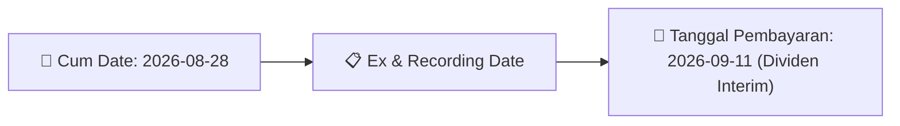

# Ikhtisar Pasar Harian (Daily Digest) - 2026-08-14

⬅️ [[Daily_Digest_20260731]] | 📅 **2026-08-14** | ➡️ [[Daily_Digest_20260804]]

## 1. Radar Pasar & Sentimen Harian (Executive Dashboard)
> [!NOTE]
> Terdeteksi sebanyak **34 pengumuman baru** dari 13 emiten pantauan pada (2026-08-14).

| Metric | Jumlah | Status Radar |
| :--- | :---: | :--- |
| **🟢 Sentimen Bullish / Positif** | `1` | [[Dividen Interim]], [[Mandatory Tender Offer]], Kinerja Positif |
| **⚪ Sentimen Netral / Routine** | `12` | [[Tanggapan Penjelasan Bursa]], [[RUPS]], [[Pendaftaran Unit]] |
| **🔴 Sentimen Bearish / Alert** | `0` | Sengketa Hukum, Defisit / Gugatan (Nihil hari ini) |
| **📄 [[Laporan Keuangan]] Baru** | `0` | Memicu Analisis Keuangan Otomatis |

> [!NOTE]
> Tidak dideteksi adanya publikasi laporan keuangan baru hari ini. Rangkuman per emiten secara terperinci tidak diperlukan.

---

## 2. Sorotan Utama & Watchlist Strategis (Strategic Watchlist)
#### 💰 Watchlist Dividen & Distribution
- **[[BPII]]**: Nomor Surat = 029/BPI/CR/VIII/2026
- **[[BPII]]**: Tanggal Keputusan Direksi = 2026-08-12
- **[[BPII]]**: Dividen per Saham = 3,54 IDR
- **[[BPII]]**: Total Nilai Dividen Minimum = 35.000.000.000 IDR
- **[[BPII]]**: Total Nilai Dividen Maksimum = 34.989.902.470 IDR
- **[[BPII]]**: Tanggal Cum Dividen di Pasar Reguler dan Negosiasi = 2026-08-26

#### 🎯 Watchlist Penawaran Tender Wajib (MTO) & Strategis
- **[[PADI]]**: Pemegang Saham Pengendali Baru = [[Djoko Joelijanto]]

---

## 3. Matriks Pengumuman Pasar (Announcements Intelligence Table)
| Emiten | Sentimen | Jenis Pengumuman | Judul Pengumuman | Berkas |
| :--- | :---: | :--- | :--- | :--- |
| **[[NISP]]** | ⚪ NEUTRAL | Aksi Korporasi | Laporan Informasi dan Fakta Material | [Utama](file:///g:/My%20Drive/Model2/reports/raw/NISP/20260814_NISP_20260814_NISP_Laporan Informasi dan Fakta Material_32120607.pdf) |
| **[[DMAS]]** | ⚪ NEUTRAL | RUPS | Pengumuman RUPS | [Utama](file:///g:/My%20Drive/Model2/reports/raw/DMAS/20260814_DMAS_20260814_DMAS_Pengumuman RUPS_32120694.pdf) |
| **[[OILS]]** | ⚪ NEUTRAL | RUPS | Pengumuman RUPS | [Utama](file:///g:/My%20Drive/Model2/reports/raw/OILS/20260814_OILS_20260814_OILS_Pengumuman RUPS_32120805.pdf) · [Lamp 1](file:///g:/My%20Drive/Model2/reports/raw/OILS/20260814_OILS_20260814_OILS_Pengumuman RUPS_32120805_lamp1.pdf) |
| **[[PADI]]** | ⚪ NEUTRAL | RUPS | Pemanggilan RUPS | [Utama](file:///g:/My%20Drive/Model2/reports/raw/PADI/20260814_PADI_20260814_PADI_Pemanggilan RUPS_32120649.pdf) · [Lamp 3](file:///g:/My%20Drive/Model2/reports/raw/PADI/20260814_PADI_20260814_PADI_Pemanggilan RUPS_32120649_lamp3.pdf) · [Lamp 1](file:///g:/My%20Drive/Model2/reports/raw/PADI/20260814_PADI_20260814_PADI_Pemanggilan RUPS_32120649_lamp1.pdf) |
| **[[OBAT]]** | ⚪ NEUTRAL | RUPS | Ringkasan RisalahRisalah RUPS | [Utama](file:///g:/My%20Drive/Model2/reports/raw/OBAT/20260814_OBAT_20260814_OBAT_Ringkasan RisalahRisalah RUPS_32120715.pdf) |
| **[[SCCO]]** | ⚪ NEUTRAL | RUPS | Pemanggilan RUPS | [Utama](file:///g:/My%20Drive/Model2/reports/raw/SCCO/20260814_SCCO_20260814_SCCO_Pemanggilan RUPS_32120585.pdf) · [Lamp 2](file:///g:/My%20Drive/Model2/reports/raw/SCCO/20260814_SCCO_20260814_SCCO_Pemanggilan RUPS_32120585_lamp2.pdf) · [Lamp 1](file:///g:/My%20Drive/Model2/reports/raw/SCCO/20260814_SCCO_20260814_SCCO_Pemanggilan RUPS_32120585_lamp1.pdf) |
| **[[RATU]]** | ⚪ NEUTRAL | RUPS | Pemanggilan RUPS | [Utama](file:///g:/My%20Drive/Model2/reports/raw/RATU/20260814_RATU_20260814_RATU_Pemanggilan RUPS_32120683.pdf) · [Lamp 1](file:///g:/My%20Drive/Model2/reports/raw/RATU/20260814_RATU_20260814_RATU_Pemanggilan RUPS_32120683_lamp1.pdf) |
| **[[LUCK]]** | ⚪ NEUTRAL | RUPS | Pengumuman RUPS | [Utama](file:///g:/My%20Drive/Model2/reports/raw/LUCK/20260814_LUCK_20260814_LUCK_Pengumuman RUPS_32120719.pdf) · [Lamp 1](file:///g:/My%20Drive/Model2/reports/raw/LUCK/20260814_LUCK_20260814_LUCK_Pengumuman RUPS_32120719_lamp1.pdf) · [Lamp 2](file:///g:/My%20Drive/Model2/reports/raw/LUCK/20260814_LUCK_20260814_LUCK_Pengumuman RUPS_32120719_lamp2.pdf) |
| **[[NELY]]** | ⚪ NEUTRAL | RUPS | Ringkasan RisalahRisalah RUPS | [Utama](file:///g:/My%20Drive/Model2/reports/raw/NELY/20260814_NELY_20260814_NELY_Ringkasan RisalahRisalah RUPS_32120657.pdf) · [Lamp 1](file:///g:/My%20Drive/Model2/reports/raw/NELY/20260814_NELY_20260814_NELY_Ringkasan RisalahRisalah RUPS_32120657_lamp1.pdf) · [Lamp 2](file:///g:/My%20Drive/Model2/reports/raw/NELY/20260814_NELY_20260814_NELY_Ringkasan RisalahRisalah RUPS_32120657_lamp2.pdf) |
| **[[SKRN]]** | ⚪ NEUTRAL | RUPS | Ringkasan RisalahRisalah RUPS | [Lamp 1](file:///g:/My%20Drive/Model2/reports/raw/SKRN/20260814_SKRN_20260814_SKRN_Ringkasan RisalahRisalah RUPS_32120745_lamp1.pdf) · [Lamp 4](file:///g:/My%20Drive/Model2/reports/raw/SKRN/20260814_SKRN_20260814_SKRN_Ringkasan RisalahRisalah RUPS_32120745_lamp4.pdf) · [Lamp 5](file:///g:/My%20Drive/Model2/reports/raw/SKRN/20260814_SKRN_20260814_SKRN_Ringkasan RisalahRisalah RUPS_32120745_lamp5.pdf) · [Lamp 2](file:///g:/My%20Drive/Model2/reports/raw/SKRN/20260814_SKRN_20260814_SKRN_Ringkasan RisalahRisalah RUPS_32120745_lamp2.pdf) · [Lamp 3](file:///g:/My%20Drive/Model2/reports/raw/SKRN/20260814_SKRN_20260814_SKRN_Ringkasan RisalahRisalah RUPS_32120745_lamp3.pdf) |
| **[[BPII]]** | 🟢 BULLISH | Dividen | Jadwal Aksi Korporasi (Khusus Penyampaian Dividen Interim) | [Utama](file:///g:/My%20Drive/Model2/reports/raw/BPII/20260814_BPII_20260813_BPII_Jadwal Aksi Korporasi (Khusus Penyampaian Dividen Interim)_32120263.pdf) · [Lamp 1](file:///g:/My%20Drive/Model2/reports/raw/BPII/20260814_BPII_20260813_BPII_Jadwal Aksi Korporasi (Khusus Penyampaian Dividen Interim)_32120263_lamp1.pdf) · [Lamp 2](file:///g:/My%20Drive/Model2/reports/raw/BPII/20260814_BPII_20260813_BPII_Jadwal Aksi Korporasi (Khusus Penyampaian Dividen Interim)_32120263_lamp2.pdf) |
| **[[KONI]]** | ⚪ NEUTRAL | RUPS | Pemanggilan RUPS | [Utama](file:///g:/My%20Drive/Model2/reports/raw/KONI/20260814_KONI_20260814_KONI_Pemanggilan RUPS_32120680.pdf) · [Lamp 1](file:///g:/My%20Drive/Model2/reports/raw/KONI/20260814_KONI_20260814_KONI_Pemanggilan RUPS_32120680_lamp1.pdf) |
| **[[KBLM]]** | ⚪ NEUTRAL | RUPS | Pemanggilan RUPS | [Utama](file:///g:/My%20Drive/Model2/reports/raw/KBLM/20260814_KBLM_20260813_KBLM_Pemanggilan RUPS_32120232.pdf) · [Lamp 2](file:///g:/My%20Drive/Model2/reports/raw/KBLM/20260814_KBLM_20260813_KBLM_Pemanggilan RUPS_32120232_lamp2.pdf) |

---

## 4. Detail Informasi per Emiten (Grouped by Emiten)
### 🔵 [[NISP]]
- **[Aksi Korporasi]** [Laporan Informasi dan Fakta Material](file:///g:/My%20Drive/Model2/reports/raw/NISP/20260814_NISP_20260814_NISP_Laporan Informasi dan Fakta Material_32120607.pdf)
  - 📌 *Deskripsi*: PT Bank OCBC NISP Tbk menyelesaikan pengambilalihan PT OCBC Sekuritas Indonesia (PTOS) dari OCBC Ltd, melanjutkan Perjanjian Penjualan dan Pembelian Bersyarat tanggal 3 Juni 2026. Transaksi ini ditandatangani pada 12 Agustus 2026 dan efektif pada 13 Agustus 2026, dengan total nilai transaksi Rp455,201 miliar. Setelah penyelesaian, Perseroan memiliki 99,9999% saham PTOS, menjadikannya anak perusahaan terkendali. Pengambilalihan ini bertujuan membentuk Konglomerasi Keuangan OCBC Grup di Indonesia, dengan Perseroan sebagai Perusahaan Induk Konglomerasi Keuangan (PIKK). Dampaknya tidak material terhadap operasional dan kelangsungan usaha Perseroan.
  - 📊 **Fakta Material**:
    - **Tanggal Kejadian**: 13 Agustus 2026
    - **Jenis Informasi**: Penyelesaian pengambilalihan PT OCBC Sekuritas Indonesia (PTOS) oleh Perseroan
    - **Tanggal Penandatanganan Akta**: 12 Agustus 2026
    - **Nomor Akta Pengambilalihan**: No. 23
    - **Nomor Akta Jual Beli**: No. 24 dan No. 25
    - **Notaris**: Bara Indra Ardiyasha, S.H. (pengganti Ashoya Ratam, S.H., M.Kn.)
    - **Tanggal Efektif Penerimaan Pemberitahuan Perubahan Data**: 13 Agustus 2026
    - **Nomor Penerimaan Pemberitahuan Perubahan Data**: AHU-AH.01.09-0389995
    - **Total Nilai Transaksi**: Rp455,201 miliar
    - **Kepemilikan Saham Setelah Pengambilalihan**: 99,9999%
    - **Tujuan Pengambilalihan**: Pembentukan Konglomerasi Keuangan OCBC Grup di Indonesia
    - **Dampak Material**: Tidak ada dampak material terhadap kegiatan operasional dan kelangsungan usaha

### 🔵 [[DMAS]]
- **[RUPS]** [Pengumuman RUPS](file:///g:/My%20Drive/Model2/reports/raw/DMAS/20260814_DMAS_20260814_DMAS_Pengumuman RUPS_32120694.pdf)
  - 📌 *Deskripsi*: PT Puradelta Lestari Tbk. (DMAS) mengumumkan rencana penyelenggaraan Rapat Umum Pemegang Saham Luar Biasa (RUPSLB) yang akan diadakan pada Selasa, 22 September 2026, pukul 14:00 WIB di Le Premier Hotel Kota Deltamas, Cikarang. Pemegang saham yang berhak hadir ditetapkan berdasarkan Daftar Pemegang Saham (DPS) pada tanggal 28 Agustus 2026.
  - 📊 **Fakta Material**:
    - **Nomor Surat**: 041/DMAS/IR-CS/VIII/2026
    - **Tanggal Pengumuman**: 14 Agustus 2026
    - **Jenis Rapat**: Rapat Umum Pemegang Saham Luar Biasa (RUPSLB)
    - **Hari/Tanggal RUPS**: Selasa, 22 September 2026
    - **Waktu RUPS**: 14:00 WIB
    - **Lokasi RUPS**: Le Premier Hotel Kota Deltamas, Commercial Lot Sektor 1 No. 6, Cikarang
    - **Tanggal Daftar Pemegang Saham (DPS)**: 28 Agustus 2026
    - **Nama Pengirim**: PT Puradelta Lestari Tbk.
    - **Nama Penanggung Jawab**: Tondy Suwanto

### 🔵 [[OILS]]
- **[RUPS]** [Pengumuman RUPS](file:///g:/My%20Drive/Model2/reports/raw/OILS/20260814_OILS_20260814_OILS_Pengumuman RUPS_32120805.pdf) *(Attachment: [Lamp 1](file:///g:/My%20Drive/Model2/reports/raw/OILS/20260814_OILS_20260814_OILS_Pengumuman RUPS_32120805_lamp1.pdf))*
  - 📌 *Deskripsi*: PT Indo Oil Perkasa Tbk (OILS) mengumumkan rencana penyelenggaraan Rapat Umum Pemegang Saham Luar Biasa (RUPSLB) yang akan diadakan pada Selasa, 22 September 2026, pukul 10:30, bertempat di Ruang Meeting PT Indo Oil Perkasa Tbk, Raya Perning Km 39, Kab. Mojokerto. Tanggal Daftar Pemegang Saham (DPS) yang berhak hadir adalah 28 Agustus 2026. Pengumuman ini merujuk pada surat No. 010/SK/IOP/VIII/2026 dan ditandatangani oleh Direktur Utama, Johan Widakdo Liem.
  - 📊 **Fakta Material**:
    - **Nomor Surat Pengumuman**: 016/SK/IOP/VIII/2026
    - **Nomor Surat Rujukan**: 010/SK/IOP/VIII/2026
    - **Jenis Rapat**: Rapat Umum Pemegang Saham Luar Biasa (RUPSLB)
    - **Tanggal Penyelenggaraan RUPS**: 22 September 2026
    - **Waktu Penyelenggaraan RUPS**: 10:30
    - **Lokasi Penyelenggaraan RUPS**: Ruang Meeting PT Indo Oil Perkasa Tbk, Raya Perning Km 39, Kab. Mojokerto
    - **Tanggal Daftar Pemegang Saham (DPS)**: 28 Agustus 2026
    - **Nama Pengirim / Penandatangan**: Johan Widakdo Liem
    - **Jabatan Pengirim / Penandatangan**: Direktur Utama
    - **Tanggal Pengumuman**: 14 Agustus 2026

### 🔵 [[PADI]]
- **[RUPS]** [Pemanggilan RUPS](file:///g:/My%20Drive/Model2/reports/raw/PADI/20260814_PADI_20260814_PADI_Pemanggilan RUPS_32120649.pdf) *(Attachment: [Lamp 3](file:///g:/My%20Drive/Model2/reports/raw/PADI/20260814_PADI_20260814_PADI_Pemanggilan RUPS_32120649_lamp3.pdf) · [Lamp 1](file:///g:/My%20Drive/Model2/reports/raw/PADI/20260814_PADI_20260814_PADI_Pemanggilan RUPS_32120649_lamp1.pdf))*
  - 📌 *Deskripsi*: Pemanggilan RUPSLB Kedua PT Minna Padi Investama Sekuritas Tbk yang akan diselenggarakan pada 21 Agustus 2026. Agenda utama meliputi persetujuan penetapan pemegang saham pengendali baru (Djoko Joelijanto) sesuai surat OJK No. 204/PM.131/2026 dan persetujuan perubahan susunan direksi dengan pencalonan Beba Hawah Ria sebagai Direktur.
  - 📊 **Fakta Material**:
    - **Jenis RUPS**: RUPS Luar Biasa Kedua
    - **Tanggal RUPS**: 2026-08-21
    - **Waktu RUPS**: 14.00 WIB
    - **Tempat RUPS**: Cityloog Hotel Tebet, Batavia Room, Lt. 1, Jl. Dr. Saharjo No. 191, Tebet, Jakarta 12960
    - **Agenda 1**: Persetujuan penetapan pemegang saham pengendali baru, Djoko Joelijanto, sebagai ultimate beneficiary owner
    - **Agenda 2**: Persetujuan perubahan susunan Direksi dengan pencalonan Beba Hawah Ria sebagai Direktur
    - **Dasar Hukum Agenda 1**: Surat OJK No. 204/PM.131/2026 tanggal 24 April 2026
    - **Dasar Hukum Agenda 2**: POJK No. 33/POJK.04/2014
    - **Tanggal Daftar Pemegang Saham (DPS)**: 2026-08-13
    - **Batas Akhir Penerimaan Kuasa**: 2026-08-21
    - **Kapasitas Tempat RUPS**: 75 orang
    - **Pemegang Saham Pengendali Baru**: Djoko Joelijanto
    - **Calon Direktur Baru**: Beba Hawah Ria

### 🔵 [[OBAT]]
- **[RUPS]** [Ringkasan RisalahRisalah RUPS](file:///g:/My%20Drive/Model2/reports/raw/OBAT/20260814_OBAT_20260814_OBAT_Ringkasan RisalahRisalah RUPS_32120715.pdf)
  - 📌 *Deskripsi*: PT Brigit Biofarmaka Teknologi Tbk (OBAT) menyelenggarakan RUPS Luar Biasa pada 11 Agustus 2026, yang dihadiri pemegang saham mewakili 60,1% saham dengan hak suara sah. Rapat menyetujui agenda penyesuaian KBLI Perseroan dengan Klasifikasi Baku Lapangan Usaha Indonesia (KBLI) terbaru, dengan persetujuan 100% dari suara yang dikeluarkan.
  - 📊 **Fakta Material**:
    - **Tanggal RUPS**: 2026-08-11
    - **Kuorum Kehadiran**: 408.919.150 saham (60,1%)
    - **Agenda**: Persetujuan atas penyesuaian KBLI Perseroan untuk diselaraskan dengan Klasifikasi Baku Lapangan Usaha Indonesia (KBLI) terbaru
    - **Hasil Voting Agenda 1 - Setuju**: 408.919.150 suara (100%)
    - **Hasil Voting Agenda 1 - Tidak Setuju**: 0 suara (0%)
    - **Hasil Voting Agenda 1 - Abstain**: 0 suara (0%)
    - **Keputusan RUPS**: Setuju
    - **Tanggal Pelaporan**: 2026-08-14

### 🔵 [[SCCO]]
- **[RUPS]** [Pemanggilan RUPS](file:///g:/My%20Drive/Model2/reports/raw/SCCO/20260814_SCCO_20260814_SCCO_Pemanggilan RUPS_32120585.pdf) *(Attachment: [Lamp 2](file:///g:/My%20Drive/Model2/reports/raw/SCCO/20260814_SCCO_20260814_SCCO_Pemanggilan RUPS_32120585_lamp2.pdf) · [Lamp 1](file:///g:/My%20Drive/Model2/reports/raw/SCCO/20260814_SCCO_20260814_SCCO_Pemanggilan RUPS_32120585_lamp1.pdf))*
  - 📌 *Deskripsi*: Pemanggilan Rapat Umum Pemegang Saham Luar Biasa (RUPSLB) PT Supreme Cable Manufacturing & Commerce Tbk (PT SUCACO Tbk) yang akan diselenggarakan pada Selasa, 8 September 2026, pukul 10.00 WIB. Agenda tunggal rapat adalah perubahan Pasal 3 Anggaran Dasar Perseroan untuk penyesuaian dengan Klasifikasi Baku Lapangan Usaha Indonesia (KBLI) 2025, yang bersifat administratif dan tidak mengubah kegiatan usaha utama.
  - 📊 **Fakta Material**:
    - **Jenis Rapat**: Rapat Umum Pemegang Saham Luar Biasa (RUPSLB)
    - **Tanggal Rapat**: 2026-09-08
    - **Waktu Rapat**: 10.00 WIB
    - **Tempat Rapat**: Kantor PT Supreme Cable Manufacturing & Commerce Tbk (PT SUCACO Tbk)
    - **Agenda Rapat**: Perubahan Pasal 3 Anggaran Dasar untuk penyesuaian dengan KBLI 2025
    - **Tanggal Daftar Pemegang Saham yang Berhak Hadir**: 2026-08-13
    - **Batas Akhir Penerimaan Surat Kuasa**: 2026-09-03
    - **Biro Administrasi Efek**: PT Sinartama Gunita
    - **Tanggal Pengumuman**: 2026-08-14

### 🔵 [[RATU]]
- **[RUPS]** [Pemanggilan RUPS](file:///g:/My%20Drive/Model2/reports/raw/RATU/20260814_RATU_20260814_RATU_Pemanggilan RUPS_32120683.pdf) *(Attachment: [Lamp 1](file:///g:/My%20Drive/Model2/reports/raw/RATU/20260814_RATU_20260814_RATU_Pemanggilan RUPS_32120683_lamp1.pdf))*
  - 📌 *Deskripsi*: PT Raharja Energi Cepu Tbk (RATU) mengundang pemegang saham untuk menghadiri Rapat Umum Pemegang Saham Luar Biasa (RUPSLB) pada 8 September 2026, secara fisik di Cityloog Hotel Tebet, Jakarta, dan virtual melalui eASY.KSEI. Agenda utama meliputi persetujuan Penambahan Modal Tanpa Hak Memesan Efek Terlebih Dahulu (PMTHMETD) sesuai POJK No. 14/2019 dan perubahan Pasal 4 ayat (2) Anggaran Dasar terkait modal ditempatkan dan disetor. Pemegang saham yang berhak hadir adalah yang tercatat dalam Daftar Pemegang Saham pada 13 Agustus 2026 pukul 16.00 WIB.
  - 📊 **Fakta Material**:
    - **Jenis Rapat**: Rapat Umum Pemegang Saham Luar Biasa (RUPSLB)
    - **Hari/Tanggal Rapat**: Selasa, 8 September 2026
    - **Waktu Rapat**: 10.00 WIB – selesai
    - **Tempat Rapat**: Cityloog Hotel Tebet, Jl. Dr. Saharjo No. 191, Manggarai Sel., Kec. Tebet, Jakarta 12960
    - **Agenda 1**: Persetujuan atas rencana Penambahan Modal Tanpa Hak Memesan Efek Terlebih Dahulu (PMTHMETD) melalui penerbitan saham baru sesuai POJK No. 14/2019
    - **Agenda 2**: Persetujuan atas perubahan Pasal 4 ayat (2) Anggaran Dasar sehubungan dengan penerbitan saham dalam rangka PMTHMETD
    - **Tanggal Daftar Pemegang Saham (Recording Date)**: 13 Agustus 2026 pukul 16.00 WIB
    - **Metode Pelaksanaan Rapat**: Fisik dan elektronik/virtual melalui fasilitas Electronic General Meeting System (eASY.KSEI)
    - **Dasar Hukum PMTHMETD**: POJK No. 14/2019
    - **Dasar Hukum Penyelenggaraan Rapat Elektronik**: POJK No. 15/2020 dan POJK No. 14/2025

### 🔵 [[LUCK]]
- **[RUPS]** [Pengumuman RUPS](file:///g:/My%20Drive/Model2/reports/raw/LUCK/20260814_LUCK_20260814_LUCK_Pengumuman RUPS_32120719.pdf) *(Attachment: [Lamp 1](file:///g:/My%20Drive/Model2/reports/raw/LUCK/20260814_LUCK_20260814_LUCK_Pengumuman RUPS_32120719_lamp1.pdf) · [Lamp 2](file:///g:/My%20Drive/Model2/reports/raw/LUCK/20260814_LUCK_20260814_LUCK_Pengumuman RUPS_32120719_lamp2.pdf))*
  - 📌 *Deskripsi*: PT Sentral Mitra Informatika Tbk. (LUCK) mengumumkan rencana penyelenggaraan Rapat Umum Pemegang Saham Luar Biasa (RUPSLB) yang akan diadakan pada Rabu, 23 September 2026, pukul 14:00 WIB, bertempat di Kantor Perseroan, Komplek Graha Mas Fatmawati Blok A No.27-29, Jl. RS. Fatmawati. Tanggal Daftar Pemegang Saham (DPS) yang berhak hadir ditetapkan pada 31 Agustus 2026. Pengumuman ini merujuk pada surat No. 01/SMI/FA/VIII/2026.
  - 📊 **Fakta Material**:
    - **Jenis Rapat**: Rapat Umum Pemegang Saham Luar Biasa (RUPSLB)
    - **Tanggal Pengumuman**: 14 Agustus 2026
    - **Tanggal Penyelenggaraan RUPS**: 23 September 2026
    - **Waktu Penyelenggaraan**: 14:00 WIB
    - **Lokasi Penyelenggaraan**: Kantor Perseroan, Komplek Graha Mas Fatmawati Blok A No.27-29, Jl. RS. Fatmawati
    - **Tanggal Daftar Pemegang Saham (DPS)**: 31 Agustus 2026
    - **Nomor Surat Pengumuman**: 02/SMI/FA/VIII/2026
    - **Nama Pengirim**: Christine Herawati

### 🔵 [[NELY]]
- **[RUPS]** [Ringkasan RisalahRisalah RUPS](file:///g:/My%20Drive/Model2/reports/raw/NELY/20260814_NELY_20260814_NELY_Ringkasan RisalahRisalah RUPS_32120657.pdf) *(Attachment: [Lamp 1](file:///g:/My%20Drive/Model2/reports/raw/NELY/20260814_NELY_20260814_NELY_Ringkasan RisalahRisalah RUPS_32120657_lamp1.pdf) · [Lamp 2](file:///g:/My%20Drive/Model2/reports/raw/NELY/20260814_NELY_20260814_NELY_Ringkasan RisalahRisalah RUPS_32120657_lamp2.pdf))*
  - 📌 *Deskripsi*: RUPSLB PT Pelayaran Nely Dwi Putri Tbk pada 12 Agustus 2025 menyetujui pemberhentian Direktur Eduard Halomoan dan penyesuaian Pasal 3 Anggaran Dasar dengan KBLI 2025. Keputusan diambil dengan suara mayoritas.
  - 📊 **Fakta Material**:
    - **Jenis Rapat**: RUPSLB
    - **Tanggal Rapat**: 2025-08-12
    - **Waktu Rapat**: 14.29 WIB - 14.49 WIB
    - **Tempat Rapat**: Ruang Serenity dan Infinity, Hotel Yuan Garden, Jakarta Pusat
    - **Kehadiran Pemegang Saham**: 1.970.204.197 saham (83,84%)
    - **Mata Acara Pertama - Pemberhentian Direktur**: Menyetujui pemberhentian Eduard Halomoan sebagai Direktur
    - **Mata Acara Pertama - Hasil Voting**: Setuju: 1.970.203.797 (99,9999797%), Tidak Setuju: 400 (0,0000203%), Abstain: 7.500 (0,0003807%)
    - **Mata Acara Kedua - Penyesuaian Anggaran Dasar**: Menyetujui penyesuaian Pasal 3 dengan KBLI 2025
    - **Mata Acara Kedua - Hasil Voting**: Setuju: 1.970.203.797 (99,9999797%), Tidak Setuju: 400 (0,0000203%), Abstain: 7.500 (0,0003807%)
    - **Susunan Direksi Baru**: Direktur Utama: Cynthia Sunarko, Direktur: Eugene Sunarko, Direktur: Tjauw Yani
    - **Susunan Dewan Komisaris**: Komisaris Utama: Koh Tji Beng, Komisaris: Alias Bin Jumaat, Komisaris Independen: Djoko Soemarjanto

### 🔵 [[SKRN]]
- **[RUPS]** [Ringkasan RisalahRisalah RUPS](file:///g:/My%20Drive/Model2/reports/raw/SKRN/20260814_SKRN_20260814_SKRN_Ringkasan RisalahRisalah RUPS_32120745_lamp1.pdf)
  - 📌 *Deskripsi*: RUPSLB PT Superkrane Mitra Utama Tbk. pada 13 Agustus 2026 menyetujui perubahan Anggaran Dasar Pasal 3 untuk penyesuaian KBLI 2025 dan penyesuaian susunan pemegang saham sesuai Daftar Pemegang Saham BAE. Rapat dihadiri 84,798% suara dan seluruh keputusan disetujui 100%.
  - 📊 **Fakta Material**:
    - **Jenis Rapat**: Rapat Umum Pemegang Saham Luar Biasa (RUPSLB)
    - **Tanggal Rapat**: 13 Agustus 2026
    - **Waktu Rapat**: 14:18 WIB - 14:30 WIB
    - **Tempat Rapat**: Pool 3, Jalan Pemadam Kebakaran No 1, Semper Barat, Cilincing, Jakarta Utara
    - **Komisaris Utama**: Johannes Wargo
    - **Presiden Direktur**: Yafin Tandiono Tan
    - **Kuorum Kehadiran**: 6.035.933.700 saham (84,798%) dari total 7.117.999.826 saham
    - **Mata Acara 1 - Perubahan Anggaran Dasar (KBLI 2025)**: Disetujui 100% (6.035.933.700 suara setuju, 0 abstain, 0 tidak setuju)
    - **Mata Acara 2 - Penyesuaian Susunan Pemegang Saham**: Disetujui 100% (6.035.933.700 suara setuju, 0 abstain, 0 tidak setuju)
    - **Dasar Perubahan KBLI**: Peraturan Badan Pusat Statistik Nomor 7 Tahun 2025

### 🔵 [[BPII]]
- **[Dividen]** [Jadwal Aksi Korporasi (Khusus Penyampaian Dividen Interim)](file:///g:/My%20Drive/Model2/reports/raw/BPII/20260814_BPII_20260813_BPII_Jadwal Aksi Korporasi (Khusus Penyampaian Dividen Interim)_32120263.pdf) *(Attachment: [Lamp 1](file:///g:/My%20Drive/Model2/reports/raw/BPII/20260814_BPII_20260813_BPII_Jadwal Aksi Korporasi (Khusus Penyampaian Dividen Interim)_32120263_lamp1.pdf) · [Lamp 2](file:///g:/My%20Drive/Model2/reports/raw/BPII/20260814_BPII_20260813_BPII_Jadwal Aksi Korporasi (Khusus Penyampaian Dividen Interim)_32120263_lamp2.pdf))*
  - 📌 *Deskripsi*: PT Batavia Prosperindo Internasional Tbk. (BPII) mengumumkan jadwal pembagian dividen tunai interim untuk tahun buku 2026, berdasarkan keputusan Direksi yang disetujui Dewan Komisaris pada 12 Agustus 2026. Dividen per saham ditetapkan sebesar 3,54 IDR dengan total nilai dividen sekitar 34,99 miliar IDR. Jadwal pembayaran dividen dimulai dengan cum dividen di pasar reguler dan negosiasi pada 26 Agustus 2026, ex dividen pada 27 Agustus 2026, recording date pada 28 Agustus 2026, dan pembayaran pada 11 September 2026. Data keuangan pendukung per 30 Juni 2026 menunjukkan laba bersih entitas induk sebesar 42,83 miliar IDR, saldo laba ditahan tidak dibatasi sebesar 1,59 triliun IDR, dan total ekuitas sebesar 1,85 triliun IDR.
  - 📊 **Fakta Material**:
    - **Nomor Surat**: 029/BPI/CR/VIII/2026
    - **Tanggal Keputusan Direksi**: 2026-08-12
    - **Dividen per Saham**: 3,54 IDR
    - **Total Nilai Dividen Minimum**: 35.000.000.000 IDR
    - **Total Nilai Dividen Maksimum**: 34.989.902.470 IDR
    - **Tanggal Cum Dividen di Pasar Reguler dan Negosiasi**: 2026-08-26
    - **Tanggal Ex Dividen di Pasar Reguler dan Negosiasi**: 2026-08-27
    - **Tanggal Cum Dividen di Pasar Tunai**: 2026-08-28
    - **Tanggal Ex Dividen di Pasar Tunai**: 2026-08-31
    - **Tanggal Daftar Pemegang Saham (DPS)**: 2026-08-28
    - **Tanggal Pembayaran Dividen**: 2026-09-11
    - **Laba Bersih Diatribusikan ke Entitas Induk (per 30 Juni 2026)**: 42.826.183.882 IDR
    - **Saldo Laba Ditahan yang Tidak Dibatasi (per 30 Juni 2026)**: 1.593.070.481.514 IDR
    - **Total Ekuitas (per 30 Juni 2026)**: 1.852.545.466.342 IDR

### 🔵 [[KONI]]
- **[RUPS]** [Pemanggilan RUPS](file:///g:/My%20Drive/Model2/reports/raw/KONI/20260814_KONI_20260814_KONI_Pemanggilan RUPS_32120680.pdf) *(Attachment: [Lamp 1](file:///g:/My%20Drive/Model2/reports/raw/KONI/20260814_KONI_20260814_KONI_Pemanggilan RUPS_32120680_lamp1.pdf))*
  - 📌 *Deskripsi*: Perdana Bangun Pusaka Tbk (KONI) mengumumkan pemanggilan Rapat Umum Pemegang Saham Luar Biasa (RUPSLB) yang akan diselenggarakan pada 7 September 2026 pukul 10:30 WIB di Jakarta Pusat. Rapat akan membahas persetujuan perubahan Anggaran Dasar dan pengangkatan kembali/perubahan susunan Direksi. Pemegang saham yang berhak hadir adalah mereka yang tercatat pada tanggal 13 Agustus 2026.
  - 📊 **Fakta Material**:
    - **Nomor Surat**: 044/GP-VIII/2026
    - **Tanggal Pemberitahuan**: 2026-07-30
    - **Hari/Tanggal RUPS**: 07 September 2026
    - **Waktu RUPS**: 10:30
    - **Lokasi RUPS**: Raya No.78, Jakarta Pusat
    - **Tanggal Daftar Pemegang Saham (Recording Date)**: 13 Agustus 2026
    - **Agenda 1**: Persetujuan Perubahan Anggaran Dasar
    - **Agenda 2**: Persetujuan Pengangkatan Kembali / Perubahan Susunan Direksi
    - **Nama Pengirim**: Lenny Kartika
    - **Tanggal dan Waktu Pelaporan**: 14-08-2026 11:00

### 🔵 [[KBLM]]
- **[RUPS]** [Pemanggilan RUPS](file:///g:/My%20Drive/Model2/reports/raw/KBLM/20260814_KBLM_20260813_KBLM_Pemanggilan RUPS_32120232.pdf) *(Attachment: [Lamp 2](file:///g:/My%20Drive/Model2/reports/raw/KBLM/20260814_KBLM_20260813_KBLM_Pemanggilan RUPS_32120232_lamp2.pdf))*
  - 📌 *Deskripsi*: Pemanggilan Rapat Umum Pemegang Saham Luar Biasa (RUPSLB) PT Kabelindo Murni Tbk yang akan diselenggarakan pada Senin, 7 September 2026. Agenda tunggal RUPSLB adalah perubahan Pasal 3 Anggaran Dasar Perseroan untuk menyesuaikan dengan Klasifikasi Baku Lapangan Usaha Indonesia (KBLI) 2025. Pemegang saham yang berhak hadir adalah yang terdaftar dalam Daftar Pemegang Saham Perseroan pada Kamis, 13 Agustus 2026, pukul 16.00 WIB.
  - 📊 **Fakta Material**:
    - **Jenis Rapat**: Rapat Umum Pemegang Saham Luar Biasa (RUPSLB)
    - **Hari, Tanggal Rapat**: Senin, 7 September 2026
    - **Waktu Rapat**: 10.00 WIB sampai selesai
    - **Tempat Rapat**: PT Kabelindo Murni Tbk
    - **Agenda Rapat**: Perubahan Pasal 3 Anggaran Dasar Perseroan untuk menyesuaikan dengan Klasifikasi Baku Lapangan Usaha Indonesia (KBLI) 2025
    - **Tanggal Daftar Pemegang Saham (Recording Date)**: Kamis, 13 Agustus 2026, pukul 16.00 WIB
    - **Biro Administrasi Efek**: PT Sinartama Gunita
    - **Batas Akhir Penerimaan Kuasa Konvensional**: Rabu, 2 September 2026
    - **Alamat Kantor Perseroan**: Jl. Rawagirang No. 2, Kawasan Industri Pulogadung
    - **Sifat Perubahan Anggaran Dasar**: Penyesuaian administratif dan tidak merupakan perubahan kegiatan usaha sebagaimana dimaksud dalam POJK No. 17/POJK.04/2020

---

## 5. Rekomendasi & Langkah Analisis Selanjutnya (Next Steps)
> [!TIP]
> **Instruksi Otomatis Swarm Agent**:
> 1. **Dividen Action**: Pantau *Recording Date & Payment Date* untuk emiten pembagi [[Dividen Interim]] (`[[TAPG]]`, `[[AMAR]]`).
> 2. **Tender Offer Action**: Pantau keterbukaan informasi lanjutan untuk `[[MAPI]]` terkait harga [[Mandatory Tender Offer]] oleh `[[Pacific Universal Investments Pte. Ltd.]]`.
> 3. **Financial Statement Deep-Dive**: Jika ada [[Laporan Keuangan]] baru di Section 1, jalankan agen `financial-summarizer-agent` untuk menghitung margin dan rasio valuasi.
