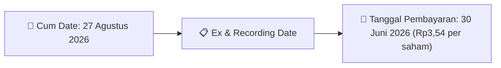

# Ikhtisar Pasar Harian (Daily Digest) - 2026-08-15

⬅️ [[Daily_Digest_20260731]] | 📅 **2026-08-15** | ➡️ [[Daily_Digest_20260804]]

## 1. Radar Pasar & Sentimen Harian (Executive Dashboard)
> [!NOTE]
> Terdeteksi sebanyak **61 pengumuman baru** dari 19 emiten pantauan pada (2026-08-15).

| Metric | Jumlah | Status Radar |
| :--- | :---: | :--- |
| **🟢 Sentimen Bullish / Positif** | `1` | [[Dividen Interim]], [[Mandatory Tender Offer]], Kinerja Positif |
| **⚪ Sentimen Netral / Routine** | `19` | [[Tanggapan Penjelasan Bursa]], [[RUPS]], [[Pendaftaran Unit]] |
| **🔴 Sentimen Bearish / Alert** | `0` | Sengketa Hukum, Defisit / Gugatan (Nihil hari ini) |
| **📄 [[Laporan Keuangan]] Baru** | `0` | Memicu Analisis Keuangan Otomatis |

> [!NOTE]
> Tidak dideteksi adanya publikasi laporan keuangan baru hari ini. Rangkuman per emiten secara terperinci tidak diperlukan.

---

## 2. Sorotan Utama & Watchlist Strategis (Strategic Watchlist)
#### 💰 Watchlist Dividen & Distribution
- **[[BPII]]**: Nominal Dividen = Rp3,54 per saham
- **[[BPII]]**: Total Dividen = Rp35.00 Miliar
- **[[BPII]]**: Cum Date = 27 Agustus 2026
- **[[BPII]]**: Ex Date = 28 Agustus 2026
- **[[BPII]]**: Recording Date = 26 Agustus 2026
- **[[BPII]]**: Tanggal Pembayaran = 30 Juni 2026

---

## 3. Matriks Pengumuman Pasar (Announcements Intelligence Table)
| Emiten | Sentimen | Jenis Pengumuman | Judul Pengumuman | Berkas |
| :--- | :---: | :--- | :--- | :--- |
| **[[MEDS]]** | ⚪ NEUTRAL | Aksi Korporasi | LK-15082026-7130-00 | [Utama](file:///g:/My%20Drive/Model2/reports/raw/MEDS/20260815_MEDS_LK-15082026-7130-00.pdf) |
| **[[SILO]]** | ⚪ NEUTRAL | RUPS | Rencana Transaksi Material Dengan Persetujuan RUPS | [Utama](file:///g:/My%20Drive/Model2/reports/raw/SILO/20260815_SILO_20260815_SILO_Rencana Transaksi Material Dengan Persetujuan RUPS_32120989.pdf) · [Lamp 4](file:///g:/My%20Drive/Model2/reports/raw/SILO/20260815_SILO_20260815_SILO_Rencana Transaksi Material Dengan Persetujuan RUPS_32120989_lamp4.pdf) · [Lamp 2](file:///g:/My%20Drive/Model2/reports/raw/SILO/20260815_SILO_20260815_SILO_Rencana Transaksi Material Dengan Persetujuan RUPS_32120989_lamp2.pdf) · [Lamp 5](file:///g:/My%20Drive/Model2/reports/raw/SILO/20260815_SILO_20260815_SILO_Rencana Transaksi Material Dengan Persetujuan RUPS_32120989_lamp5.pdf) · [Lamp 3](file:///g:/My%20Drive/Model2/reports/raw/SILO/20260815_SILO_20260815_SILO_Rencana Transaksi Material Dengan Persetujuan RUPS_32120989_lamp3.pdf) · [Lamp 1](file:///g:/My%20Drive/Model2/reports/raw/SILO/20260815_SILO_20260815_SILO_Rencana Transaksi Material Dengan Persetujuan RUPS_32120989_lamp1.pdf) |
| **[[SILO]]** | ⚪ NEUTRAL | RUPS | Pengumuman RUPS | [Utama](file:///g:/My%20Drive/Model2/reports/raw/SILO/20260814_SILO_20260814_SILO_Pengumuman RUPS_32120956.pdf) · [Lamp 3](file:///g:/My%20Drive/Model2/reports/raw/SILO/20260814_SILO_20260814_SILO_Pengumuman RUPS_32120956_lamp3.pdf) · [Lamp 2](file:///g:/My%20Drive/Model2/reports/raw/SILO/20260814_SILO_20260814_SILO_Pengumuman RUPS_32120956_lamp2.pdf) · [Lamp 1](file:///g:/My%20Drive/Model2/reports/raw/SILO/20260814_SILO_20260814_SILO_Pengumuman RUPS_32120956_lamp1.pdf) |
| **[[NISP]]** | ⚪ NEUTRAL | Aksi Korporasi | Laporan Informasi dan Fakta Material | [Utama](file:///g:/My%20Drive/Model2/reports/raw/NISP/20260814_NISP_20260814_NISP_Laporan Informasi dan Fakta Material_32120607.pdf) |
| **[[DMAS]]** | ⚪ NEUTRAL | RUPS | Pengumuman RUPS | [Utama](file:///g:/My%20Drive/Model2/reports/raw/DMAS/20260814_DMAS_20260814_DMAS_Pengumuman RUPS_32120694.pdf) |
| **[[WIKA]]** | ⚪ NEUTRAL | RUPS | Pemberitahuan RencanaPenyampaian PanggilanHasil RUPORUPSURUP EBA-SP | [Utama](file:///g:/My%20Drive/Model2/reports/raw/WIKA/20260814_WIKA_20260814_WIKA_Pemberitahuan RencanaPenyampaian PanggilanHasil RUPORUPSURUP EBA-SP_32120620.pdf) · [Lamp 1](file:///g:/My%20Drive/Model2/reports/raw/WIKA/20260814_WIKA_20260814_WIKA_Pemberitahuan RencanaPenyampaian PanggilanHasil RUPORUPSURUP EBA-SP_32120638_lamp1.pdf) · [Lamp 1](file:///g:/My%20Drive/Model2/reports/raw/WIKA/20260814_WIKA_20260814_WIKA_Pemberitahuan RencanaPenyampaian PanggilanHasil RUPORUPSURUP EBA-SP_32120632_lamp1.pdf) · [Lamp 1](file:///g:/My%20Drive/Model2/reports/raw/WIKA/20260814_WIKA_20260814_WIKA_Pemberitahuan RencanaPenyampaian PanggilanHasil RUPORUPSURUP EBA-SP_32120630_lamp1.pdf) · [Lamp 1](file:///g:/My%20Drive/Model2/reports/raw/WIKA/20260814_WIKA_20260814_WIKA_Pemberitahuan RencanaPenyampaian PanggilanHasil RUPORUPSURUP EBA-SP_32120620_lamp1.pdf) |
| **[[OILS]]** | ⚪ NEUTRAL | RUPS | Pengumuman RUPS | [Utama](file:///g:/My%20Drive/Model2/reports/raw/OILS/20260814_OILS_20260814_OILS_Pengumuman RUPS_32120805.pdf) · [Lamp 1](file:///g:/My%20Drive/Model2/reports/raw/OILS/20260814_OILS_20260814_OILS_Pengumuman RUPS_32120805_lamp1.pdf) |
| **[[PADI]]** | ⚪ NEUTRAL | RUPS | Pemanggilan RUPS | [Utama](file:///g:/My%20Drive/Model2/reports/raw/PADI/20260814_PADI_20260814_PADI_Pemanggilan RUPS_32120649.pdf) · [Lamp 3](file:///g:/My%20Drive/Model2/reports/raw/PADI/20260814_PADI_20260814_PADI_Pemanggilan RUPS_32120649_lamp3.pdf) · [Lamp 1](file:///g:/My%20Drive/Model2/reports/raw/PADI/20260814_PADI_20260814_PADI_Pemanggilan RUPS_32120649_lamp1.pdf) |
| **[[OBAT]]** | ⚪ NEUTRAL | RUPS | Ringkasan RisalahRisalah RUPS | [Utama](file:///g:/My%20Drive/Model2/reports/raw/OBAT/20260814_OBAT_20260814_OBAT_Ringkasan RisalahRisalah RUPS_32120715.pdf) |
| **[[SCCO]]** | ⚪ NEUTRAL | RUPS | Pemanggilan RUPS | [Utama](file:///g:/My%20Drive/Model2/reports/raw/SCCO/20260814_SCCO_20260814_SCCO_Pemanggilan RUPS_32120585.pdf) · [Lamp 2](file:///g:/My%20Drive/Model2/reports/raw/SCCO/20260814_SCCO_20260814_SCCO_Pemanggilan RUPS_32120585_lamp2.pdf) · [Lamp 1](file:///g:/My%20Drive/Model2/reports/raw/SCCO/20260814_SCCO_20260814_SCCO_Pemanggilan RUPS_32120585_lamp1.pdf) |
| **[[RATU]]** | ⚪ NEUTRAL | RUPS | Pemanggilan RUPS | [Utama](file:///g:/My%20Drive/Model2/reports/raw/RATU/20260814_RATU_20260814_RATU_Pemanggilan RUPS_32120683.pdf) · [Lamp 1](file:///g:/My%20Drive/Model2/reports/raw/RATU/20260814_RATU_20260814_RATU_Pemanggilan RUPS_32120683_lamp1.pdf) |
| **[[LUCK]]** | ⚪ NEUTRAL | RUPS | Pengumuman RUPS | [Utama](file:///g:/My%20Drive/Model2/reports/raw/LUCK/20260814_LUCK_20260814_LUCK_Pengumuman RUPS_32120719.pdf) · [Lamp 1](file:///g:/My%20Drive/Model2/reports/raw/LUCK/20260814_LUCK_20260814_LUCK_Pengumuman RUPS_32120719_lamp1.pdf) · [Lamp 2](file:///g:/My%20Drive/Model2/reports/raw/LUCK/20260814_LUCK_20260814_LUCK_Pengumuman RUPS_32120719_lamp2.pdf) |
| **[[NELY]]** | ⚪ NEUTRAL | RUPS | Ringkasan RisalahRisalah RUPS | [Utama](file:///g:/My%20Drive/Model2/reports/raw/NELY/20260814_NELY_20260814_NELY_Ringkasan RisalahRisalah RUPS_32120657.pdf) · [Lamp 1](file:///g:/My%20Drive/Model2/reports/raw/NELY/20260814_NELY_20260814_NELY_Ringkasan RisalahRisalah RUPS_32120657_lamp1.pdf) · [Lamp 2](file:///g:/My%20Drive/Model2/reports/raw/NELY/20260814_NELY_20260814_NELY_Ringkasan RisalahRisalah RUPS_32120657_lamp2.pdf) |
| **[[ABDA]]** | ⚪ NEUTRAL | RUPS | Pemanggilan RUPS | [Utama](file:///g:/My%20Drive/Model2/reports/raw/ABDA/20260814_ABDA_20260814_ABDA_Pemanggilan RUPS_32120872.pdf) · [Lamp 1](file:///g:/My%20Drive/Model2/reports/raw/ABDA/20260814_ABDA_20260814_ABDA_Pemanggilan RUPS_32120872_lamp1.pdf) |
| **[[SKRN]]** | ⚪ NEUTRAL | RUPS | Ringkasan RisalahRisalah RUPS | [Utama](file:///g:/My%20Drive/Model2/reports/raw/SKRN/20260814_SKRN_20260814_SKRN_Ringkasan RisalahRisalah RUPS_32120745.pdf) · [Lamp 1](file:///g:/My%20Drive/Model2/reports/raw/SKRN/20260814_SKRN_20260814_SKRN_Ringkasan RisalahRisalah RUPS_32120745_lamp1.pdf) · [Lamp 4](file:///g:/My%20Drive/Model2/reports/raw/SKRN/20260814_SKRN_20260814_SKRN_Ringkasan RisalahRisalah RUPS_32120745_lamp4.pdf) · [Lamp 5](file:///g:/My%20Drive/Model2/reports/raw/SKRN/20260814_SKRN_20260814_SKRN_Ringkasan RisalahRisalah RUPS_32120745_lamp5.pdf) · [Lamp 2](file:///g:/My%20Drive/Model2/reports/raw/SKRN/20260814_SKRN_20260814_SKRN_Ringkasan RisalahRisalah RUPS_32120745_lamp2.pdf) · [Lamp 3](file:///g:/My%20Drive/Model2/reports/raw/SKRN/20260814_SKRN_20260814_SKRN_Ringkasan RisalahRisalah RUPS_32120745_lamp3.pdf) |
| **[[BPII]]** | 🟢 BULLISH | Dividen | Jadwal Aksi Korporasi (Khusus Penyampaian Dividen Interim) | [Utama](file:///g:/My%20Drive/Model2/reports/raw/BPII/20260814_BPII_20260813_BPII_Jadwal Aksi Korporasi (Khusus Penyampaian Dividen Interim)_32120263.pdf) · [Lamp 1](file:///g:/My%20Drive/Model2/reports/raw/BPII/20260814_BPII_20260813_BPII_Jadwal Aksi Korporasi (Khusus Penyampaian Dividen Interim)_32120263_lamp1.pdf) · [Lamp 2](file:///g:/My%20Drive/Model2/reports/raw/BPII/20260814_BPII_20260813_BPII_Jadwal Aksi Korporasi (Khusus Penyampaian Dividen Interim)_32120263_lamp2.pdf) |
| **[[KONI]]** | ⚪ NEUTRAL | RUPS | Pemanggilan RUPS | [Utama](file:///g:/My%20Drive/Model2/reports/raw/KONI/20260814_KONI_20260814_KONI_Pemanggilan RUPS_32120680.pdf) · [Lamp 1](file:///g:/My%20Drive/Model2/reports/raw/KONI/20260814_KONI_20260814_KONI_Pemanggilan RUPS_32120680_lamp1.pdf) |
| **[[KBLM]]** | ⚪ NEUTRAL | RUPS | Pemanggilan RUPS | [Utama](file:///g:/My%20Drive/Model2/reports/raw/KBLM/20260814_KBLM_20260813_KBLM_Pemanggilan RUPS_32120232.pdf) · [Lamp 2](file:///g:/My%20Drive/Model2/reports/raw/KBLM/20260814_KBLM_20260813_KBLM_Pemanggilan RUPS_32120232_lamp2.pdf) |
| **[[SQMI]]** | ⚪ NEUTRAL | RUPS | Pemanggilan RUPS | [Utama](file:///g:/My%20Drive/Model2/reports/raw/SQMI/20260814_SQMI_20260814_SQMI_Pemanggilan RUPS_32120917.pdf) · [Lamp 2](file:///g:/My%20Drive/Model2/reports/raw/SQMI/20260814_SQMI_20260814_SQMI_Pemanggilan RUPS_32120917_lamp2.pdf) |
| **[[SFAN]]** | ⚪ NEUTRAL | Aksi Korporasi | Laporan Informasi dan Fakta Material | [Utama](file:///g:/My%20Drive/Model2/reports/raw/SFAN/20260814_SFAN_20260814_SFAN_Laporan Informasi dan Fakta Material_32120863.pdf) |

---

## 4. Detail Informasi per Emiten (Grouped by Emiten)
### 🔵 [[MEDS]]
- **[Aksi Korporasi]** [LK-15082026-7130-00](file:///g:/My%20Drive/Model2/reports/raw/MEDS/20260815_MEDS_LK-15082026-7130-00.pdf)
  - 📌 *Deskripsi*: Laporan perubahan kepemilikan saham insider MEDS.
  - 📊 **Fakta Material**:
    - **Nama Insider**: JEMMY KURNIAWAN

### 🔵 [[SILO]]
- **[RUPS]** [Rencana Transaksi Material Dengan Persetujuan RUPS](file:///g:/My%20Drive/Model2/reports/raw/SILO/20260815_SILO_20260815_SILO_Rencana Transaksi Material Dengan Persetujuan RUPS_32120989.pdf) *(Attachment: [Lamp 4](file:///g:/My%20Drive/Model2/reports/raw/SILO/20260815_SILO_20260815_SILO_Rencana Transaksi Material Dengan Persetujuan RUPS_32120989_lamp4.pdf) · [Lamp 2](file:///g:/My%20Drive/Model2/reports/raw/SILO/20260815_SILO_20260815_SILO_Rencana Transaksi Material Dengan Persetujuan RUPS_32120989_lamp2.pdf) · [Lamp 5](file:///g:/My%20Drive/Model2/reports/raw/SILO/20260815_SILO_20260815_SILO_Rencana Transaksi Material Dengan Persetujuan RUPS_32120989_lamp5.pdf) · [Lamp 3](file:///g:/My%20Drive/Model2/reports/raw/SILO/20260815_SILO_20260815_SILO_Rencana Transaksi Material Dengan Persetujuan RUPS_32120989_lamp3.pdf) · [Lamp 1](file:///g:/My%20Drive/Model2/reports/raw/SILO/20260815_SILO_20260815_SILO_Rencana Transaksi Material Dengan Persetujuan RUPS_32120989_lamp1.pdf))*
  - 📌 *Deskripsi*: Informasi dan fakta material SILO: BUDI, EDY, SAPTONO DAN REKAN P R O P E R T Y & B U S I N E S S A P P R A I S E R S Laporan Pendapat Kewajaran Atas Rencana Transaksi PT Siloam Internasional Hospitals, Tbk No. 00046/2.0033-00/BS/05/0191/1/VIII/2026 Tanggal : 13 Agustus 2026
  - 📊 **Fakta Material**:
    - **Uraian Kejadian**: BUDI, EDY, SAPTONO DAN REKAN P R O P E R T Y & B U S I N E S S A P P R A I S E R S Laporan Pendapat Kewajaran Atas Rencana Transaksi PT Siloam Internasional Hospitals, Tbk No. 00046/2.0033-00/BS/05/0191/1/VIII/2026 Tanggal : 13 Agustus 2026
- **[RUPS]** [Pengumuman RUPS](file:///g:/My%20Drive/Model2/reports/raw/SILO/20260814_SILO_20260814_SILO_Pengumuman RUPS_32120956.pdf) *(Attachment: [Lamp 3](file:///g:/My%20Drive/Model2/reports/raw/SILO/20260814_SILO_20260814_SILO_Pengumuman RUPS_32120956_lamp3.pdf) · [Lamp 2](file:///g:/My%20Drive/Model2/reports/raw/SILO/20260814_SILO_20260814_SILO_Pengumuman RUPS_32120956_lamp2.pdf) · [Lamp 1](file:///g:/My%20Drive/Model2/reports/raw/SILO/20260814_SILO_20260814_SILO_Pengumuman RUPS_32120956_lamp1.pdf))*
  - 📌 *Deskripsi*: Informasi dan fakta material SILO: Siloam International Hospitals 1 Lippo Village, Tangerang 15811, Indonesia No.111/Corsec-SIH/VIII/2026 Tangerang, 14 Agustus/August 2026 Kepada/To: Otoritas Jasa Keuangan (“OJK”) Untuk Perhatian/For the attention: Bapak Hasan Fawzi Kepala Eksekutif Pengawas Pasar Modal, Keuangan Derivatif, dan Bursa Karbon OJK/ Chief Executive Supervisory for Capital Markets, Financial Derivative, and Carbon Exchange at OJK PT Bursa Efek Indonesia Jakarta 12190 Untuk Perhatian/For the attention: Bapak Jeffrey He
  - 📊 **Fakta Material**:
    - **Uraian Kejadian**: Siloam International Hospitals 1 Lippo Village, Tangerang 15811, Indonesia No.111/Corsec-SIH/VIII/2026 Tangerang, 14 Agustus/August 2026 Kepada/To: Otoritas Jasa Keuangan (“OJK”) Untuk Perhatian/For the attention: Bapak Hasan Fawzi Kepala Eksekutif Pengawas Pasar Modal, Keuangan Derivatif, dan Bursa Karbon OJK/ Chief Executive Supervisory for Capital Markets, Financial Derivative, and Carbon Exchange at OJK PT Bursa Efek Indonesia Jakarta 12190 Untuk Perhatian/For the attention: Bapak Jeffrey He

### 🔵 [[NISP]]
- **[Aksi Korporasi]** [Laporan Informasi dan Fakta Material](file:///g:/My%20Drive/Model2/reports/raw/NISP/20260814_NISP_20260814_NISP_Laporan Informasi dan Fakta Material_32120607.pdf)
  - 📌 *Deskripsi*: Informasi dan fakta material NISP: 033/IR-FINANCE/JT/PIKK/VIII/2026 PT Bank OCBC NISP Tbk NISP 1 Penyelesaian pengambilalihan PT OCBC Sekuritas Indonesia (PTOS) oleh Perseroan, yang merupakan kelanjutan dari Perjanjian Penjualan dan Pembelian Bersyarat (Conditional Sale and Purchase Agreement) tanggal 3 Juni 2026 antara Perseroan dan OCBC Ltd. Dengan ini kami untuk dan atas menyampaikan Laporan Informasi atau Fakta Material sebagai berikut: Nama Emiten atau Perusahaan Publik PT Bank OCBC NISP Tbk Bidang Usaha Perbankan Telepon (0
  - 📊 **Fakta Material**:
    - **Uraian Kejadian**: 033/IR-FINANCE/JT/PIKK/VIII/2026 PT Bank OCBC NISP Tbk NISP 1 Penyelesaian pengambilalihan PT OCBC Sekuritas Indonesia (PTOS) oleh Perseroan, yang merupakan kelanjutan dari Perjanjian Penjualan dan Pembelian Bersyarat (Conditional Sale and Purchase Agreement) tanggal 3 Juni 2026 antara Perseroan dan OCBC Ltd. Dengan ini kami untuk dan atas menyampaikan Laporan Informasi atau Fakta Material sebagai berikut: Nama Emiten atau Perusahaan Publik PT Bank OCBC NISP Tbk Bidang Usaha Perbankan Telepon (0

### 🔵 [[DMAS]]
- **[RUPS]** [Pengumuman RUPS](file:///g:/My%20Drive/Model2/reports/raw/DMAS/20260814_DMAS_20260814_DMAS_Pengumuman RUPS_32120694.pdf)
  - 📌 *Deskripsi*: Informasi dan fakta material DMAS: 041/DMAS/IR-CS/VIII/2026 PT Puradelta Lestari Tbk. DMAS 1 Pemberitahuan Rencana Rapat Umum Pemegang Saham Luar Biasa Pengumuman Rencana RUPS Merujuk pada surat : 040/DMAS/IR-CS/VIII/2026 Perseroan menyampaikan permberitahuan penyelenggaraan Rapat Umum Pemegang Saham pada : Lokasi Penyelenggaraan RUPS (bila sudah dapat diumumkan dan sesuai iklan) : Tanggal Daftar Pemegang Saham (DPS) yang berhak hadir dalam RUPS Le Premier Hotel Kota Deltamas Commercial Lot Sektor 1 no 6, Cikarang 28 Agustus 2026
  - 📊 **Fakta Material**:
    - **Uraian Kejadian**: 041/DMAS/IR-CS/VIII/2026 PT Puradelta Lestari Tbk. DMAS 1 Pemberitahuan Rencana Rapat Umum Pemegang Saham Luar Biasa Pengumuman Rencana RUPS Merujuk pada surat : 040/DMAS/IR-CS/VIII/2026 Perseroan menyampaikan permberitahuan penyelenggaraan Rapat Umum Pemegang Saham pada : Lokasi Penyelenggaraan RUPS (bila sudah dapat diumumkan dan sesuai iklan) : Tanggal Daftar Pemegang Saham (DPS) yang berhak hadir dalam RUPS Le Premier Hotel Kota Deltamas Commercial Lot Sektor 1 no 6, Cikarang 28 Agustus 2026

### 🔵 [[WIKA]]
- **[RUPS]** [Pemberitahuan RencanaPenyampaian PanggilanHasil RUPORUPSURUP EBA-SP](file:///g:/My%20Drive/Model2/reports/raw/WIKA/20260814_WIKA_20260814_WIKA_Pemberitahuan RencanaPenyampaian PanggilanHasil RUPORUPSURUP EBA-SP_32120620.pdf) *(Attachment: [Lamp 1](file:///g:/My%20Drive/Model2/reports/raw/WIKA/20260814_WIKA_20260814_WIKA_Pemberitahuan RencanaPenyampaian PanggilanHasil RUPORUPSURUP EBA-SP_32120638_lamp1.pdf) · [Lamp 1](file:///g:/My%20Drive/Model2/reports/raw/WIKA/20260814_WIKA_20260814_WIKA_Pemberitahuan RencanaPenyampaian PanggilanHasil RUPORUPSURUP EBA-SP_32120632_lamp1.pdf) · [Lamp 1](file:///g:/My%20Drive/Model2/reports/raw/WIKA/20260814_WIKA_20260814_WIKA_Pemberitahuan RencanaPenyampaian PanggilanHasil RUPORUPSURUP EBA-SP_32120630_lamp1.pdf) · [Lamp 1](file:///g:/My%20Drive/Model2/reports/raw/WIKA/20260814_WIKA_20260814_WIKA_Pemberitahuan RencanaPenyampaian PanggilanHasil RUPORUPSURUP EBA-SP_32120620_lamp1.pdf))*
  - 📌 *Deskripsi*: Informasi dan fakta material WIKA: PENGUMUMAN KEPADA PARA PEMEGANG OBLIGASI BERKELANJUTAN I WIJAYA KARYA TAHAP I TAHUN 2020 PT Bank Mega Tbk, berkedudukan di Jakarta Selatan, dalam hal ini bertindak selaku Wali Amanat berdasarkan Perjanjian Perwaliamanatan Obligasi Berkelanjutan I Wijaya Karya Tahap I Tahun 2020, Akta No. 33, tanggal 22 September 2020, yang dibuat di hadapan Ir. Nanette Cahyanie Handari Adi Warsito, S.H., Notaris di Jakarta, berikut perubahan-perubahannya (“Perjanjian Perwaliamanatan”), dengan ini memberitahukan
  - 📊 **Fakta Material**:
    - **Uraian Kejadian**: PENGUMUMAN KEPADA PARA PEMEGANG OBLIGASI BERKELANJUTAN I WIJAYA KARYA TAHAP I TAHUN 2020 PT Bank Mega Tbk, berkedudukan di Jakarta Selatan, dalam hal ini bertindak selaku Wali Amanat berdasarkan Perjanjian Perwaliamanatan Obligasi Berkelanjutan I Wijaya Karya Tahap I Tahun 2020, Akta No. 33, tanggal 22 September 2020, yang dibuat di hadapan Ir. Nanette Cahyanie Handari Adi Warsito, S.H., Notaris di Jakarta, berikut perubahan-perubahannya (“Perjanjian Perwaliamanatan”), dengan ini memberitahukan

### 🔵 [[OILS]]
- **[RUPS]** [Pengumuman RUPS](file:///g:/My%20Drive/Model2/reports/raw/OILS/20260814_OILS_20260814_OILS_Pengumuman RUPS_32120805.pdf) *(Attachment: [Lamp 1](file:///g:/My%20Drive/Model2/reports/raw/OILS/20260814_OILS_20260814_OILS_Pengumuman RUPS_32120805_lamp1.pdf))*
  - 📌 *Deskripsi*: Informasi dan fakta material OILS: Mojokerto, 14 Agustus 2026 PT INDO OIL PERKASA TBK Direksi Perseroan PENGUMUMAN KEPADA PARA PEMEGANG SAHAM PT INDO OIL PERKASA TBK Dengan ini diumumkan kepada Para Pemegang Saham PT Indo Oil Perkasa Tbk (“Perseroan”) bahwa Perseroan akan melaksanakan Rapat Umum Pemegang Saham Luar Biasa (“Rapat”) dengan informasi sebagai berikut : Hari/Tanggal : Selasa, 22 September 2026. Tempat : E-RUPS Waktu : 10.30 - Selesai Pemegang Saham yang berhak hadir atau diwakili dalam Rapat adalah Pemegang Saham yang
  - 📊 **Fakta Material**:
    - **Uraian Kejadian**: Mojokerto, 14 Agustus 2026 PT INDO OIL PERKASA TBK Direksi Perseroan PENGUMUMAN KEPADA PARA PEMEGANG SAHAM PT INDO OIL PERKASA TBK Dengan ini diumumkan kepada Para Pemegang Saham PT Indo Oil Perkasa Tbk (“Perseroan”) bahwa Perseroan akan melaksanakan Rapat Umum Pemegang Saham Luar Biasa (“Rapat”) dengan informasi sebagai berikut : Hari/Tanggal : Selasa, 22 September 2026. Tempat : E-RUPS Waktu : 10.30 - Selesai Pemegang Saham yang berhak hadir atau diwakili dalam Rapat adalah Pemegang Saham yang

### 🔵 [[PADI]]
- **[RUPS]** [Pemanggilan RUPS](file:///g:/My%20Drive/Model2/reports/raw/PADI/20260814_PADI_20260814_PADI_Pemanggilan RUPS_32120649.pdf) *(Attachment: [Lamp 3](file:///g:/My%20Drive/Model2/reports/raw/PADI/20260814_PADI_20260814_PADI_Pemanggilan RUPS_32120649_lamp3.pdf) · [Lamp 1](file:///g:/My%20Drive/Model2/reports/raw/PADI/20260814_PADI_20260814_PADI_Pemanggilan RUPS_32120649_lamp1.pdf))*
  - 📌 *Deskripsi*: Informasi dan fakta material PADI: No. :06?/CS-PADtlvttV2o26 Dewan Komisloner Otoritas Jasa Keuangan Gd. Sumitro Djojohadikusumo Jakarta 10170 Up. Keoala Eksekutif Pensawas Pasar Modal MINNA PADI INVESTAMA SEKURITAS Member of lndonesia Stock Exchange Dengan hormat, : lnvestama Sekuritas Tbk (PADI) Sehubungan dengan pelaksanaan Rapat Umum Pemegang Saham Luar Biasa PT Minna Padi lnvestama Sekuritas Tbk ("Perseroran") yang telah dilaksanakan pada hari Jumat tanggal 07 Agustus 2026 dan tidak mencapai kuorum kehadiran dan dalam rangka
  - 📊 **Fakta Material**:
    - **Uraian Kejadian**: No. :06?/CS-PADtlvttV2o26 Dewan Komisloner Otoritas Jasa Keuangan Gd. Sumitro Djojohadikusumo Jakarta 10170 Up. Keoala Eksekutif Pensawas Pasar Modal MINNA PADI INVESTAMA SEKURITAS Member of lndonesia Stock Exchange Dengan hormat, : lnvestama Sekuritas Tbk (PADI) Sehubungan dengan pelaksanaan Rapat Umum Pemegang Saham Luar Biasa PT Minna Padi lnvestama Sekuritas Tbk ("Perseroran") yang telah dilaksanakan pada hari Jumat tanggal 07 Agustus 2026 dan tidak mencapai kuorum kehadiran dan dalam rangka

### 🔵 [[OBAT]]
- **[RUPS]** [Ringkasan RisalahRisalah RUPS](file:///g:/My%20Drive/Model2/reports/raw/OBAT/20260814_OBAT_20260814_OBAT_Ringkasan RisalahRisalah RUPS_32120715.pdf)
  - 📌 *Deskripsi*: Informasi dan fakta material OBAT: 041/VIII/PR/2026 PT Brigit Biofarmaka Teknologi Tbk OBAT 1 Ringkasan Risalah Rapat Umum Para Pemegang Saham Luar Biasa Merujuk pada surat Perseroan nomor 036/VII/PR/2026 tanggal 20 Juli 2026, Perseroan menyampaikan hasil penyelenggaraan Rapat Umum Pemegang Saham yang dilaksanakan pada tanggal 11 Agustus 2026, sebagai berikut: RUPS Luar Biasa Rapat Umum Pemegang Saham Telah memenuhi kuorum karena dihadiri oleh pemegang saham yang mewakili 408.919.150 saham atau 60,1% dari seluruh saham dengan hak
  - 📊 **Fakta Material**:
    - **Uraian Kejadian**: 041/VIII/PR/2026 PT Brigit Biofarmaka Teknologi Tbk OBAT 1 Ringkasan Risalah Rapat Umum Para Pemegang Saham Luar Biasa Merujuk pada surat Perseroan nomor 036/VII/PR/2026 tanggal 20 Juli 2026, Perseroan menyampaikan hasil penyelenggaraan Rapat Umum Pemegang Saham yang dilaksanakan pada tanggal 11 Agustus 2026, sebagai berikut: RUPS Luar Biasa Rapat Umum Pemegang Saham Telah memenuhi kuorum karena dihadiri oleh pemegang saham yang mewakili 408.919.150 saham atau 60,1% dari seluruh saham dengan hak

### 🔵 [[SCCO]]
- **[RUPS]** [Pemanggilan RUPS](file:///g:/My%20Drive/Model2/reports/raw/SCCO/20260814_SCCO_20260814_SCCO_Pemanggilan RUPS_32120585.pdf) *(Attachment: [Lamp 2](file:///g:/My%20Drive/Model2/reports/raw/SCCO/20260814_SCCO_20260814_SCCO_Pemanggilan RUPS_32120585_lamp2.pdf) · [Lamp 1](file:///g:/My%20Drive/Model2/reports/raw/SCCO/20260814_SCCO_20260814_SCCO_Pemanggilan RUPS_32120585_lamp1.pdf))*
  - 📌 *Deskripsi*: Informasi dan fakta material SCCO: PT SUPREME CABLE MANUFACTURING & COMMERCE Tbk Disingkat PT SUCACO Tbk (“Perseroan”) PANGGILAN RAPAT UMUM PEMEGANG SAHAM LUAR BIASA Direksi Perseroan dengan ini mengundang para pemegang saham Perseroan untuk menghadiri Rapat Umum Pemegang Saham Luar Biasa (“Rapat”), yang akan diselenggarakan pada: Hari / Tanggal : Selasa, 8 September 2026 Waktu : Pukul 10.00 WIB s/d selesai Tempat : PT Supreme Cable Manufacturing & Commerce Tbk (PT SUCACO Tbk) Mata Acara Rapat : ❖ Perubahan Pasal 3 Anggaran Dasar
  - 📊 **Fakta Material**:
    - **Uraian Kejadian**: PT SUPREME CABLE MANUFACTURING & COMMERCE Tbk Disingkat PT SUCACO Tbk (“Perseroan”) PANGGILAN RAPAT UMUM PEMEGANG SAHAM LUAR BIASA Direksi Perseroan dengan ini mengundang para pemegang saham Perseroan untuk menghadiri Rapat Umum Pemegang Saham Luar Biasa (“Rapat”), yang akan diselenggarakan pada: Hari / Tanggal : Selasa, 8 September 2026 Waktu : Pukul 10.00 WIB s/d selesai Tempat : PT Supreme Cable Manufacturing & Commerce Tbk (PT SUCACO Tbk) Mata Acara Rapat : ❖ Perubahan Pasal 3 Anggaran Dasar

### 🔵 [[RATU]]
- **[RUPS]** [Pemanggilan RUPS](file:///g:/My%20Drive/Model2/reports/raw/RATU/20260814_RATU_20260814_RATU_Pemanggilan RUPS_32120683.pdf) *(Attachment: [Lamp 1](file:///g:/My%20Drive/Model2/reports/raw/RATU/20260814_RATU_20260814_RATU_Pemanggilan RUPS_32120683_lamp1.pdf))*
  - 📌 *Deskripsi*: Rencana Penambahan Modal HMETD (Rights Issue / PMHMETD) oleh RATU.
  - 📊 **Fakta Material**:
    - **Jenis Aksi Korporasi**: Penambahan Modal HMETD (Rights Issue)

### 🔵 [[LUCK]]
- **[RUPS]** [Pengumuman RUPS](file:///g:/My%20Drive/Model2/reports/raw/LUCK/20260814_LUCK_20260814_LUCK_Pengumuman RUPS_32120719.pdf) *(Attachment: [Lamp 1](file:///g:/My%20Drive/Model2/reports/raw/LUCK/20260814_LUCK_20260814_LUCK_Pengumuman RUPS_32120719_lamp1.pdf) · [Lamp 2](file:///g:/My%20Drive/Model2/reports/raw/LUCK/20260814_LUCK_20260814_LUCK_Pengumuman RUPS_32120719_lamp2.pdf))*
  - 📌 *Deskripsi*: Rencana Penambahan Modal HMETD (Rights Issue / PMHMETD) oleh LUCK.
  - 📊 **Fakta Material**:
    - **Jenis Aksi Korporasi**: Penambahan Modal HMETD (Rights Issue)

### 🔵 [[NELY]]
- **[RUPS]** [Ringkasan RisalahRisalah RUPS](file:///g:/My%20Drive/Model2/reports/raw/NELY/20260814_NELY_20260814_NELY_Ringkasan RisalahRisalah RUPS_32120657.pdf) *(Attachment: [Lamp 1](file:///g:/My%20Drive/Model2/reports/raw/NELY/20260814_NELY_20260814_NELY_Ringkasan RisalahRisalah RUPS_32120657_lamp1.pdf) · [Lamp 2](file:///g:/My%20Drive/Model2/reports/raw/NELY/20260814_NELY_20260814_NELY_Ringkasan RisalahRisalah RUPS_32120657_lamp2.pdf))*
  - 📌 *Deskripsi*: Rencana Penambahan Modal HMETD (Rights Issue / PMHMETD) oleh NELY.
  - 📊 **Fakta Material**:
    - **Jenis Aksi Korporasi**: Penambahan Modal HMETD (Rights Issue)

### 🔵 [[ABDA]]
- **[RUPS]** [Pemanggilan RUPS](file:///g:/My%20Drive/Model2/reports/raw/ABDA/20260814_ABDA_20260814_ABDA_Pemanggilan RUPS_32120872.pdf) *(Attachment: [Lamp 1](file:///g:/My%20Drive/Model2/reports/raw/ABDA/20260814_ABDA_20260814_ABDA_Pemanggilan RUPS_32120872_lamp1.pdf))*
  - 📌 *Deskripsi*: Informasi dan fakta material ABDA: PT ASURANSI BINA DANA ARTA TBK (OONA INSURANCE) PEMANGGILAN RAPAT UMUM PEMEGANG SAHAM LUAR BIASA INVITATION EXTRAORDINARY GENERAL MEETING OF SHAREHOLDERS Direksi PT Asuransi Bina Dana Arta Tbk (“Perseroan”) dengan ini mengundang para pemegang saham Perseroan untuk menghadiri Rapat Umum Pemegang Saham Luar Biasa (“Rapat”) yang akan diselenggarakan pada: The Board of Directors of PT Asuransi Bina Dana Arta Tbk (“Company”) hereby invites the shareholders of the Company to attend the Extraordinary G
  - 📊 **Fakta Material**:
    - **Uraian Kejadian**: PT ASURANSI BINA DANA ARTA TBK (OONA INSURANCE) PEMANGGILAN RAPAT UMUM PEMEGANG SAHAM LUAR BIASA INVITATION EXTRAORDINARY GENERAL MEETING OF SHAREHOLDERS Direksi PT Asuransi Bina Dana Arta Tbk (“Perseroan”) dengan ini mengundang para pemegang saham Perseroan untuk menghadiri Rapat Umum Pemegang Saham Luar Biasa (“Rapat”) yang akan diselenggarakan pada: The Board of Directors of PT Asuransi Bina Dana Arta Tbk (“Company”) hereby invites the shareholders of the Company to attend the Extraordinary G

### 🔵 [[SKRN]]
- **[RUPS]** [Ringkasan RisalahRisalah RUPS](file:///g:/My%20Drive/Model2/reports/raw/SKRN/20260814_SKRN_20260814_SKRN_Ringkasan RisalahRisalah RUPS_32120745.pdf) *(Attachment: [Lamp 1](file:///g:/My%20Drive/Model2/reports/raw/SKRN/20260814_SKRN_20260814_SKRN_Ringkasan RisalahRisalah RUPS_32120745_lamp1.pdf) · [Lamp 4](file:///g:/My%20Drive/Model2/reports/raw/SKRN/20260814_SKRN_20260814_SKRN_Ringkasan RisalahRisalah RUPS_32120745_lamp4.pdf) · [Lamp 5](file:///g:/My%20Drive/Model2/reports/raw/SKRN/20260814_SKRN_20260814_SKRN_Ringkasan RisalahRisalah RUPS_32120745_lamp5.pdf) · [Lamp 2](file:///g:/My%20Drive/Model2/reports/raw/SKRN/20260814_SKRN_20260814_SKRN_Ringkasan RisalahRisalah RUPS_32120745_lamp2.pdf) · [Lamp 3](file:///g:/My%20Drive/Model2/reports/raw/SKRN/20260814_SKRN_20260814_SKRN_Ringkasan RisalahRisalah RUPS_32120745_lamp3.pdf))*
  - 📌 *Deskripsi*: Informasi dan fakta material SKRN: FLOW TEXT OF THE GENERAL MEETING HELD ON SUPERKRANE MITRA UTAMA Tbk, PT Time Text Meeting has not started yet. 14:01 Meeting started. 14:02 Note of Chairman: Safety induction read 14:07 Note of Chairman: Rules of conduct read 14:15 Note of Chairman: EGMS process of announcement read. 14:15 Note of Chairman: General Information about company read 14:18 Note of Chairman: Attendance 6,035,933,700 shares or 84,798%. Quorum achieved. 14:19 Note of Chairman: EGMS officially starts at 2.18 pm 14:19 Dis
  - 📊 **Fakta Material**:
    - **Uraian Kejadian**: FLOW TEXT OF THE GENERAL MEETING HELD ON SUPERKRANE MITRA UTAMA Tbk, PT Time Text Meeting has not started yet. 14:01 Meeting started. 14:02 Note of Chairman: Safety induction read 14:07 Note of Chairman: Rules of conduct read 14:15 Note of Chairman: EGMS process of announcement read. 14:15 Note of Chairman: General Information about company read 14:18 Note of Chairman: Attendance 6,035,933,700 shares or 84,798%. Quorum achieved. 14:19 Note of Chairman: EGMS officially starts at 2.18 pm 14:19 Dis

### 🔵 [[BPII]]
- **[Dividen]** [Jadwal Aksi Korporasi (Khusus Penyampaian Dividen Interim)](file:///g:/My%20Drive/Model2/reports/raw/BPII/20260814_BPII_20260813_BPII_Jadwal Aksi Korporasi (Khusus Penyampaian Dividen Interim)_32120263.pdf) *(Attachment: [Lamp 1](file:///g:/My%20Drive/Model2/reports/raw/BPII/20260814_BPII_20260813_BPII_Jadwal Aksi Korporasi (Khusus Penyampaian Dividen Interim)_32120263_lamp1.pdf) · [Lamp 2](file:///g:/My%20Drive/Model2/reports/raw/BPII/20260814_BPII_20260813_BPII_Jadwal Aksi Korporasi (Khusus Penyampaian Dividen Interim)_32120263_lamp2.pdf))*
  - 📌 *Deskripsi*: Pembagian dividen tunai BPII.
  - 📊 **Fakta Material**:
    - **Nominal Dividen**: Rp3,54 per saham
    - **Total Dividen**: Rp35.00 Miliar
    - **Cum Date**: 27 Agustus 2026
    - **Ex Date**: 28 Agustus 2026
    - **Recording Date**: 26 Agustus 2026
    - **Tanggal Pembayaran**: 30 Juni 2026

### 🔵 [[KONI]]
- **[RUPS]** [Pemanggilan RUPS](file:///g:/My%20Drive/Model2/reports/raw/KONI/20260814_KONI_20260814_KONI_Pemanggilan RUPS_32120680.pdf) *(Attachment: [Lamp 1](file:///g:/My%20Drive/Model2/reports/raw/KONI/20260814_KONI_20260814_KONI_Pemanggilan RUPS_32120680_lamp1.pdf))*
  - 📌 *Deskripsi*: Informasi dan fakta material KONI: PT PERDANA BANGUN PUSAKA Tbk (“Perseroan”) P A N G G I L A N RAPAT UMUM PEMEGANG SAHAM LUAR BIASA Dengan ini Direksi Perseroan memanggil dan mengundang Para Pemegang Saham Perseroan untuk menghadiri Rapat Umum Pemegang Saham Luar Biasa (“Rapat”) Perseroan yang akan diselenggarakan pada : Hari/Tanggal : Senin/ 7 September 2026 Waktu : 10:30 WIB - selesai Tempat : Gedung Konica Lt. 7 Jl Gunung Sahari Raya No. 78 Dengan Agenda Rapat sebagai berikut : ------------------------------------------------
  - 📊 **Fakta Material**:
    - **Uraian Kejadian**: PT PERDANA BANGUN PUSAKA Tbk (“Perseroan”) P A N G G I L A N RAPAT UMUM PEMEGANG SAHAM LUAR BIASA Dengan ini Direksi Perseroan memanggil dan mengundang Para Pemegang Saham Perseroan untuk menghadiri Rapat Umum Pemegang Saham Luar Biasa (“Rapat”) Perseroan yang akan diselenggarakan pada : Hari/Tanggal : Senin/ 7 September 2026 Waktu : 10:30 WIB - selesai Tempat : Gedung Konica Lt. 7 Jl Gunung Sahari Raya No. 78 Dengan Agenda Rapat sebagai berikut : ------------------------------------------------

### 🔵 [[KBLM]]
- **[RUPS]** [Pemanggilan RUPS](file:///g:/My%20Drive/Model2/reports/raw/KBLM/20260814_KBLM_20260813_KBLM_Pemanggilan RUPS_32120232.pdf) *(Attachment: [Lamp 2](file:///g:/My%20Drive/Model2/reports/raw/KBLM/20260814_KBLM_20260813_KBLM_Pemanggilan RUPS_32120232_lamp2.pdf))*
  - 📌 *Deskripsi*: Informasi dan fakta material KBLM: NOTICE OF EXTRAORDINARY GENERAL MEETING OF SHAREHOLDERS PT KABELINDO MURNI Tbk The Board of Directors of PT Kabelindo Murni Tbk (the "Company") hereby invites the Shareholders of the Company to attend the Extraordinary General Meeting of Shareholders ("EGMS"), which will be convened as follows: Day, Date : Monday, September 7, 2026 Time : 10.00 a.m Western Indonesian Time (WIB) until conclusion Venue : PT Kabelindo Murni Tbk Agenda of the EGMS: Amendment to Article 3 of the Company's Articles of
  - 📊 **Fakta Material**:
    - **Uraian Kejadian**: NOTICE OF EXTRAORDINARY GENERAL MEETING OF SHAREHOLDERS PT KABELINDO MURNI Tbk The Board of Directors of PT Kabelindo Murni Tbk (the "Company") hereby invites the Shareholders of the Company to attend the Extraordinary General Meeting of Shareholders ("EGMS"), which will be convened as follows: Day, Date : Monday, September 7, 2026 Time : 10.00 a.m Western Indonesian Time (WIB) until conclusion Venue : PT Kabelindo Murni Tbk Agenda of the EGMS: Amendment to Article 3 of the Company's Articles of

### 🔵 [[SQMI]]
- **[RUPS]** [Pemanggilan RUPS](file:///g:/My%20Drive/Model2/reports/raw/SQMI/20260814_SQMI_20260814_SQMI_Pemanggilan RUPS_32120917.pdf) *(Attachment: [Lamp 2](file:///g:/My%20Drive/Model2/reports/raw/SQMI/20260814_SQMI_20260814_SQMI_Pemanggilan RUPS_32120917_lamp2.pdf))*
  - 📌 *Deskripsi*: Informasi dan fakta material SQMI: CURRICULUM VITAE YULIAN HADROMI, SH, LL.M, MM Curriculum Vitae PROFESSIONAL HIGHLIGHTS • Pengalaman Perbankan Multinasional yang Luas Eksekutif senior dengan pengalaman lebih dari 20 tahun di bidang kepatuhan perbankan, hukum, dan tata kelola di berbagai lembaga keuangan multinasional terkemuka—Bank Danamon, Maybank Indonesia, Citibank, Bank of America, Standard Chartered Bank, dan ABN AMRO Bank. Memiliki rekam jejak yang kuat dalam memimpin penyelarasan regulasi,memperkuat kerangka kepatuhan, d
  - 📊 **Fakta Material**:
    - **Uraian Kejadian**: CURRICULUM VITAE YULIAN HADROMI, SH, LL.M, MM Curriculum Vitae PROFESSIONAL HIGHLIGHTS • Pengalaman Perbankan Multinasional yang Luas Eksekutif senior dengan pengalaman lebih dari 20 tahun di bidang kepatuhan perbankan, hukum, dan tata kelola di berbagai lembaga keuangan multinasional terkemuka—Bank Danamon, Maybank Indonesia, Citibank, Bank of America, Standard Chartered Bank, dan ABN AMRO Bank. Memiliki rekam jejak yang kuat dalam memimpin penyelarasan regulasi,memperkuat kerangka kepatuhan, d

### 🔵 [[SFAN]]
- **[Aksi Korporasi]** [Laporan Informasi dan Fakta Material](file:///g:/My%20Drive/Model2/reports/raw/SFAN/20260814_SFAN_20260814_SFAN_Laporan Informasi dan Fakta Material_32120863.pdf)
  - 📌 *Deskripsi*: Informasi dan fakta material SFAN: 055/SFC-CS/VIII/2026 PT Surya Fajar Capital Tbk SFAN 2 Keterbukaan Informasi Sehubungan dengan Tindak Lanjut Persetujuan Rapat Umum Pemegang Saham Independen (RUPS Independen) PT Surya Fajar Capital Tbk (Perseroan) Dengan ini kami untuk dan atas menyampaikan Laporan Informasi atau Fakta Material sebagai berikut: Nama Emiten atau Perusahaan Publik PT Surya Fajar Capital Tbk Bidang Usaha Bergerak dalam bidang investasi, jasa, konsultasi manajemen dan bisnis, perdagangan dan keuangan serta bergerak
  - 📊 **Fakta Material**:
    - **Uraian Kejadian**: 055/SFC-CS/VIII/2026 PT Surya Fajar Capital Tbk SFAN 2 Keterbukaan Informasi Sehubungan dengan Tindak Lanjut Persetujuan Rapat Umum Pemegang Saham Independen (RUPS Independen) PT Surya Fajar Capital Tbk (Perseroan) Dengan ini kami untuk dan atas menyampaikan Laporan Informasi atau Fakta Material sebagai berikut: Nama Emiten atau Perusahaan Publik PT Surya Fajar Capital Tbk Bidang Usaha Bergerak dalam bidang investasi, jasa, konsultasi manajemen dan bisnis, perdagangan dan keuangan serta bergerak

---

## 5. Rekomendasi & Langkah Analisis Selanjutnya (Next Steps)
> [!TIP]
> **Instruksi Otomatis Swarm Agent**:
> 1. **Dividen Action**: Pantau *Recording Date & Payment Date* untuk emiten pembagi [[Dividen Interim]] (`[[TAPG]]`, `[[AMAR]]`).
> 2. **Tender Offer Action**: Pantau keterbukaan informasi lanjutan untuk `[[MAPI]]` terkait harga [[Mandatory Tender Offer]] oleh `[[Pacific Universal Investments Pte. Ltd.]]`.
> 3. **Financial Statement Deep-Dive**: Jika ada [[Laporan Keuangan]] baru di Section 1, jalankan agen `financial-summarizer-agent` untuk menghitung margin dan rasio valuasi.
