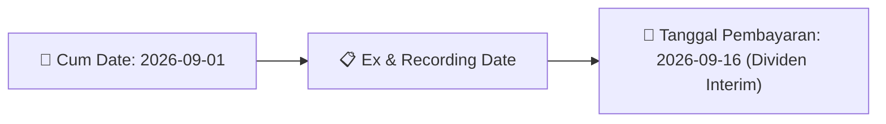

# Ikhtisar Pasar Harian (Daily Digest) - 2026-08-20

📅 **2026-08-20 (Daily Digest)**

## 1. Radar Pasar & Sentimen Harian (Executive Dashboard)
> [!NOTE]
> Terdeteksi sebanyak **163 pengumuman baru** dari 69 emiten pantauan pada (2026-08-20).

| Metric | Jumlah | Status Radar |
| :--- | :---: | :--- |
| **🟢 Sentimen Bullish / Positif** | `6` | [[Dividen Interim]], [[Mandatory Tender Offer]], Kinerja Positif |
| **⚪ Sentimen Netral / Routine** | `66` | [[Tanggapan Penjelasan Bursa]], [[RUPS]], [[Pendaftaran Unit]] |
| **🔴 Sentimen Bearish / Alert** | `7` | Sengketa Hukum, Defisit / Gugatan (Nihil hari ini) |
| **📄 [[Laporan Keuangan]] Baru** | `0` | Memicu Analisis Keuangan Otomatis |

> [!NOTE]
> Tidak dideteksi adanya publikasi laporan keuangan baru hari ini. Rangkuman per emiten secara terperinci tidak diperlukan.

---

## 2. Sorotan Utama & Watchlist Strategis (Strategic Watchlist)
#### 💰 Watchlist Dividen & Distribution
- **[[BBCA]]**: Nomor Surat = 005/CSG-IVR/2026
- **[[BBCA]]**: Tanggal Keputusan Direksi disetujui Dewan Komisaris = 2026-08-19
- **[[BBCA]]**: Periode Dividen = Tahun Buku 2026
- **[[BBCA]]**: Dividen per Saham = 25 IDR
- **[[BBCA]]**: Total Nilai Dividen Minimum = 3.071.043.782.500 IDR
- **[[BBCA]]**: Total Nilai Dividen Maksimum = 3.071.043.782.500 IDR

#### 🎯 Watchlist Penawaran Tender Wajib (MTO) & Strategis
- **[[CYBR]]**: Pengendali = [[Tidak]]
- **[[JARR]]**: Rencana Akuisisi oleh Pemegang Saham Pengendali = [[Belum menerima konfirmasi atau pemberitahuan resmi dari Pemegang Saham Pengendali maupun Ultimate Beneficial Owner]]
- **[[EKAD]]**: Pemegang Saham Pengendali = [[PT Ekadharma Inti Perkasa]]
- **[[PGUN]]**: Konfirmasi Pemegang Saham Pengendali/UBO = [[Belum menerima konfirmasi ataupun pemberitahuan resmi terkait rencana akuisisi saham BYAN]]
- **[[NAYZ]]**: Status Pengendali = [[Tidak]]
- **[[MEJA]]**: Rencana Perubahan Kepemilikan Pengendali = [[Tidak terdapat rencana perubahan kepemilikan saham pengendali dan/atau pemegang saham utama]]

#### 📈 Watchlist Konversi Waran & Potensi Dilusi
- **[[INET]]**: Nama Waran = INET-W2
- **[[INET]]**: Jumlah Waran yang Dikonversi = 12,542
- **[[INET]]**: Jumlah Saham Hasil Konversi = 12.542
- **[[INET]]**: Total Saham Setelah Konversi = 22,375,285,348
- **[[INET]]**: Sisa Waran Setelah Konversi = 2,299,441,241
- **[[ISAP]]**: Nama Waran = ISAP-W

---

## 3. Matriks Pengumuman Pasar (Announcements Intelligence Table)
| Emiten | Sentimen | Jenis Pengumuman | Judul Pengumuman | Berkas |
| :--- | :---: | :--- | :--- | :--- |
| **[[BBCA]]** | 🟢 BULLISH | Dividen | Jadwal Aksi Korporasi (Khusus Penyampaian Dividen Interim) | [Utama](file:///g:/My%20Drive/Model2/reports/raw/BBCA/20260819_BBCA_20260818_BBCA_Jadwal Aksi Korporasi (Khusus Penyampaian Dividen Interim)_32121192.pdf) · [Lamp 2](file:///g:/My%20Drive/Model2/reports/raw/BBCA/20260819_BBCA_20260818_BBCA_Jadwal Aksi Korporasi (Khusus Penyampaian Dividen Interim)_32121192_lamp2.pdf) · [Lamp 1](file:///g:/My%20Drive/Model2/reports/raw/BBCA/20260819_BBCA_20260818_BBCA_Jadwal Aksi Korporasi (Khusus Penyampaian Dividen Interim)_32121192_lamp1.pdf) |
| **[[SMCB]]** | ⚪ NEUTRAL | RUPS | Pengumuman RUPS | [Utama](file:///g:/My%20Drive/Model2/reports/raw/SMCB/20260819_SMCB_20260818_SMCB_Pengumuman RUPS_32121197.pdf) |
| **[[INET]]** | ⚪ NEUTRAL | Aksi Korporasi | Pencatatan Saham Tambahan dari Konversi | [Utama](file:///g:/My%20Drive/Model2/reports/raw/INET/20260819_INET_20260819_INET_Pencatatan Saham Tambahan dari Konversi_32121469.pdf) |
| **[[ISAP]]** | ⚪ NEUTRAL | Aksi Korporasi | Pencatatan Saham Tambahan dari Konversi | [Utama](file:///g:/My%20Drive/Model2/reports/raw/ISAP/20260819_ISAP_20260819_ISAP_Pencatatan Saham Tambahan dari Konversi_32121453.pdf) |
| **[[MREI]]** | ⚪ NEUTRAL | RUPS | Ringkasan RisalahRisalah RUPS | [Lamp 1](file:///g:/My%20Drive/Model2/reports/raw/MREI/20260819_MREI_20260819_MREI_Ringkasan RisalahRisalah RUPS_32121423_lamp1.pdf) |
| **[[MREI]]** | ⚪ NEUTRAL | Public Expose | Public Expose | [Utama](file:///g:/My%20Drive/Model2/reports/raw/MREI/20260820_MREI_20260820_MREI_Public Expose_32121668.pdf) |
| **[[MGNA]]** | ⚪ NEUTRAL | Aksi Korporasi | Pencatatan Saham Tambahan dari Konversi | [Utama](file:///g:/My%20Drive/Model2/reports/raw/MGNA/20260819_MGNA_20260819_MGNA_Pencatatan Saham Tambahan dari Konversi_32121491.pdf) · [Lamp 1](file:///g:/My%20Drive/Model2/reports/raw/MGNA/20260819_MGNA_20260819_MGNA_Pencatatan Saham Tambahan dari Konversi_32121491_lamp1.pdf) |
| **[[INRU]]** | ⚪ NEUTRAL | Aksi Korporasi | Tanggapan atas Permintaan Penjelasan Bursa | [Utama](file:///g:/My%20Drive/Model2/reports/raw/INRU/20260819_INRU_20260819_INRU_Tanggapan atas Permintaan Penjelasan Bursa_32121603.pdf) · [Lamp 1](file:///g:/My%20Drive/Model2/reports/raw/INRU/20260819_INRU_20260819_INRU_Tanggapan atas Permintaan Penjelasan Bursa_32121603_lamp1.pdf) |
| **[[CYBR]]** | ⚪ NEUTRAL | Aksi Korporasi | Pencatatan Saham Tambahan dari Konversi | [Utama](file:///g:/My%20Drive/Model2/reports/raw/CYBR/20260819_CYBR_20260819_CYBR_Pencatatan Saham Tambahan dari Konversi_32121451.pdf) · [Lamp 1](file:///g:/My%20Drive/Model2/reports/raw/CYBR/20260819_CYBR_20260819_CYBR_Pencatatan Saham Tambahan dari Konversi_32121451_lamp1.pdf) |
| **[[CYBR]]** | ⚪ NEUTRAL | Aksi Korporasi | LK-20082026-7517-00 | [Utama](file:///g:/My%20Drive/Model2/reports/raw/CYBR/20260820_CYBR_LK-20082026-7517-00.pdf) |
| **[[ASMI]]** | ⚪ NEUTRAL | RUPS | Ringkasan RisalahRisalah RUPS | [Utama](file:///g:/My%20Drive/Model2/reports/raw/ASMI/20260819_ASMI_20260819_ASMI_Ringkasan RisalahRisalah RUPS_32121532.pdf) · [Lamp 2](file:///g:/My%20Drive/Model2/reports/raw/ASMI/20260819_ASMI_20260819_ASMI_Ringkasan RisalahRisalah RUPS_32121532_lamp2.pdf) |
| **[[DJPU]]** | ⚪ NEUTRAL | Aksi Korporasi | Pengumuman Bursa | [Utama](file:///g:/My%20Drive/Model2/reports/raw/DJPU/20260819_DJPU_20260819_DJPU_Pengumuman Bursa_32121535.pdf) · [Lamp 1](file:///g:/My%20Drive/Model2/reports/raw/DJPU/20260819_DJPU_20260819_DJPU_Pengumuman Bursa_32121535_lamp1.pdf) · [Lamp 2](file:///g:/My%20Drive/Model2/reports/raw/DJPU/20260819_DJPU_20260819_DJPU_Pengumuman Bursa_32121535_lamp2.pdf) |
| **[[PJHB]]** | ⚪ NEUTRAL | Aksi Korporasi | Pencatatan Saham Tambahan dari Konversi | [Utama](file:///g:/My%20Drive/Model2/reports/raw/PJHB/20260819_PJHB_20260819_PJHB_Pencatatan Saham Tambahan dari Konversi_32121410.pdf) |
| **[[WIKA]]** | ⚪ NEUTRAL | Aksi Korporasi | Pengumuman Bursa | [Utama](file:///g:/My%20Drive/Model2/reports/raw/WIKA/20260819_WIKA_20260818_WIKA_Pengumuman Bursa_32121329.pdf) · [Lamp 7](file:///g:/My%20Drive/Model2/reports/raw/WIKA/20260819_WIKA_20260818_WIKA_Pengumuman Bursa_32121329_lamp7.pdf) · [Lamp 4](file:///g:/My%20Drive/Model2/reports/raw/WIKA/20260819_WIKA_20260818_WIKA_Pengumuman Bursa_32121329_lamp4.pdf) |
| **[[BIPP]]** | ⚪ NEUTRAL | RUPS | Pengumuman RUPS | [Utama](file:///g:/My%20Drive/Model2/reports/raw/BIPP/20260819_BIPP_20260819_BIPP_Pengumuman RUPS_32121442.pdf) |
| **[[BIPP]]** | ⚪ NEUTRAL | Aksi Korporasi | Keterbukaan Informasi terkait Aksi Korporasi | [Utama](file:///g:/My%20Drive/Model2/reports/raw/BIPP/20260819_BIPP_20260819_BIPP_Keterbukaan Informasi terkait Aksi Korporasi_32121595.pdf) · [Lamp 1](file:///g:/My%20Drive/Model2/reports/raw/BIPP/20260819_BIPP_20260819_BIPP_Keterbukaan Informasi terkait Aksi Korporasi_32121595_lamp1.pdf) |
| **[[BIPP]]** | 🔴 BEARISH | Aksi Korporasi | Laporan Informasi dan Fakta Material | [Utama](file:///g:/My%20Drive/Model2/reports/raw/BIPP/20260819_BIPP_20260819_BIPP_Laporan Informasi dan Fakta Material_32121587.pdf) |
| **[[CBDK]]** | 🟢 BULLISH | Buyback | Laporan Informasi dan Fakta Material | [Utama](file:///g:/My%20Drive/Model2/reports/raw/CBDK/20260819_CBDK_20260819_CBDK_Laporan Informasi dan Fakta Material_32121564.pdf) · [Lamp 2](file:///g:/My%20Drive/Model2/reports/raw/CBDK/20260819_CBDK_20260819_CBDK_Laporan Informasi dan Fakta Material_32121608_lamp2.pdf) |
| **[[TAPG]]** | ⚪ NEUTRAL | Aksi Korporasi | LK-19082026-5987-00 | [Utama](file:///g:/My%20Drive/Model2/reports/raw/TAPG/20260819_TAPG_LK-19082026-5987-00.pdf) |
| **[[ISAT]]** | ⚪ NEUTRAL | Aksi Korporasi | Tanggapan atas Permintaan Penjelasan Bursa | [Utama](file:///g:/My%20Drive/Model2/reports/raw/ISAT/20260819_ISAT_20260819_ISAT_Tanggapan atas Permintaan Penjelasan Bursa_32121591.pdf) · [Lamp 1](file:///g:/My%20Drive/Model2/reports/raw/ISAT/20260819_ISAT_20260819_ISAT_Tanggapan atas Permintaan Penjelasan Bursa_32121591_lamp1.pdf) |
| **[[LABA]]** | 🟢 BULLISH | RUPS | Ringkasan RisalahRisalah RUPS | [Utama](file:///g:/My%20Drive/Model2/reports/raw/LABA/20260819_LABA_20260819_LABA_Ringkasan RisalahRisalah RUPS_32121419.pdf) · [Lamp 1](file:///g:/My%20Drive/Model2/reports/raw/LABA/20260819_LABA_20260819_LABA_Ringkasan RisalahRisalah RUPS_32121419_lamp1.pdf) |
| **[[PYFA]]** | ⚪ NEUTRAL | Aksi Korporasi | Pencatatan Saham Tambahan dari Konversi | [Utama](file:///g:/My%20Drive/Model2/reports/raw/PYFA/20260819_PYFA_20260819_PYFA_Pencatatan Saham Tambahan dari Konversi_32121472.pdf) |
| **[[PPRE]]** | 🔴 BEARISH | Aksi Korporasi | Laporan Informasi dan Fakta Material | [Lamp 1](file:///g:/My%20Drive/Model2/reports/raw/PPRE/20260819_PPRE_20260819_PPRE_Laporan Informasi dan Fakta Material_32121513_lamp1.pdf) |
| **[[PTPP]]** | ⚪ NEUTRAL | RUPS | Pemberitahuan RencanaPenyampaian PanggilanHasil RUPORUPSURUP EBA-SP | [Lamp 1](file:///g:/My%20Drive/Model2/reports/raw/PTPP/20260819_PTPP_20260812_PTPP_Pemberitahuan RencanaPenyampaian PanggilanHasil RUPORUPSURUP EBA-SP_32119967_lamp1.pdf) |
| **[[BIKE]]** | ⚪ NEUTRAL | Aksi Korporasi | Tanggapan atas Permintaan Penjelasan Bursa | [Utama](file:///g:/My%20Drive/Model2/reports/raw/BIKE/20260819_BIKE_20260819_BIKE_Tanggapan atas Permintaan Penjelasan Bursa_32121404.pdf) |
| **[[PPGD]]** | ⚪ NEUTRAL | Aksi Korporasi | Penyampaian ProspektusInformasi Tambahan | [Utama](file:///g:/My%20Drive/Model2/reports/raw/PPGD/20260819_PPGD_20260819_PPGD_Penyampaian ProspektusInformasi Tambahan_32121606.pdf) · [Lamp 2](file:///g:/My%20Drive/Model2/reports/raw/PPGD/20260819_PPGD_20260819_PPGD_Penyampaian ProspektusInformasi Tambahan_32121612_lamp2.pdf) |
| **[[MEDS]]** | ⚪ NEUTRAL | Aksi Korporasi | LK-19082026-1867-00 | [Utama](file:///g:/My%20Drive/Model2/reports/raw/MEDS/20260819_MEDS_LK-19082026-1867-00.pdf) |
| **[[MEDS]]** | ⚪ NEUTRAL | Aksi Korporasi | LK-20082026-7047-00 | [Utama](file:///g:/My%20Drive/Model2/reports/raw/MEDS/20260820_MEDS_LK-20082026-7047-00.pdf) |
| **[[EDGE]]** | ⚪ NEUTRAL | Aksi Korporasi | Laporan Informasi dan Fakta Material | [Lamp 3](file:///g:/My%20Drive/Model2/reports/raw/EDGE/20260819_EDGE_20260819_EDGE_Laporan Informasi dan Fakta Material_32121414_lamp3.pdf) |
| **[[KOCI]]** | ⚪ NEUTRAL | Aksi Korporasi | Pencatatan Saham Tambahan dari Konversi | [Utama](file:///g:/My%20Drive/Model2/reports/raw/KOCI/20260819_KOCI_20260819_KOCI_Pencatatan Saham Tambahan dari Konversi_32121431.pdf) |
| **[[PRDA]]** | 🟢 BULLISH | Aksi Korporasi | Laporan Informasi dan Fakta Material | [Utama](file:///g:/My%20Drive/Model2/reports/raw/PRDA/20260819_PRDA_20260819_PRDA_Laporan Informasi dan Fakta Material_32121388.pdf) |
| **[[BMSR]]** | ⚪ NEUTRAL | Aksi Korporasi | AnnualReport2025-BMSR | [Utama](file:///g:/My%20Drive/Model2/reports/raw/BMSR/20260819_BMSR_AnnualReport2025-BMSR.pdf) |
| **[[BMSR]]** | ⚪ NEUTRAL | Aksi Korporasi | AnnualReport2025-BMSR-att3 | [Utama](file:///g:/My%20Drive/Model2/reports/raw/BMSR/20260819_BMSR_AnnualReport2025-BMSR-att3.pdf) |
| **[[INTP]]** | ⚪ NEUTRAL | Aksi Korporasi | Laporan Informasi dan Fakta Material | [Utama](file:///g:/My%20Drive/Model2/reports/raw/INTP/20260819_INTP_20260818_INTP_Laporan Informasi dan Fakta Material_32121334.pdf) |
| **[[DPNS]]** | ⚪ NEUTRAL | Aksi Korporasi | Sanksi | [Utama](file:///g:/My%20Drive/Model2/reports/raw/DPNS/20260819_DPNS_20260819_DPNS_Sanksi_32121504.pdf) · [Lamp 2](file:///g:/My%20Drive/Model2/reports/raw/DPNS/20260819_DPNS_20260819_DPNS_Sanksi_32121504_lamp2.pdf) · [Lamp 1](file:///g:/My%20Drive/Model2/reports/raw/DPNS/20260819_DPNS_20260819_DPNS_Sanksi_32121504_lamp1.pdf) |
| **[[HATM]]** | ⚪ NEUTRAL | Aksi Korporasi | Laporan Informasi dan Fakta Material | [Lamp 1](file:///g:/My%20Drive/Model2/reports/raw/HATM/20260819_HATM_20260819_HATM_Laporan Informasi dan Fakta Material_32121531_lamp1.pdf) |
| **[[APEX]]** | ⚪ NEUTRAL | Aksi Korporasi | Laporan Informasi dan Fakta Material | [Utama](file:///g:/My%20Drive/Model2/reports/raw/APEX/20260819_APEX_20260819_APEX_Laporan Informasi dan Fakta Material_32121370.pdf) |
| **[[BAIK]]** | ⚪ NEUTRAL | Aksi Korporasi | Laporan Informasi dan Fakta Material | [Lamp 1](file:///g:/My%20Drive/Model2/reports/raw/BAIK/20260819_BAIK_20260819_BAIK_Laporan Informasi dan Fakta Material_32121436_lamp1.pdf) |
| **[[BEEF]]** | 🟢 BULLISH | Buyback | Laporan Informasi dan Fakta Material | [Utama](file:///g:/My%20Drive/Model2/reports/raw/BEEF/20260819_BEEF_20260819_BEEF_Laporan Informasi dan Fakta Material_32121474.pdf) |
| **[[BEEF]]** | 🔴 BEARISH | Public Expose | Public Expose | [Utama](file:///g:/My%20Drive/Model2/reports/raw/BEEF/20260820_BEEF_20260820_BEEF_Public Expose_32121671.pdf) · [Lamp 1](file:///g:/My%20Drive/Model2/reports/raw/BEEF/20260820_BEEF_20260820_BEEF_Public Expose_32121671_lamp1.pdf) |
| **[[TRUK]]** | ⚪ NEUTRAL | Public Expose | Public Expose | [Utama](file:///g:/My%20Drive/Model2/reports/raw/TRUK/20260819_TRUK_20260819_TRUK_Public Expose_32121457.pdf) |
| **[[TRJA]]** | ⚪ NEUTRAL | Aksi Korporasi | Tanggapan atas Permintaan Penjelasan Bursa | [Utama](file:///g:/My%20Drive/Model2/reports/raw/TRJA/20260819_TRJA_20260819_TRJA_Tanggapan atas Permintaan Penjelasan Bursa_32121551.pdf) |
| **[[TRJA]]** | 🔴 BEARISH | Aksi Korporasi | LK-20082026-6111-00 | [Utama](file:///g:/My%20Drive/Model2/reports/raw/TRJA/20260820_TRJA_LK-20082026-6111-00.pdf) |
| **[[ABBA]]** | ⚪ NEUTRAL | Aksi Korporasi | Pengumuman Bursa | [Utama](file:///g:/My%20Drive/Model2/reports/raw/ABBA/20260819_ABBA_20260819_ABBA_Pengumuman Bursa_32121507.pdf) · [Lamp 1](file:///g:/My%20Drive/Model2/reports/raw/ABBA/20260819_ABBA_20260819_ABBA_Pengumuman Bursa_32121507_lamp1.pdf) |
| **[[LMPI]]** | ⚪ NEUTRAL | RUPS | Pengumuman RUPS | [Lamp 1](file:///g:/My%20Drive/Model2/reports/raw/LMPI/20260819_LMPI_20260819_LMPI_Pengumuman RUPS_32121379_lamp1.pdf) |
| **[[BNBA]]** | ⚪ NEUTRAL | RUPS | Pemanggilan RUPS | [Utama](file:///g:/My%20Drive/Model2/reports/raw/BNBA/20260819_BNBA_20260819_BNBA_Pemanggilan RUPS_32121632.pdf) · [Lamp 4](file:///g:/My%20Drive/Model2/reports/raw/BNBA/20260819_BNBA_20260819_BNBA_Pemanggilan RUPS_32121632_lamp4.pdf) · [Lamp 3](file:///g:/My%20Drive/Model2/reports/raw/BNBA/20260819_BNBA_20260819_BNBA_Pemanggilan RUPS_32121632_lamp3.pdf) |
| **[[JARR]]** | ⚪ NEUTRAL | Aksi Korporasi | Tanggapan atas Permintaan Penjelasan Bursa | [Utama](file:///g:/My%20Drive/Model2/reports/raw/JARR/20260819_JARR_20260819_JARR_Tanggapan atas Permintaan Penjelasan Bursa_32121593.pdf) · [Lamp 1](file:///g:/My%20Drive/Model2/reports/raw/JARR/20260819_JARR_20260819_JARR_Tanggapan atas Permintaan Penjelasan Bursa_32121593_lamp1.pdf) |
| **[[R-ABFII]]** | ⚪ NEUTRAL | Aksi Korporasi | R-ABFII R-ABFII Pencatatan AwalTambahan ETF | [Utama](file:///g:/My%20Drive/Model2/reports/raw/R-ABFII/20260819_R-ABFII_20260819_R-ABFII_Pencatatan AwalTambahan ETF_32121402.pdf) · [Lamp 1](file:///g:/My%20Drive/Model2/reports/raw/R-ABFII/20260819_R-ABFII_20260819_R-ABFII_Pencatatan AwalTambahan ETF_32121402_lamp1.pdf) |
| **[[DGWG]]** | ⚪ NEUTRAL | RUPS | Pengumuman RUPS | [Utama](file:///g:/My%20Drive/Model2/reports/raw/DGWG/20260820_DGWG_20260820_DGWG_Pengumuman RUPS_32121675.pdf) · [Lamp 1](file:///g:/My%20Drive/Model2/reports/raw/DGWG/20260820_DGWG_20260820_DGWG_Pengumuman RUPS_32121675_lamp1.pdf) |
| **[[PORT]]** | ⚪ NEUTRAL | Aksi Korporasi | Tanggapan atas Permintaan Penjelasan Bursa | [Utama](file:///g:/My%20Drive/Model2/reports/raw/PORT/20260820_PORT_20260820_PORT_Tanggapan atas Permintaan Penjelasan Bursa_32121768.pdf) |
| **[[JGLE]]** | ⚪ NEUTRAL | RUPS | Pemanggilan RUPS | [Utama](file:///g:/My%20Drive/Model2/reports/raw/JGLE/20260820_JGLE_20260820_JGLE_Pemanggilan RUPS_32121700.pdf) · [Lamp 3](file:///g:/My%20Drive/Model2/reports/raw/JGLE/20260820_JGLE_20260820_JGLE_Pemanggilan RUPS_32121700_lamp3.pdf) · [Lamp 2](file:///g:/My%20Drive/Model2/reports/raw/JGLE/20260820_JGLE_20260820_JGLE_Pemanggilan RUPS_32121700_lamp2.pdf) |
| **[[AKPI]]** | ⚪ NEUTRAL | Aksi Korporasi | LK-20082026-6804-00 | [Utama](file:///g:/My%20Drive/Model2/reports/raw/AKPI/20260820_AKPI_LK-20082026-6804-00.pdf) |
| **[[BEST]]** | ⚪ NEUTRAL | Aksi Korporasi | Tanggapan atas Permintaan Penjelasan Bursa | [Utama](file:///g:/My%20Drive/Model2/reports/raw/BEST/20260820_BEST_20260820_BEST_Tanggapan atas Permintaan Penjelasan Bursa_32121673.pdf) |
| **[[WTON]]** | ⚪ NEUTRAL | Public Expose | Public Expose | [Utama](file:///g:/My%20Drive/Model2/reports/raw/WTON/20260820_WTON_20260820_WTON_Public Expose_32121652.pdf) · [Lamp 1](file:///g:/My%20Drive/Model2/reports/raw/WTON/20260820_WTON_20260820_WTON_Public Expose_32121652_lamp1.pdf) |
| **[[TCPI]]** | ⚪ NEUTRAL | RUPS | Pemanggilan RUPS | [Utama](file:///g:/My%20Drive/Model2/reports/raw/TCPI/20260820_TCPI_20260820_TCPI_Pemanggilan RUPS_32121646.pdf) |
| **[[SWAT]]** | ⚪ NEUTRAL | RUPS | Pemanggilan RUPS | [Utama](file:///g:/My%20Drive/Model2/reports/raw/SWAT/20260820_SWAT_20260820_SWAT_Pemanggilan RUPS_32121735.pdf) · [Lamp 1](file:///g:/My%20Drive/Model2/reports/raw/SWAT/20260820_SWAT_20260820_SWAT_Pemanggilan RUPS_32121735_lamp1.pdf) |
| **[[SOLA]]** | 🔴 BEARISH | Aksi Korporasi | Tanggapan atas Permintaan Penjelasan Bursa | [Utama](file:///g:/My%20Drive/Model2/reports/raw/SOLA/20260820_SOLA_20260820_SOLA_Tanggapan atas Permintaan Penjelasan Bursa_32121728.pdf) · [Lamp 1](file:///g:/My%20Drive/Model2/reports/raw/SOLA/20260820_SOLA_20260820_SOLA_Tanggapan atas Permintaan Penjelasan Bursa_32121728_lamp1.pdf) |
| **[[WIFI]]** | ⚪ NEUTRAL | RUPS | Pengumuman RUPS | [Utama](file:///g:/My%20Drive/Model2/reports/raw/WIFI/20260820_WIFI_20260819_WIFI_Pengumuman RUPS_32121554.pdf) · [Lamp 1](file:///g:/My%20Drive/Model2/reports/raw/WIFI/20260820_WIFI_20260819_WIFI_Pengumuman RUPS_32121554_lamp1.pdf) |
| **[[TGKA]]** | ⚪ NEUTRAL | Aksi Korporasi | Pengumuman Bursa | [Utama](file:///g:/My%20Drive/Model2/reports/raw/TGKA/20260820_TGKA_20260819_TGKA_Pengumuman Bursa_32121506.pdf) · [Lamp 1](file:///g:/My%20Drive/Model2/reports/raw/TGKA/20260820_TGKA_20260819_TGKA_Pengumuman Bursa_32121506_lamp1.pdf) |
| **[[EKAD]]** | ⚪ NEUTRAL | Aksi Korporasi | Tanggapan atas Permintaan Penjelasan Bursa | [Utama](file:///g:/My%20Drive/Model2/reports/raw/EKAD/20260820_EKAD_20260820_EKAD_Tanggapan atas Permintaan Penjelasan Bursa_32121681.pdf) |
| **[[GOOD]]** | ⚪ NEUTRAL | Aksi Korporasi | LK-20082026-4297-00 | [Utama](file:///g:/My%20Drive/Model2/reports/raw/GOOD/20260820_GOOD_LK-20082026-4297-00.pdf) |
| **[[BAJA]]** | 🔴 BEARISH | Aksi Korporasi | Laporan Informasi dan Fakta Material | [Utama](file:///g:/My%20Drive/Model2/reports/raw/BAJA/20260820_BAJA_20260820_BAJA_Laporan Informasi dan Fakta Material_32121642.pdf) |
| **[[MINE]]** | ⚪ NEUTRAL | RUPS | Pemanggilan RUPS | [Utama](file:///g:/My%20Drive/Model2/reports/raw/MINE/20260820_MINE_20260819_MINE_Pemanggilan RUPS_32121613.pdf) · [Lamp 1](file:///g:/My%20Drive/Model2/reports/raw/MINE/20260820_MINE_20260819_MINE_Pemanggilan RUPS_32121613_lamp1.pdf) |
| **[[PEGE]]** | ⚪ NEUTRAL | Aksi Korporasi | LK-20082026-5966-00 | [Utama](file:///g:/My%20Drive/Model2/reports/raw/PEGE/20260820_PEGE_LK-20082026-5966-00.pdf) |
| **[[AVIA]]** | 🟢 BULLISH | Aksi Korporasi | Laporan Informasi dan Fakta Material | [Utama](file:///g:/My%20Drive/Model2/reports/raw/AVIA/20260820_AVIA_20260819_AVIA_Laporan Informasi dan Fakta Material_32121427.pdf) |
| **[[PGUN]]** | ⚪ NEUTRAL | Aksi Korporasi | Tanggapan atas Permintaan Penjelasan Bursa | [Utama](file:///g:/My%20Drive/Model2/reports/raw/PGUN/20260820_PGUN_20260820_PGUN_Tanggapan atas Permintaan Penjelasan Bursa_32121753.pdf) · [Lamp 1](file:///g:/My%20Drive/Model2/reports/raw/PGUN/20260820_PGUN_20260820_PGUN_Tanggapan atas Permintaan Penjelasan Bursa_32121753_lamp1.pdf) |
| **[[ALL]]** | ⚪ NEUTRAL | Aksi Korporasi | Pemantauan Khusus | [Utama](file:///g:/My%20Drive/Model2/reports/raw/ALL/20260820__20260820_Pemantauan Khusus_32121762.pdf) |
| **[[ENRG]]** | ⚪ NEUTRAL | Aksi Korporasi | Tanggapan atas Permintaan Penjelasan Bursa | [Utama](file:///g:/My%20Drive/Model2/reports/raw/ENRG/20260820_ENRG_20260820_ENRG_Tanggapan atas Permintaan Penjelasan Bursa_32121765.pdf) · [Lamp 1](file:///g:/My%20Drive/Model2/reports/raw/ENRG/20260820_ENRG_20260820_ENRG_Tanggapan atas Permintaan Penjelasan Bursa_32121765_lamp1.pdf) |
| **[[SMII]]** | ⚪ NEUTRAL | Aksi Korporasi | Laporan Informasi dan Fakta Material | [Utama](file:///g:/My%20Drive/Model2/reports/raw/SMII/20260820_SMII_20260820_SMII_Laporan Informasi dan Fakta Material_32121767.pdf) · [Lamp 1](file:///g:/My%20Drive/Model2/reports/raw/SMII/20260820_SMII_20260820_SMII_Laporan Informasi dan Fakta Material_32121770_lamp1.pdf) · [Lamp 1](file:///g:/My%20Drive/Model2/reports/raw/SMII/20260820_SMII_20260820_SMII_Laporan Informasi dan Fakta Material_32121767_lamp1.pdf) |
| **[[BEER]]** | ⚪ NEUTRAL | Aksi Korporasi | Tanggapan atas Permintaan Penjelasan Bursa | [Utama](file:///g:/My%20Drive/Model2/reports/raw/BEER/20260820_BEER_20260820_BEER_Tanggapan atas Permintaan Penjelasan Bursa_32121771.pdf) |
| **[[VINS]]** | ⚪ NEUTRAL | RUPS | Ringkasan RisalahRisalah RUPS | [Utama](file:///g:/My%20Drive/Model2/reports/raw/VINS/20260820_VINS_20260820_VINS_Ringkasan RisalahRisalah RUPS_32121664.pdf) · [Lamp 1](file:///g:/My%20Drive/Model2/reports/raw/VINS/20260820_VINS_20260820_VINS_Ringkasan RisalahRisalah RUPS_32121664_lamp1.pdf) |
| **[[NAYZ]]** | ⚪ NEUTRAL | Aksi Korporasi | LK-20082026-0665-00 | [Utama](file:///g:/My%20Drive/Model2/reports/raw/NAYZ/20260820_NAYZ_LK-20082026-0665-00.pdf) |
| **[[NAYZ]]** | ⚪ NEUTRAL | Aksi Korporasi | LK-20082026-4519-00 | [Utama](file:///g:/My%20Drive/Model2/reports/raw/NAYZ/20260820_NAYZ_LK-20082026-4519-00.pdf) |
| **[[NAYZ]]** | ⚪ NEUTRAL | Aksi Korporasi | Laporan Informasi dan Fakta Material | [Utama](file:///g:/My%20Drive/Model2/reports/raw/NAYZ/20260820_NAYZ_20260819_NAYZ_Laporan Informasi dan Fakta Material_32121541.pdf) · [Lamp 1](file:///g:/My%20Drive/Model2/reports/raw/NAYZ/20260820_NAYZ_20260819_NAYZ_Laporan Informasi dan Fakta Material_32121541_lamp1.pdf) · [Lamp 2](file:///g:/My%20Drive/Model2/reports/raw/NAYZ/20260820_NAYZ_20260819_NAYZ_Laporan Informasi dan Fakta Material_32121541_lamp2.pdf) |
| **[[INDS]]** | 🔴 BEARISH | Aksi Korporasi | Laporan Informasi dan Fakta Material | [Utama](file:///g:/My%20Drive/Model2/reports/raw/INDS/20260820_INDS_20260819_INDS_Laporan Informasi dan Fakta Material_32121399.pdf) |
| **[[ARTI]]** | ⚪ NEUTRAL | Aksi Korporasi | Tanggapan atas Permintaan Penjelasan Bursa | [Utama](file:///g:/My%20Drive/Model2/reports/raw/ARTI/20260820_ARTI_20260820_ARTI_Tanggapan atas Permintaan Penjelasan Bursa_32121692.pdf) · [Lamp 3](file:///g:/My%20Drive/Model2/reports/raw/ARTI/20260820_ARTI_20260820_ARTI_Tanggapan atas Permintaan Penjelasan Bursa_32121692_lamp3.pdf) |
| **[[MEJA]]** | ⚪ NEUTRAL | Aksi Korporasi | Tanggapan atas Permintaan Penjelasan Bursa | [Utama](file:///g:/My%20Drive/Model2/reports/raw/MEJA/20260820_MEJA_20260819_MEJA_Tanggapan atas Permintaan Penjelasan Bursa_32121449.pdf) · [Lamp 1](file:///g:/My%20Drive/Model2/reports/raw/MEJA/20260820_MEJA_20260819_MEJA_Tanggapan atas Permintaan Penjelasan Bursa_32121449_lamp1.pdf) |
| **[[GGRP]]** | ⚪ NEUTRAL | RUPS | Ringkasan RisalahRisalah RUPS | [Utama](file:///g:/My%20Drive/Model2/reports/raw/GGRP/20260820_GGRP_20260819_GGRP_Ringkasan RisalahRisalah RUPS_32121515.pdf) · [Lamp 1](file:///g:/My%20Drive/Model2/reports/raw/GGRP/20260820_GGRP_20260819_GGRP_Ringkasan RisalahRisalah RUPS_32121515_lamp1.pdf) |
| **[[SMMF]]** | ⚪ NEUTRAL | Aksi Korporasi | Laporan Informasi dan Fakta Material | [Utama](file:///g:/My%20Drive/Model2/reports/raw/SMMF/20260820_SMMF_20260820_SMMF_Laporan Informasi dan Fakta Material_32121643.pdf) · [Lamp 3](file:///g:/My%20Drive/Model2/reports/raw/SMMF/20260820_SMMF_20260820_SMMF_Laporan Informasi dan Fakta Material_32121643_lamp3.pdf) |

---

## 4. Detail Informasi per Emiten (Grouped by Emiten)
### 🔵 [[BBCA]]
- **[Dividen]** [Jadwal Aksi Korporasi (Khusus Penyampaian Dividen Interim)](file:///g:/My%20Drive/Model2/reports/raw/BBCA/20260819_BBCA_20260818_BBCA_Jadwal Aksi Korporasi (Khusus Penyampaian Dividen Interim)_32121192.pdf) *(Attachment: [Lamp 2](file:///g:/My%20Drive/Model2/reports/raw/BBCA/20260819_BBCA_20260818_BBCA_Jadwal Aksi Korporasi (Khusus Penyampaian Dividen Interim)_32121192_lamp2.pdf) · [Lamp 1](file:///g:/My%20Drive/Model2/reports/raw/BBCA/20260819_BBCA_20260818_BBCA_Jadwal Aksi Korporasi (Khusus Penyampaian Dividen Interim)_32121192_lamp1.pdf))*
  - 📌 *Deskripsi*: PT Bank Central Asia Tbk (BBCA) mengumumkan rencana pembagian dividen tunai interim untuk tahun buku 2026 sebesar Rp25 per saham, dengan total nilai dividen minimum dan maksimum masing-masing Rp3.071.043.782.500. Jadwal dividen: cum dividen pasar reguler dan negosiasi 28 Agustus 2026, ex dividen pasar reguler dan negosiasi 31 Agustus 2026, recording date 1 September 2026, cum dividen pasar tunai 1 September 2026, ex dividen pasar tunai 2 September 2026, dan pembayaran dividen 16 September 2026.
  - 📊 **Fakta Material**:
    - **Nomor Surat**: 005/CSG-IVR/2026
    - **Tanggal Keputusan Direksi disetujui Dewan Komisaris**: 2026-08-19
    - **Periode Dividen**: Tahun Buku 2026
    - **Dividen per Saham**: 25 IDR
    - **Total Nilai Dividen Minimum**: 3.071.043.782.500 IDR
    - **Total Nilai Dividen Maksimum**: 3.071.043.782.500 IDR
    - **Efek Bersifat Ekuitas yang Dapat Dikonversi**: Tidak
    - **Tanggal Cum Dividen Pasar Reguler dan Negosiasi**: 2026-08-28
    - **Tanggal Ex Dividen Pasar Reguler dan Negosiasi**: 2026-08-31
    - **Tanggal Cum Dividen Pasar Tunai**: 2026-09-01
    - **Tanggal Ex Dividen Pasar Tunai**: 2026-09-02
    - **Tanggal Daftar Pemegang Saham (Recording Date)**: 2026-09-01 16:00
    - **Tanggal Pembayaran Dividen**: 2026-09-16
    - **Laba Bersih Entitas Induk per 30 Juni 2026**: 29.534.445.918.301 IDR
    - **Saldo Laba Ditahan Tidak Dibatasi Penggunaannya per 30 Juni 2026**: 251.487.039.179.909 IDR
    - **Total Ekuitas per 30 Juni 2026**: 270.667.745.587.678 IDR
    - **Catatan Realisasi Jumlah Saham**: Realisasi jumlah saham yang berhak atas dividen interim kuartal III 2026 dapat lebih rendah sesuai akumulasi saham hasil buyback sampai tanggal pencatatan

### 🔵 [[SMCB]]
- **[RUPS]** [Pengumuman RUPS](file:///g:/My%20Drive/Model2/reports/raw/SMCB/20260819_SMCB_20260818_SMCB_Pengumuman RUPS_32121197.pdf)
  - 📌 *Deskripsi*: PT Solusi Bangun Indonesia Tbk menyampaikan pemberitahuan rencana penyelenggaraan Rapat Umum Pemegang Saham Luar Biasa yang akan diselenggarakan pada Jumat, 25 September 2026 pukul 14:00 di Hotel RA Suites Simatupang, Jakarta Selatan, dengan tanggal daftar pemegang saham yang berhak hadir pada 02 September 2026.
  - 📊 **Fakta Material**:
    - **Jenis Rapat**: Rapat Umum Pemegang Saham Luar Biasa
    - **Lokasi Penyelenggaraan RUPS**: Hotel RA Suites Simatupang, Pandawa 1-2, Jl TB Simatupang No. 30, Jakarta Selatan
    - **Tanggal Daftar Pemegang Saham yang Berhak Hadir**: 02 September 2026
    - **Hari/Tanggal RUPS**: Jumat, 25 September 2026
    - **Waktu RUPS**: 14:00
    - **Referensi Surat**: 231/LGRC/SBI/VII/2026
    - **Nama Pengirim**: Andika Lukmana
    - **Tanggal Pelaporan**: 19-08-2026

### 🔵 [[INET]]
- **[Aksi Korporasi]** [Pencatatan Saham Tambahan dari Konversi](file:///g:/My%20Drive/Model2/reports/raw/INET/20260819_INET_20260819_INET_Pencatatan Saham Tambahan dari Konversi_32121469.pdf)
  - 📌 *Deskripsi*: PT Sinergi Inti Andalan Prima Tbk. (INET) mengumumkan pencatatan saham tambahan dari konversi Waran INET-W2 sebanyak 12.542 lembar, sehingga total saham setelah konversi menjadi 22.375.285.348 lembar. Sisa waran INET-W2 setelah konversi adalah 2.299.441.241. Saham dicatat dan diperdagangkan di Papan Pengembangan mulai 20 Agustus 2026.
  - 📊 **Fakta Material**:
    - **Nama Waran**: INET-W2
    - **Jumlah Waran yang Dikonversi**: 12,542
    - **Jumlah Saham Hasil Konversi**: 12.542
    - **Total Saham Setelah Konversi**: 22,375,285,348
    - **Sisa Waran Setelah Konversi**: 2,299,441,241
    - **Tanggal Pencatatan dan Perdagangan**: 20 Agustus 2026
    - **Papan Pencatatan**: Pengembangan

### 🔵 [[ISAP]]
- **[Aksi Korporasi]** [Pencatatan Saham Tambahan dari Konversi](file:///g:/My%20Drive/Model2/reports/raw/ISAP/20260819_ISAP_20260819_ISAP_Pencatatan Saham Tambahan dari Konversi_32121453.pdf)
  - 📌 *Deskripsi*: Pengumuman pencatatan saham tambahan hasil konversi Waran ISAP-W di Papan Akselerasi pada 20 Agustus 2026. Jumlah saham hasil konversi 4.020.356.232 lembar, sisa waran 749.643.768.
  - 📊 **Fakta Material**:
    - **Nama Waran**: ISAP-W
    - **Jumlah Saham Hasil Konversi**: 4.020.356.232
    - **Sisa Waran**: 749.643.768
    - **Tanggal Pencatatan dan Perdagangan**: 20 Agustus 2026
    - **Papan Pencatatan**: Akselerasi

### 🔵 [[MREI]]
- **[RUPS]** [Ringkasan RisalahRisalah RUPS](file:///g:/My%20Drive/Model2/reports/raw/MREI/20260819_MREI_20260819_MREI_Ringkasan RisalahRisalah RUPS_32121423_lamp1.pdf)
  - 📌 *Deskripsi*: RUPS Luar Biasa PT Maskapai Reasuransi Indonesia Tbk. diselenggarakan pada 14 Agustus 2026 dengan kuorum 80,87%. Mata acara pertama bersifat informasi atas keterlambatan Laporan Keuangan Audit dan Laporan Tahunan Tahun Buku 2025 akibat insiden siber. Mata acara kedua, ketiga, dan keempat disetujui dengan suara setuju 99,57%.
  - 📊 **Fakta Material**:
    - **Tanggal RUPS**: 14 Agustus 2026
    - **Waktu RUPS**: 10.05 WIB - 10.44 WIB
    - **Tempat RUPS**: Ruang MLC Lounge, Plaza Marein Lt. 22, Jl. Jend. Sudirman Kav. 76-78, Jakarta 12910
    - **Total saham dengan hak suara**: 517.791.681 saham
    - **Kuorum kehadiran**: 418.752.216 saham atau 80,87%
    - **Dewan Komisaris yang hadir**: Hardjono (Presiden Komisaris/Komisaris Independen), Fanra Budiman Arief (Komisaris), Aloysia Dwi Ana Nurhandayani (Komisaris)
    - **Direksi yang hadir**: Robby Loho (Presiden Direktur), Trinita Situmeang (Direktur), Lukcimo Jahja (Direktur Keuangan)
    - **Mata Acara 1**: Penyampaian informasi keterlambatan Laporan Keuangan Audit dan Laporan Tahunan Tahun Buku 2025; tidak ada pemungutan suara
    - **Penyebab keterlambatan LK 2025**: Insiden siber di tahun 2025
    - **Mata Acara 2**: Penunjukan Kantor Akuntan Publik dan Akuntan Publik untuk audit Laporan Keuangan Tahun Buku 2026; disetujui 416.943.716 suara (99,57%), abstain 1.808.500 (0,43%)
    - **Mata Acara 3**: Penetapan dan Perubahan Pengurus Perseroan; disetujui 416.943.716 suara (99,57%), abstain 1.808.500 (0,43%)
    - **Mata Acara 4**: Perubahan Anggaran Dasar Perseroan; disetujui 416.939.716 suara (99,57%), abstain 1.812.500 (0,43%)
    - **KAP yang ditunjuk**: Amir Abadi Jusuf, Aryanto, Ma... (dokumen terpotong)
- **[Public Expose]** [Public Expose](file:///g:/My%20Drive/Model2/reports/raw/MREI/20260820_MREI_20260820_MREI_Public Expose_32121668.pdf)
  - 📌 *Deskripsi*: Perseroan menyampaikan laporan hasil Public Expose Insidentil merujuk pada surat penyampaian materi Public Expose No. 136/SEKPER/RUPS/082026 tanggal 11 Agustus 2026. Acara dihadiri oleh 4 peserta eksternal dan laporan disampaikan oleh Lukcimo Jahja pada 20 Agustus 2026.
  - 📊 **Fakta Material**:
    - **Nomor Surat Rujukan Public Expose**: 136/SEKPER/RUPS/082026
    - **Tanggal Surat Rujukan Public Expose**: 2026-08-11
    - **Jenis Public Expose**: Insidentil
    - **Jumlah Peserta Eksternal**: 4 orang
    - **Nama Pengirim Laporan**: Lukcimo Jahja
    - **Tanggal Penyampaian Laporan**: 2026-08-20
    - **Lokasi Perseroan**: Plaza Marein, 18th Floor

### 🔵 [[MGNA]]
- **[Aksi Korporasi]** [Pencatatan Saham Tambahan dari Konversi](file:///g:/My%20Drive/Model2/reports/raw/MGNA/20260819_MGNA_20260819_MGNA_Pencatatan Saham Tambahan dari Konversi_32121491.pdf) *(Attachment: [Lamp 1](file:///g:/My%20Drive/Model2/reports/raw/MGNA/20260819_MGNA_20260819_MGNA_Pencatatan Saham Tambahan dari Konversi_32121491_lamp1.pdf))*
  - 📌 *Deskripsi*: PT Magna Investama Mandiri Tbk menyampaikan pencatatan penambahan saham baru hasil exercise Waran Seri II. Pada tanggal 18 Agustus 2026 terdapat pelaksanaan exercise sebanyak 59 waran yang menghasilkan 59 saham baru, sehingga total saham tercatat bertambah dari 3.411.123.326 menjadi 3.411.123.385 lembar dan sisa Waran Seri II berkurang dari 343.265.473 menjadi 343.265.414.
  - 📊 **Fakta Material**:
    - **Nama Perusahaan**: PT Magna Investama Mandiri Tbk
    - **Kode Waran**: MGNA-W
    - **Tanggal Pelaksanaan Exercise**: 18-08-2026
    - **Tanggal Penerbitan Saham**: 19-08-2026
    - **Total Saham Sebelum Exercise**: 3.411.123.326
    - **Total Saham Setelah Exercise**: 3.411.123.385
    - **Sisa Waran Seri II Sebelum Exercise**: 343.265.473
    - **Sisa Waran Seri II Setelah Exercise**: 343.265.414

### 🔵 [[INRU]]
- **[Aksi Korporasi]** [Tanggapan atas Permintaan Penjelasan Bursa](file:///g:/My%20Drive/Model2/reports/raw/INRU/20260819_INRU_20260819_INRU_Tanggapan atas Permintaan Penjelasan Bursa_32121603.pdf) *(Attachment: [Lamp 1](file:///g:/My%20Drive/Model2/reports/raw/INRU/20260819_INRU_20260819_INRU_Tanggapan atas Permintaan Penjelasan Bursa_32121603_lamp1.pdf))*
  - 📌 *Deskripsi*: PT Toba Pulp Lestari Tbk menyampaikan tanggapan atas permintaan penjelasan BEI terkait pemberitaan dugaan korupsi transfer pricing Ditjen Pajak senilai Rp2 triliun. Perseroan menyatakan sedang melakukan penelaahan dan verifikasi, belum memperoleh informasi resmi mengenai status perkara atau keterlibatan pihak internal, serta belum mengidentifikasi dampak material tambahan terhadap kelangsungan usaha.
  - 📊 **Fakta Material**:
    - **Nomor Surat BEI**: S-10798/BEI.PP3/08-2026 tanggal 18 Agustus 2026
    - **Nomor Surat Perseroan**: 516/TPL-P/VIII/26
    - **Tanggal Surat Perseroan**: 19 Agustus 2026
    - **Nilai Dugaan Transfer Pricing**: Rp 2 triliun
    - **Lembaga Penegak Hukum**: Kejaksaan Agung Republik Indonesia
    - **Status Verifikasi Informasi**: Perseroan sedang melakukan penelaahan dan verifikasi; belum memperoleh informasi resmi yang dapat dikonfirmasi
    - **Dampak terhadap Kelangsungan Usaha**: Belum mengidentifikasi adanya dampak material tambahan terhadap kelangsungan usaha
    - **Keterlibatan Direksi, Komisaris, atau Karyawan**: Belum memperoleh informasi resmi yang dapat mengonfirmasi keterlibatan
    - **Status Perkara di Pengadilan**: Belum memperoleh informasi resmi mengenai status perkara, nomor perkara, maupun pengadilan tempat perkara
    - **Sikap Perseroan terhadap Proses Hukum**: Menghormati proses penegakan hukum oleh Kejaksaan Agung RI dan akan mengambil langkah sesuai perkembangan

### 🔵 [[CYBR]]
- **[Aksi Korporasi]** [Pencatatan Saham Tambahan dari Konversi](file:///g:/My%20Drive/Model2/reports/raw/CYBR/20260819_CYBR_20260819_CYBR_Pencatatan Saham Tambahan dari Konversi_32121451.pdf) *(Attachment: [Lamp 1](file:///g:/My%20Drive/Model2/reports/raw/CYBR/20260819_CYBR_20260819_CYBR_Pencatatan Saham Tambahan dari Konversi_32121451_lamp1.pdf))*
  - 📌 *Deskripsi*: PT ITSEC Asia Tbk (CYBR) menyampaikan pencatatan saham baru hasil exercise Waran Seri I sebanyak 250.401 saham pada 19 Agustus 2026, sehingga total saham tercatat menjadi 13.483.117.205 dan sisa Waran Seri I menjadi 424.766.999.
  - 📊 **Fakta Material**:
    - **Tanggal Pelaksanaan Exercise**: 2026-08-18
    - **Tanggal Penerbitan**: 2026-08-19
    - **Jumlah Waran yang Di-Exercise**: 250.401
    - **Jumlah Saham Baru**: 250.401
    - **Total Saham Sebelum Exercise**: 13.482.866.804
    - **Total Saham Setelah Exercise**: 13.483.117.205
    - **Sisa Waran Seri I Sebelum Exercise**: 425.017.400
    - **Sisa Waran Seri I Setelah Exercise**: 424.766.999
    - **Nomor Surat**: OPR-1252/AJKI/082026
    - **Kode Waran**: CYBR-W
- **[Aksi Korporasi]** [LK-20082026-7517-00](file:///g:/My%20Drive/Model2/reports/raw/CYBR/20260820_CYBR_LK-20082026-7517-00.pdf)
  - 📌 *Deskripsi*: Doni Mora selaku Direksi CYBR (ITsec Asia Tbk) melaporkan perubahan kepemilikan saham akibat transaksi Repurchase Agreement/penjualan 100.000 saham biasa pada 19 Agustus 2026 dengan harga Rp560 per saham, sehingga kepemilikan turun dari 4.761.200 menjadi 4.661.200 unit dengan hak suara tetap 0,035%.
  - 📊 **Fakta Material**:
    - **Nama Pelapor**: DONI MORA
    - **Jabatan Pelapor**: Direksi
    - **Emiten**: CYBR - ITSEC ASIA Tbk, PT
    - **Nomor Laporan**: LK/20082026/0008/1
    - **Jumlah Saham Sebelum Transaksi**: 4.761.200,00 Unit
    - **Hak Suara Sebelum Transaksi**: 0,035%
    - **Jumlah Saham Setelah Transaksi**: 4.661.200,00 Unit
    - **Hak Suara Setelah Transaksi**: 0,035%
    - **Jenis Transaksi**: Repurchase Agreement
    - **Status Kepemilikan**: Langsung
    - **Transaksi Dilaporkan**: Penjualan Tidak Langsung
    - **Jumlah Saham Transaksi**: 100.000,00 Unit
    - **Klasifikasi Saham**: Saham Biasa
    - **Harga Transaksi**: 560,00
    - **Tanggal Transaksi**: 2026-08-19
    - **Tujuan Transaksi**: Investasi Lainnya
    - **Pengendali**: Tidak

### 🔵 [[ASMI]]
- **[RUPS]** [Ringkasan RisalahRisalah RUPS](file:///g:/My%20Drive/Model2/reports/raw/ASMI/20260819_ASMI_20260819_ASMI_Ringkasan RisalahRisalah RUPS_32121532.pdf) *(Attachment: [Lamp 2](file:///g:/My%20Drive/Model2/reports/raw/ASMI/20260819_ASMI_20260819_ASMI_Ringkasan RisalahRisalah RUPS_32121532_lamp2.pdf))*
  - 📌 *Deskripsi*: RUPSLB Kedua PT Asuransi Maximus Graha Persada Tbk diselenggarakan pada Jumat, 14 Agustus 2026 pukul 14.39-14.56 WIB di 18 Parc Place. Rapat menyetujui rencana pembelian kembali saham Perseroan sebanyak-banyaknya 10% dari modal ditempatkan dan disetor penuh dengan perkiraan biaya maksimum 0,3% dari nilai transaksi. Rapat dihadiri pemegang saham yang mewakili 7.287.826.600 saham atau 81,35% dari total 8.958.380.460 saham. Hasil pemungutan suara: setuju 7.287.819.200 suara, tidak setuju 100 suara, abstain 7.300 suara.
  - 📊 **Fakta Material**:
    - **Hari dan Tanggal Rapat**: Jumat, 14 Agustus 2026
    - **Waktu Rapat**: 14.39 WIB - 14.56 WIB
    - **Tempat Rapat**: 18 Parc Place
    - **Mata Acara Rapat**: Persetujuan atas Rencana Pembelian Kembali Saham Perseroan sesuai POJK Nomor 29 Tahun 2023
    - **Pimpinan Rapat**: Magit Les Denny Tewu selaku Komisaris Utama
    - **Komisaris yang Hadir**: Magit Les Denny Tewu (Komisaris Utama), Hendra Sudjaka (Komisaris Independen), Muhamad Idrus (Komisaris Independen)
    - **Direksi yang Hadir**: Jemmy Atmadja (Direktur Utama), Norvin Osel (Direktur), Lianny (Direktur)
    - **Jumlah Saham yang Dihadiri**: 7.287.826.600 saham
    - **Persentase Saham yang Dihadiri**: 81,35%
    - **Total Saham Dikeluarkan Perseroan**: 8.958.380.460 saham
    - **Suara Setuju**: 7.287.819.200 suara
    - **Suara Tidak Setuju**: 100 suara
    - **Suara Abstain**: 7.300 suara
    - **Keputusan Pembelian Kembali Saham**: Menyetujui pembelian kembali saham sebanyak-banyaknya 10% dari seluruh modal ditempatkan dan disetor penuh
    - **Perkiraan Biaya Pembelian Kembali Saham**: Maksimum 0,3% dari nilai transaksi
    - **Tanggal Pengumuman Keterbukaan Informasi Awal**: 22 Mei 2026
    - **Tanggal Koreksi Keterbukaan Informasi**: 23 Juli 2026
    - **Pertanyaan atau Pendapat Pemegang Saham**: Tidak ada pemegang saham atau kuasa pemegang saham yang mengajukan pertanyaan dan/atau pendapat

### 🔵 [[DJPU]]
- **[Aksi Korporasi]** [Pengumuman Bursa](file:///g:/My%20Drive/Model2/reports/raw/DJPU/20260819_DJPU_20260819_DJPU_Pengumuman Bursa_32121535.pdf) *(Attachment: [Lamp 1](file:///g:/My%20Drive/Model2/reports/raw/DJPU/20260819_DJPU_20260819_DJPU_Pengumuman Bursa_32121535_lamp1.pdf) · [Lamp 2](file:///g:/My%20Drive/Model2/reports/raw/DJPU/20260819_DJPU_20260819_DJPU_Pengumuman Bursa_32121535_lamp2.pdf))*
  - 📌 *Deskripsi*: Pemerintah melalui Direktorat Jenderal Pengelolaan Pembiayaan dan Risiko Kementerian Keuangan mengumumkan rencana lelang Surat Berharga Syariah Negara (SBSN) atau Sukuk Negara pada 26 Agustus 2026. Lelang mencakup seri SPN-S dan PBS untuk membiayai APBN 2026, dengan target indikatif Rp10 triliun dan setelmen pada 28 Agustus 2026.
  - 📊 **Fakta Material**:
    - **Tanggal Pengumuman**: 18 Agustus 2026
    - **Tanggal Lelang**: 26 Agustus 2026
    - **Tanggal Setelmen**: 28 Agustus 2026
    - **Metode Lelang**: Open auction, multiple price method
    - **Target Indikatif**: Rp10.000.000.000.000,00
    - **Maksimum Penawaran Non-Kompetitif SPN-S**: 99% dari jumlah yang dimenangkan
    - **Maksimum Penawaran Non-Kompetitif PBS**: 30% dari jumlah yang dimenangkan
    - **Maksimum Pemenuhan Lelang**: 200% dari target indikatif
    - **Waktu Lelang**: 09.00 - 11.00 WIB
    - **Seri SPNS12102026**: Reopening; jatuh tempo 12 Oktober 2026; diskonto
    - **Seri SPNS01032027**: Reopening; jatuh tempo 1 Maret 2027; diskonto
    - **Seri SPNS25052027**: New issuance; jatuh tempo 25 Mei 2027; diskonto
    - **Seri PBS030**: Reopening; jatuh tempo 15 Juli 2028; kupon 5,87500%
    - **Seri PBS040**: Reopening; jatuh tempo 15 November 2030; kupon 5,00000%
    - **Seri PBS034**: Reopening; jatuh tempo 15 Juni 2039; kupon 6,50000%
    - **Seri PBS005**: Reopening; jatuh tempo 15 April 2043; kupon 6,75000%
    - **Seri PBS038**: Reopening; jatuh tempo 15 Desember 2049; kupon 6,87500%
    - **Underlying Asset SPN-S**: Barang Milik Negara (BMN) yang disetujui DPR
    - **Underlying Asset PBS**: Proyek/kegiatan dalam APBN 2026 dan BMN
    - **Penerbit SBSN**: Perusahaan Penerbit SBSN Indonesia

### 🔵 [[PJHB]]
- **[Aksi Korporasi]** [Pencatatan Saham Tambahan dari Konversi](file:///g:/My%20Drive/Model2/reports/raw/PJHB/20260819_PJHB_20260819_PJHB_Pencatatan Saham Tambahan dari Konversi_32121410.pdf)
  - 📌 *Deskripsi*: PT Pelayaran Jaya Hidup Baru Tbk (PJHB) mengumumkan pencatatan saham tambahan hasil konversi Waran PJHB-W sebanyak 6.322 saham, sehingga total saham tercatat menjadi 1.920.803.782 saham. Saham hasil konversi akan mulai dicatatkan dan diperdagangkan di Papan Pengembangan pada 20 Agustus 2026. Sisa waran yang belum dikonversi adalah 239.196.218.
  - 📊 **Fakta Material**:
    - **Nama Waran**: PJHB-W
    - **Jumlah Waran yang Dikonversi**: 6.322
    - **Jumlah Saham Hasil Konversi**: 6.322
    - **Total Saham Setelah Konversi**: 1.920.803.782
    - **Sisa Waran**: 239.196.218
    - **Tanggal Pencatatan dan Perdagangan**: 2026-08-20
    - **Papan Pencatatan**: Pengembangan

### 🔵 [[WIKA]]
- **[Aksi Korporasi]** [Pengumuman Bursa](file:///g:/My%20Drive/Model2/reports/raw/WIKA/20260819_WIKA_20260818_WIKA_Pengumuman Bursa_32121329.pdf) *(Attachment: [Lamp 7](file:///g:/My%20Drive/Model2/reports/raw/WIKA/20260819_WIKA_20260818_WIKA_Pengumuman Bursa_32121329_lamp7.pdf) · [Lamp 4](file:///g:/My%20Drive/Model2/reports/raw/WIKA/20260819_WIKA_20260818_WIKA_Pengumuman Bursa_32121329_lamp4.pdf))*
  - 📌 *Deskripsi*: Ringkasan risalah RUPSU Sukuk Mudharabah Berkelanjutan I Wijaya Karya Tahap II Tahun 2021 yang diselenggarakan pada 31 Juli 2026. RUPSU dihadiri pemegang sukuk mewakili Rp473,5 miliar atau 94,7% dari total Rp500 miliar sehingga kuorum terpenuhi. Agenda pertama terkait perubahan jatuh tempo pembayaran kembali dana sukuk memperoleh suara setuju 243,1 miliar suara (51,341%) dan tidak setuju 61 miliar suara (12,883%).
  - 📊 **Fakta Material**:
    - **Nama Sukuk**: Sukuk Mudharabah Berkelanjutan I Wijaya Karya Tahap II Tahun 2021
    - **Wali Amanat**: PT Bank Mega Tbk
    - **Emiten**: PT Wijaya Karya (Persero) Tbk
    - **Hari Tanggal RUPSU**: Jumat, 31 Juli 2026
    - **Waktu RUPSU**: Pukul 14.56 s.d 16.04 WIB
    - **Tempat RUPSU**: WIKA Tower 2
    - **Total Sukuk yang belum dibayar kembali**: Rp500.000.000.000,00
    - **Jumlah suara hadir**: Rp473.500.000.000,00 atau 473.500.000.000 suara
    - **Persentase kehadiran**: 94,7%
    - **Kuorum kehadiran**: Terpenuhi sesuai Pasal 10 ayat 10.5 huruf a butir (i) Perjanjian Perwaliamanatan
    - **Agenda Pertama**: Persetujuan perubahan ketentuan Perjanjian Perwaliamanatan Pasal 5 ayat 5.3 mengenai Perubahan Jatuh Tempo Pembayaran Kembali Dana Sukuk
    - **Agenda Kedua**: Persetujuan perubahan ketentuan Perjanjian Perwaliamanatan Pasal 5 ayat 5.5 mengenai Penundaan dan/atau Perubahan Jadwal Pembayaran Pendapatan Bagi Hasil Sukuk
    - **Agenda Pertama Suara Setuju**: 243.100.000.000 suara atau Rp243.100.000.000,00 (51,341%)
    - **Agenda Pertama Suara Tidak Setuju**: 61.000.000.000 suara atau Rp61.000.000.000,00 (12,883%)

### 🔵 [[BIPP]]
- **[RUPS]** [Pengumuman RUPS](file:///g:/My%20Drive/Model2/reports/raw/BIPP/20260819_BIPP_20260819_BIPP_Pengumuman RUPS_32121442.pdf)
  - 📌 *Deskripsi*: Bhuwanatala Indah Permai Tbk menyampaikan pemberitahuan rencana penyelenggaraan Rapat Umum Pemegang Saham Luar Biasa yang akan diselenggarakan pada Jumat, 25 September 2026 pukul 15:00 di Graha BIP lt. 11, Jl. Jenderal Gatot Subroto, dengan tanggal daftar pemegang saham yang berhak hadir pada 02 September 2026.
  - 📊 **Fakta Material**:
    - **Nomor Surat**: 071/BIPP/OJK/08-2026
    - **Jenis Rapat**: Rapat Umum Pemegang Saham Luar Biasa
    - **Lokasi RUPS**: Graha BIP lt. 11, Jl. Jenderal Gatot Subroto
    - **Tanggal Daftar Pemegang Saham yang Berhak Hadir**: 02 September 2026
    - **Hari/Tanggal RUPS**: Jumat, 25 September 2026
    - **Waktu RUPS**: 15:00
    - **Nama Pengirim**: Bhuwanatala Indah Permai Tbk
    - **Nama Pejabat**: Arianto Sjarief
- **[Aksi Korporasi]** [Keterbukaan Informasi terkait Aksi Korporasi](file:///g:/My%20Drive/Model2/reports/raw/BIPP/20260819_BIPP_20260819_BIPP_Keterbukaan Informasi terkait Aksi Korporasi_32121595.pdf) *(Attachment: [Lamp 1](file:///g:/My%20Drive/Model2/reports/raw/BIPP/20260819_BIPP_20260819_BIPP_Keterbukaan Informasi terkait Aksi Korporasi_32121595_lamp1.pdf))*
  - 📌 *Deskripsi*: PT Bhuwanatala Indah Permai Tbk (BIPP) mengumumkan rencana Penambahan Modal Tanpa Hak Memesan Efek Terlebih Dahulu (PMTHMETD) sebanyak-banyaknya 502.866.937 saham seri B atau 10,00% dari saham ditempatkan dan disetor penuh, untuk pengembangan usaha dan modal kerja. RUPSLB akan diselenggarakan pada 25 September 2026.
  - 📊 **Fakta Material**:
    - **Jenis aksi korporasi**: PMTHMETD
    - **Jumlah saham PMTHMETD**: 502.866.937 saham seri B
    - **Nilai nominal saham seri B**: Rp100 per saham
    - **Persentase PMTHMETD dari saham ditempatkan dan disetor penuh**: 10,00%
    - **Dilusi kepemilikan pemegang saham maksimum**: 9,09%
    - **Tanggal RUPSLB**: 2026-09-25
    - **Jangka waktu pelaksanaan PMTHMETD**: 2 tahun sejak disetujui RUPSLB
    - **Bentuk penyetoran modal**: Uang tunai
    - **Tujuan penggunaan dana**: Pengembangan usaha dan penambahan modal kerja
    - **Dampak terhadap jumlah aset**: Meningkat paling banyak 2,74%
    - **Dampak terhadap ekuitas**: Meningkat 5,27%
    - **Rasio liabilitas terhadap ekuitas sebelum PMTHMETD**: 0,92x
    - **Rasio liabilitas terhadap ekuitas setelah PMTHMETD**: 0,87x
    - **Tanggal laporan keuangan acuan**: 2026-06-30
    - **Kegiatan usaha**: Properti dan Real Estat
    - **Kantor pusat**: Jakarta Selatan
- **[Aksi Korporasi]** [Laporan Informasi dan Fakta Material](file:///g:/My%20Drive/Model2/reports/raw/BIPP/20260819_BIPP_20260819_BIPP_Laporan Informasi dan Fakta Material_32121587.pdf)
  - 📌 *Deskripsi*: Perseroan menyampaikan keterbukaan informasi kepada pemegang saham terkait rencana Penambahan Modal Tanpa Hak Memesan Efek Terlebih Dahulu (PMTHMETD) sesuai POJK No.14/POJK.04/2019. Tidak ada dampak merugikan terhadap operasional, hukum, keuangan, atau kelangsungan usaha.
  - 📊 **Fakta Material**:
    - **Jenis Informasi**: Rencana PMTHMETD
    - **Dasar Hukum**: POJK No.14/POJK.04/2019 tentang Perubahan Atas POJK No.32/POJK.04/2015
    - **Dampak**: Tidak ada dampak merugikan terhadap kegiatan operasional, hukum, kondisi keuangan, atau kelangsungan usaha
    - **Nama Pengirim**: Arianto Sjarief
    - **Tanggal Pelaporan**: 2026-08-19 18:17
    - **Bidang Usaha**: Property dan Real Estate
    - **Email**: corsecbipp@bipp.co.id
    - **Telepon**: 021-252-2535
    - **Faksimili**: 252-2532
    - **Alamat**: Graha BIP Lantai 6, Jl. Jenderal Gatot Subroto Kav. 23, Jakarta Selatan 12930

### 🔵 [[CBDK]]
- **[Buyback]** [Laporan Informasi dan Fakta Material](file:///g:/My%20Drive/Model2/reports/raw/CBDK/20260819_CBDK_20260819_CBDK_Laporan Informasi dan Fakta Material_32121564.pdf) *(Attachment: [Lamp 2](file:///g:/My%20Drive/Model2/reports/raw/CBDK/20260819_CBDK_20260819_CBDK_Laporan Informasi dan Fakta Material_32121608_lamp2.pdf))*
  - 📌 *Deskripsi*: PT Bangun Kosambi Sukses Tbk (CBDK) menyampaikan rencana pembelian kembali saham dalam kondisi pasar yang berfluktuasi secara signifikan dengan biaya maksimum Rp250.000.000.000 termasuk biaya transaksi, yang akan dilaksanakan pada 20 Agustus 2026 hingga 19 November 2026.
  - 📊 **Fakta Material**:
    - **Nama Emiten**: PT Bangun Kosambi Sukses Tbk
    - **Kode Emiten**: CBDK
    - **Tanggal Kejadian**: 19 Agustus 2026
    - **Jenis Informasi atau Fakta Material**: Rencana Pembelian Kembali Saham Perseroan dalam Kondisi Pasar yang Berfluktuasi secara Signifikan (Pembelian Kembali Saham)
    - **Maksimum Biaya Pembelian Kembali Saham**: Rp250.000.000.000
    - **Termasuk Biaya Transaksi**: Ya, termasuk biaya pedagang perantara dan biaya lainnya
    - **Tanggal Mulai Pembelian Kembali Saham**: 20 Agustus 2026
    - **Tanggal Berakhir Pembelian Kembali Saham**: 19 November 2026
    - **Bidang Usaha**: Real Estat dan Aktivitas Perusahaan Holding
    - **Nama Pengirim**: Yohanes Edmond Budiman

### 🔵 [[TAPG]]
- **[Aksi Korporasi]** [LK-19082026-5987-00](file:///g:/My%20Drive/Model2/reports/raw/TAPG/20260819_TAPG_LK-19082026-5987-00.pdf)
  - 📌 *Deskripsi*: George Oetomo, Direksi TAPG, melaporkan penjualan 550.000 lembar saham biasa TAPG pada 18 Agustus 2026 dengan harga Rp1.815 per saham. Kepemilikan sahamnya turun dari 56.456.100 unit (0,2844% hak suara) menjadi 55.906.100 unit (0,2816% hak suara), dengan tujuan transaksi divestasi.
  - 📊 **Fakta Material**:
    - **Nama Pelapor**: GEORGE OETOMO
    - **Jabatan**: Direksi
    - **Emiten**: TAPG - TRIPUTRA AGRO PERSADA Tbk, PT
    - **Nomor Laporan**: LK/19082026/0001/1
    - **Kewarganegaraan**: WNI
    - **Jumlah Saham Sebelum Transaksi**: 56.456.100 unit
    - **Hak Suara Sebelum Transaksi**: 0,2844%
    - **Jumlah Saham Setelah Transaksi**: 55.906.100 unit
    - **Hak Suara Setelah Transaksi**: 0,2816%
    - **Jumlah Saham Ditransaksikan**: 550.000 unit
    - **Klasifikasi Saham**: Saham Biasa
    - **Harga Transaksi**: Rp 1.815,00
    - **Tanggal Transaksi**: 18 Agustus 2026
    - **Tujuan Transaksi**: Divestasi

### 🔵 [[ISAT]]
- **[Aksi Korporasi]** [Tanggapan atas Permintaan Penjelasan Bursa](file:///g:/My%20Drive/Model2/reports/raw/ISAT/20260819_ISAT_20260819_ISAT_Tanggapan atas Permintaan Penjelasan Bursa_32121591.pdf) *(Attachment: [Lamp 1](file:///g:/My%20Drive/Model2/reports/raw/ISAT/20260819_ISAT_20260819_ISAT_Tanggapan atas Permintaan Penjelasan Bursa_32121591_lamp1.pdf))*
  - 📌 *Deskripsi*: PT Indosat Tbk menyampaikan tanggapan atas surat BEI Nomor S-10757/BEI.PP2/08-2026 mengenai volatilitas transaksi efek. Perseroan menyatakan tidak mengetahui adanya informasi atau fakta material yang dapat mempengaruhi nilai efek atau keputusan investasi pemodal, serta tidak mengetahui aktivitas pemegang saham tertentu sebagaimana diatur dalam POJK terkait.
  - 📊 **Fakta Material**:
    - **Nomor Surat Perseroan**: 178/AY0-AYD/LGL/26
    - **Tanggal Surat Perseroan**: 19 Agustus 2026
    - **Nomor Surat Permintaan Penjelasan BEI**: S-10757/BEI.PP2/08-2026
    - **Penerima Surat di BEI**: Adi Pratomo Aryanto, Kepala Divisi Penilaian Perusahaan 2
    - **Pengetahuan atas Informasi atau Fakta Material POJK 31/POJK.04/2015**: Tidak memiliki dan tidak mengetahui adanya informasi atau fakta material
    - **Pengetahuan atas Informasi atau Fakta Material Peraturan BEI Nomor I-E**: Tidak memiliki dan tidak mengetahui adanya informasi atau fakta material
    - **Pengetahuan atas Aktivitas Pemegang Saham Tertentu POJK Nomor 4 Tahun 2024**: Tidak mengetahui atau memiliki informasi mengenai adanya aktivitas pemegang saham tertentu
    - **Regulasi BEI yang Dirujuk**: Peraturan Nomor I-E, Keputusan Direksi PT Bursa Efek Indonesia Nomor: Kep-00087/BEI/12-2025
    - **Regulasi OJK yang Dirujuk**: POJK Nomor 31/POJK.04/2015 dan POJK Nomor 4 Tahun 2024

### 🔵 [[LABA]]
- **[RUPS]** [Ringkasan RisalahRisalah RUPS](file:///g:/My%20Drive/Model2/reports/raw/LABA/20260819_LABA_20260819_LABA_Ringkasan RisalahRisalah RUPS_32121419.pdf) *(Attachment: [Lamp 1](file:///g:/My%20Drive/Model2/reports/raw/LABA/20260819_LABA_20260819_LABA_Ringkasan RisalahRisalah RUPS_32121419_lamp1.pdf))*
  - 📌 *Deskripsi*: Ringkasan Risalah RUPS Tahunan PT Green Power Group Tbk yang diselenggarakan pada 14 Agustus 2026. RUPS dihadiri pemegang saham mewakili 414.921.800 saham atau 37,603% dari seluruh saham dengan hak suara sah. Seluruh agenda disetujui, termasuk pengesahan laporan tahunan dan keuangan 2025, penetapan laba bersih 2025 sebesar Rp16.515.737.300 sebagai laba ditahan, pendelegasian wewenang penetapan remunerasi dan penunjukan akuntan publik kepada Dewan Komisaris, serta susunan Direksi dan Dewan Komisaris periode 2026-2031.
  - 📊 **Fakta Material**:
    - **Tanggal Penyelenggaraan RUPS Tahunan**: 14 Agustus 2026
    - **Jumlah Saham Hadir**: 414.921.800 saham
    - **Persentase Kuorum Kehadiran**: 37,603%
    - **Agenda 1 Hasil**: Setuju 100% (414.921.800 suara)
    - **Agenda 1 Keputusan**: Menyetujui dan mengesahkan Laporan Tahunan dan Laporan Keuangan Tahunan untuk tahun buku yang berakhir 31 Desember 2025 serta memberikan acquit et de charge kepada Direksi dan Dewan Komisaris
    - **Agenda 2 Hasil**: Setuju 99,99% (414.921.700 suara), Tidak Setuju 0,01% (100 suara), Abstain 0% (10.300 suara)
    - **Agenda 2 Keputusan**: Menetapkan laba bersih tahun berjalan 2025 sebesar Rp16.515.737.300 dibukukan sebagai laba ditahan untuk memperkuat permodalan jangka panjang dan mendukung pertumbuhan bisnis serta rencana investasi
    - **Agenda 3 Hasil**: Setuju 99,98% (414.864.200 suara), Tidak Setuju 0,02% (57.600 suara), Abstain 0% (10.300 suara)
    - **Agenda 3 Keputusan**: Memberikan wewenang dan kuasa kepada Dewan Komisaris untuk menetapkan gaji/honorarium/tunjangan lainnya bagi anggota Direksi dan Dewan Komisaris untuk tahun buku 2026
    - **Agenda 4 Hasil**: Setuju 99,99% (414.921.700 suara), Tidak Setuju 0,01% (100 suara), Abstain 0% (10.300 suara)
    - **Agenda 4 Keputusan**: Mendelegasikan wewenang penunjukan Akuntan Publik untuk audit laporan keuangan tahun buku 2026 kepada Dewan Komisaris dengan kriteria terdaftar di OJK, berpengalaman, SDM memadai, dan independen
    - **Susunan Direksi**: Chen Xiao Xiao (Direktur Utama), Kurnia Ngatimin (Direktur), Wahyu Eka Saputra (Direktur); periode 03 Februari 2026 - 03 Februari 2031
    - **Susunan Dewan Komisaris**: Sutanty Jakidjan (Komisaris Utama), Hanry Darsono (Komisaris), Erik Djaja (Komisaris); periode 03 Februari 2026 - 03 Februari 2031
    - **Tanggal Pelaporan**: 19 Agustus 2026

### 🔵 [[PYFA]]
- **[Aksi Korporasi]** [Pencatatan Saham Tambahan dari Konversi](file:///g:/My%20Drive/Model2/reports/raw/PYFA/20260819_PYFA_20260819_PYFA_Pencatatan Saham Tambahan dari Konversi_32121472.pdf)
  - 📌 *Deskripsi*: Bursa mengumumkan pencatatan saham tambahan hasil konversi Waran PYFA-W di Papan Pencatatan Pengembangan, dengan tanggal pencatatan dan perdagangan 20 Agustus 2026.
  - 📊 **Fakta Material**:
    - **Nama Waran**: PYFA-W
    - **Total Saham Setelah Konversi**: 11.236.750.642
    - **Sisa Waran**: 178.288.857
    - **Tanggal Pencatatan dan Perdagangan**: 20 Agustus 2026

### 🔵 [[PPRE]]
- **[Aksi Korporasi]** [Laporan Informasi dan Fakta Material](file:///g:/My%20Drive/Model2/reports/raw/PPRE/20260819_PPRE_20260819_PPRE_Laporan Informasi dan Fakta Material_32121513_lamp1.pdf)
  - 📌 *Deskripsi*: PT PP Presisi Tbk mengumumkan perolehan kontrak baru Rp1,5 triliun hingga Triwulan II 2026, pendapatan konsolidasian Rp2,2 triliun hingga Juni 2026 atau tumbuh 35% YoY, serta rugi tahun berjalan yang ditekan signifikan menjadi Rp88,6 miliar dari Rp1,3 triliun pada periode sama tahun sebelumnya.
  - 📊 **Fakta Material**:
    - **Kontrak Baru hingga Triwulan II 2026**: Rp1,5 triliun
    - **Pendapatan Konsolidasian hingga Juni 2026**: Rp2,2 triliun
    - **Pendapatan Konsolidasian Periode Sama Tahun Sebelumnya**: Rp1,6 triliun
    - **Kontribusi Segmen Pertambangan dan Konstruksi terhadap Pendapatan**: 97,3%
    - **Rugi Tahun Berjalan hingga Juni 2026**: Rp88,6 miliar
    - **Penurunan Rugi Tahun Berjalan YoY**: 93,4%
    - **Rugi Tahun Berjalan Periode Sama Tahun 2025**: Rp1,3 triliun
    - **Beban Penurunan Nilai hingga Juni 2026**: Rp57,9 miliar
    - **Beban Penurunan Nilai Periode Sama Tahun 2025**: Rp656 miliar
    - **Beban Keuangan hingga Juni 2026**: Rp167,7 miliar
    - **Beban Keuangan Periode Sama Tahun Sebelumnya**: Rp171,4 miliar
    - **Direktur Utama**: Rizki Dianugrah

### 🔵 [[PTPP]]
- **[RUPS]** [Pemberitahuan RencanaPenyampaian PanggilanHasil RUPORUPSURUP EBA-SP](file:///g:/My%20Drive/Model2/reports/raw/PTPP/20260819_PTPP_20260812_PTPP_Pemberitahuan RencanaPenyampaian PanggilanHasil RUPORUPSURUP EBA-SP_32119967_lamp1.pdf)
  - 📌 *Deskripsi*: Panggilan Rapat Umum Pemegang Sukuk Mudharabah (RUPSu) untuk Sukuk Mudharabah Berkelanjutan I PTPP Tahap III Tahun 2023 yang akan diselenggarakan pada 2 September 2026 dengan agenda persetujuan restrukturisasi dalam rangka penyehatan keuangan.
  - 📊 **Fakta Material**:
    - **Nama Sukuk**: Sukuk Mudharabah Berkelanjutan I PTPP Tahap III Tahun 2023
    - **Wali Amanat**: PT Bank Pembangunan Daerah Jawa Barat dan Banten Tbk
    - **Tanggal RUPSu**: Rabu, 02 September 2026
    - **Waktu RUPSu**: Pukul 15.30 s.d. 17.00 WIB
    - **Tempat RUPSu**: Plaza PP - Wisma Subiyanto, Kota Jakarta Timur, DKI Jakarta 13760
    - **Agenda RUPSu**: Permohonan persetujuan restrukturisasi dalam rangka penyehatan keuangan
    - **Kuorum Kehadiran**: 3/4 dari jumlah seluruh Sukuk Mudharabah yang belum dilunasi (tidak termasuk yang dimiliki Emiten/Afiliasi)
    - **Kuorum Keputusan**: 3/4 dari jumlah Sukuk Mudharabah yang hadir (tidak termasuk yang dimiliki Emiten/Afiliasi)

### 🔵 [[BIKE]]
- **[Aksi Korporasi]** [Tanggapan atas Permintaan Penjelasan Bursa](file:///g:/My%20Drive/Model2/reports/raw/BIKE/20260819_BIKE_20260819_BIKE_Tanggapan atas Permintaan Penjelasan Bursa_32121404.pdf)
  - 📌 *Deskripsi*: PT Bhineka Inovasi Ketahanan Energi Tbk (BIKE) menyampaikan tanggapan atas permintaan penjelasan Bursa Efek Indonesia nomor S-10738/BEI.PP3/08-2026 tertanggal 13 Agustus 2026. Tanggapan disampaikan oleh Direktur Winston Mulyadi pada 19 Agustus 2026 pukul 10:44 melalui sistem pelaporan elektronik. Substansi tanggapan tidak tersedia dalam teks lampiran yang diberikan.
  - 📊 **Fakta Material**:
    - **Nomor Surat Permintaan Penjelasan Bursa**: S-10738/BEI.PP3/08-2026
    - **Tanggal Surat Permintaan Penjelasan Bursa**: 2026-08-13
    - **Nama Pengirim Tanggapan**: Winston Mulyadi
    - **Jabatan Pengirim**: Direktur
    - **Tanggal dan Waktu Penyampaian Tanggapan**: 2026-08-19 10:44
    - **Nama File Lampiran**: Surat Tanggapan_ S-10738.pdf

### 🔵 [[PPGD]]
- **[Aksi Korporasi]** [Penyampaian ProspektusInformasi Tambahan](file:///g:/My%20Drive/Model2/reports/raw/PPGD/20260819_PPGD_20260819_PPGD_Penyampaian ProspektusInformasi Tambahan_32121606.pdf) *(Attachment: [Lamp 2](file:///g:/My%20Drive/Model2/reports/raw/PPGD/20260819_PPGD_20260819_PPGD_Penyampaian ProspektusInformasi Tambahan_32121612_lamp2.pdf))*
  - 📌 *Deskripsi*: PT Pegadaian (Persero) menyampaikan informasi tambahan atas Penawaran Umum Berkelanjutan Obligasi Berkelanjutan VII Tahap II Tahun 2026 senilai Rp1.912.460.000.000 dan Sukuk Mudharabah Berkelanjutan IV Tahap II Tahun 2026 senilai Rp2.304.885.000.000. Obligasi terdiri dari Seri A sebesar Rp924.330.000.000 dengan bunga tetap 7,30% per tahun berjangka 370 hari kalender dan Seri B sebesar Rp988.130.000.000 dengan bunga tetap 7,40% per tahun berjangka 3 tahun.
  - 📊 **Fakta Material**:
    - **Nama Perseroan**: PT Pegadaian (Persero)
    - **Kegiatan Usaha Utama**: Pergadaian Konvensional, Pergadaian Syariah, Kegiatan Bisnis Pergadaian Platform Digital, Layanan Jasa Taksiran Perhiasan, Layanan Laboratorium Gemologi, dan Jasa Bullion
    - **Jaringan Kantor**: 1 Kantor Pusat, 12 Kantor Wilayah, 539 Kantor Cabang Konvensional, 103 Kantor Cabang Syariah, 2.871 Unit Pelayanan Cabang Konvensional, 563 Unit Pelayanan Cabang Syariah
    - **Target Dana PUB Obligasi Berkelanjutan VII**: Rp25.000.000.000.000
    - **Obligasi Berkelanjutan VII Tahap I**: Rp1.000.000.000.000
    - **Obligasi Berkelanjutan VII Tahap II**: Rp1.912.460.000.000
    - **Obligasi Seri A Jumlah Pokok**: Rp924.330.000.000
    - **Obligasi Seri A Bunga Tetap**: 7,30% per tahun
    - **Obligasi Seri A Tenor**: 370 Hari Kalender
    - **Obligasi Seri A Jatuh Tempo**: 18 September 2027
    - **Obligasi Seri B Jumlah Pokok**: Rp988.130.000.000
    - **Obligasi Seri B Bunga Tetap**: 7,40% per tahun
    - **Obligasi Seri B Tenor**: 3 tahun
    - **Obligasi Seri B Jatuh Tempo**: 8 September 2029
    - **Pembayaran Bunga Obligasi Pertama**: 8 Desember 2026
    - **Pembayaran Pokok Obligasi**: bullet payment pada saat jatuh tempo
    - **Target Dana PUB Sukuk Mudharabah Berkelanjutan IV**: Rp5.000.000.000.000
    - **Sukuk Mudharabah Berkelanjutan IV Tahap I**: Rp500.000.000.000
    - **Sukuk Mudharabah Berkelanjutan IV Tahap II**: Rp2.304.885.000.000
    - **Sukuk Mudharabah Seri A Jumlah Dana**: Rp1.438.405.000.000

### 🔵 [[MEDS]]
- **[Aksi Korporasi]** [LK-19082026-1867-00](file:///g:/My%20Drive/Model2/reports/raw/MEDS/20260819_MEDS_LK-19082026-1867-00.pdf)
  - 📌 *Deskripsi*: JEMMY KURNIAWAN selaku Dewan Komisaris MEDS melaporkan perubahan kepemilikan saham tidak langsung pada 18 Agustus 2026, dengan kepemilikan turun dari 848.819.300 unit (54,32%) menjadi 838.312.500 unit (53,65%).
  - 📊 **Fakta Material**:
    - **Nama Pelapor**: JEMMY KURNIAWAN
    - **Jabatan**: Dewan Komisaris
    - **Emiten**: MEDS - HETZER MEDICAL INDONESIA Tbk, PT
    - **Nomor Laporan**: LK/19082026/0004/1
    - **Jumlah Saham Sebelum Transaksi**: 848.819.300 unit
    - **Hak Suara Sebelum Transaksi**: 54,32%
    - **Jumlah Saham Setelah Transaksi**: 838.312.500 unit
    - **Hak Suara Setelah Transaksi**: 53,65%
    - **Status Kepemilikan**: Tidak Langsung
    - **Tanggal Transaksi**: 18-Agu-2026
    - **Transaksi 1**: Penjualan 1.500.000 saham biasa harga Rp72
    - **Transaksi 2**: Penjualan 5.000.000 saham biasa harga Rp71
    - **Transaksi 3**: Penjualan 56.800 saham biasa harga Rp75
    - **Transaksi 4**: Penjualan 1.000.000 saham biasa harga Rp74
    - **Transaksi 5**: Penjualan 2.950.000 saham biasa harga Rp73
- **[Aksi Korporasi]** [LK-20082026-7047-00](file:///g:/My%20Drive/Model2/reports/raw/MEDS/20260820_MEDS_LK-20082026-7047-00.pdf)
  - 📌 *Deskripsi*: Laporan kepemilikan saham oleh JEMMY KURNIAWAN selaku Dewan Komisaris MEDS. Terjadi penjualan tidak langsung sebesar 3.000.000 lembar saham biasa pada 19 Agustus 2026, sehingga kepemilikan turun dari 838.312.500 unit (53,65%) menjadi 835.312.500 unit (53,46%).
  - 📊 **Fakta Material**:
    - **Nama Pelapor**: JEMMY KURNIAWAN
    - **Jabatan**: Dewan Komisaris
    - **Nama Emiten**: HETZER MEDICAL INDONESIA Tbk, PT
    - **Nomor Laporan**: LK/20082026/0007/1
    - **Jumlah Saham Sebelum Transaksi**: 838.312.500 unit
    - **Hak Suara Sebelum Transaksi**: 53,65%
    - **Jumlah Saham Setelah Transaksi**: 835.312.500 unit
    - **Hak Suara Setelah Transaksi**: 53,46%
    - **Jenis Transaksi**: Penjualan
    - **Status Kepemilikan**: Tidak Langsung
    - **Klasifikasi Saham**: Saham Biasa
    - **Tanggal Transaksi**: 19 Agustus 2026
    - **Tujuan Transaksi**: Pengurangan jumlah saham
    - **Transaksi 1 Jumlah Saham**: 100 unit
    - **Transaksi 1 Harga**: Rp 71
    - **Transaksi 2 Jumlah Saham**: 2.999.900 unit
    - **Transaksi 2 Harga**: Rp 70
    - **Total Perubahan Saham**: -3.000.000 unit

### 🔵 [[EDGE]]
- **[Aksi Korporasi]** [Laporan Informasi dan Fakta Material](file:///g:/My%20Drive/Model2/reports/raw/EDGE/20260819_EDGE_20260819_EDGE_Laporan Informasi dan Fakta Material_32121414_lamp3.pdf)
  - 📌 *Deskripsi*: Dokumen tidak memuat informasi atau fakta material terkait emiten EDGE. Konten yang tersedia merupakan kliping berita umum mengenai Danantara, WIKA, WSKT, kebijakan PPPK, dan regulasi ojek online, sehingga tidak dapat diekstraksi sebagai laporan informasi dan fakta material emiten EDGE.

### 🔵 [[KOCI]]
- **[Aksi Korporasi]** [Pencatatan Saham Tambahan dari Konversi](file:///g:/My%20Drive/Model2/reports/raw/KOCI/20260819_KOCI_20260819_KOCI_Pencatatan Saham Tambahan dari Konversi_32121431.pdf)
  - 📌 *Deskripsi*: PT Kokoh Exa Nusantara (KOCI) mengumumkan pencatatan saham tambahan hasil konversi Waran KOCI-W. Sebanyak 100 waran dikonversi menjadi 4.467.444.405 saham baru. Sisa waran yang belum dikonversi adalah 398.145.595. Saham hasil konversi akan dicatatkan dan diperdagangkan di Bursa Efek Indonesia mulai 20 Agustus 2026.
  - 📊 **Fakta Material**:
    - **Nama Waran**: KOCI-W
    - **Jumlah Waran yang Dikonversi**: 100
    - **Jumlah Saham Hasil Konversi**: 4.467.444.405
    - **Sisa Waran**: 398,145,595
    - **Tanggal Pencatatan dan Perdagangan**: 20 Agustus 2026

### 🔵 [[PRDA]]
- **[Aksi Korporasi]** [Laporan Informasi dan Fakta Material](file:///g:/My%20Drive/Model2/reports/raw/PRDA/20260819_PRDA_20260819_PRDA_Laporan Informasi dan Fakta Material_32121388.pdf)
  - 📌 *Deskripsi*: PT Prodia Widyahusada Tbk. menyampaikan laporan informasi atau fakta material berupa siaran pers mengenai kinerja semester I 2026 yang menguat serta rencana pembelian kembali (buyback) saham hingga Rp150 miliar untuk menciptakan nilai jangka panjang bagi pemegang saham. Perusahaan menyatakan tidak ada dampak material terhadap kegiatan operasional, hukum, kondisi keuangan, atau kelangsungan usaha.
  - 📊 **Fakta Material**:
    - **Jenis Informasi atau Fakta Material**: Siaran Pers: Kinerja 1H2026 Menguat, Prodia Siapkan Buyback Saham hingga Rp150 Miliar Terus Ciptakan Nilai Jangka Panjang bagi Pemegang Saham
    - **Tanggal Kejadian**: 19 Agustus 2026
    - **Rencana Buyback Saham**: Hingga Rp150 Miliar
    - **Kinerja 1H2026**: Menguat
    - **Dampak terhadap kegiatan operasional, hukum, kondisi keuangan, atau kelangsungan usaha**: Tidak ada
    - **Bidang Usaha**: Jasa Pelayanan Penunjang Kesehatan (Laboratorium Medis) dan Klinik Swasta
    - **Lampiran**: PRDA_Press Release - Rencana Buyback 2026_ID.pdf; PRDA_Press Release - Rencana Buyback 2026_ENG.pdf

### 🔵 [[BMSR]]
- **[Aksi Korporasi]** [AnnualReport2025-BMSR](file:///g:/My%20Drive/Model2/reports/raw/BMSR/20260819_BMSR_AnnualReport2025-BMSR.pdf)
  - 📌 *Deskripsi*: BMSR menyampaikan koreksi kedua atas penyampaian Laporan Tahunan 2025 untuk periode tahun buku 1 Januari 2025 sampai dengan 31 Desember 2025 dalam Bahasa Indonesia dan Inggris. Perseroan telah melakukan panggilan Rapat Umum Pemegang Saham Tahunan pada 13 Mei 2026 dan tidak tercatat di bursa lain.
  - 📊 **Fakta Material**:
    - **Nomor Surat**: 113/DIR-BMSR/IV/2026.KOREKSI2
    - **Tanggal Penyampaian Koreksi**: 2026-08-19
    - **Periode Tahun Buku**: 01 Januari 2025 - 31 Desember 2025
    - **Bahasa Laporan**: Indonesia dan Inggris
    - **Tanggal Panggilan RUPS Tahunan**: 2026-05-13
    - **Tercatat di Bursa Lain**: Tidak
    - **Lampiran**: No. 113 - Penyampaian AR-SR 2025.pdf; Sustainable Report BMSR 2025.pdf; Annual Report BMSR 2025.pdf
- **[Aksi Korporasi]** [AnnualReport2025-BMSR-att3](file:///g:/My%20Drive/Model2/reports/raw/BMSR/20260819_BMSR_AnnualReport2025-BMSR-att3.pdf)
  - 📌 *Deskripsi*: Laporan Tahunan 2025 PT Bintang Mitra Semestaraya Tbk mengusung tema 'Mendorong Pertumbuhan Berkelanjutan'. Perseroan menegaskan fokus pada penguatan bisnis inti, perluasan pasar, dan efisiensi operasional sebagai distributor bahan kimia terkemuka di Indonesia, serta mempertahankan profitabilitas di tengah dinamika ekonomi.
  - 📊 **Fakta Material**:
    - **Nama Perseroan**: PT Bintang Mitra Semestaraya Tbk
    - **Tahun Buku**: 2025
    - **Tema Laporan Tahunan**: Mendorong Pertumbuhan Berkelanjutan / Driving Sustainable Growth
    - **Fokus Strategis**: Memperkuat bisnis inti, memperluas jangkauan pasar, meningkatkan efisiensi operasional
    - **Posisi Bisnis**: Distributor bahan kimia terkemuka
    - **Kinerja**: Mempertahankan profitabilitas dan kinerja keuangan solid

### 🔵 [[INTP]]
- **[Aksi Korporasi]** [Laporan Informasi dan Fakta Material](file:///g:/My%20Drive/Model2/reports/raw/INTP/20260819_INTP_20260818_INTP_Laporan Informasi dan Fakta Material_32121334.pdf)
  - 📌 *Deskripsi*: PT Indocement Tunggal Prakarsa Tbk menyampaikan perubahan susunan Direksi PT Mandiri Sejahtera Sentra, entitas anak, yaitu Mochammad Nur digantikan oleh Purwoto. Perubahan disebabkan restrukturisasi organisasi dan tidak memiliki dampak terhadap kegiatan operasional, hukum, kondisi keuangan, atau kelangsungan usaha Perseroan.
  - 📊 **Fakta Material**:
    - **Entitas Anak**: PT Mandiri Sejahtera Sentra
    - **Direktur Utama**: Jimmy Dharmawan Lokantara
    - **Direktur Tetap**: Zulkifly Mahda Latuconsina
    - **Direktur Sebelumnya**: Mochammad Nur
    - **Direktur Saat Ini**: Purwoto
    - **Penyebab Perubahan**: Restrukturisasi Organisasi
    - **Dampak Terhadap Emiten**: Tidak ada
    - **Nama Pengirim**: Dani Handajani

### 🔵 [[DPNS]]
- **[Aksi Korporasi]** [Sanksi](file:///g:/My%20Drive/Model2/reports/raw/DPNS/20260819_DPNS_20260819_DPNS_Sanksi_32121504.pdf) *(Attachment: [Lamp 2](file:///g:/My%20Drive/Model2/reports/raw/DPNS/20260819_DPNS_20260819_DPNS_Sanksi_32121504_lamp2.pdf) · [Lamp 1](file:///g:/My%20Drive/Model2/reports/raw/DPNS/20260819_DPNS_20260819_DPNS_Sanksi_32121504_lamp1.pdf))*
  - 📌 *Deskripsi*: BEI mengumumkan status penyampaian Laporan Keuangan Interim per 31 Maret 2026. Total 1.068 perusahaan tercatat; 904 wajib menyampaikan, 838 telah menyampaikan, 73 belum menyampaikan dan/atau belum membayar denda, serta 157 tidak wajib. Satu perusahaan tercatat yang belum menyampaikan LK interim auditan dikenakan Peringatan Tertulis II dan denda Rp50.000.000.
  - 📊 **Fakta Material**:
    - **Batas akhir penyampaian LK Interim 31 Maret 2026 tanpa laporan Akuntan Publik**: 30 April 2026
    - **Total Perusahaan Tercatat**: 1.068
    - **Perusahaan Tercatat wajib menyampaikan LK Interim**: 904
    - **Perusahaan Tercatat telah menyampaikan LK Interim**: 838
    - **Nilai denda untuk keterlambatan LK Interim auditan**: Rp50.000.000,00
    - **Perusahaan Tercatat tidak wajib menyampaikan LK Interim**: 157

### 🔵 [[HATM]]
- **[Aksi Korporasi]** [Laporan Informasi dan Fakta Material](file:///g:/My%20Drive/Model2/reports/raw/HATM/20260819_HATM_20260819_HATM_Laporan Informasi dan Fakta Material_32121531_lamp1.pdf)
  - 📌 *Deskripsi*: PT Habco Trans Maritima Tbk menerbitkan perubahan dan/atau tambahan informasi kepada pemegang saham sehubungan dengan rencana Penambahan Modal Tanpa Hak Memesan Efek Terlebih Dahulu (PMTHMETD), yang akan dimintakan persetujuan dalam RUPSLB pada 21 Agustus 2026.
  - 📊 **Fakta Material**:
    - **Jenis Aksi Korporasi**: Penambahan Modal Tanpa Hak Memesan Efek Terlebih Dahulu (PMTHMETD)
    - **Tanggal RUPSLB**: 21 Agustus 2026
    - **Tanggal Penerbitan Informasi**: 19 Agustus 2026
    - **Biro Administrasi Efek**: PT Bima Registra
    - **Dasar Peraturan**: POJK No. 14/POJK.04/2019
    - **Kegiatan Usaha Utama**: Angkutan Laut Dalam Negeri untuk Barang Umum
    - **Kantor Pusat**: Pekanbaru, Riau

### 🔵 [[APEX]]
- **[Aksi Korporasi]** [Laporan Informasi dan Fakta Material](file:///g:/My%20Drive/Model2/reports/raw/APEX/20260819_APEX_20260819_APEX_Laporan Informasi dan Fakta Material_32121370.pdf)
  - 📌 *Deskripsi*: Apexindo Pratama Duta Tbk memperoleh kontrak dari PT Pertamina Hulu Mahakam untuk pekerjaan pengeboran laut di wilayah Delta Mahakam, Kalimantan Timur, dengan estimasi nilai USD 74,3 juta dan durasi 2 tahun pasti serta 1 tahun opsional.
  - 📊 **Fakta Material**:
    - **Pihak pemberi kontrak**: PT Pertamina Hulu Mahakam (PHM)
    - **Jenis pekerjaan**: Pengeboran laut di wilayah Delta Mahakam, Kalimantan Timur
    - **Estimasi nilai kontrak**: USD 74,3 juta
    - **Durasi kontrak**: 2 tahun pasti dan 1 tahun opsional
    - **Dampak terhadap operasional dan keuangan**: Diharapkan berdampak positif terhadap tingkat utilisasi rig dan pendapatan operasional Perseroan
    - **Tanggal kejadian**: 18 Agustus 2026
    - **Tanggal pelaporan**: 19 Agustus 2026

### 🔵 [[BAIK]]
- **[Aksi Korporasi]** [Laporan Informasi dan Fakta Material](file:///g:/My%20Drive/Model2/reports/raw/BAIK/20260819_BAIK_20260819_BAIK_Laporan Informasi dan Fakta Material_32121436_lamp1.pdf)
  - 📌 *Deskripsi*: Laporan perubahan kepemilikan saham oleh Komisaris Utama PT Bersama Mencapai Puncak Tbk (BAIK), Yeni Isnawati, dari 3.420.000 lembar (0,29%) menjadi 8.420.000 lembar (0,75%), dengan status sebagai pengendali.
  - 📊 **Fakta Material**:
    - **Nama Perusahaan Terbuka**: PT Bersama Mencapai Puncak Tbk
    - **Nama Pelapor**: Yeni Isnawati
    - **Jabatan Pelapor**: Komisaris Utama
    - **Jumlah Saham Sebelum Transaksi**: 3.420.000 lembar saham
    - **Hak Suara Sebelum Transaksi**: 0,29%
    - **Jumlah Saham Setelah Transaksi**: 8.420.000 lembar saham
    - **Hak Suara Setelah Transaksi**: 0,75%
    - **Nomor Surat**: 0115/SPn/BMP/08/2026
    - **Tanggal Pelaporan**: 19 Agustus 2026

### 🔵 [[BEEF]]
- **[Buyback]** [Laporan Informasi dan Fakta Material](file:///g:/My%20Drive/Model2/reports/raw/BEEF/20260819_BEEF_20260819_BEEF_Laporan Informasi dan Fakta Material_32121474.pdf)
  - 📌 *Deskripsi*: Laporan hasil pelaksanaan buyback PT Estika Tata Tiara Tbk untuk periode 19 Mei 2026 sampai 18 Agustus 2026, sesuai dengan POJK No. 13/2023, POJK No. 29/2023, dan SE OJK No. S-10/D.04/2026. Perusahaan menyatakan tidak ada dampak terhadap kegiatan operasional, hukum, kondisi keuangan, atau kelangsungan usaha.
  - 📊 **Fakta Material**:
    - **Nama Emiten**: PT Estika Tata Tiara Tbk.
    - **Periode Buyback**: 19 Mei 2026 - 18 Agustus 2026
    - **Dasar Hukum**: POJK No. 13/2023, POJK No. 29/2023, SE OJK No. S-10/D.04/2026
    - **Dampak Terhadap Emiten**: Tidak Ada
    - **Nama Pengirim**: Ratna Sari Ismianti
    - **Tanggal Pelaporan**: 19 Agustus 2026 15:02
- **[Public Expose]** [Public Expose](file:///g:/My%20Drive/Model2/reports/raw/BEEF/20260820_BEEF_20260820_BEEF_Public Expose_32121671.pdf) *(Attachment: [Lamp 1](file:///g:/My%20Drive/Model2/reports/raw/BEEF/20260820_BEEF_20260820_BEEF_Public Expose_32121671_lamp1.pdf))*
  - 📌 *Deskripsi*: PT Estika Tata Tiara Tbk (BEEF) menyampaikan pemberitahuan rencana Public Expose Insidentil yang akan diselenggarakan pada 24 Agustus 2026 terkait keterbukaan informasi atas suspensi cooling down saham BEEF oleh BEI pada 19 Agustus 2026.
  - 📊 **Fakta Material**:
    - **Tanggal surat pemberitahuan**: 2026-08-20
    - **Tanggal Public Expose Insidentil**: 2026-08-24
    - **Waktu pelaksanaan**: 14:00 WIB - Selesai
    - **Tempat pelaksanaan**: Aplikasi Google Meeting Online
    - **Manajemen yang hadir**: Dewan Direksi Perseroan
    - **Agenda acara**: Keterbukaan Informasi dari adanya Suspensi Cooling Down atas saham PT Estika Tata Tiara Tbk (BEEF)
    - **Tanggal suspensi cooling down**: 2026-08-19
    - **Nomor surat suspensi BEI**: Peng-SPT-00149/BEI.WAS/08-2026
    - **Batas akhir pendaftaran**: 2026-08-21
    - **Email pendaftaran**: corporatesecretary@estikafood.com
    - **Batas penyampaian materi Public Expose**: 1 hari bursa sebelum tanggal penyelenggaraan

### 🔵 [[TRUK]]
- **[Public Expose]** [Public Expose](file:///g:/My%20Drive/Model2/reports/raw/TRUK/20260819_TRUK_20260819_TRUK_Public Expose_32121457.pdf)
  - 📌 *Deskripsi*: PT Guna Timur Raya Tbk menyampaikan laporan hasil Public Expose Insidentil yang dihadiri 5 orang peserta eksternal. Penyampaian materi Public Expose merujuk pada surat No. 039/GTR-DIR/VIII/2026 tanggal 14 Agustus 2026.
  - 📊 **Fakta Material**:
    - **Nomor Surat Rujukan Public Expose**: 039/GTR-DIR/VIII/2026
    - **Tanggal Surat Rujukan Public Expose**: 2026-08-14
    - **Jumlah Peserta Public Expose**: 5 orang
    - **Nama Pengirim**: Budi Gunawan
    - **Jabatan Pengirim**: PT Guna Timur Raya Tbk.

### 🔵 [[TRJA]]
- **[Aksi Korporasi]** [Tanggapan atas Permintaan Penjelasan Bursa](file:///g:/My%20Drive/Model2/reports/raw/TRJA/20260819_TRJA_20260819_TRJA_Tanggapan atas Permintaan Penjelasan Bursa_32121551.pdf)
  - 📌 *Deskripsi*: PT Transkon Jaya Tbk (TRJA) menanggapi permintaan penjelasan Bursa Efek Indonesia atas volatilitas transaksi efek. Perseroan menyatakan tidak mengetahui adanya informasi atau fakta material yang dapat mempengaruhi nilai efek atau keputusan investasi, tidak mengetahui aktivitas pemegang saham tertentu, tidak memiliki rencana tindakan korporasi dalam waktu dekat, dan tidak memiliki informasi material lain yang belum diungkapkan. Pemegang saham utama, PT Samindo Resources Tbk (MYOH), juga tidak memiliki rencana terkait kepemilikan saham yang dapat mengubah statusnya.
  - 📊 **Fakta Material**:
    - **Nomor surat permintaan penjelasan BEI**: S-10775/BEI.PP2/08-2026
    - **Tanggapan atas informasi material sesuai POJK 31/POJK.04/2015**: Tidak mengetahui adanya informasi atau fakta material yang dapat mempengaruhi nilai efek perusahaan atau keputusan investasi pemodal
    - **Tanggapan atas informasi material sesuai Peraturan I-E BEI**: Tidak mengetahui adanya informasi atau fakta material yang dapat mempengaruhi harga efek Perusahaan
    - **Aktivitas pemegang saham tertentu**: Tidak mengetahui adanya aktivitas dari pemegang saham tertentu
    - **Rencana tindakan korporasi dalam 3 bulan mendatang**: Belum memiliki rencana untuk melakukan tindakan korporasi dalam waktu dekat
    - **Informasi material lain yang belum diungkapkan**: Tidak memiliki informasi/fakta/kejadian penting lainnya yang material
    - **Rencana pemegang saham utama**: PT Samindo Resources Tbk (MYOH) tidak memiliki rencana terkait kepemilikan sahamnya yang dapat mengubah status sebagai pemegang saham utama
- **[Aksi Korporasi]** [LK-20082026-6111-00](file:///g:/My%20Drive/Model2/reports/raw/TRJA/20260820_TRJA_LK-20082026-6111-00.pdf)
  - 📌 *Deskripsi*: Laporan kepemilikan saham oleh R Hesthi Sambodo, anggota Direksi PT Transkon Jaya Tbk (TRJA), terkait transaksi Repurchase Agreement pada tanggal 11 dan 12 Agustus 2026. Terjadi penurunan jumlah saham dari 905.600 unit menjadi 453.800 unit, dengan hak suara turun dari 0,06% menjadi 0,03%.
  - 📊 **Fakta Material**:
    - **Nama Pelapor**: R HESTHI SAMBODO
    - **Jabatan**: Direksi
    - **Jumlah Saham Sebelum Transaksi**: 905.600,00 Unit
    - **Hak Suara Sebelum Transaksi**: 0,06%
    - **Jumlah Saham Setelah Transaksi**: 453.800,00 Unit
    - **Hak Suara Setelah Transaksi**: 0,03%
    - **Jenis Transaksi**: Repurchase Agreement
    - **Tanggal Transaksi Penjualan**: 2026-08-11
    - **Jumlah Saham Dijual**: 500.000,00 Unit
    - **Harga Transaksi Penjualan**: 117,00
    - **Tujuan Transaksi Penjualan**: Jual Saham
    - **Tanggal Transaksi Pembelian**: 2026-08-12
    - **Jumlah Saham Dibeli**: 48.200,00 Unit
    - **Harga Transaksi Pembelian**: 109,00
    - **Tujuan Transaksi Pembelian**: Beli Saham

### 🔵 [[ABBA]]
- **[Aksi Korporasi]** [Pengumuman Bursa](file:///g:/My%20Drive/Model2/reports/raw/ABBA/20260819_ABBA_20260819_ABBA_Pengumuman Bursa_32121507.pdf) *(Attachment: [Lamp 1](file:///g:/My%20Drive/Model2/reports/raw/ABBA/20260819_ABBA_20260819_ABBA_Pengumuman Bursa_32121507_lamp1.pdf))*
  - 📌 *Deskripsi*: Biro Administrasi Efek PT Mahaka Media Tbk mengajukan permohonan pengumuman penerbitan Surat Kolektif Saham (SKS) pengganti atas Pengumuman Saham Hilang kepada PT Bursa Efek Indonesia.
  - 📊 **Fakta Material**:
    - **Nomor Surat**: OPR-1251/AJK/082026
    - **Tanggal Surat**: 18 Agustus 2026
    - **Perihal**: Permohonan Pengumuman Penerbitan SKS Pengganti
    - **Nama Emiten**: PT Mahaka Media Tbk
    - **Kode Emiten**: ABBA
    - **Pihak Pengaju**: Biro Administrasi Efek PT Mahaka Media Tbk
    - **Ditujukan Kepada**: PT Bursa Efek Indonesia
    - **Terkait**: Penerbitan Surat Kolektif Saham (SKS) pengganti atas Pengumuman Saham Hilang

### 🔵 [[LMPI]]
- **[RUPS]** [Pengumuman RUPS](file:///g:/My%20Drive/Model2/reports/raw/LMPI/20260819_LMPI_20260819_LMPI_Pengumuman RUPS_32121379_lamp1.pdf)
  - 📌 *Deskripsi*: PT Langgeng Makmur Industri Tbk. mengumumkan akan menyelenggarakan Rapat Umum Pemegang Saham Luar Biasa di Sidoarjo pada 25 September 2026. Panggilan Rapat akan dilakukan pada 3 September 2026 melalui situs web KSEI, BEI, dan Perseroan. Pemegang saham yang berhak hadir adalah yang tercatat dalam Daftar Pemegang Saham per 2 September 2026 pukul 16.00 WIB.
  - 📊 **Fakta Material**:
    - **Jenis Rapat**: Rapat Umum Pemegang Saham Luar Biasa
    - **Tanggal Rapat**: 2026-09-25
    - **Lokasi Rapat**: Sidoarjo
    - **Tanggal Panggilan Rapat**: 2026-09-03
    - **Media Panggilan Rapat**: Situs web PT Kustodian Sentral Efek Indonesia, PT Bursa Efek Indonesia, dan situs web Perseroan
    - **Tanggal Pencatatan Daftar Pemegang Saham**: 2026-09-02
    - **Batas Waktu Pencatatan DPS**: 16.00 WIB
    - **Syarat Usul Pemegang Saham**: Pasal 12 ayat 12 Anggaran Dasar Perseroan dan Pasal 16 Peraturan OJK No. 15/POJK.04/2020
    - **Tanggal Pengumuman**: 2026-08-19

### 🔵 [[BNBA]]
- **[RUPS]** [Pemanggilan RUPS](file:///g:/My%20Drive/Model2/reports/raw/BNBA/20260819_BNBA_20260819_BNBA_Pemanggilan RUPS_32121632.pdf) *(Attachment: [Lamp 4](file:///g:/My%20Drive/Model2/reports/raw/BNBA/20260819_BNBA_20260819_BNBA_Pemanggilan RUPS_32121632_lamp4.pdf) · [Lamp 3](file:///g:/My%20Drive/Model2/reports/raw/BNBA/20260819_BNBA_20260819_BNBA_Pemanggilan RUPS_32121632_lamp3.pdf))*
  - 📌 *Deskripsi*: Pemanggilan Rapat Umum Pemegang Saham Luar Biasa PT Bank Bumi Arta Tbk yang akan diselenggarakan pada Kamis, 10 September 2026 pukul 15.00 WIB di Pullman Jakarta Indonesia The Gallery, Lantai 2. Agenda utama meliputi perubahan susunan Dewan Komisaris dan Direksi, termasuk pengunduran diri Wakil Presiden Komisaris, Komisaris Independen, dan Presiden Direktur, serta pengangkatan penggantinya.
  - 📊 **Fakta Material**:
    - **Jenis Rapat**: Rapat Umum Pemegang Saham Luar Biasa
    - **Hari/Tanggal Rapat**: Kamis, 10 September 2026
    - **Waktu Rapat**: 15.00 WIB - selesai
    - **Tempat Rapat**: Pullman Jakarta Indonesia The Gallery, Lantai 2
    - **Recording Date**: 18 Agustus 2026 sampai dengan pukul 16.00 WIB
    - **Tanggal Pengumuman Rapat**: 04 Agustus 2026
    - **Mata Acara 1**: Persetujuan permohonan pengunduran diri Bapak Daniel Budi Dharma selaku Wakil Presiden Komisaris merangkap Komisaris Independen dan Bapak Mohammad Sjariffudin selaku Komisaris merangkap Komisaris Independen
    - **Mata Acara 2**: Persetujuan nominasi dan pengangkatan Bapak Markus Sugiono sebagai Komisaris merangkap Komisaris Independen
    - **Mata Acara 3**: Persetujuan nominasi dan pengangkatan Ibu Setiawati Samahita sebagai Komisaris merangkap Komisaris Independen
    - **Mata Acara 4**: Persetujuan nominasi dan pengangkatan Bapak Abi Kistono sebagai Komisaris merangkap Komisaris Independen
    - **Mata Acara 5**: Persetujuan nominasi dan pengangkatan Bapak I Gst Agung Rai Wirajaya sebagai Wakil Presiden Komisaris merangkap Komisaris Non Independen
    - **Mata Acara 6**: Persetujuan permohonan pengunduran diri Bapak Wikan Aryono S selaku Presiden Direktur
    - **Mata Acara 7**: Persetujuan nominasi dan pengangkatan Bapak Alex Susanto sebagai Presiden Direktur
    - **Tindak Lanjut RUPS Tahunan**: Menindaklanjuti Rapat Umum Pemegang Saham Tahunan Tahun Buku 2025 tanggal 30 Juni 2026
    - **Mekanisme Rapat**: Dapat diselenggarakan secara elektronik melalui aplikasi e-RUPS sesuai POJK No. 15/POJK.04/2020 dan POJK No. 14 Tahun 2025

### 🔵 [[JARR]]
- **[Aksi Korporasi]** [Tanggapan atas Permintaan Penjelasan Bursa](file:///g:/My%20Drive/Model2/reports/raw/JARR/20260819_JARR_20260819_JARR_Tanggapan atas Permintaan Penjelasan Bursa_32121593.pdf) *(Attachment: [Lamp 1](file:///g:/My%20Drive/Model2/reports/raw/JARR/20260819_JARR_20260819_JARR_Tanggapan atas Permintaan Penjelasan Bursa_32121593_lamp1.pdf))*
  - 📌 *Deskripsi*: PT Jhonlin Agro Raya Tbk (JARR) memberikan klarifikasi kepada Bursa Efek Indonesia terkait pemberitaan mengenai rencana akuisisi PT Bayan Resources Tbk (BYAN). Perseroan menyatakan tidak mengetahui kebenaran berita tersebut dan tidak memiliki rencana untuk mengakuisisi saham BYAN, baik oleh Perseroan, Grup, maupun Pemegang Saham Pengendali. Perseroan juga menyatakan tidak ada informasi material lain yang belum diungkapkan kepada publik.
  - 📊 **Fakta Material**:
    - **Nomor Surat Bursa**: S-10814/BEI.PP/08-2026
    - **Tanggal Surat Bursa**: 18 Agustus 2026
    - **Media Pemberitaan**: IDX Channel
    - **Judul Pemberitaan**: Rumor Haji Isam Akuisisi Bayan (BYAN), Pihak Jhonlin Group Enggan Beri Tanggapan
    - **Tanggal Pemberitaan**: 16 Agustus 2026
    - **Klarifikasi Kebenaran Berita**: Perseroan tidak mengetahui kebenaran dan tidak memiliki informasi terkait rencana pengambilalihan PT Bayan Resources Tbk (BYAN)
    - **Rencana Akuisisi oleh Perseroan dan Grup**: Tidak ada rencana akuisisi saham PT Bayan Resources Tbk (BYAN)
    - **Rencana Akuisisi oleh Pemegang Saham Pengendali**: Belum menerima konfirmasi atau pemberitahuan resmi dari Pemegang Saham Pengendali maupun Ultimate Beneficial Owner
    - **Rencana Keterbukaan Informasi dan Timeline Akuisisi**: Tidak ada rencana keterbukaan informasi maupun timeline pelaksanaan akuisisi
    - **Informasi Material Lainnya**: Tidak terdapat informasi, fakta, maupun kejadian material penting lainnya yang dapat mempengaruhi kelangsungan usaha dan harga saham
    - **Penandatangan**: Indra Irawan, Direktur Utama

### 🔵 [[R-ABFII]]
- **[Aksi Korporasi]** [R-ABFII R-ABFII Pencatatan AwalTambahan ETF](file:///g:/My%20Drive/Model2/reports/raw/R-ABFII/20260819_R-ABFII_20260819_R-ABFII_Pencatatan AwalTambahan ETF_32121402.pdf) *(Attachment: [Lamp 1](file:///g:/My%20Drive/Model2/reports/raw/R-ABFII/20260819_R-ABFII_20260819_R-ABFII_Pencatatan AwalTambahan ETF_32121402_lamp1.pdf))*
  - 📌 *Deskripsi*: Reksa Dana KIK ABF IBI Funds melaporkan perubahan jumlah Unit Penyertaan beredar per 18 Agustus 2026. Jumlah unit beredar sebelumnya 132.915.036, tidak ada penambahan unit, terdapat pengurangan 32.399 unit, sehingga jumlah unit beredar setelah perubahan menjadi 132.882.637.
  - 📊 **Fakta Material**:
    - **Jumlah Unit Penyertaan beredar sebelumnya**: 132.915.036
    - **Jumlah pengurangan unit**: 32.399
    - **Jumlah Unit Penyertaan beredar setelah perubahan**: 132.882.637
    - **Nama Pengirim**: Wahyu Wijaya
    - **Jabatan Pengirim**: Head of Operation

### 🔵 [[DGWG]]
- **[RUPS]** [Pengumuman RUPS](file:///g:/My%20Drive/Model2/reports/raw/DGWG/20260820_DGWG_20260820_DGWG_Pengumuman RUPS_32121675.pdf) *(Attachment: [Lamp 1](file:///g:/My%20Drive/Model2/reports/raw/DGWG/20260820_DGWG_20260820_DGWG_Pengumuman RUPS_32121675_lamp1.pdf))*
  - 📌 *Deskripsi*: PT Delta Giri Wacana Tbk mengumumkan penyelenggaraan Rapat Umum Pemegang Saham Luar Biasa (RUPSLB) yang akan dilaksanakan pada hari Senin, 28 September 2026. Pemanggilan Rapat akan dilakukan paling lambat 4 September 2026 melalui website KSEI, BEI, dan Perseroan. Pemegang saham yang berhak hadir adalah yang tercatat dalam Daftar Pemegang Saham pada 3 September 2026 pukul 16.00 WIB. Rapat akan diselenggarakan secara elektronik sesuai POJK No. 14 Tahun 2025.
  - 📊 **Fakta Material**:
    - **Jenis Rapat**: Rapat Umum Pemegang Saham Luar Biasa (RUPSLB)
    - **Tanggal Pelaksanaan Rapat**: 2026-09-28
    - **Hari Pelaksanaan Rapat**: Senin
    - **Tanggal Pemanggilan Rapat (Paling Lambat)**: 2026-09-04
    - **Tanggal Daftar Pemegang Saham (Recording Date)**: 2026-09-03
    - **Batas Waktu Penerimaan Usulan Pemegang Saham**: 7 hari sebelum tanggal pemanggilan rapat
    - **Syarat Pengajuan Usulan Pemegang Saham**: Mewakili minimal 1/20 bagian dari seluruh saham dengan hak suara
    - **Dasar Hukum Pemanggilan Rapat**: POJK 15/POJK.04/2020 dan Anggaran Dasar Pasal 21 ayat (5)
    - **Dasar Hukum Penyelenggaraan Elektronik**: POJK No. 14 Tahun 2025 Pasal 8 dan Pasal 24
    - **Metode Penyelenggaraan Rapat**: Secara elektronik

### 🔵 [[PORT]]
- **[Aksi Korporasi]** [Tanggapan atas Permintaan Penjelasan Bursa](file:///g:/My%20Drive/Model2/reports/raw/PORT/20260820_PORT_20260820_PORT_Tanggapan atas Permintaan Penjelasan Bursa_32121768.pdf)
  - 📌 *Deskripsi*: PT Nusantara Pelabuhan Handal Tbk. menyampaikan tanggapan atas surat permintaan penjelasan Bursa Efek Indonesia terkait volatilitas transaksi efek. Perseroan menyatakan tidak mengetahui adanya informasi atau fakta material, tidak memiliki rencana tindakan korporasi dalam waktu dekat, dan pemegang saham utama tidak memiliki rencana terkait kepemilikan sahamnya.
  - 📊 **Fakta Material**:
    - **Nomor Surat Permintaan Penjelasan Bursa**: S-10851/BEI.PP2/08-2026
    - **Tanggal Surat Permintaan Penjelasan Bursa**: 2026-08-19
    - **Pernyataan Informasi atau Fakta Material**: Tidak mengetahui adanya informasi atau fakta material yang dapat mempengaruhi nilai efek atau keputusan investasi pemodal
    - **Rencana Tindakan Korporasi**: Tidak memiliki rencana tindakan korporasi dalam waktu dekat
    - **Rencana Pemegang Saham Utama**: Tidak ada rencana terkait kepemilikan sahamnya di Perseroan
    - **Nama Pengirim**: Andika Manaon
    - **Waktu Pelaporan**: 2026-08-20 16:19

### 🔵 [[JGLE]]
- **[RUPS]** [Pemanggilan RUPS](file:///g:/My%20Drive/Model2/reports/raw/JGLE/20260820_JGLE_20260820_JGLE_Pemanggilan RUPS_32121700.pdf) *(Attachment: [Lamp 3](file:///g:/My%20Drive/Model2/reports/raw/JGLE/20260820_JGLE_20260820_JGLE_Pemanggilan RUPS_32121700_lamp3.pdf) · [Lamp 2](file:///g:/My%20Drive/Model2/reports/raw/JGLE/20260820_JGLE_20260820_JGLE_Pemanggilan RUPS_32121700_lamp2.pdf))*
  - 📌 *Deskripsi*: PT Graha Andrasentra Propertindo Tbk mengumumkan pemanggilan Rapat Umum Pemegang Saham Luar Biasa ketiga yang akan diselenggarakan pada Selasa, 1 September 2026 pukul 09.30 WIB di Aston Bogor Hotel & Resort, Perumahan Bogor Nirwana Residence. RUPSLB ketiga diadakan karena kuorum kehadiran pada RUPSLB pertama 11 Juni 2026 dan RUPSLB kedua 23 Juni 2026 tidak terpenuhi. Agenda tunggal rapat adalah persetujuan penyesuaian kegiatan usaha Perseroan dengan Klasifikasi Baku Lapangan Usaha Indonesia 2025 berdasarkan Peraturan BPS Nomor 7 Tahun 2025.
  - 📊 **Fakta Material**:
    - **Nama Perseroan**: PT Graha Andrasentra Propertindo Tbk
    - **Kode Emiten**: JGLE
    - **Jenis Rapat**: Rapat Umum Pemegang Saham Luar Biasa Ketiga
    - **Tanggal RUPSLB Pertama**: 11 Juni 2026
    - **Tanggal RUPSLB Kedua**: 23 Juni 2026
    - **Tanggal RUPSLB Ketiga**: 1 September 2026
    - **Hari RUPSLB Ketiga**: Selasa
    - **Waktu Rapat**: 09.30 WIB - selesai
    - **Tempat Rapat**: Aston Bogor Hotel & Resort, Perumahan Bogor Nirwana Residence
    - **Agenda Rapat**: Persetujuan Penyesuaian Kegiatan Usaha Perseroan dengan Peraturan Badan Pusat Statistik Nomor 7 Tahun 2025 tentang Klasifikasi Baku Lapangan Usaha Indonesia 2025 (KBLI 2025)
    - **Dasar Hukum Agenda**: Pasal 5 Peraturan Badan Pusat Statistik Nomor 7 Tahun 2025 tanggal 17 Desember 2025
    - **Batas Waktu Penyesuaian KBLI**: Paling lambat 6 bulan sejak diundangkan
    - **Tanggal Pemanggilan**: 20 Agustus 2026
    - **Tanggal Pencatatan Pemegang Saham Berhak**: 19 Agustus 2026
    - **Ketersediaan Bahan Rapat**: Tersedia di kantor Perseroan sejak 20 Agustus 2026 sampai dengan 1 September 2026
    - **Mekanisme Kehadiran**: Fisik atau elektronik

### 🔵 [[AKPI]]
- **[Aksi Korporasi]** [LK-20082026-6804-00](file:///g:/My%20Drive/Model2/reports/raw/AKPI/20260820_AKPI_LK-20082026-6804-00.pdf)
  - 📌 *Deskripsi*: Henry Liem selaku Dewan Komisaris PT Argha Karya Prima Industry Tbk (AKPI) melaporkan penjualan tidak langsung saham AKPI pada 18 Agustus 2026. Kepemilikan sahamnya berkurang dari 11.232.859 unit menjadi 10.740.059 unit, atau total penjualan 492.800 saham biasa.
  - 📊 **Fakta Material**:
    - **Nama Pelapor**: HENRY LIEM
    - **Jabatan**: Dewan Komisaris
    - **Kewarganegaraan**: WNI
    - **Nomor Laporan**: LK/20082026/0001/1
    - **Jumlah Saham Sebelum Transaksi**: 11.232.859,00 Unit
    - **Hak Suara Sebelum Transaksi**: 1,8347%
    - **Jumlah Saham Setelah Transaksi**: 10.740.059,00 Unit
    - **Hak Suara Setelah Transaksi**: 1,7542%
    - **Tanggal Transaksi**: 18-Aug-2026
    - **Transaksi 1**: Penjualan Tidak Langsung 282.300 saham biasa harga Rp510
    - **Transaksi 2**: Penjualan Tidak Langsung 198.500 saham biasa harga Rp505
    - **Transaksi 3**: Penjualan Tidak Langsung 12.000 saham biasa harga Rp515
    - **Tujuan Transaksi**: Jual saham

### 🔵 [[BEST]]
- **[Aksi Korporasi]** [Tanggapan atas Permintaan Penjelasan Bursa](file:///g:/My%20Drive/Model2/reports/raw/BEST/20260820_BEST_20260820_BEST_Tanggapan atas Permintaan Penjelasan Bursa_32121673.pdf)
  - 📌 *Deskripsi*: Perseroan memberikan tanggapan atas permintaan penjelasan Bursa Efek Indonesia terkait volatilitas transaksi efek. Perseroan menyatakan tidak mengetahui adanya informasi atau fakta material yang dapat mempengaruhi nilai efek atau keputusan investasi pemodal, tidak memiliki informasi material lain yang wajib diumumkan, tidak mengetahui perubahan kepemilikan saham oleh pemegang saham utama, tidak memiliki rencana aksi korporasi dalam waktu dekat, serta tidak terdapat informasi penting lainnya yang belum diungkapkan kepada publik.
  - 📊 **Fakta Material**:
    - **Nomor surat permintaan penjelasan Bursa**: S-10852/BEI.PP2/08-2026
    - **Pernyataan tentang informasi material**: Tidak mengetahui adanya informasi atau fakta material yang dapat mempengaruhi nilai efek atau keputusan investasi pemodal
    - **Pernyataan tentang informasi material lain yang wajib diumumkan**: Tidak memiliki informasi atau fakta material lain yang wajib diumumkan
    - **Pernyataan tentang perubahan kepemilikan saham**: Tidak mengetahui adanya perubahan kepemilikan saham oleh pemegang saham utama atau aktivitas tertentu yang wajib dilaporkan
    - **Pernyataan tentang rencana aksi korporasi**: Tidak memiliki rencana untuk melakukan tindakan korporasi dalam waktu dekat
    - **Pernyataan tentang informasi penting lainnya**: Tidak terdapat informasi, fakta, maupun kejadian penting lainnya yang material yang belum diungkapkan kepada publik

### 🔵 [[WTON]]
- **[Public Expose]** [Public Expose](file:///g:/My%20Drive/Model2/reports/raw/WTON/20260820_WTON_20260820_WTON_Public Expose_32121652.pdf) *(Attachment: [Lamp 1](file:///g:/My%20Drive/Model2/reports/raw/WTON/20260820_WTON_20260820_WTON_Public Expose_32121652_lamp1.pdf))*
  - 📌 *Deskripsi*: WTON mengumumkan rencana penyelenggaraan Public Expose Tahunan untuk tahun buku 2026 yang akan dilaksanakan pada 09 September 2026 pukul 15:00 melalui Public Expose Live 2026 di website pubexlive.idx.co.id, dengan agenda pemaparan kinerja kuartal II 2026.
  - 📊 **Fakta Material**:
    - **Jenis Acara**: Public Expose Tahunan
    - **Tahun Buku**: 2026
    - **Tempat**: Public Expose Live 2026 (pubexlive.idx.co.id)
    - **Hari/Tanggal**: 09 September 2026
    - **Waktu**: 15:00
    - **Agenda**: Pemaparan Kinerja Perseroan Kuartal II Tahun 2026
    - **Alamat**: Tamansari Hive Office Lt. 3-5, Jl. D.I. Panjaitan Kav. 2, Jakarta Timur 13340
    - **Nama Pengirim**: Wijaya Karya Beton Ignatius Harry Sumartono
    - **Tanggal Pelaporan**: 20-08-2026 14:40

### 🔵 [[TCPI]]
- **[RUPS]** [Pemanggilan RUPS](file:///g:/My%20Drive/Model2/reports/raw/TCPI/20260820_TCPI_20260820_TCPI_Pemanggilan RUPS_32121646.pdf)
  - 📌 *Deskripsi*: PT Transcoal Pacific Tbk mengumumkan pemanggilan Rapat Umum Pemegang Saham Luar Biasa (RUPSLB) yang akan diselenggarakan pada 11 September 2026 pukul 14:00 WIB di Bakrie Tower, Jakarta Selatan. Agenda tunggal adalah persetujuan pengangkatan kembali/perubahan susunan Dewan Komisaris. Recording date ditetapkan pada 19 Agustus 2026.
  - 📊 **Fakta Material**:
    - **Tanggal RUPS**: 11 September 2026
    - **Waktu RUPS**: 14:00
    - **Lokasi RUPS**: PT Transcoal Pacific Tbk, Bakrie Tower, H.R. Rasuna Said, Karet Kuningan, Setiabudi, Jakarta Selatan 12940, DKI Jakarta, Indonesia
    - **Recording Date**: 19 Agustus 2026
    - **Agenda RUPS**: Persetujuan Pengangkatan Kembali / Perubahan Susunan Dewan Komisaris
    - **Nomor Surat**: 174/LGC/LTR/TCPI-OJK/VIII/26
    - **Tanggal Surat Pemberitahuan**: 05 Agustus 2026
    - **Nama Pengirim**: Bintang Septo Drestanto
    - **Jabatan Pengirim**: Direktur
    - **Tanggal Pelaporan**: 20-08-2026

### 🔵 [[SWAT]]
- **[RUPS]** [Pemanggilan RUPS](file:///g:/My%20Drive/Model2/reports/raw/SWAT/20260820_SWAT_20260820_SWAT_Pemanggilan RUPS_32121735.pdf) *(Attachment: [Lamp 1](file:///g:/My%20Drive/Model2/reports/raw/SWAT/20260820_SWAT_20260820_SWAT_Pemanggilan RUPS_32121735_lamp1.pdf))*
  - 📌 *Deskripsi*: PT Sriwahana Adityakarta Tbk mengumumkan pemanggilan Rapat Umum Pemegang Saham Tahunan yang akan diselenggarakan pada Jumat, 11 September 2026 pukul 10.00-11.30 WIB di Hotel Aston Solo, dengan agenda persetujuan laporan tahunan dan pengesahan laporan keuangan tahun buku 2025 serta pemberian acquit et de charge kepada Direksi dan Dewan Komisaris.
  - 📊 **Fakta Material**:
    - **Nama Perseroan**: PT Sriwahana Adityakarta Tbk
    - **Jenis Rapat**: Rapat Umum Pemegang Saham Tahunan (RUPST)
    - **Hari, Tanggal Rapat**: Jumat, 11 September 2026
    - **Waktu Rapat**: 10.00 WIB - 11.30 WIB
    - **Tempat Rapat**: Hotel Aston Solo
    - **Recording Date**: 19 Agustus 2026 sampai dengan pukul 16.00 WIB
    - **Agenda**: Persetujuan Laporan Tahunan dan pengesahan Laporan Keuangan tahun buku yang berakhir 31 Desember 2025 serta pemberian acquit et de charge kepada Direksi dan Dewan Komisaris
    - **Tahun Buku**: 31 Desember 2025
    - **Sistem Rapat**: Electronic General Meeting System Sentral Efek Indonesia
    - **Batas Penyampaian Kehadiran/Kuasa**: Pukul 12.00 WIB pada 1 hari kerja sebelum tanggal Rapat
    - **Ketersediaan Bahan Rapat**: Tersedia di situs web Perseroan sejak tanggal pemanggilan sampai tanggal Rapat; tidak tersedia dalam bentuk hardcopy

### 🔵 [[SOLA]]
- **[Aksi Korporasi]** [Tanggapan atas Permintaan Penjelasan Bursa](file:///g:/My%20Drive/Model2/reports/raw/SOLA/20260820_SOLA_20260820_SOLA_Tanggapan atas Permintaan Penjelasan Bursa_32121728.pdf) *(Attachment: [Lamp 1](file:///g:/My%20Drive/Model2/reports/raw/SOLA/20260820_SOLA_20260820_SOLA_Tanggapan atas Permintaan Penjelasan Bursa_32121728_lamp1.pdf))*
  - 📌 *Deskripsi*: PT Xolare RCR Energy Tbk (SOLA) menanggapi permintaan penjelasan Bursa Efek Indonesia terkait laporan keuangan per 31 Maret 2026 dan 30 Juni 2026. Perusahaan menjelaskan bahwa peningkatan piutang usaha sebesar 86,96% tidak memerlukan tambahan CKPN karena tidak terjadi peningkatan risiko kredit signifikan, dengan pertimbangan kualitas debitur, kesepakatan pembayaran, dan pengujian matriks provisi. Terkait penurunan margin laba kotor dari 38,80% menjadi 25,18%, perusahaan memperkirakan penurunan akan berlanjut karena addendum kontrak proyek, dan akan melakukan pengendalian biaya serta evaluasi struktur biaya untuk meningkatkan profitabilitas.
  - 📊 **Fakta Material**:
    - **Tanggal Surat Bursa**: 2026-08-18
    - **Nomor Surat Bursa**: S-10822/BEI.PP2/08-2026
    - **Peningkatan Piutang Usaha**: 86,96%
    - **Saldo CKPN ECL**: Rp3,28 miliar
    - **Peningkatan Beban Pokok Pendapatan**: 515,13%
    - **Pertumbuhan Pendapatan**: 403,51%
    - **Margin Laba Kotor Sebelumnya**: 38,80%
    - **Margin Laba Kotor Saat Ini**: 25,18%
    - **Proyek yang Mengalami Addendum**: Proyek Wisma Titan dan Proyek Jalan Hauling
    - **Debitur Dominan Piutang >90 Hari**: PT Servo Lintas Raya

### 🔵 [[WIFI]]
- **[RUPS]** [Pengumuman RUPS](file:///g:/My%20Drive/Model2/reports/raw/WIFI/20260820_WIFI_20260819_WIFI_Pengumuman RUPS_32121554.pdf) *(Attachment: [Lamp 1](file:///g:/My%20Drive/Model2/reports/raw/WIFI/20260820_WIFI_20260819_WIFI_Pengumuman RUPS_32121554_lamp1.pdf))*
  - 📌 *Deskripsi*: PT Solusi Sinergi Digital Tbk mengumumkan perubahan jadwal RUPS Luar Biasa dari Jumat, 11 September 2026 menjadi Rabu, 23 September 2026. Batas usulan mata acara ditetapkan pada Senin, 24 Agustus 2026 pukul 16:00 WIB, dan pemberian kuasa elektronik (e-Proxy) hingga Selasa, 22 September 2026 pukul 12:00 WIB.
  - 📊 **Fakta Material**:
    - **Jadwal RUPSLB Semula**: Jumat, 11 September 2026
    - **Jadwal RUPSLB Baru**: Rabu, 23 September 2026
    - **Tanggal Pengumuman Awal**: Jumat, 7 Agustus 2026
    - **Batas Usulan Mata Acara**: Senin, 24 Agustus 2026 pukul 16:00 WIB
    - **Batas e-Proxy**: Selasa, 22 September 2026 pukul 12:00 WIB
    - **Dasar Hukum**: POJK No.15/POJK.04/2020 dan POJK No.16/POJK.04/2020
    - **Bahasa Pemanggilan**: Indonesia dan Inggris
    - **Nama Perseroan**: PT Solusi Sinergi Digital Tbk

### 🔵 [[TGKA]]
- **[Aksi Korporasi]** [Pengumuman Bursa](file:///g:/My%20Drive/Model2/reports/raw/TGKA/20260820_TGKA_20260819_TGKA_Pengumuman Bursa_32121506.pdf) *(Attachment: [Lamp 1](file:///g:/My%20Drive/Model2/reports/raw/TGKA/20260820_TGKA_20260819_TGKA_Pengumuman Bursa_32121506_lamp1.pdf))*
  - 📌 *Deskripsi*: PT EDI Indonesia, Biro Administrasi Efek PT Tigaraksa Satria Tbk, mengumumkan kehilangan dua surat kolektif saham atas nama HILDA SRIBULAN SALIM N dan FRANSISCUS L. Pihak yang berkeberatan diberi waktu 14 hari untuk mengajukan keberatan sebelum diterbitkan surat kolektif saham pengganti.
  - 📊 **Fakta Material**:
    - **Nama Emiten**: PT Tigaraksa Satria Tbk
    - **Biro Administrasi Efek**: PT EDI Indonesia
    - **Tanggal Pengumuman**: 2026-08-19
    - **Sertifikat 1 - No. SKS**: 134041
    - **Sertifikat 1 - No. Seri Awal**: 54241681
    - **Sertifikat 1 - No. Seri Akhir**: 54242180
    - **Sertifikat 1 - Denom**: 500
    - **Sertifikat 1 - Nominal**: 1000
    - **Sertifikat 1 - Nama Pemilik**: HILDA SRIBULAN SALIM N
    - **Sertifikat 1 - Alamat**: BUAYA CENGKARENG JAKARTA BARAT
    - **Sertifikat 2 - No. SKS**: 134040
    - **Sertifikat 2 - No. Seri Awal**: 54242181
    - **Sertifikat 2 - No. Seri Akhir**: 54242680
    - **Sertifikat 2 - Denom**: 500
    - **Sertifikat 2 - Nominal**: 1000
    - **Sertifikat 2 - Nama Pemilik**: FRANSISCUS L
    - **Sertifikat 2 - Alamat**: BUAYA CENGKARENG JAKARTA BARAT
    - **Batas Waktu Keberatan**: 14 hari
    - **Tindakan Jika Tidak Ada Keberatan**: Menerbitkan surat kolektif saham pengganti

### 🔵 [[EKAD]]
- **[Aksi Korporasi]** [Tanggapan atas Permintaan Penjelasan Bursa](file:///g:/My%20Drive/Model2/reports/raw/EKAD/20260820_EKAD_20260820_EKAD_Tanggapan atas Permintaan Penjelasan Bursa_32121681.pdf)
  - 📌 *Deskripsi*: Perseroan menyampaikan tanggapan atas permintaan penjelasan BEI terkait volatilitas transaksi efek. Perseroan telah menyampaikan keterbukaan informasi mengenai penandatanganan Letter of Intent for Equity Acquisition pada 12 Agustus 2026, dengan penandatanganan dilakukan pada 11 Agustus 2026. Perseroan tidak memiliki rencana tindakan korporasi dalam waktu dekat dan belum menerima informasi lebih lanjut terkait kepemilikan saham dari pemegang saham utama.
  - 📊 **Fakta Material**:
    - **Nomor Surat Permintaan Penjelasan BEI**: S-10807/BEI.PP3/08-2026
    - **Tanggal Penandatanganan Letter of Intent for Equity Acquisition**: 2026-08-11
    - **Tanggal Keterbukaan Informasi Letter of Intent**: 2026-08-12
    - **Pemegang Saham Pengendali**: PT Ekadharma Inti Perkasa
    - **Rencana Tindakan Korporasi dalam 3 Bulan Mendatang**: Tidak ada
    - **Informasi Material Lainnya yang Belum Diungkapkan**: Tidak ada
    - **Status Informasi Kepemilikan Saham dari Pemegang Saham Utama**: Belum menerima informasi lebih lanjut

### 🔵 [[GOOD]]
- **[Aksi Korporasi]** [LK-20082026-4297-00](file:///g:/My%20Drive/Model2/reports/raw/GOOD/20260820_GOOD_LK-20082026-4297-00.pdf)
  - 📌 *Deskripsi*: Laporan perubahan kepemilikan saham GOOD oleh SUDHAMEK AGOENG WASPODO S selaku Dewan Komisaris. Terjadi pembelian tidak langsung sebanyak 6.792.536 lembar saham biasa pada 13 Agustus 2026 dengan harga Rp400 per saham, sehingga kepemilikan meningkat dari 3.259.781.961 unit menjadi 3.266.574.497 unit.
  - 📊 **Fakta Material**:
    - **Nama Pelapor**: SUDHAMEK AGOENG WASPODO S
    - **Jabatan**: Dewan Komisaris
    - **Kewarganegaraan**: WNI
    - **Emiten**: GOOD - GARUDAFOOD PUTRA PUTRI JAYA Tbk, PT
    - **Nomor Laporan**: LK/20082026/0003/1
    - **Jumlah Saham Sebelum Transaksi**: 3.259.781.961 unit
    - **Hak Suara Sebelum Transaksi**: 8,83%
    - **Jumlah Saham Setelah Transaksi**: 3.266.574.497 unit
    - **Hak Suara Setelah Transaksi**: 8,85%
    - **Jenis Transaksi**: Pembelian
    - **Status Kepemilikan**: Tidak Langsung
    - **Jumlah Saham Transaksi**: 6.792.536 unit
    - **Klasifikasi Saham**: Saham Biasa
    - **Harga**: Rp400
    - **Tanggal Transaksi**: 2026-08-13
    - **Tujuan Transaksi**: Investasi

### 🔵 [[BAJA]]
- **[Aksi Korporasi]** [Laporan Informasi dan Fakta Material](file:///g:/My%20Drive/Model2/reports/raw/BAJA/20260820_BAJA_20260820_BAJA_Laporan Informasi dan Fakta Material_32121642.pdf)
  - 📌 *Deskripsi*: Perseroan menyampaikan pernyataan sehubungan dengan dibukanya suspensi perdagangan saham BAJA per 19 Agustus 2026. Perseroan juga melaporkan kinerja Semester I 2026 yang lebih baik dibandingkan Semester I 2025, serta rencana PMHMETD I untuk memperbaiki struktur neraca. Dampaknya adalah prospek dan neraca keuangan emiten menjadi lebih solid.
  - 📊 **Fakta Material**:
    - **Tanggal Pembukaan Suspensi**: 19 Agustus 2026
    - **Kinerja Semester I 2026**: Lebih baik dibandingkan Semester I 2025
    - **Rencana Aksi Korporasi**: PMHMETD I untuk memperbaiki struktur neraca
    - **Dampak**: Prospek dan Neraca Keuangan Emiten yang lebih Solid

### 🔵 [[MINE]]
- **[RUPS]** [Pemanggilan RUPS](file:///g:/My%20Drive/Model2/reports/raw/MINE/20260820_MINE_20260819_MINE_Pemanggilan RUPS_32121613.pdf) *(Attachment: [Lamp 1](file:///g:/My%20Drive/Model2/reports/raw/MINE/20260820_MINE_20260819_MINE_Pemanggilan RUPS_32121613_lamp1.pdf))*
  - 📌 *Deskripsi*: PT Sinar Terang Mandiri Tbk mengumumkan pembatalan Rapat Umum Pemegang Saham Luar Biasa yang semula dijadwalkan pada 31 Agustus 2026, karena adanya penyesuaian dan kajian lebih lanjut terhadap mata acara RUPSLB.
  - 📊 **Fakta Material**:
    - **Nama Perseroan**: PT Sinar Terang Mandiri Tbk
    - **Jenis Rapat**: Rapat Umum Pemegang Saham Luar Biasa (RUPSLB)
    - **Tanggal Rapat Semula**: 31 Agustus 2026
    - **Hari Rapat Semula**: Jumat
    - **Status Rapat**: Dibatalkan
    - **Alasan Pembatalan**: Penyesuaian dan kajian lebih lanjut terhadap mata acara RUPSLB guna memastikan pemenuhan ketentuan peraturan perundang-undangan serta kebutuhan Perseroan
    - **Tanggal Pengumuman**: 18 Agustus 2026
    - **Tempat Pengumuman**: Jakarta

### 🔵 [[PEGE]]
- **[Aksi Korporasi]** [LK-20082026-5966-00](file:///g:/My%20Drive/Model2/reports/raw/PEGE/20260820_PEGE_LK-20082026-5966-00.pdf)
  - 📌 *Deskripsi*: PT Mandiri Terang Harapan melaporkan kepemilikan saham atas PEGE per 20 Agustus 2026. Jumlah saham tetap 256.833.500,00 unit, namun hak suara menurun dari 9,06% menjadi 6,80%. Laporan mencakup pelaksanaan HMETD dan tiga transaksi penjualan tidak langsung dengan tujuan realisasi investasi.
  - 📊 **Fakta Material**:
    - **Nama Pelapor**: PT Mandiri Terang Harapan
    - **Kewarganegaraan Pelapor**: WNI
    - **Emiten**: PEGE - Panca Global Kapital Tbk, PT
    - **Nomor Laporan**: LK/20082026/0002/1
    - **Jumlah Saham Sebelum Transaksi**: 256.833.500,00 Unit
    - **Hak Suara Sebelum Transaksi**: 9,06%
    - **Jumlah Saham Setelah Transaksi**: 256.833.500,00 Unit
    - **Hak Suara Setelah Transaksi**: 6,80%
    - **Transaksi 1 - Jenis**: Pelaksanaan (exercise) Efek Bersifat Ekuitas
    - **Transaksi 1 - Status Kepemilikan**: Tidak Langsung
    - **Transaksi 1 - Jumlah EBE Belum Dilaksanakan**: 55.647.259,00 Unit
    - **Transaksi 1 - Batas Akhir Pelaksanaan**: 2026-07-17
    - **Transaksi 1 - Jumlah Saham**: 29.963.908,00 Unit
    - **Transaksi 1 - Klasifikasi Saham**: Saham Biasa
    - **Transaksi 1 - Harga**: Rp100,00
    - **Transaksi 1 - Tanggal Transaksi**: 2026-07-10
    - **Transaksi 1 - Tujuan**: HMETD
    - **Transaksi 2 - Jenis**: Penjualan
    - **Transaksi 2 - Status Kepemilikan**: Tidak Langsung
    - **Transaksi 2 - Jumlah Saham**: 5.000.000,00 Unit
    - **Transaksi 2 - Klasifikasi Saham**: Saham Biasa
    - **Transaksi 2 - Harga**: Rp110,00
    - **Transaksi 2 - Tanggal Transaksi**: 2026-08-14
    - **Transaksi 2 - Tujuan**: Realisasi Investasi
    - **Transaksi 3 - Jenis**: Penjualan
    - **Transaksi 3 - Status Kepemilikan**: Tidak Langsung
    - **Transaksi 3 - Jumlah Saham**: 2.289.800,00 Unit
    - **Transaksi 3 - Klasifikasi Saham**: Saham Biasa
    - **Transaksi 3 - Harga**: Rp112,00
    - **Transaksi 3 - Tanggal Transaksi**: 2026-08-18
    - **Transaksi 3 - Tujuan**: Realisasi Investasi
    - **Transaksi 4 - Jenis**: Penjualan
    - **Transaksi 4 - Status Kepemilikan**: Tidak Langsung
    - **Transaksi 4 - Jumlah Saham**: 22.674.108,00 Unit
    - **Transaksi 4 - Klasifikasi Saham**: Saham Biasa
    - **Transaksi 4 - Harga**: Rp110,00
    - **Transaksi 4 - Tanggal Transaksi**: 2026-08-19
    - **Transaksi 4 - Tujuan**: Realisasi Investasi

### 🔵 [[AVIA]]
- **[Aksi Korporasi]** [Laporan Informasi dan Fakta Material](file:///g:/My%20Drive/Model2/reports/raw/AVIA/20260820_AVIA_20260819_AVIA_Laporan Informasi dan Fakta Material_32121427.pdf)
  - 📌 *Deskripsi*: PT Avia Avian Tbk menerima dividen interim sebesar Rp99.999.929.387,00 dari PT Tirtakencana Tatawarna, entitas anak yang 99,9999% sahamnya dimiliki Perseroan. Tidak ada dampak material terhadap kegiatan operasional, hukum, kondisi keuangan, atau kelangsungan usaha Perseroan.
  - 📊 **Fakta Material**:
    - **Jenis Informasi atau Fakta Material**: Pendapatan dividen interim dari PT Tirtakencana Tatawarna
    - **Jumlah Dividen Interim**: Rp99.999.929.387,00
    - **Persentase Kepemilikan Saham pada PT Tirtakencana Tatawarna**: 99,9999%
    - **Nama Entitas Anak**: PT Tirtakencana Tatawarna
    - **Dampak terhadap Kegiatan Operasional, Hukum, Kondisi Keuangan, atau Kelangsungan Usaha**: Tidak ada dampak material

### 🔵 [[PGUN]]
- **[Aksi Korporasi]** [Tanggapan atas Permintaan Penjelasan Bursa](file:///g:/My%20Drive/Model2/reports/raw/PGUN/20260820_PGUN_20260820_PGUN_Tanggapan atas Permintaan Penjelasan Bursa_32121753.pdf) *(Attachment: [Lamp 1](file:///g:/My%20Drive/Model2/reports/raw/PGUN/20260820_PGUN_20260820_PGUN_Tanggapan atas Permintaan Penjelasan Bursa_32121753_lamp1.pdf))*
  - 📌 *Deskripsi*: PT Pradiksi Gunatama Tbk menyampaikan klarifikasi atas pemberitaan media mengenai rumor akuisisi PT Bayan Resources Tbk (BYAN). Perseroan menyatakan tidak mengetahui kebenaran pemberitaan, tidak memiliki rencana akuisisi BYAN, dan belum menerima konfirmasi dari Pemegang Saham Pengendali maupun Ultimate Beneficial Owner terkait hal tersebut. Tidak terdapat informasi atau kejadian material penting lainnya yang belum diungkapkan kepada publik.
  - 📊 **Fakta Material**:
    - **Nomor Surat Perseroan**: 098/DIR-PG/EXT-CORSEC/VIII/2026
    - **Surat BEI yang Ditanggapi**: S-10834/BEI.PP1/08-2026 tanggal 19 Agustus 2026
    - **Nama Media**: Investor Trust
    - **Judul Berita**: JARR, PGUN, hingga FAST Terbang karena Rumor Akuisisi BYAN, Investor Harus Bagaimana?
    - **Tanggal Berita**: 18 Agustus 2026
    - **Klarifikasi atas Kebenaran Berita**: Perseroan tidak mengetahui kebenaran ataupun memiliki informasi terkait rencana pengambilalihan PT Bayan Resources Tbk (BYAN)
    - **Rencana Perseroan dan Grup Mengakuisisi BYAN**: Belum memiliki rencana untuk melakukan akuisisi atas saham PT Bayan Resources Tbk (BYAN)
    - **Konfirmasi Pemegang Saham Pengendali/UBO**: Belum menerima konfirmasi ataupun pemberitahuan resmi terkait rencana akuisisi saham BYAN
    - **Rencana Keterbukaan Informasi dan Timeline Akuisisi**: Tidak terdapat rencana keterbukaan informasi maupun timeline pelaksanaan akuisisi
    - **Informasi atau Kejadian Material Penting Lainnya**: Tidak terdapat informasi, fakta, maupun kejadian material penting lainnya
    - **Faktor yang Mempengaruhi Tren Peningkatan Harga Saham**: Performance Perseroan, Laporan Keuangan Perseroan, dan pemberitaan di media massa
    - **Penandatangan**: Tamlikho, Direktur
    - **Tempat dan Tanggal Penandatanganan**: Paser, 19 Agustus 2026

### 🔵 [[ALL]]
- **[Aksi Korporasi]** [Pemantauan Khusus](file:///g:/My%20Drive/Model2/reports/raw/ALL/20260820__20260820_Pemantauan Khusus_32121762.pdf)
  - 📌 *Deskripsi*: Bursa mengumumkan pencabutan efek bersifat ekuitas PT Kian Santang Muliatama Tbk. (RGAS) dari Pemantauan Khusus, dengan papan pencatatan berubah dari Pemantauan Khusus menjadi Pengembangan, efektif 21 Agustus 2026.
  - 📊 **Fakta Material**:
    - **Nama Emiten**: PT Kian Santang Muliatama Tbk.
    - **Kode Emiten**: RGAS
    - **Papan Pencatatan Sebelum**: Pemantauan Khusus
    - **Papan Pencatatan Sesudah**: Pengembangan
    - **Keterangan**: Keluar / Exit
    - **Tanggal Efektif Perubahan**: 21 Agustus 2026
    - **Tanggal Pengumuman**: 20 Agustus 2026

### 🔵 [[ENRG]]
- **[Aksi Korporasi]** [Tanggapan atas Permintaan Penjelasan Bursa](file:///g:/My%20Drive/Model2/reports/raw/ENRG/20260820_ENRG_20260820_ENRG_Tanggapan atas Permintaan Penjelasan Bursa_32121765.pdf) *(Attachment: [Lamp 1](file:///g:/My%20Drive/Model2/reports/raw/ENRG/20260820_ENRG_20260820_ENRG_Tanggapan atas Permintaan Penjelasan Bursa_32121765_lamp1.pdf))*
  - 📌 *Deskripsi*: PT Energi Mega Persada Tbk menanggapi permintaan penjelasan BEI atas pemberitaan media mengenai peluang akuisisi aset baru. Perseroan menyatakan bahwa pernyataan dalam diskusi zoom dengan BRI Danareksa Sekuritas merupakan bagian dari strategi pertumbuhan non-organik secara umum, dan sampai tanggal surat belum ada aset atau target akuisisi tertentu yang ditetapkan. Perseroan juga menyatakan tidak ada informasi material lain yang belum diungkapkan.
  - 📊 **Fakta Material**:
    - **Nomor Surat Perseroan**: 273/EMP.DIR/1070/08-26/E
    - **Tanggal Surat Perseroan**: 20 Agustus 2026
    - **Nomor Surat Permintaan Penjelasan BEI**: S-10786/BEI.PP1/08-2026
    - **Tanggal Surat Permintaan Penjelasan BEI**: 14 Agustus 2026
    - **Sumber Pemberitaan Media**: investasi.kontan.co.id
    - **Tanggal Pemberitaan Media**: 13 Agustus 2026
    - **Kegiatan Diskusi**: Zoom oleh BRI Danareksa Sekuritas bersama investor ritel
    - **Periode Laporan Keuangan yang Disampaikan**: 31 Maret 2026
    - **Status Target Akuisisi**: Belum menetapkan aset atau target akuisisi tertentu
    - **Pernyataan Informasi Material Lainnya**: Tidak memiliki informasi atau kejadian penting material lainnya selain keterbukaan informasi yang telah disampaikan
    - **Penandatangan Surat**: Edoardus Ardianto (Wakil Direktur Utama) dan Riri Harahap (Direktur)

### 🔵 [[SMII]]
- **[Aksi Korporasi]** [Laporan Informasi dan Fakta Material](file:///g:/My%20Drive/Model2/reports/raw/SMII/20260820_SMII_20260820_SMII_Laporan Informasi dan Fakta Material_32121767.pdf) *(Attachment: [Lamp 1](file:///g:/My%20Drive/Model2/reports/raw/SMII/20260820_SMII_20260820_SMII_Laporan Informasi dan Fakta Material_32121770_lamp1.pdf) · [Lamp 1](file:///g:/My%20Drive/Model2/reports/raw/SMII/20260820_SMII_20260820_SMII_Laporan Informasi dan Fakta Material_32121767_lamp1.pdf))*
  - 📌 *Deskripsi*: PT Sarana Multi Infrastruktur (Persero) menyatakan kesiapan dana untuk pelunasan pokok Obligasi Berkelanjutan IV Tahap IV Tahun 2025 Seri A sebesar Rp800 miliar dan Sukuk Mudharabah Berkelanjutan III Tahap II Tahun 2025 Seri A sebesar Rp1,7 triliun yang akan jatuh tempo pada 7 Desember 2026.
  - 📊 **Fakta Material**:
    - **Nama Instrumen 1**: Obligasi Berkelanjutan IV Sarana Multi Infrastruktur Tahap IV Tahun 2025 Seri A
    - **Nilai Pokok Instrumen 1**: Rp800.000.000.000,00
    - **Nama Instrumen 2**: Sukuk Mudharabah Berkelanjutan III Sarana Multi Infrastruktur Tahap II Tahun 2025 Seri A
    - **Nilai Pokok Instrumen 2**: Rp1.700.000.000.000,00
    - **Tanggal Jatuh Tempo**: 7 Desember 2026
    - **Tanggal Surat**: 18 Agustus 2026
    - **Penandatangan**: Reynaldi Hermansjah, Direktur Utama

### 🔵 [[BEER]]
- **[Aksi Korporasi]** [Tanggapan atas Permintaan Penjelasan Bursa](file:///g:/My%20Drive/Model2/reports/raw/BEER/20260820_BEER_20260820_BEER_Tanggapan atas Permintaan Penjelasan Bursa_32121771.pdf)
  - 📌 *Deskripsi*: PT Jobubu Jarum Minahasa Tbk (BEER) menyampaikan tanggapan atas surat permintaan penjelasan Bursa Efek Indonesia Nomor S-10774/BEI.PP2/08-2026 tanggal 14 Agustus 2026 terkait volatilitas transaksi efek. Perseroan menyatakan tidak mengetahui adanya informasi atau fakta material yang dapat mempengaruhi nilai efek atau keputusan investasi pemodal, tidak mengetahui aktivitas pemegang saham tertentu di luar yang telah dilaporkan, serta tidak memiliki rencana aksi korporasi dalam waktu dekat (minimal 3 bulan mendatang).
  - 📊 **Fakta Material**:
    - **Nomor Surat Permintaan Penjelasan Bursa**: S-10774/BEI.PP2/08-2026
    - **Tanggal Surat Permintaan Penjelasan Bursa**: 2026-08-14
    - **Nomor Surat Tanggapan Perseroan**: 079/JJM/CORPSEC/VIII/2026
    - **Tanggal Penyampaian Tanggapan**: 2026-08-20
    - **Pengetahuan atas Informasi atau Fakta Material**: Tidak ada
    - **Rencana Aksi Korporasi dalam 3 Bulan Mendatang**: Tidak ada
    - **Aktivitas Pemegang Saham Tertentu yang Belum Diungkapkan**: Tidak ada
    - **Nama Pengirim Tanggapan**: M. Dwi Hapsoro

### 🔵 [[VINS]]
- **[RUPS]** [Ringkasan RisalahRisalah RUPS](file:///g:/My%20Drive/Model2/reports/raw/VINS/20260820_VINS_20260820_VINS_Ringkasan RisalahRisalah RUPS_32121664.pdf) *(Attachment: [Lamp 1](file:///g:/My%20Drive/Model2/reports/raw/VINS/20260820_VINS_20260820_VINS_Ringkasan RisalahRisalah RUPS_32121664_lamp1.pdf))*
  - 📌 *Deskripsi*: RUPS Luar Biasa PT Victoria Insurance Tbk. pada 18 Agustus 2026 memenuhi kuorum dengan kehadiran 96,25% saham dan menyetujui penyesuaian Pasal 3 Anggaran Dasar Perseroan terkait KBLI 2025 untuk kegiatan usaha Asuransi Umum Konvensional (KBLI No. 65121).
  - 📊 **Fakta Material**:
    - **Jenis Rapat**: Rapat Umum Pemegang Saham Luar Biasa
    - **Tanggal RUPS**: 18 Agustus 2026
    - **Kuorum Kehadiran**: 96,25%
    - **Jumlah Saham Hadir**: 1.495.218.143 saham
    - **Agenda**: Persetujuan Penyesuaian Pasal 3 Anggaran Dasar Perseroan sehubungan dengan Peraturan Badan Pusat Statistik Nomor 7 Tahun 2025 tentang Klasifikasi Baku Lapangan Usaha Indonesia (KBLI 2025)
    - **Hasil Keputusan**: Setuju
    - **Suara Setuju**: 1.495.218.143 (99,998%)
    - **Suara Tidak Setuju**: 30.000 (0,002%)
    - **Kegiatan Usaha Utama Baru**: Asuransi Umum Konvensional (KBLI No. 65121)
    - **Susunan Direksi**: Suwandi Suharto (Direktur Utama), Fatchurhuda (Direktur), Rosalina Gunawan (Direktur)
    - **Susunan Dewan Komisaris**: Sulistijowati (Komisaris Utama), Jimmy Paulus Watulingas (Komisaris), Tomi Parisianto Wibowo (Komisaris)
    - **Periode Jabatan Direksi dan Komisaris**: 17 April 2025 - 31 Desember 2028

### 🔵 [[NAYZ]]
- **[Aksi Korporasi]** [LK-20082026-0665-00](file:///g:/My%20Drive/Model2/reports/raw/NAYZ/20260820_NAYZ_LK-20082026-0665-00.pdf)
  - 📌 *Deskripsi*: SAIKO CONSULTANCY PTE. LTD. melaporkan perubahan kepemilikan saham NAYZ (Hassana Boga Sejahtera Tbk) dari 0 unit menjadi 750.000.000 unit atau 29,41% hak suara melalui dua transaksi pembelian tidak langsung masing-masing 375.000.000 lembar saham biasa pada 19 Agustus 2026 dengan harga Rp24,00 dan Rp23,00 per saham.
  - 📊 **Fakta Material**:
    - **Nama Pelapor**: SAIKO CONSULTANCY PTE. LTD.
    - **Emiten**: NAYZ - HASSANA BOGA SEJAHTERA Tbk, PT
    - **Jumlah Saham Sebelum Transaksi**: 0,00 Unit
    - **Hak Suara Sebelum Transaksi**: 0,00%
    - **Jumlah Saham Setelah Transaksi**: 750.000.000,00 Unit
    - **Hak Suara Setelah Transaksi**: 29,41%
    - **Nomor Laporan**: LK/20082026/0006/1
    - **Jenis Transaksi**: Pembelian Tidak Langsung
    - **Tanggal Transaksi**: 19-Agu-2026
    - **Rincian Transaksi 1**: 375.000.000 lembar saham biasa, harga Rp24,00
    - **Rincian Transaksi 2**: 375.000.000 lembar saham biasa, harga Rp23,00
    - **Tujuan Transaksi**: Perubahan komposisi kepemilikan saham di NAYZ sehubungan dengan transaksi jual beli antara Asia Intrainvesta dan SAIKO
- **[Aksi Korporasi]** [LK-20082026-4519-00](file:///g:/My%20Drive/Model2/reports/raw/NAYZ/20260820_NAYZ_LK-20082026-4519-00.pdf)
  - 📌 *Deskripsi*: ASIA INTRAINVESTA melaporkan perubahan kepemilikan saham PT Hassana Boga Sejahtera Tbk (NAYZ) pada 20 Agustus 2026. Kepemilikan turun dari 1.456.000.000 unit atau 57,10% hak suara menjadi 706.000.000 unit atau 27,69% hak suara setelah menjual total 750.000.000 lembar saham biasa melalui dua transaksi pada 19 Agustus 2026 dengan harga Rp24,00 dan Rp23,00 per saham.
  - 📊 **Fakta Material**:
    - **Nama Pelapor**: ASIA INTRAINVESTA
    - **Nama Emiten**: PT Hassana Boga Sejahtera Tbk (NAYZ)
    - **Jumlah Saham Sebelum Transaksi**: 1.456.000.000 unit
    - **Hak Suara Sebelum Transaksi**: 57,10%
    - **Jumlah Saham Setelah Transaksi**: 706.000.000 unit
    - **Hak Suara Setelah Transaksi**: 27,69%
    - **Nomor Laporan**: LK/20082026/0005/1
    - **Tanggal Transaksi**: 19 Agustus 2026
    - **Total Saham Dijual**: 750.000.000 unit
    - **Transaksi 1 Jumlah Saham**: 375.000.000 unit
    - **Transaksi 1 Harga**: Rp24,00
    - **Transaksi 1 Klasifikasi Saham**: Saham Biasa
    - **Transaksi 1 Sifat**: Penjualan Tidak Langsung
    - **Transaksi 2 Jumlah Saham**: 375.000.000 unit
    - **Transaksi 2 Harga**: Rp23,00
    - **Transaksi 2 Klasifikasi Saham**: Saham Biasa
    - **Transaksi 2 Sifat**: Penjualan Tidak Langsung
    - **Tujuan Transaksi**: Perubahan kepemilikan saham di NAYZ sehubungan dengan transaksi jual beli antara Asia Intrainvesta dan Saiko
    - **Status Pengendali**: Tidak
- **[Aksi Korporasi]** [Laporan Informasi dan Fakta Material](file:///g:/My%20Drive/Model2/reports/raw/NAYZ/20260820_NAYZ_20260819_NAYZ_Laporan Informasi dan Fakta Material_32121541.pdf) *(Attachment: [Lamp 1](file:///g:/My%20Drive/Model2/reports/raw/NAYZ/20260820_NAYZ_20260819_NAYZ_Laporan Informasi dan Fakta Material_32121541_lamp1.pdf) · [Lamp 2](file:///g:/My%20Drive/Model2/reports/raw/NAYZ/20260820_NAYZ_20260819_NAYZ_Laporan Informasi dan Fakta Material_32121541_lamp2.pdf))*
  - 📌 *Deskripsi*: Saiko Consultancy Pte. Ltd. mengumumkan telah melakukan pengambilalihan atas 750.000.000 saham PT Hassana Boga Sejahtera Tbk (NAYZ) atau 29,41% dari modal ditempatkan dan disetor, dari PT Asia Intrainvesta sebagai pengendali lama, dengan harga Rp23,5 per saham atau total Rp17.625.000.000. Pengambilalihan dilakukan pada 19 Agustus 2026 sebagai strategi ekspansi dan penguatan bisnis. Pembeli menunjuk PT Saiko Consultancy Grand sebagai pihak pelaksana penawaran tender wajib sesuai POJK 9/2018.
  - 📊 **Fakta Material**:
    - **Pembeli**: Saiko Consultancy Pte. Ltd.
    - **Tanggal Pengambilalihan**: 19 Agustus 2026
    - **Jumlah Saham Diambil Alih**: 750.000.000 saham
    - **Persentase Kepemilikan**: 29,41%
    - **Pihak Penjual**: PT Asia Intrainvesta
    - **Harga per Saham**: Rp23,5
    - **Total Nilai Pengambilalihan**: Rp17.625.000.000,00
    - **Tujuan Pengambilalihan**: Strategi ekspansi dan penguatan bisnis Pembeli
    - **Hubungan Afiliasi**: Tidak terdapat hubungan afiliasi antara Pembeli dengan Perseroan dan pemegang saham Perseroan
    - **Pihak Pelaksana Penawaran Tender Wajib**: PT Saiko Consultancy Grand (SCG)
    - **Kepemilikan Pembeli di SCG**: 99,98%
    - **Direktur Pembeli**: Sawin Laosethakul dan Mark Leong Kei Wei
    - **Struktur Permodalan Pembeli**: Nusttanakit Sasiarnon 350 saham (35,00%), Sawin Laosethakul 350 saham (35,00%), Mark Leong Kei Wei 300 saham (30,00%), Total 1.000 saham (100,00%)
    - **Kegiatan Usaha Pembeli**: Aktivitas Konsultasi Manajemen (SSIC 70201) dan Aktivitas Perusahaan Holding Lainnya (SSIC 64202)
    - **Alamat Pembeli**: Bukit Batok Crescent #11-80, WCEGA Tower, Singapura 658065
    - **Telepon Pembeli**: +65 9824 5813
    - **Email Pembeli**: leongmark@saikoconsultancy.com

### 🔵 [[INDS]]
- **[Aksi Korporasi]** [Laporan Informasi dan Fakta Material](file:///g:/My%20Drive/Model2/reports/raw/INDS/20260820_INDS_20260819_INDS_Laporan Informasi dan Fakta Material_32121399.pdf)
  - 📌 *Deskripsi*: Indospring Tbk menyampaikan informasi material terkait penurunan modal dasar dan modal disetor entitas anak, PT Indobaja Primamurni (IBPM), yang telah disetujui Menteri Hukum RI. Perseroan menerima pengembalian setoran modal sebesar Rp19,3 miliar atau setara 96,5% kepemilikan saham, tanpa perubahan persentase kepemilikan saham pada IBPM.
  - 📊 **Fakta Material**:
    - **Nama Entitas Anak**: PT Indobaja Primamurni (IBPM)
    - **Jenis Informasi atau Fakta Material**: Penurunan Modal Entitas Anak Perseroan, PT Indobaja Primamurni (IBPM)
    - **Tanggal Kejadian**: 19 Agustus 2026
    - **Nomor Keputusan Menteri Hukum RI**: AHU-0077057.AH.01.02 Tahun 2026
    - **Tanggal Persetujuan Menteri Hukum RI**: 19 Agustus 2026
    - **Tanggal Diterima dari Notaris**: 19 Agustus 2026
    - **Nilai Pengembalian Setoran Modal**: Rp19,3 miliar
    - **Persentase Kepemilikan Saham**: 96,5%
    - **Dampak terhadap Perseroan**: Pengembalian modal akan dimanfaatkan untuk memperkuat struktur arus kas Perseroan

### 🔵 [[ARTI]]
- **[Aksi Korporasi]** [Tanggapan atas Permintaan Penjelasan Bursa](file:///g:/My%20Drive/Model2/reports/raw/ARTI/20260820_ARTI_20260820_ARTI_Tanggapan atas Permintaan Penjelasan Bursa_32121692.pdf) *(Attachment: [Lamp 3](file:///g:/My%20Drive/Model2/reports/raw/ARTI/20260820_ARTI_20260820_ARTI_Tanggapan atas Permintaan Penjelasan Bursa_32121692_lamp3.pdf))*
  - 📌 *Deskripsi*: Perseroan menyampaikan tanggapan atas permintaan penjelasan Bursa Efek Indonesia terkait perkembangan penyelesaian homologasi PT Lekom Maras dan perkara hukum lainnya, dengan melampirkan surat tanggapan serta salinan putusan dan panggilan sidang pengadilan.
  - 📊 **Fakta Material**:
    - **Nomor Surat Perseroan**: 044/RPE-CORSEC/OJK/IDX/VIII/2026
    - **Tanggal dan Waktu Surat**: 20-08-2026 13:10
    - **Perihal**: Penjelasan atas Permintaan Penjelasan Bursa
    - **Referensi Surat BEI Terkini**: S-10799-BEI.PP3-08-2026
    - **Referensi Surat Perseroan Sebelumnya**: 006/RPE-CORSEC/OJK/IDX/I/2025 tanggal 31 Januari 2025
    - **Referensi Surat BEI Sebelumnya**: S-00773/BEI.PP3/01-2025
    - **Pihak Terkait Perkara**: PT Lekom Maras dan Derek Prabu Maras
    - **Isi Putusan Pengadilan**: Objek sengketa adalah sah milik pribadi Derek Prabu Maras, bukan milik pihak lain
    - **Lampiran Salinan Putusan**: salinan_putusan_1002_Pdt_G_2025_PN_JKT_SEL.pdf; salinan_putusan_366_Pdt_G_2026_PN_JKT_SEL.pdf; Salinan_Putusan_1026_Pdt_G_2025_PN_JKT_SELL.pdf
    - **Lampiran Panggilan Sidang**: Panggilan Sidang No. 549-Pdt.G-2026-PN.Jkt.Sel.pdf; Panggilan Sidang No. 551-Pdt.G-2026-PN.Jkt.Sel.pdf; Panggilan Sidang No. 61-PN.Niaga.Jkt.Pst.pdf
    - **Lampiran Pencabutan Perkara**: Pencabutan Perkara No. 21-Pdt-Sus-2026 PN Jak.Pst.pdf

### 🔵 [[MEJA]]
- **[Aksi Korporasi]** [Tanggapan atas Permintaan Penjelasan Bursa](file:///g:/My%20Drive/Model2/reports/raw/MEJA/20260820_MEJA_20260819_MEJA_Tanggapan atas Permintaan Penjelasan Bursa_32121449.pdf) *(Attachment: [Lamp 1](file:///g:/My%20Drive/Model2/reports/raw/MEJA/20260820_MEJA_20260819_MEJA_Tanggapan atas Permintaan Penjelasan Bursa_32121449_lamp1.pdf))*
  - 📌 *Deskripsi*: PT Harta Djaya Karya Tbk (MEJA) menyampaikan tanggapan atas permintaan penjelasan Bursa Efek Indonesia tertanggal 18 Agustus 2026. Perseroan menyatakan tidak mengetahui adanya informasi atau fakta material yang belum diungkapkan kepada publik, tidak terdapat aktivitas pemegang saham tertentu, serta tidak terdapat rencana perubahan kepemilikan saham oleh pengendali dan/atau pemegang saham utama. Namun, Perseroan memiliki rencana tindakan korporasi yang telah diungkapkan, antara lain rencana akuisisi PT Trimata Coal Perkasa.
  - 📊 **Fakta Material**:
    - **Nomor Surat**: 010/HDK/SP/VIII/2026
    - **Tanggal Surat**: 19 Agustus 2026
    - **Referensi Surat BEI**: S-10817/BEI.PP3/08-2026 tanggal 18 Agustus 2026
    - **Pernyataan Informasi Material**: Perseroan tidak mengetahui adanya informasi atau fakta material yang belum diungkapkan kepada publik
    - **Rencana Tindakan Korporasi**: Rencana akuisisi PT Trimata Coal Perkasa
    - **Rencana Perubahan Kepemilikan Pengendali**: Tidak terdapat rencana perubahan kepemilikan saham pengendali dan/atau pemegang saham utama

### 🔵 [[GGRP]]
- **[RUPS]** [Ringkasan RisalahRisalah RUPS](file:///g:/My%20Drive/Model2/reports/raw/GGRP/20260820_GGRP_20260819_GGRP_Ringkasan RisalahRisalah RUPS_32121515.pdf) *(Attachment: [Lamp 1](file:///g:/My%20Drive/Model2/reports/raw/GGRP/20260820_GGRP_20260819_GGRP_Ringkasan RisalahRisalah RUPS_32121515_lamp1.pdf))*
  - 📌 *Deskripsi*: PT Gunung Raja Paksi Tbk menyelenggarakan RUPS Luar Biasa pada 18 Agustus 2026 dengan kuorum 96,42%. Seluruh empat agenda disetujui, meliputi perubahan Pasal 3 ayat 2 & 3, Pasal 14, Pasal 16 Anggaran Dasar, serta pemberian kuasa kepada Direksi untuk menyatakan kembali seluruh Anggaran Dasar dalam akta Notaris.
  - 📊 **Fakta Material**:
    - **Tanggal RUPS Luar Biasa**: 18 Agustus 2026
    - **Kuorum Kehadiran**: 11.677.943.557 saham (96,42%)
    - **Agenda 1 - Keputusan**: Setuju perubahan Pasal 3 ayat 2 & 3 Anggaran Dasar mengenai Maksud dan Tujuan serta Kegiatan Usaha Perseroan untuk penyesuaian KBLI 2025
    - **Agenda 1 - Suara Setuju**: 11.677.793.557 saham
    - **Agenda 1 - Suara Tidak Setuju**: 150.000 saham (0,001%)
    - **Agenda 1 - Suara Abstain**: 0 saham (0%)
    - **Agenda 2 - Keputusan**: Setuju perubahan Pasal 14 Anggaran Dasar mengenai Keputusan, Kuorum Kehadiran, Kuorum Keputusan Dalam Rapat Umum Pemegang Saham
    - **Agenda 2 - Suara Setuju**: 11.677.793.557 saham
    - **Agenda 2 - Suara Tidak Setuju**: 150.000 saham (0,001%)
    - **Agenda 2 - Suara Abstain**: 0 saham (0%)
    - **Agenda 3 - Keputusan**: Setuju perubahan Pasal 16 Anggaran Dasar mengenai Tugas dan Wewenang Direksi
    - **Agenda 3 - Suara Setuju**: 11.677.793.557 saham
    - **Agenda 3 - Suara Tidak Setuju**: 150.000 saham (0,001%)
    - **Agenda 3 - Suara Abstain**: 0 saham (0%)
    - **Agenda 4 - Keputusan**: Setuju pemberian kuasa dan wewenang kepada Direksi Perseroan, dengan hak substitusi, untuk menyatakan kembali seluruh Anggaran Dasar Perseroan dalam akta Notaris
    - **Agenda 4 - Suara Setuju**: 11.677.793.557 saham
    - **Agenda 4 - Suara Tidak Setuju**: 150.000 saham (0,001%)
    - **Agenda 4 - Suara Abstain**: 0 saham (0%)

### 🔵 [[SMMF]]
- **[Aksi Korporasi]** [Laporan Informasi dan Fakta Material](file:///g:/My%20Drive/Model2/reports/raw/SMMF/20260820_SMMF_20260820_SMMF_Laporan Informasi dan Fakta Material_32121643.pdf) *(Attachment: [Lamp 3](file:///g:/My%20Drive/Model2/reports/raw/SMMF/20260820_SMMF_20260820_SMMF_Laporan Informasi dan Fakta Material_32121643_lamp3.pdf))*
  - 📌 *Deskripsi*: Kementerian Hukum Republik Indonesia melalui Direktorat Jenderal Administrasi Hukum Umum menerima dan mencatat penyampaian Laporan Tahunan Tahun 2025 PT Sinar Mas Multifinance dengan kriteria Wajib Audit, berdasarkan Akta Nomor 1302 tanggal 19 Agustus 2026 yang dibuat oleh Notaris Syofilawati, S.H.
  - 📊 **Fakta Material**:
    - **Nomor Surat Pemberitahuan**: AHU-AH.01-0084040
    - **Akta**: Nomor 1302 tanggal 19 Agustus 2026
    - **Notaris**: Syofilawati, S.H.
    - **Perihal**: Penyampaian Laporan Tahunan Tahun 2025 PT Sinar Mas Multifinance
    - **Kriteria Laporan**: Wajib Audit
    - **Kedudukan Perseroan**: Jakarta Pusat
    - **Tanggal Penerimaan dan Pencatatan**: 19 Agustus 2026
    - **Nomor Transaksi Penyampaian Laporan Tahunan**: 4026081931280243
    - **Pejabat Penerbit**: a.n. Menteri Hukum Republik Indonesia Direktur Jenderal Administrasi Hukum Umum, Widodo

---

## 5. Rekomendasi & Langkah Analisis Selanjutnya (Next Steps)
> [!TIP]
> **Instruksi Otomatis Swarm Agent**:
> 1. **Dividen Action**: Pantau *Recording Date & Payment Date* untuk emiten pembagi [[Dividen Interim]] (`[[TAPG]]`, `[[AMAR]]`).
> 2. **Tender Offer Action**: Pantau keterbukaan informasi lanjutan untuk `[[MAPI]]` terkait harga [[Mandatory Tender Offer]] oleh `[[Pacific Universal Investments Pte. Ltd.]]`.
> 3. **Financial Statement Deep-Dive**: Jika ada [[Laporan Keuangan]] baru di Section 1, jalankan agen `financial-summarizer-agent` untuk menghitung margin dan rasio valuasi.
