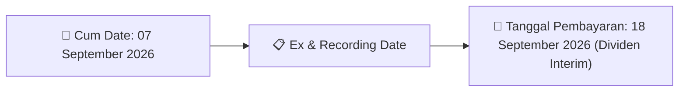
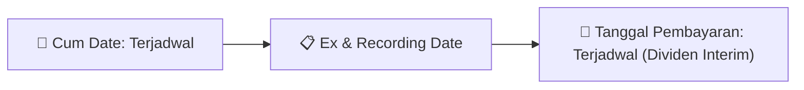

# Ikhtisar Pasar Harian (Daily Digest) - 2026-08-26

📅 **2026-08-26 (Daily Digest)**

## 1. Radar Pasar & Sentimen Harian (Executive Dashboard)
> [!NOTE]
> Terdeteksi sebanyak **104 pengumuman baru** dari 41 emiten pantauan pada (2026-08-26).

| Metric | Jumlah | Status Radar |
| :--- | :---: | :--- |
| **🟢 Sentimen Bullish / Positif** | `4` | [[Dividen Interim]], [[Mandatory Tender Offer]], Kinerja Positif |
| **⚪ Sentimen Netral / Routine** | `42` | [[Tanggapan Penjelasan Bursa]], [[RUPS]], [[Pendaftaran Unit]] |
| **🔴 Sentimen Bearish / Alert** | `0` | Sengketa Hukum, Defisit / Gugatan (Nihil hari ini) |
| **📄 [[Laporan Keuangan]] Baru** | `0` | Memicu Analisis Keuangan Otomatis |

> [!NOTE]
> Tidak dideteksi adanya publikasi laporan keuangan baru hari ini. Rangkuman per emiten secara terperinci tidak diperlukan.

---

## 2. Sorotan Utama & Watchlist Strategis (Strategic Watchlist)
#### 💰 Watchlist Dividen & Distribution
- **[[CMRY]]**: Nomor Surat = 046a/CORSEC/EKS/VIII/2026
- **[[CMRY]]**: Tanggal Keputusan Direksi Disetujui Dewan Komisaris = 26 Agustus 2026
- **[[CMRY]]**: Periode Tahun Buku = 2026
- **[[CMRY]]**: Recording Date / DPS = 07 September 2026 16:00
- **[[CMRY]]**: Cum Dividen Pasar Reguler dan Negosiasi = 03 September 2026
- **[[CMRY]]**: Ex Dividen Pasar Reguler dan Negosiasi = 04 September 2026

#### 🎯 Watchlist Penawaran Tender Wajib (MTO) & Strategis
- **[[PIPA]]**: Surat Tanggapan Pemegang Saham Pengendali = [[No. 037/ST/Oxala-MCI/VIII/2026 tertanggal 26 Agustus 2026 dari PT Morris Capital Indonesia (MCI)]]
- **[[CARS]]**: Pemegang saham utama dan pengendali per 31 Juli 2026 = [[Belum ada]]
- **[[GOTO]]**: Keterangan Pengendali = [[Tidak]]
- **[[NAYZ]]**: Pengendali Baru Perseroan = [[Saiko Consultancy Pte. Ltd.]]
- **[[NAYZ]]**: Rencana Pengendali atas Kepemilikan Saham = [[Tidak terdapat rencana untuk mengalihkan dan/atau mengubah kepemilikan saham selain dalam rangka pelaksanaan kewajiban Penawaran Tender Wajib]]

#### 📈 Watchlist Konversi Waran & Potensi Dilusi
- **[[KETR]]**: Perpanjangan Periode Penawaran Tender Sukarela = Sampai 18 September 2026

---

## 3. Matriks Pengumuman Pasar (Announcements Intelligence Table)
| Emiten | Sentimen | Jenis Pengumuman | Judul Pengumuman | Berkas |
| :--- | :---: | :--- | :--- | :--- |
| **[[BBCA]]** | ⚪ NEUTRAL | Public Expose | Public Expose | [Utama](file:///g:/My%20Drive/Model2/reports/raw/BBCA/20260826_BBCA_20260826_BBCA_Public Expose_32132482.pdf) |
| **[[HEXA]]** | ⚪ NEUTRAL | RUPS | Pemanggilan RUPS | [Utama](file:///g:/My%20Drive/Model2/reports/raw/HEXA/20260826_HEXA_20260811_HEXA_Pemanggilan RUPS_32119631.pdf) · [Lamp 2](file:///g:/My%20Drive/Model2/reports/raw/HEXA/20260826_HEXA_20260811_HEXA_Pemanggilan RUPS_32119631_lamp2.pdf) · [Lamp 1](file:///g:/My%20Drive/Model2/reports/raw/HEXA/20260826_HEXA_20260811_HEXA_Pemanggilan RUPS_32119631_lamp1.pdf) |
| **[[PIPA]]** | 🟢 BULLISH | Aksi Korporasi | Laporan Informasi dan Fakta Material | [Utama](file:///g:/My%20Drive/Model2/reports/raw/PIPA/20260826_PIPA_20260826_PIPA_Laporan Informasi dan Fakta Material_32132474.pdf) · [Lamp 1](file:///g:/My%20Drive/Model2/reports/raw/PIPA/20260826_PIPA_20260826_PIPA_Laporan Informasi dan Fakta Material_32132474_lamp1.pdf) |
| **[[HAIS]]** | ⚪ NEUTRAL | Aksi Korporasi | Laporan Informasi dan Fakta Material | [Utama](file:///g:/My%20Drive/Model2/reports/raw/HAIS/20260826_HAIS_20260821_HAIS_Laporan Informasi dan Fakta Material_32122049.pdf) · [Lamp 1](file:///g:/My%20Drive/Model2/reports/raw/HAIS/20260826_HAIS_20260821_HAIS_Laporan Informasi dan Fakta Material_32122049_lamp1.pdf) |
| **[[HAIS]]** | ⚪ NEUTRAL | Public Expose | Public Expose | [Utama](file:///g:/My%20Drive/Model2/reports/raw/HAIS/20260826_HAIS_20260826_HAIS_Public Expose_32132667.pdf) |
| **[[MBSS]]** | ⚪ NEUTRAL | RUPS | Pemanggilan RUPS | [Utama](file:///g:/My%20Drive/Model2/reports/raw/MBSS/20260826_MBSS_20260826_MBSS_Pemanggilan RUPS_32132714.pdf) · [Lamp 2](file:///g:/My%20Drive/Model2/reports/raw/MBSS/20260826_MBSS_20260826_MBSS_Pemanggilan RUPS_32132714_lamp2.pdf) |
| **[[CMRY]]** | 🟢 BULLISH | Dividen | Jadwal Aksi Korporasi (Khusus Penyampaian Dividen Interim) | [Utama](file:///g:/My%20Drive/Model2/reports/raw/CMRY/20260826_CMRY_20260826_CMRY_Jadwal Aksi Korporasi (Khusus Penyampaian Dividen Interim)_32132705.pdf) · [Lamp 1](file:///g:/My%20Drive/Model2/reports/raw/CMRY/20260826_CMRY_20260826_CMRY_Jadwal Aksi Korporasi (Khusus Penyampaian Dividen Interim)_32132705_lamp1.pdf) |
| **[[CMRY]]** | 🟢 BULLISH | Dividen | Laporan Informasi dan Fakta Material | [Utama](file:///g:/My%20Drive/Model2/reports/raw/CMRY/20260826_CMRY_20260826_CMRY_Laporan Informasi dan Fakta Material_32132690.pdf) · [Lamp 1](file:///g:/My%20Drive/Model2/reports/raw/CMRY/20260826_CMRY_20260826_CMRY_Laporan Informasi dan Fakta Material_32132690_lamp1.pdf) |
| **[[WINS]]** | ⚪ NEUTRAL | Aksi Korporasi | Laporan Informasi dan Fakta Material | [Utama](file:///g:/My%20Drive/Model2/reports/raw/WINS/20260826_WINS_20260826_WINS_Laporan Informasi dan Fakta Material_32132520.pdf) · [Lamp 1](file:///g:/My%20Drive/Model2/reports/raw/WINS/20260826_WINS_20260826_WINS_Laporan Informasi dan Fakta Material_32132520_lamp1.pdf) |
| **[[NSSS]]** | ⚪ NEUTRAL | Aksi Korporasi | LK-26082026-7115-00 | [Utama](file:///g:/My%20Drive/Model2/reports/raw/NSSS/20260826_NSSS_LK-26082026-7115-00.pdf) |
| **[[BJTM]]** | ⚪ NEUTRAL | Public Expose | Public Expose | [Utama](file:///g:/My%20Drive/Model2/reports/raw/BJTM/20260826_BJTM_20260826_BJTM_Public Expose_32132475.pdf) |
| **[[KDTN]]** | ⚪ NEUTRAL | Aksi Korporasi | LK-26082026-2239-00 | [Utama](file:///g:/My%20Drive/Model2/reports/raw/KDTN/20260826_KDTN_LK-26082026-2239-00.pdf) |
| **[[WIKA]]** | ⚪ NEUTRAL | RUPS | Pemberitahuan RencanaPenyampaian PanggilanHasil RUPORUPSURUP EBA-SP | [Utama](file:///g:/My%20Drive/Model2/reports/raw/WIKA/20260826_WIKA_20260826_WIKA_Pemberitahuan RencanaPenyampaian PanggilanHasil RUPORUPSURUP EBA-SP_32132605.pdf) · [Lamp 1](file:///g:/My%20Drive/Model2/reports/raw/WIKA/20260826_WIKA_20260826_WIKA_Pemberitahuan RencanaPenyampaian PanggilanHasil RUPORUPSURUP EBA-SP_32132653_lamp1.pdf) · [Lamp 1](file:///g:/My%20Drive/Model2/reports/raw/WIKA/20260826_WIKA_20260826_WIKA_Pemberitahuan RencanaPenyampaian PanggilanHasil RUPORUPSURUP EBA-SP_32132650_lamp1.pdf) · [Lamp 1](file:///g:/My%20Drive/Model2/reports/raw/WIKA/20260826_WIKA_20260826_WIKA_Pemberitahuan RencanaPenyampaian PanggilanHasil RUPORUPSURUP EBA-SP_32132647_lamp1.pdf) · [Lamp 1](file:///g:/My%20Drive/Model2/reports/raw/WIKA/20260826_WIKA_20260826_WIKA_Pemberitahuan RencanaPenyampaian PanggilanHasil RUPORUPSURUP EBA-SP_32132613_lamp1.pdf) · [Lamp 1](file:///g:/My%20Drive/Model2/reports/raw/WIKA/20260826_WIKA_20260826_WIKA_Pemberitahuan RencanaPenyampaian PanggilanHasil RUPORUPSURUP EBA-SP_32132609_lamp1.pdf) · [Lamp 1](file:///g:/My%20Drive/Model2/reports/raw/WIKA/20260826_WIKA_20260826_WIKA_Pemberitahuan RencanaPenyampaian PanggilanHasil RUPORUPSURUP EBA-SP_32132605_lamp1.pdf) |
| **[[FILM]]** | ⚪ NEUTRAL | Aksi Korporasi | LK-26082026-5738-00 | [Utama](file:///g:/My%20Drive/Model2/reports/raw/FILM/20260826_FILM_LK-26082026-5738-00.pdf) |
| **[[CARS]]** | ⚪ NEUTRAL | Aksi Korporasi | Tanggapan atas Permintaan Penjelasan Bursa | [Utama](file:///g:/My%20Drive/Model2/reports/raw/CARS/20260826_CARS_20260826_CARS_Tanggapan atas Permintaan Penjelasan Bursa_32132552.pdf) · [Lamp 1](file:///g:/My%20Drive/Model2/reports/raw/CARS/20260826_CARS_20260826_CARS_Tanggapan atas Permintaan Penjelasan Bursa_32132552_lamp1.pdf) |
| **[[MGLV]]** | ⚪ NEUTRAL | Aksi Korporasi | LK-26082026-0345-00 | [Utama](file:///g:/My%20Drive/Model2/reports/raw/MGLV/20260826_MGLV_LK-26082026-0345-00.pdf) |
| **[[KUAS]]** | ⚪ NEUTRAL | Aksi Korporasi | Tanggapan atas Permintaan Penjelasan Bursa | [Utama](file:///g:/My%20Drive/Model2/reports/raw/KUAS/20260826_KUAS_20260826_KUAS_Tanggapan atas Permintaan Penjelasan Bursa_32132496.pdf) · [Lamp 1](file:///g:/My%20Drive/Model2/reports/raw/KUAS/20260826_KUAS_20260826_KUAS_Tanggapan atas Permintaan Penjelasan Bursa_32132496_lamp1.pdf) |
| **[[AEGS]]** | ⚪ NEUTRAL | Aksi Korporasi | Tanggapan atas Permintaan Penjelasan Bursa | [Utama](file:///g:/My%20Drive/Model2/reports/raw/AEGS/20260826_AEGS_20260826_AEGS_Tanggapan atas Permintaan Penjelasan Bursa_32132580.pdf) |
| **[[BBNI]]** | ⚪ NEUTRAL | Public Expose | Public Expose | [Utama](file:///g:/My%20Drive/Model2/reports/raw/BBNI/20260826_BBNI_20260826_BBNI_Public Expose_32132582.pdf) |
| **[[EDGE]]** | 🟢 BULLISH | Aksi Korporasi | Laporan Informasi dan Fakta Material | [Utama](file:///g:/My%20Drive/Model2/reports/raw/EDGE/20260826_EDGE_20260826_EDGE_Laporan Informasi dan Fakta Material_32132545.pdf) · [Lamp 1](file:///g:/My%20Drive/Model2/reports/raw/EDGE/20260826_EDGE_20260826_EDGE_Laporan Informasi dan Fakta Material_32132545_lamp1.pdf) |
| **[[GOTO]]** | ⚪ NEUTRAL | Aksi Korporasi | LK-26082026-1699-00 | [Utama](file:///g:/My%20Drive/Model2/reports/raw/GOTO/20260826_GOTO_LK-26082026-1699-00.pdf) |
| **[[MDLN]]** | ⚪ NEUTRAL | Aksi Korporasi | Laporan Informasi dan Fakta Material | [Utama](file:///g:/My%20Drive/Model2/reports/raw/MDLN/20260826_MDLN_20260826_MDLN_Laporan Informasi dan Fakta Material_32132495.pdf) · [Lamp 1](file:///g:/My%20Drive/Model2/reports/raw/MDLN/20260826_MDLN_20260826_MDLN_Laporan Informasi dan Fakta Material_32132495_lamp1.pdf) |
| **[[KETR]]** | ⚪ NEUTRAL | Aksi Korporasi | Laporan Informasi dan Fakta Material | [Utama](file:///g:/My%20Drive/Model2/reports/raw/KETR/20260826_KETR_20260826_KETR_Laporan Informasi dan Fakta Material_32132480.pdf) · [Lamp 1](file:///g:/My%20Drive/Model2/reports/raw/KETR/20260826_KETR_20260826_KETR_Laporan Informasi dan Fakta Material_32132480_lamp1.pdf) |
| **[[AIMS]]** | ⚪ NEUTRAL | RUPS | Pemanggilan RUPS | [Utama](file:///g:/My%20Drive/Model2/reports/raw/AIMS/20260826_AIMS_20260826_AIMS_Pemanggilan RUPS_32132573.pdf) · [Lamp 1](file:///g:/My%20Drive/Model2/reports/raw/AIMS/20260826_AIMS_20260826_AIMS_Pemanggilan RUPS_32132573_lamp1.pdf) |
| **[[EXCL]]** | ⚪ NEUTRAL | Aksi Korporasi | Laporan Informasi dan Fakta Material | [Utama](file:///g:/My%20Drive/Model2/reports/raw/EXCL/20260826_EXCL_20260826_EXCL_Laporan Informasi dan Fakta Material_32132532.pdf) |
| **[[WIRG]]** | ⚪ NEUTRAL | Aksi Korporasi | Tanggapan atas Permintaan Penjelasan Bursa | [Utama](file:///g:/My%20Drive/Model2/reports/raw/WIRG/20260826_WIRG_20260826_WIRG_Tanggapan atas Permintaan Penjelasan Bursa_32132662.pdf) · [Lamp 1](file:///g:/My%20Drive/Model2/reports/raw/WIRG/20260826_WIRG_20260826_WIRG_Tanggapan atas Permintaan Penjelasan Bursa_32132662_lamp1.pdf) |
| **[[SWID]]** | ⚪ NEUTRAL | Aksi Korporasi | Laporan Informasi dan Fakta Material | [Utama](file:///g:/My%20Drive/Model2/reports/raw/SWID/20260826_SWID_20260826_SWID_Laporan Informasi dan Fakta Material_32132473.pdf) · [Lamp 1](file:///g:/My%20Drive/Model2/reports/raw/SWID/20260826_SWID_20260826_SWID_Laporan Informasi dan Fakta Material_32132473_lamp1.pdf) · [Lamp 2](file:///g:/My%20Drive/Model2/reports/raw/SWID/20260826_SWID_20260826_SWID_Laporan Informasi dan Fakta Material_32132473_lamp2.pdf) |
| **[[WEGE]]** | ⚪ NEUTRAL | Aksi Korporasi | Laporan Informasi dan Fakta Material | [Utama](file:///g:/My%20Drive/Model2/reports/raw/WEGE/20260826_WEGE_20260826_WEGE_Laporan Informasi dan Fakta Material_32132615.pdf) · [Lamp 2](file:///g:/My%20Drive/Model2/reports/raw/WEGE/20260826_WEGE_20260826_WEGE_Laporan Informasi dan Fakta Material_32132615_lamp2.pdf) · [Lamp 1](file:///g:/My%20Drive/Model2/reports/raw/WEGE/20260826_WEGE_20260826_WEGE_Laporan Informasi dan Fakta Material_32132615_lamp1.pdf) |
| **[[DLTA]]** | ⚪ NEUTRAL | Aksi Korporasi | Pengumuman Bursa | [Utama](file:///g:/My%20Drive/Model2/reports/raw/DLTA/20260826_DLTA_20260826_DLTA_Pengumuman Bursa_32132642.pdf) · [Lamp 1](file:///g:/My%20Drive/Model2/reports/raw/DLTA/20260826_DLTA_20260826_DLTA_Pengumuman Bursa_32132642_lamp1.pdf) |
| **[[SDMU]]** | ⚪ NEUTRAL | Aksi Korporasi | Tanggapan atas Permintaan Penjelasan Bursa | [Utama](file:///g:/My%20Drive/Model2/reports/raw/SDMU/20260826_SDMU_20260826_SDMU_Tanggapan atas Permintaan Penjelasan Bursa_32132651.pdf) |
| **[[MCOR]]** | ⚪ NEUTRAL | RUPS | Pemanggilan RUPS | [Utama](file:///g:/My%20Drive/Model2/reports/raw/MCOR/20260826_MCOR_20260826_MCOR_Pemanggilan RUPS_32132527.pdf) · [Lamp 1](file:///g:/My%20Drive/Model2/reports/raw/MCOR/20260826_MCOR_20260826_MCOR_Pemanggilan RUPS_32132527_lamp1.pdf) |
| **[[MCOR]]** | ⚪ NEUTRAL | Aksi Korporasi | LK-26082026-4227-00 | [Utama](file:///g:/My%20Drive/Model2/reports/raw/MCOR/20260826_MCOR_LK-26082026-4227-00.pdf) |
| **[[MEDC]]** | ⚪ NEUTRAL | Public Expose | Public Expose | [Utama](file:///g:/My%20Drive/Model2/reports/raw/MEDC/20260826_MEDC_20260826_MEDC_Public Expose_32132525.pdf) |
| **[[ADHI]]** | ⚪ NEUTRAL | Public Expose | Public Expose | [Utama](file:///g:/My%20Drive/Model2/reports/raw/ADHI/20260826_ADHI_20260826_ADHI_Public Expose_32132607.pdf) |
| **[[ADHI]]** | ⚪ NEUTRAL | Aksi Korporasi | Restrukturisasi Obligasi dan Sukuk | [Utama](file:///g:/My%20Drive/Model2/reports/raw/ADHI/20260826_ADHI_20260826_ADHI_Restrukturisasi Obligasi dan Sukuk_32132522.pdf) · [Lamp 1](file:///g:/My%20Drive/Model2/reports/raw/ADHI/20260826_ADHI_20260826_ADHI_Restrukturisasi Obligasi dan Sukuk_32132522_lamp1.pdf) |
| **[[AVIA]]** | ⚪ NEUTRAL | Aksi Korporasi | Laporan Informasi dan Fakta Material | [Utama](file:///g:/My%20Drive/Model2/reports/raw/AVIA/20260826_AVIA_20260826_AVIA_Laporan Informasi dan Fakta Material_32132610.pdf) · [Lamp 1](file:///g:/My%20Drive/Model2/reports/raw/AVIA/20260826_AVIA_20260826_AVIA_Laporan Informasi dan Fakta Material_32132610_lamp1.pdf) |
| **[[CSMI]]** | ⚪ NEUTRAL | Public Expose | Public Expose | [Utama](file:///g:/My%20Drive/Model2/reports/raw/CSMI/20260826_CSMI_20260826_CSMI_Public Expose_32132619.pdf) |
| **[[BEER]]** | ⚪ NEUTRAL | RUPS | Pengumuman RUPS | [Utama](file:///g:/My%20Drive/Model2/reports/raw/BEER/20260826_BEER_20260826_BEER_Pengumuman RUPS_32132603.pdf) · [Lamp 2](file:///g:/My%20Drive/Model2/reports/raw/BEER/20260826_BEER_20260826_BEER_Pengumuman RUPS_32132603_lamp2.pdf) |
| **[[NAYZ]]** | ⚪ NEUTRAL | RUPS | Pengumuman RUPS | [Utama](file:///g:/My%20Drive/Model2/reports/raw/NAYZ/20260826_NAYZ_20260826_NAYZ_Pengumuman RUPS_32132593.pdf) · [Lamp 1](file:///g:/My%20Drive/Model2/reports/raw/NAYZ/20260826_NAYZ_20260826_NAYZ_Pengumuman RUPS_32132593_lamp1.pdf) |
| **[[NAYZ]]** | ⚪ NEUTRAL | Aksi Korporasi | Tanggapan atas Permintaan Penjelasan Bursa | [Utama](file:///g:/My%20Drive/Model2/reports/raw/NAYZ/20260826_NAYZ_20260826_NAYZ_Tanggapan atas Permintaan Penjelasan Bursa_32132695.pdf) · [Lamp 1](file:///g:/My%20Drive/Model2/reports/raw/NAYZ/20260826_NAYZ_20260826_NAYZ_Tanggapan atas Permintaan Penjelasan Bursa_32132695_lamp1.pdf) |
| **[[MEJA]]** | ⚪ NEUTRAL | Aksi Korporasi | Laporan Informasi dan Fakta Material | [Utama](file:///g:/My%20Drive/Model2/reports/raw/MEJA/20260826_MEJA_20260826_MEJA_Laporan Informasi dan Fakta Material_32132471.pdf) · [Lamp 1](file:///g:/My%20Drive/Model2/reports/raw/MEJA/20260826_MEJA_20260826_MEJA_Laporan Informasi dan Fakta Material_32132471_lamp1.pdf) |
| **[[PRTL]]** | ⚪ NEUTRAL | Aksi Korporasi | Laporan Informasi dan Fakta Material | [Utama](file:///g:/My%20Drive/Model2/reports/raw/PRTL/20260826_PRTL_20260826_PRTL_Laporan Informasi dan Fakta Material_32132468.pdf) · [Lamp 1](file:///g:/My%20Drive/Model2/reports/raw/PRTL/20260826_PRTL_20260826_PRTL_Laporan Informasi dan Fakta Material_32132491_lamp1.pdf) · [Lamp 1](file:///g:/My%20Drive/Model2/reports/raw/PRTL/20260826_PRTL_20260826_PRTL_Laporan Informasi dan Fakta Material_32132468_lamp1.pdf) |
| **[[BAUT]]** | ⚪ NEUTRAL | RUPS | Transaksi Material Tanpa Persetujuan RUPS | [Utama](file:///g:/My%20Drive/Model2/reports/raw/BAUT/20260826_BAUT_20260826_BAUT_Transaksi Material Tanpa Persetujuan RUPS_32132626.pdf) · [Lamp 4](file:///g:/My%20Drive/Model2/reports/raw/BAUT/20260826_BAUT_20260826_BAUT_Transaksi Material Tanpa Persetujuan RUPS_32132626_lamp4.pdf) · [Lamp 3](file:///g:/My%20Drive/Model2/reports/raw/BAUT/20260826_BAUT_20260826_BAUT_Transaksi Material Tanpa Persetujuan RUPS_32132626_lamp3.pdf) · [Lamp 1](file:///g:/My%20Drive/Model2/reports/raw/BAUT/20260826_BAUT_20260826_BAUT_Transaksi Material Tanpa Persetujuan RUPS_32132626_lamp1.pdf) · [Lamp 2](file:///g:/My%20Drive/Model2/reports/raw/BAUT/20260826_BAUT_20260826_BAUT_Transaksi Material Tanpa Persetujuan RUPS_32132626_lamp2.pdf) |
| **[[YPAS]]** | ⚪ NEUTRAL | Public Expose | Public Expose | [Utama](file:///g:/My%20Drive/Model2/reports/raw/YPAS/20260826_YPAS_20260820_YPAS_Public Expose_32121665.pdf) |
| **[[ALTO]]** | ⚪ NEUTRAL | Aksi Korporasi | Sanksi | [Utama](file:///g:/My%20Drive/Model2/reports/raw/ALTO/20260826_ALTO_20260824_ALTO_Sanksi_32132196.pdf) · [Lamp 2](file:///g:/My%20Drive/Model2/reports/raw/ALTO/20260826_ALTO_20260824_ALTO_Sanksi_32132196_lamp2.pdf) · [Lamp 1](file:///g:/My%20Drive/Model2/reports/raw/ALTO/20260826_ALTO_20260824_ALTO_Sanksi_32132196_lamp1.pdf) |
| **[[ARKO]]** | ⚪ NEUTRAL | Aksi Korporasi | Laporan Informasi dan Fakta Material | [Utama](file:///g:/My%20Drive/Model2/reports/raw/ARKO/20260825_ARKO_20260825_ARKO_Laporan Informasi dan Fakta Material_32132465.pdf) · [Lamp 1](file:///g:/My%20Drive/Model2/reports/raw/ARKO/20260825_ARKO_20260825_ARKO_Laporan Informasi dan Fakta Material_32132465_lamp1.pdf) |

---

## 4. Detail Informasi per Emiten (Grouped by Emiten)
### 🔵 [[BBCA]]
- **[Public Expose]** [Public Expose](file:///g:/My%20Drive/Model2/reports/raw/BBCA/20260826_BBCA_20260826_BBCA_Public Expose_32132482.pdf)
  - 📌 *Deskripsi*: PT Bank Central Asia Tbk (BBCA) mengumumkan rencana penyelenggaraan Public Expose Tahunan untuk tahun buku 2026 yang akan diselenggarakan pada 09 September 2026 pukul 16:00 melalui Public Expose Live 2026 di website idx.co.id. Agenda meliputi presentasi perusahaan dan konferensi pers, dengan dihadiri oleh Vera Eve Lim (Managing Director, CFO).
  - 📊 **Fakta Material**:
    - **Nomor Surat**: 008/CSG-IVR/2026
    - **Tahun Buku**: 2026
    - **Tempat**: Public Expose Live 2026 (website idx.co.id)
    - **Hari/Tanggal**: 09 September 2026
    - **Waktu**: 16:00
    - **Agenda**: 1. Presentasi Perusahaan; 2. Konferensi Pers
    - **Direksi yang Hadir**: Vera Eve Lim - Managing Director, CFO
    - **Nama Pengirim**: Rudy Budiardjo
    - **Tanggal Pelaporan**: 26-08-2026 17:35
    - **Lokasi Kantor**: Menara BCA, Grand Indonesia

### 🔵 [[HEXA]]
- **[RUPS]** [Pemanggilan RUPS](file:///g:/My%20Drive/Model2/reports/raw/HEXA/20260826_HEXA_20260811_HEXA_Pemanggilan RUPS_32119631.pdf) *(Attachment: [Lamp 2](file:///g:/My%20Drive/Model2/reports/raw/HEXA/20260826_HEXA_20260811_HEXA_Pemanggilan RUPS_32119631_lamp2.pdf) · [Lamp 1](file:///g:/My%20Drive/Model2/reports/raw/HEXA/20260826_HEXA_20260811_HEXA_Pemanggilan RUPS_32119631_lamp1.pdf))*
  - 📌 *Deskripsi*: PT Hexindo Adiperkasa Tbk mengundang para pemegang saham untuk menghadiri RUPST dan RUPSLB pada Kamis, 17 September 2026 pukul 10.00 WIB di Kantor Pusat Perseroan, Kawasan Industri Pulo Gadung. RUPST memiliki 5 mata acara rutin, antara lain pengesahan laporan tahunan, penetapan penggunaan laba, penunjukan akuntan publik, penetapan remunerasi, serta perubahan/pengangkatan kembali Direksi dan Dewan Komisaris. RUPSLB membahas persetujuan perubahan Pasal 3 Anggaran Dasar untuk penyesuaian dengan KBLI 2025.
  - 📊 **Fakta Material**:
    - **Jenis Rapat**: RUPST dan RUPSLB
    - **Hari, Tanggal Rapat**: Kamis, 17 September 2026
    - **Waktu Rapat**: 10.00 WIB - selesai
    - **Tempat Rapat**: Kantor Pusat Perseroan, Kawasan Industri Pulo Gadung
    - **Mata Acara RUPST 1**: Persetujuan dan pengesahan Laporan Tahunan untuk tahun buku yang berakhir 31 Maret 2026, termasuk Laporan Kegiatan Perseroan, Laporan Pengawasan Dewan Komisaris, Laporan Keuangan, serta pemberian acquit et de charge kepada Direksi dan Dewan Komisaris
    - **Mata Acara RUPST 2**: Penetapan Penggunaan Laba Perseroan untuk tahun buku yang berakhir 31 Maret 2026
    - **Mata Acara RUPST 3**: Penunjukan Akuntan Publik dan/atau Kantor Akuntan Publik untuk tahun buku 1 April 2025 sampai dengan 31 Maret 2026
    - **Mata Acara RUPST 4**: Penetapan gaji dan tunjangan bagi anggota Dewan Komisaris dan Direksi
    - **Mata Acara RUPST 5**: Perubahan dan/atau Pengangkatan Kembali Direksi dan/atau Dewan Komisaris Perseroan
    - **Mata Acara RUPSLB**: Persetujuan atas perubahan Pasal 3 Anggaran Dasar Perseroan tentang Maksud dan Tujuan serta Kegiatan Usaha Perseroan dalam rangka penyesuaian dengan Klasifikasi Baku Lapangan Usaha Indonesia Tahun 2025 (KBLI 2025)
    - **Recording Date**: 24 Agustus 2026 sampai dengan pukul 16.00 WIB
    - **Dasar Hukum Mata Acara RUPST 1-4**: Anggaran Dasar Perseroan dan Undang-Undang Nomor 40 Tahun 2007 tentang Perseroan Terbatas
    - **Dasar Hukum Mata Acara RUPST 5**: Anggaran Dasar Perseroan dan Peraturan OJK Nomor 33/POJK.04/2014 tentang Direksi dan Dewan Komisaris Emiten atau Perusahaan Publik
    - **Sifat Penyesuaian Pasal 3 Anggaran Dasar**: Bersifat administratif, tidak mengubah kegiatan usaha maupun arah bisnis Perseroan, serta tidak termasuk perubahan kegiatan usaha sebagaimana dimaksud dalam POJK No. 17/POJK.04/2020
    - **Catatan Undangan**: Pemanggilan berlaku sebagai undangan resmi; Perseroan tidak mengirimkan surat undangan terpisah kepada masing-masing pemegang saham

### 🔵 [[PIPA]]
- **[Aksi Korporasi]** [Laporan Informasi dan Fakta Material](file:///g:/My%20Drive/Model2/reports/raw/PIPA/20260826_PIPA_20260826_PIPA_Laporan Informasi dan Fakta Material_32132474.pdf) *(Attachment: [Lamp 1](file:///g:/My%20Drive/Model2/reports/raw/PIPA/20260826_PIPA_20260826_PIPA_Laporan Informasi dan Fakta Material_32132474_lamp1.pdf))*
  - 📌 *Deskripsi*: PT Oxala Energy International Tbk (PIPA) menyampaikan informasi lanjutan mengenai rencana akuisisi perusahaan target di bidang pengolahan gas alam. Negosiasi masih berlangsung; konsolidasi keuangan ditargetkan pada tahun buku 2027 dan diproyeksikan meningkatkan laba bersih serta memperbaiki rasio PER dan PBV saham PIPA.
  - 📊 **Fakta Material**:
    - **Tanggal Kejadian**: 26 Agustus 2026
    - **Referensi Keterbukaan Sebelumnya**: No. 044/Oxala-Corsec/VIII/2026 tertanggal 19 Agustus 2026
    - **Surat Tanggapan Pemegang Saham Pengendali**: No. 037/ST/Oxala-MCI/VIII/2026 tertanggal 26 Agustus 2026 dari PT Morris Capital Indonesia (MCI)
    - **Status Negosiasi Akuisisi**: Masih terus berproses
    - **Target Akuisisi**: Perusahaan Target di bidang Pengolahan Gas Alam
    - **Proyeksi Konsolidasi Keuangan**: Laporan Keuangan Perusahaan Target dapat mulai dikonsolidasi ke Laporan Keuangan Perseroan pada tahun buku 2027
    - **Proyeksi Dampak Laba Bersih**: Laba Bersih Perseroan diproyeksikan meningkat signifikan
    - **Proyeksi Perbaikan Rasio Saham**: PER dan PBV saham PIPA diharapkan membaik secara signifikan setelah konsolidasi
    - **Pernyataan Sanggahan**: Informasi bersifat umum, bukan rekomendasi jual beli saham PIPA; bersifat forward-looking
    - **Dampak Operasional dan Strategis**: Memperkuat ekspansi bisnis Perseroan ke sektor energi dan pengolahan gas alam
    - **Dampak Hukum dan Kepatuhan**: Transaksi masih dalam tahap negosiasi dan penyelesaian persetujuan pihak ketiga termasuk kreditur Perusahaan Target
    - **Nama Pengirim**: Haerul Maelani
    - **Jabatan Pengirim**: Corsec

### 🔵 [[HAIS]]
- **[Aksi Korporasi]** [Laporan Informasi dan Fakta Material](file:///g:/My%20Drive/Model2/reports/raw/HAIS/20260826_HAIS_20260821_HAIS_Laporan Informasi dan Fakta Material_32122049.pdf) *(Attachment: [Lamp 1](file:///g:/My%20Drive/Model2/reports/raw/HAIS/20260826_HAIS_20260821_HAIS_Laporan Informasi dan Fakta Material_32122049_lamp1.pdf))*
  - 📌 *Deskripsi*: PT Hasnur Internasional Shipping Tbk (HAIS) mengumumkan implementasi penggunaan bahan bakar B50 secara bertahap pada armada kapal tunda mulai Agustus 2026 sebagai dukungan terhadap ketahanan energi nasional dan keberlanjutan operasional.
  - 📊 **Fakta Material**:
    - **Nomor Siaran Pers**: 12/SP.HIS/VIII/2026
    - **Tanggal Penerbitan**: 18 Agustus 2026
    - **Nama Emiten**: PT Hasnur Internasional Shipping Tbk
    - **Kode Ticker**: HAIS
    - **Implementasi B50**: Mulai Agustus 2026 secara bertahap
    - **Kapal Tunda Awal Pengguna B50**: TB Hasnur 18, TB Hasnur 21, Hasnur 23, TB Hasnur 01
    - **Target Perluasan Penggunaan B50**: 24 kapal tugboat milik HIS
    - **Panel Surya**: Digunakan pada 5 armada sebagai sumber energi alternatif
    - **Direktur Operasi**: Laorentina Devi
    - **Armada yang Dimiliki**: 23 set tugboat dan barge kapasitas 7.500-10.000 metrik ton serta 1 unit kapal pengangkut CPO
    - **Kontak Perusahaan**: Ahmad Denoan Rinaldi (Corporate Communication) corsec.his@hasnurgroup.com
- **[Public Expose]** [Public Expose](file:///g:/My%20Drive/Model2/reports/raw/HAIS/20260826_HAIS_20260826_HAIS_Public Expose_32132667.pdf)
  - 📌 *Deskripsi*: PT Hasnur Internasional Shipping Tbk mengumumkan rencana penyelenggaraan Public Expose Tahunan untuk Tahun Buku 2026 yang akan dilaksanakan pada 9 September 2026 pukul 09:30 WIB melalui Zoom Meeting.
  - 📊 **Fakta Material**:
    - **Tahun Buku**: 2026
    - **Tempat**: Video Live Conference melalui Zoom Meeting
    - **Link Zoom Meeting**: https://us06web.zoom.us/j/88575936748?pwd=BbVEQYkxBaeorC sopdTFn5FO31jSN9.1
    - **Meeting ID**: 885 7593 6748
    - **Passcode**: 2026
    - **Hari/Tanggal**: 09 September 2026
    - **Waktu**: 09:30
    - **Agenda**: Paparan Publik Tahunan
    - **Nama Pengirim**: PT Hasnur Internasional Shipping Tbk - Rengga Temenggung
    - **Tanggal Pengumuman**: 26-08-2026 15:54

### 🔵 [[MBSS]]
- **[RUPS]** [Pemanggilan RUPS](file:///g:/My%20Drive/Model2/reports/raw/MBSS/20260826_MBSS_20260826_MBSS_Pemanggilan RUPS_32132714.pdf) *(Attachment: [Lamp 2](file:///g:/My%20Drive/Model2/reports/raw/MBSS/20260826_MBSS_20260826_MBSS_Pemanggilan RUPS_32132714_lamp2.pdf))*
  - 📌 *Deskripsi*: Perseroan mengundang pemegang saham untuk menghadiri RUPSLB pada Kamis, 17 September 2026 pukul 10.00 WIB secara elektronik dengan tiga mata acara: perubahan susunan Direksi dan Dewan Komisaris, penegasan susunan pemegang saham pasca pengalihan saham dari PT Galley Adhika Arnawama kepada PT Wibowo Group Capital, serta perubahan tempat kedudukan dan alamat kantor pusat.
  - 📊 **Fakta Material**:
    - **Nama Perseroan**: PT Mitrabahtera Segara Sejati Tbk
    - **Jenis Rapat**: Rapat Umum Pemegang Saham Luar Biasa (RUPSLB)
    - **Hari/Tanggal Rapat**: Kamis, 17 September 2026
    - **Waktu Rapat**: 10.00 WIB - selesai
    - **Tempat Pelaksanaan**: Secara elektronik dengan lokasi fisik Sheraton Grand Gandaria City Grand Ballroom, Jakarta Selatan
    - **Mata Acara 1**: Perubahan susunan Direksi dan Dewan Komisaris Perseroan
    - **Mata Acara 2**: Persetujuan penegasan susunan Pemegang Saham Perseroan
    - **Mata Acara 3**: Perubahan tempat kedudukan dan alamat kantor pusat Perseroan
    - **Pihak Pengalih Saham**: PT Galley Adhika Arnawama
    - **Pihak Penerima Saham**: PT Wibowo Group Capital
    - **Tanggal Transaksi Pengalihan Saham**: 31 Juli 2026
    - **Mekanisme Transaksi**: Crossing pada Pasar Negosiasi Bursa Efek Indonesia
    - **Tanggal Pencatatan Pemegang Saham yang Berhak**: 24 Agustus 2026 pukul 16.15 WIB
    - **Dasar Pelaksanaan Rapat Elektronik**: POJK Nomor 15/POJK.04/2020 dan POJK Nomor 14 Tahun 2025

### 🔵 [[CMRY]]
- **[Dividen]** [Jadwal Aksi Korporasi (Khusus Penyampaian Dividen Interim)](file:///g:/My%20Drive/Model2/reports/raw/CMRY/20260826_CMRY_20260826_CMRY_Jadwal Aksi Korporasi (Khusus Penyampaian Dividen Interim)_32132705.pdf) *(Attachment: [Lamp 1](file:///g:/My%20Drive/Model2/reports/raw/CMRY/20260826_CMRY_20260826_CMRY_Jadwal Aksi Korporasi (Khusus Penyampaian Dividen Interim)_32132705_lamp1.pdf))*
  - 📌 *Deskripsi*: PT Cisarua Mountain Dairy Tbk (CMRY) mengumumkan rencana pembagian dividen tunai interim untuk tahun buku 2026. Recording date/DPS ditetapkan pada 7 September 2026 dan pembayaran dividen pada 18 September 2026. Data keuangan per 30 Juni 2026 menunjukkan laba bersih diatribusikan ke entitas induk sebesar IDR 1.171.624.000.000.
  - 📊 **Fakta Material**:
    - **Nomor Surat**: 046a/CORSEC/EKS/VIII/2026
    - **Tanggal Keputusan Direksi Disetujui Dewan Komisaris**: 26 Agustus 2026
    - **Periode Tahun Buku**: 2026
    - **Recording Date / DPS**: 07 September 2026 16:00
    - **Cum Dividen Pasar Reguler dan Negosiasi**: 03 September 2026
    - **Ex Dividen Pasar Reguler dan Negosiasi**: 04 September 2026
    - **Cum Dividen Pasar Tunai**: 07 September 2026
    - **Ex Dividen Pasar Tunai**: 08 September 2026
    - **Tanggal Pembayaran Dividen**: 18 September 2026
    - **Laba Bersih Diatribusikan ke Entitas Induk per 30 Juni 2026**: IDR 1.171.624.000.000
    - **Saldo Laba Ditahan Tidak Dibatasi Penggunaannya per 30 Juni 2026**: IDR 3.339.927.000.000
    - **Total Ekuitas per 30 Juni 2026**: IDR 7.162.913.000.000
    - **Nama Pengirim**: Martua Sihaloho
    - **Jabatan Pengirim**: Direktur

- **[Dividen]** [Laporan Informasi dan Fakta Material](file:///g:/My%20Drive/Model2/reports/raw/CMRY/20260826_CMRY_20260826_CMRY_Laporan Informasi dan Fakta Material_32132690.pdf) *(Attachment: [Lamp 1](file:///g:/My%20Drive/Model2/reports/raw/CMRY/20260826_CMRY_20260826_CMRY_Laporan Informasi dan Fakta Material_32132690_lamp1.pdf))*
  - 📌 *Deskripsi*: PT Cisarua Mountain Dairy Tbk mengumumkan pembagian dividen interim untuk tahun buku 2026 dengan total Rp793.468.300.000 atau Rp100 per saham. Pembagian dividen akan dilaksanakan pada 18 September 2026. Perusahaan menyatakan tidak ada dampak material terhadap kegiatan operasional, hukum, kondisi keuangan, atau kelangsungan usaha.
  - 📊 **Fakta Material**:
    - **Nama Perusahaan**: PT Cisarua Mountain Dairy Tbk
    - **Tanggal Kejadian**: 26 Agustus 2026
    - **Uraian Informasi**: Pembagian dividen interim tahun buku 2026
    - **Jumlah Dividen Interim**: Rp793.468.300.000
    - **Dividen Interim per Saham**: Rp100
    - **Jadwal Pembagian Dividen**: 18 September 2026
    - **Dampak**: Tidak ada dampak material terhadap kegiatan operasional, hukum, kondisi keuangan, atau kelangsungan usaha

### 🔵 [[WINS]]
- **[Aksi Korporasi]** [Laporan Informasi dan Fakta Material](file:///g:/My%20Drive/Model2/reports/raw/WINS/20260826_WINS_20260826_WINS_Laporan Informasi dan Fakta Material_32132520.pdf) *(Attachment: [Lamp 1](file:///g:/My%20Drive/Model2/reports/raw/WINS/20260826_WINS_20260826_WINS_Laporan Informasi dan Fakta Material_32132520_lamp1.pdf))*
  - 📌 *Deskripsi*: PT Wintermar Offshore Marine Tbk (WINS) menyampaikan keterbukaan informasi terkait transaksi afiliasi berupa pemberian jaminan perusahaan (corporate guarantee) dengan nilai maksimal USD 12.000.000 kepada PT Bank Shinhan Indonesia untuk menjamin fasilitas kredit yang diberikan kepada entitas anak, PT Wintermar, dalam rangka refinancing kapal dan pemenuhan modal kerja.
  - 📊 **Fakta Material**:
    - **Tanggal Transaksi**: 21 Agustus 2026
    - **Objek Transaksi**: Pemberian Jaminan Perusahaan (Corporate Guarantee)
    - **Nilai Transaksi**: Maksimal USD 12.000.000
    - **Pemberi Jaminan Perusahaan**: PT Wintermar Offshore Marine Tbk
    - **Penerima Jaminan Perusahaan**: PT Bank Shinhan Indonesia
    - **Pihak yang Dijamin**: PT Wintermar
    - **Kepemilikan Perseroan pada PT Wintermar**: Lebih dari 99%
    - **Hubungan Afiliasi**: PT Wintermar adalah entitas anak yang dikendalikan Perseroan; terdapat 2 Direktur dan 1 Komisaris yang sama
    - **Tujuan Transaksi**: Refinancing kapal milik PT Wintermar dan pemenuhan kebutuhan modal kerja
    - **Dasar Regulasi**: POJK No. 42/POJK.04/2020 Pasal 6 Ayat (1) huruf e
    - **Benturan Kepentingan**: Tidak ada

### 🔵 [[NSSS]]
- **[Aksi Korporasi]** [LK-26082026-7115-00](file:///g:/My%20Drive/Model2/reports/raw/NSSS/20260826_NSSS_LK-26082026-7115-00.pdf)
  - 📌 *Deskripsi*: Samuel Sekuritas Indonesia selaku Direksi melaporkan penjualan 220.035.000 lembar saham NSSS pada 26 Agustus 2026 dengan harga Rp705,00 per saham, sehingga kepemilikan turun dari 5.688.281.800 unit atau 23,90% hak suara menjadi 5.468.246.800 unit atau 22,97% hak suara.
  - 📊 **Fakta Material**:
    - **Nama Pelapor**: SAMUEL SEKURITAS INDONESIA
    - **Jabatan Pelapor**: Direksi
    - **Emiten**: NSSS - NUSANTARA SAWIT SEJAHTERA Tbk, PT
    - **Nomor Laporan**: LK/26082026/0006/1
    - **Jumlah Saham Sebelum Transaksi**: 5.688.281.800 unit
    - **Hak Suara Sebelum Transaksi**: 23,90%
    - **Jumlah Saham Setelah Transaksi**: 5.468.246.800 unit
    - **Hak Suara Setelah Transaksi**: 22,97%
    - **Jenis Transaksi**: Penjualan
    - **Jumlah Saham Transaksi**: 220.035.000 unit
    - **Klasifikasi Saham**: Saham Biasa
    - **Harga Transaksi**: Rp705,00
    - **Tanggal Transaksi**: 26 Agustus 2026

### 🔵 [[BJTM]]
- **[Public Expose]** [Public Expose](file:///g:/My%20Drive/Model2/reports/raw/BJTM/20260826_BJTM_20260826_BJTM_Public Expose_32132475.pdf)
  - 📌 *Deskripsi*: Bank Pembangunan Daerah Jawa Timur Tbk (BJTM) mengumumkan rencana Public Expose Tahunan untuk tahun buku 2026 yang akan diselenggarakan pada 09 September 2026 pukul 11:00 melalui Public Expose Live 2026 di website idx.co.id dengan agenda pemaparan kinerja perseroan.
  - 📊 **Fakta Material**:
    - **Tahun Buku yang Berakhir**: 2026
    - **Tempat**: Public Expose Live 2026 yang tercantum pada website idx.co.id
    - **Hari/Tanggal**: 09 September 2026
    - **Waktu**: 11:00
    - **Agenda**: Pemaparan Kinerja Perseroan
    - **Alamat Perseroan**: Jl Basuki Rachmad 98-104 Surabaya
    - **Nama Pengirim**: Bank Pembangunan Daerah Jawa Timur Tbk
    - **Nama Pejabat**: Fenty Rischana K
    - **Tanggal dan Waktu Pelaporan**: 26-08-2026 09:12

### 🔵 [[KDTN]]
- **[Aksi Korporasi]** [LK-26082026-2239-00](file:///g:/My%20Drive/Model2/reports/raw/KDTN/20260826_KDTN_LK-26082026-2239-00.pdf)
  - 📌 *Deskripsi*: Putrasakti Mandiri melaporkan perubahan kepemilikan saham KDTN - Puri Sentul Permai Tbk melalui transaksi Repurchase Agreement berupa penjualan 4.500.000 unit saham biasa pada 24 Agustus 2026 dengan harga Rp342,00 per saham. Kepemilikan saham berkurang dari 428.000.000 unit (34,24%) menjadi 423.500.000 unit (33,88%).
  - 📊 **Fakta Material**:
    - **Nama Pelapor**: PUTRASAKTI MANDIRI
    - **Jabatan**: Bukan Anggota Direksi/Dewan Komisaris
    - **Kewarganegaraan**: WNI
    - **Emiten**: KDTN - PURI SENTUL PERMAI Tbk, PT
    - **Nomor Laporan**: LK/26082026/0003/1
    - **Jumlah Saham Sebelum Transaksi**: 428.000.000 unit
    - **Hak Suara Sebelum Transaksi**: 34,24%
    - **Jumlah Saham Setelah Transaksi**: 423.500.000 unit
    - **Hak Suara Setelah Transaksi**: 33,88%
    - **Jenis Transaksi**: Repurchase Agreement
    - **Status Kepemilikan**: Langsung
    - **Aksi Transaksi**: Penjualan
    - **Jumlah Saham Transaksi**: 4.500.000 unit
    - **Klasifikasi Saham**: Saham Biasa
    - **Harga Transaksi**: Rp342,00
    - **Tanggal Transaksi**: 2026-08-24
    - **Tujuan Transaksi**: Restrukturisasi kepemilikan saham dalam kelompok usaha

### 🔵 [[WIKA]]
- **[RUPS]** [Pemberitahuan RencanaPenyampaian PanggilanHasil RUPORUPSURUP EBA-SP](file:///g:/My%20Drive/Model2/reports/raw/WIKA/20260826_WIKA_20260826_WIKA_Pemberitahuan RencanaPenyampaian PanggilanHasil RUPORUPSURUP EBA-SP_32132605.pdf) *(Attachment: [Lamp 1](file:///g:/My%20Drive/Model2/reports/raw/WIKA/20260826_WIKA_20260826_WIKA_Pemberitahuan RencanaPenyampaian PanggilanHasil RUPORUPSURUP EBA-SP_32132653_lamp1.pdf) · [Lamp 1](file:///g:/My%20Drive/Model2/reports/raw/WIKA/20260826_WIKA_20260826_WIKA_Pemberitahuan RencanaPenyampaian PanggilanHasil RUPORUPSURUP EBA-SP_32132650_lamp1.pdf) · [Lamp 1](file:///g:/My%20Drive/Model2/reports/raw/WIKA/20260826_WIKA_20260826_WIKA_Pemberitahuan RencanaPenyampaian PanggilanHasil RUPORUPSURUP EBA-SP_32132647_lamp1.pdf) · [Lamp 1](file:///g:/My%20Drive/Model2/reports/raw/WIKA/20260826_WIKA_20260826_WIKA_Pemberitahuan RencanaPenyampaian PanggilanHasil RUPORUPSURUP EBA-SP_32132613_lamp1.pdf) · [Lamp 1](file:///g:/My%20Drive/Model2/reports/raw/WIKA/20260826_WIKA_20260826_WIKA_Pemberitahuan RencanaPenyampaian PanggilanHasil RUPORUPSURUP EBA-SP_32132609_lamp1.pdf) · [Lamp 1](file:///g:/My%20Drive/Model2/reports/raw/WIKA/20260826_WIKA_20260826_WIKA_Pemberitahuan RencanaPenyampaian PanggilanHasil RUPORUPSURUP EBA-SP_32132605_lamp1.pdf))*
  - 📌 *Deskripsi*: PT Bank Mega Tbk selaku Wali Amanat mengundang para Pemegang Obligasi Berkelanjutan II Wijaya Karya Tahap II Tahun 2022 untuk menghadiri RUPO pada Kamis, 10 September 2026 pukul 09.00 WIB di WIKA Tower 2, Jakarta. Agenda utama meliputi persetujuan perubahan jatuh tempo pokok obligasi, penundaan jadwal pembayaran bunga ke-18 dan ke-19, serta pengesampingan pelanggaran atas tidak dipenuhinya kewajiban pembayaran bunga ke-18.
  - 📊 **Fakta Material**:
    - **Jenis Dokumen**: Panggilan RUPO Obligasi Berkelanjutan II Wijaya Karya Tahap II Tahun 2022
    - **Emiten**: PT Wijaya Karya (Persero) Tbk
    - **Wali Amanat**: PT Bank Mega Tbk
    - **Hari, Tanggal RUPO**: Kamis, 10 September 2026
    - **Waktu RUPO**: Pukul 09.00 WIB s.d selesai
    - **Tempat RUPO**: WIKA Tower 2, Jl. D.I Panjaitan Kavling 9-10
    - **Dasar Perjanjian Perwaliamanatan**: Akta No. 48 tanggal 21 Januari 2022, dibuat di hadapan Ir. Nanette Cahyanie Handari Adi Warsito, S.H., Notaris di Jakarta, berikut perubahan-perubahannya
    - **Agenda 1**: Persetujuan perubahan Pasal 5 ayat 5.3 dan pasal terkait mengenai Perubahan Jatuh Tempo Pokok Obligasi Berkelanjutan II Wijaya Karya Tahap II Tahun 2022
    - **Agenda 2**: Persetujuan perubahan Pasal 5 ayat 5.4 mengenai Perubahan dan/atau Penundaan Jadwal Pembayaran Bunga ke-18
    - **Agenda 3**: Persetujuan perubahan Pasal 5 ayat 5.4 mengenai Perubahan dan/atau Penundaan Jadwal Pembayaran Bunga ke-19
    - **Agenda 4**: Persetujuan pengesampingan pelanggaran atas tidak dipenuhinya kewajiban pembayaran Bunga ke-18
    - **Kuorum Kehadiran**: Dihadiri paling sedikit 3/4 bagian dari jumlah Obligasi yang masih belum dilunasi
    - **Kuorum Keputusan**: Disetujui paling sedikit 3/4 bagian dari jumlah Obligasi yang hadir dalam RUPO
    - **Hak Suara Afiliasi**: Obligasi milik Emiten dan/atau Afiliasi Emiten tidak memiliki hak suara dan tidak diperhitungkan dalam kuorum kehadiran, kecuali Afiliasi karena kepemilikan atau penyertaan modal Pemerintah
    - **Penyelenggaraan RUPO**: Atas permintaan PT Wijaya Karya (Persero) Tbk selaku Emiten

### 🔵 [[FILM]]
- **[Aksi Korporasi]** [LK-26082026-5738-00](file:///g:/My%20Drive/Model2/reports/raw/FILM/20260826_FILM_LK-26082026-5738-00.pdf)
  - 📌 *Deskripsi*: Samuel Sekuritas Indonesia selaku Direksi melaporkan penjualan 78.503.800 saham biasa FILM melalui transaksi Repurchase Agreement pada 26 Agustus 2026 dengan harga Rp1.240,00. Kepemilikan saham turun dari 738.285.700 unit (6,78%) menjadi 659.781.900 unit (6,06%).
  - 📊 **Fakta Material**:
    - **Nama Pelapor**: Samuel Sekuritas Indonesia
    - **Jabatan Pelapor**: Direksi
    - **Nomor Laporan**: LK/26082026/0004/1
    - **Jenis Transaksi**: Repurchase Agreement
    - **Arah Transaksi**: Penjualan
    - **Status Kepemilikan**: Langsung
    - **Jumlah Saham Sebelum Transaksi**: 738.285.700 unit
    - **Hak Suara Sebelum Transaksi**: 6,78%
    - **Jumlah Saham Setelah Transaksi**: 659.781.900 unit
    - **Hak Suara Setelah Transaksi**: 6,06%
    - **Jumlah Saham Transaksi**: 78.503.800 unit
    - **Klasifikasi Saham**: Saham Biasa
    - **Harga Transaksi**: Rp1.240,00
    - **Tanggal Transaksi**: 2026-08-26
    - **Tujuan Transaksi**: Pencairan Repo

### 🔵 [[CARS]]
- **[Aksi Korporasi]** [Tanggapan atas Permintaan Penjelasan Bursa](file:///g:/My%20Drive/Model2/reports/raw/CARS/20260826_CARS_20260826_CARS_Tanggapan atas Permintaan Penjelasan Bursa_32132552.pdf) *(Attachment: [Lamp 1](file:///g:/My%20Drive/Model2/reports/raw/CARS/20260826_CARS_20260826_CARS_Tanggapan atas Permintaan Penjelasan Bursa_32132552_lamp1.pdf))*
  - 📌 *Deskripsi*: PT Industri dan Perdagangan Bintraco Dharma Tbk menyampaikan tanggapan atas permintaan penjelasan Bursa Efek Indonesia terkait volatilitas transaksi efek. Perseroan menyatakan tidak mengetahui adanya informasi atau fakta material yang mempengaruhi nilai efek atau keputusan investasi pemodal, tidak memiliki rencana tindakan korporasi dalam 3 bulan mendatang, serta belum terdapat pemegang saham utama atau pengendali per 31 Juli 2026.
  - 📊 **Fakta Material**:
    - **Nomor surat permintaan penjelasan BEI**: S-10964/BEI.PP1/08-2026
    - **Nomor surat tanggapan Perseroan**: Leg/SRT-077/VIII/2026
    - **Tanggal surat tanggapan**: 2026-08-26
    - **Pengetahuan atas informasi atau fakta material**: Tidak mengetahui
    - **Rencana tindakan korporasi dalam 3 bulan mendatang**: Tidak ada
    - **Informasi atau kejadian penting lain yang material**: Tidak ada
    - **Pemegang saham utama dan pengendali per 31 Juli 2026**: Belum ada
    - **Nama pengirim**: Lina M. Ibrahim

### 🔵 [[MGLV]]
- **[Aksi Korporasi]** [LK-26082026-0345-00](file:///g:/My%20Drive/Model2/reports/raw/MGLV/20260826_MGLV_LK-26082026-0345-00.pdf)
  - 📌 *Deskripsi*: Laporan perubahan kepemilikan saham MGLV oleh Putra Batee selaku pengendali, dengan penjualan tidak langsung melalui Repurchase Agreement pada 20, 21, dan 24 Agustus 2026, sehingga kepemilikan turun dari 1.357.785.200 unit (71,28%) menjadi 1.288.797.600 unit (67,66%).
  - 📊 **Fakta Material**:
    - **Nama Pelapor**: Putra Batee
    - **Jabatan Anggota Direksi/Dewan Komisaris**: Tidak
    - **Kewarganegaraan**: WNI
    - **Emiten**: MGLV - PANCA ANUGRAH WISESA Tbk, PT
    - **Nomor Laporan**: LK/26082026/0001/1
    - **Jenis Transaksi**: Repurchase Agreement
    - **Status Kepemilikan**: Langsung
    - **Jumlah Saham Sebelum Transaksi**: 1.357.785.200 unit
    - **Hak Suara Sebelum Transaksi**: 71,28%
    - **Jumlah Saham Setelah Transaksi**: 1.288.797.600 unit
    - **Hak Suara Setelah Transaksi**: 67,66%
    - **Nama Kuasa**: PT NEXTIER DATAMATE CENTER
    - **Transaksi 1**: Penjualan tidak langsung 34.374.000 saham biasa pada 20-Agu-2026 harga Rp7.250,00
    - **Transaksi 2**: Penjualan tidak langsung 17.608.000 saham biasa pada 21-Agu-2026 harga Rp7.250,00
    - **Transaksi 3**: Penjualan tidak langsung 17.005.600 saham biasa pada 24-Agu-2026 harga Rp7.250,00

### 🔵 [[KUAS]]
- **[Aksi Korporasi]** [Tanggapan atas Permintaan Penjelasan Bursa](file:///g:/My%20Drive/Model2/reports/raw/KUAS/20260826_KUAS_20260826_KUAS_Tanggapan atas Permintaan Penjelasan Bursa_32132496.pdf) *(Attachment: [Lamp 1](file:///g:/My%20Drive/Model2/reports/raw/KUAS/20260826_KUAS_20260826_KUAS_Tanggapan atas Permintaan Penjelasan Bursa_32132496_lamp1.pdf))*
  - 📌 *Deskripsi*: PT Ace Oldfields Tbk menyampaikan jawaban atas permintaan penjelasan BEI terkait volatilitas transaksi efek. Perseroan menyatakan tidak mengetahui adanya informasi atau fakta material pada 21 Agustus 2026, tidak memiliki rencana tindakan korporasi dalam waktu dekat, dan pemegang saham utama belum memiliki rencana terkait kepemilikan sahamnya.
  - 📊 **Fakta Material**:
    - **Nomor Surat Jawaban**: 249/IDX/AO/VIII/2026
    - **Nomor Surat Permintaan BEI**: S-10966/BEI.PP3/08-2026
    - **Pernyataan Informasi Material**: Tidak mengetahui adanya informasi atau fakta material pada 21 Agustus 2026 yang dapat mempengaruhi nilai efek atau keputusan investasi pemodal
    - **Pernyataan Aktivitas Pemegang Saham Tertentu**: Telah menyampaikan semua laporan atas aktivitas pemegang saham tertentu
    - **Rencana Tindakan Korporasi**: Tidak memiliki rencana tindakan korporasi dalam waktu dekat
    - **Informasi Material yang Belum Diungkapkan**: Tidak ada fakta atau kejadian material yang belum diungkapkan ke publik
    - **Rencana Pemegang Saham Utama**: Belum ada rencana terkait kepemilikan sahamnya di Perseroan
    - **Nama Pengirim**: Irwin Allen Poernomo
    - **Jabatan Pengirim**: Direktur

### 🔵 [[AEGS]]
- **[Aksi Korporasi]** [Tanggapan atas Permintaan Penjelasan Bursa](file:///g:/My%20Drive/Model2/reports/raw/AEGS/20260826_AEGS_20260826_AEGS_Tanggapan atas Permintaan Penjelasan Bursa_32132580.pdf)
  - 📌 *Deskripsi*: PT Anugerah Spareparts Sejahtera Tbk (AEGS) menyampaikan tanggapan atas permintaan penjelasan Bursa Efek Indonesia terkait volatilitas transaksi saham. Perseroan menyatakan tidak mengetahui adanya informasi atau fakta material, tidak memiliki rencana aksi korporasi dalam 3 bulan mendatang, dan pemegang saham utama belum berencana mengubah kepemilikan. Pergerakan harga saham dinilai merupakan transaksi pasar bebas yang tidak berafiliasi dengan perseroan.
  - 📊 **Fakta Material**:
    - **Nomor surat permintaan penjelasan Bursa**: S-10967/BEI.PP3/08-2026
    - **Pengetahuan atas informasi/fakta material yang mempengaruhi nilai efek**: Tidak mengetahui
    - **Pengetahuan atas informasi/fakta material yang mempengaruhi harga efek**: Tidak mengetahui
    - **Pengetahuan atas aktivitas pemegang saham tertentu**: Tidak mengetahui
    - **Rencana tindakan korporasi dalam 3 bulan mendatang**: Belum memiliki rencana
    - **Informasi/fakta/kejadian material yang belum diungkapkan kepada publik**: Tidak memiliki
    - **Rencana pemegang saham utama terkait kepemilikan saham**: Belum memiliki rencana untuk mengubah kepemilikan saham
    - **Keterangan tambahan terkait volatilitas transaksi**: Emiten tidak mengetahui penyebab volatilitas; saham pendiri tidak mengalami perubahan jumlah; pergerakan harga saham merupakan transaksi jual beli di pasar bebas yang tidak berafiliasi dengan perseroan

### 🔵 [[BBNI]]
- **[Public Expose]** [Public Expose](file:///g:/My%20Drive/Model2/reports/raw/BBNI/20260826_BBNI_20260826_BBNI_Public Expose_32132582.pdf)
  - 📌 *Deskripsi*: BBNI mengumumkan rencana Public Expose Tahunan untuk tahun buku yang berakhir 2026, yang akan diselenggarakan pada 9 September 2026 pukul 14:00 melalui Public Expose Live 2026 di website idx.co.id, dengan agenda laporan kinerja kuartal II 2026 serta prospek dan strategi perseroan.
  - 📊 **Fakta Material**:
    - **Tahun Buku**: 2026
    - **Tempat**: Public Expose Live 2026 yang tercantum pada website idx.co.id
    - **Hari/Tanggal**: 09 September 2026
    - **Waktu**: 14:00
    - **Agenda**: 1. Laporan Kinerja Kuartal II Tahun 2026; 2. Prospek dan Strategi Perseroan
    - **Nama Pengirim**: PT Bank Negara Indonesia (Persero) Tbk - Okki Rushartomo Budiprabowo

### 🔵 [[EDGE]]
- **[Aksi Korporasi]** [Laporan Informasi dan Fakta Material](file:///g:/My%20Drive/Model2/reports/raw/EDGE/20260826_EDGE_20260826_EDGE_Laporan Informasi dan Fakta Material_32132545.pdf) *(Attachment: [Lamp 1](file:///g:/My%20Drive/Model2/reports/raw/EDGE/20260826_EDGE_20260826_EDGE_Laporan Informasi dan Fakta Material_32132545_lamp1.pdf))*
  - 📌 *Deskripsi*: PT Indointernet Tbk menyampaikan perkembangan pelaksanaan Penawaran Tender Sukarela oleh Digital Edge (Hong Kong) Ltd. DEHK memperpanjang masa VTO Tahap III selama 30 hari dari 24 Agustus sampai 22 September 2026. Hasil sementara VTO Periode I (25 Juni - 24 Juli 2026) menunjukkan dari 1.573 pemegang saham publik dengan total 159.598.500 saham, sebanyak 919 pemegang saham berpartisipasi penuh dengan 7.118.700 saham, sementara 654 pemegang saham belum berpartisipasi dengan 152.479.800 saham. Pelaksanaan VTO Periode I selesai pada 5 Agustus 2026 dan diumumkan pada 6 Agustus 2026 melalui situs web BEI.
  - 📊 **Fakta Material**:
    - **Nama Emiten**: PT Indointernet Tbk / EDGE
    - **Bidang Usaha**: Internet service provider, telekomunikasi dengan kabel, holding, hosting, konsultasi komputer dan manajemen fasilitas komputer lainnya
    - **Tanggal Kejadian**: 23 Agustus 2026
    - **Jenis Informasi atau Fakta Material**: Perkembangan Pelaksanaan Proses VTO dan Hasil Sementara Pelaksanaan VTO Tahap II (Periode 25 Juli – 23 Agustus 2026)
    - **Perpanjangan Masa VTO Tahap III**: 30 hari, dimulai 24 Agustus sampai dengan 22 September 2026
    - **Pengumuman Perpanjangan Masa VTO Tahap III**: Harian Terbit dan Link Bisnis, situs web Perseroan dan BEI, tanggal 19 Agustus 2026
    - **Periode I VTO**: 25 Juni – 24 Juli 2026
    - **Jumlah Pemegang Saham Publik (Periode I)**: 1.573 pemegang saham
    - **Jumlah Saham Pemegang Saham Publik (Periode I)**: 159.598.500 saham
    - **Pemegang Saham yang Berpartisipasi Penuh dalam VTO (Periode I)**: 919 pemegang saham, 7.118.700 saham
    - **Pemegang Saham yang Belum Berpartisipasi dalam VTO (Periode I)**: 654 pemegang saham, 152.479.800 saham
    - **Penyelesaian Pelaksanaan VTO Periode I**: 5 Agustus 2026
    - **Pengumuman Hasil VTO Periode I**: 6 Agustus 2026 melalui situs web BEI
    - **Periode II VTO**: 25 Juli – 23 Agustus 2026

### 🔵 [[GOTO]]
- **[Aksi Korporasi]** [LK-26082026-1699-00](file:///g:/My%20Drive/Model2/reports/raw/GOTO/20260826_GOTO_LK-26082026-1699-00.pdf)
  - 📌 *Deskripsi*: Morgan Stanley and Co International PLC melaporkan perubahan kepemilikan saham GOTO dari 55.572.469.938 unit atau 4,8267% hak suara menjadi 59.368.333.838 unit atau 5,1563% hak suara melalui transaksi Repurchase Agreement pada 21 Agustus 2026.
  - 📊 **Fakta Material**:
    - **Nama Pelapor**: MORGAN STANLEY AND CO INTERNATIONAL PLC
    - **Status Anggota Direksi/Dewan Komisaris**: Tidak
    - **Kewarganegaraan**: WNA
    - **Jumlah Saham Sebelum Transaksi**: 55.572.469.938 unit
    - **Hak Suara Sebelum Transaksi**: 4,8267%
    - **Jumlah Saham Setelah Transaksi**: 59.368.333.838 unit
    - **Hak Suara Setelah Transaksi**: 5,1563%
    - **Nomor Laporan**: LK/26082026/0005/1
    - **Jenis Transaksi**: Repurchase Agreement
    - **Status Kepemilikan**: Tidak Langsung
    - **Transaksi 1 - Jumlah Saham**: 3.138.522.500 unit
    - **Transaksi 1 - Klasifikasi Saham**: Saham Biasa
    - **Transaksi 1 - Harga**: Rp23,00
    - **Transaksi 1 - Tanggal Transaksi**: 21-Agu-2026
    - **Transaksi 1 - Tujuan Transaksi**: Investment
    - **Transaksi 2 - Jumlah Saham**: 657.341.400 unit
    - **Transaksi 2 - Klasifikasi Saham**: Saham Biasa
    - **Transaksi 2 - Harga**: Rp23,00
    - **Transaksi 2 - Tanggal Transaksi**: 21-Agu-2026
    - **Transaksi 2 - Tujuan Transaksi**: Investment
    - **Keterangan Pengendali**: Tidak

### 🔵 [[MDLN]]
- **[Aksi Korporasi]** [Laporan Informasi dan Fakta Material](file:///g:/My%20Drive/Model2/reports/raw/MDLN/20260826_MDLN_20260826_MDLN_Laporan Informasi dan Fakta Material_32132495.pdf) *(Attachment: [Lamp 1](file:///g:/My%20Drive/Model2/reports/raw/MDLN/20260826_MDLN_20260826_MDLN_Laporan Informasi dan Fakta Material_32132495_lamp1.pdf))*
  - 📌 *Deskripsi*: PT Modernland Realty Tbk menyampaikan bahwa usulan scheme of arrangement atas Notes telah disetujui oleh mayoritas pemegang Notes, namun masih memerlukan persetujuan dari Pengadilan Tinggi Singapura. Perseroan menilai belum ada dampak material saat ini dan Scheme berpotensi berdampak positif apabila dilaksanakan.
  - 📊 **Fakta Material**:
    - **Nama Emiten**: PT Modernland Realty Tbk
    - **Bidang Usaha**: Real estat, konstruksi, instalasi dan klub golf
    - **Tanggal Kejadian**: 24 Agustus 2026
    - **Jenis Informasi atau Fakta Material**: Informasi atau Fakta Material lainnya
    - **Rujukan Surat Sebelumnya**: No. 035/MDLN-CORSEC/VIII/26 tanggal 14 Agustus 2026
    - **Status Persetujuan Scheme of Arrangement**: Disetujui oleh mayoritas pemegang Notes
    - **Syarat Berikutnya**: Persetujuan dari Pengadilan Tinggi Singapura
    - **Dampak Terhadap Emiten**: Belum ada dampak material; Scheme berdampak positif apabila dilaksanakan
    - **Nomor Surat**: 037/MDLN-CORSEC/VIII/26
    - **Tanggal Surat**: 26 Agustus 2026
    - **Telepon**: (021) 293 65888
    - **Email**: corporate@modernland.co.id

### 🔵 [[KETR]]
- **[Aksi Korporasi]** [Laporan Informasi dan Fakta Material](file:///g:/My%20Drive/Model2/reports/raw/KETR/20260826_KETR_20260826_KETR_Laporan Informasi dan Fakta Material_32132480.pdf) *(Attachment: [Lamp 1](file:///g:/My%20Drive/Model2/reports/raw/KETR/20260826_KETR_20260826_KETR_Laporan Informasi dan Fakta Material_32132480_lamp1.pdf))*
  - 📌 *Deskripsi*: PT Ketrosden Triasmitra Tbk menyampaikan pemberitahuan perpanjangan periode penawaran tender sukarela hingga 18 September 2026. Tidak terdapat dampak terhadap kegiatan operasional, hukum, kondisi keuangan, atau kelangsungan usaha.
  - 📊 **Fakta Material**:
    - **Nama Emiten**: PT Ketrosden Triasmitra Tbk
    - **Nomor Surat**: 016/KT-OJK/DIR/CORSEC/SPE/VIII/2026
    - **Tanggal Kejadian**: 24 Agustus 2026
    - **Jenis Informasi atau Fakta Material**: Pemberitahuan Perpanjangan Periode Penawaran Tender Sukarela
    - **Perpanjangan Periode Penawaran Tender Sukarela**: Sampai 18 September 2026
    - **Dampak terhadap Emiten**: Tidak ada dampak apapun
    - **Pengirim**: Vidcy Octory, Direktur Keuangan

### 🔵 [[AIMS]]
- **[RUPS]** [Pemanggilan RUPS](file:///g:/My%20Drive/Model2/reports/raw/AIMS/20260826_AIMS_20260826_AIMS_Pemanggilan RUPS_32132573.pdf) *(Attachment: [Lamp 1](file:///g:/My%20Drive/Model2/reports/raw/AIMS/20260826_AIMS_20260826_AIMS_Pemanggilan RUPS_32132573_lamp1.pdf))*
  - 📌 *Deskripsi*: PT Artha Mahiya Investama Tbk menyampaikan pemanggilan Rapat Umum Pemegang Saham Tahunan untuk tahun buku yang berakhir 31 Desember 2025, yang akan diselenggarakan pada 17 September 2026 pukul 10:00 di The Tribrata Darmawangsa, Jakarta Selatan, dengan recording date 24 Agustus 2026.
  - 📊 **Fakta Material**:
    - **Jenis Rapat**: Rapat Umum Pemegang Saham Tahunan
    - **Tahun Buku**: 31 Desember 2025
    - **Nomor Surat Pemberitahuan**: 002/-PRUPS-AIMS/VIII/2026
    - **Tanggal Surat Pemberitahuan**: 11 Agustus 2026
    - **Hari/Tanggal RUPS**: 17 September 2026
    - **Waktu RUPS**: 10:00
    - **Lokasi RUPS**: Chora 1 & 2, Level 2 The Tribrata, Darmawangsa Jakarta, Jl. Darmawangsa III No.2, RT.2/RW.1, Kelurahan Pulo, Jakarta Selatan, DKI Jakarta 12160
    - **Recording Date**: 24 Agustus 2026
    - **Agenda 1**: Persetujuan Laporan Tahunan dan Laporan Keuangan Tahunan
    - **Agenda 2**: Persetujuan Penunjukkan Akuntan Publik dan/atau Kantor Akuntan Publik
    - **Agenda 3**: Persetujuan Penggunaan Laba Bersih
    - **Agenda 4**: Persetujuan Laporan Realisasi Penggunaan Dana

### 🔵 [[EXCL]]
- **[Aksi Korporasi]** [Laporan Informasi dan Fakta Material](file:///g:/My%20Drive/Model2/reports/raw/EXCL/20260826_EXCL_20260826_EXCL_Laporan Informasi dan Fakta Material_32132532.pdf)
  - 📌 *Deskripsi*: PT XLSMART Telecom Sejahtera Tbk menerima surat pengunduran diri Bapak Vivek Sood selaku Komisaris Perseroan pada 26 Agustus 2026. Pengunduran diri berlaku efektif setelah memperoleh persetujuan Rapat Umum Pemegang Saham terdekat.
  - 📊 **Fakta Material**:
    - **Nama Komisaris yang Mengundurkan Diri**: Vivek Sood
    - **Jabatan**: Komisaris Perseroan
    - **Tanggal Penerimaan Surat Pengunduran Diri**: 26 Agustus 2026
    - **Efektivitas Pengunduran Diri**: Berlaku efektif setelah persetujuan Rapat Umum Pemegang Saham Perseroan terdekat
    - **Dampak terhadap Operasional, Hukum, Keuangan, atau Kelangsungan Usaha**: Tidak disebutkan

### 🔵 [[WIRG]]
- **[Aksi Korporasi]** [Tanggapan atas Permintaan Penjelasan Bursa](file:///g:/My%20Drive/Model2/reports/raw/WIRG/20260826_WIRG_20260826_WIRG_Tanggapan atas Permintaan Penjelasan Bursa_32132662.pdf) *(Attachment: [Lamp 1](file:///g:/My%20Drive/Model2/reports/raw/WIRG/20260826_WIRG_20260826_WIRG_Tanggapan atas Permintaan Penjelasan Bursa_32132662_lamp1.pdf))*
  - 📌 *Deskripsi*: PT WIR ASIA Tbk menyampaikan tanggapan atas surat BEI No. S-10968/BEI.PP3/08-2026 tanggal 24 Agustus 2026 terkait volatilitas transaksi efek periode 18-21 Agustus 2026. Perseroan menyatakan tidak mengetahui adanya informasi atau fakta material yang belum diungkapkan kepada publik yang dapat mempengaruhi nilai efek atau keputusan investasi pemodal, serta telah memenuhi kewajiban keterbukaan informasi sesuai POJK 31/2015, POJK 4/2024, dan Peraturan BEI Nomor I-E.
  - 📊 **Fakta Material**:
    - **Nomor Surat Tanggapan Perseroan**: 136/CORSEC/WIRG/VIII/2026
    - **Nomor Surat Permintaan Penjelasan BEI**: S-10968/BEI.PP3/08-2026
    - **Tanggal Surat Permintaan Penjelasan BEI**: 24 Agustus 2026
    - **Periode Fluktuasi Harga dan Aktivitas Transaksi Efek**: 18-21 Agustus 2026
    - **Informasi atau Fakta Material yang Belum Diungkapkan**: Tidak ada
    - **Pengungkapan Informasi Sebelumnya**: Surat No. 123/CORSEC/WIRG/VIII/2026 tanggal 7 Agustus 2026 tentang Perubahan Anggaran Dasar dan Perubahan Pengurus Entitas Anak
    - **Kepatuhan Keterbukaan Informasi**: POJK 31/2015, POJK 4/2024, dan Peraturan BEI Nomor I-E Kep-00087/BEI/12-2025
    - **Media Publikasi Informasi**: Situs resmi BEI (idx.co.id) dan situs resmi Perseroan (wir.group)

### 🔵 [[SWID]]
- **[Aksi Korporasi]** [Laporan Informasi dan Fakta Material](file:///g:/My%20Drive/Model2/reports/raw/SWID/20260826_SWID_20260826_SWID_Laporan Informasi dan Fakta Material_32132473.pdf) *(Attachment: [Lamp 1](file:///g:/My%20Drive/Model2/reports/raw/SWID/20260826_SWID_20260826_SWID_Laporan Informasi dan Fakta Material_32132473_lamp1.pdf) · [Lamp 2](file:///g:/My%20Drive/Model2/reports/raw/SWID/20260826_SWID_20260826_SWID_Laporan Informasi dan Fakta Material_32132473_lamp2.pdf))*
  - 📌 *Deskripsi*: SWID memperkuat bisnis hospitality dan MICE di Yogyakarta melalui pembukaan The Royal Alana Yogyakarta (hotel bintang 5, 219 kamar) dan peletakan batu pertama ballroom baru di INNSiDE by Meliá Yogyakarta pada 27 Agustus 2026. Perseroan memperkirakan pendapatan gabungan The Alana Yogyakarta dan The Royal Alana Yogyakarta dapat meningkat hingga 50%.
  - 📊 **Fakta Material**:
    - **Tanggal Peristiwa**: 27 Agustus 2026
    - **Lokasi**: Yogyakarta (Sleman)
    - **Nama Hotel yang Dibuka**: The Royal Alana Yogyakarta
    - **Kelas Hotel**: Bintang 5
    - **Jumlah Kamar The Royal Alana Yogyakarta**: 219 kamar
    - **Nama Hotel dengan Ballroom Baru**: INNSiDE by Meliá Yogyakarta
    - **Kapasitas MICE The Alana Yogyakarta**: hingga 3.000 pax
    - **Jumlah Kamar The Alana Yogyakarta**: 264 kamar
    - **Estimasi Kenaikan Pendapatan Gabungan**: hingga 50%
    - **Presiden Direktur**: Bogat Agus Riyono

### 🔵 [[WEGE]]
- **[Aksi Korporasi]** [Laporan Informasi dan Fakta Material](file:///g:/My%20Drive/Model2/reports/raw/WEGE/20260826_WEGE_20260826_WEGE_Laporan Informasi dan Fakta Material_32132615.pdf) *(Attachment: [Lamp 2](file:///g:/My%20Drive/Model2/reports/raw/WEGE/20260826_WEGE_20260826_WEGE_Laporan Informasi dan Fakta Material_32132615_lamp2.pdf) · [Lamp 1](file:///g:/My%20Drive/Model2/reports/raw/WEGE/20260826_WEGE_20260826_WEGE_Laporan Informasi dan Fakta Material_32132615_lamp1.pdf))*
  - 📌 *Deskripsi*: PT Wijaya Karya Bangunan Gedung Tbk (WEGE) mengumumkan perolehan kontrak baru per Agustus 2026 sebesar Rp775 miliar, naik 568% YoY dari Rp116 miliar. Komposisi pemberi kerja didominasi pemerintah 83% dan BUMN 17%, dengan tipologi proyek fasilitas publik 63% dan residensial 37%. Perseroan juga menyampaikan kondisi keuangan yang sehat dengan DER 0.98x dan rasio utang berbunga 0.07x per Juni 2026, tanpa utang obligasi/sukuk. Selain itu, WEGE menjalankan transformasi melalui rencana divestasi aset senilai lebih dari Rp1 triliun untuk memperkuat likuiditas dan fokus pada bisnis inti konstruksi.
  - 📊 **Fakta Material**:
    - **Perolehan Kontrak Baru per Agustus 2026**: Rp775 miliar
    - **Pertumbuhan Kontrak Baru YoY**: 568%
    - **Perolehan Kontrak Baru Tahun Sebelumnya**: Rp116 miliar
    - **Daftar Proyek Kontrak Baru**: Hunian Sementara (Huntara) Aceh Tamiang, Hunian ASN Aceh, Pasca Darurat Sumut, Pasca Darurat Sumbar, BRT Sumut (Mebidang), Sekolah Garuda Kaltara (JO), Office Keet SR Aceh, RSUD Rupit (JO), Modular Internal Huntara Aceh, RDBI Sumut, Huntara Tegal, Hunian Puskesmas Lokop Aceh, Huntara Tamiang 4 Danantara, Pembangunan Poliklinik Temanggung, Rumah Sakit di Kalimantan Selatan
    - **Debt to Equity Ratio per Juni 2026**: 0.98x
    - **Rasio Utang Berbunga per Juni 2026**: 0.07x
    - **Kepemilikan Utang Obligasi atau Sukuk**: Tidak ada
    - **Rencana Nilai Divestasi Aset**: Lebih dari Rp1 triliun
    - **Aset yang Direncanakan Divestasi**: Fave Hotel Karawang, Menara MTH lantai 10 dan 15, de Braga Bandung, Graha Mantap, tanah di Lombok, Samarinda, dan lokasi lainnya

### 🔵 [[DLTA]]
- **[Aksi Korporasi]** [Pengumuman Bursa](file:///g:/My%20Drive/Model2/reports/raw/DLTA/20260826_DLTA_20260826_DLTA_Pengumuman Bursa_32132642.pdf) *(Attachment: [Lamp 1](file:///g:/My%20Drive/Model2/reports/raw/DLTA/20260826_DLTA_20260826_DLTA_Pengumuman Bursa_32132642_lamp1.pdf))*
  - 📌 *Deskripsi*: PT Raya Saham Registra melaporkan kehilangan saham PT Delta Djakarta Tbk atas nama Toko Makmur dengan rincian nomor SKS 351-352 dan jumlah saham sebelum stock split 224 lembar serta setelah stock split 11.280 lembar.
  - 📊 **Fakta Material**:
    - **Nama Pemegang Saham**: Toko Makmur
    - **Alamat**: Kie Semaun No.1 Tangerang
    - **Nomor SKS**: 351-352
    - **Nomor Saham**: 1597, 22059A1 s/d 2206104, 2s82677 s/d 25827A0
    - **Jumlah Saham Sebelum Stock Split (Nominal Rp1.000)**: 200 dan 24
    - **Jumlah Saham Setelah Stock Split (Nominal Rp20)**: 10.000 dan 1.200
    - **Total Jumlah Saham Sebelum Stock Split**: 224
    - **Total Jumlah Saham Setelah Stock Split**: 11.280

### 🔵 [[SDMU]]
- **[Aksi Korporasi]** [Tanggapan atas Permintaan Penjelasan Bursa](file:///g:/My%20Drive/Model2/reports/raw/SDMU/20260826_SDMU_20260826_SDMU_Tanggapan atas Permintaan Penjelasan Bursa_32132651.pdf)
  - 📌 *Deskripsi*: Perseroan menyampaikan tanggapan atas permintaan penjelasan BEI terkait volatilitas transaksi efek. Perseroan menyatakan tidak mengetahui adanya informasi atau fakta material, aktivitas pemegang saham tertentu, maupun rencana tindakan korporasi yang dapat mempengaruhi nilai atau harga efek perusahaan.
  - 📊 **Fakta Material**:
    - **Nomor Surat Permintaan Penjelasan BEI**: S-10955/BEI.PP2/08-2026
    - **Tanggal Surat Permintaan Penjelasan BEI**: 2026-08-24
    - **Nomor Surat Tanggapan Emiten**: 118/SDMU/VIII/2026
    - **Tanggal Surat Tanggapan Emiten**: 2026-08-26
    - **Penandatangan**: Jonathan Walewangko
    - **Pernyataan Mengetahui Informasi Material**: Tidak mengetahui
    - **Pernyataan Mengetahui Aktivitas Pemegang Saham Tertentu**: Tidak mengetahui
    - **Rencana Tindakan Korporasi Dalam Waktu Dekat**: Tidak memiliki

### 🔵 [[MCOR]]
- **[RUPS]** [Pemanggilan RUPS](file:///g:/My%20Drive/Model2/reports/raw/MCOR/20260826_MCOR_20260826_MCOR_Pemanggilan RUPS_32132527.pdf) *(Attachment: [Lamp 1](file:///g:/My%20Drive/Model2/reports/raw/MCOR/20260826_MCOR_20260826_MCOR_Pemanggilan RUPS_32132527_lamp1.pdf))*
  - 📌 *Deskripsi*: Perseroan menyampaikan koreksi atas surat sebelumnya terkait pemanggilan RUPSLB, yaitu perubahan recording date menjadi 21 Agustus 2026. RUPSLB akan diselenggarakan pada 15 September 2026 pukul 15:00 di Jend. Sudirman Kav. 86 Jakarta Pusat secara hybrid offline dengan agenda perubahan susunan pengurus.
  - 📊 **Fakta Material**:
    - **Jenis Rapat**: Rapat Umum Pemegang Saham Luar Biasa (RUPSLB)
    - **Tanggal RUPS**: 15 September 2026
    - **Waktu RUPS**: 15:00
    - **Lokasi RUPS**: Jend. Sudirman Kav. 86 Jakarta Pusat
    - **Mekanisme Rapat**: Hybrid offline dengan pembatasan jumlah kehadiran
    - **Recording Date (DPS) yang Dikoreksi**: 21 Agustus 2026
    - **Agenda RUPS**: Perubahan Susunan Pengurus
    - **Nomor Surat yang Dikoreksi**: 221/CCBI/CSEC-OJK/VIII/2026 tanggal 24 Agustus 2026
    - **Tanggal Pengumuman Koreksi**: 26 Agustus 2026
    - **Nama Pengirim**: Thomas Widianto
    - **Kontak**: 021-50821000, Fax: 021-50821010, bankccbi.co.id
- **[Aksi Korporasi]** [LK-26082026-4227-00](file:///g:/My%20Drive/Model2/reports/raw/MCOR/20260826_MCOR_LK-26082026-4227-00.pdf)
  - 📌 *Deskripsi*: JUNIANTO selaku Direksi MCOR melaporkan perubahan kepemilikan saham dari 1.996.923 unit menjadi 2.497.123 unit (bertambah 500.200 unit) melalui transaksi pembelian tidak langsung pada 26 Agustus 2026 dengan harga Rp68 per saham.
  - 📊 **Fakta Material**:
    - **Nama Pelapor**: JUNIANTO
    - **Jabatan**: Direksi
    - **Emiten**: MCOR - BANK CHINA CONSTRUCTION BANK INDONESIA Tbk, PT
    - **Nomor Laporan**: LK/26082026/0002/1
    - **Jumlah Saham Sebelum Transaksi**: 1.996.923 unit
    - **Jumlah Saham Setelah Transaksi**: 2.497.123 unit
    - **Hak Suara Sebelum Transaksi**: 0,00%
    - **Hak Suara Setelah Transaksi**: 0,00%
    - **Jenis Transaksi**: Pembelian
    - **Status Kepemilikan**: Tidak Langsung
    - **Jumlah Saham Transaksi**: 500.200 unit
    - **Klasifikasi Saham**: Saham Biasa
    - **Harga Transaksi**: Rp 68,00
    - **Tanggal Transaksi**: 26-Agu-2026
    - **Tujuan Transaksi**: PEMENUHAN POJK NO. 45/POJK.03/2015

### 🔵 [[MEDC]]
- **[Public Expose]** [Public Expose](file:///g:/My%20Drive/Model2/reports/raw/MEDC/20260826_MEDC_20260826_MEDC_Public Expose_32132525.pdf)
  - 📌 *Deskripsi*: PT Medco Energi Internasional Tbk (MEDC) mengumumkan rencana penyelenggaraan Public Expose Tahunan untuk tahun buku 2026 yang akan dilaksanakan pada 9 September 2026 pukul 10:00 melalui Public Expose Live 2026 di website idx.co.id, dengan agenda laporan kinerja kuartal I 2026, prospek dan strategi usaha, serta lain-lain.
  - 📊 **Fakta Material**:
    - **Tempat**: Public Expose Live 2026 di website idx.co.id
    - **Tanggal Pelaksanaan**: 09 September 2026
    - **Waktu**: 10:00
    - **Agenda**: 1. Laporan Kinerja Kuartal I Tahun 2026; 2. Prospek dan Strategi Usaha; 3. Lain-lain
    - **Tahun Buku**: 2026
    - **Pengirim**: PT Medco Energi Internasional Tbk

### 🔵 [[ADHI]]
- **[Public Expose]** [Public Expose](file:///g:/My%20Drive/Model2/reports/raw/ADHI/20260826_ADHI_20260826_ADHI_Public Expose_32132607.pdf)
  - 📌 *Deskripsi*: PT Adhi Karya (Persero) Tbk. menyampaikan rencana penyelenggaraan Public Expose Tahunan untuk tahun buku 2026 yang akan dilaksanakan pada 9 September 2026 pukul 16:00 melalui Public Expose Live 2026 di website idx.co.id, dengan agenda laporan kinerja semester I 2026, prospek dan strategi usaha, serta lain-lain.
  - 📊 **Fakta Material**:
    - **Nomor Surat**: 347/SP-VIII/2026
    - **Nama Emiten**: PT Adhi Karya (Persero) Tbk.
    - **Kode Emiten**: ADHI
    - **Jenis Kegiatan**: Public Expose Tahunan
    - **Tahun Buku**: 2026
    - **Tempat**: Public Expose Live 2026 (website idx.co.id)
    - **Hari/Tanggal**: 09 September 2026
    - **Waktu**: 16:00
    - **Agenda**: 1. Laporan Kinerja Semester I Tahun 2026; 2. Prospek & Strategi Usaha; 3. Lain-lain
    - **Nama Pengirim**: Siswanto
    - **Tanggal Pelaporan**: 26 Agustus 2026 13:56
    - **Lampiran**: Surat Pemberitahuan Public Expose 2026.pdf
- **[Aksi Korporasi]** [Restrukturisasi Obligasi dan Sukuk](file:///g:/My%20Drive/Model2/reports/raw/ADHI/20260826_ADHI_20260826_ADHI_Restrukturisasi Obligasi dan Sukuk_32132522.pdf) *(Attachment: [Lamp 1](file:///g:/My%20Drive/Model2/reports/raw/ADHI/20260826_ADHI_20260826_ADHI_Restrukturisasi Obligasi dan Sukuk_32132522_lamp1.pdf))*
  - 📌 *Deskripsi*: Koreksi atas pengumuman restrukturisasi Obligasi Berkelanjutan IV Adhi Karya Tahap I Tahun 2024 dengan kode seri ADHI04CN1, berdasarkan hasil RUPO tanggal 6 Agustus 2026.
  - 📊 **Fakta Material**:
    - **Jenis Pengumuman**: Koreksi
    - **Nomor Surat Koreksi**: Peng-P-00956/BEI.PP2/08-2026
    - **Tanggal Surat Koreksi**: 2026-08-24
    - **Nomor Surat Perseroan**: 014-19/2026/010
    - **Tanggal Surat Perseroan**: 2026-08-21
    - **Tanggal RUPO**: 2026-08-06
    - **Nama Seri**: Obligasi Berkelanjutan IV Adhi Karya Tahap I Tahun 2024
    - **Kode Seri**: ADHI04CN1
    - **Nilai Emisi**: 102.715.000.000
    - **Jenis**: Fixed
    - **Tingkat Bunga / Imbal Hasil**: 10,65%
    - **Periode Pertama Pembayaran Kupon / Imbal Hasil**: 3 Bulan
    - **Tenor**: 3 Tahun
    - **Tanggal Jatuh Tempo**: 2027-07-09

### 🔵 [[AVIA]]
- **[Aksi Korporasi]** [Laporan Informasi dan Fakta Material](file:///g:/My%20Drive/Model2/reports/raw/AVIA/20260826_AVIA_20260826_AVIA_Laporan Informasi dan Fakta Material_32132610.pdf) *(Attachment: [Lamp 1](file:///g:/My%20Drive/Model2/reports/raw/AVIA/20260826_AVIA_20260826_AVIA_Laporan Informasi dan Fakta Material_32132610_lamp1.pdf))*
  - 📌 *Deskripsi*: PT Avia Avian Tbk (Avian Brands) menerbitkan Avian Brands Sustainability Strategy (ABSS) – Progress Report 2026 pada 26 Agustus 2026, yang memuat pembaruan kinerja keberlanjutan hingga Mei 2026. Laporan ini menguraikan empat pilar utama strategi keberlanjutan: Product, Environment, People & Community, dan Governance, serta integrasi aspek ESG ke dalam operasional perusahaan.
  - 📊 **Fakta Material**:
    - **Nama Laporan**: Avian Brands Sustainability Strategy (ABSS) – Progress Report 2026
    - **Tanggal Publikasi**: 26 Agustus 2026
    - **Periode Pembaruan Kinerja**: Hingga Mei 2026
    - **Pilar Strategi 1**: Product
    - **Pilar Strategi 2**: Environment
    - **Pilar Strategi 3**: People & Community
    - **Pilar Strategi 4**: Governance
    - **Fokus Environment Pillar**: Efisiensi energi, konservasi air, pengelolaan limbah, pengurangan emisi gas rumah kaca, inisiatif dekarbonisasi, ekonomi sirkular
    - **Fokus People & Community Pillar**: HAM, K3, keberagaman dan inklusi, pengembangan kompetensi, program sosial
    - **Fokus Governance Pillar**: Kepatuhan regulasi, manajemen risiko terintegrasi, anti-korupsi, keamanan informasi, etika bisnis, rantai pasok berkelanjutan
    - **Dukungan SDGs**: Konsumsi dan produksi bertanggung jawab, pekerjaan layak dan pertumbuhan ekonomi, inovasi industri, aksi iklim, energi bersih, pengelolaan air, kemitraan

### 🔵 [[CSMI]]
- **[Public Expose]** [Public Expose](file:///g:/My%20Drive/Model2/reports/raw/CSMI/20260826_CSMI_20260826_CSMI_Public Expose_32132619.pdf)
  - 📌 *Deskripsi*: PT Cipta Selera Murni Tbk (CSMI) mengumumkan rencana Public Expose Insidentil yang akan diselenggarakan pada 28 Agustus 2026 pukul 23:59 melalui Zoom, dengan agenda membahas kinerja keuangan, rencana bisnis, dan analisis pergerakan harga saham.
  - 📊 **Fakta Material**:
    - **Nomor Surat**: 002/OL-CSM/DIR/VIII/2026
    - **Latar Belakang**: Permintaan OJK
    - **Tempat**: https://us06web.zoom.us/webinar/register/WN_o_Rwn4xrTYGQp3 4yI9dlAw
    - **Hari/Tanggal**: 28 Agustus 2026
    - **Waktu**: 23:59
    - **Agenda 1**: Kinerja keuangan dan kondisi bisnis terkini Perseroan
    - **Agenda 2**: Rencana bisnis ke depan
    - **Agenda 3**: Analisa manajemen terkait dengan pergerakan harga saham Perseroan
    - **Nama Pengirim**: RADINO MIHARJO
    - **Jabatan**: DIREKTUR
    - **Tanggal dan Waktu Pelaporan**: 26-08-2026 14:20
    - **Alamat**: Menara Imperium, Lantai Lower Ground No.04 (LG-04) Jakarta Selatan, 12980

### 🔵 [[BEER]]
- **[RUPS]** [Pengumuman RUPS](file:///g:/My%20Drive/Model2/reports/raw/BEER/20260826_BEER_20260826_BEER_Pengumuman RUPS_32132603.pdf) *(Attachment: [Lamp 2](file:///g:/My%20Drive/Model2/reports/raw/BEER/20260826_BEER_20260826_BEER_Pengumuman RUPS_32132603_lamp2.pdf))*
  - 📌 *Deskripsi*: PT Jobubu Jarum Minahasa Tbk (BEER) menyampaikan pemberitahuan rencana penyelenggaraan Rapat Umum Pemegang Saham Luar Biasa (RUPSLB) yang akan diselenggarakan pada Jumat, 02 Oktober 2026 pukul 10:00, dengan tanggal Daftar Pemegang Saham (DPS) yang berhak hadir pada 09 September 2026. Lokasi RUPS belum diumumkan.
  - 📊 **Fakta Material**:
    - **Jenis Rapat**: Rapat Umum Pemegang Saham Luar Biasa (RUPSLB)
    - **Hari/Tanggal RUPS**: Jumat, 02 Oktober 2026
    - **Waktu RUPS**: 10:00
    - **Tanggal Daftar Pemegang Saham (DPS) yang berhak hadir**: 09 September 2026
    - **Lokasi Penyelenggaraan RUPS**: Belum diumumkan
    - **Nomor Surat Pengumuman**: 081/JJM/CORPSEC/VIII/2026
    - **Nomor Surat Rujukan**: 078/JJM/CORPSECT/VIII/2026
    - **Nama Pengirim**: PT Jobubu Jarum Minahasa Tbk
    - **Nama Pejabat**: M. Dwi Hapsoro
    - **Tanggal Pelaporan**: 2026-08-26

### 🔵 [[NAYZ]]
- **[RUPS]** [Pengumuman RUPS](file:///g:/My%20Drive/Model2/reports/raw/NAYZ/20260826_NAYZ_20260826_NAYZ_Pengumuman RUPS_32132593.pdf) *(Attachment: [Lamp 1](file:///g:/My%20Drive/Model2/reports/raw/NAYZ/20260826_NAYZ_20260826_NAYZ_Pengumuman RUPS_32132593_lamp1.pdf))*
  - 📌 *Deskripsi*: PT Hassana Boga Sejahtera Tbk (NAYZ) mengumumkan rencana penyelenggaraan Rapat Umum Pemegang Saham Luar Biasa (RUPSLB) pada Jumat, 02 Oktober 2026 pukul 13:00. Lokasi dan tanggal Daftar Pemegang Saham (DPS) yang berhak hadir akan ditentukan kemudian.
  - 📊 **Fakta Material**:
    - **Jenis RUPS**: Rapat Umum Pemegang Saham Luar Biasa (RUPSLB)
    - **Hari/Tanggal RUPS**: Jumat, 02 Oktober 2026
    - **Waktu RUPS**: 13:00
    - **Lokasi RUPS**: Akan ditentukan kemudian
    - **Tanggal Daftar Pemegang Saham (DPS)**: Akan ditentukan kemudian
    - **Nomor Surat Pemberitahuan**: 069/01/DIR/HBS/VIII/2026
    - **Merujuk Surat**: 064/01/DIR/HBS/VIII/2026
    - **Nama Pengirim**: PT Hassana Boga Sejahtera Tbk
    - **Nama Pejabat**: Dody Arifianto
    - **Jabatan**: Direktur Utama
    - **Tanggal Pemberitahuan**: 26-08-2026
- **[Aksi Korporasi]** [Tanggapan atas Permintaan Penjelasan Bursa](file:///g:/My%20Drive/Model2/reports/raw/NAYZ/20260826_NAYZ_20260826_NAYZ_Tanggapan atas Permintaan Penjelasan Bursa_32132695.pdf) *(Attachment: [Lamp 1](file:///g:/My%20Drive/Model2/reports/raw/NAYZ/20260826_NAYZ_20260826_NAYZ_Tanggapan atas Permintaan Penjelasan Bursa_32132695_lamp1.pdf))*
  - 📌 *Deskripsi*: PT Hassana Boga Sejahtera Tbk menyampaikan tanggapan atas permintaan penjelasan BEI terkait volatilitas transaksi efek. Perseroan menyatakan tidak mengetahui adanya informasi atau fakta material yang belum diungkapkan selain perubahan pengendalian yang telah disampaikan pada 20 Agustus 2026. Tidak terdapat rencana aksi korporasi dalam waktu dekat selain pelaksanaan Penawaran Tender Wajib oleh Saiko Consultancy Pte. Ltd. selaku pengendali baru.
  - 📊 **Fakta Material**:
    - **Nomor Surat Perseroan**: 071/01/DIR/HBS/VIII/2026
    - **Tanggal Surat Perseroan**: 26 Agustus 2026
    - **Referensi Surat BEI**: S-10960/BEI.PP3/08-2026
    - **Informasi Material yang Telah Disampaikan Sebelumnya**: Perubahan pengendalian Perseroan melalui surat No. 065/01/DIR/HBS/VIII/2026 tanggal 20 Agustus 2026
    - **Rencana Korporasi dalam 3 Bulan Mendatang**: Tidak ada selain pelaksanaan Penawaran Tender Wajib oleh Saiko Consultancy Pte. Ltd.
    - **Pengendali Baru Perseroan**: Saiko Consultancy Pte. Ltd.
    - **Rencana Pengendali atas Kepemilikan Saham**: Tidak terdapat rencana untuk mengalihkan dan/atau mengubah kepemilikan saham selain dalam rangka pelaksanaan kewajiban Penawaran Tender Wajib
    - **Nama Pengirim**: Dody Arifianto
    - **Jabatan Pengirim**: Direktur Utama

### 🔵 [[MEJA]]
- **[Aksi Korporasi]** [Laporan Informasi dan Fakta Material](file:///g:/My%20Drive/Model2/reports/raw/MEJA/20260826_MEJA_20260826_MEJA_Laporan Informasi dan Fakta Material_32132471.pdf) *(Attachment: [Lamp 1](file:///g:/My%20Drive/Model2/reports/raw/MEJA/20260826_MEJA_20260826_MEJA_Laporan Informasi dan Fakta Material_32132471_lamp1.pdf))*
  - 📌 *Deskripsi*: PT Harta Djaya Karya Tbk (MEJA) melaporkan tindak lanjut RUPSLB tanggal 21 Agustus 2026 yang menyetujui peningkatan modal dasar dari Rp100 miliar menjadi Rp208,65 miliar. Perseroan berencana menggelar RUPSLB berikutnya untuk menyetujui perubahan kegiatan usaha menjadi holding company, right issue, dan akuisisi PT Trimata Coal Perkasa (TCP) dengan target pelaksanaan Kuartal IV 2026.
  - 📊 **Fakta Material**:
    - **Tanggal RUPSLB**: 2026-08-21
    - **Modal Dasar Sebelum Peningkatan**: Rp100.000.000.000
    - **Modal Dasar Setelah Peningkatan**: Rp208.646.840.000
    - **Rencana Perubahan Kegiatan Usaha**: Menjadi perusahaan induk (holding company)
    - **Rencana Right Issue**: Sebagai bagian dari struktur transaksi akuisisi PT Trimata Coal Perkasa (TCP)
    - **Rencana Akuisisi**: PT Trimata Coal Perkasa (TCP)
    - **Target Pelaksanaan Aksi Korporasi**: Kuartal IV 2026
    - **Laporan Keuangan Auditan yang Digunakan**: Periode berakhir 30 Juni 2026
    - **Kisaran Harga Right Issue (Indikasi)**: Rp450 - Rp550 per saham

### 🔵 [[PRTL]]
- **[Aksi Korporasi]** [Laporan Informasi dan Fakta Material](file:///g:/My%20Drive/Model2/reports/raw/PRTL/20260826_PRTL_20260826_PRTL_Laporan Informasi dan Fakta Material_32132468.pdf) *(Attachment: [Lamp 1](file:///g:/My%20Drive/Model2/reports/raw/PRTL/20260826_PRTL_20260826_PRTL_Laporan Informasi dan Fakta Material_32132491_lamp1.pdf) · [Lamp 1](file:///g:/My%20Drive/Model2/reports/raw/PRTL/20260826_PRTL_20260826_PRTL_Laporan Informasi dan Fakta Material_32132468_lamp1.pdf))*
  - 📌 *Deskripsi*: PT Profesional Telekomunikasi Indonesia menyampaikan klarifikasi atas pemberitaan media massa tanggal 24 Agustus 2026 terkait perolehan 10,86% saham BTEL. Perseroan menegaskan bahwa perolehan saham tersebut merupakan pelaksanaan konversi Obligasi Wajib Konversi berdasarkan Perjanjian Perdamaian tanggal 8 Desember 2014, bukan pelaksanaan Repurchase Agreement, dan kepemilikan saham tersebut tidak material terhadap kegiatan usaha maupun kondisi keuangan Perseroan.
  - 📊 **Fakta Material**:
    - **Tanggal surat klarifikasi**: 26 Agustus 2026
    - **Tanggal pemberitaan media massa**: 24 Agustus 2026
    - **Sumber pemberitaan**: Emitentrust.com dan Bisnis Indonesia
    - **Judul artikel Emitentrust.com**: Grup Djarum Diam-diam Caplok 10,86% Saham Bakrie Telecom (BTEL), Ada Tujuan?
    - **Judul artikel Bisnis Indonesia**: Grup Djarum Protelindo Dapat 10,86% Saham Bakrie Telecom
    - **Persentase saham BTEL yang diperoleh**: 10,86%
    - **Mekanisme perolehan saham BTEL**: Pelaksanaan konversi Obligasi Wajib Konversi, bukan Repurchase Agreement
    - **Dasar perolehan saham**: Perjanjian Perdamaian tanggal 8 Desember 2014 antara BTEL dan para kreditur terkait
    - **Putusan pengadilan terkait PKPU Sementara BTEL**: Putusan Pengadilan Niaga pada Pengadilan Negeri Jakarta Pusat tanggal 10 November 2014
    - **Nomor laporan perubahan kepemilikan saham**: LK/24082026/0003/1
    - **Tanggal laporan perubahan kepemilikan saham**: 24 Agustus 2026
    - **Periode laporan keuangan konsolidasian yang dirujuk**: Enam bulan berakhir 30 Juni 2026
    - **Materialitas kepemilikan saham BTEL**: Tidak material terhadap kegiatan usaha maupun kondisi keuangan Perseroan

### 🔵 [[BAUT]]
- **[RUPS]** [Transaksi Material Tanpa Persetujuan RUPS](file:///g:/My%20Drive/Model2/reports/raw/BAUT/20260826_BAUT_20260826_BAUT_Transaksi Material Tanpa Persetujuan RUPS_32132626.pdf) *(Attachment: [Lamp 4](file:///g:/My%20Drive/Model2/reports/raw/BAUT/20260826_BAUT_20260826_BAUT_Transaksi Material Tanpa Persetujuan RUPS_32132626_lamp4.pdf) · [Lamp 3](file:///g:/My%20Drive/Model2/reports/raw/BAUT/20260826_BAUT_20260826_BAUT_Transaksi Material Tanpa Persetujuan RUPS_32132626_lamp3.pdf) · [Lamp 1](file:///g:/My%20Drive/Model2/reports/raw/BAUT/20260826_BAUT_20260826_BAUT_Transaksi Material Tanpa Persetujuan RUPS_32132626_lamp1.pdf) · [Lamp 2](file:///g:/My%20Drive/Model2/reports/raw/BAUT/20260826_BAUT_20260826_BAUT_Transaksi Material Tanpa Persetujuan RUPS_32132626_lamp2.pdf))*
  - 📌 *Deskripsi*: Laporan pendapat kewajaran oleh KJPP Felix Sutandar dan Rekan atas rencana transaksi pinjaman dana dari pemegang saham utama NA Fasteners Pte Ltd kepada PT Mitra Angkasa Sejahtera Tbk untuk mendukung modal kerja anak perusahaan PT Rantai Jaringan Sukses.
  - 📊 **Fakta Material**:
    - **Pemberi Tugas**: PT Mitra Angkasa Sejahtera Tbk
    - **Bidang Usaha**: Perdagangan mur dan baut
    - **Alamat**: Jl. Raya Tanjung Pasir Kp. Pondok Bahagia No. 18 Tangerang, Banten
    - **Telepon**: 021 – 2229 3554
    - **Penilai Independen**: KJPP Felix Sutandar dan Rekan
    - **Nomor Laporan**: 00359/2.0072-00/BS/05/0022/1/V/2026
    - **Tanggal Laporan**: 26 Mei 2026
    - **Ijin Penilai**: PB-1.08.00022
    - **STTD**: KEP-174/KS.13/2026
    - **MAPPI**: 81-S-00017
    - **No. Register**: RMK-2017.00022
    - **Pemegang Saham Utama Pemberi Pinjaman**: NA Fasteners Pte Ltd (NAF)
    - **Penerima Pinjaman**: PT Mitra Angkasa Sejahtera Tbk (MAS)
    - **Anak Perusahaan Penerima Manfaat**: PT Rantai Jaringan Sukses (RJS)
    - **Jenis Transaksi**: Pinjaman Pemegang Saham (shareholder loan)
    - **Tujuan Penggunaan Dana**: Mendukung modal kerja RJS, pengadaan inventori skala besar, pengembangan infrastruktur ritel, peningkatan kapasitas distribusi
    - **Alasan Pemilihan Skema**: Proses pencairan dana lebih cepat, persyaratan agunan lebih ringan, struktur pinjaman lebih fleksibel
    - **Dasar Regulasi**: POJK No. 17/POJK.04/2020 dan POJK No. 42/POJK.04/2020
    - **Surat Penugasan**: No. 0418/FSR/Spn/FS/3004/2026 tanggal 30 April 2026

### 🔵 [[YPAS]]
- **[Public Expose]** [Public Expose](file:///g:/My%20Drive/Model2/reports/raw/YPAS/20260826_YPAS_20260820_YPAS_Public Expose_32121665.pdf)
  - 📌 *Deskripsi*: YPAS mengumumkan rencana Public Expose Insidentil yang akan diselenggarakan secara daring pada 28 Agustus 2026 pukul 10:00 melalui Google Meet, dengan agenda pemaparan kinerja dan operasional terkini, ringkasan laporan keuangan Q2 2026, rencana usaha, serta informasi material lainnya.
  - 📊 **Fakta Material**:
    - **Latar Belakang Pelaksanaan**: Permintaan Otoritas Jasa Keuangan (OJK)
    - **Referensi Surat**: Peng-SPT-00148/BEI.WAS/08-2026
    - **Tempat**: Daring
    - **Link**: meet.google.com/xzh-nwgb-ufm
    - **Hari/Tanggal Public Expose**: 28 Agustus 2026
    - **Waktu**: 10:00
    - **Agenda 1**: Informasi terkait Perkembangan Kinerja dan Operasional Terkini Perseroan
    - **Agenda 2**: Summary Laporan Keuangan Terakhir (Q2 - 30 Juni 2026)
    - **Agenda 3**: Rencana Usaha Perseroan
    - **Agenda 4**: Informasi Material Lainnya yang Belum Disampaikan kepada Publik
    - **Nama Pengirim**: Rinawati
    - **Jabatan Pengirim**: Direktur Keuangan
    - **Tanggal dan Waktu Pelaporan**: 26-08-2026 13:55

### 🔵 [[ALTO]]
- **[Aksi Korporasi]** [Sanksi](file:///g:/My%20Drive/Model2/reports/raw/ALTO/20260826_ALTO_20260824_ALTO_Sanksi_32132196.pdf) *(Attachment: [Lamp 2](file:///g:/My%20Drive/Model2/reports/raw/ALTO/20260826_ALTO_20260824_ALTO_Sanksi_32132196_lamp2.pdf) · [Lamp 1](file:///g:/My%20Drive/Model2/reports/raw/ALTO/20260826_ALTO_20260824_ALTO_Sanksi_32132196_lamp1.pdf))*
  - 📌 *Deskripsi*: BEI mengumumkan sanksi Peringatan Tertulis I kepada PT Tri Banyan Tirta Tbk (ALTO) karena belum menyampaikan Laporan Keuangan Interim per 30 Juni 2026 yang tidak diaudit dan tidak ditelaah secara terbatas oleh Akuntan Publik hingga batas akhir 31 Juli 2026.
  - 📊 **Fakta Material**:
    - **Nama Perusahaan Tercatat**: PT Tri Banyan Tirta Tbk
    - **Kode Saham**: ALTO
    - **Kewajiban Pelaporan**: Laporan Keuangan Interim per 30 Juni 2026
    - **Batas Akhir Penyampaian**: 31 Juli 2026
    - **Status Penyampaian**: Belum menyampaikan Laporan Keuangan Interim per 30 Juni 2026 yang tidak diaudit dan tidak ditelaah secara terbatas oleh Akuntan Publik
    - **Sanksi**: Peringatan Tertulis I
    - **Tanggal Pengumuman**: 21 Agustus 2026
    - **Jumlah Perusahaan Terkena Peringatan Tertulis I**: 106

### 🔵 [[ARKO]]
- **[Aksi Korporasi]** [Laporan Informasi dan Fakta Material](file:///g:/My%20Drive/Model2/reports/raw/ARKO/20260825_ARKO_20260825_ARKO_Laporan Informasi dan Fakta Material_32132465.pdf) *(Attachment: [Lamp 1](file:///g:/My%20Drive/Model2/reports/raw/ARKO/20260825_ARKO_20260825_ARKO_Laporan Informasi dan Fakta Material_32132465_lamp1.pdf))*
  - 📌 *Deskripsi*: PT Arkora Hydro Tbk. melaporkan bahwa anak usahanya, PT Arkora Tenaga Matahari (ATM) dan PT Arjuna Hidro (AJ), telah menyelesaikan akuisisi 100% saham PT Endorshine Energy Solution (EES). Transaksi efektif setelah diterimanya Surat Penerimaan Pemberitahuan Data Perseroan dari Menteri Hukum RI pada 24 Agustus 2026. ATM dan AJ masing-masing memegang 99,99% dan 0,01% saham EES, sehingga EES menjadi anak perusahaan tidak langsung Perseroan. Transaksi ini diharapkan berdampak positif terhadap operasional, keuangan, dan kelangsungan usaha Perseroan.
  - 📊 **Fakta Material**:
    - **Anak Usaha yang Melakukan Akuisisi**: PT Arkora Tenaga Matahari (ATM) dan PT Arjuna Hidro (AJ)
    - **Perusahaan Target Akuisisi**: PT Endorshine Energy Solution (EES)
    - **Persentase Saham yang Diakuisisi**: 100%
    - **Dasar Hukum Transaksi**: Akta Jual Beli Saham No. 09, 10, 11 tanggal 12 Agustus 2026
    - **Notaris**: Stephani Dwi Sari, S.H., M.Kn, Notaris di Jakarta Timur
    - **Surat Penerimaan Pemberitahuan Data Perseroan**: Nomor AHU-AH.01.09-0393673 tanggal 22 Agustus 2026
    - **Tanggal Efektif Transaksi**: 24 Agustus 2026
    - **Kepemilikan ATM setelah Transaksi**: 99,99%
    - **Kepemilikan AJ setelah Transaksi**: 0,01%
    - **Status EES setelah Transaksi**: Anak perusahaan tidak langsung Perseroan
    - **Dampak Transaksi**: Positif terhadap kegiatan operasional, keuangan, dan kelangsungan usaha

---

## 5. Rekomendasi & Langkah Analisis Selanjutnya (Next Steps)
> [!TIP]
> **Instruksi Otomatis Swarm Agent**:
> 1. **Dividen Action**: Pantau *Recording Date & Payment Date* untuk emiten pembagi [[Dividen Interim]] (`[[TAPG]]`, `[[AMAR]]`).
> 2. **Tender Offer Action**: Pantau keterbukaan informasi lanjutan untuk `[[MAPI]]` terkait harga [[Mandatory Tender Offer]] oleh `[[Pacific Universal Investments Pte. Ltd.]]`.
> 3. **Financial Statement Deep-Dive**: Jika ada [[Laporan Keuangan]] baru di Section 1, jalankan agen `financial-summarizer-agent` untuk menghitung margin dan rasio valuasi.
