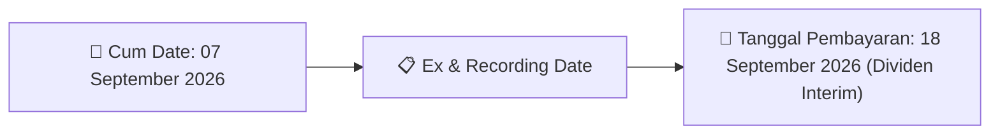
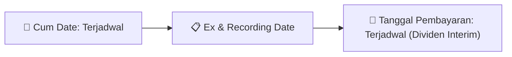

# Ikhtisar Pasar Harian (Daily Digest) - 2026-08-27

📅 **2026-08-27 (Daily Digest)**

## 1. Radar Pasar & Sentimen Harian (Executive Dashboard)
> [!NOTE]
> Terdeteksi sebanyak **251 pengumuman baru** dari 88 emiten pantauan pada (2026-08-27).

| Metric | Jumlah | Status Radar |
| :--- | :---: | :--- |
| **🟢 Sentimen Bullish / Positif** | `7` | [[Dividen Interim]], [[Mandatory Tender Offer]], Kinerja Positif |
| **⚪ Sentimen Netral / Routine** | `98` | [[Tanggapan Penjelasan Bursa]], [[RUPS]], [[Pendaftaran Unit]] |
| **🔴 Sentimen Bearish / Alert** | `1` | Sengketa Hukum, Defisit / Gugatan (Nihil hari ini) |
| **📄 [[Laporan Keuangan]] Baru** | `0` | Memicu Analisis Keuangan Otomatis |

> [!NOTE]
> Tidak dideteksi adanya publikasi laporan keuangan baru hari ini. Rangkuman per emiten secara terperinci tidak diperlukan.

---

## 2. Sorotan Utama & Watchlist Strategis (Strategic Watchlist)
#### 💰 Watchlist Dividen & Distribution
- **[[DR]]**: Total Nilai Dividen = IDR 793.468.300.000
- **[[DR]]**: Dividen Per Saham = IDR 100
- **[[DR]]**: Tanggal Cum Dividen di Pasar Reguler dan Pasar Negosiasi = 03 September 2026
- **[[DR]]**: Tanggal Ex Dividen di Pasar Reguler dan Pasar Negosiasi = 04 September 2026
- **[[DR]]**: Tanggal Cum Dividen di Pasar Tunai = 07 September 2026
- **[[DR]]**: Tanggal Ex Dividen di Pasar Tunai = 08 September 2026

#### 🎯 Watchlist Penawaran Tender Wajib (MTO) & Strategis
- **[[NSSS]]**: Keterangan Pengendali = [[Tidak]]
- **[[PJHB]]**: Rencana Pemegang Saham Utama dan Pengendali = [[Tidak memiliki rencana perubahan kepemilikan saham dalam waktu dekat]]
- **[[DOID]]**: Rencana Pengendali/Pemegang Saham Utama = [[Tidak ada rencana tindakan terkait kepemilikan saham]]
- **[[LUCY]]**: Keterangan Pengendali = [[Tidak]]
- **[[PYFA]]**: Pemegang Saham Pengendali = [[Rejuve Global Investment Pte. Ltd.]]
- **[[RLCO]]**: Pengendali = [[Tidak]]

#### 📈 Watchlist Konversi Waran & Potensi Dilusi
- **[[CSIS]]**: Nama Waran = CSIS-W
- **[[CSIS]]**: Total Saham Setelah Konversi = 1.829.803.506
- **[[CSIS]]**: Sisa Waran = 52.276.432
- **[[DR]]**: Underlying Waran Terstruktur = CMRY
- **[[DR]]**: Penerbit Waran Terstruktur = PT RHB Sekuritas Indonesia
- **[[DR]]**: Efek Bersifat Ekuitas Selain Saham yang Bisa Dikonversi Menjadi Saham = Tidak

---

## 3. Matriks Pengumuman Pasar (Announcements Intelligence Table)
| Emiten | Sentimen | Jenis Pengumuman | Judul Pengumuman | Berkas |
| :--- | :---: | :--- | :--- | :--- |
| **[[ASII]]** | ⚪ NEUTRAL | Public Expose | Public Expose | [Utama](file:///g:/My%20Drive/Model2/reports/raw/ASII/20260827_ASII_20260827_ASII_Public Expose_32133047.pdf) |
| **[[CSIS]]** | ⚪ NEUTRAL | Aksi Korporasi | Pencatatan Saham Tambahan dari Konversi | [Utama](file:///g:/My%20Drive/Model2/reports/raw/CSIS/20260827_CSIS_20260826_CSIS_Pencatatan Saham Tambahan dari Konversi_32132624.pdf) |
| **[[DR]]** | 🟢 BULLISH | Aksi Korporasi | DR DR Keterbukaan Informasi | [Utama](file:///g:/My%20Drive/Model2/reports/raw/DR/20260828_DR_20260827_DR_Keterbukaan Informasi_32132943.pdf) · [Lamp 1](file:///g:/My%20Drive/Model2/reports/raw/DR/20260827_DR_20260826_DR_Keterbukaan Informasi_32132512_lamp1.pdf) · [Lamp 1](file:///g:/My%20Drive/Model2/reports/raw/DR/20260828_DR_20260827_DR_Keterbukaan Informasi_32132943_lamp1.pdf) |
| **[[ANTM]]** | ⚪ NEUTRAL | Public Expose | Public Expose | [Utama](file:///g:/My%20Drive/Model2/reports/raw/ANTM/20260827_ANTM_20260827_ANTM_Public Expose_32133003.pdf) · [Lamp 1](file:///g:/My%20Drive/Model2/reports/raw/ANTM/20260827_ANTM_20260827_ANTM_Public Expose_32133003_lamp1.pdf) |
| **[[INET]]** | ⚪ NEUTRAL | Aksi Korporasi | Pencatatan Saham Tambahan dari Konversi | [Utama](file:///g:/My%20Drive/Model2/reports/raw/INET/20260827_INET_20260827_INET_Pencatatan Saham Tambahan dari Konversi_32132888.pdf) |
| **[[ZP]]** | 🟢 BULLISH | Aksi Korporasi | ZP ZP Keterbukaan Informasi | [Utama](file:///g:/My%20Drive/Model2/reports/raw/ZP/20260827_ZP_20260827_ZP_Keterbukaan Informasi_32132940.pdf) · [Lamp 1](file:///g:/My%20Drive/Model2/reports/raw/ZP/20260827_ZP_20260827_ZP_Keterbukaan Informasi_32132940_lamp1.pdf) |
| **[[ISAP]]** | ⚪ NEUTRAL | Aksi Korporasi | Pencatatan Saham Tambahan dari Konversi | [Utama](file:///g:/My%20Drive/Model2/reports/raw/ISAP/20260827_ISAP_20260827_ISAP_Pencatatan Saham Tambahan dari Konversi_32132913.pdf) |
| **[[TFCO]]** | ⚪ NEUTRAL | Aksi Korporasi | Tanggapan atas Permintaan Penjelasan Bursa | [Utama](file:///g:/My%20Drive/Model2/reports/raw/TFCO/20260827_TFCO_20260827_TFCO_Tanggapan atas Permintaan Penjelasan Bursa_32132984.pdf) |
| **[[DOOH]]** | ⚪ NEUTRAL | Public Expose | Public Expose | [Utama](file:///g:/My%20Drive/Model2/reports/raw/DOOH/20260827_DOOH_20260827_DOOH_Public Expose_32133171.pdf) · [Lamp 1](file:///g:/My%20Drive/Model2/reports/raw/DOOH/20260827_DOOH_20260827_DOOH_Public Expose_32133171_lamp1.pdf) |
| **[[MGNA]]** | ⚪ NEUTRAL | Aksi Korporasi | Pencatatan Saham Tambahan dari Konversi | [Utama](file:///g:/My%20Drive/Model2/reports/raw/MGNA/20260827_MGNA_20260826_MGNA_Pencatatan Saham Tambahan dari Konversi_32132505.pdf) · [Lamp 1](file:///g:/My%20Drive/Model2/reports/raw/MGNA/20260827_MGNA_20260824_MGNA_Pencatatan Saham Tambahan dari Konversi_32132226_lamp1.pdf) |
| **[[ELSA]]** | ⚪ NEUTRAL | Aksi Korporasi | Laporan Informasi dan Fakta Material | [Utama](file:///g:/My%20Drive/Model2/reports/raw/ELSA/20260827_ELSA_20260827_ELSA_Laporan Informasi dan Fakta Material_32132805.pdf) · [Lamp 2](file:///g:/My%20Drive/Model2/reports/raw/ELSA/20260827_ELSA_20260827_ELSA_Laporan Informasi dan Fakta Material_32132805_lamp2.pdf) · [Lamp 1](file:///g:/My%20Drive/Model2/reports/raw/ELSA/20260827_ELSA_20260827_ELSA_Laporan Informasi dan Fakta Material_32132805_lamp1.pdf) |
| **[[TBIG]]** | ⚪ NEUTRAL | RUPS | Ringkasan RisalahRisalah RUPS | [Utama](file:///g:/My%20Drive/Model2/reports/raw/TBIG/20260827_TBIG_20260827_TBIG_Ringkasan RisalahRisalah RUPS_32132848.pdf) · [Lamp 3](file:///g:/My%20Drive/Model2/reports/raw/TBIG/20260827_TBIG_20260827_TBIG_Ringkasan RisalahRisalah RUPS_32132848_lamp3.pdf) · [Lamp 2](file:///g:/My%20Drive/Model2/reports/raw/TBIG/20260827_TBIG_20260827_TBIG_Ringkasan RisalahRisalah RUPS_32132848_lamp2.pdf) · [Lamp 1](file:///g:/My%20Drive/Model2/reports/raw/TBIG/20260827_TBIG_20260827_TBIG_Ringkasan RisalahRisalah RUPS_32132848_lamp1.pdf) |
| **[[UVCR]]** | ⚪ NEUTRAL | Public Expose | Public Expose | [Utama](file:///g:/My%20Drive/Model2/reports/raw/UVCR/20260827_UVCR_20260827_UVCR_Public Expose_32132873.pdf) · [Lamp 1](file:///g:/My%20Drive/Model2/reports/raw/UVCR/20260827_UVCR_20260827_UVCR_Public Expose_32132873_lamp1.pdf) |
| **[[CMRY]]** | 🟢 BULLISH | Dividen | Jadwal Aksi Korporasi (Khusus Penyampaian Dividen Interim) | [Utama](file:///g:/My%20Drive/Model2/reports/raw/CMRY/20260827_CMRY_20260827_CMRY_Jadwal Aksi Korporasi (Khusus Penyampaian Dividen Interim)_32132891.pdf) |
| **[[MUTU]]** | ⚪ NEUTRAL | RUPS | Ringkasan RisalahRisalah RUPS | [Utama](file:///g:/My%20Drive/Model2/reports/raw/MUTU/20260827_MUTU_20260827_MUTU_Ringkasan RisalahRisalah RUPS_32132847.pdf) · [Lamp 1](file:///g:/My%20Drive/Model2/reports/raw/MUTU/20260827_MUTU_20260827_MUTU_Ringkasan RisalahRisalah RUPS_32132847_lamp1.pdf) |
| **[[NSSS]]** | ⚪ NEUTRAL | Aksi Korporasi | LK-27082026-5751-00 | [Utama](file:///g:/My%20Drive/Model2/reports/raw/NSSS/20260827_NSSS_LK-27082026-5751-00.pdf) |
| **[[SMFP]]** | ⚪ NEUTRAL | Aksi Korporasi | Pengumuman Perubahan Pencatatan EBA Partisipasi | [Utama](file:///g:/My%20Drive/Model2/reports/raw/SMFP/20260827_SMFP_20260826_SMFP_Pengumuman Perubahan Pencatatan EBA Partisipasi_32132530.pdf) |
| **[[SMFP]]** | ⚪ NEUTRAL | Aksi Korporasi | Pengumuman Jatuh Tempo Obligasi dan Sukuk | [Utama](file:///g:/My%20Drive/Model2/reports/raw/SMFP/20260827_SMFP_20260826_SMFP_Pengumuman Jatuh Tempo Obligasi dan Sukuk_32132670.pdf) |
| **[[CYBR]]** | ⚪ NEUTRAL | Aksi Korporasi | Pencatatan Saham Tambahan dari Konversi | [Utama](file:///g:/My%20Drive/Model2/reports/raw/CYBR/20260827_CYBR_20260827_CYBR_Pencatatan Saham Tambahan dari Konversi_32132897.pdf) · [Lamp 1](file:///g:/My%20Drive/Model2/reports/raw/CYBR/20260827_CYBR_20260824_CYBR_Pencatatan Saham Tambahan dari Konversi_32132298_lamp1.pdf) · [Lamp 1](file:///g:/My%20Drive/Model2/reports/raw/CYBR/20260827_CYBR_20260827_CYBR_Pencatatan Saham Tambahan dari Konversi_32132897_lamp1.pdf) |
| **[[DJPU]]** | ⚪ NEUTRAL | Aksi Korporasi | Pengumuman Jatuh Tempo Obligasi dan Sukuk | [Utama](file:///g:/My%20Drive/Model2/reports/raw/DJPU/20260827_DJPU_20260827_DJPU_Pengumuman Jatuh Tempo Obligasi dan Sukuk_32132843.pdf) |
| **[[PACK]]** | ⚪ NEUTRAL | Aksi Korporasi | Pencatatan Saham Tambahan dari Konversi | [Utama](file:///g:/My%20Drive/Model2/reports/raw/PACK/20260827_PACK_20260827_PACK_Pencatatan Saham Tambahan dari Konversi_32132884.pdf) |
| **[[PJHB]]** | ⚪ NEUTRAL | Aksi Korporasi | Tanggapan atas Permintaan Penjelasan Bursa | [Utama](file:///g:/My%20Drive/Model2/reports/raw/PJHB/20260827_PJHB_20260827_PJHB_Tanggapan atas Permintaan Penjelasan Bursa_32132840.pdf) · [Lamp 1](file:///g:/My%20Drive/Model2/reports/raw/PJHB/20260827_PJHB_20260827_PJHB_Tanggapan atas Permintaan Penjelasan Bursa_32132840_lamp1.pdf) |
| **[[PJHB]]** | ⚪ NEUTRAL | Aksi Korporasi | Pencatatan Saham Tambahan dari Konversi | [Utama](file:///g:/My%20Drive/Model2/reports/raw/PJHB/20260827_PJHB_20260827_PJHB_Pencatatan Saham Tambahan dari Konversi_32132852.pdf) |
| **[[DOID]]** | ⚪ NEUTRAL | Aksi Korporasi | Tanggapan atas Permintaan Penjelasan Bursa | [Utama](file:///g:/My%20Drive/Model2/reports/raw/DOID/20260827_DOID_20260827_DOID_Tanggapan atas Permintaan Penjelasan Bursa_32133023.pdf) |
| **[[EMAS]]** | ⚪ NEUTRAL | Aksi Korporasi | Laporan Informasi dan Fakta Material | [Utama](file:///g:/My%20Drive/Model2/reports/raw/EMAS/20260827_EMAS_20260827_EMAS_Laporan Informasi dan Fakta Material_32133168.pdf) · [Lamp 1](file:///g:/My%20Drive/Model2/reports/raw/EMAS/20260827_EMAS_20260827_EMAS_Laporan Informasi dan Fakta Material_32133168_lamp1.pdf) |
| **[[EPAC]]** | ⚪ NEUTRAL | Aksi Korporasi | Laporan Informasi dan Fakta Material | [Utama](file:///g:/My%20Drive/Model2/reports/raw/EPAC/20260827_EPAC_20260827_EPAC_Laporan Informasi dan Fakta Material_32133169.pdf) · [Lamp 1](file:///g:/My%20Drive/Model2/reports/raw/EPAC/20260827_EPAC_20260827_EPAC_Laporan Informasi dan Fakta Material_32133169_lamp1.pdf) · [Lamp 2](file:///g:/My%20Drive/Model2/reports/raw/EPAC/20260827_EPAC_20260827_EPAC_Laporan Informasi dan Fakta Material_32133169_lamp2.pdf) |
| **[[CBDK]]** | ⚪ NEUTRAL | Aksi Korporasi | Laporan Informasi dan Fakta Material | [Utama](file:///g:/My%20Drive/Model2/reports/raw/CBDK/20260827_CBDK_20260827_CBDK_Laporan Informasi dan Fakta Material_32133152.pdf) · [Lamp 1](file:///g:/My%20Drive/Model2/reports/raw/CBDK/20260827_CBDK_20260827_CBDK_Laporan Informasi dan Fakta Material_32133152_lamp1.pdf) |
| **[[MDLA]]** | ⚪ NEUTRAL | Public Expose | Public Expose | [Utama](file:///g:/My%20Drive/Model2/reports/raw/MDLA/20260827_MDLA_20260827_MDLA_Public Expose_32132829.pdf) |
| **[[WGSH]]** | ⚪ NEUTRAL | Aksi Korporasi | LK-27082026-7755-00 | [Utama](file:///g:/My%20Drive/Model2/reports/raw/WGSH/20260827_WGSH_LK-27082026-7755-00.pdf) |
| **[[TAMA]]** | ⚪ NEUTRAL | Aksi Korporasi | LK-27082026-9824-00 | [Utama](file:///g:/My%20Drive/Model2/reports/raw/TAMA/20260827_TAMA_LK-27082026-9824-00.pdf) |
| **[[LUCY]]** | ⚪ NEUTRAL | Aksi Korporasi | LK-27082026-8598-00 | [Utama](file:///g:/My%20Drive/Model2/reports/raw/LUCY/20260827_LUCY_LK-27082026-8598-00.pdf) |
| **[[JSMR]]** | ⚪ NEUTRAL | Aksi Korporasi | Informasi Transaksi Afiliasi | [Utama](file:///g:/My%20Drive/Model2/reports/raw/JSMR/20260827_JSMR_20260827_JSMR_Informasi Transaksi Afiliasi_32132977.pdf) · [Lamp 2](file:///g:/My%20Drive/Model2/reports/raw/JSMR/20260827_JSMR_20260827_JSMR_Informasi Transaksi Afiliasi_32132982_lamp2.pdf) · [Lamp 2](file:///g:/My%20Drive/Model2/reports/raw/JSMR/20260827_JSMR_20260827_JSMR_Informasi Transaksi Afiliasi_32132980_lamp2.pdf) · [Lamp 1](file:///g:/My%20Drive/Model2/reports/raw/JSMR/20260827_JSMR_20260827_JSMR_Informasi Transaksi Afiliasi_32132980_lamp1.pdf) · [Lamp 1](file:///g:/My%20Drive/Model2/reports/raw/JSMR/20260827_JSMR_20260827_JSMR_Informasi Transaksi Afiliasi_32132979_lamp1.pdf) · [Lamp 2](file:///g:/My%20Drive/Model2/reports/raw/JSMR/20260827_JSMR_20260827_JSMR_Informasi Transaksi Afiliasi_32132979_lamp2.pdf) · [Lamp 2](file:///g:/My%20Drive/Model2/reports/raw/JSMR/20260827_JSMR_20260827_JSMR_Informasi Transaksi Afiliasi_32132977_lamp2.pdf) · [Lamp 1](file:///g:/My%20Drive/Model2/reports/raw/JSMR/20260827_JSMR_20260827_JSMR_Informasi Transaksi Afiliasi_32132977_lamp1.pdf) · [Lamp 2](file:///g:/My%20Drive/Model2/reports/raw/JSMR/20260827_JSMR_20260827_JSMR_Informasi Transaksi Afiliasi_32132975_lamp2.pdf) · [Lamp 4](file:///g:/My%20Drive/Model2/reports/raw/JSMR/20260827_JSMR_20260827_JSMR_Informasi Transaksi Afiliasi_32132975_lamp4.pdf) · [Lamp 3](file:///g:/My%20Drive/Model2/reports/raw/JSMR/20260827_JSMR_20260827_JSMR_Informasi Transaksi Afiliasi_32132975_lamp3.pdf) |
| **[[PYFA]]** | ⚪ NEUTRAL | Aksi Korporasi | Tanggapan atas Permintaan Penjelasan Bursa | [Utama](file:///g:/My%20Drive/Model2/reports/raw/PYFA/20260827_PYFA_20260827_PYFA_Tanggapan atas Permintaan Penjelasan Bursa_32133026.pdf) |
| **[[PYFA]]** | ⚪ NEUTRAL | Public Expose | Public Expose | [Utama](file:///g:/My%20Drive/Model2/reports/raw/PYFA/20260827_PYFA_20260827_PYFA_Public Expose_32132963.pdf) · [Lamp 1](file:///g:/My%20Drive/Model2/reports/raw/PYFA/20260827_PYFA_20260827_PYFA_Public Expose_32132963_lamp1.pdf) |
| **[[PYFA]]** | ⚪ NEUTRAL | Aksi Korporasi | Pencatatan Saham Tambahan dari Konversi | [Utama](file:///g:/My%20Drive/Model2/reports/raw/PYFA/20260827_PYFA_20260827_PYFA_Pencatatan Saham Tambahan dari Konversi_32132932.pdf) |
| **[[SMSM]]** | 🟢 BULLISH | Aksi Korporasi | Laporan Informasi dan Fakta Material | [Utama](file:///g:/My%20Drive/Model2/reports/raw/SMSM/20260827_SMSM_20260826_SMSM_Laporan Informasi dan Fakta Material_32132773.pdf) |
| **[[PGEO]]** | ⚪ NEUTRAL | Aksi Korporasi | Pencatatan Saham Tambahan dari Konversi | [Utama](file:///g:/My%20Drive/Model2/reports/raw/PGEO/20260827_PGEO_20260827_PGEO_Pencatatan Saham Tambahan dari Konversi_32132894.pdf) |
| **[[NICE]]** | ⚪ NEUTRAL | Aksi Korporasi | Laporan Informasi dan Fakta Material | [Utama](file:///g:/My%20Drive/Model2/reports/raw/NICE/20260827_NICE_20260826_NICE_Laporan Informasi dan Fakta Material_32132664.pdf) |
| **[[PTPP]]** | ⚪ NEUTRAL | Aksi Korporasi | Laporan Hasil Pemeringkatan | [Utama](file:///g:/My%20Drive/Model2/reports/raw/PTPP/20260827_PTPP_20260827_PTPP_Laporan Hasil Pemeringkatan_32132814.pdf) · [Lamp 2](file:///g:/My%20Drive/Model2/reports/raw/PTPP/20260827_PTPP_20260827_PTPP_Laporan Hasil Pemeringkatan_32132814_lamp2.pdf) · [Lamp 1](file:///g:/My%20Drive/Model2/reports/raw/PTPP/20260827_PTPP_20260827_PTPP_Laporan Hasil Pemeringkatan_32132814_lamp1.pdf) |
| **[[ACES]]** | ⚪ NEUTRAL | Public Expose | Public Expose | [Utama](file:///g:/My%20Drive/Model2/reports/raw/ACES/20260827_ACES_20260827_ACES_Public Expose_32133090.pdf) · [Lamp 1](file:///g:/My%20Drive/Model2/reports/raw/ACES/20260827_ACES_20260827_ACES_Public Expose_32132951_lamp1.pdf) · [Lamp 1](file:///g:/My%20Drive/Model2/reports/raw/ACES/20260827_ACES_20260827_ACES_Public Expose_32133090_lamp1.pdf) |
| **[[SMMA]]** | ⚪ NEUTRAL | Aksi Korporasi | Tanggapan atas Permintaan Penjelasan Bursa | [Utama](file:///g:/My%20Drive/Model2/reports/raw/SMMA/20260827_SMMA_20260827_SMMA_Tanggapan atas Permintaan Penjelasan Bursa_32132893.pdf) |
| **[[EURO]]** | ⚪ NEUTRAL | RUPS | Pemanggilan RUPS | [Utama](file:///g:/My%20Drive/Model2/reports/raw/EURO/20260827_EURO_20260827_EURO_Pemanggilan RUPS_32132935.pdf) · [Lamp 1](file:///g:/My%20Drive/Model2/reports/raw/EURO/20260827_EURO_20260827_EURO_Pemanggilan RUPS_32132935_lamp1.pdf) |
| **[[VICO]]** | 🟢 BULLISH | Dividen | Pemanggilan RUPS | [Utama](file:///g:/My%20Drive/Model2/reports/raw/VICO/20260827_VICO_20260827_VICO_Pemanggilan RUPS_32132850.pdf) · [Lamp 2](file:///g:/My%20Drive/Model2/reports/raw/VICO/20260827_VICO_20260827_VICO_Pemanggilan RUPS_32132850_lamp2.pdf) |
| **[[PPGD]]** | ⚪ NEUTRAL | Aksi Korporasi | Pembayaran KuponBagi HasilIjarahPokok | [Utama](file:///g:/My%20Drive/Model2/reports/raw/PPGD/20260827_PPGD_20260827_PPGD_Pembayaran KuponBagi HasilIjarahPokok_32132998.pdf) · [Lamp 1](file:///g:/My%20Drive/Model2/reports/raw/PPGD/20260827_PPGD_20260827_PPGD_Pembayaran KuponBagi HasilIjarahPokok_32133008_lamp1.pdf) · [Lamp 1](file:///g:/My%20Drive/Model2/reports/raw/PPGD/20260827_PPGD_20260827_PPGD_Pembayaran KuponBagi HasilIjarahPokok_32132998_lamp1.pdf) |
| **[[BWPT]]** | ⚪ NEUTRAL | Aksi Korporasi | Tanggapan atas Permintaan Penjelasan Bursa | [Utama](file:///g:/My%20Drive/Model2/reports/raw/BWPT/20260827_BWPT_20260827_BWPT_Tanggapan atas Permintaan Penjelasan Bursa_32133068.pdf) · [Lamp 1](file:///g:/My%20Drive/Model2/reports/raw/BWPT/20260827_BWPT_20260827_BWPT_Tanggapan atas Permintaan Penjelasan Bursa_32133068_lamp1.pdf) |
| **[[BBRM]]** | ⚪ NEUTRAL | Aksi Korporasi | Laporan Informasi dan Fakta Material | [Utama](file:///g:/My%20Drive/Model2/reports/raw/BBRM/20260827_BBRM_20260827_BBRM_Laporan Informasi dan Fakta Material_32133094.pdf) · [Lamp 1](file:///g:/My%20Drive/Model2/reports/raw/BBRM/20260827_BBRM_20260827_BBRM_Laporan Informasi dan Fakta Material_32133094_lamp1.pdf) · [Lamp 2](file:///g:/My%20Drive/Model2/reports/raw/BBRM/20260827_BBRM_20260827_BBRM_Laporan Informasi dan Fakta Material_32133094_lamp2.pdf) |
| **[[INCO]]** | ⚪ NEUTRAL | Public Expose | Public Expose | [Utama](file:///g:/My%20Drive/Model2/reports/raw/INCO/20260827_INCO_20260827_INCO_Public Expose_32132990.pdf) |
| **[[KOCI]]** | ⚪ NEUTRAL | Aksi Korporasi | Pencatatan Saham Tambahan dari Konversi | [Utama](file:///g:/My%20Drive/Model2/reports/raw/KOCI/20260827_KOCI_20260824_KOCI_Pencatatan Saham Tambahan dari Konversi_32132222.pdf) · [Lamp 1](file:///g:/My%20Drive/Model2/reports/raw/KOCI/20260827_KOCI_20260824_KOCI_Pencatatan Saham Tambahan dari Konversi_32132222_lamp1.pdf) |
| **[[RGAS]]** | ⚪ NEUTRAL | Aksi Korporasi | LK-27082026-1987-00 | [Utama](file:///g:/My%20Drive/Model2/reports/raw/RGAS/20260827_RGAS_LK-27082026-1987-00.pdf) |
| **[[RGAS]]** | ⚪ NEUTRAL | Aksi Korporasi | LK-27082026-2617-00 | [Utama](file:///g:/My%20Drive/Model2/reports/raw/RGAS/20260827_RGAS_LK-27082026-2617-00.pdf) |
| **[[BVIC]]** | ⚪ NEUTRAL | Aksi Korporasi | Pembayaran KuponBagi HasilIjarahPokok | [Utama](file:///g:/My%20Drive/Model2/reports/raw/BVIC/20260827_BVIC_20260827_BVIC_Pembayaran KuponBagi HasilIjarahPokok_32132961.pdf) |
| **[[WSKT]]** | ⚪ NEUTRAL | Aksi Korporasi | Laporan Informasi dan Fakta Material | [Utama](file:///g:/My%20Drive/Model2/reports/raw/WSKT/20260827_WSKT_20260827_WSKT_Laporan Informasi dan Fakta Material_32132809.pdf) · [Lamp 1](file:///g:/My%20Drive/Model2/reports/raw/WSKT/20260827_WSKT_20260827_WSKT_Laporan Informasi dan Fakta Material_32132809_lamp1.pdf) |
| **[[RATU]]** | ⚪ NEUTRAL | Public Expose | Public Expose | [Utama](file:///g:/My%20Drive/Model2/reports/raw/RATU/20260827_RATU_20260827_RATU_Public Expose_32132892.pdf) |
| **[[ITMG]]** | ⚪ NEUTRAL | Public Expose | Public Expose | [Utama](file:///g:/My%20Drive/Model2/reports/raw/ITMG/20260827_ITMG_20260827_ITMG_Public Expose_32132811.pdf) |
| **[[AGAR]]** | 🟢 BULLISH | Aksi Korporasi | Tanggapan atas Permintaan Penjelasan Bursa | [Utama](file:///g:/My%20Drive/Model2/reports/raw/AGAR/20260827_AGAR_20260827_AGAR_Tanggapan atas Permintaan Penjelasan Bursa_32133157.pdf) · [Lamp 1](file:///g:/My%20Drive/Model2/reports/raw/AGAR/20260827_AGAR_20260827_AGAR_Tanggapan atas Permintaan Penjelasan Bursa_32133157_lamp1.pdf) · [Lamp 2](file:///g:/My%20Drive/Model2/reports/raw/AGAR/20260827_AGAR_20260827_AGAR_Tanggapan atas Permintaan Penjelasan Bursa_32133157_lamp2.pdf) |
| **[[KKGI]]** | ⚪ NEUTRAL | Aksi Korporasi | LK-27082026-3031-00 | [Utama](file:///g:/My%20Drive/Model2/reports/raw/KKGI/20260827_KKGI_LK-27082026-3031-00.pdf) |
| **[[TINS]]** | ⚪ NEUTRAL | Public Expose | Public Expose | [Utama](file:///g:/My%20Drive/Model2/reports/raw/TINS/20260827_TINS_20260827_TINS_Public Expose_32132834.pdf) |
| **[[ARTO]]** | ⚪ NEUTRAL | Public Expose | Public Expose | [Utama](file:///g:/My%20Drive/Model2/reports/raw/ARTO/20260827_ARTO_20260827_ARTO_Public Expose_32132917.pdf) · [Lamp 1](file:///g:/My%20Drive/Model2/reports/raw/ARTO/20260827_ARTO_20260827_ARTO_Public Expose_32132917_lamp1.pdf) |
| **[[BBTN]]** | ⚪ NEUTRAL | Aksi Korporasi | Pembayaran KuponBagi HasilIjarahPokok | [Utama](file:///g:/My%20Drive/Model2/reports/raw/BBTN/20260827_BBTN_20260827_BBTN_Pembayaran KuponBagi HasilIjarahPokok_32132993.pdf) |
| **[[BBTN]]** | ⚪ NEUTRAL | Public Expose | Public Expose | [Utama](file:///g:/My%20Drive/Model2/reports/raw/BBTN/20260827_BBTN_20260827_BBTN_Public Expose_32132973.pdf) |
| **[[INKP]]** | ⚪ NEUTRAL | Aksi Korporasi | Laporan Informasi dan Fakta Material | [Utama](file:///g:/My%20Drive/Model2/reports/raw/INKP/20260827_INKP_20260824_INKP_Laporan Informasi dan Fakta Material_32132152.pdf) |
| **[[INKP]]** | ⚪ NEUTRAL | Aksi Korporasi | Pengumuman Jatuh Tempo Obligasi dan Sukuk | [Utama](file:///g:/My%20Drive/Model2/reports/raw/INKP/20260827_INKP_20260824_INKP_Pengumuman Jatuh Tempo Obligasi dan Sukuk_32132291.pdf) · [Lamp 2](file:///g:/My%20Drive/Model2/reports/raw/INKP/20260827_INKP_20260824_INKP_Pengumuman Jatuh Tempo Obligasi dan Sukuk_32132291_lamp2.pdf) |
| **[[MBMA]]** | ⚪ NEUTRAL | Aksi Korporasi | Laporan Informasi dan Fakta Material | [Utama](file:///g:/My%20Drive/Model2/reports/raw/MBMA/20260827_MBMA_20260827_MBMA_Laporan Informasi dan Fakta Material_32132922.pdf) · [Lamp 2](file:///g:/My%20Drive/Model2/reports/raw/MBMA/20260827_MBMA_20260827_MBMA_Laporan Informasi dan Fakta Material_32132922_lamp2.pdf) |
| **[[MBMA]]** | ⚪ NEUTRAL | Aksi Korporasi | Pengumuman Jatuh Tempo Obligasi dan Sukuk | [Utama](file:///g:/My%20Drive/Model2/reports/raw/MBMA/20260827_MBMA_20260826_MBMA_Pengumuman Jatuh Tempo Obligasi dan Sukuk_32132497.pdf) · [Lamp 1](file:///g:/My%20Drive/Model2/reports/raw/MBMA/20260827_MBMA_20260826_MBMA_Pengumuman Jatuh Tempo Obligasi dan Sukuk_32132497_lamp1.pdf) |
| **[[RLCO]]** | ⚪ NEUTRAL | Aksi Korporasi | LK-27082026-4428-00 | [Utama](file:///g:/My%20Drive/Model2/reports/raw/RLCO/20260827_RLCO_LK-27082026-4428-00.pdf) |
| **[[RICY]]** | ⚪ NEUTRAL | Public Expose | Public Expose | [Utama](file:///g:/My%20Drive/Model2/reports/raw/RICY/20260827_RICY_20260827_RICY_Public Expose_32132842.pdf) · [Lamp 1](file:///g:/My%20Drive/Model2/reports/raw/RICY/20260827_RICY_20260827_RICY_Public Expose_32132842_lamp1.pdf) · [Lamp 2](file:///g:/My%20Drive/Model2/reports/raw/RICY/20260827_RICY_20260827_RICY_Public Expose_32132842_lamp2.pdf) |
| **[[HRUM]]** | ⚪ NEUTRAL | RUPS | Pemanggilan RUPS | [Utama](file:///g:/My%20Drive/Model2/reports/raw/HRUM/20260827_HRUM_20260824_HRUM_Pemanggilan RUPS_32132345.pdf) · [Lamp 1](file:///g:/My%20Drive/Model2/reports/raw/HRUM/20260827_HRUM_20260824_HRUM_Pemanggilan RUPS_32132345_lamp1.pdf) |
| **[[MICE]]** | ⚪ NEUTRAL | Aksi Korporasi | LK-27082026-0235-00 | [Utama](file:///g:/My%20Drive/Model2/reports/raw/MICE/20260827_MICE_LK-27082026-0235-00.pdf) |
| **[[PBSA]]** | ⚪ NEUTRAL | RUPS | Pemanggilan RUPS | [Utama](file:///g:/My%20Drive/Model2/reports/raw/PBSA/20260827_PBSA_20260827_PBSA_Pemanggilan RUPS_32132810.pdf) · [Lamp 1](file:///g:/My%20Drive/Model2/reports/raw/PBSA/20260827_PBSA_20260827_PBSA_Pemanggilan RUPS_32132810_lamp1.pdf) |
| **[[BPII]]** | ⚪ NEUTRAL | Aksi Korporasi | Tanggapan atas Permintaan Penjelasan Bursa | [Utama](file:///g:/My%20Drive/Model2/reports/raw/BPII/20260827_BPII_20260827_BPII_Tanggapan atas Permintaan Penjelasan Bursa_32133132.pdf) · [Lamp 1](file:///g:/My%20Drive/Model2/reports/raw/BPII/20260827_BPII_20260827_BPII_Tanggapan atas Permintaan Penjelasan Bursa_32133132_lamp1.pdf) |
| **[[GGRM]]** | ⚪ NEUTRAL | Public Expose | Public Expose | [Utama](file:///g:/My%20Drive/Model2/reports/raw/GGRM/20260827_GGRM_20260826_GGRM_Public Expose_32132685.pdf) |
| **[[CSMI]]** | ⚪ NEUTRAL | Public Expose | Public Expose | [Utama](file:///g:/My%20Drive/Model2/reports/raw/CSMI/20260827_CSMI_20260827_CSMI_Public Expose_32132981.pdf) · [Lamp 1](file:///g:/My%20Drive/Model2/reports/raw/CSMI/20260827_CSMI_20260827_CSMI_Public Expose_32132981_lamp1.pdf) |
| **[[ALL]]** | ⚪ NEUTRAL | Aksi Korporasi | Pemantauan Khusus | [Utama](file:///g:/My%20Drive/Model2/reports/raw/ALL/20260827__20260827_Pemantauan Khusus_32133020.pdf) |
| **[[ALL]]** | ⚪ NEUTRAL | Aksi Korporasi | Pengumuman Bursa | [Utama](file:///g:/My%20Drive/Model2/reports/raw/ALL/20260827__20260827_Pengumuman Bursa_32133091.pdf) · [Lamp 4](file:///g:/My%20Drive/Model2/reports/raw/ALL/20260827__20260827_Pengumuman Bursa_32133091_lamp4.pdf) · [Lamp 1](file:///g:/My%20Drive/Model2/reports/raw/ALL/20260827__20260827_Pengumuman Bursa_32133091_lamp1.pdf) · [Lamp 2](file:///g:/My%20Drive/Model2/reports/raw/ALL/20260827__20260827_Pengumuman Bursa_32133091_lamp2.pdf) · [Lamp 3](file:///g:/My%20Drive/Model2/reports/raw/ALL/20260827__20260827_Pengumuman Bursa_32133091_lamp3.pdf) |
| **[[PNBN]]** | ⚪ NEUTRAL | Aksi Korporasi | Laporan Penggunaan Dana Hasil Penawaran Umum | [Utama](file:///g:/My%20Drive/Model2/reports/raw/PNBN/20260827_PNBN_20260826_PNBN_Laporan Penggunaan Dana Hasil Penawaran Umum_32132659.pdf) |
| **[[R-ABFII]]** | ⚪ NEUTRAL | Aksi Korporasi | R-ABFII R-ABFII Pencatatan AwalTambahan ETF | [Utama](file:///g:/My%20Drive/Model2/reports/raw/R-ABFII/20260827_R-ABFII_20260827_R-ABFII_Pencatatan AwalTambahan ETF_32132908.pdf) · [Lamp 1](file:///g:/My%20Drive/Model2/reports/raw/R-ABFII/20260827_R-ABFII_20260827_R-ABFII_Pencatatan AwalTambahan ETF_32132908_lamp1.pdf) |
| **[[SMII]]** | ⚪ NEUTRAL | Aksi Korporasi | Pengumuman Jatuh Tempo Obligasi dan Sukuk | [Utama](file:///g:/My%20Drive/Model2/reports/raw/SMII/20260827_SMII_20260827_SMII_Pengumuman Jatuh Tempo Obligasi dan Sukuk_32132929.pdf) |
| **[[SUPR]]** | ⚪ NEUTRAL | Aksi Korporasi | Laporan Informasi dan Fakta Material | [Utama](file:///g:/My%20Drive/Model2/reports/raw/SUPR/20260827_SUPR_20260827_SUPR_Laporan Informasi dan Fakta Material_32132987.pdf) · [Lamp 1](file:///g:/My%20Drive/Model2/reports/raw/SUPR/20260827_SUPR_20260827_SUPR_Laporan Informasi dan Fakta Material_32132987_lamp1.pdf) |
| **[[COIN]]** | ⚪ NEUTRAL | Aksi Korporasi | Tanggapan atas Permintaan Penjelasan Bursa | [Utama](file:///g:/My%20Drive/Model2/reports/raw/COIN/20260827_COIN_20260827_COIN_Tanggapan atas Permintaan Penjelasan Bursa_32133037.pdf) · [Lamp 1](file:///g:/My%20Drive/Model2/reports/raw/COIN/20260827_COIN_20260827_COIN_Tanggapan atas Permintaan Penjelasan Bursa_32133037_lamp1.pdf) |
| **[[PICO]]** | ⚪ NEUTRAL | Aksi Korporasi | Tanggapan atas Permintaan Penjelasan Bursa | [Utama](file:///g:/My%20Drive/Model2/reports/raw/PICO/20260827_PICO_20260827_PICO_Tanggapan atas Permintaan Penjelasan Bursa_32132863.pdf) |
| **[[YPAS]]** | ⚪ NEUTRAL | Public Expose | Public Expose | [Utama](file:///g:/My%20Drive/Model2/reports/raw/YPAS/20260827_YPAS_20260820_YPAS_Public Expose_32121666.pdf) · [Lamp 1](file:///g:/My%20Drive/Model2/reports/raw/YPAS/20260827_YPAS_20260820_YPAS_Public Expose_32121666_lamp1.pdf) |
| **[[R-LQ45X]]** | ⚪ NEUTRAL | Aksi Korporasi | R-LQ45X R-LQ45X Pencatatan AwalTambahan ETF | [Utama](file:///g:/My%20Drive/Model2/reports/raw/R-LQ45X/20260827_R-LQ45X_20260827_R-LQ45X_Pencatatan AwalTambahan ETF_32132818.pdf) |
| **[[NZIA]]** | ⚪ NEUTRAL | Aksi Korporasi | ESG2025-NZIA | [Utama](file:///g:/My%20Drive/Model2/reports/raw/NZIA/20260827_NZIA_ESG2025-NZIA.pdf) |
| **[[NZIA]]** | ⚪ NEUTRAL | Aksi Korporasi | AnnualReport2025-NZIA-att2 | [Utama](file:///g:/My%20Drive/Model2/reports/raw/NZIA/20260827_NZIA_AnnualReport2025-NZIA-att2.pdf) |
| **[[NZIA]]** | ⚪ NEUTRAL | Aksi Korporasi | AnnualReport2025-NZIA-att3 | [Utama](file:///g:/My%20Drive/Model2/reports/raw/NZIA/20260827_NZIA_AnnualReport2025-NZIA-att3.pdf) |
| **[[NZIA]]** | ⚪ NEUTRAL | Aksi Korporasi | AnnualReport2025-NZIA-att1 | [Utama](file:///g:/My%20Drive/Model2/reports/raw/NZIA/20260827_NZIA_AnnualReport2025-NZIA-att1.pdf) |
| **[[SUNI]]** | ⚪ NEUTRAL | RUPS | Transaksi Material Tanpa Persetujuan RUPS | [Utama](file:///g:/My%20Drive/Model2/reports/raw/SUNI/20260827_SUNI_20260827_SUNI_Transaksi Material Tanpa Persetujuan RUPS_32132978.pdf) |
| **[[ERTX]]** | ⚪ NEUTRAL | Aksi Korporasi | Laporan Informasi dan Fakta Material | [Utama](file:///g:/My%20Drive/Model2/reports/raw/ERTX/20260827_ERTX_20260827_ERTX_Laporan Informasi dan Fakta Material_32132967.pdf) |
| **[[CENT]]** | ⚪ NEUTRAL | Aksi Korporasi | Tanggapan atas Permintaan Penjelasan Bursa | [Utama](file:///g:/My%20Drive/Model2/reports/raw/CENT/20260827_CENT_20260827_CENT_Tanggapan atas Permintaan Penjelasan Bursa_32132976.pdf) · [Lamp 1](file:///g:/My%20Drive/Model2/reports/raw/CENT/20260827_CENT_20260827_CENT_Tanggapan atas Permintaan Penjelasan Bursa_32132976_lamp1.pdf) |
| **[[PART]]** | ⚪ NEUTRAL | Aksi Korporasi | Tanggapan atas Permintaan Penjelasan Bursa | [Utama](file:///g:/My%20Drive/Model2/reports/raw/PART/20260827_PART_20260827_PART_Tanggapan atas Permintaan Penjelasan Bursa_32132807.pdf) |
| **[[PART]]** | ⚪ NEUTRAL | Aksi Korporasi | Laporan Informasi dan Fakta Material | [Utama](file:///g:/My%20Drive/Model2/reports/raw/PART/20260828_PART_20260828_PART_Laporan Informasi dan Fakta Material_32133199.pdf) |
| **[[PGAS]]** | 🔴 BEARISH | Aksi Korporasi | Laporan Informasi dan Fakta Material | [Utama](file:///g:/My%20Drive/Model2/reports/raw/PGAS/20260827_PGAS_20260827_PGAS_Laporan Informasi dan Fakta Material_32133145.pdf) · [Lamp 1](file:///g:/My%20Drive/Model2/reports/raw/PGAS/20260827_PGAS_20260827_PGAS_Laporan Informasi dan Fakta Material_32133186_lamp1.pdf) |
| **[[DILD]]** | ⚪ NEUTRAL | Aksi Korporasi | Laporan Informasi dan Fakta Material | [Utama](file:///g:/My%20Drive/Model2/reports/raw/DILD/20260827_DILD_20260827_DILD_Laporan Informasi dan Fakta Material_32133143.pdf) · [Lamp 1](file:///g:/My%20Drive/Model2/reports/raw/DILD/20260827_DILD_20260827_DILD_Laporan Informasi dan Fakta Material_32133143_lamp1.pdf) |
| **[[TRIS]]** | ⚪ NEUTRAL | Aksi Korporasi | LK-27082026-2058-00 | [Utama](file:///g:/My%20Drive/Model2/reports/raw/TRIS/20260827_TRIS_LK-27082026-2058-00.pdf) |
| **[[TRIS]]** | ⚪ NEUTRAL | Aksi Korporasi | LK-27082026-6215-00 | [Utama](file:///g:/My%20Drive/Model2/reports/raw/TRIS/20260827_TRIS_LK-27082026-6215-00.pdf) |
| **[[TRIS]]** | ⚪ NEUTRAL | Aksi Korporasi | LK-27082026-9399-00 | [Utama](file:///g:/My%20Drive/Model2/reports/raw/TRIS/20260827_TRIS_LK-27082026-9399-00.pdf) |
| **[[TRIS]]** | 🟢 BULLISH | Aksi Korporasi | LK-27082026-1104-00 | [Utama](file:///g:/My%20Drive/Model2/reports/raw/TRIS/20260827_TRIS_LK-27082026-1104-00.pdf) |
| **[[MOYA]]** | ⚪ NEUTRAL | Aksi Korporasi | Laporan Informasi dan Fakta Material | [Utama](file:///g:/My%20Drive/Model2/reports/raw/MOYA/20260827_MOYA_20260827_MOYA_Laporan Informasi dan Fakta Material_32132949.pdf) · [Lamp 3](file:///g:/My%20Drive/Model2/reports/raw/MOYA/20260827_MOYA_20260827_MOYA_Laporan Informasi dan Fakta Material_32132949_lamp3.pdf) · [Lamp 4](file:///g:/My%20Drive/Model2/reports/raw/MOYA/20260827_MOYA_20260827_MOYA_Laporan Informasi dan Fakta Material_32132949_lamp4.pdf) · [Lamp 2](file:///g:/My%20Drive/Model2/reports/raw/MOYA/20260827_MOYA_20260827_MOYA_Laporan Informasi dan Fakta Material_32132949_lamp2.pdf) |
| **[[TPIA]]** | ⚪ NEUTRAL | Aksi Korporasi | Laporan Informasi dan Fakta Material | [Utama](file:///g:/My%20Drive/Model2/reports/raw/TPIA/20260828_TPIA_20260828_TPIA_Laporan Informasi dan Fakta Material_32133219.pdf) · [Lamp 1](file:///g:/My%20Drive/Model2/reports/raw/TPIA/20260828_TPIA_20260828_TPIA_Laporan Informasi dan Fakta Material_32133219_lamp1.pdf) · [Lamp 2](file:///g:/My%20Drive/Model2/reports/raw/TPIA/20260828_TPIA_20260828_TPIA_Laporan Informasi dan Fakta Material_32133219_lamp2.pdf) |
| **[[AWAN]]** | ⚪ NEUTRAL | Aksi Korporasi | Laporan Informasi dan Fakta Material | [Utama](file:///g:/My%20Drive/Model2/reports/raw/AWAN/20260828_AWAN_20260827_AWAN_Laporan Informasi dan Fakta Material_32133182.pdf) · [Lamp 1](file:///g:/My%20Drive/Model2/reports/raw/AWAN/20260828_AWAN_20260827_AWAN_Laporan Informasi dan Fakta Material_32133182_lamp1.pdf) |
| **[[PTRO]]** | ⚪ NEUTRAL | Aksi Korporasi | Laporan Informasi dan Fakta Material | [Utama](file:///g:/My%20Drive/Model2/reports/raw/PTRO/20260828_PTRO_20260828_PTRO_Laporan Informasi dan Fakta Material_32133198.pdf) · [Lamp 1](file:///g:/My%20Drive/Model2/reports/raw/PTRO/20260828_PTRO_20260828_PTRO_Laporan Informasi dan Fakta Material_32133198_lamp1.pdf) |
| **[[AVIA]]** | ⚪ NEUTRAL | Aksi Korporasi | Laporan Informasi dan Fakta Material | [Utama](file:///g:/My%20Drive/Model2/reports/raw/AVIA/20260828_AVIA_20260827_AVIA_Laporan Informasi dan Fakta Material_32133033.pdf) |
| **[[ARTI]]** | ⚪ NEUTRAL | Aksi Korporasi | ESG2025-ARTI | [Utama](file:///g:/My%20Drive/Model2/reports/raw/ARTI/20260828_ARTI_ESG2025-ARTI.pdf) |
| **[[ARTI]]** | ⚪ NEUTRAL | Aksi Korporasi | AnnualReport2025-ARTI-att1 | [Utama](file:///g:/My%20Drive/Model2/reports/raw/ARTI/20260828_ARTI_AnnualReport2025-ARTI-att1.pdf) |
| **[[ARTI]]** | ⚪ NEUTRAL | Aksi Korporasi | AnnualReport2025-ARTI-att2 | [Utama](file:///g:/My%20Drive/Model2/reports/raw/ARTI/20260828_ARTI_AnnualReport2025-ARTI-att2.pdf) |
| **[[BEBS]]** | ⚪ NEUTRAL | Aksi Korporasi | Tanggapan atas Permintaan Penjelasan Bursa | [Utama](file:///g:/My%20Drive/Model2/reports/raw/BEBS/20260828_BEBS_20260828_BEBS_Tanggapan atas Permintaan Penjelasan Bursa_32133187.pdf) · [Lamp 1](file:///g:/My%20Drive/Model2/reports/raw/BEBS/20260828_BEBS_20260828_BEBS_Tanggapan atas Permintaan Penjelasan Bursa_32133187_lamp1.pdf) |

---

## 4. Detail Informasi per Emiten (Grouped by Emiten)
### 🔵 [[ASII]]
- **[Public Expose]** [Public Expose](file:///g:/My%20Drive/Model2/reports/raw/ASII/20260827_ASII_20260827_ASII_Public Expose_32133047.pdf)
  - 📌 *Deskripsi*: Astra International Tbk mengumumkan rencana penyelenggaraan Public Expose Tahunan untuk tahun buku 2026 yang akan dilaksanakan pada 10 September 2026 pukul 10:00 melalui Public Expose Live 2026 di website idx.co.id, dengan agenda pemaparan kinerja semester I 2026.
  - 📊 **Fakta Material**:
    - **Tahun Buku**: 2026
    - **Tempat**: Public Expose Live 2026, website idx.co.id
    - **Hari/Tanggal**: 10 September 2026
    - **Waktu**: 10:00
    - **Agenda**: Pemaparan Kinerja Perseroan Semester I Tahun 2026

### 🔵 [[CSIS]]
- **[Aksi Korporasi]** [Pencatatan Saham Tambahan dari Konversi](file:///g:/My%20Drive/Model2/reports/raw/CSIS/20260827_CSIS_20260826_CSIS_Pencatatan Saham Tambahan dari Konversi_32132624.pdf)
  - 📌 *Deskripsi*: Bursa mengumumkan pencatatan saham tambahan hasil konversi Waran CSIS-W sebanyak 42 saham pada 27 Agustus 2026, sehingga total saham CSIS setelah konversi menjadi 1.829.803.506 saham. Sisa waran yang belum dikonversi sebanyak 52.276.432.
  - 📊 **Fakta Material**:
    - **Papan Pencatatan**: Pengembangan
    - **Nama Waran**: CSIS-W
    - **Total Saham Setelah Konversi**: 1.829.803.506
    - **Sisa Waran**: 52.276.432
    - **Tanggal Pencatatan dan Perdagangan**: 27 Agustus 2026

### 🔵 [[DR]]
- **[Aksi Korporasi]** [DR DR Keterbukaan Informasi](file:///g:/My%20Drive/Model2/reports/raw/DR/20260828_DR_20260827_DR_Keterbukaan Informasi_32132943.pdf) *(Attachment: [Lamp 1](file:///g:/My%20Drive/Model2/reports/raw/DR/20260827_DR_20260826_DR_Keterbukaan Informasi_32132512_lamp1.pdf) · [Lamp 1](file:///g:/My%20Drive/Model2/reports/raw/DR/20260828_DR_20260827_DR_Keterbukaan Informasi_32132943_lamp1.pdf))*
  - 📌 *Deskripsi*: Pengumuman penyesuaian syarat dan ketentuan Waran Terstruktur dengan underlying CMRY sehubungan dengan aksi korporasi dividen tunai PT Cisarua Mountain Dairy Tbk. Total dividen tunai sebesar IDR 793.468.300.000 dengan dividen per saham IDR 100. Rasio Pelaksanaan dan Harga Pelaksanaan Waran Terstruktur CMRY akan disesuaikan berdasarkan formula yang tercantum dalam prospektus.
  - 📊 **Fakta Material**:
    - **Underlying Waran Terstruktur**: CMRY
    - **Penerbit Waran Terstruktur**: PT RHB Sekuritas Indonesia
    - **Aksi Korporasi Underlying**: Dividen Tunai
    - **Total Nilai Dividen**: IDR 793.468.300.000
    - **Dividen Per Saham**: IDR 100
    - **Efek Bersifat Ekuitas Selain Saham yang Bisa Dikonversi Menjadi Saham**: Tidak
    - **Tanggal Efektif**: 26 Agustus 2026
    - **Tanggal Cum Dividen di Pasar Reguler dan Pasar Negosiasi**: 03 September 2026
    - **Tanggal Ex Dividen di Pasar Reguler dan Pasar Negosiasi**: 04 September 2026
    - **Tanggal Cum Dividen di Pasar Tunai**: 07 September 2026
    - **Tanggal Ex Dividen di Pasar Tunai**: 08 September 2026
    - **Tanggal Daftar Pemegang Saham yang Berhak atas Dividen Tunai**: 07 September 2026 pukul 16:00
    - **Tanggal Pembayaran Dividen**: 18 September 2026
    - **Formula Rasio Pelaksanaan yang Disesuaikan**: E x (P - D) / P
    - **Formula Harga Pelaksanaan yang Disesuaikan**: X x (P - D) / P
    - **Tanggal Pemberitahuan**: 27 Agustus 2026

### 🔵 [[ANTM]]
- **[Public Expose]** [Public Expose](file:///g:/My%20Drive/Model2/reports/raw/ANTM/20260827_ANTM_20260827_ANTM_Public Expose_32133003.pdf) *(Attachment: [Lamp 1](file:///g:/My%20Drive/Model2/reports/raw/ANTM/20260827_ANTM_20260827_ANTM_Public Expose_32133003_lamp1.pdf))*
  - 📌 *Deskripsi*: PT ANTAM (Persero) Tbk mengumumkan rencana penyelenggaraan Public Expose Tahunan untuk Tahun Buku 2026 yang akan dilaksanakan pada 10 September 2026 pukul 16:00 melalui Public Expose Live 2026, dengan agenda paparan kinerja Semester I 2026 dan press conference.
  - 📊 **Fakta Material**:
    - **Nomor Surat**: 5103/692/DCS/2026
    - **Tahun Buku**: 2026
    - **Tempat**: Public Expose Live 2026 yang tercantum pada website
    - **Hari/Tanggal**: 10 September 2026
    - **Waktu**: 16:00
    - **Agenda**: 1. Paparan Kinerja Semester I Tahun 2026; 2. Press Conference
    - **Tanggal Pelaporan**: 27-08-2026 15:26
    - **Kontak**: Telepon: 021-7805119; 021-7891234; 021-7812635, Fax: 021-7812822, http://www.

### 🔵 [[INET]]
- **[Aksi Korporasi]** [Pencatatan Saham Tambahan dari Konversi](file:///g:/My%20Drive/Model2/reports/raw/INET/20260827_INET_20260827_INET_Pencatatan Saham Tambahan dari Konversi_32132888.pdf)
  - 📌 *Deskripsi*: PT Sinergi Inti Andalan Prima Tbk. (INET) mengumumkan pencatatan saham tambahan hasil konversi Waran Seri II (INET-W2) di Papan Pencatatan Pengembangan, dengan tanggal pencatatan dan perdagangan 28 Agustus 2026.
  - 📊 **Fakta Material**:
    - **Nama Waran**: INET-W2
    - **Jumlah Waran yang Dikonversi**: 311.322
    - **Jumlah Saham Hasil Konversi**: 311.322
    - **Total Saham Setelah Konversi**: 22.375.938.264
    - **Sisa Waran**: 2.298.788.325
    - **Tanggal Pencatatan dan Perdagangan**: 28 Agustus 2026
    - **Papan Pencatatan**: Pengembangan

### 🔵 [[ZP]]
- **[Aksi Korporasi]** [ZP ZP Keterbukaan Informasi](file:///g:/My%20Drive/Model2/reports/raw/ZP/20260827_ZP_20260827_ZP_Keterbukaan Informasi_32132940.pdf) *(Attachment: [Lamp 1](file:///g:/My%20Drive/Model2/reports/raw/ZP/20260827_ZP_20260827_ZP_Keterbukaan Informasi_32132940_lamp1.pdf))*
  - 📌 *Deskripsi*: Pengumuman penyesuaian harga pelaksanaan dan rasio konversi Waran Terstruktur CMRYZPCZ6A dan CMRYZPCK7A yang diterbitkan oleh PT Maybank Sekuritas Indonesia, terkait pembagian dividen interim PT Cisarua Mountain Dairy Tbk (CMRY) sebesar Rp100 per saham. Penyesuaian berlaku efektif pada tanggal ex dividen 4 September 2026 untuk pasar reguler dan negosiasi, serta 8 September 2026 untuk pasar tunai.
  - 📊 **Fakta Material**:
    - **Underlying**: PT Cisarua Mountain Dairy Tbk (CMRY)
    - **Kode Waran Terstruktur**: CMRYZPCZ6A dan CMRYZPCK7A
    - **Penerbit**: PT Maybank Sekuritas Indonesia
    - **Dividen Tunai per Saham**: Rp100
    - **Tanggal Pengumuman Dividen**: 2026-08-26
    - **Tanggal Ex Dividen Pasar Reguler dan Negosiasi**: 2026-09-04
    - **Tanggal Ex Dividen Pasar Tunai**: 2026-09-08
    - **Tanggal Prospektus**: 2025-04-11

### 🔵 [[ISAP]]
- **[Aksi Korporasi]** [Pencatatan Saham Tambahan dari Konversi](file:///g:/My%20Drive/Model2/reports/raw/ISAP/20260827_ISAP_20260827_ISAP_Pencatatan Saham Tambahan dari Konversi_32132913.pdf)
  - 📌 *Deskripsi*: Bursa Efek Indonesia mengumumkan pencatatan saham tambahan PT Isra Presisi Indonesia Tbk (ISAP) di Papan Akselerasi yang berasal dari konversi 50 Waran ISAP-W menjadi 50 saham. Total saham tercatat setelah konversi menjadi 4.020.356.332 saham, dengan sisa waran ISAP-W sebanyak 749.643.668. Pencatatan dan perdagangan efektif pada 26 Agustus 2026.
  - 📊 **Fakta Material**:
    - **Papan Pencatatan**: Akselerasi
    - **Nama Waran**: ISAP-W
    - **Total Saham Setelah Konversi**: 4.020.356.332
    - **Sisa Waran Setelah Konversi**: 749,643,668
    - **Tanggal Pencatatan dan Perdagangan**: 26 Agustus 2026

### 🔵 [[TFCO]]
- **[Aksi Korporasi]** [Tanggapan atas Permintaan Penjelasan Bursa](file:///g:/My%20Drive/Model2/reports/raw/TFCO/20260827_TFCO_20260827_TFCO_Tanggapan atas Permintaan Penjelasan Bursa_32132984.pdf)
  - 📌 *Deskripsi*: Perseroan menyampaikan tanggapan atas surat BEI mengenai volatilitas transaksi, menyatakan tidak mengetahui informasi material, tidak memiliki rencana korporasi dalam 3 bulan mendatang, dan pemegang saham utama belum memiliki rencana terkait kepemilikan sahamnya.
  - 📊 **Fakta Material**:
    - **Nomor Surat BEI**: S-10965/BEI.PP1/08-2026
    - **Pengetahuan atas Informasi Material**: Tidak mengetahui
    - **Rencana Tindakan Korporasi 3 Bulan Mendatang**: Tidak memiliki
    - **Rencana Pemegang Saham Utama Terkait Kepemilikan**: Belum memiliki rencana
    - **Informasi/Fakta Material Lainnya**: Tidak ada
    - **Nama Pengirim**: Joy Matthew Pangemanan

### 🔵 [[DOOH]]
- **[Public Expose]** [Public Expose](file:///g:/My%20Drive/Model2/reports/raw/DOOH/20260827_DOOH_20260827_DOOH_Public Expose_32133171.pdf) *(Attachment: [Lamp 1](file:///g:/My%20Drive/Model2/reports/raw/DOOH/20260827_DOOH_20260827_DOOH_Public Expose_32133171_lamp1.pdf))*
  - 📌 *Deskripsi*: PT Era Media Sejahtera Tbk (DOOH) mengumumkan rencana penyelenggaraan Public Expose Insidentil yang akan dilaksanakan pada Jumat, 4 September 2026 pukul 15.00 WIB melalui Zoom.
  - 📊 **Fakta Material**:
    - **Tanggal Surat**: 27 Agustus 2026
    - **Nomor Surat**: 024/CORSEC/EMS/PUBEX.I/VIII/2026
    - **Nama Perusahaan**: PT Era Media Sejahtera Tbk
    - **Jenis Acara**: Public Expose Insidentil
    - **Hari/Tanggal Acara**: Jumat, 4 September 2026
    - **Waktu Acara**: 15.00 WIB - Selesai
    - **Sarana Media Elektronik**: https://us06web.zoom.us/j/82678336401?pwd=ImT1jJ6Q43mNLRheWr2FIsSzQGdTxm.1
    - **Meeting ID**: 826 7833 6401
    - **Passcode**: Pubex2026
    - **Pihak Manajemen yang Hadir**: Anggota Direksi PT Era Media Sejahtera Tbk
    - **Batas Penyampaian Materi**: Kamis, 3 September 2026
    - **Penandatangan**: Vicktor Aritonang, Direktur Utama

### 🔵 [[MGNA]]
- **[Aksi Korporasi]** [Pencatatan Saham Tambahan dari Konversi](file:///g:/My%20Drive/Model2/reports/raw/MGNA/20260827_MGNA_20260826_MGNA_Pencatatan Saham Tambahan dari Konversi_32132505.pdf) *(Attachment: [Lamp 1](file:///g:/My%20Drive/Model2/reports/raw/MGNA/20260827_MGNA_20260824_MGNA_Pencatatan Saham Tambahan dari Konversi_32132226_lamp1.pdf))*
  - 📌 *Deskripsi*: PT Magna Investama Mandiri Tbk (MGNA) mengumumkan pencatatan saham tambahan sebanyak 200 lembar hasil exercise Waran Seri II (MGNA-W) pada tanggal 24 Agustus 2026. Total saham beredar meningkat dari 3.411.123.485 menjadi 3.411.123.685 lembar, sementara sisa waran Seri II berkurang dari 343.265.314 menjadi 343.265.114.
  - 📊 **Fakta Material**:
    - **Tanggal Pelaksanaan Exercise**: 24-08-2026
    - **Tanggal Penerbitan**: 24-08-2026
    - **Jumlah Waran yang Di-exercise**: 200
    - **Jumlah Saham yang Diterbitkan**: 200
    - **Total Saham Sebelum Exercise**: 3.411.123.485
    - **Total Saham Setelah Exercise**: 3.411.123.685
    - **Sisa Waran Seri II Sebelum Exercise**: 343.265.314
    - **Sisa Waran Seri II Setelah Exercise**: 343.265.114
    - **Kode Waran**: MGNA-W
    - **Pihak Pelapor**: PT Adimitra Jasa Korpora (Biro Administrasi Efek)

### 🔵 [[ELSA]]
- **[Aksi Korporasi]** [Laporan Informasi dan Fakta Material](file:///g:/My%20Drive/Model2/reports/raw/ELSA/20260827_ELSA_20260827_ELSA_Laporan Informasi dan Fakta Material_32132805.pdf) *(Attachment: [Lamp 2](file:///g:/My%20Drive/Model2/reports/raw/ELSA/20260827_ELSA_20260827_ELSA_Laporan Informasi dan Fakta Material_32132805_lamp2.pdf) · [Lamp 1](file:///g:/My%20Drive/Model2/reports/raw/ELSA/20260827_ELSA_20260827_ELSA_Laporan Informasi dan Fakta Material_32132805_lamp1.pdf))*
  - 📌 *Deskripsi*: PT Elnusa Tbk melaporkan keberhasilan pengeboran Sumur Semberah-206 milik PT Pertamina Hulu Sanga-Sanga Zona 9 di Kutai Kartanegara, Kalimantan Timur. Menggunakan Rig EMR-001, pengeboran selesai dalam 45 hari dan uji produksi pada 19 Agustus 2026 mencatat initial production 5,36 MMSCFD gas dan 406 BOPD minyak, melampaui target awal masing-masing sekitar 255% dan 232%.
  - 📊 **Fakta Material**:
    - **Nama Emiten**: PT Elnusa Tbk
    - **Kode Saham**: ELSA
    - **Jenis Informasi atau Fakta Material**: Sumur Semberah-206 Lampaui Target Produksi, Elnusa Perkuat Rekam Jejak Operational Excellence di Bisnis Hulu
    - **Nama Sumur**: Semberah-206 (SEM-20-US)
    - **Pemilik Sumur**: PT Pertamina Hulu Sanga-Sanga (PHSS) Zona 9
    - **Lokasi Sumur**: Kutai Kartanegara, Kalimantan Timur
    - **Rig Pengeboran**: Rig EMR-001
    - **Tanggal Mulai Pengeboran**: 4 Juni 2026
    - **Durasi Pengeboran**: 45 hari
    - **Tanggal Uji Produksi**: 19 Agustus 2026
    - **Initial Production Gas**: 5,36 MMSCFD
    - **Initial Production Minyak**: 406 BOPD
    - **Target Awal Gas**: 2,1 MMSCFD
    - **Target Awal Minyak**: 175 BOPD
    - **Pencapaian Terhadap Target Gas**: Sekitar 255%
    - **Pencapaian Terhadap Target Minyak**: Sekitar 232%
    - **Kedalaman Akhir Pengeboran**: 11.685 ftMD
    - **Layer Produksi**: F083A, I089A, dan I072A
    - **Total Safe Man Hours Rig EMR-001**: 75.600 jam
    - **Posisi Elnusa dalam Pertamina**: Subholding Upstream Pertamina

### 🔵 [[TBIG]]
- **[RUPS]** [Ringkasan RisalahRisalah RUPS](file:///g:/My%20Drive/Model2/reports/raw/TBIG/20260827_TBIG_20260827_TBIG_Ringkasan RisalahRisalah RUPS_32132848.pdf) *(Attachment: [Lamp 3](file:///g:/My%20Drive/Model2/reports/raw/TBIG/20260827_TBIG_20260827_TBIG_Ringkasan RisalahRisalah RUPS_32132848_lamp3.pdf) · [Lamp 2](file:///g:/My%20Drive/Model2/reports/raw/TBIG/20260827_TBIG_20260827_TBIG_Ringkasan RisalahRisalah RUPS_32132848_lamp2.pdf) · [Lamp 1](file:///g:/My%20Drive/Model2/reports/raw/TBIG/20260827_TBIG_20260827_TBIG_Ringkasan RisalahRisalah RUPS_32132848_lamp1.pdf))*
  - 📌 *Deskripsi*: RUPS Luar Biasa PT Tower Bersama Infrastructure Tbk diselenggarakan pada Senin, 24 Agustus 2026 secara elektronik. Rapat dihadiri pemegang saham mewakili 20.887.926.767 saham atau 92,63% dari total saham dengan hak suara sah. Rapat menyetujui perubahan kegiatan usaha PT Tower Bersama berupa penambahan kegiatan usaha KBLI 61107 serta perubahan Pasal 3 Anggaran Dasar Perseroan dalam rangka penyesuaian KBLI 2025.
  - 📊 **Fakta Material**:
    - **Hari/Tanggal Rapat**: Senin, 24 Agustus 2026
    - **Waktu Rapat**: 10.00 WIB - Selesai
    - **Tempat Rapat**: Gedung The Convergence Indonesia (TCI), lantai 18, Kawasan Rasuna Epicentrum, JL. H.R. Rasuna Said, Jakarta Selatan - 12940, secara elektronik
    - **Pimpinan Rapat**: Ludovicus Sensi Wondabio (Komisaris Independen)
    - **Surat Penunjukan Pimpinan Rapat**: 14 Agustus 2026
    - **Kuorum Kehadiran**: 20.887.926.767 saham atau 92,63% dari 22.550.614.345 saham dengan hak suara sah
    - **Jumlah Saham Ditempatkan dan Disetor pada Recording Date 30 Juli 2026**: 22.656.999.445 saham termasuk saham treasuri
    - **Mata Acara 1**: Persetujuan perubahan kegiatan usaha PT Tower Bersama berupa penambahan kegiatan usaha KBLI 61107
    - **Hasil Voting Mata Acara 1 - Setuju**: 20.831.403.067 saham (99,73%)
    - **Hasil Voting Mata Acara 1 - Abstain**: 56.523.400 saham (0,27%)
    - **Hasil Voting Mata Acara 1 - Tidak Setuju**: 300 saham (0,00%)
    - **Mata Acara 2**: Persetujuan perubahan Pasal 3 Anggaran Dasar Perseroan dalam rangka penyesuaian KBLI 2025
    - **Hasil Voting Mata Acara 2 - Setuju**: 20.720.001.567 saham (99,19%)
    - **Hasil Voting Mata Acara 2 - Abstain**: 56.523.400 saham (0,27%)

### 🔵 [[UVCR]]
- **[Public Expose]** [Public Expose](file:///g:/My%20Drive/Model2/reports/raw/UVCR/20260827_UVCR_20260827_UVCR_Public Expose_32132873.pdf) *(Attachment: [Lamp 1](file:///g:/My%20Drive/Model2/reports/raw/UVCR/20260827_UVCR_20260827_UVCR_Public Expose_32132873_lamp1.pdf))*
  - 📌 *Deskripsi*: PT Trimegah Karya Pratama Tbk. (UVCR) mengumumkan rencana penyelenggaraan Public Expose Tahunan untuk tahun buku yang berakhir pada 2026, yang akan dilaksanakan pada 10 September 2026 pukul 15:00 melalui IDX Public Expose Live 2026.
  - 📊 **Fakta Material**:
    - **Nomor Surat**: 047/SK/COE/TKP-REG/VIII/2026
    - **Nama Emiten**: PT Trimegah Karya Pratama Tbk.
    - **Kode Emiten**: UVCR
    - **Rencana Public Expose Tahunan**: Tahun Buku yang Berakhir pada 2026
    - **Tempat**: IDX Public Expose Live 2026 dengan link https://pubexlive.idx.co.id/
    - **Hari/Tanggal**: 10 September 2026
    - **Waktu**: 15:00
    - **Agenda**: 1. Update Perseroan; 2. Informasi fitur, pengembangan inovasi; dan 3. Kerjasama yang telah dilakukan Perseroan.
    - **Direktur Utama**: Hady Kuswanto
    - **Telepon**: 021-22008385
    - **Website**: https://company.ultravoucher.co.id/
    - **Tanggal Pelaporan**: 27-08-2026 15:01

### 🔵 [[CMRY]]
- **[Dividen]** [Jadwal Aksi Korporasi (Khusus Penyampaian Dividen Interim)](file:///g:/My%20Drive/Model2/reports/raw/CMRY/20260827_CMRY_20260827_CMRY_Jadwal Aksi Korporasi (Khusus Penyampaian Dividen Interim)_32132891.pdf)
  - 📌 *Deskripsi*: PT Cisarua Mountain Dairy Tbk (CMRY) menyampaikan koreksi jadwal pembagian dividen tunai interim tahun buku 2026. Total dividen sebesar Rp793.468.300.000 atau Rp100 per saham, dengan recording date 7 September 2026 dan pembayaran dividen pada 18 September 2026.
  - 📊 **Fakta Material**:
    - **Jenis Aksi Korporasi**: Dividen Tunai Interim (Koreksi)
    - **Nomor Surat**: 047/CORSEC/EKS/VIII/2026
    - **Tanggal Persetujuan Direksi dan Dewan Komisaris**: 26 Agustus 2026
    - **Periode Tahun Buku**: 2026
    - **Total Nilai Dividen**: IDR 793.468.300.000
    - **Dividen Per Saham**: IDR 100
    - **Efek Bersifat Ekuitas Selain Saham yang Dapat Dikonversi**: Tidak
    - **Tanggal Daftar Pemegang Saham (Recording Date)**: 07 September 2026 pukul 16:00
    - **Tanggal Cum Dividen Pasar Reguler dan Negosiasi**: 03 September 2026
    - **Tanggal Ex Dividen Pasar Reguler dan Negosiasi**: 04 September 2026
    - **Tanggal Cum Dividen Pasar Tunai**: 07 September 2026
    - **Tanggal Ex Dividen Pasar Tunai**: 08 September 2026
    - **Tanggal Pembayaran Dividen**: 18 September 2026
    - **Laba Bersih Entitas Induk per 30 Juni 2026**: IDR 7.162.913.000.000
    - **Saldo Laba Ditahan Tidak Dibatasi per 30 Juni 2026**: IDR 3.339.927.000.000
    - **Total Ekuitas per 30 Juni 2026**: IDR 7.162.913.000.000
    - **Nama Pengirim**: Martua Sihaloho
    - **Jabatan Pengirim**: Direktur

### 🔵 [[MUTU]]
- **[RUPS]** [Ringkasan RisalahRisalah RUPS](file:///g:/My%20Drive/Model2/reports/raw/MUTU/20260827_MUTU_20260827_MUTU_Ringkasan RisalahRisalah RUPS_32132847.pdf) *(Attachment: [Lamp 1](file:///g:/My%20Drive/Model2/reports/raw/MUTU/20260827_MUTU_20260827_MUTU_Ringkasan RisalahRisalah RUPS_32132847_lamp1.pdf))*
  - 📌 *Deskripsi*: RUPS Luar Biasa PT Mutuagung Lestari Tbk pada 24 Agustus 2026 menyetujui perubahan Anggaran Dasar terkait penambahan jabatan Wakil Presiden Direktur serta perubahan susunan Direksi dan Dewan Komisaris.
  - 📊 **Fakta Material**:
    - **Tanggal RUPS Luar Biasa**: 24 Agustus 2026
    - **Kuorum Kehadiran**: 74,18% (2.560.899.601 saham)
    - **Agenda 1**: Perubahan Anggaran Dasar Perseroan terkait penambahan jabatan Wakil Presiden Direktur
    - **Hasil Agenda 1**: Disetujui 100%
    - **Agenda 2**: Perubahan susunan Direksi dan Dewan Komisaris Perseroan
    - **Hasil Agenda 2**: Disetujui 100%
    - **Presiden Komisaris baru**: Sandiaga Salahuddin Uno
    - **Komisaris baru**: Mohamad Indra Permana
    - **Wakil Presiden Direktur baru**: Roestiandi Tsamanov
    - **Komisaris Independen diangkat kembali**: Gati Wibawaningsih
    - **Presiden Direktur diangkat kembali**: Arifin Lambaga
    - **Direktur diangkat kembali**: Sumarna, Irham Budiman, Herliana Dewi
    - **Periode jabatan**: 24 Agustus 2026 sampai dengan RUPST tahun buku 2029 yang diselenggarakan pada tahun 2030 (akhir periode 30 Juni 2030)
    - **Susunan Dewan Komisaris**: Presiden Komisaris: Sandiaga Salahuddin Uno; Komisaris: Mohamad Indra Permana; Komisaris Independen: Gati Wibawaningsih
    - **Susunan Direksi**: Presiden Direktur: Arifin Lambaga; Wakil Presiden Direktur: Roestiandi Tsamanov; Direktur: Sumarna; Direktur: Irham Budiman; Direktur: Herliana Dewi

### 🔵 [[NSSS]]
- **[Aksi Korporasi]** [LK-27082026-5751-00](file:///g:/My%20Drive/Model2/reports/raw/NSSS/20260827_NSSS_LK-27082026-5751-00.pdf)
  - 📌 *Deskripsi*: Samuel Sekuritas Indonesia selaku Direksi melaporkan perubahan kepemilikan saham NSSS akibat transaksi Repurchase Agreement berupa penempatan repo sebesar 209.896.400 lembar saham biasa pada harga Rp795,00 per unit pada 27 Agustus 2026, sehingga kepemilikan meningkat dari 5.468.246.800 unit atau 22,97% hak suara menjadi 5.678.143.200 unit atau 23,86% hak suara.
  - 📊 **Fakta Material**:
    - **Nama Pelapor**: SAMUEL SEKURITAS INDONESIA
    - **Jabatan Pelapor**: Direksi
    - **Emiten**: NSSS - NUSANTARA SAWIT SEJAHTERA Tbk, PT
    - **Nomor Laporan**: LK/27082026/0007/1
    - **Jumlah Saham Sebelum Transaksi**: 5.468.246.800,00 Unit
    - **Hak Suara Sebelum Transaksi**: 22,97%
    - **Jumlah Saham Setelah Transaksi**: 5.678.143.200,00 Unit
    - **Hak Suara Setelah Transaksi**: 23,86%
    - **Jenis Transaksi**: Repurchase Agreement
    - **Status Kepemilikan**: Nama Pemilik Langsung
    - **Jumlah Saham Transaksi**: 209.896.400,00 Unit
    - **Klasifikasi Saham**: Saham Biasa
    - **Harga**: Rp 795,00
    - **Tanggal Transaksi**: 2026-08-27
    - **Tujuan Transaksi**: PENEMPATAN REPO
    - **Keterangan Pengendali**: Tidak

### 🔵 [[SMFP]]
- **[Aksi Korporasi]** [Pengumuman Perubahan Pencatatan EBA Partisipasi](file:///g:/My%20Drive/Model2/reports/raw/SMFP/20260827_SMFP_20260826_SMFP_Pengumuman Perubahan Pencatatan EBA Partisipasi_32132530.pdf)
  - 📌 *Deskripsi*: Bursa Efek Indonesia mengumumkan perubahan pencatatan Efek Beragun Aset Syariah Berbentuk Surat Partisipasi Sarana Multigriya Finansial - Bank Syariah Indonesia 01 Kelas A dengan kode SPSMFBRIS01A. Perubahan berupa amortisasi senilai Rp10.365.906.186 sehingga nilai total setelah tindakan korporasi menjadi Rp92.391.329.701, berlaku mulai 27 Agustus 2026.
  - 📊 **Fakta Material**:
    - **Nama Efek**: Efek Beragun Aset Syariah Berbentuk Surat Partisipasi Sarana Multigriya Finansial - Bank Syariah Indonesia 01 Kelas A
    - **Kode Seri**: SPSMFBRIS01A
    - **Nilai Emisi**: 297,700,000,000
    - **Jenis Tindakan Korporasi**: Amortisasi
    - **Nilai Pencatatan**: 10,365,906,186
    - **Nilai Total Setelah Tindakan Korporasi**: 92,391,329,701
    - **Tanggal Mulai Berlaku Perubahan Pencatatan**: 27 Agustus 2026
    - **Nomor Surat Rujukan**: S-1970/DIR/SMF/VIII/2026
    - **Tanggal Surat Rujukan**: 24 Agustus 2026
    - **Periode Laporan**: Agustus 2026
- **[Aksi Korporasi]** [Pengumuman Jatuh Tempo Obligasi dan Sukuk](file:///g:/My%20Drive/Model2/reports/raw/SMFP/20260827_SMFP_20260826_SMFP_Pengumuman Jatuh Tempo Obligasi dan Sukuk_32132670.pdf)
  - 📌 *Deskripsi*: PT Bursa Efek Indonesia mengumumkan bahwa Obligasi Berkelanjutan VII Sarana Multigriya Finansial Tahap VI Tahun 2024 Seri B dengan kode SMFP07BCN6 akan jatuh tempo dan delisting mulai 27 Agustus 2026, sehingga tidak lagi dapat diperdagangkan di Bursa Efek Indonesia.
  - 📊 **Fakta Material**:
    - **Nama Efek**: Obligasi Berkelanjutan VII Sarana Multigriya Finansial Tahap VI Tahun 2024 Seri B
    - **Kode Seri**: SMFP07BCN6
    - **Nilai Seri**: 192195 juta rupiah
    - **Tanggal Prospektus**: 2024-08-20
    - **Tanggal Terbit**: 2024-08-27
    - **Tanggal Jatuh Tempo**: 2026-08-27
    - **Tanggal Delisting**: 2026-08-27
    - **Status Pencatatan**: Tidak tercatat dan tidak dapat diperdagangkan mulai 27 Agustus 2026
    - **Penerbit**: Sarana Multigriya Finansial (Persero)
    - **Penyelenggara Bursa**: PT Bursa Efek Indonesia
    - **Tanggal Pengumuman**: 2026-08-27 08:52

### 🔵 [[CYBR]]
- **[Aksi Korporasi]** [Pencatatan Saham Tambahan dari Konversi](file:///g:/My%20Drive/Model2/reports/raw/CYBR/20260827_CYBR_20260827_CYBR_Pencatatan Saham Tambahan dari Konversi_32132897.pdf) *(Attachment: [Lamp 1](file:///g:/My%20Drive/Model2/reports/raw/CYBR/20260827_CYBR_20260824_CYBR_Pencatatan Saham Tambahan dari Konversi_32132298_lamp1.pdf) · [Lamp 1](file:///g:/My%20Drive/Model2/reports/raw/CYBR/20260827_CYBR_20260827_CYBR_Pencatatan Saham Tambahan dari Konversi_32132897_lamp1.pdf))*
  - 📌 *Deskripsi*: PT ITSEC Asia Tbk (CYBR) menyampaikan pencatatan penambahan saham baru hasil exercise Waran Seri I sebanyak 210.300 saham. Dengan exercise tersebut, total saham diterbitkan meningkat dari 13.483.589.605 menjadi 13.483.799.905 saham, dan sisa Waran Seri I berkurang dari 424.294.599 menjadi 424.084.299.
  - 📊 **Fakta Material**:
    - **Nama Emiten**: PT ITSEC Asia Tbk
    - **Kode Saham**: CYBR
    - **Kode Waran**: CYBR-W
    - **Jenis Aksi Korporasi**: Pencatatan Penambahan Saham Hasil Exercise Waran Seri I
    - **Tanggal Pelaksanaan Exercise**: 2026-08-26
    - **Tanggal Penerbitan Saham**: 2026-08-27
    - **Jumlah Waran yang Di-exercise**: 210.300
    - **Jumlah Saham Baru**: 210.300
    - **Total Saham Sebelum Exercise**: 13.483.589.605
    - **Total Saham Setelah Exercise**: 13.483.799.905
    - **Sisa Waran Seri I Sebelum Exercise**: 424.294.599
    - **Sisa Waran Seri I Setelah Exercise**: 424.084.299

### 🔵 [[DJPU]]
- **[Aksi Korporasi]** [Pengumuman Jatuh Tempo Obligasi dan Sukuk](file:///g:/My%20Drive/Model2/reports/raw/DJPU/20260827_DJPU_20260827_DJPU_Pengumuman Jatuh Tempo Obligasi dan Sukuk_32132843.pdf)
  - 📌 *Deskripsi*: Bursa Efek Indonesia mengumumkan bahwa Obligasi Negara Republik Indonesia Seri VR0039 dengan nilai seri total Rp4.245.000.000.000 akan jatuh tempo dan tidak lagi tercatat serta tidak dapat diperdagangkan di Bursa Efek Indonesia mulai 28 Agustus 2026.
  - 📊 **Fakta Material**:
    - **Kode Seri SBN**: VR0039
    - **Nama Seri SBN**: Obligasi Negara RI Seri VR0039
    - **Nilai Seri Total SBN**: 4,245,000,000,000
    - **Tanggal Terbit**: 28 Agustus 2020
    - **Tanggal Jatuh Tempo**: 28 Agustus 2026
    - **Tanggal Delisting**: 28 Agustus 2026
    - **Penerbit**: Pemerintah Republik Indonesia
    - **Tanggal Pengumuman**: 27-08-2026 17:20

### 🔵 [[PACK]]
- **[Aksi Korporasi]** [Pencatatan Saham Tambahan dari Konversi](file:///g:/My%20Drive/Model2/reports/raw/PACK/20260827_PACK_20260827_PACK_Pencatatan Saham Tambahan dari Konversi_32132884.pdf)
  - 📌 *Deskripsi*: PT Abadi Nusantara Hijau Investama Tbk (PACK) mencatatkan saham tambahan hasil pelaksanaan Obligasi Wajib Konversi di Papan Akselerasi pada 28 Agustus 2026, dengan jumlah saham setelah pencatatan 34.105.889.471 lembar dan saham hasil konversi 78.448.873 lembar.
  - 📊 **Fakta Material**:
    - **Papan Pencatatan**: Akselerasi
    - **Tanggal Pencatatan**: 28 Agustus 2026
    - **Jumlah Saham Setelah Pencatatan**: 34.105.889.471
    - **Saham Hasil Pelaksanaan Obligasi Wajib Konversi**: 78.448.873
    - **Sisa Obligasi Wajib Konversi**: 153.000

### 🔵 [[PJHB]]
- **[Aksi Korporasi]** [Tanggapan atas Permintaan Penjelasan Bursa](file:///g:/My%20Drive/Model2/reports/raw/PJHB/20260827_PJHB_20260827_PJHB_Tanggapan atas Permintaan Penjelasan Bursa_32132840.pdf) *(Attachment: [Lamp 1](file:///g:/My%20Drive/Model2/reports/raw/PJHB/20260827_PJHB_20260827_PJHB_Tanggapan atas Permintaan Penjelasan Bursa_32132840_lamp1.pdf))*
  - 📌 *Deskripsi*: Perseroan menyampaikan tanggapan atas permintaan penjelasan BEI terkait volatilitas transaksi efek, menyatakan tidak terdapat informasi atau fakta material yang belum diungkapkan kepada publik, tidak ada rencana tindakan korporasi material dalam 3 bulan ke depan, serta pemegang saham utama dan pengendali tidak memiliki rencana perubahan kepemilikan saham dalam waktu dekat.
  - 📊 **Fakta Material**:
    - **Nomor Surat Permintaan Penjelasan BEI**: S-11045/BEI.PP1/08-2026
    - **Tanggal Surat Permintaan Penjelasan BEI**: 26 Agustus 2026
    - **Tanggal Penyampaian Tanggapan**: 27 Agustus 2026
    - **Direktur Utama**: Go Sioe Bie
    - **Pernyataan Informasi Material POJK No. 31/POJK.04/2015**: Tidak terdapat informasi atau fakta material yang belum diungkapkan kepada publik
    - **Pernyataan Informasi Material Peraturan BEI Nomor I-E**: Tidak terdapat informasi atau fakta material lain yang belum disampaikan kepada publik
    - **Aktivitas Pemegang Saham Tertentu**: Tidak diketahui adanya aktivitas yang wajib dilaporkan
    - **Rencana Tindakan Korporasi 3 Bulan Mendatang**: Tidak ada, kecuali yang telah diungkapkan sebelumnya kepada publik
    - **Rencana Pemegang Saham Utama dan Pengendali**: Tidak memiliki rencana perubahan kepemilikan saham dalam waktu dekat
    - **Informasi/Fakta/Kejadian Penting Lainnya**: Tidak ada
- **[Aksi Korporasi]** [Pencatatan Saham Tambahan dari Konversi](file:///g:/My%20Drive/Model2/reports/raw/PJHB/20260827_PJHB_20260827_PJHB_Pencatatan Saham Tambahan dari Konversi_32132852.pdf)
  - 📌 *Deskripsi*: Bursa Efek Indonesia mengumumkan pencatatan saham tambahan dari konversi waran PT Pelayaran Jaya Hidup Baru Tbk (PJHB) pada Papan Pencatatan Pengembangan. Sebanyak 15.646 waran dikonversi menjadi 1.920.882.625 saham, dengan total saham setelah konversi menjadi 1.920.882.625. Tanggal pencatatan dan perdagangan adalah 28 Agustus 2026. Sisa waran setelah konversi adalah 239.117.375.
  - 📊 **Fakta Material**:
    - **Jumlah Waran yang Dikonversi**: 15.646
    - **Jumlah Saham Hasil Konversi**: 1.920.882.625
    - **Total Saham Setelah Konversi**: 1.920.882.625
    - **Tanggal Pencatatan dan Perdagangan**: 28 Agustus 2026
    - **Nama Waran**: PJHB - W
    - **Sisa Waran Setelah Konversi**: 239.117.375

### 🔵 [[DOID]]
- **[Aksi Korporasi]** [Tanggapan atas Permintaan Penjelasan Bursa](file:///g:/My%20Drive/Model2/reports/raw/DOID/20260827_DOID_20260827_DOID_Tanggapan atas Permintaan Penjelasan Bursa_32133023.pdf)
  - 📌 *Deskripsi*: PT BUMA Internasional Grup Tbk (DOID) menanggapi permintaan penjelasan Bursa Efek Indonesia (BEI) terkait volatilitas transaksi efek. Perseroan menyatakan tidak mengetahui adanya informasi atau fakta material yang belum diungkapkan kepada publik yang dapat mempengaruhi nilai efek atau keputusan investasi, tidak mengetahui aktivitas pemegang saham tertentu yang wajib dilaporkan, tidak memiliki rencana aksi korporasi dalam waktu dekat (3 bulan), dan pemegang saham utama tidak memiliki rencana terkait kepemilikan sahamnya.
  - 📊 **Fakta Material**:
    - **Nomor Surat Permintaan Penjelasan BEI**: S-10963/BEI.PP1/08-2026
    - **Nomor Surat Tanggapan Perseroan**: 248/BIG/CORSEC/VIII/2026
    - **Tanggal Surat Tanggapan**: 2026-08-27
    - **Pengetahuan Informasi/Fakta Material**: Tidak ada informasi/fakta material yang belum diungkapkan
    - **Aktivitas Pemegang Saham Tertentu**: Tidak mengetahui adanya aktivitas yang wajib diungkapkan
    - **Rencana Aksi Korporasi (3 Bulan Mendatang)**: Tidak ada rencana aksi korporasi dalam waktu dekat
    - **Rencana Pengendali/Pemegang Saham Utama**: Tidak ada rencana tindakan terkait kepemilikan saham

### 🔵 [[EMAS]]
- **[Aksi Korporasi]** [Laporan Informasi dan Fakta Material](file:///g:/My%20Drive/Model2/reports/raw/EMAS/20260827_EMAS_20260827_EMAS_Laporan Informasi dan Fakta Material_32133168.pdf) *(Attachment: [Lamp 1](file:///g:/My%20Drive/Model2/reports/raw/EMAS/20260827_EMAS_20260827_EMAS_Laporan Informasi dan Fakta Material_32133168_lamp1.pdf))*
  - 📌 *Deskripsi*: PT Merdeka Gold Resources Tbk (EMAS) menyampaikan laporan informasi atau fakta material terkait pengumuman perusahaan pada Bursa Efek Hong Kong (The Stock Exchange of Hong Kong Limited). Informasi rinci terdapat pada lampiran dokumen IDX_FS Q2.pdf.
  - 📊 **Fakta Material**:
    - **Nomor Surat**: 116/EMAS-JKT/CORSEC/VIII/2026
    - **Tanggal Kejadian**: 27 Agustus 2026
    - **Jenis Informasi**: Keterbukaan Informasi Sehubungan dengan Pengumuman PT Merdeka Gold Resources Tbk pada Bursa Efek Hong Kong
    - **Nama Pengirim**: Adi Adriansyah Sjoekri
    - **Jabatan Pengirim**: Tidak disebutkan secara eksplisit
    - **Lampiran**: 116. IDX_FS Q2.pdf

### 🔵 [[EPAC]]
- **[Aksi Korporasi]** [Laporan Informasi dan Fakta Material](file:///g:/My%20Drive/Model2/reports/raw/EPAC/20260827_EPAC_20260827_EPAC_Laporan Informasi dan Fakta Material_32133169.pdf) *(Attachment: [Lamp 1](file:///g:/My%20Drive/Model2/reports/raw/EPAC/20260827_EPAC_20260827_EPAC_Laporan Informasi dan Fakta Material_32133169_lamp1.pdf) · [Lamp 2](file:///g:/My%20Drive/Model2/reports/raw/EPAC/20260827_EPAC_20260827_EPAC_Laporan Informasi dan Fakta Material_32133169_lamp2.pdf))*
  - 📌 *Deskripsi*: PT Megalestari Epack Sentosaraya Tbk (EPAC) menyampaikan siaran pers mengenai kontribusi segmen usaha MES dan EFI serta analisis proforma kinerja konsolidasi jika operasi MES dihentikan. Pada kuartal kedua 2026, proforma menunjukkan net loss sekitar Rp2,8 miliar akan berubah menjadi net profit sekitar Rp1,7 miliar, EPS Rp0,51, dan PER 135,29x berdasarkan harga penutupan Rp69 pada 30 Juni 2026.
  - 📊 **Fakta Material**:
    - **Nama Emiten**: PT Megalestari Epack Sentosaraya Tbk (EPAC/MES)
    - **Bidang Usaha**: Kemasan fleksibel
    - **Anak Usaha Digital Printing**: PT Epac Flexibles Indonesia (EFI)
    - **Metode Produksi MES**: Cetak rotogravure konvensional
    - **Proforma Net Loss Q2 2026 (aktual)**: Sekitar Rp2,8 miliar
    - **Proforma Net Profit Q2 2026 (tanpa MES)**: Sekitar Rp1,7 miliar
    - **EPS Proforma Q2 2026**: Rp0,51
    - **Harga Penutupan 30 Juni 2026**: Rp69
    - **PER Proforma Q2 2026**: 135,29x

### 🔵 [[CBDK]]
- **[Aksi Korporasi]** [Laporan Informasi dan Fakta Material](file:///g:/My%20Drive/Model2/reports/raw/CBDK/20260827_CBDK_20260827_CBDK_Laporan Informasi dan Fakta Material_32133152.pdf) *(Attachment: [Lamp 1](file:///g:/My%20Drive/Model2/reports/raw/CBDK/20260827_CBDK_20260827_CBDK_Laporan Informasi dan Fakta Material_32133152_lamp1.pdf))*
  - 📌 *Deskripsi*: PT Bangun Kosambi Sukses Tbk (CBDK) mengumumkan bahwa Danantara Indonesia memilih Nusantara International Convention Exhibition (NICE) di PIK2, Tangerang, sebagai lokasi penyelenggaraan Danantara Housing Expo 2026. Acara ini berlangsung pada 27-30 Agustus 2026 dan menampilkan lebih dari 120.000 unit hunian dari lebih dari 130 pengembang swasta dan BUMN, dengan berbagai skema pembiayaan perumahan.
  - 📊 **Fakta Material**:
    - **Nama Acara**: Danantara Housing Expo 2026
    - **Lokasi Acara**: Nusantara International Convention Exhibition (NICE), PIK2, Tangerang, Banten
    - **Tanggal Penyelenggaraan**: 27-30 Agustus 2026
    - **Total Luas Bank Tanah CBDK**: 676 ha
    - **Jumlah Unit Hunian yang Ditawarkan**: Lebih dari 120.000 unit (rumah tapak dan apartemen)
    - **Jumlah Pengembang yang Berpartisipasi**: Lebih dari 130 pengembang swasta dan BUMN
    - **Opsi Pembiayaan Perumahan**: Himbara dan Bank Syariah Indonesia (BSI)
    - **Tenor Pembiayaan Maksimal (Himbara)**: Hingga 40 tahun
    - **Uang Muka Minimum**: Mulai dari 1%
    - **Suku Bunga Minimum**: Mulai dari 2,75%
    - **Status Operasional NICE**: Beroperasi sejak Agustus 2025

### 🔵 [[MDLA]]
- **[Public Expose]** [Public Expose](file:///g:/My%20Drive/Model2/reports/raw/MDLA/20260827_MDLA_20260827_MDLA_Public Expose_32132829.pdf)
  - 📌 *Deskripsi*: PT Medela Potentia Tbk (MDLA) mengumumkan rencana penyelenggaraan Public Expose Tahunan untuk Tahun Buku 2025. Acara akan diselenggarakan secara daring (Public Expose Live 2026) pada tanggal 08 September 2026 pukul 15:00 WIB. Agenda utama meliputi pemaparan profil perseroan dan update kinerja perseroan.
  - 📊 **Fakta Material**:
    - **Nomor Surat**: 047/VIII/DIR/MP/2026-E
    - **Tahun Buku**: 2025
    - **Tanggal Pelaksanaan Public Expose**: 2026-09-08
    - **Waktu Pelaksanaan**: 15:00 WIB
    - **Tempat Pelaksanaan**: Public Expose Live 2026
    - **Agenda 1**: Profil Perseroan
    - **Agenda 2**: Update Kinerja Perseroan
    - **Nama Pengirim**: Edbert Orotodan
    - **Jabatan Pengirim**: Direktur

### 🔵 [[WGSH]]
- **[Aksi Korporasi]** [LK-27082026-7755-00](file:///g:/My%20Drive/Model2/reports/raw/WGSH/20260827_WGSH_LK-27082026-7755-00.pdf)
  - 📌 *Deskripsi*: WALDEN GLOBAL SERVICES melaporkan perubahan kepemilikan saham WGSH dari 704.293.998 unit (hak suara 33,78%) menjadi 690.960.698 unit (hak suara 33,14%) melalui transaksi Repurchase Agreement/penjualan 13.333.300 saham biasa pada 24 Agustus 2026 dengan harga Rp150,00 per saham untuk tujuan investasi.
  - 📊 **Fakta Material**:
    - **Nama Pelapor**: WALDEN GLOBAL SERVICES
    - **Emiten**: WGSH - WIRA GLOBAL SOLUSI Tbk, PT
    - **Nomor Laporan**: LK/27082026/0005/1
    - **Jumlah Saham Sebelum Transaksi**: 704.293.998,00 Unit
    - **Hak Suara Sebelum Transaksi**: 33,78%
    - **Jumlah Saham Setelah Transaksi**: 690.960.698,00 Unit
    - **Hak Suara Setelah Transaksi**: 33,14%
    - **Jenis Transaksi**: Repurchase Agreement
    - **Status Kepemilikan**: Langsung
    - **Jumlah Saham Transaksi**: 13.333.300,00 Unit
    - **Klasifikasi Saham**: Saham Biasa
    - **Harga Transaksi**: Rp150,00
    - **Tanggal Transaksi**: 2026-08-24
    - **Tujuan Transaksi**: INVESTASI

### 🔵 [[TAMA]]
- **[Aksi Korporasi]** [LK-27082026-9824-00](file:///g:/My%20Drive/Model2/reports/raw/TAMA/20260827_TAMA_LK-27082026-9824-00.pdf)
  - 📌 *Deskripsi*: Laporan kepemilikan saham oleh Verah Wahyudi S Wong selaku pemegang saham LANCARTAMA SEJATI Tbk (TAMA) terkait transaksi pembelian saham sebanyak 5.600.000 unit melalui skema Repurchase Agreement pada tanggal 26 Agustus 2026. Transaksi ini meningkatkan jumlah saham yang dimiliki dari 107.036.500 unit (8,92% hak suara) menjadi 112.636.500 unit (9,39% hak suara), dengan tujuan investasi.
  - 📊 **Fakta Material**:
    - **Nama Pelapor**: VERAH WAHYUDI S WONG
    - **Jabatan Pelapor**: Anggota Direksi/Dewan Komisaris: Tidak
    - **Jenis Transaksi**: Repurchase Agreement
    - **Status Kepemilikan**: Langsung
    - **Jumlah Saham Sebelum Transaksi**: 107.036.500,00 Unit
    - **Hak Suara Sebelum Transaksi**: 8,92%
    - **Jumlah Saham Setelah Transaksi**: 112.636.500,00 Unit
    - **Hak Suara Setelah Transaksi**: 9,39%
    - **Jumlah Saham Transaksi**: 5.600.000,00 Unit
    - **Klasifikasi Saham**: Saham Biasa
    - **Harga Transaksi**: 224,00 Rp
    - **Tanggal Transaksi**: 26-Agu-2026
    - **Tujuan Transaksi**: INVESTASI
    - **Nomor Laporan**: LK/27082026/0001/1

### 🔵 [[LUCY]]
- **[Aksi Korporasi]** [LK-27082026-8598-00](file:///g:/My%20Drive/Model2/reports/raw/LUCY/20260827_LUCY_LK-27082026-8598-00.pdf)
  - 📌 *Deskripsi*: HP Capital Resources melaporkan perubahan kepemilikan saham LUCY (Lima Dua Lima Tiga Tbk) melalui transaksi Repurchase Agreement pada 24 Agustus 2026, meningkatkan kepemilikan dari 112.701.800 unit (7,44%) menjadi 339.917.884 unit (22,44%).
  - 📊 **Fakta Material**:
    - **Nama Pelapor (SID)**: HP CAPITAL RESOURCES
    - **Anggota Direksi/Dewan Komisaris**: Tidak
    - **Kewarganegaraan**: WNI
    - **Emiten**: LUCY - LIMA DUA LIMA TIGA Tbk, PT
    - **Jumlah Saham Sebelum Transaksi**: 112.701.800,00 Unit
    - **Hak Suara Sebelum Transaksi**: 7,44%
    - **Jumlah Saham Setelah Transaksi**: 339.917.884,00 Unit
    - **Hak Suara Setelah Transaksi**: 22,44%
    - **Nomor Laporan**: LK/27082026/0002/1
    - **Jenis Transaksi**: Repurchase Agreement
    - **Status Kepemilikan**: Tidak Langsung
    - **Jumlah Saham Ditransaksikan**: 227.216.084,00 Unit
    - **Klasifikasi Saham**: Saham Biasa
    - **Harga Transaksi**: 300,00
    - **Tanggal Transaksi**: 2026-08-24
    - **Tujuan Transaksi**: Pembelian
    - **Keterangan Pengendali**: Tidak

### 🔵 [[JSMR]]
- **[Aksi Korporasi]** [Informasi Transaksi Afiliasi](file:///g:/My%20Drive/Model2/reports/raw/JSMR/20260827_JSMR_20260827_JSMR_Informasi Transaksi Afiliasi_32132977.pdf) *(Attachment: [Lamp 2](file:///g:/My%20Drive/Model2/reports/raw/JSMR/20260827_JSMR_20260827_JSMR_Informasi Transaksi Afiliasi_32132982_lamp2.pdf) · [Lamp 2](file:///g:/My%20Drive/Model2/reports/raw/JSMR/20260827_JSMR_20260827_JSMR_Informasi Transaksi Afiliasi_32132980_lamp2.pdf) · [Lamp 1](file:///g:/My%20Drive/Model2/reports/raw/JSMR/20260827_JSMR_20260827_JSMR_Informasi Transaksi Afiliasi_32132980_lamp1.pdf) · [Lamp 1](file:///g:/My%20Drive/Model2/reports/raw/JSMR/20260827_JSMR_20260827_JSMR_Informasi Transaksi Afiliasi_32132979_lamp1.pdf) · [Lamp 2](file:///g:/My%20Drive/Model2/reports/raw/JSMR/20260827_JSMR_20260827_JSMR_Informasi Transaksi Afiliasi_32132979_lamp2.pdf) · [Lamp 2](file:///g:/My%20Drive/Model2/reports/raw/JSMR/20260827_JSMR_20260827_JSMR_Informasi Transaksi Afiliasi_32132977_lamp2.pdf) · [Lamp 1](file:///g:/My%20Drive/Model2/reports/raw/JSMR/20260827_JSMR_20260827_JSMR_Informasi Transaksi Afiliasi_32132977_lamp1.pdf) · [Lamp 2](file:///g:/My%20Drive/Model2/reports/raw/JSMR/20260827_JSMR_20260827_JSMR_Informasi Transaksi Afiliasi_32132975_lamp2.pdf) · [Lamp 4](file:///g:/My%20Drive/Model2/reports/raw/JSMR/20260827_JSMR_20260827_JSMR_Informasi Transaksi Afiliasi_32132975_lamp4.pdf) · [Lamp 3](file:///g:/My%20Drive/Model2/reports/raw/JSMR/20260827_JSMR_20260827_JSMR_Informasi Transaksi Afiliasi_32132975_lamp3.pdf))*
  - 📌 *Deskripsi*: PT Jasa Marga (Persero) Tbk (JSMR) menyampaikan tambahan data terkait Keterbukaan Informasi Transaksi Afiliasi berupa pemberian Shareholder Loan kepada PT Jasamarga Jogja Bawen. Transaksi dilaksanakan pada tanggal 30 Juni 2026 dan telah melalui prosedur sesuai POJK No. 42/POJK.04/2020. Dokumen ini merupakan surat pernyataan Direksi yang menegaskan bahwa transaksi tidak mengandung benturan kepentingan dan seluruh informasi material telah diungkapkan dengan benar.
  - 📊 **Fakta Material**:
    - **Nomor Surat**: AB.HM.04.324
    - **Tanggal Surat**: 27 Agustus 2026
    - **Jenis Transaksi**: Transaksi Afiliasi - Pemberian Shareholder Loan
    - **Pihak Terkait**: PT Jasamarga Jogja Bawen
    - **Tanggal Pelaksanaan Transaksi**: 30 Juni 2026
    - **Dasar Regulasi**: POJK No. 42/POJK.04/2020 tentang Transaksi Afiliasi dan Transaksi Benturan Kepentingan
    - **Nomor Surat Pelaporan Sebelumnya**: AB.HM.04.256
    - **Tanggal Pelaporan Sebelumnya**: 02 Juli 2026
    - **Penandatangan Surat Pernyataan**: Rivan A. Purwantono (Direktur Utama)
    - **Nomor Surat Pernyataan Direksi**: AA.HK.02.804
    - **Tanggal Surat Pernyataan Direksi**: 02 Juli 2026
    - **Benturan Kepentingan**: Tidak ada

### 🔵 [[PYFA]]
- **[Aksi Korporasi]** [Tanggapan atas Permintaan Penjelasan Bursa](file:///g:/My%20Drive/Model2/reports/raw/PYFA/20260827_PYFA_20260827_PYFA_Tanggapan atas Permintaan Penjelasan Bursa_32133026.pdf)
  - 📌 *Deskripsi*: PT Pyridam Farma Tbk (PYFA) menanggapi permintaan penjelasan Bursa Efek Indonesia (BEI) terkait volatilitas transaksi efek. Perseroan menyatakan tidak mengetahui adanya informasi atau fakta material yang mempengaruhi nilai efek atau keputusan investasi, tidak mengetahui aktivitas pemegang saham tertentu, dan belum memiliki rencana definitif untuk aksi korporasi dalam waktu dekat. Namun, Perseroan masih mempertimbangkan rencana Penambahan Modal Dengan Memberikan Hak Memesan Efek Terlebih Dahulu II (PMHMETD II) dan saat ini sedang dalam masa pelaksanaan konversi Waran Seri I.
  - 📊 **Fakta Material**:
    - **Nomor Surat Permintaan Penjelasan BEI**: S-10926/BEI.PP3/08-2026
    - **Tanggal Surat Permintaan Penjelasan BEI**: 2026-08-24
    - **Peraturan OJK yang Dirujuk**: Peraturan Otoritas Jasa Keuangan Nomor 31/POJK.04/2015
    - **Peraturan BEI yang Dirujuk**: Peraturan Nomor I-E Keputusan Direksi PT Bursa Efek Indonesia Nomor: Kep-00087/BEI/12-2025
    - **Masa Pelaksanaan Konversi Waran Seri I**: 25 Oktober 2024 sampai dengan 24 April 2029
    - **Rencana PMHMETD II**: Masih dipertimbangkan, meninjau perkembangan kondisi pasar modal dan makroekonomi
    - **Tanggal Keterbukaan Informasi Terkait PMHMETD II**: 2026-06-11
    - **Tanggal RUPS yang Menyetujui PMHMETD II**: 2026-04-22
    - **Batas Waktu Pernyataan Pendaftaran Efektif OJK**: 12 bulan sejak tanggal RUPS (22 April 2026)
    - **Pemegang Saham Pengendali**: Rejuve Global Investment Pte. Ltd.
    - **Rencana Pemegang Saham Utama**: Belum memiliki rencana definitif terkait kepemilikan saham
- **[Public Expose]** [Public Expose](file:///g:/My%20Drive/Model2/reports/raw/PYFA/20260827_PYFA_20260827_PYFA_Public Expose_32132963.pdf) *(Attachment: [Lamp 1](file:///g:/My%20Drive/Model2/reports/raw/PYFA/20260827_PYFA_20260827_PYFA_Public Expose_32132963_lamp1.pdf))*
  - 📌 *Deskripsi*: PT Pyridam Farma Tbk. (PYFA) melaksanakan Public Expose Tahunan pada 21 Agustus 2026 secara elektronik. Acara dihadiri oleh Direksi Perseroan dan membahas kinerja terkini, strategi bisnis 2026, serta sesi tanya jawab. Poin penting yang dibahas antara lain penundaan rencana Rights Issue (PMHMETD II) yang masih memiliki waktu hingga April 2027, fokus pada enam therapeutic area (termasuk kardiovaskular, anestesiologi, dan metabolik), serta peresmian Line 3 dengan kapasitas 80 juta ampul.
  - 📊 **Fakta Material**:
    - **Tanggal Pelaksanaan Public Expose**: 21 Agustus 2026
    - **Waktu Pelaksanaan**: 15.15 - 16.05 WIB
    - **Metode Pelaksanaan**: Elektronik melalui fasilitas zoom
    - **Direktur Utama**: Lee Yan Gwan
    - **Direksi yang Hadir**: Lee Yan Gwan, Bedjo Stefanus, Antes Eko Prasetio, Sinta Lestari Ningsih
    - **Status Rencana Rights Issue (PMHMETD II)**: Ditunda, bukan dibatalkan
    - **Batas Waktu Pelaksanaan PMHMETD II**: 12 bulan sejak RUPS tanggal 22 April 2026 (hingga April 2027)
    - **Fokus Therapeutic Area**: Kardiovaskular, anestesiologi, metabolik/diabetes-obesitas, dan lainnya (total 6 area)
    - **Kapasitas Line 3**: 80 juta ampul
    - **Status Line 3**: 100% terpasang, diresmikan oleh Kepala BPOM pada Juni 2026
- **[Aksi Korporasi]** [Pencatatan Saham Tambahan dari Konversi](file:///g:/My%20Drive/Model2/reports/raw/PYFA/20260827_PYFA_20260827_PYFA_Pencatatan Saham Tambahan dari Konversi_32132932.pdf)
  - 📌 *Deskripsi*: PT Pyridam Farma Tbk (PYFA) mengumumkan pencatatan saham tambahan dari konversi waran di Papan Pencatatan Pengembangan. Jumlah saham hasil konversi adalah 10 saham, total saham setelah konversi menjadi 11.236.750.724 saham. Waran yang dikonversi adalah PYFA-W sebanyak 10 waran, dengan sisa waran 178.288.775. Tanggal pencatatan dan perdagangan efektif pada 28 Agustus 2026.
  - 📊 **Fakta Material**:
    - **Papan Pencatatan**: Pengembangan
    - **Total Saham Setelah Konversi**: 11.236.750.724
    - **Tanggal Pencatatan dan Perdagangan**: 2026-08-27
    - **Nama Waran**: PYFA-W
    - **Sisa Waran**: 178,288,775

### 🔵 [[SMSM]]
- **[Aksi Korporasi]** [Laporan Informasi dan Fakta Material](file:///g:/My%20Drive/Model2/reports/raw/SMSM/20260827_SMSM_20260826_SMSM_Laporan Informasi dan Fakta Material_32132773.pdf)
  - 📌 *Deskripsi*: Selamat Sempurna Tbk menyampaikan laporan informasi atau fakta material mengenai pendapatan dividen dari entitas anak, PT Panata Jaya Mandiri, sebesar Rp34.125.000.000,-. Tidak terdapat dampak terhadap kegiatan operasional, hukum, kondisi keuangan, atau kelangsungan usaha Perseroan.
  - 📊 **Fakta Material**:
    - **Entitas Anak**: PT Panata Jaya Mandiri
    - **Pendapatan Dividen**: Rp34.125.000.000,-
    - **Dampak terhadap Emiten**: Tidak ada dampak terhadap kegiatan operasional, hukum, kondisi keuangan, atau kelangsungan usaha Perseroan
    - **Nama Pengirim**: Ang Andri Pribadi
    - **Jabatan Pengirim**: Wakil Direktur Utama

### 🔵 [[PGEO]]
- **[Aksi Korporasi]** [Pencatatan Saham Tambahan dari Konversi](file:///g:/My%20Drive/Model2/reports/raw/PGEO/20260827_PGEO_20260827_PGEO_Pencatatan Saham Tambahan dari Konversi_32132894.pdf)
  - 📌 *Deskripsi*: Bursa Efek Indonesia mengumumkan pencatatan saham tambahan PT Pertamina Geothermal Energy Tbk (PGEO) dari konversi ESOP/MSOP Tahap I, II, dan III pada 28 Agustus 2026. Total penambahan 3.807.745 saham, sehingga jumlah saham tercatat menjadi 41.906.586.834 lembar.
  - 📊 **Fakta Material**:
    - **Tahap I Jumlah Saham**: 3,407,694
    - **Tahap I Jumlah Saham Setelah Pencatatan**: 41,906,186,783
    - **Tahap I Sisa ESOP/MSOP**: 43,018,203
    - **Tahap II Jumlah Saham Setelah Pencatatan**: 41,906,186,868
    - **Tahap II Sisa ESOP/MSOP**: 55,354,088
    - **Tahap III Jumlah Saham**: 399,966
    - **Tahap III Jumlah Saham Setelah Pencatatan**: 41,906,586,834
    - **Tahap III Sisa ESOP/MSOP**: 21,580,875
    - **Tanggal Pencatatan dan Perdagangan**: 28 Agustus 2026

### 🔵 [[NICE]]
- **[Aksi Korporasi]** [Laporan Informasi dan Fakta Material](file:///g:/My%20Drive/Model2/reports/raw/NICE/20260827_NICE_20260826_NICE_Laporan Informasi dan Fakta Material_32132664.pdf)
  - 📌 *Deskripsi*: PT Adhi Kartiko Pratama Tbk menyampaikan Laporan Informasi atau Fakta Material tertanggal 26 Agustus 2026 dengan lampiran mengenai perubahan direksi per Agustus 2026.
  - 📊 **Fakta Material**:
    - **Nama Emiten**: PT Adhi Kartiko Pratama Tbk
    - **Bidang Usaha**: Pertambangan Bijih Nikel
    - **Tanggal Kejadian**: 2026-08-26
    - **Tanggal Pelaporan**: 2026-08-27
    - **Jenis Informasi atau Fakta Material**: Laporan Informasi atau Fakta Material
    - **Lampiran**: NICE - Perubahan Direksi Aug 2026.pdf
    - **Nama Pengirim**: Yeon Ho Choi
    - **Jabatan Pengirim**: Direktur

### 🔵 [[PTPP]]
- **[Aksi Korporasi]** [Laporan Hasil Pemeringkatan](file:///g:/My%20Drive/Model2/reports/raw/PTPP/20260827_PTPP_20260827_PTPP_Laporan Hasil Pemeringkatan_32132814.pdf) *(Attachment: [Lamp 2](file:///g:/My%20Drive/Model2/reports/raw/PTPP/20260827_PTPP_20260827_PTPP_Laporan Hasil Pemeringkatan_32132814_lamp2.pdf) · [Lamp 1](file:///g:/My%20Drive/Model2/reports/raw/PTPP/20260827_PTPP_20260827_PTPP_Laporan Hasil Pemeringkatan_32132814_lamp1.pdf))*
  - 📌 *Deskripsi*: PTPP menerima hasil pemeringkatan dari PEFINDO atas tujuh instrumen obligasi dan sukuk mudharabah dengan rating idBB untuk obligasi dan idBB(sy) untuk sukuk, outlook Lain-lain, periode rating 26 Agustus 2026 sampai 26 November 2026.
  - 📊 **Fakta Material**:
    - **Lembaga Pemeringkat**: PEFINDO
    - **Rating Obligasi**: idBB
    - **Rating Sukuk**: idBB(sy)
    - **Outlook**: Lain-lain
    - **Periode Rating**: 26 Agustus 2026 - 26 November 2026
    - **Tanggal Hasil Pemeringkatan**: 2026-08-26
    - **Tanggal Terima Hasil Pemeringkatan oleh Emiten**: 2026-08-27
    - **Tanggal Publikasi**: 2026-08-27
    - **Tahun Pemeringkatan**: 2026
    - **Obligasi Berkelanjutan III PTPP Tahap I Tahun 2021 Seri B**: Jumlah pokok Rp650.000.000.000; jatuh tempo 02-Jul-27; rating idBB
    - **Obligasi Berkelanjutan III PTPP Tahap II Tahun 2022 Seri B**: Jumlah pokok Rp404.500.000.000; jatuh tempo 22-Apr-27; rating idBB
    - **Obligasi Berkelanjutan III PTPP Tahap III Tahun 2023**: Jumlah pokok Rp503.725.000.000; jatuh tempo 11-Apr-27; rating idBB
    - **Obligasi Berkelanjutan IV PTPP Tahap I Tahun 2024**: Jumlah pokok Rp434.620.000.000; jatuh tempo 28-Jun-27; rating idBB
    - **Sukuk Mudharabah Berkelanjutan I PTPP Tahap I Tahun 2021 Seri B**: Jumlah pokok Rp100.000.000.000; jatuh tempo 02-Jul-27; rating idBB(sy)
    - **Sukuk Mudharabah Berkelanjutan I PTPP Tahap II Tahun 2022 Seri B**: Jumlah pokok Rp305.000.000.000; jatuh tempo 22-Apr-27; rating idBB(sy)
    - **Sukuk Mudharabah Berkelanjutan I PTPP Tahap III Tahun 2023**: Jumlah pokok Rp126.754.000.000; jatuh tempo 11-Apr-27; rating idBB(sy)

### 🔵 [[ACES]]
- **[Public Expose]** [Public Expose](file:///g:/My%20Drive/Model2/reports/raw/ACES/20260827_ACES_20260827_ACES_Public Expose_32133090.pdf) *(Attachment: [Lamp 1](file:///g:/My%20Drive/Model2/reports/raw/ACES/20260827_ACES_20260827_ACES_Public Expose_32132951_lamp1.pdf) · [Lamp 1](file:///g:/My%20Drive/Model2/reports/raw/ACES/20260827_ACES_20260827_ACES_Public Expose_32133090_lamp1.pdf))*
  - 📌 *Deskripsi*: PT Aspirasi Hidup Indonesia Tbk menyampaikan koreksi atas surat sebelumnya mengenai rencana penyelenggaraan Public Expose Tahunan untuk tahun buku 2026. Acara akan diselenggarakan pada 10 September 2026 pukul 14:00 melalui Public Expose Live 2026 di website idx.co.id, dengan agenda laporan kinerja semester I 2026 serta prospek dan strategi usaha.
  - 📊 **Fakta Material**:
    - **Nomor Surat**: 043a/IR-FIN/AHI/8/26
    - **Perihal**: Koreksi Rencana Penyelenggaraan Public Expose Tahunan
    - **Tahun Buku**: 2026
    - **Tempat**: Public Expose Live 2026 yang tercantum pada website idx.co.id
    - **Hari/Tanggal**: 10 September 2026
    - **Waktu**: 14:00
    - **Agenda**: 1. Laporan Kinerja Semester I Tahun 2026; 2. Prospek dan Strategi Usaha
    - **Nama Pengirim**: Billy Utama Suria
    - **Telepon**: 021 - 5828282
    - **Fax**: 021 - 5824022
    - **Website**: https://ahi.id/
    - **Tanggal dan Waktu Pelaporan**: 27-08-2026 17:06

### 🔵 [[SMMA]]
- **[Aksi Korporasi]** [Tanggapan atas Permintaan Penjelasan Bursa](file:///g:/My%20Drive/Model2/reports/raw/SMMA/20260827_SMMA_20260827_SMMA_Tanggapan atas Permintaan Penjelasan Bursa_32132893.pdf)
  - 📌 *Deskripsi*: PT Sinar Mas Multiartha Tbk (SMMA) menanggapi surat BEI No. S-10957/BEI.PP2/08-2026 tanggal 24 Agustus 2026 mengenai volatilitas transaksi efek. Perseroan menyatakan tidak mengetahui informasi/fakta material yang mempengaruhi nilai/harga efek, tidak mengetahui aktivitas pemegang saham tertentu, tidak memiliki rencana tindakan korporasi dalam 3 bulan mendatang, dan tidak memiliki informasi material lain yang belum diungkapkan.
  - 📊 **Fakta Material**:
    - **Nomor Surat BEI**: S-10957/BEI.PP2/08-2026
    - **Tanggal Surat BEI**: 24 Agustus 2026
    - **Tanggal Penyampaian Tanggapan**: 27 Agustus 2026
    - **Pengetahuan atas Informasi/Fakta Material (POJK 31/2015)**: Tidak mengetahui
    - **Pengetahuan atas Informasi/Fakta Material (Peraturan BEI I-E)**: Tidak mengetahui
    - **Pengetahuan atas Aktivitas Pemegang Saham Tertentu**: Tidak mengetahui
    - **Rencana Tindakan Korporasi dalam 3 Bulan Mendatang**: Tidak memiliki
    - **Informasi Material Lain yang Belum Diungkapkan**: Tidak memiliki

### 🔵 [[EURO]]
- **[RUPS]** [Pemanggilan RUPS](file:///g:/My%20Drive/Model2/reports/raw/EURO/20260827_EURO_20260827_EURO_Pemanggilan RUPS_32132935.pdf) *(Attachment: [Lamp 1](file:///g:/My%20Drive/Model2/reports/raw/EURO/20260827_EURO_20260827_EURO_Pemanggilan RUPS_32132935_lamp1.pdf))*
  - 📌 *Deskripsi*: PT Estee Gold Feet Tbk mengumumkan pemanggilan RUPSLB secara online pada Jum'at, 18 September 2026 pukul 13.30 WIB di Danatama Square, Jakarta, dengan mata acara persetujuan PMHMETD, perubahan susunan Dewan Komisaris dan Direksi, serta perubahan Anggaran Dasar untuk menjadi holding company.
  - 📊 **Fakta Material**:
    - **Jenis Rapat**: RUPSLB
    - **Hari, Tanggal Rapat**: Jum'at, 18 September 2026
    - **Waktu Rapat**: Pukul 13.30 WIB - selesai
    - **Tempat Rapat**: Danatama Square, Jl. Mega Kuningan Timur Blok C-6
    - **Mata Acara 1**: Persetujuan Rencana Penambahan Modal Dengan Hak Memesan Efek Terlebih Dahulu (PMHMETD)
    - **Mata Acara 2**: Persetujuan Pengangkatan Kembali/Perubahan Susunan Dewan Komisaris
    - **Mata Acara 3**: Persetujuan Pengangkatan Kembali/Perubahan Susunan Dewan Direksi
    - **Mata Acara 4**: Persetujuan Perubahan Anggaran Dasar
    - **Tujuan Penggunaan Dana PMHMETD**: Modal kerja dan peningkatan kapasitas usaha Perseroan
    - **Perubahan Anggaran Dasar**: Penambahan kegiatan usaha Perseroan sebagai Aktivitas Perusahaan Holding (Holding Company)
    - **Recording Date**: Rabu, 26 Agustus 2026 pukul 16.00 WIB
    - **Biro Administrasi Efek**: PT Bima Registra, Satrio Tower lantai 9 A2, Jl. Prof. Dr. Satrio Blok C4, Kuningan, Setiabudi, Jakarta Selatan, 12950
    - **Batas e-Proxy**: Kamis, 17 September 2026 pukul 12.00 WIB
    - **Tanggal Panggilan**: Jakarta, 27 Agustus 2026

### 🔵 [[VICO]]
- **[Dividen]** [Pemanggilan RUPS](file:///g:/My%20Drive/Model2/reports/raw/VICO/20260827_VICO_20260827_VICO_Pemanggilan RUPS_32132850.pdf) *(Attachment: [Lamp 2](file:///g:/My%20Drive/Model2/reports/raw/VICO/20260827_VICO_20260827_VICO_Pemanggilan RUPS_32132850_lamp2.pdf))*
  - 📌 *Deskripsi*: PT Victoria Investama Tbk mengumumkan pemanggilan Rapat Umum Pemegang Saham Luar Biasa yang akan diselenggarakan pada Jumat, 18 September 2026 pukul 14.00 WIB di Graha BIP, Lantai 3A, Jakarta Selatan, secara fisik dan elektronik. Agenda tunggal rapat adalah persetujuan penggunaan sebagian laba ditahan per 31 Desember 2025 untuk dibagikan sebagai dividen tunai kepada pemegang saham.
  - 📊 **Fakta Material**:
    - **Nama Emiten**: PT Victoria Investama Tbk
    - **Jenis Rapat**: Rapat Umum Pemegang Saham Luar Biasa (RUPSLB)
    - **Hari dan Tanggal Rapat**: Jumat, 18 September 2026
    - **Waktu Rapat**: 14.00 WIB - Selesai
    - **Tempat Rapat Fisik**: Graha BIP, Lantai 3A, Jakarta Selatan 12930
    - **Mekanisme Rapat**: Rapat secara fisik dan elektronik dengan aplikasi Electronic Meeting System
    - **Mata Acara Rapat**: Persetujuan atas penggunaan sebagian laba ditahan Perseroan untuk dibagikan sebagai dividen tunai kepada Pemegang Saham Perseroan
    - **Dasar Laporan Keuangan**: Saldo Laba Ditahan per 31 Desember 2025 dalam Laporan Keuangan Konsolidasian yang diaudit oleh KAP Heliantono dan Rekan Parker Russell International
    - **Nomor Laporan Auditor Independen**: 00400/2.0459/AU.1/09/0916-4/1/III/2026
    - **Tanggal Laporan Auditor Independen**: 27 Maret 2026
    - **Tanggal Pemanggilan Rapat**: 27 Agustus 2026
    - **Recording Date**: Rabu, 26 Agustus 2026 pukul 16.00 WIB
    - **Periode Pengunduhan Materi Rapat**: 27 Agustus 2026 sampai dengan 18 September 2026

### 🔵 [[PPGD]]
- **[Aksi Korporasi]** [Pembayaran KuponBagi HasilIjarahPokok](file:///g:/My%20Drive/Model2/reports/raw/PPGD/20260827_PPGD_20260827_PPGD_Pembayaran KuponBagi HasilIjarahPokok_32132998.pdf) *(Attachment: [Lamp 1](file:///g:/My%20Drive/Model2/reports/raw/PPGD/20260827_PPGD_20260827_PPGD_Pembayaran KuponBagi HasilIjarahPokok_32133008_lamp1.pdf) · [Lamp 1](file:///g:/My%20Drive/Model2/reports/raw/PPGD/20260827_PPGD_20260827_PPGD_Pembayaran KuponBagi HasilIjarahPokok_32132998_lamp1.pdf))*
  - 📌 *Deskripsi*: PT Pegadaian (Persero) mengumumkan pembayaran kupon ke-5 untuk Obligasi Berkelanjutan VI Tahap II Tahun 2025 Seri B dan Sukuk Mudharabah Berkelanjutan III Tahap IV Tahun 2025 Seri B dengan tingkat bunga/bagi hasil 6,80% per tahun, masing-masing senilai IDR 39.256.485.000 dan IDR 3.990.240.000, jatuh tempo pada 27 Agustus 2026.
  - 📊 **Fakta Material**:
    - **Nama Obligasi**: Obligasi Berkelanjutan VI Pegadaian Tahap II Tahun 2025 Seri B
    - **Tingkat Bunga Obligasi**: 6,80%
    - **Mata Uang Obligasi**: IDR
    - **Nilai Nominal Obligasi**: 39,256,485,000
    - **Tanggal Pembayaran Obligasi**: 27 Agustus 2026
    - **Nama Sukuk**: Sukuk Mudharabah Berkelanjutan III Pegadaian Tahap IV Tahun 2025 Seri B
    - **Tingkat Bagi Hasil Sukuk**: 6,80%
    - **Mata Uang Sukuk**: IDR
    - **Nilai Nominal Sukuk**: 3,990,240,000
    - **Tanggal Pembayaran Sukuk**: 27 Agustus 2026

### 🔵 [[BWPT]]
- **[Aksi Korporasi]** [Tanggapan atas Permintaan Penjelasan Bursa](file:///g:/My%20Drive/Model2/reports/raw/BWPT/20260827_BWPT_20260827_BWPT_Tanggapan atas Permintaan Penjelasan Bursa_32133068.pdf) *(Attachment: [Lamp 1](file:///g:/My%20Drive/Model2/reports/raw/BWPT/20260827_BWPT_20260827_BWPT_Tanggapan atas Permintaan Penjelasan Bursa_32133068_lamp1.pdf))*
  - 📌 *Deskripsi*: PT Eagle High Plantations Tbk menyampaikan klarifikasi bahwa pemegang saham tercatat adalah FIC Properties Sdn. Bhd. (FICP), bukan FELDA. Tidak ada perubahan kepemilikan saham dan Perseroan bukan pihak dalam perjanjian yang diberitakan, serta tidak memiliki kewajiban terkait. Operasional tetap berjalan normal.
  - 📊 **Fakta Material**:
    - **Pemegang Saham Tercatat**: FIC Properties Sdn. Bhd. (FICP)
    - **Status Kepemilikan Saham FICP**: Tidak ada perubahan, tetap sama sampai 27 Agustus 2026
    - **FELDA Tercatat sebagai Pemegang Saham**: Tidak
    - **Hubungan Perseroan dengan FELDA**: Tidak memiliki hubungan korporasi maupun kontraktual terkait kepemilikan saham
    - **Pihak dalam Perjanjian Put Option**: Perseroan bukan pihak dan tidak memiliki informasi
    - **Kewajiban/Komitmen/Jaminan/Undertaking/Eksposur Perseroan**: Tidak ada
    - **Dampak terhadap Operasional**: Tetap berjalan normal

### 🔵 [[BBRM]]
- **[Aksi Korporasi]** [Laporan Informasi dan Fakta Material](file:///g:/My%20Drive/Model2/reports/raw/BBRM/20260827_BBRM_20260827_BBRM_Laporan Informasi dan Fakta Material_32133094.pdf) *(Attachment: [Lamp 1](file:///g:/My%20Drive/Model2/reports/raw/BBRM/20260827_BBRM_20260827_BBRM_Laporan Informasi dan Fakta Material_32133094_lamp1.pdf) · [Lamp 2](file:///g:/My%20Drive/Model2/reports/raw/BBRM/20260827_BBRM_20260827_BBRM_Laporan Informasi dan Fakta Material_32133094_lamp2.pdf))*
  - 📌 *Deskripsi*: PT Pelayaran Nasional Bina Buana Raya Tbk menyampaikan pembatalan perjanjian pembangunan 1 unit Platform Supply Vessel kapasitas 3500 MT dengan JiangXi New Jiangzhou Shipbuilding Heavy Industry Co., Ltd senilai USD22 juta. Pembatalan efektif 27 Agustus 2026 karena corporate guarantee tidak diterbitkan dan belum ada pembayaran, sehingga tidak berdampak signifikan terhadap operasional, hukum, dan keuangan.
  - 📊 **Fakta Material**:
    - **Tanggal Kejadian**: 27 Agustus 2026
    - **Jenis Informasi atau Fakta Material**: Pembatalan Perjanjian Pendahuluan dalam rangka Pembangunan 1 (satu) kapal Platform Supply Vessel dengan kapasitas 3500 MT
    - **Tanggal Penandatanganan Perjanjian Awal**: 29 April 2026
    - **Pihak Penjual/Pembangun Kapal**: JiangXi New Jiangzhou Shipbuilding Heavy Industry Co., Ltd, China
    - **Kapasitas Kapal**: 3500 MT
    - **Harga Pembuatan Kapal**: USD22.000.000
    - **Deposit**: 20% atau USD4.400.000
    - **Jadwal Serah Terima Kapal**: 18 bulan setelah pembayaran Term Pertama
    - **Tanggal Efektif Pembatalan**: 27 Agustus 2026
    - **Alasan Pembatalan**: Corporate guarantee belum diterbitkan dan belum ada cicilan atau pembayaran yang dilakukan Perseroan
    - **Dampak Operasional**: Tidak signifikan; kapal belum dioperasikan dan belum menjadi bagian armada
    - **Dampak Keuangan**: Tidak signifikan; tidak ada kewajiban pengembalian dana atau kerugian material
    - **Dampak Hukum**: Tidak ada dampak hukum; pembatalan berdasarkan kesepakatan bersama
    - **Hubungan Afiliasi**: Bukan transaksi afiliasi sesuai POJK 42/2020

### 🔵 [[INCO]]
- **[Public Expose]** [Public Expose](file:///g:/My%20Drive/Model2/reports/raw/INCO/20260827_INCO_20260827_INCO_Public Expose_32132990.pdf)
  - 📌 *Deskripsi*: Vale Indonesia Tbk (INCO) mengumumkan rencana penyelenggaraan Public Expose Tahunan untuk tahun buku 2026 yang akan dilaksanakan pada 10 September 2026 pukul 11:00 melalui Public Expose Live 2026 di website idx.co.id, dengan agenda laporan kinerja triwulan II 2026, proyek pertumbuhan, dan strategi usaha perseroan.
  - 📊 **Fakta Material**:
    - **Referensi Surat**: 01661/IR-J/VIII/2026
    - **Tahun Buku**: 2026
    - **Tempat**: Public Expose Live 2026 (website idx.co.id)
    - **Hari/Tanggal**: 10 September 2026
    - **Waktu**: 11:00
    - **Agenda**: 1. Laporan Kinerja Triwulan II Tahun 2026; 2. Proyek Pertumbuhan; 3. Strategi Usaha Perseroan
    - **Nama Pengirim**: Vale Indonesia Tbk - Ranty Astari Rachman
    - **Tanggal Pelaporan**: 27-08-2026 15:15

### 🔵 [[KOCI]]
- **[Aksi Korporasi]** [Pencatatan Saham Tambahan dari Konversi](file:///g:/My%20Drive/Model2/reports/raw/KOCI/20260827_KOCI_20260824_KOCI_Pencatatan Saham Tambahan dari Konversi_32132222.pdf) *(Attachment: [Lamp 1](file:///g:/My%20Drive/Model2/reports/raw/KOCI/20260827_KOCI_20260824_KOCI_Pencatatan Saham Tambahan dari Konversi_32132222_lamp1.pdf))*
  - 📌 *Deskripsi*: PT Kokoh Exa Nusantara Tbk (KOCI) melalui Biro Administrasi Efek PT Adimitra Jasa Korpora menyampaikan pencatatan penambahan saham hasil exercise Waran Seri I. Sebanyak 100 waran dikonversi menjadi 100 saham baru, sehingga total saham tercatat bertambah dari 4.467.447.425 menjadi 4.467.447.525 lembar dan sisa Waran Seri I berkurang dari 398.142.575 menjadi 398.142.475.
  - 📊 **Fakta Material**:
    - **Kode Bursa Waran**: KOCI-W
    - **Tanggal Pelaksanaan Exercise**: 2026-08-21
    - **Tanggal Penerbitan Saham Baru**: 2026-08-24
    - **Jumlah Waran yang Di-Exercise**: 100
    - **Jumlah Saham Baru Hasil Exercise**: 100
    - **Total Saham Sebelum Exercise**: 4.467.447.425
    - **Total Saham Setelah Exercise**: 4.467.447.525
    - **Sisa Waran Seri I Sebelum Exercise**: 398.142.575
    - **Sisa Waran Seri I Setelah Exercise**: 398.142.475

### 🔵 [[RGAS]]
- **[Aksi Korporasi]** [LK-27082026-1987-00](file:///g:/My%20Drive/Model2/reports/raw/RGAS/20260827_RGAS_LK-27082026-1987-00.pdf)
  - 📌 *Deskripsi*: PT Platinum Berkah Abadi, anggota Direksi RGAS, melaporkan penjualan 93.362.900 saham RGAS pada 24 Agustus 2026 dengan harga Rp207 per saham, sehingga kepemilikan sahamnya berkurang dari 135.275.000 unit (9,27% hak suara) menjadi 41.912.100 unit (2,87% hak suara). Transaksi bertujuan realisasi investasi dalam pengelolaan portofolio.
  - 📊 **Fakta Material**:
    - **Nama Pelapor**: PT PLATINUM BERKAH ABADI
    - **Jabatan Pelapor**: Direksi
    - **Emiten**: RGAS - KIAN SANTANG MULIATAMA Tbk, PT
    - **Jumlah Saham Sebelum Transaksi**: 135.275.000 unit
    - **Hak Suara Sebelum Transaksi**: 9,27%
    - **Jumlah Saham Setelah Transaksi**: 41.912.100 unit
    - **Hak Suara Setelah Transaksi**: 2,87%
    - **Nomor Laporan**: LK/27082026/0013/1
    - **Jenis Transaksi**: Repurchase Agreement
    - **Tujuan Transaksi**: Realisasi investasi dalam rangka pengelolaan portofolio investasi Perseroan
    - **Status Kepemilikan**: Langsung
    - **Jumlah Saham yang Ditransaksikan**: 93.362.900 unit
    - **Klasifikasi Saham**: Saham Biasa
    - **Harga Transaksi**: Rp207,00
    - **Tanggal Transaksi**: 2026-08-24
- **[Aksi Korporasi]** [LK-27082026-2617-00](file:///g:/My%20Drive/Model2/reports/raw/RGAS/20260827_RGAS_LK-27082026-2617-00.pdf)
  - 📌 *Deskripsi*: PT Platinum Berkah Abadi selaku Direksi RGAS melaporkan perubahan kepemilikan saham RGAS. Pada 21 Agustus 2026, pihak pelapor menjual 5.350.000 lembar saham biasa RGAS pada harga Rp201,00 per saham, sehingga kepemilikan sahamnya turun dari 140.625.000 unit atau 9,64% hak suara menjadi 135.275.000 unit atau 9,27% hak suara.
  - 📊 **Fakta Material**:
    - **Nama Pelapor**: PT PLATINUM BERKAH ABADI
    - **Jabatan Pelapor**: Direksi
    - **Emiten Terkait**: RGAS - KIAN SANTANG MULIATAMA Tbk, PT
    - **Nomor Laporan**: LK/27082026/0012/1
    - **Jenis Transaksi**: Repurchase Agreement
    - **Sifat Transaksi**: Penjualan
    - **Status Kepemilikan**: Tidak Langsung
    - **Jumlah Saham Sebelum Transaksi**: 140.625.000 unit
    - **Hak Suara Sebelum Transaksi**: 9,64%
    - **Jumlah Saham Setelah Transaksi**: 135.275.000 unit
    - **Hak Suara Setelah Transaksi**: 9,27%
    - **Jumlah Saham Transaksi**: 5.350.000 unit
    - **Klasifikasi Saham**: Saham Biasa
    - **Harga Transaksi**: Rp201,00
    - **Tanggal Transaksi**: 2026-08-21
    - **Tujuan Transaksi**: Realisasi investasi dalam rangka pengelolaan portofolio investasi Perseroan

### 🔵 [[BVIC]]
- **[Aksi Korporasi]** [Pembayaran KuponBagi HasilIjarahPokok](file:///g:/My%20Drive/Model2/reports/raw/BVIC/20260827_BVIC_20260827_BVIC_Pembayaran KuponBagi HasilIjarahPokok_32132961.pdf)
  - 📌 *Deskripsi*: Bank Victoria International Tbk mengumumkan pembayaran kupon ke-14 untuk Obligasi Berkelanjutan III Bank Victoria Tahap I Tahun 2023 Seri B dengan tingkat bunga 10,25% dan nilai nominal IDR 5.125.000.000 yang akan dibayarkan pada 09 September 2026.
  - 📊 **Fakta Material**:
    - **Nama Obligasi**: Obligasi Berkelanjutan III Bank Victoria Tahap I Tahun 2023 Seri B
    - **Tipe**: Kupon
    - **Tingkat Bunga**: 10,25%
    - **Mata Uang**: IDR
    - **Nilai Nominal**: 5.125.000.000
    - **Tanggal Pembayaran**: 09 September 2026

### 🔵 [[WSKT]]
- **[Aksi Korporasi]** [Laporan Informasi dan Fakta Material](file:///g:/My%20Drive/Model2/reports/raw/WSKT/20260827_WSKT_20260827_WSKT_Laporan Informasi dan Fakta Material_32132809.pdf) *(Attachment: [Lamp 1](file:///g:/My%20Drive/Model2/reports/raw/WSKT/20260827_WSKT_20260827_WSKT_Laporan Informasi dan Fakta Material_32132809_lamp1.pdf))*
  - 📌 *Deskripsi*: PT Waskita Karya (Persero) Tbk melaporkan pelaksanaan RUPSLB PT Waskita Bali Mandara (WBM) pada 26 Agustus 2026 yang menyetujui pembubaran dan likuidasi WBM. WBM adalah anak perusahaan tidak langsung melalui PT Waskita Toll Road (WTR) dengan kepemilikan 75% oleh WTR. Likuidator yang ditunjuk adalah Allan May Nasution. Pembubaran dilakukan karena WBM berstatus dormant dan instruksi dari PT Danantara Aset Management.
  - 📊 **Fakta Material**:
    - **Tanggal RUPSLB**: 26 Agustus 2026
    - **Kepemilikan WTR oleh Perseroan**: 16.374.113 lembar saham (92,53%)
    - **Kepemilikan WBM oleh WTR**: 3.750 lembar saham (75,00%)
    - **Nomor Surat Keterangan Notaris**: No.134/NZH/PT/VIII/2026
    - **Notaris**: Zulkifli Harahap, S.H.
    - **Status Badan Hukum WBM**: Dalam Likuidasi
    - **Likuidator**: Allan May Nasution
    - **Alasan Pembubaran**: Status dormant dan instruksi PT Danantara Aset Management (Surat No. SR.039/DI-DAM/DO/2026 tanggal 2 Maret 2026)
    - **Dampak**: Bagian dari strategi restrukturisasi dan transformasi bisnis Perseroan, kembali ke bisnis inti sebagai kontraktor murni

### 🔵 [[RATU]]
- **[Public Expose]** [Public Expose](file:///g:/My%20Drive/Model2/reports/raw/RATU/20260827_RATU_20260827_RATU_Public Expose_32132892.pdf)
  - 📌 *Deskripsi*: PT Raharja Energi Cepu Tbk menyampaikan rencana penyelenggaraan Public Expose Tahunan untuk tahun buku 2026 yang akan dilaksanakan pada 10 September 2026 pukul 14:00 di Public Expose Live 2026, dengan agenda laporan kinerja kuartal II 2026, rencana bisnis perseroan, dan fakta material lainnya.
  - 📊 **Fakta Material**:
    - **Nomor Surat**: REC/CO/26.253/VIII/2026
    - **Tahun Buku**: 2026
    - **Tempat Public Expose**: Public Expose Live 2026
    - **Hari/Tanggal Public Expose**: 10 September 2026
    - **Waktu Public Expose**: 14:00
    - **Agenda Public Expose**: 1. Laporan Kinerja Kuartal II Tahun 2026; 2. Rencana Bisnis Perseroan; 3. Fakta Material Lainnya
    - **Nama Pengirim**: Supriyanti Priandini
    - **Jabatan Pengirim**: PT Raharja Energi Cepu Tbk

### 🔵 [[ITMG]]
- **[Public Expose]** [Public Expose](file:///g:/My%20Drive/Model2/reports/raw/ITMG/20260827_ITMG_20260827_ITMG_Public Expose_32132811.pdf)
  - 📌 *Deskripsi*: ITMG mengumumkan rencana penyelenggaraan Public Expose Tahunan untuk tahun buku 2026 yang akan dilaksanakan pada 9 September 2026 pukul 09:00 melalui platform Public Expose Live 2026 di website idx.co.id, dengan agenda laporan kinerja kuartal I 2026, prospek dan strategi usaha, serta lain-lain.
  - 📊 **Fakta Material**:
    - **Nomor Surat**: 2705/L/ITM/CorSec/8/2026
    - **Nama Emiten**: Indo Tambangraya Megah Tbk
    - **Kode Emiten**: ITMG
    - **Tempat Public Expose**: Public Expose Live 2026 yang tercantum pada website idx.co.id
    - **Tanggal Public Expose**: 09 September 2026
    - **Waktu Public Expose**: 09:00
    - **Tahun Buku**: 2026
    - **Agenda**: 1. Laporan Kinerja Kuartal I Tahun 2026; 2. Prospek dan Strategi Usaha; 3. Lain-lain
    - **Nama Pengirim**: Monika Ida Krisnamurti
    - **Alamat**: Pondok Indah Office Tower III, 3rd Floor
    - **Telepon**: 021 - 2932 8100
    - **Fax**: 021 - 2932 7999
    - **Tanggal Pelaporan**: 27-08-2026 09:16

### 🔵 [[AGAR]]
- **[Aksi Korporasi]** [Tanggapan atas Permintaan Penjelasan Bursa](file:///g:/My%20Drive/Model2/reports/raw/AGAR/20260827_AGAR_20260827_AGAR_Tanggapan atas Permintaan Penjelasan Bursa_32133157.pdf) *(Attachment: [Lamp 1](file:///g:/My%20Drive/Model2/reports/raw/AGAR/20260827_AGAR_20260827_AGAR_Tanggapan atas Permintaan Penjelasan Bursa_32133157_lamp1.pdf) · [Lamp 2](file:///g:/My%20Drive/Model2/reports/raw/AGAR/20260827_AGAR_20260827_AGAR_Tanggapan atas Permintaan Penjelasan Bursa_32133157_lamp2.pdf))*
  - 📌 *Deskripsi*: PT Asia Sejahtera Mina Tbk menyampaikan tanggapan atas permintaan penjelasan BEI terkait rencana pengambilalihan oleh Bapak Suprajitno Sutomo, kinerja keuangan per 30 Juni 2026, hubungan usaha dengan Greenwich Technology Development Ltd, dan penurunan arus kas operasi. Perseroan menyatakan proses uji tuntas masih berlangsung, penjualan naik 59,5% YoY, laba bersih Rp1,02 miliar, serta tidak terdapat informasi material lain yang belum diungkapkan.
  - 📊 **Fakta Material**:
    - **Nomor Surat Tanggapan**: 013/ASM/VIII/2026
    - **Tanggal Surat Tanggapan**: 27 Agustus 2026
    - **Rencana Pengambilalihan oleh**: Bapak Suprajitno Sutomo
    - **Status Proses Pengambilalihan**: Masih dalam proses uji tuntas; target waktu belum diketahui dan bergantung hasil uji tuntas serta negosiasi
    - **Rencana Pembelian Tambahan Saham**: Perseroan tidak mengetahui perkembangan rencana pembelian tambahan saham sekurang-kurangnya 60 juta saham
    - **Peningkatan Penjualan YoY per 30 Juni 2026**: 59,5% YoY
    - **Faktor Peningkatan Penjualan**: Kenaikan purchase order pelanggan akibat kebutuhan bahan baku rumput laut sejalan lonjakan permintaan global
    - **Laba Bersih per 30 Juni 2026**: Rp1,02 miliar
    - **Rugi Bersih per 30 Juni 2025**: Rp4,07 miliar
    - **Penjualan ke Greenwich Technology Development Ltd**: Rp107,73 miliar atau 75,9% dari total penjualan per 30 Juni 2026
    - **Piutang ke Greenwich Technology Development Ltd**: Rp34,30 miliar
    - **Arus Kas Operasi per 30 Juni 2026**: Rp11,65 miliar, turun 57,3% dari Rp27,26 miliar
    - **Pembayaran kepada Pemasok**: Meningkat dari Rp61,86 miliar menjadi Rp114,63 miliar
    - **Informasi Material Lain**: Tidak terdapat informasi material lain yang belum diungkapkan

### 🔵 [[KKGI]]
- **[Aksi Korporasi]** [LK-27082026-3031-00](file:///g:/My%20Drive/Model2/reports/raw/KKGI/20260827_KKGI_LK-27082026-3031-00.pdf)
  - 📌 *Deskripsi*: DRS. HENDRO MARTOWARDOJO, anggota Dewan Komisaris KKGI, membeli 300.000 lembar saham biasa pada 26 Agustus 2026 dengan harga Rp 288 per saham, meningkatkan kepemilikan dari 5.214.528 menjadi 5.514.528 unit (hak suara naik dari 0,10% menjadi 0,11%). Transaksi berjenis Repurchase Agreement dengan tujuan investasi.
  - 📊 **Fakta Material**:
    - **Nama Pelapor**: DRS. HENDRO MARTOWARDOJO
    - **Jabatan**: Dewan Komisaris
    - **Emiten**: KKGI - RESOURCE ALAM INDONESIA Tbk, PT
    - **Jumlah Saham Sebelum Transaksi**: 5.214.528 unit
    - **Hak Suara Sebelum Transaksi**: 0,10%
    - **Jumlah Saham Setelah Transaksi**: 5.514.528 unit
    - **Hak Suara Setelah Transaksi**: 0,11%
    - **Jenis Transaksi**: Repurchase Agreement
    - **Status Kepemilikan**: Langsung
    - **Jumlah Saham yang Dibeli**: 300.000 unit
    - **Klasifikasi Saham**: Saham Biasa
    - **Harga Transaksi**: Rp 288,00
    - **Tanggal Transaksi**: 2026-08-26
    - **Tujuan Transaksi**: INVESTASI
    - **Nomor Laporan**: LK/27082026/0004/1

### 🔵 [[TINS]]
- **[Public Expose]** [Public Expose](file:///g:/My%20Drive/Model2/reports/raw/TINS/20260827_TINS_20260827_TINS_Public Expose_32132834.pdf)
  - 📌 *Deskripsi*: PT TIMAH (Persero) Tbk mengumumkan rencana penyelenggaraan Public Expose Tahunan untuk tahun buku 2026 yang akan dilaksanakan pada 10 September 2026 pukul 10:00 melalui Public Expose Live 2026 di website idx.co.id, dengan agenda pemaparan kinerja semester I-2026 dan lain-lain.
  - 📊 **Fakta Material**:
    - **Rencana Penyelenggaraan**: Public Expose Tahunan
    - **Tahun Buku**: 2026
    - **Tempat**: Public Expose Live 2026 di website idx.co.id
    - **Hari/Tanggal**: 10 September 2026
    - **Waktu**: 10:00
    - **Agenda**: 1. Kinerja Perseroan Periode Semester 1-2026; 2. Lain-lain
    - **Nama Pengirim**: Ruddy Nursalam
    - **Kantor Pusat**: Jl. Jenderal Sudirman 51, Opas Indah, Taman Sari, Kota
    - **Telepon**: 021-2352 8000
    - **Tanggal Pelaporan**: 27-08-2026 14:23

### 🔵 [[ARTO]]
- **[Public Expose]** [Public Expose](file:///g:/My%20Drive/Model2/reports/raw/ARTO/20260827_ARTO_20260827_ARTO_Public Expose_32132917.pdf) *(Attachment: [Lamp 1](file:///g:/My%20Drive/Model2/reports/raw/ARTO/20260827_ARTO_20260827_ARTO_Public Expose_32132917_lamp1.pdf))*
  - 📌 *Deskripsi*: PT Bank Jago Tbk. mengumumkan rencana penyelenggaraan Public Expose Tahunan untuk tahun buku 2025 yang akan dilaksanakan pada 10 September 2026 pukul 11:00 WIB dengan agenda pemaparan kinerja keuangan Juni 2026 dan perkembangan bisnis perseroan.
  - 📊 **Fakta Material**:
    - **Tempat**: Public Expose Live 2026
    - **Hari/Tanggal**: 10 September 2026
    - **Waktu**: 11:00
    - **Agenda**: 1. Kinerja Keuangan Juni 2026; 2. Perkembangan Bisnis Perseroan
    - **Tahun Buku**: 2025
    - **Nama Pengirim**: Tjit Siat Fun
    - **Alamat Perusahaan**: Menara SMBC Lt.43,45 & 46 Jl. Dr. Ide Anak Agung Gde Agung Kav.5.5-5.6
    - **Telepon**: 021-50927460 & 021-30000746
    - **Fax**: 021-50927479 & 021-50927499

### 🔵 [[BBTN]]
- **[Aksi Korporasi]** [Pembayaran KuponBagi HasilIjarahPokok](file:///g:/My%20Drive/Model2/reports/raw/BBTN/20260827_BBTN_20260827_BBTN_Pembayaran KuponBagi HasilIjarahPokok_32132993.pdf)
  - 📌 *Deskripsi*: PT Bank Tabungan Negara (Persero) Tbk mengumumkan pembayaran kupon ke-17 untuk Obligasi Berkelanjutan IV Bank BTN Tahap II Tahun 2022 Seri B dengan tingkat bunga 6%, mata uang IDR, nilai nominal Rp6.000.000.000, dan tanggal pembayaran 24 Agustus 2026.
  - 📊 **Fakta Material**:
    - **Nama Obligasi**: Obligasi Berkelanjutan IV Bank BTN Tahap II Tahun 2022 Seri B
    - **Tipe**: Kupon
    - **Mata Uang**: IDR
    - **Nilai Nominal**: 6,000,000,000
    - **Tanggal Pembayaran**: 24 Agustus 2026
- **[Public Expose]** [Public Expose](file:///g:/My%20Drive/Model2/reports/raw/BBTN/20260827_BBTN_20260827_BBTN_Public Expose_32132973.pdf)
  - 📌 *Deskripsi*: PT Bank Tabungan Negara (Persero) Tbk mengumumkan rencana penyelenggaraan Public Expose Tahunan untuk Tahun Buku 2026 yang akan dilaksanakan pada 10 September 2026 pukul 09:00 melalui Public Expose Live 2026 di website idx.co.id, dengan agenda presentasi kinerja perseroan dan press conference.
  - 📊 **Fakta Material**:
    - **Tahun Buku**: 2026
    - **Tempat**: Public Expose Live 2026 yang tercantum pada website idx.co.id
    - **Hari/Tanggal**: 10 September 2026
    - **Waktu**: 09:00
    - **Agenda**: 1. Presentasi/Pemaparan Kinerja Perseroan 2. Press Conference
    - **Nama Pengirim**: PT Bank Tabungan Negara (Persero) Tbk
    - **Nama Pejabat**: Ramon Armando
    - **Tanggal dan Waktu Pelaporan**: 27-08-2026 16:02

### 🔵 [[INKP]]
- **[Aksi Korporasi]** [Laporan Informasi dan Fakta Material](file:///g:/My%20Drive/Model2/reports/raw/INKP/20260827_INKP_20260824_INKP_Laporan Informasi dan Fakta Material_32132152.pdf)
  - 📌 *Deskripsi*: INKP menyampaikan laporan informasi atau fakta material terkait pelunasan pokok Obligasi Berkelanjutan IV Indah Kiat Pulp & Paper Tahap II Tahun 2023 Seri B sebesar Rp1.609.865.000.000 dan Sukuk Mudharabah Berkelanjutan III Indah Kiat Pulp & Paper Tahap II Tahun 2023 Seri B sebesar Rp878.975.000.000 pada tanggal 26 Agustus 2026.
  - 📊 **Fakta Material**:
    - **Jenis Informasi atau Fakta Material**: Pelunasan Obligasi dan Sukuk Mudharabah
    - **Tanggal Kejadian**: 2026-08-26
    - **Pelunasan Pokok Obligasi Berkelanjutan IV Tahap II Tahun 2023 Seri B**: Rp1.609.865.000.000
    - **Pelunasan Pokok Sukuk Mudharabah Berkelanjutan III Tahap II Tahun 2023 Seri B**: Rp878.975.000.000
    - **Nama Pengirim**: Heri Santoso
    - **Bidang Usaha**: Pulp and Paper
- **[Aksi Korporasi]** [Pengumuman Jatuh Tempo Obligasi dan Sukuk](file:///g:/My%20Drive/Model2/reports/raw/INKP/20260827_INKP_20260824_INKP_Pengumuman Jatuh Tempo Obligasi dan Sukuk_32132291.pdf) *(Attachment: [Lamp 2](file:///g:/My%20Drive/Model2/reports/raw/INKP/20260827_INKP_20260824_INKP_Pengumuman Jatuh Tempo Obligasi dan Sukuk_32132291_lamp2.pdf))*
  - 📌 *Deskripsi*: PT Indah Kiat Pulp & Paper Tbk menerbitkan Obligasi Berkelanjutan IV Tahap II Tahun 2023 dengan jumlah pokok maksimal Rp3 triliun, terdiri dari Seri A, B, dan C dengan porsi penjaminan full commitment dan best effort.
  - 📊 **Fakta Material**:
    - **Nama Emiten**: PT Indah Kiat Pulp & Paper Tbk
    - **Target Dana Penawaran Umum Berkelanjutan Obligasi Berkelanjutan IV**: Rp12.000.000.000.000
    - **Jumlah Pokok Obligasi Berkelanjutan IV Tahap I Tahun 2023**: Rp2.272.320.000.000
    - **Jumlah Pokok Obligasi Berkelanjutan IV Tahap II Tahun 2023 Maksimal**: Rp3.000.000.000.000
    - **Porsi Penjaminan Full Commitment**: Rp2.137.475.000.000
    - **Porsi Penjaminan Best Effort**: Rp862.525.000.000
    - **Seri A Jumlah Pokok**: Rp207.050.000.000
    - **Seri A Bunga Tetap**: 6,50% per tahun
    - **Seri A Jangka Waktu**: 370 Hari Kalender
    - **Seri B Jumlah Pokok**: Rp1.487.630.000.000
    - **Seri B Bunga Tetap**: 10,25% per tahun
    - **Seri B Jangka Waktu**: 3 tahun
    - **Seri C Jumlah Pokok**: Rp442.795.000.000
    - **Seri C Bunga Tetap**: 10,75% per tahun
    - **Seri C Jangka Waktu**: 5 tahun
    - **Tanggal Efektif**: 2023-06-27
    - **Masa Penawaran Umum**: 2023-08-22
    - **Tanggal Penjatahan**: 2023-08-23
    - **Tanggal Pengembalian Uang Pemesanan**: 2023-08-25
    - **Tanggal Distribusi Obligasi dan Sukuk Mudharabah Secara Elektronik**: 2023-08-25
    - **Tanggal Pencatatan di Bursa Efek Indonesia**: 2023-08-28
    - **Pembayaran Bunga Obligasi**: Setiap 3 bulan sejak Tanggal Emisi

### 🔵 [[MBMA]]
- **[Aksi Korporasi]** [Laporan Informasi dan Fakta Material](file:///g:/My%20Drive/Model2/reports/raw/MBMA/20260827_MBMA_20260827_MBMA_Laporan Informasi dan Fakta Material_32132922.pdf) *(Attachment: [Lamp 2](file:///g:/My%20Drive/Model2/reports/raw/MBMA/20260827_MBMA_20260827_MBMA_Laporan Informasi dan Fakta Material_32132922_lamp2.pdf))*
  - 📌 *Deskripsi*: PT Merdeka Battery Materials Tbk menerbitkan Obligasi Berkelanjutan I Tahap V Tahun 2026 dengan total pokok Rp2.336.893.000.000, terdiri dari tiga seri (A, B, C) dengan tingkat bunga tetap berbeda dan tenor 367 hari, 3 tahun, dan 5 tahun. Ini merupakan bagian dari Penawaran Umum Berkelanjutan dengan target dana Rp16 triliun, di mana sebelumnya telah diterbitkan Rp11.163.326.000.000.
  - 📊 **Fakta Material**:
    - **Target dana Obligasi Berkelanjutan I**: Rp16.000.000.000.000
    - **Total obligasi yang telah diterbitkan sebelumnya**: Rp11.163.326.000.000
    - **Jumlah pokok Obligasi Tahap V**: Rp2.336.893.000.000
    - **Seri A - Jumlah Pokok**: Rp1.711.584.000.000
    - **Seri A - Tingkat Bunga Tetap**: 9,00% per tahun
    - **Seri A - Jangka Waktu**: 367 Hari Kalender
    - **Seri B - Jumlah Pokok**: Rp529.974.000.000
    - **Seri B - Tingkat Bunga Tetap**: 10,00% per tahun
    - **Seri B - Jangka Waktu**: 3 tahun
    - **Seri C - Jumlah Pokok**: Rp95.335.000.000
    - **Seri C - Tingkat Bunga Tetap**: 10,50% per tahun
    - **Seri C - Jangka Waktu**: 5 tahun
    - **Tanggal pembayaran bunga pertama**: 1 Desember 2026
    - **Tanggal pelunasan Seri A**: 8 September 2027
    - **Tanggal pelunasan Seri B**: 1 September 2029
    - **Tanggal pelunasan Seri C**: 1 September 2031
    - **Jaminan Obligasi**: Tidak dijamin dengan jaminan khusus, namun dijamin dengan seluruh harta kekayaan Perseroan sesuai Pasal 1131 dan 1132 KUH Perdata
    - **Hak pemegang obligasi**: Pari passu tanpa hak preferen dengan kreditur lain, kecuali kreditur yang dijamin khusus
    - **Hak buyback**: Perseroan dapat melakukan pembelian kembali (buyback) setelah 1 tahun sejak tanggal penjatahan, sebelum tanggal pelunasan pokok
- **[Aksi Korporasi]** [Pengumuman Jatuh Tempo Obligasi dan Sukuk](file:///g:/My%20Drive/Model2/reports/raw/MBMA/20260827_MBMA_20260826_MBMA_Pengumuman Jatuh Tempo Obligasi dan Sukuk_32132497.pdf) *(Attachment: [Lamp 1](file:///g:/My%20Drive/Model2/reports/raw/MBMA/20260827_MBMA_20260826_MBMA_Pengumuman Jatuh Tempo Obligasi dan Sukuk_32132497_lamp1.pdf))*
  - 📌 *Deskripsi*: PT Merdeka Battery Materials Tbk menerbitkan Obligasi Berkelanjutan I Tahap II Tahun 2025 senilai Rp1,94 triliun dalam tiga seri (A, B, C) dan Sukuk Mudharabah Berkelanjutan I Tahap II Tahun 2025 senilai Rp1,78 triliun dalam tiga seri. Penerbitan ini merupakan bagian dari target dana Rp16 triliun untuk obligasi dan Rp4 triliun untuk sukuk. Tanggal emisi 20 Agustus 2025 dan pencatatan di BEI 21 Agustus 2025. Jatuh tempo Obligasi Seri A pada 27 Agustus 2026, Seri B 20 Agustus 2028, dan Seri C 20 Agustus 2030.
  - 📊 **Fakta Material**:
    - **Tanggal Efektif**: 30 Juni 2025
    - **Masa Penawaran Umum**: 14 Agustus 2025
    - **Tanggal Penjatahan**: 15 Agustus 2025
    - **Tanggal Emisi**: 20 Agustus 2025
    - **Tanggal Pengembalian Uang Pemesanan**: 20 Agustus 2025
    - **Tanggal Pencatatan di BEI**: 21 Agustus 2025
    - **Target Dana Obligasi Berkelanjutan I**: Rp16.000.000.000.000
    - **Obligasi yang Telah Diterbitkan Sebelumnya**: Rp2.121.660.000.000
    - **Jumlah Pokok Obligasi Tahap II**: Rp1.940.716.000.000
    - **Obligasi Seri A Jumlah Pokok**: Rp984.066.000.000
    - **Obligasi Seri A Bunga Tetap**: 7,50% per tahun
    - **Obligasi Seri A Tenor**: 367 Hari Kalender
    - **Obligasi Seri A Jatuh Tempo**: 27 Agustus 2026
    - **Obligasi Seri B Jumlah Pokok**: Rp686.140.000.000
    - **Obligasi Seri B Bunga Tetap**: 8,75% per tahun
    - **Obligasi Seri B Tenor**: 3 tahun
    - **Obligasi Seri B Jatuh Tempo**: 20 Agustus 2028
    - **Obligasi Seri C Jumlah Pokok**: Rp270.510.000.000
    - **Obligasi Seri C Bunga Tetap**: 9,25% per tahun
    - **Obligasi Seri C Tenor**: 5 tahun
    - **Obligasi Seri C Jatuh Tempo**: 20 Agustus 2030
    - **Bunga Obligasi Pertama**: 20 November 2025
    - **Metode Pelunasan Pokok Obligasi**: Bullet payment pada saat jatuh tempo
    - **Target Dana Sukuk Mudharabah Berkelanjutan I**: Rp4.000.000.000.000
    - **Sukuk Mudharabah yang Telah Diterbitkan Sebelumnya**: Rp600.000.000.000
    - **Total Dana Sukuk Mudharabah Tahap II**: Rp1.777.875.000.000
    - **Sukuk Mudharabah Seri A Jumlah Dana**: Rp651.680.000.000

### 🔵 [[RLCO]]
- **[Aksi Korporasi]** [LK-27082026-4428-00](file:///g:/My%20Drive/Model2/reports/raw/RLCO/20260827_RLCO_LK-27082026-4428-00.pdf)
  - 📌 *Deskripsi*: Samuel Sekuritas Indonesia selaku Direksi melaporkan penambahan kepemilikan saham PT Abadi Lestari Indonesia Tbk (RLCO) melalui transaksi Repurchase Agreement/penempatan repo pada 27 Agustus 2026, sehingga kepemilikan bertambah dari 189.064.500 unit (6,05%) menjadi 198.644.500 unit (6,36%).
  - 📊 **Fakta Material**:
    - **Nama Pelapor**: SAMUEL SEKURITAS INDONESIA
    - **Jabatan**: Direksi
    - **Kewarganegaraan**: WNI
    - **Emiten**: RLCO - ABADI LESTARI INDONESIA Tbk, PT
    - **Nomor Laporan**: LK/27082026/0006/1
    - **Jumlah Saham Sebelum Transaksi**: 189.064.500,00 Unit
    - **Hak Suara Sebelum Transaksi**: 6,05%
    - **Jumlah Saham Setelah Transaksi**: 198.644.500,00 Unit
    - **Hak Suara Setelah Transaksi**: 6,36%
    - **Jenis Transaksi**: Repurchase Agreement
    - **Status Kepemilikan**: Langsung
    - **Jumlah Saham Transaksi**: 9.580.000,00 Unit
    - **Klasifikasi Saham**: Saham Biasa
    - **Harga Transaksi**: Rp 4.050,00
    - **Tanggal Transaksi**: 27-Agu-2026
    - **Tujuan Transaksi**: PENEMPATAN REPO
    - **Pengendali**: Tidak

### 🔵 [[RICY]]
- **[Public Expose]** [Public Expose](file:///g:/My%20Drive/Model2/reports/raw/RICY/20260827_RICY_20260827_RICY_Public Expose_32132842.pdf) *(Attachment: [Lamp 1](file:///g:/My%20Drive/Model2/reports/raw/RICY/20260827_RICY_20260827_RICY_Public Expose_32132842_lamp1.pdf) · [Lamp 2](file:///g:/My%20Drive/Model2/reports/raw/RICY/20260827_RICY_20260827_RICY_Public Expose_32132842_lamp2.pdf))*
  - 📌 *Deskripsi*: Public Expose PT Ricky Putra Globalindo Tbk (RICY) menyajikan materi FY 2025 Audited, mencakup riwayat singkat perseroan, peristiwa penting 2025, ikhtisar data keuangan, posisi pasca homologasi, outlook dan strategi 2026. Perseroan adalah produsen pakaian dalam pria terkemuka di Indonesia dengan merek GT Man, Ricky, dan Ricsony, berdiri sejak 1987, memiliki 2.706 karyawan, serta fasilitas terintegrasi di Bogor, Tangerang, dan Bandung.
  - 📊 **Fakta Material**:
    - **Tahun Berdiri**: 1987
    - **Domisili**: Bogor, Indonesia
    - **Industri**: Garmen dan Tekstil
    - **Jumlah Karyawan**: 2.706
    - **Pasar Utama**: Domestik dan Ekspor
    - **Merek Utama**: GT Man, Ricky, Ricsony
    - **Fasilitas Produksi**: Bogor, Tangerang, Bandung (rajut, dyeing, manufaktur garmen)
    - **Tahun Listing di BEI**: 1998
    - **Kode Saham**: RICY
    - **Tahun Buku**: FY 2025 Audited
    - **Status Restrukturisasi**: Pasca Homologasi

### 🔵 [[HRUM]]
- **[RUPS]** [Pemanggilan RUPS](file:///g:/My%20Drive/Model2/reports/raw/HRUM/20260827_HRUM_20260824_HRUM_Pemanggilan RUPS_32132345.pdf) *(Attachment: [Lamp 1](file:///g:/My%20Drive/Model2/reports/raw/HRUM/20260827_HRUM_20260824_HRUM_Pemanggilan RUPS_32132345_lamp1.pdf))*
  - 📌 *Deskripsi*: PT Harum Energy Tbk mengumumkan pemanggilan Rapat Umum Pemegang Saham Luar Biasa (RUPSLB) yang akan diselenggarakan pada 18 September 2026 pukul 10:00 di Deutsche Bank Building, Lantai 1, Jln. Imam Bonjol No. 80, Jakarta Pusat. Agenda RUPSLB meliputi persetujuan pengangkatan kembali/perubahan susunan Direksi dan persetujuan perubahan Anggaran Dasar. Recording date untuk pemegang saham yang berhak hadir adalah 26 Agustus 2026.
  - 📊 **Fakta Material**:
    - **Jenis RUPS**: Luar Biasa
    - **Nomor Surat**: 055/HE/VIII/2026
    - **Tanggal Surat**: 27 Agustus 2026
    - **Referensi Surat Sebelumnya**: 053/HE/VIII/2026 tanggal 12 Agustus 2026
    - **Tanggal RUPS**: 18 September 2026
    - **Waktu RUPS**: 10:00
    - **Lokasi RUPS**: Deutsche Bank Building, Lantai 1, Jln. Imam Bonjol No. 80, Jakarta Pusat
    - **Recording Date**: 26 Agustus 2026
    - **Agenda 1**: Persetujuan Pengangkatan Kembali / Perubahan Susunan Direksi
    - **Agenda 2**: Persetujuan Perubahan Anggaran Dasar
    - **Nama Pengirim**: Ray Gunara
    - **Tanggal dan Waktu Pengiriman**: 27-08-2026 16:28

### 🔵 [[MICE]]
- **[Aksi Korporasi]** [LK-27082026-0235-00](file:///g:/My%20Drive/Model2/reports/raw/MICE/20260827_MICE_LK-27082026-0235-00.pdf)
  - 📌 *Deskripsi*: BUANA GRAHA UTAMA selaku pengendali MICE melaporkan pembelian 40.200 saham biasa MICE pada 24 Agustus 2026 dengan harga Rp525 per saham melalui transaksi Repurchase Agreement, sehingga kepemilikan meningkat dari 290.533.318 unit menjadi 290.573.518 unit atau hak suara dari 48,4222% menjadi 48,4289%.
  - 📊 **Fakta Material**:
    - **Nama Pelapor**: BUANA GRAHA UTAMA
    - **Nomor Laporan**: LK/27082026/0003/1
    - **Hubungan dengan Emiten**: Pengendali
    - **Anggota Direksi/Dewan Komisaris**: Tidak
    - **Kewarganegaraan**: WNI
    - **Jumlah Saham Sebelum Transaksi**: 290.533.318 unit
    - **Hak Suara Sebelum Transaksi**: 48,4222%
    - **Jumlah Saham Setelah Transaksi**: 290.573.518 unit
    - **Hak Suara Setelah Transaksi**: 48,4289%
    - **Jenis Transaksi**: Repurchase Agreement
    - **Status Kepemilikan**: Tidak Langsung
    - **Jumlah Saham Transaksi**: 40.200 unit
    - **Klasifikasi Saham**: Saham Biasa
    - **Harga Transaksi**: Rp525,00
    - **Tanggal Transaksi**: 2026-08-24
    - **Tujuan Transaksi**: Investasi

### 🔵 [[PBSA]]
- **[RUPS]** [Pemanggilan RUPS](file:///g:/My%20Drive/Model2/reports/raw/PBSA/20260827_PBSA_20260827_PBSA_Pemanggilan RUPS_32132810.pdf) *(Attachment: [Lamp 1](file:///g:/My%20Drive/Model2/reports/raw/PBSA/20260827_PBSA_20260827_PBSA_Pemanggilan RUPS_32132810_lamp1.pdf))*
  - 📌 *Deskripsi*: PT Paramita Bangun Sarana Tbk menyelenggarakan RUPS Luar Biasa pada Jumat, 18 September 2026 pukul 10:00 WIB di Merlynn Park Hotel Jakarta dengan agenda persetujuan stock split rasio 1:2 yang mengubah nilai nominal saham dari Rp50 menjadi Rp25 serta penyesuaian Pasal 4 Anggaran Dasar terkait modal.
  - 📊 **Fakta Material**:
    - **Hari dan Tanggal Rapat**: Jumat, 18 September 2026
    - **Waktu Rapat**: 10:00 WIB
    - **Tempat Rapat**: Shanghai Meeting Room 6th Floor, Merlynn Park Hotel Jakarta, Jl. KH. Hasyim Ashari No. 29-31, RT.7/RW.7, Petojo Utara, Gambir, Jakarta Pusat, 10130
    - **Mata Acara 1**: Persetujuan Pemecahan Nilai Nominal Saham (Stock Split) dengan rasio 1:2
    - **Nilai Nominal Saham Sebelum Stock Split**: Rp50 per saham
    - **Nilai Nominal Saham Setelah Stock Split**: Rp25 per saham
    - **Mata Acara 2**: Persetujuan Perubahan Pasal 4 Anggaran Dasar Perseroan Mengenai Modal
    - **Tanggal Pengumuman Rapat**: Rabu, 12 Agustus (tahun tidak disebutkan)
    - **Tanggal Pencatatan Pemegang Saham yang Berhak**: Rabu, 26 Agustus 2026 sampai dengan penutupan perdagangan di Bursa
    - **Biro Administrasi Efek**: PT Sinartama Gunita
    - **Batas Pemberian Kuasa Elektronik**: Paling lambat 1 hari kerja sebelum Rapat, pukul 12.00 WIB
    - **Batas Penerimaan Surat Kuasa Tertulis**: 3 hari kerja sebelum Rapat diselenggarakan
    - **Alamat Biro Administrasi Efek**: Menara Tekno Lt. 7, Jl. H. Fachrudin No. 19, Tanah Abang, Jakarta Pusat, 10250

### 🔵 [[BPII]]
- **[Aksi Korporasi]** [Tanggapan atas Permintaan Penjelasan Bursa](file:///g:/My%20Drive/Model2/reports/raw/BPII/20260827_BPII_20260827_BPII_Tanggapan atas Permintaan Penjelasan Bursa_32133132.pdf) *(Attachment: [Lamp 1](file:///g:/My%20Drive/Model2/reports/raw/BPII/20260827_BPII_20260827_BPII_Tanggapan atas Permintaan Penjelasan Bursa_32133132_lamp1.pdf))*
  - 📌 *Deskripsi*: PT Batavia Prosperindo Internasional Tbk (BPII) menanggapi permintaan penjelasan BEI atas volatilitas transaksi efek pada 20 Agustus 2026. Perseroan menyatakan tidak mengetahui adanya informasi atau fakta material yang dapat mempengaruhi nilai efek atau keputusan investasi pemodal, belum memiliki rencana aksi korporasi dalam 3 bulan mendatang, dan pemegang saham utama tidak memiliki rencana terkait kepemilikan sahamnya.
  - 📊 **Fakta Material**:
    - **Nomor Surat Perseroan**: 030/BPI/CR/VIII/2026
    - **Nomor Surat BEI**: S-10947/BEI.PP2/08-2026 tanggal 24 Agustus 2026
    - **Tanggal Peningkatan Aktivitas dan Harga Saham**: 20 Agustus 2026
    - **Volume Perdagangan Saham**: 622.500 saham dengan frekuensi 519 kali, dibandingkan hari bursa sebelumnya 139.900 saham dengan frekuensi 188 kali
    - **Perubahan Harga Penutupan**: Naik Rp12 atau 2,41% dari Rp498 menjadi Rp510
    - **Keterbukaan Informasi Material POJK 31/POJK.04/2015**: Perseroan tidak mengetahui adanya informasi atau fakta material yang dapat mempengaruhi nilai efek perusahaan atau keputusan investasi pemodal
    - **Keterbukaan Informasi Material Peraturan BEI Nomor I-E**: Perseroan tidak mengetahui adanya informasi atau fakta material yang dapat mempengaruhi nilai efek perusahaan atau keputusan investasi pemodal sesuai Kep-00087/BEI/12-2025
    - **Aktivitas Pemegang Saham Tertentu**: Perseroan tidak mengetahui adanya aktivitas dari pemegang saham tertentu sesuai POJK Nomor 4 Tahun 2024
    - **Rencana Tindakan Korporasi**: Perseroan belum memiliki rencana tindakan korporasi termasuk yang berdampak pada pencatatan saham dalam 3 bulan mendatang
    - **Informasi atau Kejadian Penting Lainnya**: Tidak ada informasi/fakta/kejadian penting lain yang material dan dapat mempengaruhi harga efek serta kelangsungan hidup Perseroan
    - **Rencana Pemegang Saham Utama**: Pemegang saham utama tidak memiliki rencana apapun terkait kepemilikan sahamnya di Perseroan
    - **Penandatangan**: Rudi Setiadi Tjahjono (Direktur Utama) dan Luo Xude (Direktur)

### 🔵 [[GGRM]]
- **[Public Expose]** [Public Expose](file:///g:/My%20Drive/Model2/reports/raw/GGRM/20260827_GGRM_20260826_GGRM_Public Expose_32132685.pdf)
  - 📌 *Deskripsi*: Gudang Garam Tbk mengumumkan rencana penyelenggaraan Public Expose Tahunan untuk tahun buku 2026 yang akan dilaksanakan pada 10 September 2026 pukul 09:00 di Public Expose Live 2026 dengan agenda presentasi kinerja Januari - Juni 2026.
  - 📊 **Fakta Material**:
    - **Rencana Penyelenggaraan**: Public Expose Tahunan
    - **Tahun Buku**: 2026
    - **Tempat**: Public Expose Live 2026
    - **Hari/Tanggal**: 10 September 2026
    - **Waktu**: 09:00
    - **Agenda**: Presentasi Kinerja Perseroan Januari - Juni 2026
    - **Nama Pengirim**: Heru Budiman
    - **Telepon**: (0354) 682091-97, (021) 29557000
    - **Fax**: (0354) 681555, (021) 29557009
    - **Tanggal Pelaporan**: 27-08-2026 13:08

### 🔵 [[CSMI]]
- **[Public Expose]** [Public Expose](file:///g:/My%20Drive/Model2/reports/raw/CSMI/20260827_CSMI_20260827_CSMI_Public Expose_32132981.pdf) *(Attachment: [Lamp 1](file:///g:/My%20Drive/Model2/reports/raw/CSMI/20260827_CSMI_20260827_CSMI_Public Expose_32132981_lamp1.pdf))*
  - 📌 *Deskripsi*: Public Expose Insidentil PT Cipta Selera Murni Tbk (CSMI) pada 28 Agustus 2026, memaparkan profil perseroan, milestone, struktur kepemilikan, dan rencana bisnis.
  - 📊 **Fakta Material**:
    - **Milestone 1984**: Gerai pertama di Indonesia Pintu Besi Plaza, Jakarta
    - **Milestone 1996**: Merayakan pembukaan gerai ke 50 di Indonesia
    - **Milestone 2005**: Konsep baru yang lebih inovatif dan menarik dengan logo baru
    - **Milestone 2020**: Penawaran Umum Perdana Saham di Bursa Efek Indonesia
    - **Milestone 2021**: Pandemi COVID-19 menyebabkan seluruh operational restoran tutup
    - **Milestone 2023**: Perseroan memutuskan tidak melanjutkan waralaba Texas Chicken
    - **Milestone 2024**: Melakukan diversifikasi usaha di bidang Usaha Perdagangan Lainnya
    - **Milestone 2025**: Optimalisasi model bisnis baru
    - **Kepemilikan PT Cipta Global Selera di PT Cipta Selera Murni Tbk**: 56,15%
    - **Kepemilikan Masyarakat di PT Cipta Selera Murni Tbk**: 43,85%

### 🔵 [[ALL]]
- **[Aksi Korporasi]** [Pemantauan Khusus](file:///g:/My%20Drive/Model2/reports/raw/ALL/20260827__20260827_Pemantauan Khusus_32133020.pdf)
  - 📌 *Deskripsi*: Bursa mengumumkan saham BKDP milik Bukit Darmo Property Tbk masuk dalam Pemantauan Khusus berdasarkan kriteria 10, efektif mulai 28 Agustus 2026.
  - 📊 **Fakta Material**:
    - **Kode Saham**: BKDP
    - **Nama Emiten**: Bukit Darmo Property Tbk
    - **Papan Pencatatan**: Pengembangan
    - **Status**: Masuk / Enter
    - **Tanggal Efektif**: 2026-08-27
    - **Tanggal Pengumuman**: 2026-08-27
    - **Deskripsi Kriteria 10**: Dikenakan penghentian sementara perdagangan Efek selama lebih dari 1 Hari Bursa yang disebabkan oleh aktivitas perdagangan
- **[Aksi Korporasi]** [Pengumuman Bursa](file:///g:/My%20Drive/Model2/reports/raw/ALL/20260827__20260827_Pengumuman Bursa_32133091.pdf) *(Attachment: [Lamp 4](file:///g:/My%20Drive/Model2/reports/raw/ALL/20260827__20260827_Pengumuman Bursa_32133091_lamp4.pdf) · [Lamp 1](file:///g:/My%20Drive/Model2/reports/raw/ALL/20260827__20260827_Pengumuman Bursa_32133091_lamp1.pdf) · [Lamp 2](file:///g:/My%20Drive/Model2/reports/raw/ALL/20260827__20260827_Pengumuman Bursa_32133091_lamp2.pdf) · [Lamp 3](file:///g:/My%20Drive/Model2/reports/raw/ALL/20260827__20260827_Pengumuman Bursa_32133091_lamp3.pdf))*
  - 📌 *Deskripsi*: BEI mengumumkan penetapan saham berbasis hijau untuk tiga perusahaan tercatat: HGII (PT Hero Global Investment Tbk) kategori Saham Hijau, KEEN (PT Kencana Energi Lestari Tbk) kategori Saham Hijau, dan TOBA (PT TBS Energi Utama Tbk) kategori Saham Hijau Transisi, efektif 28 Agustus 2026.
  - 📊 **Fakta Material**:
    - **Nomor Pengumuman**: Peng-00002/BEI.PP2/08-2026 dan Peng-00002/BEI.PP3/08-2026
    - **Tanggal Pengumuman**: 27 Agustus 2026
    - **Dasar Hukum 1**: Kep-00045/BEI/03-2026 tanggal 31 Maret 2026 tentang Perubahan Peraturan Nomor I-A
    - **Dasar Hukum 2**: Kep-00110/BEI/07-2026 tanggal 31 Juli 2026 tentang Penetapan Saham Berbasis Hijau
    - **Tanggal Efektif Penetapan**: 28 Agustus 2026
    - **Taksonomi**: Taksonomi untuk Keuangan Berkelanjutan Indonesia
    - **Perusahaan 1 - Kode**: HGII
    - **Perusahaan 1 - Nama**: PT Hero Global Investment Tbk
    - **Perusahaan 1 - Kategori**: Saham Hijau (Green Equity)
    - **Perusahaan 1 - Penyedia Reviu Eksternal**: S&P Global Ratings
    - **Perusahaan 1 - Papan Pencatatan**: Papan Pengembangan
    - **Perusahaan 1 - Laporan Keuangan**: LK Audit Desember Tahunan 2025
    - **Perusahaan 2 - Kode**: KEEN
    - **Perusahaan 2 - Nama**: PT Kencana Energi Lestari Tbk
    - **Perusahaan 2 - Kategori**: Saham Hijau (Green Equity)
    - **Perusahaan 2 - Penyedia Reviu Eksternal**: PT SUCOFINDO (PERSERO)
    - **Perusahaan 2 - Papan Pencatatan**: Papan Utama
    - **Perusahaan 2 - Laporan Keuangan**: LK Audit Desember Tahunan 2025
    - **Perusahaan 3 - Kode**: TOBA
    - **Perusahaan 3 - Nama**: PT TBS Energi Utama Tbk
    - **Perusahaan 3 - Kategori**: Saham Hijau Transisi (Green Equity Transition)
    - **Perusahaan 3 - Penyedia Reviu Eksternal**: S&P Global Ratings
    - **Perusahaan 3 - Papan Pencatatan**: Papan Utama
    - **Perusahaan 3 - Laporan Keuangan**: LK Audit Desember Tahunan 2025
    - **Masa Aktif Penetapan**: Sampai dengan akhir Mei 2027 atau sampai dengan diterbitkannya Pengumuman Daftar Penetapan Saham Berbasis Hijau berikutnya oleh PT Bursa Efek Indonesia, serta dapat ditinjau kembali, diubah, atau dicabut sewaktu-waktu sesuai dengan kewenangan Bursa dan ketentuan peraturan yang berlaku.

### 🔵 [[PNBN]]
- **[Aksi Korporasi]** [Laporan Penggunaan Dana Hasil Penawaran Umum](file:///g:/My%20Drive/Model2/reports/raw/PNBN/20260827_PNBN_20260826_PNBN_Laporan Penggunaan Dana Hasil Penawaran Umum_32132659.pdf)
  - 📌 *Deskripsi*: Bank Pan Indonesia Tbk melaporkan penggunaan dana hasil penawaran umum Obligasi Berkelanjutan V Bank Panin Tahap I Tahun 2026 dan Obligasi Subordinasi Berkelanjutan V Bank Panin Tahap I Tahun 2026. Seluruh dana realisasi bersih telah digunakan sesuai rencana untuk modal kerja dan ekspansi kredit, dengan sisa dana nihil.
  - 📊 **Fakta Material**:
    - **Jenis Efek 1**: Obligasi Berkelanjutan V Bank Panin Tahap I Tahun 2026
    - **Tanggal Efektif Efek 1**: 2026-06-18
    - **Jumlah Hasil Penawaran Umum Efek 1**: 500.000.000.000
    - **Biaya Penawaran Umum Efek 1**: 6.495.000.000
    - **Hasil Realisasi Bersih Efek 1**: 493.505.000.000
    - **Rencana Penggunaan Dana Efek 1**: 493.505.000.000
    - **Realisasi Penggunaan Dana Efek 1**: 493.505.000.000
    - **Penggunaan Dana Efek 1**: Modal kerja terutama pemberian kredit kepada pihak ketiga
    - **Persentase Realisasi Efek 1**: 100%
    - **Jenis Efek 2**: Obligasi Subordinasi Berkelanjutan V Bank Panin Tahap I Tahun 2026
    - **Tanggal Efektif Efek 2**: 2026-06-18
    - **Jumlah Hasil Penawaran Umum Efek 2**: 50.000.000.000
    - **Biaya Penawaran Umum Efek 2**: 815.000.000
    - **Hasil Realisasi Bersih Efek 2**: 49.185.000.000
    - **Rencana Penggunaan Dana Efek 2**: 49.185.000.000
    - **Realisasi Penggunaan Dana Efek 2**: 49.185.000.000
    - **Penggunaan Dana Efek 2**: Modal kerja dan modal pelengkap (tier 2) dalam ekspansi kredit
    - **Persentase Realisasi Efek 2**: 100%
    - **Penempatan Sisa Dana**: Tidak ada sisa dana
    - **Hubungan Penempatan Sisa Dana**: Pihak ketiga

### 🔵 [[R-ABFII]]
- **[Aksi Korporasi]** [R-ABFII R-ABFII Pencatatan AwalTambahan ETF](file:///g:/My%20Drive/Model2/reports/raw/R-ABFII/20260827_R-ABFII_20260827_R-ABFII_Pencatatan AwalTambahan ETF_32132908.pdf) *(Attachment: [Lamp 1](file:///g:/My%20Drive/Model2/reports/raw/R-ABFII/20260827_R-ABFII_20260827_R-ABFII_Pencatatan AwalTambahan ETF_32132908_lamp1.pdf))*
  - 📌 *Deskripsi*: Pencatatan tambahan ETF untuk Reksa Dana KIK ETF ABF IBI Fund (R-ABFII). Jumlah unit penyertaan tambahan 164.704, total unit penyertaan tercatat setelah penyesuaian 132.601.240, tidak ada unit yang dihapuskan. Tanggal mulai pencatatan dan perdagangan 28 Agustus 2026.
  - 📊 **Fakta Material**:
    - **Nama KIK**: Reksa Dana KIK ETF ABF IBI Fund
    - **Kode KIK**: R-ABFII
    - **Jumlah Unit Penyertaan Tambahan**: 164.704
    - **Total Unit Penyertaan Tercatat Setelah Penyesuaian**: 132.601.240
    - **Tanggal Mulai Pencatatan dan Perdagangan**: 2026-08-27
    - **Tanggal Pengumuman**: 2026-08-27

### 🔵 [[SMII]]
- **[Aksi Korporasi]** [Pengumuman Jatuh Tempo Obligasi dan Sukuk](file:///g:/My%20Drive/Model2/reports/raw/SMII/20260827_SMII_20260827_SMII_Pengumuman Jatuh Tempo Obligasi dan Sukuk_32132929.pdf)
  - 📌 *Deskripsi*: PT Sarana Multi Infrastruktur (Persero) mengumumkan bahwa Obligasi Berkelanjutan II Tahap II Tahun 2019 Seri D (SMII02DCN2) dan Sukuk Mudharabah Berkelanjutan I Tahap III Tahun 2019 Seri A (SMSMII01DCN3) akan jatuh tempo dan delisting dari Bursa Efek Indonesia mulai 28 Agustus 2026.
  - 📊 **Fakta Material**:
    - **Tanggal Pengumuman**: 27 Agustus 2026
    - **Tanggal Efektif Delisting**: 28 Agustus 2026
    - **Efek 1 - Nama**: Obligasi Berkelanjutan II Sarana Multi Infrastruktur Tahap II Tahun 2019 Seri D
    - **Efek 1 - Kode Seri**: SMII02DCN2
    - **Efek 1 - Nilai Seri (Jutaan Rupiah)**: 1.292.000
    - **Efek 1 - Tanggal Prospektus**: 21 Agustus 2019
    - **Efek 1 - Tanggal Terbit**: 28 Agustus 2019
    - **Efek 1 - Tanggal Jatuh Tempo**: 28 Agustus 2026
    - **Efek 2 - Nama**: Sukuk Mudharabah Berkelanjutan I Sarana Multi Infrastruktur Tahap III Tahun 2019 Seri A
    - **Efek 2 - Kode Seri**: SMSMII01DCN3
    - **Efek 2 - Nilai Seri (Jutaan Rupiah)**: 76.000
    - **Efek 2 - Tanggal Prospektus**: 21 Agustus 2019
    - **Efek 2 - Tanggal Terbit**: 28 Agustus 2019
    - **Efek 2 - Tanggal Jatuh Tempo**: 28 Agustus 2026

### 🔵 [[SUPR]]
- **[Aksi Korporasi]** [Laporan Informasi dan Fakta Material](file:///g:/My%20Drive/Model2/reports/raw/SUPR/20260827_SUPR_20260827_SUPR_Laporan Informasi dan Fakta Material_32132987.pdf) *(Attachment: [Lamp 1](file:///g:/My%20Drive/Model2/reports/raw/SUPR/20260827_SUPR_20260827_SUPR_Laporan Informasi dan Fakta Material_32132987_lamp1.pdf))*
  - 📌 *Deskripsi*: PT Solusi Tunas Pratama Tbk menyampaikan perkembangan pelaksanaan penawaran tender sukarela oleh PT Profesional Telekomunikasi Indonesia (Protelindo). Masa VTO diperpanjang 30 hari dari 25 Agustus 2026 hingga 23 September 2026. Hasil sementara per 24 Agustus 2026: dari 621 pemegang saham publik dengan 980.044 saham, 57 pemegang saham dengan 220.054 saham telah berpartisipasi, sedangkan 567 pemegang saham dengan 759.990 saham belum berpartisipasi.
  - 📊 **Fakta Material**:
    - **Nama Emiten**: PT Solusi Tunas Pratama Tbk
    - **Bidang Usaha**: Penyedia layanan infrastruktur penunjang telekomunikasi independen
    - **Tanggal Kejadian**: 24 Agustus 2026
    - **Jenis Informasi atau Fakta Material**: Perkembangan Pelaksanaan VTO dan Hasil Sementara Pelaksanaan VTO (Periode 24 Juli – 24 Agustus 2026)
    - **Penawar Tender Sukarela**: PT Profesional Telekomunikasi Indonesia (Protelindo)
    - **Perpanjangan Masa VTO**: 30 hari, dimulai 25 Agustus 2026 sampai dengan 23 September 2026
    - **Pengumuman Perpanjangan Masa VTO**: Surat kabar harian Kontan dan Neraca, situs web Protelindo, Perseroan, dan BEI pada 21 Agustus 2026
    - **Jumlah Pemegang Saham Publik**: 621 pemegang saham / 980.044 saham
    - **Pemegang Saham yang Berpartisipasi dalam VTO**: 57 pemegang saham / 220.054 saham
    - **Pemegang Saham yang Belum Berpartisipasi dalam VTO**: 567 pemegang saham / 759.990 saham

### 🔵 [[COIN]]
- **[Aksi Korporasi]** [Tanggapan atas Permintaan Penjelasan Bursa](file:///g:/My%20Drive/Model2/reports/raw/COIN/20260827_COIN_20260827_COIN_Tanggapan atas Permintaan Penjelasan Bursa_32133037.pdf) *(Attachment: [Lamp 1](file:///g:/My%20Drive/Model2/reports/raw/COIN/20260827_COIN_20260827_COIN_Tanggapan atas Permintaan Penjelasan Bursa_32133037_lamp1.pdf))*
  - 📌 *Deskripsi*: Perseroan menanggapi permintaan penjelasan BEI atas volatilitas transaksi efek dengan menyatakan tidak ada informasi atau fakta material yang mempengaruhi nilai efek atau keputusan investasi. Namun, terdapat perkembangan pada periode yang sama: kenaikan harga aset kripto (Bitcoin naik 24% dari US$62,864 ke US$78,185 dan Indeks CFX10 naik 30% dari 715 ke 933 selama 17-26 Agustus 2026) dan partisipasi dalam Coinfest Asia 2026 di Bali pada 20-21 Agustus 2026 (siaran pers 24 Agustus 2026).
  - 📊 **Fakta Material**:
    - **Kenaikan Harga Bitcoin**: Dari US$62,864 ke US$78,185 (sekitar 24%) pada periode 17-26 Agustus 2026
    - **Kenaikan Indeks CFX10**: Dari 715 ke 933 (sekitar 30%) pada periode 17-26 Agustus 2026
    - **Partisipasi dalam Coinfest Asia 2026**: Bali, 20-21 Agustus 2026; siaran pers 24 Agustus 2026
    - **Anak Perusahaan yang Terlibat**: PT Central Finansial X (CFX) dan PT Kustodian Koin Indonesia (ICC)

### 🔵 [[PICO]]
- **[Aksi Korporasi]** [Tanggapan atas Permintaan Penjelasan Bursa](file:///g:/My%20Drive/Model2/reports/raw/PICO/20260827_PICO_20260827_PICO_Tanggapan atas Permintaan Penjelasan Bursa_32132863.pdf)
  - 📌 *Deskripsi*: PT Pelangi Indah Canindo Tbk (PICO) menyampaikan tanggapan atas permintaan penjelasan Bursa Efek Indonesia terkait volatilitas transaksi efek. Perseroan menyatakan telah menyampaikan informasi atau fakta material melalui Keterbukaan Informasi pada 21 Agustus 2026, tidak mengetahui aktivitas pemegang saham tertentu, belum memiliki rencana tindakan korporasi dalam 3 bulan mendatang, serta tidak terdapat informasi material lain yang belum diungkapkan.
  - 📊 **Fakta Material**:
    - **Nomor surat permintaan penjelasan BEI**: S-11038/BEI.PP3/08-2026
    - **Tanggal penyampaian Keterbukaan Informasi**: 2026-08-21
    - **Pengetahuan atas informasi atau fakta material**: Mengetahui dan telah disampaikan dalam Keterbukaan Informasi
    - **Pengetahuan atas aktivitas pemegang saham tertentu**: Tidak mengetahui
    - **Rencana tindakan korporasi dalam 3 bulan mendatang**: Belum memiliki rencana
    - **Informasi material lain yang belum diungkapkan**: Tidak ada
    - **Rencana pengendali dan/atau pemegang saham utama terkait kepemilikan saham**: Belum ada rencana
    - **Nama pengirim tanggapan**: Anton
    - **Telepon Perseroan**: (021) 6192222
    - **Faksimili Perseroan**: (021) 6193446

### 🔵 [[YPAS]]
- **[Public Expose]** [Public Expose](file:///g:/My%20Drive/Model2/reports/raw/YPAS/20260827_YPAS_20260820_YPAS_Public Expose_32121666.pdf) *(Attachment: [Lamp 1](file:///g:/My%20Drive/Model2/reports/raw/YPAS/20260827_YPAS_20260820_YPAS_Public Expose_32121666_lamp1.pdf))*
  - 📌 *Deskripsi*: Public Expose Insidentil PT Yanaprima Hastapersada Tbk tanggal 28 Agustus 2026 membahas kinerja operasional dan keuangan Juni 2026, rencana & strategi, serta informasi material. Realisasi produktivitas tercatat 6.252 T dari target 13.500 T, sedangkan pendapatan Juni 2026 terealisasi 196 miliar dari target 380 miliar (51,5%), naik 14% dibandingkan Juni 2025.
  - 📊 **Fakta Material**:
    - **Tanggal Public Expose**: 28 Agustus 2026
    - **Target Produktivitas**: 13.500 T
    - **Realisasi Produktivitas**: 6.252 T
    - **Target Pendapatan Juni 2026**: 380 Miliar
    - **Realisasi Pendapatan Juni 2026**: 196 Miliar
    - **Pencapaian Pendapatan Juni 2026**: 51,5%

### 🔵 [[R-LQ45X]]
- **[Aksi Korporasi]** [R-LQ45X R-LQ45X Pencatatan AwalTambahan ETF](file:///g:/My%20Drive/Model2/reports/raw/R-LQ45X/20260827_R-LQ45X_20260827_R-LQ45X_Pencatatan AwalTambahan ETF_32132818.pdf)
  - 📌 *Deskripsi*: Pencatatan tambahan ETF Reksa Dana KIK Premier ETF LQ45 dengan kode R-LQ45X di Papan Pencatatan Unit Penyertaan Reksa Dana Berbentuk Kontrak Investasi Kolektif. Total unit penyertaan tercatat setelah penyesuaian adalah 60.600.000, dengan 100.000 unit penyertaan dihapuskan, dan tanggal mulai pencatatan dan perdagangan 28 Agustus 2026.
  - 📊 **Fakta Material**:
    - **Nama KIK**: Reksa Dana KIK Premier ETF LQ45
    - **Kode KIK**: R-LQ45X
    - **Total Unit Penyertaan Tercatat Setelah Penyesuaian**: 60.600.000
    - **Jumlah Unit Penyertaan Yang Dihapuskan**: 100.000
    - **Tanggal Mulai Pencatatan dan Perdagangan**: 28 Agustus 2026

### 🔵 [[NZIA]]
- **[Aksi Korporasi]** [ESG2025-NZIA](file:///g:/My%20Drive/Model2/reports/raw/NZIA/20260827_NZIA_ESG2025-NZIA.pdf)
  - 📌 *Deskripsi*: PT Nusantara Almazia, Tbk. menyampaikan koreksi atas surat sebelumnya terkait Laporan Tahunan & Keberlanjutan dan ESG tahun buku 2025. Dokumen memuat kinerja lingkungan antara lain emisi GRK Scope 1, 2, dan 3, konsumsi energi, air, limbah, serta komitmen Net Zero Emission 2050 dan target pengurangan emisi 1%.
  - 📊 **Fakta Material**:
    - **Nomor Surat**: 283/DIR-NZIA/VIII/2026
    - **Perihal**: Penyampaian Laporan Tahunan & Keberlanjutan dan ESG (KOREKSI)
    - **Periode Tahun Buku**: 01 Januari 2025 - 31 Desember 2025
    - **Panggilan RUPS Tahunan**: Ya, tanggal 30 April 2026
    - **Tercatat di Bursa Lain**: Tidak
    - **Total Emisi Langsung (Scope 1)**: 3,671 tCO2e
    - **Total Emisi Tidak Langsung (Scope 2)**: 25,63 tCO2e
    - **Total Emisi Tidak Langsung (Scope 3)**: 29,34726 tCO2e
    - **Total Emisi GRK (Scope 1 dan 2)**: 29,301 tCO2e
    - **Intensitas Emisi GRK (Scope 1 dan 2 per unit pendapatan)**: 29,301
    - **Konsumsi Energi Langsung**: 0 kWh
    - **Konsumsi Energi Tidak Langsung**: 25,63 kWh
    - **Total Konsumsi Energi**: 25,63 kWh
    - **Total Konsumsi Air**: 7,955 m3
    - **Total Limbah yang Dihasilkan**: 0 ton
    - **Target Tahun Net Zero Emission**: 2050
    - **Tahun Target Penurunan Emisi GRK**: 2050
    - **Manajemen Pengawas Iklim**: Tidak
    - **Pembelian Renewable Energy Certificate (REC)**: 29,301 kWh
- **[Aksi Korporasi]** [AnnualReport2025-NZIA-att2](file:///g:/My%20Drive/Model2/reports/raw/NZIA/20260827_NZIA_AnnualReport2025-NZIA-att2.pdf)
  - 📌 *Deskripsi*: Laporan Tahunan 2025 PT Nusantara Almazia Tbk memuat daftar isi yang mencakup ikhtisar data keuangan penting, informasi saham, laporan direksi, laporan dewan komisaris, profil perseroan, analisis dan pembahasan manajemen, serta tata kelola perusahaan.
  - 📊 **Fakta Material**:
    - **Nama Perseroan**: PT Nusantara Almazia Tbk
    - **Jenis Dokumen**: Laporan Tahunan
    - **Tahun Buku**: 2025
- **[Aksi Korporasi]** [AnnualReport2025-NZIA-att3](file:///g:/My%20Drive/Model2/reports/raw/NZIA/20260827_NZIA_AnnualReport2025-NZIA-att3.pdf)
  - 📌 *Deskripsi*: Dokumen merupakan Laporan Keberlanjutan/Sustainability Report 2025 PT Nusantara Almazia Tbk. Bagian awal memuat daftar isi yang mencakup penjelasan strategi keberlanjutan, ikhtisar kinerja aspek ekonomi, lingkungan, dan sosial, profil perusahaan, penjelasan direksi, serta tata kelola keberlanjutan.
  - 📊 **Fakta Material**:
    - **Judul Laporan**: Laporan Keberlanjutan/Sustainability Report 2025 PT NUSANTARA ALMAZIA TBK
    - **Periode Laporan**: 2025
    - **Nama Perusahaan**: PT Nusantara Almazia Tbk
    - **Cakupan Isi Laporan**: Strategi keberlanjutan, ikhtisar kinerja ekonomi/lingkungan/sosial, profil perusahaan, penjelasan direksi, tata kelola keberlanjutan
- **[Aksi Korporasi]** [AnnualReport2025-NZIA-att1](file:///g:/My%20Drive/Model2/reports/raw/NZIA/20260827_NZIA_AnnualReport2025-NZIA-att1.pdf)
  - 📌 *Deskripsi*: Laporan auditor independen atas laporan keuangan konsolidasian PT Nusantara Almazia Tbk dan entitas anak untuk tahun yang berakhir 31 Desember 2025. Auditor memberikan opini wajar tanpa pengecualian sesuai Standar Akuntansi Keuangan di Indonesia.
  - 📊 **Fakta Material**:
    - **Opini Auditor**: Wajar tanpa pengecualian (WTP)
    - **Auditor**: Anwar & Rekan, Registered Public Accountants and Business Advisors
    - **Nomor Laporan Auditor**: 00156/2.1035/AU.1/03/1432-1/1/III/2026
    - **Entitas yang Diaudit**: PT Nusantara Almazia Tbk dan entitas anak
    - **Tanggal Laporan Posisi Keuangan**: 31 Desember 2025
    - **Standar Audit**: Standar Audit yang ditetapkan oleh Institut Akuntan Publik Indonesia

### 🔵 [[SUNI]]
- **[RUPS]** [Transaksi Material Tanpa Persetujuan RUPS](file:///g:/My%20Drive/Model2/reports/raw/SUNI/20260827_SUNI_20260827_SUNI_Transaksi Material Tanpa Persetujuan RUPS_32132978.pdf)
  - 📌 *Deskripsi*: PT Sunindo Pratama Tbk menyampaikan keterbukaan informasi atas transaksi material tanpa persetujuan RUPS berupa peningkatan modal disetor pada entitas anak, PT Rainbow Tubulars Manufacture, dengan nilai transaksi Rp59.976.000.000 atau setara 6,95% dari ekuitas berdasarkan Laporan Keuangan per 31 Desember 2025.
  - 📊 **Fakta Material**:
    - **Uraian Singkat Transaksi Material**: Peningkatan Modal Disetor dalam PT Rainbow Tubulars Manufacture, Entitas Anak
    - **Nilai Transaksi Material**: 59.976.000.000
    - **Persentase Nilai Transaksi terhadap Ekuitas**: 6,95%
    - **Periode Laporan Keuangan Acuan**: 31 Desember 2025
    - **Tanggal Transaksi**: 27 Agustus 2026
    - **Nama Pihak**: PT Rainbow Tubulars Manufacture
    - **Sifat Hubungan Afiliasi**: Entitas Anak
    - **Dasar Pengecualian**: Transaksi dengan Perusahaan Terkendali yang sahamnya dimiliki paling sedikit 99% dari modal disetor Perusahaan Terkendali atau transaksi antara sesama Perusahaan Terkendali
    - **Nama Pengirim**: Freddy Soejandy

### 🔵 [[ERTX]]
- **[Aksi Korporasi]** [Laporan Informasi dan Fakta Material](file:///g:/My%20Drive/Model2/reports/raw/ERTX/20260827_ERTX_20260827_ERTX_Laporan Informasi dan Fakta Material_32132967.pdf)
  - 📌 *Deskripsi*: Eratex Djaja Tbk menyampaikan laporan informasi atau fakta material mengenai tambahan limit fasilitas perbankan dari Bank Danamon pada 27 Agustus 2026.
  - 📊 **Fakta Material**:
    - **Nama Emiten**: Eratex Djaja Tbk
    - **Kode Emiten**: ERTX
    - **Bidang Usaha**: Industri Tekstil
    - **Tanggal Kejadian**: 27 Agustus 2026
    - **Jenis Informasi atau Fakta Material**: Tambahan Limit Fasilitas Perbankan
    - **Bank**: Danamon

### 🔵 [[CENT]]
- **[Aksi Korporasi]** [Tanggapan atas Permintaan Penjelasan Bursa](file:///g:/My%20Drive/Model2/reports/raw/CENT/20260827_CENT_20260827_CENT_Tanggapan atas Permintaan Penjelasan Bursa_32132976.pdf) *(Attachment: [Lamp 1](file:///g:/My%20Drive/Model2/reports/raw/CENT/20260827_CENT_20260827_CENT_Tanggapan atas Permintaan Penjelasan Bursa_32132976_lamp1.pdf))*
  - 📌 *Deskripsi*: PT Centratama Telekomunikasi Indonesia Tbk. menyampaikan tanggapan atas surat BEI No. S-11042/BEI.PP2/08-2026 tanggal 26 Agustus 2026 terkait volatilitas transaksi efek. Perseroan menyatakan tidak memiliki informasi atau fakta material yang dapat mempengaruhi nilai efek atau keputusan investasi, tidak mengetahui aktivitas pemegang saham tertentu, belum memiliki rencana tindakan korporasi dalam 3 bulan ke depan, serta pemegang saham utama tidak memiliki rencana terkait kepemilikan sahamnya.
  - 📊 **Fakta Material**:
    - **Nomor Surat BEI**: S-11042/BEI.PP2/08-2026
    - **Tanggal Surat BEI**: 2026-08-26
    - **Pernyataan Informasi Material POJK 31/2015**: Tidak memiliki informasi atau fakta material
    - **Pernyataan Informasi Material Peraturan I-E BEI**: Tidak memiliki informasi atau fakta material
    - **Pengetahuan Aktivitas Pemegang Saham Tertentu**: Tidak mengetahui
    - **Rencana Tindakan Korporasi 3 Bulan Mendatang**: Belum memiliki rencana
    - **Rencana Pemegang Saham Utama**: Tidak memiliki rencana terkait kepemilikan saham
    - **Penandatangan**: Daniel Pradipta

### 🔵 [[PART]]
- **[Aksi Korporasi]** [Tanggapan atas Permintaan Penjelasan Bursa](file:///g:/My%20Drive/Model2/reports/raw/PART/20260827_PART_20260827_PART_Tanggapan atas Permintaan Penjelasan Bursa_32132807.pdf)
  - 📌 *Deskripsi*: PT Cipta Perdana Lancar Tbk (PART) menyampaikan tanggapan atas permintaan penjelasan Bursa Efek Indonesia terkait volatilitas transaksi. Perseroan menyatakan tidak mengetahui adanya informasi atau fakta material, tidak memiliki rencana aksi korporasi dalam 3 bulan mendatang, dan pemegang saham utama dengan kepemilikan 52,48% tidak memiliki rencana terkait kepemilikan sahamnya.
  - 📊 **Fakta Material**:
    - **Nomor Surat Perseroan**: S-161/PART-DIR/08-2026
    - **Nomor Surat Permintaan Penjelasan BEI**: S-11044/BEI.PP2/08-2026
    - **Informasi atau fakta material yang diketahui**: Tidak ada
    - **Rencana tindakan korporasi dalam 3 bulan mendatang**: Tidak ada
    - **Aktivitas pemegang saham tertentu**: Tidak diketahui
    - **Informasi material lain yang belum diungkapkan kepada publik**: Tidak ada
    - **Kepemilikan pemegang saham utama**: 52,48%
    - **Rencana pemegang saham utama terkait kepemilikan saham**: Tidak memiliki rencana
    - **Nama Pengirim**: Tjoeng Rino Saputra
    - **Jabatan Pengirim**: Direktur
- **[Aksi Korporasi]** [Laporan Informasi dan Fakta Material](file:///g:/My%20Drive/Model2/reports/raw/PART/20260828_PART_20260828_PART_Laporan Informasi dan Fakta Material_32133199.pdf)
  - 📌 *Deskripsi*: PT Cipta Perdana Lancar Tbk menyampaikan laporan informasi atau fakta material terkait diversifikasi usaha ke bidang komponen non otomotif. Perseroan optimis proyeksi keuangan 2026 dapat direalisasikan pada akhir tahun buku 2026 karena perkembangan diversifikasi usaha pabrikasi dan penjualan komponen non otomotif berdampak positif terhadap indikator saham PART, khususnya PER dan PBV.
  - 📊 **Fakta Material**:
    - **Nama Emiten**: PT Cipta Perdana Lancar Tbk
    - **Kode Emiten**: PART
    - **Bidang Usaha**: Manufaktur Komponen Suku Cadang Otomotif, Elektronik dan Sanitasi
    - **Telepon**: 021-38962016
    - **Faksimili**: 021-38962016
    - **Email**: corsec@pt-cpl.id
    - **Tanggal Kejadian**: 28 Agustus 2026
    - **Jenis Informasi atau Fakta Material**: Pers Rilis Diversifikasi Usaha PT Cipta Perdana Lancar Tbk (PART) ke Bidang Usaha Non Komponen Otomotif Menjadi Penopang Laba PART
    - **Dampak Terhadap Operasional, Hukum, Kondisi Keuangan, atau Kelangsungan Usaha**: PART optimis proyeksi keuangan 2026 akan dapat direalisasikan di akhir tahun buku 2026 berkat perkembangan hasil diversifikasi ke bidang usaha pabrikasi dan penjualan komponen non otomotif sehingga berdampak positif berupa membaiknya indikator saham PART dalam PER dan PBV di pasar modal.
    - **Nama Pengirim**: Tjoeng Rino Saputra
    - **Jabatan Pengirim**: Direktur

### 🔵 [[PGAS]]
- **[Aksi Korporasi]** [Laporan Informasi dan Fakta Material](file:///g:/My%20Drive/Model2/reports/raw/PGAS/20260827_PGAS_20260827_PGAS_Laporan Informasi dan Fakta Material_32133145.pdf) *(Attachment: [Lamp 1](file:///g:/My%20Drive/Model2/reports/raw/PGAS/20260827_PGAS_20260827_PGAS_Laporan Informasi dan Fakta Material_32133186_lamp1.pdf))*
  - 📌 *Deskripsi*: PT Perusahaan Gas Negara (Persero) Tbk menyampaikan koreksi atas laporan sebelumnya dan mengumumkan telah menerima Putusan Arbitrase No. 246358 yang bersifat parsial atas gugatan Gunvor Singapore Pte. Ltd. di London Court of International Arbitration. Perseroan diminta membayar kompensasi dan sedang melakukan penelaahan menyeluruh serta mempertimbangkan upaya hukum lanjutan.
  - 📊 **Fakta Material**:
    - **Nomor Surat Koreksi**: 051300.S/KU.06.01/COS/2026
    - **Tanggal Surat Koreksi**: 27 Agustus 2026
    - **Nomor Putusan Arbitrase**: 246358
    - **Pihak Penggugat Arbitrase**: Gunvor Singapore Pte. Ltd.
    - **Lembaga Arbitrase**: The London Court of International Arbitration
    - **Jenis Putusan**: Putusan Arbitrase parsial
    - **Tanggal Kejadian**: 26 Agustus 2026
    - **Kewajiban Perseroan**: Membayar kompensasi kepada Gunvor atas sengketa hukum
    - **Proses Eksekusi Putusan**: Memerlukan proses eksekusi melalui pengadilan negeri di Indonesia
    - **Tindakan Manajemen**: Melakukan penelaahan menyeluruh dan mengambil langkah upaya hukum lebih lanjut

### 🔵 [[DILD]]
- **[Aksi Korporasi]** [Laporan Informasi dan Fakta Material](file:///g:/My%20Drive/Model2/reports/raw/DILD/20260827_DILD_20260827_DILD_Laporan Informasi dan Fakta Material_32133143.pdf) *(Attachment: [Lamp 1](file:///g:/My%20Drive/Model2/reports/raw/DILD/20260827_DILD_20260827_DILD_Laporan Informasi dan Fakta Material_32133143_lamp1.pdf))*
  - 📌 *Deskripsi*: PT Intiland Development Tbk menyampaikan bahwa Pengadilan Negeri Jakarta Pusat menolak permohonan Penundaan Kewajiban Pembayaran Utang (PKPU) yang diajukan oleh PT Bank Mayapada Internasional Tbk terhadap PT Taman Harapan Indah, entitas anak Perseroan. Putusan tersebut tidak berdampak material terhadap kegiatan operasional, hukum, kondisi keuangan, atau kelangsungan usaha Perseroan.
  - 📊 **Fakta Material**:
    - **Nama Emiten**: PT Intiland Development Tbk
    - **Bidang Usaha**: Pengembangan, perdagangan dan jasa real estat dan properti
    - **Tanggal Kejadian**: 21 Agustus 2026
    - **Tanggal Penerimaan Salinan Putusan**: 27 Agustus 2026
    - **Jenis Informasi atau Fakta Material**: Putusan Pengadilan Negeri Jakarta Pusat menolak permohonan PKPU yang diajukan oleh PT Bank Mayapada Internasional Tbk terhadap PT Taman Harapan Indah
    - **Nomor Perkara**: 204/Pdt.Sus-PKPU/2026/PN.Niaga.Jkt.Pst.
    - **Pemohon PKPU**: PT Bank Mayapada Internasional Tbk
    - **Termohon PKPU / Entitas Anak**: PT Taman Harapan Indah
    - **Amar Putusan**: Menolak permohonan PKPU
    - **Biaya Perkara**: Rp6.376.000,00 dibebankan kepada Pemohon PKPU
    - **Dampak terhadap Perseroan**: Tidak berdampak terhadap kegiatan operasional, hukum, kondisi keuangan, atau kelangsungan usaha Perseroan
    - **Keyakinan Perseroan**: THI mampu menyelesaikan seluruh kewajiban atau utang kepada semua kreditur termasuk Bank Mayapada melalui komunikasi dan koordinasi

### 🔵 [[TRIS]]
- **[Aksi Korporasi]** [LK-27082026-2058-00](file:///g:/My%20Drive/Model2/reports/raw/TRIS/20260827_TRIS_LK-27082026-2058-00.pdf)
  - 📌 *Deskripsi*: KIKY SUHERLAN melaporkan perubahan kepemilikan saham PT Trisula International Tbk (TRIS). Kepemilikan bertambah dari 507.072.000 unit (16,14%) menjadi 857.072.000 unit (27,28%) setelah transaksi pembelian 350.000.000 saham biasa pada 27 Agustus 2026 dengan harga Rp175,00 per saham.
  - 📊 **Fakta Material**:
    - **Nama Pelapor**: KIKY SUHERLAN
    - **Posisi Pelapor**: Bukan Anggota Direksi/Dewan Komisaris
    - **Kewarganegaraan**: WNI
    - **Emiten**: TRIS - TRISULA INTERNATIONAL Tbk, PT
    - **Jumlah Saham Sebelum Transaksi**: 507.072.000 unit
    - **Hak Suara Sebelum Transaksi**: 16,14%
    - **Jumlah Saham Setelah Transaksi**: 857.072.000 unit
    - **Hak Suara Setelah Transaksi**: 27,28%
    - **Nomor Laporan**: LK/27082026/0011/1
    - **Jenis Transaksi**: Repurchase Agreement
    - **Status Kepemilikan**: Tidak Langsung
    - **Jumlah Saham Transaksi**: 350.000.000 unit
    - **Klasifikasi Saham**: Saham Biasa
    - **Harga Transaksi**: Rp 175,00
    - **Tanggal Transaksi**: 2026-08-27
    - **Tujuan Transaksi**: Pembelian
    - **Keterangan Transaksi**: Penyelesaian atas surat pengakuan hutang dividen
    - **Pengendali**: Tidak
- **[Aksi Korporasi]** [LK-27082026-6215-00](file:///g:/My%20Drive/Model2/reports/raw/TRIS/20260827_TRIS_LK-27082026-6215-00.pdf)
  - 📌 *Deskripsi*: Dedie Suherlan melaporkan perubahan kepemilikan saham TRIS pada 27 Agustus 2026, meningkat dari 507.072.000 unit (16,14%) menjadi 857.072.000 unit (27,28%) melalui transaksi Repurchase Agreement atas 350.000.000 saham biasa pada harga Rp175,00.
  - 📊 **Fakta Material**:
    - **Nama Pelapor**: DEDIE SUHERLAN
    - **Kewarganegaraan**: WNI
    - **Jabatan**: Bukan Anggota Direksi/Dewan Komisaris
    - **Emiten**: TRIS - TRISULA INTERNATIONAL Tbk, PT
    - **Nomor Laporan**: LK/27082026/0010/1
    - **Jenis Transaksi**: Repurchase Agreement
    - **Status Kepemilikan**: Langsung
    - **Jumlah Saham Sebelum Transaksi**: 507.072.000,00 Unit
    - **Hak Suara Sebelum Transaksi**: 16,14%
    - **Jumlah Saham Setelah Transaksi**: 857.072.000,00 Unit
    - **Hak Suara Setelah Transaksi**: 27,28%
    - **Jumlah Saham Transaksi**: 350.000.000,00 Unit
    - **Klasifikasi Saham**: Saham Biasa
    - **Harga Transaksi**: 175,00
    - **Tanggal Transaksi**: 27-Agu-2026
    - **Tujuan Transaksi**: Penyelesaian atas surat pengakuan hutang dividen
    - **Pengendali**: Tidak
    - **Dilaporkan melalui kuasa**: Tidak
- **[Aksi Korporasi]** [LK-27082026-9399-00](file:///g:/My%20Drive/Model2/reports/raw/TRIS/20260827_TRIS_LK-27082026-9399-00.pdf)
  - 📌 *Deskripsi*: Karya Dwimanunggal Sejahtera melaporkan penjualan 350.000.000 saham biasa TRIS pada 27 Agustus 2026 dengan harga Rp175 per saham, sehingga kepemilikan turun dari 470.037.000 unit atau 14,96% menjadi 120.037.000 unit atau 3,82%.
  - 📊 **Fakta Material**:
    - **Nama Pelapor**: KARYA DWIMANUNGGAL SEJAHTERA
    - **Emiten**: TRIS - TRISULA INTERNATIONAL Tbk, PT
    - **Jumlah Saham Sebelum Transaksi**: 470.037.000 unit
    - **Hak Suara Sebelum Transaksi**: 14,96%
    - **Jumlah Saham Setelah Transaksi**: 120.037.000 unit
    - **Hak Suara Setelah Transaksi**: 3,82%
    - **Nomor Laporan**: LK/27082026/0009/1
    - **Jenis Transaksi**: Repurchase Agreement
    - **Status Kepemilikan**: Tidak Langsung
    - **Jumlah Saham Transaksi**: 350.000.000 unit
    - **Klasifikasi Saham**: Saham Biasa
    - **Harga Transaksi**: Rp175,00
    - **Tanggal Transaksi**: 27 Agustus 2026
    - **Tujuan Transaksi**: Penyelesaian atas surat pengakuan hutang dividen
- **[Aksi Korporasi]** [LK-27082026-1104-00](file:///g:/My%20Drive/Model2/reports/raw/TRIS/20260827_TRIS_LK-27082026-1104-00.pdf)
  - 📌 *Deskripsi*: TRISULA INSAN TIARA melaporkan perubahan kepemilikan saham PT Trisula International Tbk (TRIS) dari 502.814.700 unit (16,01%) menjadi 152.814.700 unit (4,86%) setelah transaksi penjualan 350.000.000 saham biasa pada 27 Agustus 2026 dengan harga Rp175,00 per saham untuk penyelesaian surat pengakuan hutang dividen.
  - 📊 **Fakta Material**:
    - **Nama Pelapor**: TRISULA INSAN TIARA
    - **Emiten**: TRIS - TRISULA INTERNATIONAL Tbk, PT
    - **Jumlah Saham Sebelum Transaksi**: 502.814.700,00 Unit
    - **Hak Suara Sebelum Transaksi**: 16,01%
    - **Jumlah Saham Setelah Transaksi**: 152.814.700,00 Unit
    - **Hak Suara Setelah Transaksi**: 4,86%
    - **Nomor Laporan**: LK/27082026/0008/1
    - **Jenis Transaksi**: Penjualan
    - **Status Kepemilikan**: Tidak Langsung
    - **Jumlah Saham Transaksi**: 350.000.000,00 Unit
    - **Klasifikasi Saham**: Saham Biasa
    - **Harga Transaksi**: 175,00
    - **Tanggal Transaksi**: 27-Agu-2026
    - **Tujuan Transaksi**: Penyelesaian atas surat pengakuan hutang dividen

### 🔵 [[MOYA]]
- **[Aksi Korporasi]** [Laporan Informasi dan Fakta Material](file:///g:/My%20Drive/Model2/reports/raw/MOYA/20260827_MOYA_20260827_MOYA_Laporan Informasi dan Fakta Material_32132949.pdf) *(Attachment: [Lamp 3](file:///g:/My%20Drive/Model2/reports/raw/MOYA/20260827_MOYA_20260827_MOYA_Laporan Informasi dan Fakta Material_32132949_lamp3.pdf) · [Lamp 4](file:///g:/My%20Drive/Model2/reports/raw/MOYA/20260827_MOYA_20260827_MOYA_Laporan Informasi dan Fakta Material_32132949_lamp4.pdf) · [Lamp 2](file:///g:/My%20Drive/Model2/reports/raw/MOYA/20260827_MOYA_20260827_MOYA_Laporan Informasi dan Fakta Material_32132949_lamp2.pdf))*
  - 📌 *Deskripsi*: Menteri Hukum RI menyetujui perubahan anggaran dasar PT Air Bersih Jakarta berdasarkan Akta Notaris No. 05 tanggal 7 Agustus 2026. Perubahan mencakup modal dasar Rp3 triliun, modal ditempatkan Rp2,227 triliun, serta perubahan susunan direksi dan komisaris. Pemegang saham terdiri dari MOYA Indonesia Holdings Pte. Ltd. dan PT Moya Indonesia.
  - 📊 **Fakta Material**:
    - **Nama Perseroan**: PT AIR BERSIH JAKARTA
    - **NPWP**: 613070705011000
    - **Kedudukan**: Jakarta Selatan
    - **Notaris**: SUTRA OKTAVIANI, S.H., M.Kn.
    - **Tanggal Akta**: 07 Agustus 2026
    - **Nomor Pendaftaran**: 4026081431242598
    - **Nomor Keputusan Menteri Hukum**: AHU-0078833.AH.01.02.TAHUN 2026
    - **Tanggal Keputusan**: 21 Agustus 2026
    - **Nomor Daftar Perseroan**: AHU-0209581.AH.01.11.TAHUN 2026
    - **Modal Dasar**: Rp. 3.000.000.000.000
    - **Modal Ditempatkan**: Rp. 2.227.000.000.000
    - **Pemegang Saham - MOYA INDONESIA HOLDINGS PTE. LTD**: 5 lembar saham, Rp. 5.000.000
    - **Pemegang Saham - PT MOYA INDONESIA**: 2.226.995 lembar saham, Rp. 2.226.995.000.000
    - **Direktur Utama**: Ir. Mohamad Selim
    - **Direktur**: Hari Yudha Hutomo, Margie Elise Tumbelaka, Rita Widayati
    - **Komisaris Utama**: Dr. Ir. Arie Setiadi, M.MSc.
    - **Komisaris**: Lafrik Bano Rangkuty
    - **Nomor Penerimaan Pemberitahuan Perubahan Data**: AHU-AH.01.09-0393067
    - **Perubahan**: Direksi dan Komisaris

### 🔵 [[TPIA]]
- **[Aksi Korporasi]** [Laporan Informasi dan Fakta Material](file:///g:/My%20Drive/Model2/reports/raw/TPIA/20260828_TPIA_20260828_TPIA_Laporan Informasi dan Fakta Material_32133219.pdf) *(Attachment: [Lamp 1](file:///g:/My%20Drive/Model2/reports/raw/TPIA/20260828_TPIA_20260828_TPIA_Laporan Informasi dan Fakta Material_32133219_lamp1.pdf) · [Lamp 2](file:///g:/My%20Drive/Model2/reports/raw/TPIA/20260828_TPIA_20260828_TPIA_Laporan Informasi dan Fakta Material_32133219_lamp2.pdf))*
  - 📌 *Deskripsi*: Aster, bagian dari Chandra Asri Group, mengumumkan akuisisi kepemilikan strategis pada Changi Airport Fuel Hydrant Installation Pte. Ltd. (CAFHI) untuk memasuki pasar bahan bakar penerbangan di Bandara Changi Singapura. Transaksi masih menunggu persetujuan dan pemenuhan kondisi penutupan.
  - 📊 **Fakta Material**:
    - **Pihak Pengakuisisi**: Aster (bagian dari Chandra Asri Group)
    - **Target Akuisisi**: Changi Airport Fuel Hydrant Installation Pte. Ltd. (CAFHI)
    - **Jenis Transaksi**: Akuisisi kepemilikan strategis dan menjadi pemegang saham
    - **Lokasi Operasi Target**: Bandara Changi, Singapura
    - **Tanggal Pengumuman**: 28 Agustus 2026
    - **Status Transaksi**: Menunggu persetujuan dan pemenuhan kondisi penutupan
    - **Pernyataan Manajemen**: Andre Khor, Deputy CEO Aster, menyatakan akuisisi ini merupakan langkah penting ekspansi Aster ke bahan bakar penerbangan
    - **Inisiatif SAF**: Pengembangan fasilitas SAF generasi berikutnya dengan Aether Fuels di Pulau Bukom dan kajian fasilitas ethanol-to-jet SAF dengan Keppel Infrastructure Division di Jurong Island
    - **Kapasitas Kilang Aster**: Lebih dari 300.000 barel per hari
    - **Kapasitas Naphtha Cracker**: 1,1 juta ton per tahun di Pulau Bukom
    - **Aset Kimia Hilir**: Sekitar 2,5 juta ton per tahun di Jurong Island
    - **Aksi Korporasi Lain**: Usulan akuisisi Cycle & Carriage
    - **Kontak Perusahaan**: Bernadette Tan, Corporate Relations & Communications, corporate.communication@aster.com.sg

### 🔵 [[AWAN]]
- **[Aksi Korporasi]** [Laporan Informasi dan Fakta Material](file:///g:/My%20Drive/Model2/reports/raw/AWAN/20260828_AWAN_20260827_AWAN_Laporan Informasi dan Fakta Material_32133182.pdf) *(Attachment: [Lamp 1](file:///g:/My%20Drive/Model2/reports/raw/AWAN/20260828_AWAN_20260827_AWAN_Laporan Informasi dan Fakta Material_32133182_lamp1.pdf))*
  - 📌 *Deskripsi*: PT Era Digital Media Tbk menyampaikan keterbukaan informasi mengenai pendirian entitas anak baru bernama PT Era Global Data yang telah mendapat pengesahan badan hukum dari Kementerian Hukum dan HAM pada 27 Agustus 2026, dengan modal ditempatkan dan disetor Rp250.000.000, kepemilikan Perseroan sebesar 99,6%, serta susunan pengurus Komisaris Stephanie Angelina Rosa Abraham dan Direktur Utama Shaanee P Harjani.
  - 📊 **Fakta Material**:
    - **Tanggal Kejadian**: 27 Agustus 2026
    - **Jenis Informasi atau Fakta Material**: Pendirian Entitas Anak Perusahaan
    - **Nama Entitas Anak**: PT ERA GLOBAL DATA
    - **Tempat Kedudukan**: Jakarta Pusat
    - **Bidang Usaha**: Aktivitas Pengolahan Data, Aktivitas Penyediaan Infrastruktur Komputasi, Hosting, Aktivitas Konsultansi dan Manajemen Keamanan Siber, Aktivitas Konsultansi Komputer dan Manajemen Fasilitas Komputer Lainnya, Aktivitas Jasa Teknologi Informasi dan Komputer Lainnya, Aktivitas Real Estat (Bangunan dan Lahan) Nonhunian, Perdagangan Besar Komputer dan Perlengkapan Komputer
    - **Modal Dasar**: Rp1.000.000.000 (Satu Miliar Rupiah) terbagi atas 1.000 saham
    - **Modal Ditempatkan dan Disetor**: Rp250.000.000 (Dua Ratus Lima Puluh Juta Rupiah) terbagi atas 250 lembar saham
    - **Pemegang Saham Perseroan**: 99,6% atau 249 lembar saham dengan nilai nominal Rp249.000.000
    - **Pemegang Saham Shaanee P Harjani**: 0,4% atau 1 lembar saham dengan nilai nominal Rp1.000.000
    - **Komisaris**: Stephanie Angelina Rosa Abraham
    - **Direktur Utama**: Shaanee P Harjani
    - **Nomor SK Kemenkumham**: AHU-0069160.AH.01.01. TAHUN 2026
    - **Akta Pendirian**: No. 274 Tanggal 27 Agustus 2026
    - **Notaris**: GUFI LAURA PATRICIA, S.H., M.KN., di Jakarta Pusat
    - **Dampak**: Diharapkan dapat memperluas jangkauan pasar dan memperkuat kinerja Perseroan

### 🔵 [[PTRO]]
- **[Aksi Korporasi]** [Laporan Informasi dan Fakta Material](file:///g:/My%20Drive/Model2/reports/raw/PTRO/20260828_PTRO_20260828_PTRO_Laporan Informasi dan Fakta Material_32133198.pdf) *(Attachment: [Lamp 1](file:///g:/My%20Drive/Model2/reports/raw/PTRO/20260828_PTRO_20260828_PTRO_Laporan Informasi dan Fakta Material_32133198_lamp1.pdf))*
  - 📌 *Deskripsi*: PT Petrosea Tbk. mengumumkan pelaksanaan program TJSL PetroDigitAll sejak awal 2026 untuk memperkuat literasi dan kompetensi digital masyarakat di sekitar wilayah operasional. Program ini memberikan pelatihan komputer dan teknologi digital kepada sekitar 140 peserta di enam provinsi.
  - 📊 **Fakta Material**:
    - **Nama Program**: PetroDigitAll
    - **Jumlah Peserta**: sekitar 140 peserta
    - **Cakupan Wilayah**: Sumatera Selatan, Kalimantan Tengah, Kalimantan Timur, Sulawesi Selatan, Sulawesi Tenggara, Papua Tengah
    - **Materi Pelatihan**: Keterampilan dasar komputer, penggunaan perangkat digital, dan pemanfaatan teknologi secara produktif
    - **Periode Pelaksanaan**: Sejak awal tahun 2026
    - **Pernyataan Direktur Legal & Communications**: Meinar Kusumastuti: program diharapkan mendorong peningkatan produktivitas dan pengembangan diri masyarakat di tengah transformasi digital
    - **Pernyataan Direktur Human Capital & General Services**: Bita Budiariani: program membekali masyarakat dengan keterampilan relevan untuk meningkatkan kemandirian dan membuka peluang pengembangan diri
    - **Lini Bisnis Perseroan**: Jasa Pertambangan, EPC, EPCI Migas Lepas Pantai, serta Jasa Logistik & Pendukung
    - **Entitas Anak**: Hafar, HBS, Scan-Bilt
    - **Tahun Pencatatan Saham**: 1990
    - **Pengendali**: PT Kreasi Jasa Persada, dimiliki sepenuhnya oleh PT Petrindo Jaya Kreasi Tbk

### 🔵 [[AVIA]]
- **[Aksi Korporasi]** [Laporan Informasi dan Fakta Material](file:///g:/My%20Drive/Model2/reports/raw/AVIA/20260828_AVIA_20260827_AVIA_Laporan Informasi dan Fakta Material_32133033.pdf)
  - 📌 *Deskripsi*: PT Avia Avian Tbk menyampaikan perubahan susunan anggota Komite Good Corporate Governance (GCG) yang berlaku efektif sejak 17 Agustus 2026 hingga 16 Agustus 2029.
  - 📊 **Fakta Material**:
    - **Masa jabatan anggota Komite GCG sebelumnya berakhir**: 16 Agustus 2026
    - **Ketua Komite GCG**: Lukas Rusli
    - **Anggota Komite GCG**: Eko Hajar Prakoeswo
    - **Anggota Komite GCG**: Beelinda Yapri
    - **Masa berlaku susunan Komite GCG**: 17 Agustus 2026 sampai dengan 16 Agustus 2029
    - **Dampak terhadap kegiatan operasional, hukum, kondisi keuangan, atau kelangsungan usaha**: Tidak ada

### 🔵 [[ARTI]]
- **[Aksi Korporasi]** [ESG2025-ARTI](file:///g:/My%20Drive/Model2/reports/raw/ARTI/20260828_ARTI_ESG2025-ARTI.pdf)
  - 📌 *Deskripsi*: PT Ratu Prabu Energi Tbk (ARTI) menyampaikan Laporan Tahunan & Keberlanjutan dan ESG untuk tahun buku 1 Januari 2025 - 31 Desember 2025 dalam Bahasa Indonesia dan Inggris. Laporan telah dimuat di situs web Perseroan. Perusahaan tidak melakukan panggilan RUPS Tahunan dan tidak tercatat di bursa lain.
  - 📊 **Fakta Material**:
    - **Periode Tahun Buku Laporan**: 01 Januari 2025 - 31 Desember 2025
    - **Bahasa Laporan**: Indonesia dan Inggris
    - **Panggilan RUPS Tahunan**: Tidak
    - **Tercatat di Bursa Lain**: Tidak
    - **Total Emisi GRK Scope 1**: 0 tCO2e
    - **Total Emisi GRK Scope 2**: 0 tCO2e
    - **Total Emisi GRK Scope 3**: 0 tCO2e
    - **Total Emisi GRK (Scope 1, 2, dan 3)**: 0 tCO2e
    - **Total Konsumsi Energi**: 19.625 kWh
    - **Total Konsumsi Air**: 0 m3
    - **Total Limbah Dihasilkan**: 0 ton
    - **Komitmen Net Zero Emission**: Tidak
    - **Komitmen Pengurangan Emisi**: Tidak
    - **Jumlah Pegawai Laki-laki**: 35 (76,09%)
    - **Jumlah Pegawai Perempuan**: 11 (23,91%)
    - **Tingkat Pergantian Pegawai**: 0 pegawai (0%)
    - **Jumlah Pegawai Sementara**: 0 pegawai (0%)
- **[Aksi Korporasi]** [AnnualReport2025-ARTI-att1](file:///g:/My%20Drive/Model2/reports/raw/ARTI/20260828_ARTI_AnnualReport2025-ARTI-att1.pdf)
  - 📌 *Deskripsi*: Laporan Tahunan Terintegrasi PT Ratu Prabu Energi Tbk untuk tahun buku 2025, yang mencakup periode 1 Januari 2025 hingga 31 Desember 2025. Perusahaan bergerak di bidang Jasa Penunjang Industri Pertambangan Minyak dan Gas. Dalam kondisi ekonomi yang belum stabil, manajemen menerapkan strategi bertahan agar Perseroan tetap berdiri dan berkembang.
  - 📊 **Fakta Material**:
    - **Nama Perusahaan**: PT Ratu Prabu Energi Tbk
    - **Kode Saham**: ARTI
    - **Bidang Usaha**: Jasa Penunjang Industri Pertambangan Minyak dan Gas
    - **Periode Laporan**: 1 Januari 2025 - 31 Desember 2025
    - **Strategi Tahun 2025**: Strategi bertahan (survival strategy)
    - **Kontak Stakeholder**: Thomas Say, Tel: (021) 7883 6836, Fax: (021) 780 8037
- **[Aksi Korporasi]** [AnnualReport2025-ARTI-att2](file:///g:/My%20Drive/Model2/reports/raw/ARTI/20260828_ARTI_AnnualReport2025-ARTI-att2.pdf)
  - 📌 *Deskripsi*: Dokumen merupakan Laporan Keberlanjutan PT Ratu Prabu Energi Tbk untuk periode 1 Januari 2025 sampai dengan 31 Desember 2025. Laporan disusun mengacu pada POJK No. 51/POJK.03/2017 tentang Penerapan Keuangan Berkelanjutan dan merupakan publikasi laporan keberlanjutan keempat Perseroan.
  - 📊 **Fakta Material**:
    - **Nama Perusahaan**: PT Ratu Prabu Energi Tbk
    - **Periode Pelaporan**: 1 Januari 2025 - 31 Desember 2025
    - **Edisi Laporan Keberlanjutan**: Keempat
    - **Regulasi Acuan**: POJK No. 51/POJK.03/2017

### 🔵 [[BEBS]]
- **[Aksi Korporasi]** [Tanggapan atas Permintaan Penjelasan Bursa](file:///g:/My%20Drive/Model2/reports/raw/BEBS/20260828_BEBS_20260828_BEBS_Tanggapan atas Permintaan Penjelasan Bursa_32133187.pdf) *(Attachment: [Lamp 1](file:///g:/My%20Drive/Model2/reports/raw/BEBS/20260828_BEBS_20260828_BEBS_Tanggapan atas Permintaan Penjelasan Bursa_32133187_lamp1.pdf))*
  - 📌 *Deskripsi*: PT Berkah Beton Sadaya Tbk menyampaikan tanggapan atas permintaan penjelasan Bursa terkait pemberitaan di media massa. Perseroan menyatakan kegiatan operasional tetap berlangsung secara berkelanjutan tanpa penghentian sebagian maupun seluruhnya, dengan utilisasi pabrik rata-rata 13,58% dan utilisasi pada produksi tertinggi 17,22%. Sumber pendapatan berasal dari proyek existing dan proyek pipeline yang masih dalam proses negosiasi.
  - 📊 **Fakta Material**:
    - **Nomor Surat Perseroan**: 079/BBS-DIR/VIII/2026
    - **Tanggal Surat Perseroan**: 27 Agustus 2026
    - **Referensi Surat Bursa**: S-10913/BEI.PP1/08-2026 tanggal 24 Agustus 2026
    - **Kondisi Operasional**: Tetap berlangsung secara berkelanjutan
    - **Penghentian Operasional**: Tidak terdapat penghentian kegiatan operasional sebagian maupun seluruhnya
    - **Jumlah Proyek Existing**: 14 proyek
    - **Total Nilai Kontrak Existing**: Rp 46.806.677.810
    - **Jumlah Proyek Pipeline**: 8 proyek
    - **Total Nilai Pipeline**: Rp 10.954.078.900
    - **Kapasitas Mesin**: 90 m³/jam
    - **Kapasitas per Hari**: 720 m³
    - **Kapasitas Maksimal per Bulan**: 18.000 m³
    - **Rata-rata Produksi Bulanan**: 2.444 m³/bulan
    - **Utilisasi Rata-rata**: 13,58%
    - **Produksi Tertinggi per Bulan**: 3.100 m³/bulan
    - **Utilisasi pada Produksi Tertinggi**: 17,22%

---

## 5. Rekomendasi & Langkah Analisis Selanjutnya (Next Steps)
> [!TIP]
> **Instruksi Otomatis Swarm Agent**:
> 1. **Dividen Action**: Pantau *Recording Date & Payment Date* untuk emiten pembagi [[Dividen Interim]] (`[[TAPG]]`, `[[AMAR]]`).
> 2. **Tender Offer Action**: Pantau keterbukaan informasi lanjutan untuk `[[MAPI]]` terkait harga [[Mandatory Tender Offer]] oleh `[[Pacific Universal Investments Pte. Ltd.]]`.
> 3. **Financial Statement Deep-Dive**: Jika ada [[Laporan Keuangan]] baru di Section 1, jalankan agen `financial-summarizer-agent` untuk menghitung margin dan rasio valuasi.
