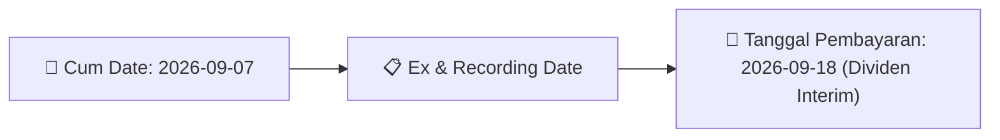
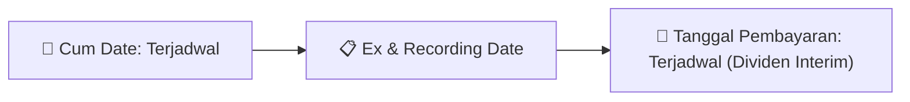

# Ikhtisar Pasar Harian (Daily Digest) - 2026-08-28

📅 **2026-08-28 (Daily Digest)**

## 1. Radar Pasar & Sentimen Harian (Executive Dashboard)
> [!NOTE]
> Terdeteksi sebanyak **275 pengumuman baru** dari 97 emiten pantauan pada (2026-08-28).

| Metric | Jumlah | Status Radar |
| :--- | :---: | :--- |
| **🟢 Sentimen Bullish / Positif** | `9` | [[Dividen Interim]], [[Mandatory Tender Offer]], Kinerja Positif |
| **⚪ Sentimen Netral / Routine** | `107` | [[Tanggapan Penjelasan Bursa]], [[RUPS]], [[Pendaftaran Unit]] |
| **🔴 Sentimen Bearish / Alert** | `5` | Sengketa Hukum, Defisit / Gugatan (Nihil hari ini) |
| **📄 [[Laporan Keuangan]] Baru** | `0` | Memicu Analisis Keuangan Otomatis |

> [!NOTE]
> Tidak dideteksi adanya publikasi laporan keuangan baru hari ini. Rangkuman per emiten secara terperinci tidak diperlukan.

---

## 2. Sorotan Utama & Watchlist Strategis (Strategic Watchlist)
#### 💰 Watchlist Dividen & Distribution
- **[[CMRY]]**: Total Nilai Dividen = IDR 793.468.300.000
- **[[CMRY]]**: Dividen Per Saham = IDR 100
- **[[CMRY]]**: Tanggal Cum Dividen di Pasar Reguler dan Negosiasi = 2026-09-03
- **[[CMRY]]**: Tanggal Ex Dividen di Pasar Reguler dan Negosiasi = 2026-09-04
- **[[CMRY]]**: Tanggal Cum Dividen di Pasar Tunai = 2026-09-07
- **[[CMRY]]**: Tanggal Ex Dividen di Pasar Tunai = 2026-09-08

#### 🎯 Watchlist Penawaran Tender Wajib (MTO) & Strategis
- **[[CYBR]]**: Pengendali = [[Tidak]]
- **[[PJHB]]**: Rencana Pemegang Saham Utama/Pengendali = [[Tidak ada rencana perubahan kepemilikan saham]]
- **[[LUCY]]**: Keterangan Pengendali = [[Tidak]]
- **[[AGAR]]**: Calon Pengendali Baru = [[Suprajitno Sutomo]]
- **[[KKGI]]**: Pengendali = [[Tidak]]
- **[[ALL]]**: Pemegang Saham Pengendali = [[Robert Njo (18%), Rudy Chandra (19%), Hendrianto Thamrin (20%)]]

#### 📈 Watchlist Konversi Waran & Potensi Dilusi
- **[[CSIS]]**: Nama Waran = CSIS-W
- **[[CSIS]]**: Total Saham Setelah Konversi = 1.829.803.506
- **[[CSIS]]**: Sisa Waran = 52.276.432
- **[[INET]]**: Nama Waran = INET-W2
- **[[INET]]**: Jumlah Waran yang Dikonversi = 90.624
- **[[INET]]**: Jumlah Saham Hasil Konversi = 90.624

---

## 3. Matriks Pengumuman Pasar (Announcements Intelligence Table)
| Emiten | Sentimen | Jenis Pengumuman | Judul Pengumuman | Berkas |
| :--- | :---: | :--- | :--- | :--- |
| **[[CSIS]]** | ⚪ NEUTRAL | Aksi Korporasi | Pencatatan Saham Tambahan dari Konversi | [Utama](file:///g:/My%20Drive/Model2/reports/raw/CSIS/20260827_CSIS_20260826_CSIS_Pencatatan Saham Tambahan dari Konversi_32132624.pdf) |
| **[[DR]]** | ⚪ NEUTRAL | Aksi Korporasi | DR DR Keterbukaan Informasi | [Utama](file:///g:/My%20Drive/Model2/reports/raw/DR/20260828_DR_20260828_DR_Keterbukaan Informasi_32133399.pdf) · [Lamp 1](file:///g:/My%20Drive/Model2/reports/raw/DR/20260827_DR_20260826_DR_Keterbukaan Informasi_32132512_lamp1.pdf) · [Lamp 1](file:///g:/My%20Drive/Model2/reports/raw/DR/20260828_DR_20260827_DR_Keterbukaan Informasi_32132943_lamp1.pdf) · [Lamp 1](file:///g:/My%20Drive/Model2/reports/raw/DR/20260828_DR_20260828_DR_Keterbukaan Informasi_32133399_lamp1.pdf) |
| **[[INET]]** | ⚪ NEUTRAL | Aksi Korporasi | Pencatatan Saham Tambahan dari Konversi | [Utama](file:///g:/My%20Drive/Model2/reports/raw/INET/20260827_INET_20260827_INET_Pencatatan Saham Tambahan dari Konversi_32132888.pdf) |
| **[[ISAP]]** | ⚪ NEUTRAL | Aksi Korporasi | Pencatatan Saham Tambahan dari Konversi | [Utama](file:///g:/My%20Drive/Model2/reports/raw/ISAP/20260827_ISAP_20260827_ISAP_Pencatatan Saham Tambahan dari Konversi_32132913.pdf) |
| **[[DOOH]]** | ⚪ NEUTRAL | Public Expose | Public Expose | [Utama](file:///g:/My%20Drive/Model2/reports/raw/DOOH/20260827_DOOH_20260827_DOOH_Public Expose_32133171.pdf) · [Lamp 1](file:///g:/My%20Drive/Model2/reports/raw/DOOH/20260827_DOOH_20260827_DOOH_Public Expose_32133171_lamp1.pdf) |
| **[[MGNA]]** | ⚪ NEUTRAL | Aksi Korporasi | Pencatatan Saham Tambahan dari Konversi | [Utama](file:///g:/My%20Drive/Model2/reports/raw/MGNA/20260827_MGNA_20260826_MGNA_Pencatatan Saham Tambahan dari Konversi_32132505.pdf) · [Lamp 1](file:///g:/My%20Drive/Model2/reports/raw/MGNA/20260827_MGNA_20260824_MGNA_Pencatatan Saham Tambahan dari Konversi_32132226_lamp1.pdf) |
| **[[ELSA]]** | ⚪ NEUTRAL | Aksi Korporasi | Laporan Informasi dan Fakta Material | [Utama](file:///g:/My%20Drive/Model2/reports/raw/ELSA/20260827_ELSA_20260827_ELSA_Laporan Informasi dan Fakta Material_32132805.pdf) · [Lamp 2](file:///g:/My%20Drive/Model2/reports/raw/ELSA/20260827_ELSA_20260827_ELSA_Laporan Informasi dan Fakta Material_32132805_lamp2.pdf) · [Lamp 1](file:///g:/My%20Drive/Model2/reports/raw/ELSA/20260827_ELSA_20260827_ELSA_Laporan Informasi dan Fakta Material_32132805_lamp1.pdf) |
| **[[TBIG]]** | ⚪ NEUTRAL | RUPS | Ringkasan RisalahRisalah RUPS | [Utama](file:///g:/My%20Drive/Model2/reports/raw/TBIG/20260827_TBIG_20260827_TBIG_Ringkasan RisalahRisalah RUPS_32132848.pdf) · [Lamp 3](file:///g:/My%20Drive/Model2/reports/raw/TBIG/20260827_TBIG_20260827_TBIG_Ringkasan RisalahRisalah RUPS_32132848_lamp3.pdf) · [Lamp 2](file:///g:/My%20Drive/Model2/reports/raw/TBIG/20260827_TBIG_20260827_TBIG_Ringkasan RisalahRisalah RUPS_32132848_lamp2.pdf) · [Lamp 1](file:///g:/My%20Drive/Model2/reports/raw/TBIG/20260827_TBIG_20260827_TBIG_Ringkasan RisalahRisalah RUPS_32132848_lamp1.pdf) |
| **[[CMRY]]** | 🟢 BULLISH | Dividen | Jadwal Aksi Korporasi (Khusus Penyampaian Dividen Interim) | [Utama](file:///g:/My%20Drive/Model2/reports/raw/CMRY/20260827_CMRY_20260827_CMRY_Jadwal Aksi Korporasi (Khusus Penyampaian Dividen Interim)_32132891.pdf) |
| **[[SMFP]]** | ⚪ NEUTRAL | Aksi Korporasi | Pengumuman Perubahan Pencatatan EBA Partisipasi | [Utama](file:///g:/My%20Drive/Model2/reports/raw/SMFP/20260827_SMFP_20260826_SMFP_Pengumuman Perubahan Pencatatan EBA Partisipasi_32132530.pdf) |
| **[[SMFP]]** | ⚪ NEUTRAL | Aksi Korporasi | Pengumuman Jatuh Tempo Obligasi dan Sukuk | [Utama](file:///g:/My%20Drive/Model2/reports/raw/SMFP/20260827_SMFP_20260826_SMFP_Pengumuman Jatuh Tempo Obligasi dan Sukuk_32132670.pdf) |
| **[[CYBR]]** | ⚪ NEUTRAL | Aksi Korporasi | Pencatatan Saham Tambahan dari Konversi | [Utama](file:///g:/My%20Drive/Model2/reports/raw/CYBR/20260827_CYBR_20260827_CYBR_Pencatatan Saham Tambahan dari Konversi_32132897.pdf) · [Lamp 1](file:///g:/My%20Drive/Model2/reports/raw/CYBR/20260827_CYBR_20260824_CYBR_Pencatatan Saham Tambahan dari Konversi_32132298_lamp1.pdf) · [Lamp 1](file:///g:/My%20Drive/Model2/reports/raw/CYBR/20260827_CYBR_20260827_CYBR_Pencatatan Saham Tambahan dari Konversi_32132897_lamp1.pdf) |
| **[[CYBR]]** | ⚪ NEUTRAL | Aksi Korporasi | LK-28082026-9370-00 | [Utama](file:///g:/My%20Drive/Model2/reports/raw/CYBR/20260828_CYBR_LK-28082026-9370-00.pdf) |
| **[[DJPU]]** | ⚪ NEUTRAL | Aksi Korporasi | Pengumuman Jatuh Tempo Obligasi dan Sukuk | [Utama](file:///g:/My%20Drive/Model2/reports/raw/DJPU/20260827_DJPU_20260827_DJPU_Pengumuman Jatuh Tempo Obligasi dan Sukuk_32132843.pdf) |
| **[[DJPU]]** | ⚪ NEUTRAL | Aksi Korporasi | Pengumuman Pencatatan Awal Obligasi dan Sukuk | [Utama](file:///g:/My%20Drive/Model2/reports/raw/DJPU/20260828_DJPU_20260827_DJPU_Pengumuman Pencatatan Awal Obligasi dan Sukuk_32133045.pdf) |
| **[[PACK]]** | ⚪ NEUTRAL | Aksi Korporasi | Pencatatan Saham Tambahan dari Konversi | [Utama](file:///g:/My%20Drive/Model2/reports/raw/PACK/20260827_PACK_20260827_PACK_Pencatatan Saham Tambahan dari Konversi_32132884.pdf) |
| **[[PJHB]]** | ⚪ NEUTRAL | Aksi Korporasi | Tanggapan atas Permintaan Penjelasan Bursa | [Utama](file:///g:/My%20Drive/Model2/reports/raw/PJHB/20260827_PJHB_20260827_PJHB_Tanggapan atas Permintaan Penjelasan Bursa_32132840.pdf) · [Lamp 1](file:///g:/My%20Drive/Model2/reports/raw/PJHB/20260827_PJHB_20260827_PJHB_Tanggapan atas Permintaan Penjelasan Bursa_32132840_lamp1.pdf) |
| **[[PJHB]]** | ⚪ NEUTRAL | Aksi Korporasi | Pencatatan Saham Tambahan dari Konversi | [Utama](file:///g:/My%20Drive/Model2/reports/raw/PJHB/20260827_PJHB_20260827_PJHB_Pencatatan Saham Tambahan dari Konversi_32132852.pdf) |
| **[[DOID]]** | ⚪ NEUTRAL | Aksi Korporasi | Tanggapan atas Permintaan Penjelasan Bursa | [Utama](file:///g:/My%20Drive/Model2/reports/raw/DOID/20260827_DOID_20260827_DOID_Tanggapan atas Permintaan Penjelasan Bursa_32133023.pdf) |
| **[[EMAS]]** | ⚪ NEUTRAL | Aksi Korporasi | Laporan Informasi dan Fakta Material | [Utama](file:///g:/My%20Drive/Model2/reports/raw/EMAS/20260827_EMAS_20260827_EMAS_Laporan Informasi dan Fakta Material_32133168.pdf) · [Lamp 1](file:///g:/My%20Drive/Model2/reports/raw/EMAS/20260827_EMAS_20260827_EMAS_Laporan Informasi dan Fakta Material_32133168_lamp1.pdf) |
| **[[EPAC]]** | ⚪ NEUTRAL | Aksi Korporasi | Laporan Informasi dan Fakta Material | [Utama](file:///g:/My%20Drive/Model2/reports/raw/EPAC/20260827_EPAC_20260827_EPAC_Laporan Informasi dan Fakta Material_32133169.pdf) · [Lamp 1](file:///g:/My%20Drive/Model2/reports/raw/EPAC/20260827_EPAC_20260827_EPAC_Laporan Informasi dan Fakta Material_32133169_lamp1.pdf) · [Lamp 2](file:///g:/My%20Drive/Model2/reports/raw/EPAC/20260827_EPAC_20260827_EPAC_Laporan Informasi dan Fakta Material_32133169_lamp2.pdf) |
| **[[CBDK]]** | ⚪ NEUTRAL | Aksi Korporasi | Laporan Informasi dan Fakta Material | [Utama](file:///g:/My%20Drive/Model2/reports/raw/CBDK/20260827_CBDK_20260827_CBDK_Laporan Informasi dan Fakta Material_32133152.pdf) · [Lamp 1](file:///g:/My%20Drive/Model2/reports/raw/CBDK/20260827_CBDK_20260827_CBDK_Laporan Informasi dan Fakta Material_32133152_lamp1.pdf) |
| **[[MDLA]]** | ⚪ NEUTRAL | Public Expose | Public Expose | [Utama](file:///g:/My%20Drive/Model2/reports/raw/MDLA/20260827_MDLA_20260827_MDLA_Public Expose_32132829.pdf) |
| **[[TAMA]]** | ⚪ NEUTRAL | Aksi Korporasi | LK-27082026-9824-00 | [Utama](file:///g:/My%20Drive/Model2/reports/raw/TAMA/20260827_TAMA_LK-27082026-9824-00.pdf) |
| **[[LUCY]]** | ⚪ NEUTRAL | Aksi Korporasi | LK-27082026-8598-00 | [Utama](file:///g:/My%20Drive/Model2/reports/raw/LUCY/20260827_LUCY_LK-27082026-8598-00.pdf) |
| **[[LUCY]]** | ⚪ NEUTRAL | Aksi Korporasi | LK-28082026-0926-00 | [Utama](file:///g:/My%20Drive/Model2/reports/raw/LUCY/20260828_LUCY_LK-28082026-0926-00.pdf) |
| **[[JSMR]]** | ⚪ NEUTRAL | Aksi Korporasi | Informasi Transaksi Afiliasi | [Utama](file:///g:/My%20Drive/Model2/reports/raw/JSMR/20260827_JSMR_20260827_JSMR_Informasi Transaksi Afiliasi_32132977.pdf) · [Lamp 1](file:///g:/My%20Drive/Model2/reports/raw/JSMR/20260827_JSMR_20260827_JSMR_Informasi Transaksi Afiliasi_32132979_lamp1.pdf) · [Lamp 2](file:///g:/My%20Drive/Model2/reports/raw/JSMR/20260827_JSMR_20260827_JSMR_Informasi Transaksi Afiliasi_32132979_lamp2.pdf) · [Lamp 2](file:///g:/My%20Drive/Model2/reports/raw/JSMR/20260827_JSMR_20260827_JSMR_Informasi Transaksi Afiliasi_32132977_lamp2.pdf) · [Lamp 1](file:///g:/My%20Drive/Model2/reports/raw/JSMR/20260827_JSMR_20260827_JSMR_Informasi Transaksi Afiliasi_32132977_lamp1.pdf) · [Lamp 2](file:///g:/My%20Drive/Model2/reports/raw/JSMR/20260827_JSMR_20260827_JSMR_Informasi Transaksi Afiliasi_32132975_lamp2.pdf) · [Lamp 4](file:///g:/My%20Drive/Model2/reports/raw/JSMR/20260827_JSMR_20260827_JSMR_Informasi Transaksi Afiliasi_32132975_lamp4.pdf) · [Lamp 3](file:///g:/My%20Drive/Model2/reports/raw/JSMR/20260827_JSMR_20260827_JSMR_Informasi Transaksi Afiliasi_32132975_lamp3.pdf) |
| **[[PYFA]]** | ⚪ NEUTRAL | Public Expose | Public Expose | [Utama](file:///g:/My%20Drive/Model2/reports/raw/PYFA/20260827_PYFA_20260827_PYFA_Public Expose_32132963.pdf) · [Lamp 1](file:///g:/My%20Drive/Model2/reports/raw/PYFA/20260827_PYFA_20260827_PYFA_Public Expose_32132963_lamp1.pdf) |
| **[[PYFA]]** | ⚪ NEUTRAL | Aksi Korporasi | Pencatatan Saham Tambahan dari Konversi | [Utama](file:///g:/My%20Drive/Model2/reports/raw/PYFA/20260827_PYFA_20260827_PYFA_Pencatatan Saham Tambahan dari Konversi_32132932.pdf) |
| **[[SMSM]]** | 🟢 BULLISH | Aksi Korporasi | Laporan Informasi dan Fakta Material | [Utama](file:///g:/My%20Drive/Model2/reports/raw/SMSM/20260827_SMSM_20260826_SMSM_Laporan Informasi dan Fakta Material_32132773.pdf) |
| **[[PGEO]]** | ⚪ NEUTRAL | Aksi Korporasi | Pencatatan Saham Tambahan dari Konversi | [Utama](file:///g:/My%20Drive/Model2/reports/raw/PGEO/20260827_PGEO_20260827_PGEO_Pencatatan Saham Tambahan dari Konversi_32132894.pdf) |
| **[[NICE]]** | ⚪ NEUTRAL | Aksi Korporasi | Laporan Informasi dan Fakta Material | [Utama](file:///g:/My%20Drive/Model2/reports/raw/NICE/20260827_NICE_20260826_NICE_Laporan Informasi dan Fakta Material_32132664.pdf) |
| **[[PTPP]]** | ⚪ NEUTRAL | Aksi Korporasi | Laporan Hasil Pemeringkatan | [Utama](file:///g:/My%20Drive/Model2/reports/raw/PTPP/20260827_PTPP_20260827_PTPP_Laporan Hasil Pemeringkatan_32132814.pdf) · [Lamp 2](file:///g:/My%20Drive/Model2/reports/raw/PTPP/20260827_PTPP_20260827_PTPP_Laporan Hasil Pemeringkatan_32132814_lamp2.pdf) · [Lamp 1](file:///g:/My%20Drive/Model2/reports/raw/PTPP/20260827_PTPP_20260827_PTPP_Laporan Hasil Pemeringkatan_32132814_lamp1.pdf) |
| **[[ACES]]** | ⚪ NEUTRAL | Public Expose | Public Expose | [Utama](file:///g:/My%20Drive/Model2/reports/raw/ACES/20260827_ACES_20260827_ACES_Public Expose_32133090.pdf) · [Lamp 1](file:///g:/My%20Drive/Model2/reports/raw/ACES/20260827_ACES_20260827_ACES_Public Expose_32133090_lamp1.pdf) |
| **[[SMMA]]** | ⚪ NEUTRAL | Aksi Korporasi | Tanggapan atas Permintaan Penjelasan Bursa | [Utama](file:///g:/My%20Drive/Model2/reports/raw/SMMA/20260827_SMMA_20260827_SMMA_Tanggapan atas Permintaan Penjelasan Bursa_32132893.pdf) |
| **[[EURO]]** | ⚪ NEUTRAL | RUPS | Pemanggilan RUPS | [Utama](file:///g:/My%20Drive/Model2/reports/raw/EURO/20260827_EURO_20260827_EURO_Pemanggilan RUPS_32132935.pdf) · [Lamp 1](file:///g:/My%20Drive/Model2/reports/raw/EURO/20260827_EURO_20260827_EURO_Pemanggilan RUPS_32132935_lamp1.pdf) |
| **[[VICO]]** | 🟢 BULLISH | Dividen | Pemanggilan RUPS | [Utama](file:///g:/My%20Drive/Model2/reports/raw/VICO/20260827_VICO_20260827_VICO_Pemanggilan RUPS_32132850.pdf) · [Lamp 2](file:///g:/My%20Drive/Model2/reports/raw/VICO/20260827_VICO_20260827_VICO_Pemanggilan RUPS_32132850_lamp2.pdf) |
| **[[BWPT]]** | 🔴 BEARISH | Aksi Korporasi | Tanggapan atas Permintaan Penjelasan Bursa | [Utama](file:///g:/My%20Drive/Model2/reports/raw/BWPT/20260827_BWPT_20260827_BWPT_Tanggapan atas Permintaan Penjelasan Bursa_32133068.pdf) · [Lamp 1](file:///g:/My%20Drive/Model2/reports/raw/BWPT/20260827_BWPT_20260827_BWPT_Tanggapan atas Permintaan Penjelasan Bursa_32133068_lamp1.pdf) |
| **[[BBRM]]** | ⚪ NEUTRAL | Aksi Korporasi | Laporan Informasi dan Fakta Material | [Utama](file:///g:/My%20Drive/Model2/reports/raw/BBRM/20260827_BBRM_20260827_BBRM_Laporan Informasi dan Fakta Material_32133094.pdf) · [Lamp 1](file:///g:/My%20Drive/Model2/reports/raw/BBRM/20260827_BBRM_20260827_BBRM_Laporan Informasi dan Fakta Material_32133094_lamp1.pdf) · [Lamp 2](file:///g:/My%20Drive/Model2/reports/raw/BBRM/20260827_BBRM_20260827_BBRM_Laporan Informasi dan Fakta Material_32133094_lamp2.pdf) |
| **[[KOCI]]** | ⚪ NEUTRAL | Aksi Korporasi | Pencatatan Saham Tambahan dari Konversi | [Utama](file:///g:/My%20Drive/Model2/reports/raw/KOCI/20260827_KOCI_20260824_KOCI_Pencatatan Saham Tambahan dari Konversi_32132222.pdf) · [Lamp 1](file:///g:/My%20Drive/Model2/reports/raw/KOCI/20260827_KOCI_20260824_KOCI_Pencatatan Saham Tambahan dari Konversi_32132222_lamp1.pdf) |
| **[[RGAS]]** | ⚪ NEUTRAL | Aksi Korporasi | LK-27082026-1987-00 | [Utama](file:///g:/My%20Drive/Model2/reports/raw/RGAS/20260827_RGAS_LK-27082026-1987-00.pdf) |
| **[[RGAS]]** | ⚪ NEUTRAL | Aksi Korporasi | LK-27082026-2617-00 | [Utama](file:///g:/My%20Drive/Model2/reports/raw/RGAS/20260827_RGAS_LK-27082026-2617-00.pdf) |
| **[[BVIC]]** | ⚪ NEUTRAL | Aksi Korporasi | Pembayaran KuponBagi HasilIjarahPokok | [Utama](file:///g:/My%20Drive/Model2/reports/raw/BVIC/20260827_BVIC_20260827_BVIC_Pembayaran KuponBagi HasilIjarahPokok_32132961.pdf) |
| **[[WSKT]]** | ⚪ NEUTRAL | Aksi Korporasi | Laporan Informasi dan Fakta Material | [Utama](file:///g:/My%20Drive/Model2/reports/raw/WSKT/20260827_WSKT_20260827_WSKT_Laporan Informasi dan Fakta Material_32132809.pdf) · [Lamp 1](file:///g:/My%20Drive/Model2/reports/raw/WSKT/20260827_WSKT_20260827_WSKT_Laporan Informasi dan Fakta Material_32132809_lamp1.pdf) |
| **[[RATU]]** | ⚪ NEUTRAL | Public Expose | Public Expose | [Utama](file:///g:/My%20Drive/Model2/reports/raw/RATU/20260827_RATU_20260827_RATU_Public Expose_32132892.pdf) |
| **[[RATU]]** | ⚪ NEUTRAL | Aksi Korporasi | Tanggapan atas Permintaan Penjelasan Bursa | [Utama](file:///g:/My%20Drive/Model2/reports/raw/RATU/20260828_RATU_20260828_RATU_Tanggapan atas Permintaan Penjelasan Bursa_32133392.pdf) · [Lamp 1](file:///g:/My%20Drive/Model2/reports/raw/RATU/20260828_RATU_20260828_RATU_Tanggapan atas Permintaan Penjelasan Bursa_32133392_lamp1.pdf) |
| **[[ITMG]]** | ⚪ NEUTRAL | Public Expose | Public Expose | [Utama](file:///g:/My%20Drive/Model2/reports/raw/ITMG/20260827_ITMG_20260827_ITMG_Public Expose_32132811.pdf) |
| **[[AGAR]]** | 🔴 BEARISH | Aksi Korporasi | Tanggapan atas Permintaan Penjelasan Bursa | [Utama](file:///g:/My%20Drive/Model2/reports/raw/AGAR/20260827_AGAR_20260827_AGAR_Tanggapan atas Permintaan Penjelasan Bursa_32133157.pdf) · [Lamp 1](file:///g:/My%20Drive/Model2/reports/raw/AGAR/20260827_AGAR_20260827_AGAR_Tanggapan atas Permintaan Penjelasan Bursa_32133157_lamp1.pdf) · [Lamp 2](file:///g:/My%20Drive/Model2/reports/raw/AGAR/20260827_AGAR_20260827_AGAR_Tanggapan atas Permintaan Penjelasan Bursa_32133157_lamp2.pdf) |
| **[[KKGI]]** | ⚪ NEUTRAL | Aksi Korporasi | LK-27082026-3031-00 | [Utama](file:///g:/My%20Drive/Model2/reports/raw/KKGI/20260827_KKGI_LK-27082026-3031-00.pdf) |
| **[[TINS]]** | ⚪ NEUTRAL | Public Expose | Public Expose | [Utama](file:///g:/My%20Drive/Model2/reports/raw/TINS/20260827_TINS_20260827_TINS_Public Expose_32132834.pdf) |
| **[[INKP]]** | ⚪ NEUTRAL | Aksi Korporasi | Laporan Informasi dan Fakta Material | [Utama](file:///g:/My%20Drive/Model2/reports/raw/INKP/20260827_INKP_20260824_INKP_Laporan Informasi dan Fakta Material_32132152.pdf) |
| **[[INKP]]** | ⚪ NEUTRAL | Aksi Korporasi | Pengumuman Jatuh Tempo Obligasi dan Sukuk | [Utama](file:///g:/My%20Drive/Model2/reports/raw/INKP/20260827_INKP_20260824_INKP_Pengumuman Jatuh Tempo Obligasi dan Sukuk_32132291.pdf) · [Lamp 2](file:///g:/My%20Drive/Model2/reports/raw/INKP/20260827_INKP_20260824_INKP_Pengumuman Jatuh Tempo Obligasi dan Sukuk_32132291_lamp2.pdf) |
| **[[MBMA]]** | 🟢 BULLISH | Aksi Korporasi | Laporan Informasi dan Fakta Material | [Utama](file:///g:/My%20Drive/Model2/reports/raw/MBMA/20260827_MBMA_20260827_MBMA_Laporan Informasi dan Fakta Material_32132922.pdf) · [Lamp 2](file:///g:/My%20Drive/Model2/reports/raw/MBMA/20260827_MBMA_20260827_MBMA_Laporan Informasi dan Fakta Material_32132922_lamp2.pdf) |
| **[[MBMA]]** | ⚪ NEUTRAL | Aksi Korporasi | Pengumuman Jatuh Tempo Obligasi dan Sukuk | [Utama](file:///g:/My%20Drive/Model2/reports/raw/MBMA/20260827_MBMA_20260826_MBMA_Pengumuman Jatuh Tempo Obligasi dan Sukuk_32132497.pdf) · [Lamp 1](file:///g:/My%20Drive/Model2/reports/raw/MBMA/20260827_MBMA_20260826_MBMA_Pengumuman Jatuh Tempo Obligasi dan Sukuk_32132497_lamp1.pdf) |
| **[[RICY]]** | ⚪ NEUTRAL | Public Expose | Public Expose | [Utama](file:///g:/My%20Drive/Model2/reports/raw/RICY/20260828_RICY_20260827_RICY_Public Expose_32133059.pdf) · [Lamp 1](file:///g:/My%20Drive/Model2/reports/raw/RICY/20260827_RICY_20260827_RICY_Public Expose_32132842_lamp1.pdf) · [Lamp 2](file:///g:/My%20Drive/Model2/reports/raw/RICY/20260827_RICY_20260827_RICY_Public Expose_32132842_lamp2.pdf) · [Lamp 2](file:///g:/My%20Drive/Model2/reports/raw/RICY/20260828_RICY_20260827_RICY_Public Expose_32133059_lamp2.pdf) · [Lamp 1](file:///g:/My%20Drive/Model2/reports/raw/RICY/20260828_RICY_20260827_RICY_Public Expose_32133059_lamp1.pdf) |
| **[[MICE]]** | ⚪ NEUTRAL | Aksi Korporasi | LK-27082026-0235-00 | [Utama](file:///g:/My%20Drive/Model2/reports/raw/MICE/20260827_MICE_LK-27082026-0235-00.pdf) |
| **[[PBSA]]** | ⚪ NEUTRAL | RUPS | Pemanggilan RUPS | [Utama](file:///g:/My%20Drive/Model2/reports/raw/PBSA/20260827_PBSA_20260827_PBSA_Pemanggilan RUPS_32132810.pdf) · [Lamp 1](file:///g:/My%20Drive/Model2/reports/raw/PBSA/20260827_PBSA_20260827_PBSA_Pemanggilan RUPS_32132810_lamp1.pdf) |
| **[[BPII]]** | ⚪ NEUTRAL | Aksi Korporasi | Tanggapan atas Permintaan Penjelasan Bursa | [Utama](file:///g:/My%20Drive/Model2/reports/raw/BPII/20260827_BPII_20260827_BPII_Tanggapan atas Permintaan Penjelasan Bursa_32133132.pdf) · [Lamp 1](file:///g:/My%20Drive/Model2/reports/raw/BPII/20260827_BPII_20260827_BPII_Tanggapan atas Permintaan Penjelasan Bursa_32133132_lamp1.pdf) |
| **[[GGRM]]** | ⚪ NEUTRAL | Public Expose | Public Expose | [Utama](file:///g:/My%20Drive/Model2/reports/raw/GGRM/20260827_GGRM_20260826_GGRM_Public Expose_32132685.pdf) |
| **[[ALL]]** | ⚪ NEUTRAL | Aksi Korporasi | Pengumuman Bursa | [Utama](file:///g:/My%20Drive/Model2/reports/raw/ALL/20260827__20260827_Pengumuman Bursa_32133091.pdf) · [Lamp 4](file:///g:/My%20Drive/Model2/reports/raw/ALL/20260827__20260827_Pengumuman Bursa_32133091_lamp4.pdf) · [Lamp 1](file:///g:/My%20Drive/Model2/reports/raw/ALL/20260827__20260827_Pengumuman Bursa_32133091_lamp1.pdf) · [Lamp 2](file:///g:/My%20Drive/Model2/reports/raw/ALL/20260827__20260827_Pengumuman Bursa_32133091_lamp2.pdf) · [Lamp 3](file:///g:/My%20Drive/Model2/reports/raw/ALL/20260827__20260827_Pengumuman Bursa_32133091_lamp3.pdf) |
| **[[PNBN]]** | ⚪ NEUTRAL | Aksi Korporasi | Laporan Penggunaan Dana Hasil Penawaran Umum | [Utama](file:///g:/My%20Drive/Model2/reports/raw/PNBN/20260827_PNBN_20260826_PNBN_Laporan Penggunaan Dana Hasil Penawaran Umum_32132659.pdf) |
| **[[R-ABFII]]** | ⚪ NEUTRAL | Aksi Korporasi | R-ABFII R-ABFII Pencatatan AwalTambahan ETF | [Utama](file:///g:/My%20Drive/Model2/reports/raw/R-ABFII/20260827_R-ABFII_20260827_R-ABFII_Pencatatan AwalTambahan ETF_32132908.pdf) · [Lamp 1](file:///g:/My%20Drive/Model2/reports/raw/R-ABFII/20260827_R-ABFII_20260827_R-ABFII_Pencatatan AwalTambahan ETF_32132908_lamp1.pdf) |
| **[[SMII]]** | ⚪ NEUTRAL | Aksi Korporasi | Pengumuman Jatuh Tempo Obligasi dan Sukuk | [Utama](file:///g:/My%20Drive/Model2/reports/raw/SMII/20260827_SMII_20260827_SMII_Pengumuman Jatuh Tempo Obligasi dan Sukuk_32132929.pdf) |
| **[[PICO]]** | ⚪ NEUTRAL | Aksi Korporasi | Tanggapan atas Permintaan Penjelasan Bursa | [Utama](file:///g:/My%20Drive/Model2/reports/raw/PICO/20260827_PICO_20260827_PICO_Tanggapan atas Permintaan Penjelasan Bursa_32132863.pdf) |
| **[[R-LQ45X]]** | ⚪ NEUTRAL | Aksi Korporasi | R-LQ45X R-LQ45X Pencatatan AwalTambahan ETF | [Utama](file:///g:/My%20Drive/Model2/reports/raw/R-LQ45X/20260827_R-LQ45X_20260827_R-LQ45X_Pencatatan AwalTambahan ETF_32132818.pdf) |
| **[[CENT]]** | ⚪ NEUTRAL | Aksi Korporasi | Tanggapan atas Permintaan Penjelasan Bursa | [Utama](file:///g:/My%20Drive/Model2/reports/raw/CENT/20260827_CENT_20260827_CENT_Tanggapan atas Permintaan Penjelasan Bursa_32132976.pdf) · [Lamp 1](file:///g:/My%20Drive/Model2/reports/raw/CENT/20260827_CENT_20260827_CENT_Tanggapan atas Permintaan Penjelasan Bursa_32132976_lamp1.pdf) |
| **[[PART]]** | ⚪ NEUTRAL | Aksi Korporasi | Tanggapan atas Permintaan Penjelasan Bursa | [Utama](file:///g:/My%20Drive/Model2/reports/raw/PART/20260827_PART_20260827_PART_Tanggapan atas Permintaan Penjelasan Bursa_32132807.pdf) |
| **[[PART]]** | ⚪ NEUTRAL | Aksi Korporasi | Laporan Informasi dan Fakta Material | [Utama](file:///g:/My%20Drive/Model2/reports/raw/PART/20260828_PART_20260828_PART_Laporan Informasi dan Fakta Material_32133199.pdf) |
| **[[PGAS]]** | 🔴 BEARISH | Aksi Korporasi | Laporan Informasi dan Fakta Material | [Utama](file:///g:/My%20Drive/Model2/reports/raw/PGAS/20260827_PGAS_20260827_PGAS_Laporan Informasi dan Fakta Material_32133145.pdf) · [Lamp 1](file:///g:/My%20Drive/Model2/reports/raw/PGAS/20260827_PGAS_20260827_PGAS_Laporan Informasi dan Fakta Material_32133186_lamp1.pdf) |
| **[[DILD]]** | ⚪ NEUTRAL | Aksi Korporasi | Laporan Informasi dan Fakta Material | [Utama](file:///g:/My%20Drive/Model2/reports/raw/DILD/20260827_DILD_20260827_DILD_Laporan Informasi dan Fakta Material_32133143.pdf) · [Lamp 1](file:///g:/My%20Drive/Model2/reports/raw/DILD/20260827_DILD_20260827_DILD_Laporan Informasi dan Fakta Material_32133143_lamp1.pdf) |
| **[[TRIS]]** | 🟢 BULLISH | Aksi Korporasi | LK-27082026-2058-00 | [Utama](file:///g:/My%20Drive/Model2/reports/raw/TRIS/20260827_TRIS_LK-27082026-2058-00.pdf) |
| **[[TRIS]]** | ⚪ NEUTRAL | Aksi Korporasi | LK-27082026-6215-00 | [Utama](file:///g:/My%20Drive/Model2/reports/raw/TRIS/20260827_TRIS_LK-27082026-6215-00.pdf) |
| **[[TRIS]]** | 🟢 BULLISH | Aksi Korporasi | LK-27082026-9399-00 | [Utama](file:///g:/My%20Drive/Model2/reports/raw/TRIS/20260827_TRIS_LK-27082026-9399-00.pdf) |
| **[[TRIS]]** | 🟢 BULLISH | Aksi Korporasi | LK-27082026-1104-00 | [Utama](file:///g:/My%20Drive/Model2/reports/raw/TRIS/20260827_TRIS_LK-27082026-1104-00.pdf) |
| **[[MOYA]]** | ⚪ NEUTRAL | Aksi Korporasi | Laporan Informasi dan Fakta Material | [Utama](file:///g:/My%20Drive/Model2/reports/raw/MOYA/20260827_MOYA_20260827_MOYA_Laporan Informasi dan Fakta Material_32132949.pdf) · [Lamp 3](file:///g:/My%20Drive/Model2/reports/raw/MOYA/20260827_MOYA_20260827_MOYA_Laporan Informasi dan Fakta Material_32132949_lamp3.pdf) · [Lamp 4](file:///g:/My%20Drive/Model2/reports/raw/MOYA/20260827_MOYA_20260827_MOYA_Laporan Informasi dan Fakta Material_32132949_lamp4.pdf) · [Lamp 2](file:///g:/My%20Drive/Model2/reports/raw/MOYA/20260827_MOYA_20260827_MOYA_Laporan Informasi dan Fakta Material_32132949_lamp2.pdf) |
| **[[ZP]]** | 🟢 BULLISH | Dividen | ZP ZP Keterbukaan Informasi | [Utama](file:///g:/My%20Drive/Model2/reports/raw/ZP/20260828_ZP_20260828_ZP_Keterbukaan Informasi_32133381.pdf) · [Lamp 1](file:///g:/My%20Drive/Model2/reports/raw/ZP/20260828_ZP_20260828_ZP_Keterbukaan Informasi_32133381_lamp1.pdf) · [Lamp 1](file:///g:/My%20Drive/Model2/reports/raw/ZP/20260828_ZP_20260828_ZP_Keterbukaan Informasi_32133314_lamp1.pdf) |
| **[[IMPC]]** | ⚪ NEUTRAL | Aksi Korporasi | LK-28082026-2265-00 | [Utama](file:///g:/My%20Drive/Model2/reports/raw/IMPC/20260828_IMPC_LK-28082026-2265-00.pdf) |
| **[[DOSS]]** | ⚪ NEUTRAL | Aksi Korporasi | Tanggapan atas Permintaan Penjelasan Bursa | [Utama](file:///g:/My%20Drive/Model2/reports/raw/DOSS/20260828_DOSS_20241106_DOSS_Tanggapan atas Permintaan Penjelasan Bursa_31754091.pdf) |
| **[[KDTN]]** | ⚪ NEUTRAL | Aksi Korporasi | LK-28082026-0528-00 | [Utama](file:///g:/My%20Drive/Model2/reports/raw/KDTN/20260828_KDTN_LK-28082026-0528-00.pdf) |
| **[[KDTN]]** | ⚪ NEUTRAL | Aksi Korporasi | LK-28082026-1587-00 | [Utama](file:///g:/My%20Drive/Model2/reports/raw/KDTN/20260828_KDTN_LK-28082026-1587-00.pdf) |
| **[[ALKA]]** | ⚪ NEUTRAL | Aksi Korporasi | Tanggapan atas Permintaan Penjelasan Bursa | [Utama](file:///g:/My%20Drive/Model2/reports/raw/ALKA/20260828_ALKA_20260828_ALKA_Tanggapan atas Permintaan Penjelasan Bursa_32133335.pdf) |
| **[[TOWR]]** | ⚪ NEUTRAL | Aksi Korporasi | LK-28082026-3437-00 | [Utama](file:///g:/My%20Drive/Model2/reports/raw/TOWR/20260828_TOWR_LK-28082026-3437-00.pdf) |
| **[[TOWR]]** | ⚪ NEUTRAL | Aksi Korporasi | LK-28082026-0679-00 | [Utama](file:///g:/My%20Drive/Model2/reports/raw/TOWR/20260828_TOWR_LK-28082026-0679-00.pdf) |
| **[[WGSH]]** | ⚪ NEUTRAL | Aksi Korporasi | Laporan Informasi dan Fakta Material | [Utama](file:///g:/My%20Drive/Model2/reports/raw/WGSH/20260828_WGSH_20260828_WGSH_Laporan Informasi dan Fakta Material_32133239.pdf) · [Lamp 1](file:///g:/My%20Drive/Model2/reports/raw/WGSH/20260828_WGSH_20260828_WGSH_Laporan Informasi dan Fakta Material_32133239_lamp1.pdf) |
| **[[FAST]]** | ⚪ NEUTRAL | Aksi Korporasi | Laporan Informasi dan Fakta Material | [Utama](file:///g:/My%20Drive/Model2/reports/raw/FAST/20260828_FAST_20260828_FAST_Laporan Informasi dan Fakta Material_32133347.pdf) · [Lamp 2](file:///g:/My%20Drive/Model2/reports/raw/FAST/20260828_FAST_20260828_FAST_Laporan Informasi dan Fakta Material_32133347_lamp2.pdf) · [Lamp 1](file:///g:/My%20Drive/Model2/reports/raw/FAST/20260828_FAST_20260828_FAST_Laporan Informasi dan Fakta Material_32133347_lamp1.pdf) |
| **[[ELIT]]** | ⚪ NEUTRAL | Aksi Korporasi | Tanggapan atas Permintaan Penjelasan Bursa | [Utama](file:///g:/My%20Drive/Model2/reports/raw/ELIT/20260828_ELIT_20260828_ELIT_Tanggapan atas Permintaan Penjelasan Bursa_32133279.pdf) · [Lamp 1](file:///g:/My%20Drive/Model2/reports/raw/ELIT/20260828_ELIT_20260828_ELIT_Tanggapan atas Permintaan Penjelasan Bursa_32133279_lamp1.pdf) |
| **[[ELIT]]** | ⚪ NEUTRAL | RUPS | Ringkasan RisalahRisalah RUPS | [Utama](file:///g:/My%20Drive/Model2/reports/raw/ELIT/20260828_ELIT_20260828_ELIT_Ringkasan RisalahRisalah RUPS_32133241.pdf) · [Lamp 2](file:///g:/My%20Drive/Model2/reports/raw/ELIT/20260828_ELIT_20260828_ELIT_Ringkasan RisalahRisalah RUPS_32133241_lamp2.pdf) |
| **[[SINI]]** | ⚪ NEUTRAL | Aksi Korporasi | Laporan Informasi dan Fakta Material | [Utama](file:///g:/My%20Drive/Model2/reports/raw/SINI/20260828_SINI_20260828_SINI_Laporan Informasi dan Fakta Material_32133287.pdf) · [Lamp 2](file:///g:/My%20Drive/Model2/reports/raw/SINI/20260828_SINI_20260828_SINI_Laporan Informasi dan Fakta Material_32133300_lamp2.pdf) · [Lamp 2](file:///g:/My%20Drive/Model2/reports/raw/SINI/20260828_SINI_20260828_SINI_Laporan Informasi dan Fakta Material_32133287_lamp2.pdf) |
| **[[TPIA]]** | ⚪ NEUTRAL | Aksi Korporasi | Laporan Informasi dan Fakta Material | [Utama](file:///g:/My%20Drive/Model2/reports/raw/TPIA/20260828_TPIA_20260828_TPIA_Laporan Informasi dan Fakta Material_32133219.pdf) · [Lamp 1](file:///g:/My%20Drive/Model2/reports/raw/TPIA/20260828_TPIA_20260828_TPIA_Laporan Informasi dan Fakta Material_32133219_lamp1.pdf) · [Lamp 2](file:///g:/My%20Drive/Model2/reports/raw/TPIA/20260828_TPIA_20260828_TPIA_Laporan Informasi dan Fakta Material_32133219_lamp2.pdf) |
| **[[HATM]]** | ⚪ NEUTRAL | Aksi Korporasi | Keterbukaan Informasi terkait Aksi Korporasi | [Utama](file:///g:/My%20Drive/Model2/reports/raw/HATM/20260828_HATM_20260828_HATM_Keterbukaan Informasi terkait Aksi Korporasi_32133361.pdf) · [Lamp 1](file:///g:/My%20Drive/Model2/reports/raw/HATM/20260828_HATM_20260828_HATM_Keterbukaan Informasi terkait Aksi Korporasi_32133361_lamp1.pdf) |
| **[[HATM]]** | ⚪ NEUTRAL | Aksi Korporasi | Laporan Informasi dan Fakta Material | [Utama](file:///g:/My%20Drive/Model2/reports/raw/HATM/20260828_HATM_20260828_HATM_Laporan Informasi dan Fakta Material_32133247.pdf) |
| **[[TGKA]]** | ⚪ NEUTRAL | Aksi Korporasi | Pengumuman Bursa | [Utama](file:///g:/My%20Drive/Model2/reports/raw/TGKA/20260828_TGKA_20260827_TGKA_Pengumuman Bursa_32132942.pdf) · [Lamp 1](file:///g:/My%20Drive/Model2/reports/raw/TGKA/20260828_TGKA_20260827_TGKA_Pengumuman Bursa_32132942_lamp1.pdf) |
| **[[NAIK]]** | ⚪ NEUTRAL | Aksi Korporasi | Tanggapan atas Permintaan Penjelasan Bursa | [Utama](file:///g:/My%20Drive/Model2/reports/raw/NAIK/20260828_NAIK_20260828_NAIK_Tanggapan atas Permintaan Penjelasan Bursa_32133265.pdf) |
| **[[CHIP]]** | ⚪ NEUTRAL | Aksi Korporasi | ESG2025-CHIP | [Utama](file:///g:/My%20Drive/Model2/reports/raw/CHIP/20260828_CHIP_ESG2025-CHIP.pdf) |
| **[[CHIP]]** | 🟢 BULLISH | Dividen | AnnualReport2025-CHIP-att1 | [Utama](file:///g:/My%20Drive/Model2/reports/raw/CHIP/20260828_CHIP_AnnualReport2025-CHIP-att1.pdf) |
| **[[CHIP]]** | ⚪ NEUTRAL | Aksi Korporasi | AnnualReport2025-CHIP-att2 | [Utama](file:///g:/My%20Drive/Model2/reports/raw/CHIP/20260828_CHIP_AnnualReport2025-CHIP-att2.pdf) |
| **[[CHIP]]** | ⚪ NEUTRAL | Aksi Korporasi | AnnualReport2025-CHIP-att3 | [Utama](file:///g:/My%20Drive/Model2/reports/raw/CHIP/20260828_CHIP_AnnualReport2025-CHIP-att3.pdf) |
| **[[GOOD]]** | ⚪ NEUTRAL | Aksi Korporasi | LK-28082026-8596-00 | [Utama](file:///g:/My%20Drive/Model2/reports/raw/GOOD/20260828_GOOD_LK-28082026-8596-00.pdf) |
| **[[AWAN]]** | ⚪ NEUTRAL | Aksi Korporasi | Laporan Informasi dan Fakta Material | [Utama](file:///g:/My%20Drive/Model2/reports/raw/AWAN/20260828_AWAN_20260827_AWAN_Laporan Informasi dan Fakta Material_32133182.pdf) · [Lamp 1](file:///g:/My%20Drive/Model2/reports/raw/AWAN/20260828_AWAN_20260827_AWAN_Laporan Informasi dan Fakta Material_32133182_lamp1.pdf) |
| **[[MAYA]]** | ⚪ NEUTRAL | RUPS | Pemanggilan RUPS | [Utama](file:///g:/My%20Drive/Model2/reports/raw/MAYA/20260828_MAYA_20260828_MAYA_Pemanggilan RUPS_32133208.pdf) · [Lamp 1](file:///g:/My%20Drive/Model2/reports/raw/MAYA/20260828_MAYA_20260828_MAYA_Pemanggilan RUPS_32133208_lamp1.pdf) |
| **[[SAFE]]** | ⚪ NEUTRAL | Aksi Korporasi | Tanggapan atas Permintaan Penjelasan Bursa | [Utama](file:///g:/My%20Drive/Model2/reports/raw/SAFE/20260828_SAFE_20260828_SAFE_Tanggapan atas Permintaan Penjelasan Bursa_32133282.pdf) |
| **[[ADHI]]** | ⚪ NEUTRAL | Aksi Korporasi | Laporan Hasil Pemeringkatan | [Utama](file:///g:/My%20Drive/Model2/reports/raw/ADHI/20260828_ADHI_20260828_ADHI_Laporan Hasil Pemeringkatan_32133407.pdf) |
| **[[TOBA]]** | 🔴 BEARISH | Aksi Korporasi | Laporan Informasi dan Fakta Material | [Utama](file:///g:/My%20Drive/Model2/reports/raw/TOBA/20260828_TOBA_20260828_TOBA_Laporan Informasi dan Fakta Material_32133310.pdf) · [Lamp 2](file:///g:/My%20Drive/Model2/reports/raw/TOBA/20260828_TOBA_20260828_TOBA_Laporan Informasi dan Fakta Material_32133310_lamp2.pdf) |
| **[[VKTR]]** | ⚪ NEUTRAL | Aksi Korporasi | LK-28082026-3861-00 | [Utama](file:///g:/My%20Drive/Model2/reports/raw/VKTR/20260828_VKTR_LK-28082026-3861-00.pdf) |
| **[[PTRO]]** | ⚪ NEUTRAL | Aksi Korporasi | Laporan Informasi dan Fakta Material | [Utama](file:///g:/My%20Drive/Model2/reports/raw/PTRO/20260828_PTRO_20260828_PTRO_Laporan Informasi dan Fakta Material_32133198.pdf) · [Lamp 1](file:///g:/My%20Drive/Model2/reports/raw/PTRO/20260828_PTRO_20260828_PTRO_Laporan Informasi dan Fakta Material_32133198_lamp1.pdf) |
| **[[AVIA]]** | ⚪ NEUTRAL | Aksi Korporasi | Laporan Informasi dan Fakta Material | [Utama](file:///g:/My%20Drive/Model2/reports/raw/AVIA/20260828_AVIA_20260827_AVIA_Laporan Informasi dan Fakta Material_32133033.pdf) |
| **[[JARR]]** | ⚪ NEUTRAL | RUPS | Pemanggilan RUPS | [Utama](file:///g:/My%20Drive/Model2/reports/raw/JARR/20260828_JARR_20260828_JARR_Pemanggilan RUPS_32133285.pdf) · [Lamp 1](file:///g:/My%20Drive/Model2/reports/raw/JARR/20260828_JARR_20260828_JARR_Pemanggilan RUPS_32133285_lamp1.pdf) |
| **[[PGUN]]** | ⚪ NEUTRAL | RUPS | Pemanggilan RUPS | [Utama](file:///g:/My%20Drive/Model2/reports/raw/PGUN/20260828_PGUN_20260828_PGUN_Pemanggilan RUPS_32133281.pdf) · [Lamp 1](file:///g:/My%20Drive/Model2/reports/raw/PGUN/20260828_PGUN_20260828_PGUN_Pemanggilan RUPS_32133293_lamp1.pdf) · [Lamp 1](file:///g:/My%20Drive/Model2/reports/raw/PGUN/20260828_PGUN_20260828_PGUN_Pemanggilan RUPS_32133281_lamp1.pdf) |
| **[[ASLI]]** | ⚪ NEUTRAL | Aksi Korporasi | Tanggapan atas Permintaan Penjelasan Bursa | [Utama](file:///g:/My%20Drive/Model2/reports/raw/ASLI/20260828_ASLI_20260828_ASLI_Tanggapan atas Permintaan Penjelasan Bursa_32133405.pdf) · [Lamp 1](file:///g:/My%20Drive/Model2/reports/raw/ASLI/20260828_ASLI_20260828_ASLI_Tanggapan atas Permintaan Penjelasan Bursa_32133405_lamp1.pdf) |
| **[[ARTI]]** | ⚪ NEUTRAL | Aksi Korporasi | ESG2025-ARTI | [Utama](file:///g:/My%20Drive/Model2/reports/raw/ARTI/20260828_ARTI_ESG2025-ARTI.pdf) |
| **[[ARTI]]** | ⚪ NEUTRAL | Aksi Korporasi | AnnualReport2025-ARTI-att1 | [Utama](file:///g:/My%20Drive/Model2/reports/raw/ARTI/20260828_ARTI_AnnualReport2025-ARTI-att1.pdf) |
| **[[ARTI]]** | ⚪ NEUTRAL | Aksi Korporasi | AnnualReport2025-ARTI-att2 | [Utama](file:///g:/My%20Drive/Model2/reports/raw/ARTI/20260828_ARTI_AnnualReport2025-ARTI-att2.pdf) |
| **[[KLBF]]** | ⚪ NEUTRAL | Public Expose | Public Expose | [Utama](file:///g:/My%20Drive/Model2/reports/raw/KLBF/20260828_KLBF_20260828_KLBF_Public Expose_32133382.pdf) |
| **[[NZIA]]** | ⚪ NEUTRAL | Aksi Korporasi | Tanggapan atas Permintaan Penjelasan Bursa | [Utama](file:///g:/My%20Drive/Model2/reports/raw/NZIA/20260828_NZIA_20260828_NZIA_Tanggapan atas Permintaan Penjelasan Bursa_32133270.pdf) |
| **[[BEBS]]** | ⚪ NEUTRAL | Aksi Korporasi | Tanggapan atas Permintaan Penjelasan Bursa | [Utama](file:///g:/My%20Drive/Model2/reports/raw/BEBS/20260828_BEBS_20260828_BEBS_Tanggapan atas Permintaan Penjelasan Bursa_32133187.pdf) · [Lamp 1](file:///g:/My%20Drive/Model2/reports/raw/BEBS/20260828_BEBS_20260828_BEBS_Tanggapan atas Permintaan Penjelasan Bursa_32133187_lamp1.pdf) |
| **[[FIFA]]** | 🔴 BEARISH | Aksi Korporasi | Laporan Informasi dan Fakta Material | [Utama](file:///g:/My%20Drive/Model2/reports/raw/FIFA/20260828_FIFA_20260828_FIFA_Laporan Informasi dan Fakta Material_32133365.pdf) · [Lamp 1](file:///g:/My%20Drive/Model2/reports/raw/FIFA/20260828_FIFA_20260828_FIFA_Laporan Informasi dan Fakta Material_32133365_lamp1.pdf) |
| **[[FIFA]]** | ⚪ NEUTRAL | Aksi Korporasi | Laporan Hasil Pemeringkatan | [Utama](file:///g:/My%20Drive/Model2/reports/raw/FIFA/20260828_FIFA_20260828_FIFA_Laporan Hasil Pemeringkatan_32133376.pdf) · [Lamp 1](file:///g:/My%20Drive/Model2/reports/raw/FIFA/20260828_FIFA_20260828_FIFA_Laporan Hasil Pemeringkatan_32133376_lamp1.pdf) |
| **[[SMLE]]** | ⚪ NEUTRAL | Public Expose | Public Expose | [Utama](file:///g:/My%20Drive/Model2/reports/raw/SMLE/20260828_SMLE_20260828_SMLE_Public Expose_32133373.pdf) |
| **[[AGII]]** | ⚪ NEUTRAL | Aksi Korporasi | Laporan Informasi dan Fakta Material | [Utama](file:///g:/My%20Drive/Model2/reports/raw/AGII/20260828_AGII_20260828_AGII_Laporan Informasi dan Fakta Material_32133235.pdf) · [Lamp 1](file:///g:/My%20Drive/Model2/reports/raw/AGII/20260828_AGII_20260828_AGII_Laporan Informasi dan Fakta Material_32133235_lamp1.pdf) |
| **[[TUFI]]** | ⚪ NEUTRAL | Aksi Korporasi | Laporan Informasi dan Fakta Material | [Utama](file:///g:/My%20Drive/Model2/reports/raw/TUFI/20260828_TUFI_20260828_TUFI_Laporan Informasi dan Fakta Material_32133253.pdf) |
| **[[ATIC]]** | ⚪ NEUTRAL | Aksi Korporasi | LK-28082026-5483-00 | [Utama](file:///g:/My%20Drive/Model2/reports/raw/ATIC/20260828_ATIC_LK-28082026-5483-00.pdf) |

---

## 4. Detail Informasi per Emiten (Grouped by Emiten)
### 🔵 [[CSIS]]
- **[Aksi Korporasi]** [Pencatatan Saham Tambahan dari Konversi](file:///g:/My%20Drive/Model2/reports/raw/CSIS/20260827_CSIS_20260826_CSIS_Pencatatan Saham Tambahan dari Konversi_32132624.pdf)
  - 📌 *Deskripsi*: Bursa mengumumkan pencatatan saham tambahan hasil konversi Waran CSIS-W. Sebanyak 42 waran dikonversi menjadi 42 saham, sehingga total saham setelah konversi menjadi 1.829.803.506 saham. Sisa waran yang belum dikonversi adalah 52.276.432 waran. Saham hasil konversi dicatatkan dan diperdagangkan mulai 27 Agustus 2026 di Papan Pengembangan.
  - 📊 **Fakta Material**:
    - **Nama Waran**: CSIS-W
    - **Total Saham Setelah Konversi**: 1.829.803.506
    - **Sisa Waran**: 52.276.432
    - **Tanggal Pencatatan dan Perdagangan**: 2026-08-27
    - **Papan Pencatatan**: Pengembangan

### 🔵 [[DR]]
- **[Aksi Korporasi]** [DR DR Keterbukaan Informasi](file:///g:/My%20Drive/Model2/reports/raw/DR/20260828_DR_20260828_DR_Keterbukaan Informasi_32133399.pdf) *(Attachment: [Lamp 1](file:///g:/My%20Drive/Model2/reports/raw/DR/20260827_DR_20260826_DR_Keterbukaan Informasi_32132512_lamp1.pdf) · [Lamp 1](file:///g:/My%20Drive/Model2/reports/raw/DR/20260828_DR_20260827_DR_Keterbukaan Informasi_32132943_lamp1.pdf) · [Lamp 1](file:///g:/My%20Drive/Model2/reports/raw/DR/20260828_DR_20260828_DR_Keterbukaan Informasi_32133399_lamp1.pdf))*
  - 📌 *Deskripsi*: Pemberitahuan kepada pemegang Waran Terstruktur (WT) Penerbitan ke-33 bahwa seluruh WT akan berakhir dan dilaksanakan secara otomatis pada Tanggal Pelaksanaan, 14 September 2026. WT akan di-delisting dari bursa efektif sejak 10 September 2026. Penyelesaian dilakukan secara tunai dengan formula berdasarkan selisih antara Harga Penyelesaian dan Harga Pelaksanaan dibagi Rasio Pelaksanaan. Terdapat 20 seri WT dengan underlying saham yang berbeda, masing-masing dengan harga dan rasio pelaksanaan yang spesifik.
  - 📊 **Fakta Material**:
    - **Tanggal Pencatatan**: 02 April 2026
    - **Hari Perdagangan Terakhir**: Rabu, 09 September 2026 pukul 16.00 WIB
    - **Tanggal Delisting**: Efektif sejak Kamis, 10 September 2026
    - **Tanggal Pelaksanaan**: Senin, 14 September 2026 pukul 09.00 WIB
    - **Jenis Penyelesaian**: Tunai
    - **Underlying 1**: ACES dengan Kode WT ACESDRCU6A, Harga Pelaksanaan 502, Rasio Pelaksanaan 2,7376
    - **Underlying 2**: AMMN dengan Kode WT AMMNDRCU6A, Harga Pelaksanaan 7.500, Rasio Pelaksanaan 40
    - **Underlying 3**: ARTO dengan Kode WT ARTODRCU6A, Harga Pelaksanaan 2.000, Rasio Pelaksanaan 30
    - **Underlying 4**: BMRI dengan Kode WT BMRIDRCU6A, Harga Pelaksanaan 5.512, Rasio Pelaksanaan 25,7203
    - **Underlying 5**: BRMS dengan Kode WT BRMSDRCU6A, Harga Pelaksanaan 990, Rasio Pelaksanaan 11
    - **Underlying 6**: BSDE dengan Kode WT BSDEDRCU6A, Harga Pelaksanaan 950, Rasio Pelaksanaan 4
    - **Underlying 7**: BUKA dengan Kode WT BUKADRCU6A, Harga Pelaksanaan 148, Rasio Pelaksanaan 4
    - **Underlying 8**: CTRA dengan Kode WT CTRADRCU6A, Harga Pelaksanaan 843, Rasio Pelaksanaan 6,5579
    - **Underlying 9**: EMTK dengan Kode WT EMTKDRCU6A, Harga Pelaksanaan 1.150, Rasio Pelaksanaan 10
    - **Underlying 10**: ERAA dengan Kode WT ERAADRCU6A, Harga Pelaksanaan 419, Rasio Pelaksanaan 3,7268
    - **Underlying 11**: HEAL dengan Kode WT HEALDRCU6A, Harga Pelaksanaan 1.700, Rasio Pelaksanaan 10
    - **Underlying 12**: HRUM dengan Kode WT HRUMDRCU6A, Harga Pelaksanaan 1.450, Rasio Pelaksanaan 12
    - **Underlying 13**: INKP dengan Kode WT INKPDRCU6A, Harga Pelaksanaan 11.875, Rasio Pelaksanaan 50
    - **Underlying 14**: JSMR dengan Kode WT JSMRDRCU6A, Harga Pelaksanaan 4.174, Rasio Pelaksanaan 18,9722
    - **Underlying 15**: MAPA dengan Kode WT MAPADRCU6A, Harga Pelaksanaan 900, Rasio Pelaksanaan 12
    - **Underlying 16**: PANI dengan Kode WT PANIDRCU6A, Harga Pelaksanaan 14.000, Rasio Pelaksanaan 80
    - **Underlying 17**: PGEO dengan Kode WT PGEODRCU6A, Harga Pelaksanaan 1.522, Rasio Pelaksanaan 9,5153
    - **Underlying 18**: PNLF dengan Kode WT PNLFDRCU6A, Harga Pelaksanaan 320, Rasio Pelaksanaan 5
    - **Underlying 19**: SMRA dengan Kode WT SMRADRCU6A, Harga Pelaksanaan 408, Rasio Pelaksanaan 4
    - **Underlying 20**: WIFI dengan Kode WT WIFIDRCU6A, Harga Pelaksanaan 4.100, Rasio Pelaksanaan 25
    - **Penerbit**: PT RHB Sekuritas Indonesia
    - **Kontak**: Telepon: (62-21) 50939888, Faks: (62-21) 50939777, Email: rhb.id.warrant@rhbgroup.com

### 🔵 [[INET]]
- **[Aksi Korporasi]** [Pencatatan Saham Tambahan dari Konversi](file:///g:/My%20Drive/Model2/reports/raw/INET/20260827_INET_20260827_INET_Pencatatan Saham Tambahan dari Konversi_32132888.pdf)
  - 📌 *Deskripsi*: Bursa mengumumkan pencatatan saham tambahan PT Sinergi Inti Andalan Prima Tbk. (INET) di Papan Pengembangan yang berasal dari konversi Waran INET-W2. Jumlah saham hasil konversi tercatat 90.624 lembar, sehingga total saham setelah konversi menjadi 22.375.626.942 lembar. Sisa waran INET-W2 setelah konversi adalah 2.299.099.647 waran.
  - 📊 **Fakta Material**:
    - **Nama Waran**: INET-W2
    - **Jumlah Waran yang Dikonversi**: 90.624
    - **Jumlah Saham Hasil Konversi**: 90.624
    - **Total Saham Setelah Konversi**: 22.375.626.942
    - **Sisa Waran Setelah Konversi**: 2.299.099.647
    - **Tanggal Pencatatan dan Perdagangan**: 26 Agustus 2026
    - **Papan Pencatatan**: Pengembangan

### 🔵 [[ISAP]]
- **[Aksi Korporasi]** [Pencatatan Saham Tambahan dari Konversi](file:///g:/My%20Drive/Model2/reports/raw/ISAP/20260827_ISAP_20260827_ISAP_Pencatatan Saham Tambahan dari Konversi_32132913.pdf)
  - 📌 *Deskripsi*: PT Isra Presisi Indonesia Tbk (ISAP) mengumumkan pencatatan saham tambahan dari konversi Waran ISAP-W di Papan Akselerasi. Sebanyak 44 waran dikonversi menjadi 4.020.356.376 saham, dengan sisa waran 749.643.624. Saham hasil konversi dicatatkan dan diperdagangkan mulai 28 Agustus 2026.
  - 📊 **Fakta Material**:
    - **Nama Waran**: ISAP-W
    - **Sisa Waran Setelah Konversi**: 749,643,624
    - **Jumlah Saham Hasil Konversi**: 4,020,356,376
    - **Tanggal Pencatatan dan Perdagangan**: 28 Agustus 2026
    - **Papan Pencatatan**: Akselerasi

### 🔵 [[DOOH]]
- **[Public Expose]** [Public Expose](file:///g:/My%20Drive/Model2/reports/raw/DOOH/20260827_DOOH_20260827_DOOH_Public Expose_32133171.pdf) *(Attachment: [Lamp 1](file:///g:/My%20Drive/Model2/reports/raw/DOOH/20260827_DOOH_20260827_DOOH_Public Expose_32133171_lamp1.pdf))*
  - 📌 *Deskripsi*: PT Era Media Sejahtera Tbk (DOOH) akan menyelenggarakan Public Expose Insidentil pada Jumat, 4 September 2026, pukul 15.00 WIB secara elektronik melalui Zoom. Acara ini merupakan tindak lanjut dari surat elektronik Bursa Efek Indonesia tertanggal 6 Agustus 2026 dan memenuhi ketentuan Peraturan No. I-E. Manajemen yang hadir adalah Anggota Direksi, dan materi Public Expose akan disampaikan selambat-lambatnya pada 3 September 2026.
  - 📊 **Fakta Material**:
    - **Nomor Surat**: 024/CORSEC/EMS/PUBEX.I/VIII/2026
    - **Tanggal Surat**: 27 Agustus 2026
    - **Hari/Tanggal Pelaksanaan**: Jumat, 4 September 2026
    - **Waktu Pelaksanaan**: 15.00 WIB – Selesai
    - **Sarana Media Elektronik**: Zoom Meeting ID: 826 7833 6401, Passcode: Pubex2026
    - **Pihak Manajemen yang Hadir**: Anggota Direksi PT Era Media Sejahtera Tbk
    - **Batas Penyampaian Materi Public Expose**: Kamis, 3 September 2026
    - **Dasar Pelaksanaan**: Keputusan Direksi PT Bursa Efek Jakarta No. Kep 306/BEJ/07-2004 dan Surat Edaran BEI No. SE-00003/BEI/05/2020

### 🔵 [[MGNA]]
- **[Aksi Korporasi]** [Pencatatan Saham Tambahan dari Konversi](file:///g:/My%20Drive/Model2/reports/raw/MGNA/20260827_MGNA_20260826_MGNA_Pencatatan Saham Tambahan dari Konversi_32132505.pdf) *(Attachment: [Lamp 1](file:///g:/My%20Drive/Model2/reports/raw/MGNA/20260827_MGNA_20260824_MGNA_Pencatatan Saham Tambahan dari Konversi_32132226_lamp1.pdf))*
  - 📌 *Deskripsi*: PT Magna Investama Mandiri Tbk (MGNA) melaporkan pencatatan saham tambahan hasil exercise Waran Seri II. Sebanyak 200 waran dieksekusi, menghasilkan 200 saham baru. Total saham meningkat dari 3.411.123.485 menjadi 3.411.123.685, dan sisa Waran Seri II berkurang dari 343.265.314 menjadi 343.265.114.
  - 📊 **Fakta Material**:
    - **Tanggal Pelaksanaan Exercise Waran**: 2026-08-24
    - **Tanggal Penerbitan Saham**: 2026-08-24
    - **Jumlah Waran yang Dieksekusi**: 200
    - **Jumlah Saham Baru yang Diterbitkan**: 200
    - **Total Saham Sebelum Exercise**: 3.411.123.485
    - **Total Saham Setelah Exercise**: 3.411.123.685
    - **Sisa Waran Seri II Sebelum Exercise**: 343.265.314
    - **Sisa Waran Seri II Setelah Exercise**: 343.265.114

### 🔵 [[ELSA]]
- **[Aksi Korporasi]** [Laporan Informasi dan Fakta Material](file:///g:/My%20Drive/Model2/reports/raw/ELSA/20260827_ELSA_20260827_ELSA_Laporan Informasi dan Fakta Material_32132805.pdf) *(Attachment: [Lamp 2](file:///g:/My%20Drive/Model2/reports/raw/ELSA/20260827_ELSA_20260827_ELSA_Laporan Informasi dan Fakta Material_32132805_lamp2.pdf) · [Lamp 1](file:///g:/My%20Drive/Model2/reports/raw/ELSA/20260827_ELSA_20260827_ELSA_Laporan Informasi dan Fakta Material_32132805_lamp1.pdf))*
  - 📌 *Deskripsi*: PT Elnusa Tbk (ELSA) melalui Rig EMR-001 berhasil menyelesaikan pengeboran Sumur Semberah-206 (SEM-20-US) milik PT Pertamina Hulu Sanga-Sanga (PHSS) Zona 9 di Kutai Kartanegara, Kalimantan Timur. Pengeboran dimulai 4 Juni 2026 dan selesai dalam 45 hari, dengan uji produksi pada 19 Agustus 2026. Initial production mencapai 5,36 MMSCFD gas dan 406 BOPD minyak, melampaui target awal (2,1 MMSCFD gas dan 175 BOPD minyak) yaitu sekitar 255% dari target gas dan 232% dari target minyak. Rig EMR-001 membukukan 75.600 safe man hours sejak tajak sumur.
  - 📊 **Fakta Material**:
    - **Nama Sumur**: Semberah-206 (SEM-20-US)
    - **Pemilik Sumur**: PT Pertamina Hulu Sanga-Sanga (PHSS) Zona 9
    - **Lokasi**: Kutai Kartanegara, Kalimantan Timur
    - **Rig yang Digunakan**: Rig EMR-001
    - **Tanggal Mulai Pengeboran**: 2026-06-04
    - **Durasi Pengeboran**: 45 hari
    - **Tanggal Uji Produksi**: 2026-08-19
    - **Initial Production Gas**: 5,36 MMSCFD
    - **Initial Production Minyak**: 406 BOPD
    - **Target Awal Gas**: 2,1 MMSCFD
    - **Target Awal Minyak**: 175 BOPD
    - **Persentase Capaian Gas**: 255%
    - **Persentase Capaian Minyak**: 232%
    - **Kedalaman Akhir**: 11.685 ftMD
    - **Layer Produksi**: F083A, I089A, I072A
    - **Safe Man Hours**: 75.600 jam

### 🔵 [[TBIG]]
- **[RUPS]** [Ringkasan RisalahRisalah RUPS](file:///g:/My%20Drive/Model2/reports/raw/TBIG/20260827_TBIG_20260827_TBIG_Ringkasan RisalahRisalah RUPS_32132848.pdf) *(Attachment: [Lamp 3](file:///g:/My%20Drive/Model2/reports/raw/TBIG/20260827_TBIG_20260827_TBIG_Ringkasan RisalahRisalah RUPS_32132848_lamp3.pdf) · [Lamp 2](file:///g:/My%20Drive/Model2/reports/raw/TBIG/20260827_TBIG_20260827_TBIG_Ringkasan RisalahRisalah RUPS_32132848_lamp2.pdf) · [Lamp 1](file:///g:/My%20Drive/Model2/reports/raw/TBIG/20260827_TBIG_20260827_TBIG_Ringkasan RisalahRisalah RUPS_32132848_lamp1.pdf))*
  - 📌 *Deskripsi*: RUPS Luar Biasa PT Tower Bersama Infrastructure Tbk pada 24 Agustus 2026 dengan kuorum 92,63% menyetujui perubahan kegiatan usaha PT Tower Bersama berupa penambahan kegiatan usaha KBLI 61107 serta perubahan Pasal 3 Anggaran Dasar untuk penyesuaian dengan KBLI 2025.
  - 📊 **Fakta Material**:
    - **Hari/Tanggal Rapat**: Senin, 24 Agustus 2026
    - **Waktu Rapat**: 10.00 WIB - Selesai
    - **Tempat Rapat**: Gedung The Convergence Indonesia (TCI), lantai 18, Kawasan Rasuna Epicentrum, JL. H.R. Rasuna Said, Jakarta Selatan 12940
    - **Pimpinan Rapat**: Ludovicus Sensi Wondabio (Komisaris Independen)
    - **Recording Date**: 30 Juli 2026
    - **Jumlah Saham Ditempatkan dan Disetor**: 22.656.999.445 saham
    - **Jumlah Saham dengan Hak Suara Sah**: 22.550.614.345 saham
    - **Jumlah Saham Hadir**: 20.887.926.767 saham atau 92,63%
    - **Mata Acara 1**: Persetujuan perubahan kegiatan usaha PT Tower Bersama berupa penambahan kegiatan usaha KBLI 61107
    - **Hasil Voting Mata Acara 1 - Setuju**: 20.831.403.067 saham (99,73%)
    - **Hasil Voting Mata Acara 1 - Abstain**: 56.523.400 saham (0,27%)
    - **Hasil Voting Mata Acara 1 - Tidak Setuju**: 300 saham (0,00%)
    - **Mata Acara 2**: Persetujuan perubahan Pasal 3 Anggaran Dasar dalam rangka penyesuaian dengan KBLI 2025
    - **Hasil Voting Mata Acara 2 - Setuju**: 20.720.001.567 saham (99,19%)
    - **Hasil Voting Mata Acara 2 - Abstain**: 56.523.400 saham (0,27%)

### 🔵 [[CMRY]]
- **[Dividen]** [Jadwal Aksi Korporasi (Khusus Penyampaian Dividen Interim)](file:///g:/My%20Drive/Model2/reports/raw/CMRY/20260827_CMRY_20260827_CMRY_Jadwal Aksi Korporasi (Khusus Penyampaian Dividen Interim)_32132891.pdf)
  - 📌 *Deskripsi*: PT Cisarua Mountain Dairy Tbk (CMRY) mengumumkan jadwal pembagian dividen tunai interim untuk tahun buku 2026, dengan total nilai dividen sebesar IDR 793.468.300.000 dan dividen per saham sebesar IDR 100. Keputusan ini berdasarkan persetujuan Direksi dan Dewan Komisaris pada tanggal 26 Agustus 2026. Jadwal pembayaran dividen ditetapkan pada tanggal 18 September 2026, dengan tanggal cum dividen di pasar reguler dan negosiasi pada 3 September 2026, ex dividen pada 4 September 2026, dan recording date pada 7 September 2026.
  - 📊 **Fakta Material**:
    - **Total Nilai Dividen**: IDR 793.468.300.000
    - **Dividen Per Saham**: IDR 100
    - **Tanggal Cum Dividen di Pasar Reguler dan Negosiasi**: 2026-09-03
    - **Tanggal Ex Dividen di Pasar Reguler dan Negosiasi**: 2026-09-04
    - **Tanggal Cum Dividen di Pasar Tunai**: 2026-09-07
    - **Tanggal Ex Dividen di Pasar Tunai**: 2026-09-08
    - **Tanggal Daftar Pemegang Saham (DPS)**: 2026-09-07
    - **Tanggal Pembayaran Dividen**: 2026-09-18
    - **Laba Bersih yang Diatribusikan kepada Entitas Induk (per 30 Juni 2026)**: IDR 7.162.913.000.000
    - **Saldo Laba Ditahan yang Tidak Dibatasi Penggunaannya (per 30 Juni 2026)**: IDR 3.339.927.000.000
    - **Total Ekuitas (per 30 Juni 2026)**: IDR 7.162.913.000.000

### 🔵 [[SMFP]]
- **[Aksi Korporasi]** [Pengumuman Perubahan Pencatatan EBA Partisipasi](file:///g:/My%20Drive/Model2/reports/raw/SMFP/20260827_SMFP_20260826_SMFP_Pengumuman Perubahan Pencatatan EBA Partisipasi_32132530.pdf)
  - 📌 *Deskripsi*: Bursa Efek Indonesia mengumumkan perubahan pencatatan EBA Partisipasi Sarana Multigriya Finansial (Persero) seri SPSMFBTN06A berupa tindakan korporasi amortisasi. Perubahan ini berlaku mulai 27 Agustus 2026, dengan nilai pencatatan sebesar Rp12.010.114.480 dan nilai total setelah tindakan korporasi sebesar Rp31.513.298.596.
  - 📊 **Fakta Material**:
    - **Nama Seri**: Sarana Multigriya Finansial – Bank Tabungan Negara Nomor 06 Kelas A
    - **Kode Seri**: SPSMFBTN06A
    - **Nilai Emisi**: 576,734,000,000
    - **Jenis Tindakan Korporasi**: AMORTISASI
    - **Nilai Pencatatan**: 12,010,114,480
    - **Nilai Total Setelah Tindakan Korporasi**: 31,513,298,596
    - **Tanggal Efektif Perubahan**: 27 Agustus 2026
    - **Nomor Surat Pengajuan**: S-1978/DIR/SMF/VIII/2026
    - **Tanggal Surat Pengajuan**: 24 Agustus 2026
- **[Aksi Korporasi]** [Pengumuman Jatuh Tempo Obligasi dan Sukuk](file:///g:/My%20Drive/Model2/reports/raw/SMFP/20260827_SMFP_20260826_SMFP_Pengumuman Jatuh Tempo Obligasi dan Sukuk_32132670.pdf)
  - 📌 *Deskripsi*: PT Bursa Efek Indonesia mengumumkan jatuh tempo Obligasi Berkelanjutan VII Sarana Multigriya Finansial Tahap VI Tahun 2024 Seri B dengan kode SMFP07BCN6. Efek tersebut tidak lagi tercatat dan diperdagangkan di BEI mulai 27 Agustus 2026.
  - 📊 **Fakta Material**:
    - **Nama Efek**: Obligasi Berkelanjutan VII Sarana Multigriya Finansial Tahap VI Tahun 2024 Seri B
    - **Kode Seri**: SMFP07BCN6
    - **Nilai Seri (Jutaan)**: 192195
    - **Tanggal Terbit**: 2024-08-27
    - **Tanggal Jatuh Tempo**: 2026-08-27
    - **Tanggal Prospektus**: 2024-08-20
    - **Tanggal Pencatatan Efek**: 2024-08-27
    - **Tanggal Delisting**: 2026-08-27

### 🔵 [[CYBR]]
- **[Aksi Korporasi]** [Pencatatan Saham Tambahan dari Konversi](file:///g:/My%20Drive/Model2/reports/raw/CYBR/20260827_CYBR_20260827_CYBR_Pencatatan Saham Tambahan dari Konversi_32132897.pdf) *(Attachment: [Lamp 1](file:///g:/My%20Drive/Model2/reports/raw/CYBR/20260827_CYBR_20260824_CYBR_Pencatatan Saham Tambahan dari Konversi_32132298_lamp1.pdf) · [Lamp 1](file:///g:/My%20Drive/Model2/reports/raw/CYBR/20260827_CYBR_20260827_CYBR_Pencatatan Saham Tambahan dari Konversi_32132897_lamp1.pdf))*
  - 📌 *Deskripsi*: PT ITSEC ASIA Tbk (CYBR) melaporkan penerbitan saham baru hasil exercise Waran Seri I. Sebanyak 1.600 waran dieksekusi menjadi 1.600 saham baru pada periode 21-24 Agustus 2026. Total saham beredar meningkat dari 13.483.357.705 menjadi 13.483.359.305 lembar, sedangkan sisa Waran Seri I berkurang dari 424.526.499 menjadi 424.524.899 waran.
  - 📊 **Fakta Material**:
    - **Tanggal Pelaksanaan Exercise Waran**: 21-08-2026
    - **Tanggal Penerbitan Saham**: 24-08-2026
    - **Jumlah Waran yang Dieksekusi**: 1.600
    - **Jumlah Saham Baru yang Diterbitkan**: 1.600
    - **Total Saham Sebelum Exercise**: 13.483.357.705
    - **Total Saham Setelah Exercise**: 13.483.359.305
    - **Sisa Waran Seri I Sebelum Exercise**: 424.526.499
    - **Sisa Waran Seri I Setelah Exercise**: 424.524.899
    - **Kode Waran**: CYBR-W
- **[Aksi Korporasi]** [LK-28082026-9370-00](file:///g:/My%20Drive/Model2/reports/raw/CYBR/20260828_CYBR_LK-28082026-9370-00.pdf)
  - 📌 *Deskripsi*: MB Investment Management Pte. Ltd. melaporkan perubahan kepemilikan saham PT ITSEC Asia Tbk (CYBR) per 28 Agustus 2026. Kepemilikan turun dari 3.532.004.014 unit (26,199%) menjadi 3.531.704.014 unit (26,193%) setelah transaksi Repurchase Agreement atas 300.000 saham biasa pada 26 Agustus 2026 dengan harga Rp545 per saham.
  - 📊 **Fakta Material**:
    - **Nama Pelapor**: MB INVESTMENT MANAGEMENT PTE.LTD.
    - **Emiten**: CYBR - ITSEC ASIA Tbk, PT
    - **Nomor Laporan**: LK/28082026/0007/1
    - **Tanggal Pelaporan**: 28 Agustus 2026
    - **Jumlah Saham Sebelum Transaksi**: 3.532.004.014,00 unit
    - **Hak Suara Sebelum Transaksi**: 26,199%
    - **Jumlah Saham Setelah Transaksi**: 3.531.704.014,00 unit
    - **Hak Suara Setelah Transaksi**: 26,193%
    - **Jenis Transaksi**: Repurchase Agreement
    - **Status Kepemilikan**: Langsung (Direct Investor)
    - **Jumlah Saham Transaksi**: 300.000,00 unit
    - **Klasifikasi Saham**: Saham Biasa
    - **Harga Transaksi**: Rp545,00
    - **Tanggal Transaksi**: 2026-08-26
    - **Tujuan Transaksi**: Investasi Lainnya
    - **Pengendali**: Tidak
    - **Kewarganegaraan Pelapor**: WNA

### 🔵 [[DJPU]]
- **[Aksi Korporasi]** [Pengumuman Jatuh Tempo Obligasi dan Sukuk](file:///g:/My%20Drive/Model2/reports/raw/DJPU/20260827_DJPU_20260827_DJPU_Pengumuman Jatuh Tempo Obligasi dan Sukuk_32132843.pdf)
  - 📌 *Deskripsi*: PT Bursa Efek Indonesia mengumumkan jatuh tempo Obligasi Negara Republik Indonesia Seri VR0039 yang diterbitkan oleh Pemerintah RI (DJPU). Efek tersebut akan dihapus dari pencatatan dan tidak dapat diperdagangkan lagi di Bursa Efek Indonesia mulai 28 Agustus 2026.
  - 📊 **Fakta Material**:
    - **Kode Seri SBN**: VR0039
    - **Nama Seri SBN**: Obligasi Negara RI Seri VR0039
    - **Nilai Seri Total SBN**: 4,245,000,000,000
    - **Tanggal Terbit**: 2020-08-28
    - **Tanggal Jatuh Tempo**: 2026-08-28
    - **Tanggal Efek Tidak Tercatat**: 2026-08-28
- **[Aksi Korporasi]** [Pengumuman Pencatatan Awal Obligasi dan Sukuk](file:///g:/My%20Drive/Model2/reports/raw/DJPU/20260828_DJPU_20260827_DJPU_Pengumuman Pencatatan Awal Obligasi dan Sukuk_32133045.pdf)
  - 📌 *Deskripsi*: PT Bursa Efek Indonesia mengumumkan pencatatan awal tiga seri Surat Berharga Negara pada 28 Agustus 2026. Pencatatan meliputi debt switch pengurangan seri VR0039 menjadi nihil, serta debt switch penambahan seri FR0076 dan FR0089.
  - 📊 **Fakta Material**:
    - **Tanggal Pencatatan Awal**: 28 Agustus 2026
    - **Seri VR0039**: Obligasi Negara RI Seri VR0039; Jenis Pencatatan: DEBTSWITCH KURANG; Kode Efek: VR0039; Nilai Emisi: 4.245.000 juta; Tanggal Terbit: 28 Agustus 2020; Tanggal Jatuh Tempo: 28 Agustus 2026; Nilai Total: 0 juta
    - **Seri FR0076**: Obligasi Negara Republik Indonesia Seri FR0076; Jenis Pencatatan: DEBTSWITCH TAMBAH; Kode Efek: FR0076; Nilai Emisi: 2.145.000 juta; Tanggal Terbit: 22 September 2017; Tanggal Jatuh Tempo: 15 Mei 2048; Nilai Total: 111.036.833 juta
    - **Seri FR0089**: Obligasi Negara Republik Indonesia Seri FR0089; Jenis Pencatatan: DEBTSWITCH TAMBAH; Kode Efek: FR0089; Nilai Emisi: 2.100.000 juta; Tanggal Terbit: 07 Januari 2021; Tanggal Jatuh Tempo: 15 Agustus 2051; Nilai Total: 113.266.394 juta

### 🔵 [[PACK]]
- **[Aksi Korporasi]** [Pencatatan Saham Tambahan dari Konversi](file:///g:/My%20Drive/Model2/reports/raw/PACK/20260827_PACK_20260827_PACK_Pencatatan Saham Tambahan dari Konversi_32132884.pdf)
  - 📌 *Deskripsi*: Bursa Efek Indonesia mengumumkan pencatatan saham tambahan dari hasil konversi Obligasi Wajib Konversi (OWK) untuk PT Abadi Nusantara Hijau Investama Tbk (PACK). Terdapat sisa OWK yang jatuh tempo pada 28 Agustus 2026, dengan jumlah saham hasil pelaksanaan konversi sebanyak 78.448.873 lembar saham. Setelah pencatatan, total saham perusahaan menjadi 34.105.889.471 lembar. Tanggal pencatatan penambahan saham adalah 28 Agustus 2026.
  - 📊 **Fakta Material**:
    - **Jumlah Saham Hasil Pelaksanaan OWK**: 78.448.873
    - **Jumlah Saham Setelah Pencatatan**: 34.105.889.471
    - **Tanggal Pencatatan Penambahan Saham**: 28 Agustus 2026
    - **Sisa Obligasi Wajib Konversi**: 28 Agustus 2026
    - **Papan Pencatatan**: Akselerasi

### 🔵 [[PJHB]]
- **[Aksi Korporasi]** [Tanggapan atas Permintaan Penjelasan Bursa](file:///g:/My%20Drive/Model2/reports/raw/PJHB/20260827_PJHB_20260827_PJHB_Tanggapan atas Permintaan Penjelasan Bursa_32132840.pdf) *(Attachment: [Lamp 1](file:///g:/My%20Drive/Model2/reports/raw/PJHB/20260827_PJHB_20260827_PJHB_Tanggapan atas Permintaan Penjelasan Bursa_32132840_lamp1.pdf))*
  - 📌 *Deskripsi*: PT Pelayaran Jaya Hidup Baru Tbk (PJHB) menanggapi permintaan penjelasan Bursa Efek Indonesia (BEI) terkait volatilitas transaksi efek. Perseroan menyatakan tidak mengetahui adanya informasi atau fakta material yang belum diungkapkan, tidak ada rencana aksi korporasi material dalam 3 bulan ke depan, dan pemegang saham utama/pengendali tidak memiliki rencana perubahan kepemilikan saham.
  - 📊 **Fakta Material**:
    - **Nomor Surat Permintaan Penjelasan BEI**: S-11045/BEI.PP1/08-2026
    - **Tanggal Surat Permintaan Penjelasan BEI**: 2026-08-26
    - **Referensi Peraturan OJK**: POJK No. 31/POJK.04/2015
    - **Referensi Peraturan BEI**: Peraturan Nomor I-E, Kep-00087/BEI/12-2025
    - **Pengetahuan Informasi/Fakta Material**: Tidak ada informasi atau fakta material yang belum diungkapkan
    - **Rencana Aksi Korporasi (3 Bulan ke Depan)**: Tidak ada rencana aksi korporasi material
    - **Aktivitas Pemegang Saham Tertentu**: Tidak ada aktivitas pemegang saham tertentu yang wajib dilaporkan
    - **Rencana Pemegang Saham Utama/Pengendali**: Tidak ada rencana perubahan kepemilikan saham
    - **Nama Pengirim**: Go Sioe Bie
    - **Jabatan Pengirim**: Direktur Utama
- **[Aksi Korporasi]** [Pencatatan Saham Tambahan dari Konversi](file:///g:/My%20Drive/Model2/reports/raw/PJHB/20260827_PJHB_20260827_PJHB_Pencatatan Saham Tambahan dari Konversi_32132852.pdf)
  - 📌 *Deskripsi*: Bursa Efek Indonesia mengumumkan pencatatan saham tambahan hasil konversi waran PT Pelayaran Jaya Hidup Baru Tbk (PJHB) pada Papan Pencatatan Pengembangan. Sebanyak 15.646 waran dikonversi menjadi 1.920.882.625 saham, dengan total saham setelah konversi dan tanggal pencatatan serta perdagangan pada 28 Agustus 2026. Sisa waran setelah konversi adalah 239.117.375.
  - 📊 **Fakta Material**:
    - **Jumlah Waran yang Dikonversi**: 15.646
    - **Jumlah Saham Hasil Konversi**: 1.920.882.625
    - **Total Saham Setelah Konversi**: 1.920.882.625
    - **Tanggal Pencatatan dan Perdagangan**: 28 Agustus 2026
    - **Nama Waran**: PJHB - W
    - **Sisa Waran Setelah Konversi**: 239.117.375

### 🔵 [[DOID]]
- **[Aksi Korporasi]** [Tanggapan atas Permintaan Penjelasan Bursa](file:///g:/My%20Drive/Model2/reports/raw/DOID/20260827_DOID_20260827_DOID_Tanggapan atas Permintaan Penjelasan Bursa_32133023.pdf)
  - 📌 *Deskripsi*: PT BUMA Internasional Grup Tbk (DOID) menanggapi permintaan penjelasan Bursa Efek Indonesia (BEI) mengenai volatilitas transaksi efek. Perseroan menyatakan tidak mengetahui adanya informasi atau fakta material yang belum diungkapkan kepada publik, tidak mengetahui aktivitas pemegang saham tertentu yang wajib dilaporkan, tidak memiliki rencana aksi korporasi dalam waktu dekat (3 bulan), dan tidak ada informasi penting lain yang material yang belum diungkapkan. Pemegang saham utama juga tidak memiliki rencana terkait kepemilikan sahamnya.
  - 📊 **Fakta Material**:
    - **Nomor Surat**: 248/BIG/CORSEC/VIII/2026
    - **Tanggal Surat**: 2026-08-27
    - **Nomor Surat BEI**: S-10963/BEI.PP1/08-2026
    - **Informasi Material yang Mempengaruhi Nilai Efek**: Tidak ada informasi material yang belum diungkapkan
    - **Aktivitas Pemegang Saham Tertentu**: Tidak ada aktivitas yang perlu diungkapkan
    - **Rencana Aksi Korporasi**: Tidak ada rencana aksi korporasi dalam waktu dekat (3 bulan)
    - **Informasi/Fakta/Kejadian Penting Lainnya**: Tidak ada informasi material yang belum diungkapkan
    - **Rencana Pemegang Saham Utama**: Tidak ada rencana terkait kepemilikan saham

### 🔵 [[EMAS]]
- **[Aksi Korporasi]** [Laporan Informasi dan Fakta Material](file:///g:/My%20Drive/Model2/reports/raw/EMAS/20260827_EMAS_20260827_EMAS_Laporan Informasi dan Fakta Material_32133168.pdf) *(Attachment: [Lamp 1](file:///g:/My%20Drive/Model2/reports/raw/EMAS/20260827_EMAS_20260827_EMAS_Laporan Informasi dan Fakta Material_32133168_lamp1.pdf))*
  - 📌 *Deskripsi*: PT Merdeka Gold Resources Tbk (EMAS) menyampaikan keterbukaan informasi sehubungan dengan pengumuman di Bursa Efek Hong Kong. Informasi material terkait pengumuman tersebut dirinci dalam lampiran dokumen (IDX_FS Q2.pdf).
  - 📊 **Fakta Material**:
    - **Nomor Surat**: 116/EMAS-JKT/CORSEC/VIII/2026
    - **Bidang Usaha**: Perusahaan induk atas grup usaha yang bergerak di bidang pertambangan emas dan mineral pengikutnya, pengolahan
    - **Tanggal Kejadian**: 27 Agustus 2026
    - **Jenis Informasi Material**: Keterbukaan Informasi Sehubungan dengan Pengumuman PT Merdeka Gold Resources Tbk pada Bursa Efek Hong Kong
    - **Nama Pengirim**: Adi Adriansyah Sjoekri
    - **Jabatan Pengirim**: Tidak disebutkan
    - **Lampiran**: 116. IDX_FS Q2.pdf

### 🔵 [[EPAC]]
- **[Aksi Korporasi]** [Laporan Informasi dan Fakta Material](file:///g:/My%20Drive/Model2/reports/raw/EPAC/20260827_EPAC_20260827_EPAC_Laporan Informasi dan Fakta Material_32133169.pdf) *(Attachment: [Lamp 1](file:///g:/My%20Drive/Model2/reports/raw/EPAC/20260827_EPAC_20260827_EPAC_Laporan Informasi dan Fakta Material_32133169_lamp1.pdf) · [Lamp 2](file:///g:/My%20Drive/Model2/reports/raw/EPAC/20260827_EPAC_20260827_EPAC_Laporan Informasi dan Fakta Material_32133169_lamp2.pdf))*
  - 📌 *Deskripsi*: PT Megalestari Epack Sentosaraya Tbk. (EPAC) melaporkan rencana penghentian operasional segmen usaha kemasan fleksibel yang akan dilaksanakan pada 31 Desember 2026. Setelah penghentian tersebut, usaha kemasan fleksibel hanya akan dijalankan oleh anak usaha Perseroan, PT Epac Flexibles Indonesia. Perseroan menyatakan tidak terdapat dampak signifikan terhadap kegiatan operasional, hukum, kondisi keuangan, atau kelangsungan usaha.
  - 📊 **Fakta Material**:
    - **Jenis Informasi atau Fakta Material**: Penghentian atau penutupan segmen usaha
    - **Tanggal Kejadian**: 27 Agustus 2026
    - **Rencana Penghentian Operasional Segmen Usaha**: Penghentian operasional segmen usaha kemasan fleksibel
    - **Tanggal Pelaksanaan Penghentian Operasional**: 31 Desember 2026
    - **Penerus Usaha Kemasan Fleksibel**: PT Epac Flexibles Indonesia (anak usaha Perseroan)
    - **Dampak Terhadap Kegiatan Operasional, Hukum, Kondisi Keuangan, atau Kelangsungan Usaha**: Tidak terdapat dampak signifikan
    - **Nomor Surat**: 004/MERS/VIII/CORSEC/26
    - **Penandatangan**: Bahar (Direktur Utama)

### 🔵 [[CBDK]]
- **[Aksi Korporasi]** [Laporan Informasi dan Fakta Material](file:///g:/My%20Drive/Model2/reports/raw/CBDK/20260827_CBDK_20260827_CBDK_Laporan Informasi dan Fakta Material_32133152.pdf) *(Attachment: [Lamp 1](file:///g:/My%20Drive/Model2/reports/raw/CBDK/20260827_CBDK_20260827_CBDK_Laporan Informasi dan Fakta Material_32133152_lamp1.pdf))*
  - 📌 *Deskripsi*: PT Bangun Kosambi Sukses Tbk (CBDK) mengumumkan bahwa Danantara Indonesia memilih Nusantara International Convention Exhibition (NICE) di PIK2, Tangerang, sebagai lokasi penyelenggaraan Danantara Housing Expo 2026. Pameran ini berlangsung pada 27-30 Agustus 2026 dan menampilkan lebih dari 120.000 unit hunian dari lebih dari 130 pengembang, dengan berbagai opsi pembiayaan perumahan.
  - 📊 **Fakta Material**:
    - **Nama Acara**: Danantara Housing Expo 2026
    - **Lokasi Penyelenggaraan**: Nusantara International Convention Exhibition (NICE), PIK2, Tangerang, Banten
    - **Tanggal Penyelenggaraan**: 27-30 Agustus 2026
    - **Total Unit Hunian**: Lebih dari 120.000 unit
    - **Jumlah Pengembang**: Lebih dari 130 pengembang swasta dan BUMN
    - **Opsi Pembiayaan**: Himbara dan Bank Syariah Indonesia (BSI)
    - **Tenor Maksimal**: 40 tahun
    - **Suku Bunga Minimum**: 2,75%
    - **Total Luas Bank Tanah CBDK**: 676 ha
    - **NICE Beroperasi Sejak**: Agustus 2025

### 🔵 [[MDLA]]
- **[Public Expose]** [Public Expose](file:///g:/My%20Drive/Model2/reports/raw/MDLA/20260827_MDLA_20260827_MDLA_Public Expose_32132829.pdf)
  - 📌 *Deskripsi*: PT Medela Potentia Tbk (MDLA) mengumumkan rencana penyelenggaraan Public Expose Tahunan untuk Tahun Buku 2025. Acara akan diselenggarakan secara daring (Public Expose Live 2026) pada tanggal 08 September 2026 pukul 15:00 WIB. Agenda utama meliputi pemaparan profil perseroan dan update kinerja perseroan. Pengumuman ini disampaikan oleh Direktur, Edbert Orotodan, pada tanggal 27 Agustus 2026.
  - 📊 **Fakta Material**:
    - **Nomor Surat**: 047/VIII/DIR/MP/2026-E
    - **Tahun Buku**: 2025
    - **Tempat Pelaksanaan**: Public Expose Live 2026
    - **Tanggal Pelaksanaan**: 08 September 2026
    - **Waktu Pelaksanaan**: 15:00
    - **Agenda 1**: Profil Perseroan
    - **Agenda 2**: Update Kinerja Perseroan
    - **Nama Pengirim**: Edbert Orotodan
    - **Jabatan Pengirim**: Direktur

### 🔵 [[TAMA]]
- **[Aksi Korporasi]** [LK-27082026-9824-00](file:///g:/My%20Drive/Model2/reports/raw/TAMA/20260827_TAMA_LK-27082026-9824-00.pdf)
  - 📌 *Deskripsi*: Laporan kepemilikan saham oleh Verah Wahyudi S Wong atas saham PT Lancartama Sejati Tbk (TAMA) pada tanggal 27 Agustus 2026. Terjadi transaksi pembelian saham sebanyak 5.600.000 unit dengan harga Rp224 per saham melalui skema Repurchase Agreement, meningkatkan kepemilikan dari 107.036.500 unit (8,92% hak suara) menjadi 112.636.500 unit (9,39% hak suara). Tujuan transaksi adalah investasi.
  - 📊 **Fakta Material**:
    - **Nama Pelapor**: VERAH WAHYUDI S WONG
    - **Jabatan Pelapor**: Anggota Direksi/Dewan Komisaris: Tidak
    - **Jenis Transaksi**: Repurchase Agreement
    - **Jumlah Saham Sebelum Transaksi**: 107.036.500,00 Unit
    - **Hak Suara Sebelum Transaksi**: 8,92%
    - **Jumlah Saham Setelah Transaksi**: 112.636.500,00 Unit
    - **Hak Suara Setelah Transaksi**: 9,39%
    - **Jumlah Saham Transaksi**: 5.600.000,00 Unit
    - **Klasifikasi Saham**: Saham Biasa
    - **Harga Transaksi**: 224,00 Rp
    - **Tanggal Transaksi**: 26-Agu-2026
    - **Tujuan Transaksi**: INVESTASI
    - **Status Kepemilikan**: Langsung
    - **Nomor Laporan**: LK/27082026/0001/1

### 🔵 [[LUCY]]
- **[Aksi Korporasi]** [LK-27082026-8598-00](file:///g:/My%20Drive/Model2/reports/raw/LUCY/20260827_LUCY_LK-27082026-8598-00.pdf)
  - 📌 *Deskripsi*: Laporan kepemilikan saham oleh HP Capital Resources, yang merupakan pemegang saham tidak langsung, atas saham PT Lima Dua Lima Tiga Tbk (LUCY). Terjadi transaksi Repurchase Agreement pada 24 Agustus 2026, yang meningkatkan jumlah saham yang dimiliki dari 112.701.800 unit (7,44% hak suara) menjadi 339.917.884 unit (22,44% hak suara). Transaksi ini bertujuan untuk capital gain.
  - 📊 **Fakta Material**:
    - **Nama Pelapor**: HP CAPITAL RESOURCES
    - **Jumlah Saham Sebelum Transaksi**: 112.701.800 unit
    - **Hak Suara Sebelum Transaksi**: 7,44%
    - **Jumlah Saham Setelah Transaksi**: 339.917.884 unit
    - **Hak Suara Setelah Transaksi**: 22,44%
    - **Jenis Transaksi**: Repurchase Agreement
    - **Jumlah Saham yang Dibeli**: 227.216.084 unit
    - **Klasifikasi Saham**: Saham Biasa
    - **Harga Transaksi**: Rp 300,00
    - **Tanggal Transaksi**: 24 Agustus 2026
    - **Tujuan Transaksi**: Capital Gain
- **[Aksi Korporasi]** [LK-28082026-0926-00](file:///g:/My%20Drive/Model2/reports/raw/LUCY/20260828_LUCY_LK-28082026-0926-00.pdf)
  - 📌 *Deskripsi*: HP Capital Resources melaporkan perubahan kepemilikan saham PT Lima Dua Lima Tiga Tbk (LUCY) dari 339.917.884 unit atau 22,44% hak suara menjadi 74.789.584 unit atau 4,94% hak suara melalui dua transaksi penjualan tidak langsung pada 26 dan 27 Agustus 2026.
  - 📊 **Fakta Material**:
    - **Nama Pelapor**: HP CAPITAL RESOURCES
    - **Emiten**: LUCY - LIMA DUA LIMA TIGA Tbk, PT
    - **Jabatan**: Bukan Anggota Direksi/Dewan Komisaris
    - **Kewarganegaraan**: WNI
    - **Nomor Laporan**: LK/28082026/0004/1
    - **Jumlah Saham Sebelum Transaksi**: 339.917.884 unit
    - **Hak Suara Sebelum Transaksi**: 22,44%
    - **Jumlah Saham Setelah Transaksi**: 74.789.584 unit
    - **Hak Suara Setelah Transaksi**: 4,94%
    - **Jenis Transaksi**: Repurchase Agreement
    - **Status Kepemilikan**: Tidak Langsung
    - **Transaksi 1**: Penjualan 40.000.000 saham biasa pada 26-Agu-2026 dengan harga Rp326, tujuan Capital Gain
    - **Transaksi 2**: Penjualan 225.128.300 saham biasa pada 27-Agu-2026 dengan harga Rp319, tujuan Capital Gain
    - **Keterangan Pengendali**: Tidak

### 🔵 [[JSMR]]
- **[Aksi Korporasi]** [Informasi Transaksi Afiliasi](file:///g:/My%20Drive/Model2/reports/raw/JSMR/20260827_JSMR_20260827_JSMR_Informasi Transaksi Afiliasi_32132977.pdf) *(Attachment: [Lamp 1](file:///g:/My%20Drive/Model2/reports/raw/JSMR/20260827_JSMR_20260827_JSMR_Informasi Transaksi Afiliasi_32132979_lamp1.pdf) · [Lamp 2](file:///g:/My%20Drive/Model2/reports/raw/JSMR/20260827_JSMR_20260827_JSMR_Informasi Transaksi Afiliasi_32132979_lamp2.pdf) · [Lamp 2](file:///g:/My%20Drive/Model2/reports/raw/JSMR/20260827_JSMR_20260827_JSMR_Informasi Transaksi Afiliasi_32132977_lamp2.pdf) · [Lamp 1](file:///g:/My%20Drive/Model2/reports/raw/JSMR/20260827_JSMR_20260827_JSMR_Informasi Transaksi Afiliasi_32132977_lamp1.pdf) · [Lamp 2](file:///g:/My%20Drive/Model2/reports/raw/JSMR/20260827_JSMR_20260827_JSMR_Informasi Transaksi Afiliasi_32132975_lamp2.pdf) · [Lamp 4](file:///g:/My%20Drive/Model2/reports/raw/JSMR/20260827_JSMR_20260827_JSMR_Informasi Transaksi Afiliasi_32132975_lamp4.pdf) · [Lamp 3](file:///g:/My%20Drive/Model2/reports/raw/JSMR/20260827_JSMR_20260827_JSMR_Informasi Transaksi Afiliasi_32132975_lamp3.pdf))*
  - 📌 *Deskripsi*: PT Jasa Marga (Persero) Tbk menyampaikan tambahan data terkait transaksi afiliasi pemberian shareholder loan kepada PT Jasamarga Jogja Bawen yang dilaksanakan pada 30 Juni 2026. Transaksi ini telah melalui prosedur sesuai POJK 42/2020 dan tidak mengandung benturan kepentingan.
  - 📊 **Fakta Material**:
    - **Tanggal Transaksi**: 2026-06-30
    - **Pemberi Pinjaman**: PT Jasa Marga (Persero) Tbk
    - **Penerima Pinjaman**: PT Jasamarga Jogja Bawen
    - **Jenis Transaksi**: Shareholder Loan
    - **Nomor Surat Pernyataan Direksi**: AA.HK.02.804
    - **Tanggal Surat Pernyataan Direksi**: 2026-07-02
    - **Penandatangan**: Rivan A. Purwantono, Direktur Utama
    - **Benturan Kepentingan**: Tidak Ada
    - **Tanggal Pelaporan Tambahan**: 2026-08-27
    - **Nomor Surat Pengantar**: AB.HM.04.324
    - **Surat Pelaporan Sebelumnya**: AB.HM.04.256 tanggal 02 Juli 2026

### 🔵 [[PYFA]]
- **[Public Expose]** [Public Expose](file:///g:/My%20Drive/Model2/reports/raw/PYFA/20260827_PYFA_20260827_PYFA_Public Expose_32132963.pdf) *(Attachment: [Lamp 1](file:///g:/My%20Drive/Model2/reports/raw/PYFA/20260827_PYFA_20260827_PYFA_Public Expose_32132963_lamp1.pdf))*
  - 📌 *Deskripsi*: PT Pyridam Farma Tbk. (PYFA) melaksanakan Public Expose Tahunan pada 21 Agustus 2026 secara elektronik. Acara dihadiri oleh Direksi dan dihadiri investor. Dalam sesi tanya jawab, manajemen menyampaikan bahwa rencana PMHMETD II (Right Issue) masih ditunda dan akan dilanjutkan jika kondisi pasar kondusif, dengan tenggat waktu hingga 22 April 2027. Perseroan juga menjelaskan fokus pada therapeutic area kardiovaskular, anestesiologi, dan metabolik/diabetes-obesitas, serta mengumumkan bahwa Line 3 telah 100% terpasang dengan kapasitas 80 juta ampul.
  - 📊 **Fakta Material**:
    - **Tanggal Pelaksanaan Public Expose**: 21 Agustus 2026
    - **Waktu Pelaksanaan**: 15.15 - 16.05 WIB
    - **Direktur Utama**: Lee Yan Gwan
    - **Status PMHMETD II (Right Issue)**: Ditunda, akan dilanjutkan jika kondisi pasar kondusif
    - **Batas Waktu Pelaksanaan PMHMETD II**: 22 April 2027 (12 bulan sejak RUPS 22 April 2026)
    - **Fokus Therapeutic Area**: Kardiovaskular, anestesiologi, dan metabolik/diabetes-obesitas
    - **Status Line 3**: 100% terpasang, diresmikan Juni 2026
    - **Kapasitas Line 3**: 80 juta ampul
- **[Aksi Korporasi]** [Pencatatan Saham Tambahan dari Konversi](file:///g:/My%20Drive/Model2/reports/raw/PYFA/20260827_PYFA_20260827_PYFA_Pencatatan Saham Tambahan dari Konversi_32132932.pdf)
  - 📌 *Deskripsi*: Bursa Efek Indonesia mengumumkan pencatatan saham tambahan PT Pyridam Farma Tbk (PYFA) di Papan Pencatatan Pengembangan sebagai hasil konversi waran. Sebanyak 178.288.785 waran PYFA-W dikonversi menjadi 11.236.750.714 saham baru, dengan total saham setelah konversi menjadi 11.236.750.714 lembar. Pencatatan dan perdagangan saham hasil konversi ini efektif pada tanggal 27 Agustus 2026.
  - 📊 **Fakta Material**:
    - **Jenis Aksi**: Konversi Waran
    - **Nama Waran**: PYFA-W
    - **Jumlah Waran yang Dikonversi**: 178,288,785
    - **Jumlah Saham Hasil Konversi**: 11,236,750,714
    - **Total Saham Setelah Konversi**: 11,236,750,714
    - **Tanggal Pencatatan dan Perdagangan**: 27 Agustus 2026
    - **Papan Pencatatan**: Papan Pengembangan

### 🔵 [[SMSM]]
- **[Aksi Korporasi]** [Laporan Informasi dan Fakta Material](file:///g:/My%20Drive/Model2/reports/raw/SMSM/20260827_SMSM_20260826_SMSM_Laporan Informasi dan Fakta Material_32132773.pdf)
  - 📌 *Deskripsi*: PT Selamat Sempurna Tbk (SMSM) mengumumkan penerimaan pendapatan dividen dari entitas anak, PT Panata Jaya Mandiri, sebesar Rp34.125.000.000,-. Informasi ini disampaikan sebagai keterbukaan informasi material sesuai ketentuan yang berlaku. Tidak ada dampak material terhadap kegiatan operasional, hukum, kondisi keuangan, atau kelangsungan usaha perusahaan.
  - 📊 **Fakta Material**:
    - **Jenis Informasi**: Keterbukaan Informasi Pendapatan Dividen dari Entitas Anak
    - **Entitas Anak**: PT Panata Jaya Mandiri
    - **Jumlah Pendapatan Dividen**: Rp34.125.000.000,-
    - **Tanggal Kejadian**: 27 Agustus 2026
    - **Dampak terhadap Operasional, Hukum, Keuangan, atau Kelangsungan Usaha**: Tidak ada dampak material
    - **Informasi Lain**: Tidak ada

### 🔵 [[PGEO]]
- **[Aksi Korporasi]** [Pencatatan Saham Tambahan dari Konversi](file:///g:/My%20Drive/Model2/reports/raw/PGEO/20260827_PGEO_20260827_PGEO_Pencatatan Saham Tambahan dari Konversi_32132894.pdf)
  - 📌 *Deskripsi*: Bursa Efek Indonesia mengumumkan pencatatan saham tambahan dari konversi ESOP/MSOP untuk PT Pertamina Geothermal Energy Tbk (PGEO) pada Papan Pencatatan Utama. Terdapat tiga tahap pelaksanaan dengan total saham yang dicatatkan sebanyak 3,807,745 saham, efektif pada tanggal 28 Agustus 2026. Setelah pencatatan, jumlah saham beredar menjadi 41,906,586,834 saham, dengan sisa ESOP/MSOP akhir sebesar 21,580,875 saham.
  - 📊 **Fakta Material**:
    - **Tahap ESOP/MSOP**: Tahap I, Tahap II, Tahap III
    - **Jumlah Saham Tahap I**: 3,407,694
    - **Jumlah Saham Tahap III**: 399,966
    - **Tanggal Pencatatan dan Perdagangan**: 28 Agustus 2026
    - **Jumlah Saham Setelah Pencatatan Tahap I**: 41,906,186,783
    - **Jumlah Saham Setelah Pencatatan Tahap II**: 41,906,186,868
    - **Jumlah Saham Setelah Pencatatan Tahap III**: 41,906,586,834
    - **Sisa ESOP/MSOP Tahap I**: 43,018,203
    - **Sisa ESOP/MSOP Tahap II**: 55,354,088
    - **Sisa ESOP/MSOP Tahap III**: 21,580,875
    - **Total Saham Dicatatkan**: 3,807,745

### 🔵 [[NICE]]
- **[Aksi Korporasi]** [Laporan Informasi dan Fakta Material](file:///g:/My%20Drive/Model2/reports/raw/NICE/20260827_NICE_20260826_NICE_Laporan Informasi dan Fakta Material_32132664.pdf)
  - 📌 *Deskripsi*: PT Adhi Kartiko Pratama Tbk (NICE) melaporkan informasi atau fakta material terkait perubahan direksi yang terjadi pada tanggal 26 Agustus 2026. Perubahan direksi ini berpotensi mempengaruhi kegiatan operasional, hukum, kondisi keuangan, atau kelangsungan usaha perusahaan. Laporan ini disampaikan oleh Direktur Yeon Ho Choi pada tanggal 27 Agustus 2026.
  - 📊 **Fakta Material**:
    - **Tanggal Kejadian**: 26 Agustus 2026
    - **Jenis Informasi atau Fakta Material**: Laporan Informasi atau Fakta Material
    - **Uraian Informasi atau Fakta Material**: Perubahan Direksi
    - **Dampak terhadap Operasional, Hukum, Keuangan, atau Kelangsungan Usaha**: Sebagaimana terlampir
    - **Nama Pengirim**: Yeon Ho Choi
    - **Jabatan Pengirim**: Direktur
    - **Tanggal Pelaporan**: 27 Agustus 2026

### 🔵 [[PTPP]]
- **[Aksi Korporasi]** [Laporan Hasil Pemeringkatan](file:///g:/My%20Drive/Model2/reports/raw/PTPP/20260827_PTPP_20260827_PTPP_Laporan Hasil Pemeringkatan_32132814.pdf) *(Attachment: [Lamp 2](file:///g:/My%20Drive/Model2/reports/raw/PTPP/20260827_PTPP_20260827_PTPP_Laporan Hasil Pemeringkatan_32132814_lamp2.pdf) · [Lamp 1](file:///g:/My%20Drive/Model2/reports/raw/PTPP/20260827_PTPP_20260827_PTPP_Laporan Hasil Pemeringkatan_32132814_lamp1.pdf))*
  - 📌 *Deskripsi*: PT PP (Persero) Tbk melaporkan hasil pemeringkatan efek utang dan sukuk oleh PEFINDO dengan rating idBB untuk obligasi dan idBB(sy) untuk sukuk, dengan outlook 'LAIN-LAIN'. Pemeringkatan dilakukan karena terdapat fakta material baru. Periode rating berlaku dari 26 Agustus 2026 hingga 26 November 2026.
  - 📊 **Fakta Material**:
    - **Lembaga Pemeringkat**: PEFINDO
    - **Rating Obligasi Berkelanjutan III PTPP Tahap I Tahun 2021 Seri B**: idBB
    - **Jumlah Pokok Obligasi Berkelanjutan III PTPP Tahap I Tahun 2021 Seri B**: Rp650.000.000.000
    - **Tanggal Jatuh Tempo Obligasi Berkelanjutan III PTPP Tahap I Tahun 2021 Seri B**: 02-Jul-27
    - **Rating Obligasi Berkelanjutan III PTPP Tahap II Tahun 2022 Seri B**: idBB
    - **Jumlah Pokok Obligasi Berkelanjutan III PTPP Tahap II Tahun 2022 Seri B**: Rp404.500.000.000
    - **Tanggal Jatuh Tempo Obligasi Berkelanjutan III PTPP Tahap II Tahun 2022 Seri B**: 22-Apr-27
    - **Rating Obligasi Berkelanjutan III PTPP Tahap III Tahun 2023**: idBB
    - **Jumlah Pokok Obligasi Berkelanjutan III PTPP Tahap III Tahun 2023**: Rp503.725.000.000
    - **Tanggal Jatuh Tempo Obligasi Berkelanjutan III PTPP Tahap III Tahun 2023**: 11-Apr-27
    - **Rating Obligasi Berkelanjutan IV PTPP Tahap I Tahun 2024**: idBB
    - **Jumlah Pokok Obligasi Berkelanjutan IV PTPP Tahap I Tahun 2024**: Rp434.620.000.000
    - **Tanggal Jatuh Tempo Obligasi Berkelanjutan IV PTPP Tahap I Tahun 2024**: 28-Jun-27
    - **Rating Sukuk Mudharabah Berkelanjutan I PTPP Tahap I Tahun 2021 Seri B**: idBB(sy)
    - **Jumlah Pokok Sukuk Mudharabah Berkelanjutan I PTPP Tahap I Tahun 2021 Seri B**: Rp100.000.000.000
    - **Tanggal Jatuh Tempo Sukuk Mudharabah Berkelanjutan I PTPP Tahap I Tahun 2021 Seri B**: 02-Jul-27
    - **Rating Sukuk Mudharabah Berkelanjutan I PTPP Tahap II Tahun 2022 Seri B**: idBB(sy)
    - **Jumlah Pokok Sukuk Mudharabah Berkelanjutan I PTPP Tahap II Tahun 2022 Seri B**: Rp305.000.000.000
    - **Tanggal Jatuh Tempo Sukuk Mudharabah Berkelanjutan I PTPP Tahap II Tahun 2022 Seri B**: 22-Apr-27
    - **Rating Sukuk Mudharabah Berkelanjutan I PTPP Tahap III Tahun 2023**: idBB(sy)
    - **Jumlah Pokok Sukuk Mudharabah Berkelanjutan I PTPP Tahap III Tahun 2023**: Rp126.754.000.000
    - **Tanggal Jatuh Tempo Sukuk Mudharabah Berkelanjutan I PTPP Tahap III Tahun 2023**: 11-Apr-27
    - **Outlook Rating**: LAIN-LAIN
    - **Periode Rating**: 26 Agustus 2026 - 26 November 2026
    - **Tanggal Hasil Pemeringkatan Efek**: 26 Agustus 2026
    - **Tanggal Terima Hasil Pemeringkatan Efek oleh Emiten**: 27 Agustus 2026
    - **Tanggal Penerbitan Publikasi**: 27 Agustus 2026
    - **Alasan Pemeringkatan**: Karena Terdapat Fakta Material

### 🔵 [[ACES]]
- **[Public Expose]** [Public Expose](file:///g:/My%20Drive/Model2/reports/raw/ACES/20260827_ACES_20260827_ACES_Public Expose_32133090.pdf) *(Attachment: [Lamp 1](file:///g:/My%20Drive/Model2/reports/raw/ACES/20260827_ACES_20260827_ACES_Public Expose_32133090_lamp1.pdf))*
  - 📌 *Deskripsi*: PT Aspirasi Hidup Indonesia Tbk (ACES) mengumumkan rencana penyelenggaraan Public Expose Tahunan untuk Tahun Buku 2026. Acara akan diselenggarakan secara daring (live) pada tanggal 10 September 2026 pukul 14:00 WIB. Agenda utama meliputi laporan kinerja Semester I 2026 serta prospek dan strategi usaha. Pengumuman ini merupakan koreksi atas surat sebelumnya bernomor 043/IR-FIN/AHI/8/26.
  - 📊 **Fakta Material**:
    - **Nomor Surat**: 043a/IR-FIN/AHI/8/26
    - **Tanggal Pengumuman**: 27 Agustus 2026
    - **Jenis Acara**: Public Expose Tahunan
    - **Tahun Buku**: 2026
    - **Tanggal Pelaksanaan**: 10 September 2026
    - **Waktu Pelaksanaan**: 14:00 WIB
    - **Tempat Pelaksanaan**: Public Expose Live 2026 (website idx.co.id)
    - **Agenda 1**: Laporan Kinerja Semester I Tahun 2026
    - **Agenda 2**: Prospek dan Strategi Usaha
    - **Nama Pengirim**: Billy Utama Suria
    - **Jabatan Pengirim**: PT Aspirasi Hidup Indonesia Tbk
    - **Kontak**: 021 - 5828282, Fax: 021 - 5824022, https://ahi.id/

### 🔵 [[SMMA]]
- **[Aksi Korporasi]** [Tanggapan atas Permintaan Penjelasan Bursa](file:///g:/My%20Drive/Model2/reports/raw/SMMA/20260827_SMMA_20260827_SMMA_Tanggapan atas Permintaan Penjelasan Bursa_32132893.pdf)
  - 📌 *Deskripsi*: PT Sinar Mas Multiartha Tbk (SMMA) memberikan tanggapan atas permintaan penjelasan Bursa Efek Indonesia (BEI) terkait volatilitas transaksi efek. Perseroan menyatakan tidak mengetahui adanya informasi atau fakta material yang mempengaruhi nilai efek, tidak mengetahui aktivitas pemegang saham tertentu, tidak memiliki rencana aksi korporasi dalam waktu dekat (3 bulan), dan tidak memiliki informasi material lainnya yang belum diungkapkan kepada publik.
  - 📊 **Fakta Material**:
    - **Nomor Surat**: 146A/SMMA/VIII/2026
    - **Nomor Surat Permintaan BEI**: S-10957/BEI.PP2/08-2026
    - **Tanggal Surat Permintaan BEI**: 2026-08-24
    - **Pengetahuan Informasi Material (POJK 31/POJK.04/2015)**: Tidak mengetahui adanya informasi atau fakta material
    - **Pengetahuan Informasi Material (Peraturan I-E BEI)**: Tidak mengetahui adanya informasi atau fakta material
    - **Pengetahuan Aktivitas Pemegang Saham Tertentu**: Tidak mengetahui adanya aktivitas pemegang saham tertentu
    - **Rencana Aksi Korporasi (3 Bulan Mendatang)**: Tidak memiliki rencana aksi korporasi
    - **Informasi Material Lainnya yang Belum Diungkapkan**: Tidak memiliki informasi material lainnya
    - **Nama Pengirim**: Felix
    - **Jabatan Pengirim**: PT Sinar Mas Multiartha Tbk

### 🔵 [[EURO]]
- **[RUPS]** [Pemanggilan RUPS](file:///g:/My%20Drive/Model2/reports/raw/EURO/20260827_EURO_20260827_EURO_Pemanggilan RUPS_32132935.pdf) *(Attachment: [Lamp 1](file:///g:/My%20Drive/Model2/reports/raw/EURO/20260827_EURO_20260827_EURO_Pemanggilan RUPS_32132935_lamp1.pdf))*
  - 📌 *Deskripsi*: PT Estee Gold Feet Tbk mengumumkan pemanggilan Rapat Umum Pemegang Saham Luar Biasa yang akan diselenggarakan secara online pada Jumat, 18 September 2026 pukul 13.30 WIB, dengan agenda persetujuan PMHMETD, perubahan susunan Dewan Komisaris dan Direksi, serta perubahan Anggaran Dasar untuk menjadi perusahaan holding.
  - 📊 **Fakta Material**:
    - **Hari dan tanggal RUPSLB**: Jumat, 18 September 2026
    - **Waktu RUPSLB**: Pukul 13.30 WIB - selesai
    - **Tempat RUPSLB**: Danatama Square, Jl. Mega Kuningan Timur Blok C-6
    - **Mata Acara 1**: Persetujuan Rencana Penambahan Modal Dengan Hak Memesan Efek Terlebih Dahulu (PMHMETD)
    - **Mata Acara 2**: Persetujuan Pengangkatan Kembali/Perubahan Susunan Dewan Komisaris
    - **Mata Acara 3**: Persetujuan Pengangkatan Kembali/Perubahan Susunan Dewan Direksi
    - **Mata Acara 4**: Persetujuan Perubahan Anggaran Dasar untuk penambahan kegiatan usaha sebagai Aktivitas Perusahaan Holding (Holding Company)
    - **Recording date**: Rabu, 26 Agustus 2026 sampai dengan pukul 16.00 WIB
    - **Biro Administrasi Efek**: PT Bima Registra, Satrio Tower lantai 9 A2, Jl. Prof. Dr. Satrio Blok C4, Kuningan, Setiabudi, Jakarta Selatan, 12950
    - **Batas pemberian kuasa elektronik e-Proxy**: Kamis, 17 September 2026 sampai dengan pukul 12.00 WIB
    - **Tanggal pemanggilan**: Jakarta, 27 Agustus 2026

### 🔵 [[VICO]]
- **[Dividen]** [Pemanggilan RUPS](file:///g:/My%20Drive/Model2/reports/raw/VICO/20260827_VICO_20260827_VICO_Pemanggilan RUPS_32132850.pdf) *(Attachment: [Lamp 2](file:///g:/My%20Drive/Model2/reports/raw/VICO/20260827_VICO_20260827_VICO_Pemanggilan RUPS_32132850_lamp2.pdf))*
  - 📌 *Deskripsi*: PT Victoria Investama Tbk (VICO) menyampaikan pemanggilan Rapat Umum Pemegang Saham Luar Biasa yang akan diselenggarakan pada 18 September 2026 pukul 14:00 di Graha BIP Lt. 3A, Jakarta Selatan. Agenda tunggal RUPSLB adalah persetujuan penggunaan sebagian laba ditahan untuk dibagikan sebagai dividen tunai kepada pemegang saham. Recording date ditetapkan pada 26 Agustus 2026.
  - 📊 **Fakta Material**:
    - **Nama Emiten**: PT Victoria Investama Tbk
    - **Kode Emiten**: VICO
    - **Nomor Surat Pemanggilan RUPSLB**: 041/VI/DIR/VIII/2026
    - **Surat Rujukan**: 016/VI/DIR/VIII/2026 tanggal 12 Agustus 2026
    - **Jenis Rapat**: Rapat Umum Pemegang Saham Luar Biasa (RUPSLB)
    - **Hari/Tanggal RUPSLB**: 18 September 2026
    - **Waktu RUPSLB**: 14:00
    - **Lokasi RUPSLB**: Graha BIP Lt. 3A, Jl. Jend. Gatot Subroto Kav 23, Jakarta Selatan 12930
    - **Recording Date**: 26 Agustus 2026
    - **Agenda RUPSLB**: Persetujuan atas penggunaan sebagian laba ditahan Perseroan untuk dibagikan sebagai dividen tunai kepada Pemegang Saham Perseroan
    - **Nama Pengirim**: Aldo Jusuf Tjahaja
    - **Jabatan Pengirim**: Direktur Utama
    - **Tanggal dan Waktu Pelaporan**: 27-08-2026 10:32

### 🔵 [[BWPT]]
- **[Aksi Korporasi]** [Tanggapan atas Permintaan Penjelasan Bursa](file:///g:/My%20Drive/Model2/reports/raw/BWPT/20260827_BWPT_20260827_BWPT_Tanggapan atas Permintaan Penjelasan Bursa_32133068.pdf) *(Attachment: [Lamp 1](file:///g:/My%20Drive/Model2/reports/raw/BWPT/20260827_BWPT_20260827_BWPT_Tanggapan atas Permintaan Penjelasan Bursa_32133068_lamp1.pdf))*
  - 📌 *Deskripsi*: Eagle High Plantations Tbk (BWPT) menyampaikan tanggapan atas permintaan penjelasan Bursa Efek Indonesia terkait pemberitaan media massa mengenai investasi Felda dan klaim kerugian Rp10,9 triliun pada emiten Peter Sondakh. Klarifikasi dan informasi material disampaikan melalui lampiran.
  - 📊 **Fakta Material**:
    - **Nomor Surat Permintaan Penjelasan BEI**: S-11036/BEI.PP1/08-2026
    - **Tanggal Surat Permintaan Penjelasan BEI**: 2026-08-26
    - **Media Pemberitaan 1**: CNN Indonesia
    - **Judul Berita 1**: Duduk Perkara Investasi Felda hingga PM Malaysia Minta Bantuan Prabowo
    - **Tanggal Pemberitaan 1**: 2026-08-24
    - **Media Pemberitaan 2**: BloombergTechnoz
    - **Judul Berita 2**: Felda Malaysia Rugi Rp10,9 Triliun di Emiten Peter Sondakh (BWPT)
    - **Tanggal Pemberitaan 2**: 2026-08-25
    - **Klaim Kerugian yang Diberitakan**: Rp10,9 triliun
    - **Tanggal Penyampaian Tanggapan**: 2026-08-27
    - **Nama Pengirim**: Eagle High Plantations Tbk
    - **Nama Pejabat**: Rizka Dewi Sulistyorini
    - **Status Klarifikasi**: Disampaikan melalui lampiran

### 🔵 [[BBRM]]
- **[Aksi Korporasi]** [Laporan Informasi dan Fakta Material](file:///g:/My%20Drive/Model2/reports/raw/BBRM/20260827_BBRM_20260827_BBRM_Laporan Informasi dan Fakta Material_32133094.pdf) *(Attachment: [Lamp 1](file:///g:/My%20Drive/Model2/reports/raw/BBRM/20260827_BBRM_20260827_BBRM_Laporan Informasi dan Fakta Material_32133094_lamp1.pdf) · [Lamp 2](file:///g:/My%20Drive/Model2/reports/raw/BBRM/20260827_BBRM_20260827_BBRM_Laporan Informasi dan Fakta Material_32133094_lamp2.pdf))*
  - 📌 *Deskripsi*: BBRM menyampaikan fakta material pembatalan perjanjian pembangunan 1 unit Platform Supply Vessel kapasitas 3500 MT dengan JiangXi New Jiangzhou Shipbuilding Heavy Industry Co., Ltd yang sebelumnya ditandatangani pada 29 April 2026. Pembatalan efektif berlaku sejak 27 Agustus 2026 karena persyaratan kontrak berupa corporate guarantee dan pembayaran pertama tidak terpenuhi. Tidak ada dana yang telah dibayarkan dan pembatalan tidak berdampak signifikan terhadap operasional, hukum, atau keuangan Perseroan.
  - 📊 **Fakta Material**:
    - **Tanggal Kejadian**: 27 Agustus 2026
    - **Jenis Informasi atau Fakta Material**: Pembatalan Perjanjian Pendahuluan dalam rangka Pembangunan 1 (satu) kapal Platform Supply Vessel dengan kapasitas 3500 MT
    - **Pihak Penjual/Pembangun Kapal**: JiangXi New Jiangzhou Shipbuilding Heavy Industry Co., Ltd, China
    - **Tanggal Penandatanganan Perjanjian Awal**: 29 April 2026
    - **Objek Transaksi**: 1 unit Platform Supply Vessel kapasitas 3500 MT
    - **Harga Pembuatan Kapal**: USD22.000.000
    - **Deposit**: 20% atau USD4.400.000
    - **Jadwal Serah Terima Kapal**: 18 bulan setelah pembayaran Term Pertama
    - **Tanggal Efektif Pembatalan**: 27 Agustus 2026
    - **Alasan Pembatalan**: Persyaratan kontrak tidak terpenuhi dalam 90 hari setelah penandatanganan; corporate guarantee belum diterbitkan dan belum ada pembayaran cicilan
    - **Hubungan Afiliasi**: Bukan transaksi afiliasi sebagaimana dimaksud dalam POJK 42/2020
    - **Dampak Operasional**: Tidak signifikan; kapal belum dioperasikan dan belum menjadi bagian dari armada Perusahaan
    - **Dampak Keuangan**: Tidak signifikan; belum ada pembayaran cicilan atau pengeluaran investasi, sehingga tidak ada kewajiban pengembalian dana maupun kerugian material
    - **Dampak Hukum**: Tidak menimbulkan dampak hukum; pembatalan berdasarkan kesepakatan bersama

### 🔵 [[KOCI]]
- **[Aksi Korporasi]** [Pencatatan Saham Tambahan dari Konversi](file:///g:/My%20Drive/Model2/reports/raw/KOCI/20260827_KOCI_20260824_KOCI_Pencatatan Saham Tambahan dari Konversi_32132222.pdf) *(Attachment: [Lamp 1](file:///g:/My%20Drive/Model2/reports/raw/KOCI/20260827_KOCI_20260824_KOCI_Pencatatan Saham Tambahan dari Konversi_32132222_lamp1.pdf))*
  - 📌 *Deskripsi*: PT Kokoh Exa Nusantara Tbk menyampaikan pencatatan penambahan saham hasil exercise Waran Seri I sebanyak 100 saham dengan tanggal pelaksanaan 21 Agustus 2026 dan tanggal penerbitan 24 Agustus 2026, sehingga total saham tercatat menjadi 4.467.447.525 lembar dan sisa Waran Seri I menjadi 398.142.475.
  - 📊 **Fakta Material**:
    - **Tanggal Pelaksanaan Exercise Waran Seri I**: 21-08-2026
    - **Tanggal Penerbitan Saham Hasil Exercise**: 24-08-2026
    - **Jumlah Waran yang Di-exercise**: 100
    - **Jumlah Saham Hasil Exercise**: 100
    - **Total Saham Sebelum Exercise**: 4.467.447.425
    - **Total Saham Setelah Exercise**: 4.467.447.525
    - **Sisa Waran Seri I Sebelum Exercise**: 398.142.575
    - **Sisa Waran Seri I Setelah Exercise**: 398.142.475

### 🔵 [[RGAS]]
- **[Aksi Korporasi]** [LK-27082026-1987-00](file:///g:/My%20Drive/Model2/reports/raw/RGAS/20260827_RGAS_LK-27082026-1987-00.pdf)
  - 📌 *Deskripsi*: PT Platinum Berkah Abadi selaku anggota Direksi RGAS melaporkan penjualan 93.362.900 lembar saham biasa pada 24 Agustus 2026 dengan harga Rp207,00 per saham, sehingga kepemilikan sahamnya turun dari 135.275.000 unit (9,27%) menjadi 41.912.100 unit (2,87%).
  - 📊 **Fakta Material**:
    - **Nama Pelapor**: PT Platinum Berkah Abadi
    - **Jabatan Pelapor**: Direksi
    - **Emiten**: RGAS - Kian Santang Muliatama Tbk, PT
    - **Nomor Laporan**: LK/27082026/0013/1
    - **Jumlah Saham Sebelum Transaksi**: 135.275.000,00 Unit
    - **Hak Suara Sebelum Transaksi**: 9,27%
    - **Jumlah Saham Setelah Transaksi**: 41.912.100,00 Unit
    - **Hak Suara Setelah Transaksi**: 2,87%
    - **Jenis Transaksi**: Penjualan
    - **Instrumen Transaksi**: Repurchase Agreement
    - **Status Kepemilikan**: Langsung
    - **Jumlah Saham Transaksi**: 93.362.900,00 Unit
    - **Klasifikasi Saham**: Saham Biasa
    - **Harga Transaksi**: Rp207,00
    - **Tanggal Transaksi**: 2026-08-24
    - **Tujuan Transaksi**: Realisasi investasi dalam rangka pengelolaan portofolio investasi Perseroan
- **[Aksi Korporasi]** [LK-27082026-2617-00](file:///g:/My%20Drive/Model2/reports/raw/RGAS/20260827_RGAS_LK-27082026-2617-00.pdf)
  - 📌 *Deskripsi*: PT Platinum Berkah Abadi selaku Direksi melaporkan perubahan kepemilikan saham RGAS (PT Kian Santang Muliatama Tbk) melalui transaksi Repurchase Agreement pada 21 Agustus 2026, dengan penjualan 5.350.000 lembar saham biasa pada harga Rp201,00 per saham.
  - 📊 **Fakta Material**:
    - **Nama Pelapor**: PT PLATINUM BERKAH ABADI
    - **Jabatan**: Direksi
    - **Emiten**: RGAS - KIAN SANTANG MULIATAMA Tbk, PT
    - **Nomor Laporan**: LK/27082026/0012/1
    - **Jumlah Saham Sebelum Transaksi**: 140.625.000,00 Unit
    - **Hak Suara Sebelum Transaksi**: 9,64%
    - **Jumlah Saham Setelah Transaksi**: 135.275.000,00 Unit
    - **Hak Suara Setelah Transaksi**: 9,27%
    - **Jenis Transaksi**: Repurchase Agreement
    - **Status Kepemilikan**: Tidak Langsung
    - **Jumlah Saham Transaksi**: 5.350.000,00 Unit
    - **Klasifikasi Saham**: Saham Biasa
    - **Harga Transaksi**: 201,00
    - **Tanggal Transaksi**: 2026-08-21
    - **Tujuan Transaksi**: Realisasi investasi dalam rangka pengelolaan portofolio investasi Perseroan

### 🔵 [[BVIC]]
- **[Aksi Korporasi]** [Pembayaran KuponBagi HasilIjarahPokok](file:///g:/My%20Drive/Model2/reports/raw/BVIC/20260827_BVIC_20260827_BVIC_Pembayaran KuponBagi HasilIjarahPokok_32132961.pdf)
  - 📌 *Deskripsi*: Bank Victoria International Tbk mengumumkan pembayaran kupon ke-14 Obligasi Berkelanjutan III Bank Victoria Tahap I Tahun 2023 Seri B dengan tingkat bunga 10,25% dan nilai nominal IDR 5.125.000.000, yang akan dibayarkan pada 9 September 2026.
  - 📊 **Fakta Material**:
    - **Nama Obligasi**: Obligasi Berkelanjutan III Bank Victoria Tahap I Tahun 2023 Seri B
    - **Tipe**: Kupon
    - **Tingkat Bunga**: 10,25%
    - **Mata Uang**: IDR
    - **Nilai Nominal**: 5.125.000.000
    - **Tanggal Pembayaran**: 2026-09-09

### 🔵 [[WSKT]]
- **[Aksi Korporasi]** [Laporan Informasi dan Fakta Material](file:///g:/My%20Drive/Model2/reports/raw/WSKT/20260827_WSKT_20260827_WSKT_Laporan Informasi dan Fakta Material_32132809.pdf) *(Attachment: [Lamp 1](file:///g:/My%20Drive/Model2/reports/raw/WSKT/20260827_WSKT_20260827_WSKT_Laporan Informasi dan Fakta Material_32132809_lamp1.pdf))*
  - 📌 *Deskripsi*: PT Waskita Karya (Persero) Tbk menyampaikan informasi pelaksanaan RUPSLB PT Waskita Bali Mandara yang menyetujui pembubaran dan likuidasi WBM. WBM berstatus Dalam Likuidasi sejak 26 Agustus 2026 dengan Allan May Nasution sebagai likuidator. Langkah ini merupakan bagian dari strategi restrukturisasi dan transformasi bisnis Perseroan untuk kembali ke bisnis inti sebagai kontraktor murni.
  - 📊 **Fakta Material**:
    - **Nama Emiten**: PT Waskita Karya (Persero) Tbk
    - **Bidang Usaha**: Konstruksi
    - **Tanggal Kejadian**: 26 Agustus 2026
    - **Jenis Informasi atau Fakta Material**: Penyampaian Informasi atas Pelaksanaan RUPSLB PT Waskita Bali Mandara terkait Pembubaran dan Likuidasi PT Waskita Bali Mandara
    - **Kepemilikan Perseroan pada PT Waskita Toll Road**: 16.374.113 lembar saham atau 92,53%
    - **Kepemilikan PT Waskita Toll Road pada PT Waskita Bali Mandara**: 3.750 lembar saham atau 75,00%
    - **Tanggal Pelaksanaan RUPSLB WBM**: 26 Agustus 2026
    - **Surat Keterangan Notaris**: No.134/NZH/PT/VIII/2026 tanggal 26 Agustus 2026, Zulkifli Harahap, S.H., Notaris di Jakarta
    - **Status Badan Hukum WBM**: Dalam Likuidasi sejak 26 Agustus 2026
    - **Likuidator**: Allan May Nasution, Direktur WBM
    - **Proses Administrasi Pembubaran**: Pengurusan Surat Pemberitahuan Pembubaran Perseroan Terbatas WBM sedang dalam proses di Kementerian Hukum Republik Indonesia melalui Kantor Notaris Zulkifli Harahap, S.H.
    - **Alasan Pembubaran dan Likuidasi**: Status perusahaan WBM yang bersifat dormant serta arahan/instruksi PT Danantara Aset Management berdasarkan surat No. SR.039/DI-DAM/DO/2026 tanggal 2 Maret 2026
    - **Dampak Aksi Korporasi**: Bagian penting dari strategi restrukturisasi dan transformasi bisnis Perseroan serta memperkuat strategi kembali ke bisnis inti sebagai kontraktor murni

### 🔵 [[RATU]]
- **[Public Expose]** [Public Expose](file:///g:/My%20Drive/Model2/reports/raw/RATU/20260827_RATU_20260827_RATU_Public Expose_32132892.pdf)
  - 📌 *Deskripsi*: PT Raharja Energi Cepu Tbk menyampaikan rencana penyelenggaraan Public Expose Tahunan untuk tahun buku 2026 yang akan dilaksanakan pada 10 September 2026 pukul 14:00 di Public Expose Live 2026, dengan agenda laporan kinerja kuartal II 2026, rencana bisnis perseroan, dan fakta material lainnya.
  - 📊 **Fakta Material**:
    - **Jenis Kegiatan**: Public Expose Tahunan
    - **Tahun Buku**: 2026
    - **Tempat**: Public Expose Live 2026
    - **Hari/Tanggal**: 10 September 2026
    - **Waktu**: 14:00
    - **Agenda 1**: Laporan Kinerja Kuartal II Tahun 2026
    - **Agenda 2**: Rencana Bisnis Perseroan
    - **Agenda 3**: Fakta Material Lainnya
    - **Nama Pengirim**: Supriyanti Priandini
    - **Tanggal Pelaporan**: 27-08-2026 11:38
- **[Aksi Korporasi]** [Tanggapan atas Permintaan Penjelasan Bursa](file:///g:/My%20Drive/Model2/reports/raw/RATU/20260828_RATU_20260828_RATU_Tanggapan atas Permintaan Penjelasan Bursa_32133392.pdf) *(Attachment: [Lamp 1](file:///g:/My%20Drive/Model2/reports/raw/RATU/20260828_RATU_20260828_RATU_Tanggapan atas Permintaan Penjelasan Bursa_32133392_lamp1.pdf))*
  - 📌 *Deskripsi*: PT Raharja Energi Cepu Tbk menyampaikan tanggapan atas permintaan penjelasan Bursa terkait rencana Penambahan Modal Tanpa Memberikan Hak Memesan Efek Terlebih Dahulu. Seluruh dana hasil PMTHMETD akan digunakan untuk modal kerja dan pengembangan usaha Perseroan serta grup, namun nilai, persentase, dan timeline penggunaan dana belum dapat ditentukan karena belum ada investor mengikat, harga pelaksanaan mengacu rata-rata harga penutupan 25 Hari Bursa, dan pelaksanaan PMTHMETD dapat dilakukan dalam jangka waktu 2 tahun sejak RUPSLB.
  - 📊 **Fakta Material**:
    - **Nama Perseroan**: PT Raharja Energi Cepu Tbk
    - **Nomor Surat**: REC/CO/28.255/VIII/2026
    - **Tanggal Surat**: 28 Agustus 2026
    - **Perihal**: Tanggapan atas Permintaan Penjelasan Bursa sehubungan dengan Rencana PMTHMETD
    - **Keterbukaan Informasi Awal**: 30 Juli 2026
    - **Tambahan Keterbukaan Informasi**: 7 Agustus 2026
    - **Rencana Penggunaan Dana Hasil PMTHMETD**: Modal kerja serta pengembangan kegiatan usaha Perseroan dan grup Perseroan, antara lain pembelian aset, pembelian saham, pemberian pinjaman, dan/atau bentuk transaksi lain yang sesuai
    - **Pembiayaan Jasa Profesional**: Tidak terdapat jasa profesional yang akan dibiayai dari dana hasil PMTHMETD
    - **Penentuan Nilai, Persentase, dan Timeline Penggunaan Dana**: Belum dapat ditentukan
    - **Alasan Nilai, Persentase, dan Timeline Belum Dapat Ditentukan**: Belum ada calon investor yang menyatakan niat secara mengikat; harga pelaksanaan berdasarkan rata-rata harga penutupan 25 Hari Bursa; PMTHMETD dapat dilaksanakan dalam jangka waktu 2 tahun sejak RUPSLB
    - **Jangka Waktu Pelaksanaan PMTHMETD**: 2 tahun sejak RUPSLB sesuai Pasal 8C ayat (1) huruf a POJK No. 14/2019
    - **Dasar Penentuan Harga Pelaksanaan**: Rata-rata harga penutupan saham Perseroan selama 25 Hari Bursa berturut-turut di pasar reguler sebelum tanggal permohonan pencatatan Saham Baru
    - **Latar Belakang Penggunaan Dana**: Memperkuat basis ekuitas dan likuiditas Perseroan selaku perusahaan induk di sektor minyak dan gas bumi serta memberikan fleksibilitas pendanaan untuk menangkap peluang pengembangan usaha dan ekspansi
    - **Kewajiban Pengungkapan Realisasi Penggunaan Dana**: Akan diungkapkan kepada pemegang saham, OJK, dan Bursa sesuai Pasal 43B POJK No. 14/2019

### 🔵 [[ITMG]]
- **[Public Expose]** [Public Expose](file:///g:/My%20Drive/Model2/reports/raw/ITMG/20260827_ITMG_20260827_ITMG_Public Expose_32132811.pdf)
  - 📌 *Deskripsi*: ITMG mengumumkan rencana penyelenggaraan Public Expose Tahunan untuk tahun buku 2026 yang akan dilaksanakan pada 09 September 2026 pukul 09:00 melalui Public Expose Live 2026 di website idx.co.id, dengan agenda laporan kinerja kuartal I 2026, prospek dan strategi usaha, serta lain-lain.
  - 📊 **Fakta Material**:
    - **Nomor Surat**: 2705/L/ITM/CorSec/8/2026
    - **Tanggal Public Expose**: 09 September 2026
    - **Waktu Public Expose**: 09:00
    - **Tempat Public Expose**: Public Expose Live 2026 yang tercantum pada website idx.co.id
    - **Tahun Buku**: 2026
    - **Agenda**: 1. Laporan Kinerja Kuartal I Tahun 2026; 2. Prospek dan Strategi Usaha; 3. Lain-lain
    - **Nama Pengirim**: Monika Ida Krisnamurti
    - **Telepon dan Fax**: 021 - 2932 8100, Fax: 021 - 2932 7999
    - **Tanggal dan Waktu Pelaporan**: 27-08-2026 09:16

### 🔵 [[AGAR]]
- **[Aksi Korporasi]** [Tanggapan atas Permintaan Penjelasan Bursa](file:///g:/My%20Drive/Model2/reports/raw/AGAR/20260827_AGAR_20260827_AGAR_Tanggapan atas Permintaan Penjelasan Bursa_32133157.pdf) *(Attachment: [Lamp 1](file:///g:/My%20Drive/Model2/reports/raw/AGAR/20260827_AGAR_20260827_AGAR_Tanggapan atas Permintaan Penjelasan Bursa_32133157_lamp1.pdf) · [Lamp 2](file:///g:/My%20Drive/Model2/reports/raw/AGAR/20260827_AGAR_20260827_AGAR_Tanggapan atas Permintaan Penjelasan Bursa_32133157_lamp2.pdf))*
  - 📌 *Deskripsi*: Perseroan menyampaikan tanggapan atas permintaan penjelasan BEI terkait rencana pengambilalihan oleh Suprajitno Sutomo, kinerja keuangan per 30 Juni 2026, konsentrasi penjualan kepada Greenwich Technology Development Ltd., dan penurunan arus kas operasi.
  - 📊 **Fakta Material**:
    - **Nomor Surat Tanggapan**: 013/ASM/VIII/2026
    - **Tanggal Surat Tanggapan**: 27 Agustus 2026
    - **Surat BEI yang Direspons**: S-10979/BEI.PP1/08-2026 tanggal 24 Agustus 2026
    - **Calon Pengendali Baru**: Suprajitno Sutomo
    - **Status Rencana Pengambilalihan**: Masih dalam proses uji tuntas; target waktu belum diketahui dan bergantung hasil uji tuntas serta negosiasi
    - **Rencana Pembelian Tambahan Saham**: Minimal 60 juta saham dari pemegang saham lainnya; perkembangan tidak diketahui Perseroan
    - **Pertumbuhan Penjualan YoY per 30 Juni 2026**: 59,5%
    - **Faktor Peningkatan Penjualan**: Kenaikan purchase order pelanggan akibat kebutuhan bahan baku rumput laut sejalan lonjakan permintaan global
    - **Laba Bersih per 30 Juni 2026**: Rp1,02 miliar
    - **Rugi Bersih per 30 Juni 2025**: Rp4,07 miliar
    - **Penjualan ke Greenwich Technology Development Ltd.**: Rp107,73 miliar atau sekitar 75,9% dari total penjualan per 30 Juni 2026
    - **Piutang ke Greenwich Technology Development Ltd.**: Rp34,30 miliar
    - **Perubahan Arus Kas Operasi**: Turun 57,3% dari Rp27,26 miliar menjadi Rp11,65 miliar per 30 Juni 2026
    - **Faktor Penurunan Arus Kas Operasi**: Meningkatnya pembayaran kepada pemasok dari Rp61,86 miliar menjadi Rp114,63 miliar
    - **Informasi Material Lain**: Tidak terdapat informasi atau fakta material lain yang belum diungkapkan

### 🔵 [[KKGI]]
- **[Aksi Korporasi]** [LK-27082026-3031-00](file:///g:/My%20Drive/Model2/reports/raw/KKGI/20260827_KKGI_LK-27082026-3031-00.pdf)
  - 📌 *Deskripsi*: DRS. HENDRO MARTOWARDOJO, Dewan Komisaris KKGI, melaporkan pembelian 300.000 saham biasa KKGI pada 26 Agustus 2026 dengan harga Rp288 per saham melalui transaksi Repurchase Agreement, meningkatkan kepemilikan dari 5.214.528 menjadi 5.514.528 saham atau hak suara dari 0,10% menjadi 0,11%.
  - 📊 **Fakta Material**:
    - **Nama Pelapor**: DRS. HENDRO MARTOWARDOJO
    - **Jabatan**: Dewan Komisaris
    - **Emiten**: KKGI - RESOURCE ALAM INDONESIA Tbk, PT
    - **Jumlah Saham Sebelum Transaksi**: 5.214.528 unit
    - **Hak Suara Sebelum Transaksi**: 0,10%
    - **Jumlah Saham Setelah Transaksi**: 5.514.528 unit
    - **Hak Suara Setelah Transaksi**: 0,11%
    - **Jenis Transaksi**: Repurchase Agreement
    - **Status Kepemilikan**: Tidak Langsung
    - **Jumlah Saham Transaksi**: 300.000 unit
    - **Klasifikasi Saham**: Saham Biasa
    - **Harga Transaksi**: Rp288,00
    - **Tanggal Transaksi**: 2026-08-26
    - **Tujuan Transaksi**: INVESTASI
    - **Nomor Laporan**: LK/27082026/0004/1
    - **Kewarganegaraan**: WNI
    - **Pengendali**: Tidak

### 🔵 [[TINS]]
- **[Public Expose]** [Public Expose](file:///g:/My%20Drive/Model2/reports/raw/TINS/20260827_TINS_20260827_TINS_Public Expose_32132834.pdf)
  - 📌 *Deskripsi*: PT TIMAH (Persero) Tbk mengumumkan rencana penyelenggaraan Public Expose Tahunan untuk tahun buku 2026 yang akan dilaksanakan pada 10 September 2026 pukul 10:00 melalui Public Expose Live 2026 di website idx.co.id, dengan agenda kinerja perseroan semester I-2026 dan lain-lain.
  - 📊 **Fakta Material**:
    - **Jenis Kegiatan**: Public Expose Tahunan
    - **Tahun Buku**: 2026
    - **Tempat**: Public Expose Live 2026 yang tercantum pada website idx.co.id
    - **Hari/Tanggal**: 10 September 2026
    - **Waktu**: 10:00
    - **Agenda**: 1. Kinerja Perseroan Periode Semester 1-2026; 2. Lain-lain
    - **Nama Pengirim**: Ruddy Nursalam
    - **Kantor Pusat**: Jl. Jenderal Sudirman 51, Opas Indah, Taman Sari, Kota
    - **Telepon**: 021-2352 8000
    - **Tanggal dan Waktu Pelaporan**: 27-08-2026 14:23

### 🔵 [[INKP]]
- **[Aksi Korporasi]** [Laporan Informasi dan Fakta Material](file:///g:/My%20Drive/Model2/reports/raw/INKP/20260827_INKP_20260824_INKP_Laporan Informasi dan Fakta Material_32132152.pdf)
  - 📌 *Deskripsi*: Indah Kiat Pulp & Paper Tbk menyampaikan laporan informasi atau fakta material mengenai pelunasan pokok Obligasi Berkelanjutan IV Tahap II Tahun 2023 Seri B sebesar Rp1.609.865.000.000 dan Sukuk Mudharabah Berkelanjutan III Tahap II Tahun 2023 Seri B sebesar Rp878.975.000.000 pada tanggal 26 Agustus 2026.
  - 📊 **Fakta Material**:
    - **Jenis Informasi atau Fakta Material**: Pelunasan Obligasi dan Sukuk Mudharabah
    - **Tanggal Kejadian**: 26 Agustus 2026
    - **Obligasi yang Dilunasi**: Obligasi Berkelanjutan IV Indah Kiat Pulp & Paper Tahap II Tahun 2023 Seri B
    - **Nilai Pelunasan Pokok Obligasi**: Rp1.609.865.000.000
    - **Sukuk Mudharabah yang Dilunasi**: Sukuk Mudharabah Berkelanjutan III Indah Kiat Pulp & Paper Tahap II Tahun 2023 Seri B
    - **Nilai Pelunasan Pokok Sukuk Mudharabah**: Rp878.975.000.000
    - **Tanggal Pelunasan**: 26 Agustus 2026
    - **Nama Pengirim**: Heri Santoso
- **[Aksi Korporasi]** [Pengumuman Jatuh Tempo Obligasi dan Sukuk](file:///g:/My%20Drive/Model2/reports/raw/INKP/20260827_INKP_20260824_INKP_Pengumuman Jatuh Tempo Obligasi dan Sukuk_32132291.pdf) *(Attachment: [Lamp 2](file:///g:/My%20Drive/Model2/reports/raw/INKP/20260827_INKP_20260824_INKP_Pengumuman Jatuh Tempo Obligasi dan Sukuk_32132291_lamp2.pdf))*
  - 📌 *Deskripsi*: PT Indah Kiat Pulp & Paper Tbk mengumumkan Penawaran Umum Berkelanjutan Obligasi Berkelanjutan IV Tahap II Tahun 2023 dengan target dana Rp12 triliun. Pada tahap ini akan diterbitkan obligasi sebanyak-banyaknya Rp3 triliun, terdiri dari Seri A, B, dan C dengan tingkat bunga tetap masing-masing 6,50%, 10,25%, dan 10,75% per tahun.
  - 📊 **Fakta Material**:
    - **Nama Perseroan**: PT Indah Kiat Pulp & Paper Tbk
    - **Kegiatan Usaha Utama**: Industri bubur kertas (pulp), kertas budaya, kertas industri, dan tissue
    - **Target Dana Penawaran Umum Berkelanjutan**: Rp12.000.000.000.000
    - **Obligasi Berkelanjutan IV Tahap I Tahun 2023**: Rp2.272.320.000.000
    - **Obligasi Berkelanjutan IV Tahap II Tahun 2023 (maksimum)**: Rp3.000.000.000.000
    - **Nilai Penawaran**: 100,00% dari jumlah Pokok Obligasi
    - **Jumlah Dijamin Full Commitment**: Rp2.137.475.000.000
    - **Seri A - Jumlah Pokok**: Rp207.050.000.000
    - **Seri A - Tingkat Bunga Tetap**: 6,50% per tahun
    - **Seri A - Jangka Waktu**: 370 Hari Kalender
    - **Seri B - Jumlah Pokok**: Rp1.487.630.000.000
    - **Seri B - Tingkat Bunga Tetap**: 10,25% per tahun
    - **Seri B - Jangka Waktu**: 3 tahun
    - **Seri C - Jumlah Pokok**: Rp442.795.000.000
    - **Seri C - Tingkat Bunga Tetap**: 10,75% per tahun
    - **Seri C - Jangka Waktu**: 5 tahun
    - **Sisa Dijamin Best Effort**: Rp862.525.000.000
    - **Tanggal Efektif**: 27 Juni 2023
    - **Masa Penawaran Umum**: 22 Agustus 2023
    - **Tanggal Penjatahan**: 23 Agustus 2023
    - **Tanggal Pengembalian Uang Pemesanan**: 25 Agustus 2023
    - **Tanggal Distribusi Secara Elektronik**: 25 Agustus 2023
    - **Tanggal Pencatatan di BEI**: 28 Agustus 2023

### 🔵 [[MBMA]]
- **[Aksi Korporasi]** [Laporan Informasi dan Fakta Material](file:///g:/My%20Drive/Model2/reports/raw/MBMA/20260827_MBMA_20260827_MBMA_Laporan Informasi dan Fakta Material_32132922.pdf) *(Attachment: [Lamp 2](file:///g:/My%20Drive/Model2/reports/raw/MBMA/20260827_MBMA_20260827_MBMA_Laporan Informasi dan Fakta Material_32132922_lamp2.pdf))*
  - 📌 *Deskripsi*: PT Merdeka Battery Materials Tbk menerbitkan Obligasi Berkelanjutan I Tahap V Tahun 2026 dengan jumlah pokok Rp2.336.893.000.000, terdiri dari Seri A Rp1.711.584.000.000 berbunga 9,00% tenor 367 hari, Seri B Rp529.974.000.000 berbunga 10,00% tenor 3 tahun, dan Seri C Rp95.335.000.000 berbunga 10,50% tenor 5 tahun. Obligasi diterbitkan tanpa warkat, tidak dijamin dengan jaminan khusus, dijamin dengan seluruh harta kekayaan Perseroan, dan memiliki hak buyback setelah satu tahun sejak tanggal penjatahan.
  - 📊 **Fakta Material**:
    - **Nama Emiten**: PT Merdeka Battery Materials Tbk
    - **Kode Emiten**: MBMA
    - **Jenis Instrumen**: Obligasi Berkelanjutan I Merdeka Battery Materials Tahap V Tahun 2026
    - **Target Dana Penawaran Umum Ber Berkelanjutan**: Rp16.000.000.000.000
    - **Jumlah Pokok Obligasi Tahahap V**: Rp2.336.893.000.000000
    - **Seri A Jumlah Pokok**: Rp1.711.584.000.000
    - **Seri A Tingkat Bunga Tetap**: 9,00% per tahun
    - **Seri A Jangka Waktu**: 367 Hari Kalender sejak Tanggal Emisi
    - **Seri B Jumlah Pokok**: Rp529.974.000.000
    - **Seri B Tingkatkat Bunga Tetap**: 10,00% per tahun
    - **Seri B Jangkaka Waktu**: 3 tahun sejak Tanggal Emisi
    - **Seri C Jumlah Pokok**: Rp95.335.000.000
    - **Seri C Jangkaka Waktu**: 5 tahun sejak Tanggal Emisi
    - **Pembayaran Bunga Obligasi Pertama**: 1 Desember 2026
    - **Tanggal Pelunasan Seri A**: 8 September 2027
    - **Tanggal Pelunasan Seri B**: 1 September 2029
    - **Tanggal Pelunasan Seri C**: 1 September 2031
    - **Metode Pelunasan Pokok**: Bullet payment pada saat jatuh tempo
    - **Jaminan Obligasi**: Seluruh harta kekayaan Perseroan, pari passu tanpa hak preferen
    - **Hak Pembelian Kembali**: Dapat dilakukan setelah satu tahun sejak Tanggal Penjatahan
    - **Tanggal Publikasi Informasi Tambahan Sebelumnya**: 12 Agustus 2026
- **[Aksi Korporasi]** [Pengumuman Jatuh Tempo Obligasi dan Sukuk](file:///g:/My%20Drive/Model2/reports/raw/MBMA/20260827_MBMA_20260826_MBMA_Pengumuman Jatuh Tempo Obligasi dan Sukuk_32132497.pdf) *(Attachment: [Lamp 1](file:///g:/My%20Drive/Model2/reports/raw/MBMA/20260827_MBMA_20260826_MBMA_Pengumuman Jatuh Tempo Obligasi dan Sukuk_32132497_lamp1.pdf))*
  - 📌 *Deskripsi*: PT Merdeka Battery Materials Tbk menerbitkan Obligasi Berkelanjutan I Tahap II Tahun 2025 senilai Rp1.940.716.000.000 dalam tiga seri dengan bunga tetap 7,50%-9,25% per tahun, serta Sukuk Mudharabah Berkelanjutan I Tahap II Tahun 2025 senilai Rp1.777.875.000.000. Tanggal emisi 20 Agustus 2025 dan jatuh tempo Obligasi Seri A pada 27 Agustus 2026.
  - 📊 **Fakta Material**:
    - **Target dana Obligasi Berkelanjutan I**: Rp16.000.000.000.000
    - **Jumlah pokok Obligasi Tahap II Tahun 2025**: Rp1.940.716.000.000
    - **Jumlah pokok Obligasi Seri A**: Rp984.066.000.000
    - **Bunga Obligasi Seri A**: 7,50% per tahun
    - **Tenor Obligasi Seri A**: 367 Hari Kalender
    - **Jatuh tempo Obligasi Seri A**: 27 Agustus 2026
    - **Jumlah pokok Obligasi Seri B**: Rp686.140.000.000
    - **Bunga Obligasi Seri B**: 8,75% per tahun
    - **Tenor Obligasi Seri B**: 3 tahun
    - **Jatuh tempo Obligasi Seri B**: 20 Agustus 2028
    - **Jumlah pokok Obligasi Seri C**: Rp270.510.000.000
    - **Bunga Obligasi Seri C**: 9,25% per tahun
    - **Tenor Obligasi Seri C**: 5 tahun
    - **Jatuh tempo Obligasi Seri C**: 20 Agustus 2030
    - **Pembayaran bunga Obligasi pertama**: 20 November 2025
    - **Tanggal Efektif**: 30 Juni 2025
    - **Masa Penawaran Umum**: 14 Agustus 2025
    - **Tanggal Penjatahan**: 15 Agustus 2025
    - **Tanggal Emisi**: 20 Agustus 2025
    - **Tanggal Pengembalian Uang Pemesanan**: 20 Agustus 2025
    - **Tanggal Pencatatan di Bursa Efek Indonesia**: 21 Agustus 2025
    - **Target dana Sukuk Mudharabah Berkelanjutan I**: Rp4.000.000.000.000
    - **Total dana Sukuk Mudharabah Tahap II Tahun 2025**: Rp1.777.875.000.000
    - **Jumlah dana Sukuk Mudharabah Seri A**: Rp651.680.000.000

### 🔵 [[RICY]]
- **[Public Expose]** [Public Expose](file:///g:/My%20Drive/Model2/reports/raw/RICY/20260828_RICY_20260827_RICY_Public Expose_32133059.pdf) *(Attachment: [Lamp 1](file:///g:/My%20Drive/Model2/reports/raw/RICY/20260827_RICY_20260827_RICY_Public Expose_32132842_lamp1.pdf) · [Lamp 2](file:///g:/My%20Drive/Model2/reports/raw/RICY/20260827_RICY_20260827_RICY_Public Expose_32132842_lamp2.pdf) · [Lamp 2](file:///g:/My%20Drive/Model2/reports/raw/RICY/20260828_RICY_20260827_RICY_Public Expose_32133059_lamp2.pdf) · [Lamp 1](file:///g:/My%20Drive/Model2/reports/raw/RICY/20260828_RICY_20260827_RICY_Public Expose_32133059_lamp1.pdf))*
  - 📌 *Deskripsi*: RICY telah menyelesaikan restrukturisasi utang melalui homologasi PKPU pada 15 Desember 2025, sehingga risiko kebangkrutan akut telah terlewati. Neraca bertransformasi signifikan: current ratio naik dari 0,87x menjadi 3,62x, modal kerja berbalik dari defisit Rp199 M menjadi surplus Rp682 M, dan ekuitas dari defisit Rp86,6 M menjadi positif Rp269,8 M. Perseroan bersiap memasuki fase pemulihan operasional terukur pada 2026 dengan fondasi merek kuat dan fasilitas terintegrasi.
  - 📊 **Fakta Material**:
    - **Status Restrukturisasi Utang**: Selesai melalui homologasi PKPU pada 15 Desember 2025
    - **Tanggal Homologasi PKPU**: 15 Desember 2025
    - **Current Ratio**: Naik dari 0,87x menjadi 3,62x
    - **Modal Kerja**: Berbalik dari defisit Rp199 M menjadi surplus Rp682 M
    - **Ekuitas**: Berbalik dari defisit Rp86,6 M menjadi positif Rp269,8 M
    - **Tahun Berdiri**: 1987
    - **Kode Saham**: RICY
    - **Jumlah Karyawan**: 2.678
    - **Pasar Utama**: Domestik + Ekspor
    - **Industri**: Garmen & Tekstil
    - **Merek Unggulan**: GT Man, Ricky, Ricsony
    - **Tahun Pencatatan di BEI**: 1998
    - **Fasilitas Produksi**: Bogor, Tangerang, dan Bandung (rajut, dyeing, manufaktur garmen)
    - **Posisi Merek**: GT Man No.1 underwear pria
    - **Fokus 2026**: Tahun awal pemulihan dengan target terukur

### 🔵 [[MICE]]
- **[Aksi Korporasi]** [LK-27082026-0235-00](file:///g:/My%20Drive/Model2/reports/raw/MICE/20260827_MICE_LK-27082026-0235-00.pdf)
  - 📌 *Deskripsi*: BUANA GRAHA UTAMA melaporkan perubahan kepemilikan saham MICE melalui transaksi Repurchase Agreement berupa pembelian 40.200 lembar saham biasa pada 24 Agustus 2026 dengan harga Rp525, sehingga kepemilikan meningkat dari 290.533.318 menjadi 290.573.518 unit dan hak suara dari 48,4222% menjadi 48,4289%.
  - 📊 **Fakta Material**:
    - **Nama Pelapor**: BUANA GRAHA UTAMA
    - **Hubungan dengan Emiten**: Pengendali
    - **Jabatan**: Bukan Anggota Direksi/Dewan Komisaris
    - **Kewarganegaraan**: WNI
    - **Nomor Laporan**: LK/27082026/0003/1
    - **Jenis Transaksi**: Pembelian (Repurchase Agreement)
    - **Status Kepemilikan**: Tidak Langsung
    - **Jumlah Saham Sebelum Transaksi**: 290.533.318 unit
    - **Hak Suara Sebelum Transaksi**: 48,4222%
    - **Jumlah Saham Setelah Transaksi**: 290.573.518 unit
    - **Hak Suara Setelah Transaksi**: 48,4289%
    - **Jumlah Saham Transaksi**: 40.200 unit
    - **Klasifikasi Saham**: Saham Biasa
    - **Harga Transaksi**: Rp525
    - **Tanggal Transaksi**: 2026-08-24
    - **Tujuan Transaksi**: Investasi
    - **Tanggal Pelaporan**: 2026-08-27

### 🔵 [[PBSA]]
- **[RUPS]** [Pemanggilan RUPS](file:///g:/My%20Drive/Model2/reports/raw/PBSA/20260827_PBSA_20260827_PBSA_Pemanggilan RUPS_32132810.pdf) *(Attachment: [Lamp 1](file:///g:/My%20Drive/Model2/reports/raw/PBSA/20260827_PBSA_20260827_PBSA_Pemanggilan RUPS_32132810_lamp1.pdf))*
  - 📌 *Deskripsi*: PT Paramita Bangun Sarana Tbk (PBSA) akan menyelenggarakan Rapat Umum Pemegang Saham Luar Biasa (RUPSLB) pada 18 September 2026. Agenda utama rapat adalah persetujuan pemecahan nilai nominal saham (stock split) dengan rasio 1:2, mengubah nilai nominal dari Rp50 menjadi Rp25 per saham, serta perubahan Pasal 4 Anggaran Dasar terkait modal sebagai konsekuensi administratif dari stock split tersebut.
  - 📊 **Fakta Material**:
    - **Hari, Tanggal RUPSLB**: Jumat, 18 September 2026
    - **Waktu Pelaksanaan**: 10:00 WIB
    - **Tempat Pelaksanaan**: Shanghai Meeting Room 6th Floor, Merlynn Park Hotel Jakarta, Jl. KH. Hasyim Ashari No. 29-31, Jakarta Pusat
    - **Mata Acara 1**: Persetujuan Pemecahan Nilai Nominal Saham (Stock Split)
    - **Nilai Nominal Saham Sebelum Stock Split**: Rp50 per saham
    - **Nilai Nominal Saham Setelah Stock Split**: Rp25 per saham
    - **Tujuan Stock Split**: Meningkatkan likuiditas perdagangan saham dan membuat harga saham lebih terjangkau bagi investor ritel
    - **Mata Acara 2**: Persetujuan Perubahan Pasal 4 Anggaran Dasar Mengenai Modal
    - **Tanggal Penentuan Pemegang Saham yang Berhak Hadir (Recording Date)**: Rabu, 26 Agustus 2026
    - **Biro Administrasi Efek**: PT Sinartama Gunita
    - **Tanggal Pengumuman Rapat**: Rabu, 12 Agustus 2026

### 🔵 [[BPII]]
- **[Aksi Korporasi]** [Tanggapan atas Permintaan Penjelasan Bursa](file:///g:/My%20Drive/Model2/reports/raw/BPII/20260827_BPII_20260827_BPII_Tanggapan atas Permintaan Penjelasan Bursa_32133132.pdf) *(Attachment: [Lamp 1](file:///g:/My%20Drive/Model2/reports/raw/BPII/20260827_BPII_20260827_BPII_Tanggapan atas Permintaan Penjelasan Bursa_32133132_lamp1.pdf))*
  - 📌 *Deskripsi*: PT Batavia Prosperindo Internasional Tbk (BPII) menanggapi surat permintaan penjelasan dari Bursa Efek Indonesia (BEI) terkait volatilitas transaksi efek pada tanggal 20 Agustus 2026. Perseroan menyatakan tidak mengetahui adanya informasi atau fakta material yang mempengaruhi nilai efek, tidak mengetahui aktivitas pemegang saham tertentu, tidak memiliki rencana aksi korporasi dalam 3 bulan mendatang, tidak ada informasi material lainnya yang belum diungkapkan, dan pemegang saham utama tidak memiliki rencana terkait kepemilikan sahamnya.
  - 📊 **Fakta Material**:
    - **Tanggal Surat BEI**: 2026-08-24
    - **Nomor Surat BEI**: S-10947/BEI.PP2/08-2026
    - **Tanggal Kejadian Volatilitas**: 2026-08-20
    - **Volume Transaksi Hari Volatilitas**: 622.500 saham
    - **Frekuensi Transaksi Hari Volatilitas**: 519 kali
    - **Volume Transaksi Hari Sebelumnya**: 139.900 saham
    - **Frekuensi Transaksi Hari Sebelumnya**: 188 kali
    - **Perubahan Harga Saham**: Naik Rp12 (2,41%) dari Rp498 menjadi Rp510
    - **Pengetahuan Informasi/Fakta Material**: Tidak ada
    - **Pengetahuan Aktivitas Pemegang Saham Tertentu**: Tidak ada
    - **Rencana Aksi Korporasi (3 Bulan)**: Tidak ada
    - **Informasi Material Lainnya**: Tidak ada
    - **Rencana Pemegang Saham Utama**: Tidak ada

### 🔵 [[GGRM]]
- **[Public Expose]** [Public Expose](file:///g:/My%20Drive/Model2/reports/raw/GGRM/20260827_GGRM_20260826_GGRM_Public Expose_32132685.pdf)
  - 📌 *Deskripsi*: PT Gudang Garam Tbk (GGRM) mengumumkan rencana penyelenggaraan Public Expose Tahunan untuk tahun buku 2026. Acara akan diselenggarakan secara daring (Public Expose Live 2026) pada tanggal 10 September 2026 pukul 09:00, dengan agenda presentasi kinerja perusahaan untuk periode Januari-Juni 2026.
  - 📊 **Fakta Material**:
    - **Rencana Penyelenggaraan Public Expose Tahunan**: Public Expose Live 2026
    - **Tahun Buku**: 2026
    - **Hari/Tanggal Pelaksanaan**: 10 September 2026
    - **Waktu Pelaksanaan**: 09:00
    - **Agenda**: Presentasi Kinerja Perseroan Januari - Juni 2026
    - **Tempat Pelaksanaan**: Public Expose Live 2026
    - **Tanggal Pengumuman**: 27-08-2026
    - **Nama Pengirim**: Heru Budiman
    - **Jabatan Pengirim**: Tidak disebutkan
    - **Nomor Telepon**: (0354) 682091-97, (021) 29557000
    - **Nomor Fax**: (0354) 681555, (021) 29557009

### 🔵 [[ALL]]
- **[Aksi Korporasi]** [Pengumuman Bursa](file:///g:/My%20Drive/Model2/reports/raw/ALL/20260827__20260827_Pengumuman Bursa_32133091.pdf) *(Attachment: [Lamp 4](file:///g:/My%20Drive/Model2/reports/raw/ALL/20260827__20260827_Pengumuman Bursa_32133091_lamp4.pdf) · [Lamp 1](file:///g:/My%20Drive/Model2/reports/raw/ALL/20260827__20260827_Pengumuman Bursa_32133091_lamp1.pdf) · [Lamp 2](file:///g:/My%20Drive/Model2/reports/raw/ALL/20260827__20260827_Pengumuman Bursa_32133091_lamp2.pdf) · [Lamp 3](file:///g:/My%20Drive/Model2/reports/raw/ALL/20260827__20260827_Pengumuman Bursa_32133091_lamp3.pdf))*
  - 📌 *Deskripsi*: Dokumen ini adalah hasil tinjauan eksternal dari S&P Global mengenai penunjukan 'Green Equity And Transition Designation' untuk PT Hero Global Investment Tbk. Perusahaan ini adalah perusahaan listrik terbarukan murni di Indonesia, fokus pada pembangkit listrik tenaga air mini run-of-river di Sumatera Utara. Semua pendapatan dan investasi perusahaan dianggap hijau, dan perusahaan dinilai memenuhi persyaratan untuk penunjukan tersebut. Rencana ekspansi kapasitas terbarukan hingga 100 MW pada 2031 mencakup proyek biogas dan biomassa sekitar 14 MW, namun ada kekhawatiran tentang pengamanan bahan baku dan transparansi rantai pasokan.
  - 📊 **Fakta Material**:
    - **Nama Perusahaan**: Hero Global Investment Tbk. PT
    - **Tanggal Tinjauan**: 2026-08-28
    - **Lokasi**: Indonesia
    - **Sektor**: Renewable Electricity
    - **Status Penunjukan**: Aligned (Selaras)
    - **Persentase Pendapatan Hijau**: Lebih dari 50% pendapatan berasal dari aktivitas hijau
    - **Kapasitas Terpasang Saat Ini**: 19 MW (10 MW Parmonangan-2 dan 9 MW Parmonangan-1)
    - **Target Kapasitas Terbarukan 2031**: 100 MW
    - **Kapasitas Biogas dan Biomassa**: Sekitar 14 MW
    - **Produksi Listrik Parmonangan-2 (2025)**: 44,034 MWh
    - **Produksi Listrik Parmonangan-1 (2025)**: 34,229 MWh
    - **Pemegang Saham Pengendali**: Robert Njo (18%), Rudy Chandra (19%), Hendrianto Thamrin (20%)
    - **Kepemilikan Minoritas**: SEP International Netherlands B.V. (25%) dan publik (18%)
    - **Tahun Pendirian**: 2010
    - **Kantor Pusat**: Jakarta
    - **Kontak Utama**: Joyee Lam, Hong Kong, joyee.lam@spglobal.com

### 🔵 [[PNBN]]
- **[Aksi Korporasi]** [Laporan Penggunaan Dana Hasil Penawaran Umum](file:///g:/My%20Drive/Model2/reports/raw/PNBN/20260827_PNBN_20260826_PNBN_Laporan Penggunaan Dana Hasil Penawaran Umum_32132659.pdf)
  - 📌 *Deskripsi*: Bank Pan Indonesia Tbk (PNBN) melaporkan penggunaan dana hasil Penawaran Umum Obligasi Berkelanjutan V Bank Panin Tahap I Tahun 2026 dan Obligasi Subordinasi Berkelanjutan V Bank Panin Tahap I Tahun 2026. Total dana yang dihimpun adalah Rp550 miliar, dengan biaya emisi Rp7,31 miliar, sehingga hasil bersih Rp542,69 miliar. Seluruh dana telah direalisasikan sesuai rencana, dengan sisa dana nihil.
  - 📊 **Fakta Material**:
    - **Jenis Penawaran Umum**: Obligasi Berkelanjutan V Bank Panin Tahap I Tahun 2026
    - **Jenis Penawaran Umum**: Obligasi Subordinasi Berkelanjutan V Bank Panin Tahap I Tahun 2026
    - **Tanggal Efektif**: 2026-06-18
    - **Jumlah Hasil Penawaran Umum (Obligasi)**: 500.000.000.000 IDR
    - **Jumlah Hasil Penawaran Umum (Subordinasi)**: 50.000.000.000 IDR
    - **Biaya Penawaran Umum (Obligasi)**: 6.495.000.000 IDR
    - **Biaya Penawaran Umum (Subordinasi)**: 815.000.000 IDR
    - **Hasil Realisasi Bersih (Obligasi)**: 493.505.000.000 IDR
    - **Hasil Realisasi Bersih (Subordinasi)**: 49.185.000.000 IDR
    - **Rencana Penggunaan Dana (Obligasi)**: Modal kerja terutama pemberian kredit kepada pihak ketiga
    - **Rencana Penggunaan Dana (Subordinasi)**: Modal kerja dan modal pelengkap (tier 2) dalam ekspansi kredit
    - **Realisasi Penggunaan Dana (Obligasi)**: 493.505.000.000 IDR (100%)
    - **Realisasi Penggunaan Dana (Subordinasi)**: 49.185.000.000 IDR (100%)
    - **Sisa Dana (Obligasi)**: 0 IDR
    - **Sisa Dana (Subordinasi)**: 0 IDR
    - **Rincian Biaya Emisi (Obligasi)**: Underwriting fee: 500.000.000; Management fee: 1.500.000.000; Selling fee: 500.000.000; Profesi penunjang: 2.922.000.000; Lembaga penunjang: 500.000.000; Financial advisory: 0; Biaya lain-lain: 573.000.000
    - **Rincian Biaya Emisi (Subordinasi)**: Underwriting fee: 50.000.000; Management fee: 150.000.000; Selling fee: 50.000.000; Profesi penunjang: 342.000.000; Lembaga penunjang: 140.000.000; Financial advisory: 0; Biaya lain-lain: 83.000.000

### 🔵 [[R-ABFII]]
- **[Aksi Korporasi]** [R-ABFII R-ABFII Pencatatan AwalTambahan ETF](file:///g:/My%20Drive/Model2/reports/raw/R-ABFII/20260827_R-ABFII_20260827_R-ABFII_Pencatatan AwalTambahan ETF_32132908.pdf) *(Attachment: [Lamp 1](file:///g:/My%20Drive/Model2/reports/raw/R-ABFII/20260827_R-ABFII_20260827_R-ABFII_Pencatatan AwalTambahan ETF_32132908_lamp1.pdf))*
  - 📌 *Deskripsi*: Pengumuman Bursa mengenai pencatatan tambahan ETF Reksa Dana KIK ETF ABF IBI Fund dengan kode R-ABFII di Papan Pencatatan Unit Penyertaan Reksa Dana Berbentuk Kontrak Investasi Kolektif, berlaku mulai 27 Agustus 2026.
  - 📊 **Fakta Material**:
    - **Nama KIK Reksa Dana**: Reksa Dana KIK ETF ABF IBI Fund
    - **Kode KIK**: R-ABFII
    - **Jumlah Unit Penyertaan Tambahan**: 4.314
    - **Total Unit Penyertaan Tercatat Setelah Penyesuaian**: 132.765.944
    - **Tanggal Mulai Pencatatan dan Perdagangan**: 27 Agustus 2026
    - **Papan Pencatatan**: Unit Penyertaan Reksa Dana Berbentuk Kontrak Investasi Kolektif

### 🔵 [[SMII]]
- **[Aksi Korporasi]** [Pengumuman Jatuh Tempo Obligasi dan Sukuk](file:///g:/My%20Drive/Model2/reports/raw/SMII/20260827_SMII_20260827_SMII_Pengumuman Jatuh Tempo Obligasi dan Sukuk_32132929.pdf)
  - 📌 *Deskripsi*: BEI mengumumkan bahwa mulai 28 Agustus 2026, Obligasi Berkelanjutan II Sarana Multi Infrastruktur Tahap II Tahun 2019 dan Sukuk Mudharabah Berkelanjutan I Sarana Multi Infrastruktur Tahap III Tahun 2019 tidak lagi tercatat dan tidak dapat diperdagangkan di Bursa Efek Indonesia karena jatuh tempo.
  - 📊 **Fakta Material**:
    - **Nama Emiten**: PT Sarana Multi Infrastruktur (Persero)
    - **Tanggal Pengumuman**: 2026-08-27
    - **Tanggal Efektif Delisting**: 2026-08-28
    - **Tanggal Prospektus**: 2019-08-21
    - **Nama Efek 1**: Obligasi Berkelanjutan II Sarana Multi Infrastruktur Tahap II Tahun 2019
    - **Kode Efek 1**: SMII02DCN2
    - **Nilai Seri Efek 1**: Rp1.292.000.000.000
    - **Tanggal Terbit Efek 1**: 2019-08-28
    - **Tanggal Jatuh Tempo Efek 1**: 2026-08-28
    - **Nama Efek 2**: Sukuk Mudharabah Berkelanjutan I Sarana Multi Infrastruktur Tahap III Tahun 2019 Seri A
    - **Kode Efek 2**: SMSMII01DCN3
    - **Nilai Seri Efek 2**: Rp76.000.000.000
    - **Tanggal Terbit Efek 2**: 2019-08-28
    - **Tanggal Jatuh Tempo Efek 2**: 2026-08-28

### 🔵 [[PICO]]
- **[Aksi Korporasi]** [Tanggapan atas Permintaan Penjelasan Bursa](file:///g:/My%20Drive/Model2/reports/raw/PICO/20260827_PICO_20260827_PICO_Tanggapan atas Permintaan Penjelasan Bursa_32132863.pdf)
  - 📌 *Deskripsi*: PT Pelangi Indah Canindo Tbk (PICO) menyampaikan tanggapan atas permintaan penjelasan BEI terkait volatilitas transaksi efek. Perseroan menyatakan telah menyampaikan informasi material melalui Keterbukaan Informasi pada 21 Agustus 2026, tidak mengetahui aktivitas pemegang saham tertentu, belum memiliki rencana aksi korporasi dalam 3 bulan ke depan, dan tidak terdapat informasi material lain yang belum diungkapkan.
  - 📊 **Fakta Material**:
    - **Nomor Surat Permintaan Penjelasan BEI**: S-11038/BEI.PP3/08-2026
    - **Nomor Surat Tanggapan Perseroan**: 039/PIC/CS/XIII-2026
    - **Tanggal Keterbukaan Informasi Material**: 21 Agustus 2026
    - **Pengetahuan atas Informasi Material yang Mempengaruhi Nilai Efek**: Perseroan mengetahui dan telah menyampaikan dalam Keterbukaan Informasi pada 21 Agustus 2026
    - **Pengetahuan atas Aktivitas Pemegang Saham Tertentu**: Perseroan tidak mengetahui aktivitas dari pemegang saham tertentu
    - **Rencana Tindakan Korporasi dalam Waktu Dekat (3 Bulan)**: Belum memiliki rencana
    - **Informasi/Fakta/Kejadian Penting Lainnya yang Material**: Tidak ada
    - **Rencana Pengendali/Pemegang Saham Utama atas Kepemilikan Saham**: Belum ada rencana

### 🔵 [[R-LQ45X]]
- **[Aksi Korporasi]** [R-LQ45X R-LQ45X Pencatatan AwalTambahan ETF](file:///g:/My%20Drive/Model2/reports/raw/R-LQ45X/20260827_R-LQ45X_20260827_R-LQ45X_Pencatatan AwalTambahan ETF_32132818.pdf)
  - 📌 *Deskripsi*: Pengumuman pencatatan tambahan ETF Reksa Dana KIK Premier ETF LQ45 dengan kode R-LQ45X. Total unit penyertaan tercatat setelah penyesuaian adalah 60.600.000, jumlah unit penyertaan yang dihapuskan 100.000, dan tanggal mulai pencatatan serta perdagangan pada 28 Agustus 2026.
  - 📊 **Fakta Material**:
    - **Nama KIK**: Reksa Dana KIK Premier ETF LQ45
    - **Kode KIK**: R-LQ45X
    - **Total Unit Penyertaan Tercatat Setelah Penyesuaian**: 60.600.000
    - **Jumlah Unit Penyertaan Yang Dihapuskan**: 100.000
    - **Tanggal Mulai Pencatatan dan Perdagangan**: 28 Agustus 2026
    - **Tanggal dan Waktu Pelaporan**: 27-08-2026 17:11

### 🔵 [[CENT]]
- **[Aksi Korporasi]** [Tanggapan atas Permintaan Penjelasan Bursa](file:///g:/My%20Drive/Model2/reports/raw/CENT/20260827_CENT_20260827_CENT_Tanggapan atas Permintaan Penjelasan Bursa_32132976.pdf) *(Attachment: [Lamp 1](file:///g:/My%20Drive/Model2/reports/raw/CENT/20260827_CENT_20260827_CENT_Tanggapan atas Permintaan Penjelasan Bursa_32132976_lamp1.pdf))*
  - 📌 *Deskripsi*: PT Centratama Telekomunikasi Indonesia Tbk. menyampaikan tanggapan atas permintaan penjelasan Bursa Efek Indonesia terkait volatilitas transaksi efek. Perseroan menyatakan tidak memiliki informasi atau fakta material yang dapat mempengaruhi nilai efek atau keputusan investasi pemodal, tidak mengetahui aktivitas pemegang saham tertentu, belum memiliki rencana tindakan korporasi dalam waktu dekat, tidak memiliki informasi material lain yang belum diungkapkan, dan pemegang saham utama tidak memiliki rencana terkait kepemilikan sahamnya di Perseroan.
  - 📊 **Fakta Material**:
    - **Nomor Surat Permintaan Penjelasan BEI**: S-11042/BEI.PP2/08-2026 tanggal 26 Agustus 2026
    - **Nomor Surat Tanggapan Perseroan**: 061/CS/CTI-IDX/VIII/2026
    - **Tanggal Surat Tanggapan**: 27 Agustus 2026
    - **Pernyataan atas Informasi atau Fakta Material**: Perseroan tidak memiliki informasi atau fakta material yang dapat mempengaruhi nilai efek perusahaan atau keputusan investasi pemodal
    - **Aktivitas Pemegang Saham Tertentu**: Perseroan tidak mengetahui adanya aktivitas dari pemegang saham tertentu
    - **Rencana Tindakan Korporasi dalam Waktu Dekat**: Belum memiliki rencana untuk melakukan tindakan korporasi, termasuk yang berakibat terhadap pencatatan saham di Bursa
    - **Informasi atau Kejadian Penting Lainnya**: Tidak memiliki informasi/fakta/kejadian penting lainnya yang material selain yang sudah disampaikan kepada publik
    - **Rencana Pemegang Saham Utama**: Pemegang saham utama Perseroan tidak memiliki rencana apa pun terkait kepemilikan sahamnya di Perseroan
    - **Nama Pengirim**: Daniel Pradipta
    - **Jabatan Pengirim**: PT Centratama Telekomunikasi Indonesia Tbk.

### 🔵 [[PART]]
- **[Aksi Korporasi]** [Tanggapan atas Permintaan Penjelasan Bursa](file:///g:/My%20Drive/Model2/reports/raw/PART/20260827_PART_20260827_PART_Tanggapan atas Permintaan Penjelasan Bursa_32132807.pdf)
  - 📌 *Deskripsi*: PT Cipta Perdana Lancar Tbk menyampaikan tanggapan atas permintaan penjelasan BEI terkait volatilitas transaksi. Perseroan menyatakan tidak mengetahui adanya informasi atau fakta material yang dapat mempengaruhi nilai atau harga efek, tidak memiliki rencana tindakan korporasi dalam waktu dekat, serta pemegang saham utama dengan 52,48% saham tidak memiliki rencana terkait kepemilikan sahamnya.
  - 📊 **Fakta Material**:
    - **Surat Permintaan Penjelasan BEI**: S-11044/BEI.PP2/08-2026
    - **Surat Tanggapan Perseroan**: S-161/PART-DIR/08-2026
    - **Pengetahuan atas informasi/fakta material berdasarkan POJK 31/POJK.04/2015**: Tidak mengetahui
    - **Pengetahuan atas informasi/fakta material berdasarkan Peraturan I-E BEI**: Tidak mengetahui
    - **Pengetahuan atas aktivitas pemegang saham tertentu**: Tidak mengetahui
    - **Rencana tindakan korporasi dalam 3 bulan mendatang**: Tidak memiliki
    - **Informasi/fakta/kejadian penting lain yang material dan belum diungkapkan**: Tidak memiliki
    - **Rencana pemegang saham utama**: Tidak memiliki rencana terkait kepemilikan sahamnya di Perseroan (52,48% saham Perseroan)
    - **Direktur Penandatangan**: Tjoeng Rino Saputra
- **[Aksi Korporasi]** [Laporan Informasi dan Fakta Material](file:///g:/My%20Drive/Model2/reports/raw/PART/20260828_PART_20260828_PART_Laporan Informasi dan Fakta Material_32133199.pdf)
  - 📌 *Deskripsi*: PT Cipta Perdana Lancar Tbk (PART) menyampaikan laporan informasi atau fakta material berupa pers rilis mengenai diversifikasi usaha ke bidang non komponen otomotif yang menjadi penopang laba. Perseroan optimis proyeksi keuangan 2026 dapat direalisasikan pada akhir tahun buku 2026, dengan dampak positif terhadap indikator saham PART, yaitu PER dan PBV.
  - 📊 **Fakta Material**:
    - **Bidang Usaha**: Manufaktur Komponen Suku Cadang Otomotif, Elektronik dan Sanitasi
    - **Tanggal Kejadian**: 28 Agustus 2026
    - **Jenis Informasi atau Fakta Material**: Laporan Informasi atau Fakta Material - Pers Rilis Diversifikasi Usaha PT Cipta Perdana Lancar Tbk (PART) ke Bidang Usaha Non Komponen Otomotif Menjadi Penopang Laba PART
    - **Dampak terhadap kegiatan operasional, hukum, kondisi keuangan, atau kelangsungan usaha**: PART optimis bahwa proyeksi keuangan 2026 akan dapat direalisasikan di akhir tahun buku 2026 berkat perkembangan hasil diversifikasi perseroan ke bidang usaha pabrikasi dan penjualan komponen non otomotif sehingga berdampak positif berupa membaiknya indikator saham PART (dalam PER dan PBV) di pasar modal.
    - **Direktur**: Tjoeng Rino Saputra
    - **Nomor Surat**: S-162/PART-DIR/08-2026

### 🔵 [[PGAS]]
- **[Aksi Korporasi]** [Laporan Informasi dan Fakta Material](file:///g:/My%20Drive/Model2/reports/raw/PGAS/20260827_PGAS_20260827_PGAS_Laporan Informasi dan Fakta Material_32133145.pdf) *(Attachment: [Lamp 1](file:///g:/My%20Drive/Model2/reports/raw/PGAS/20260827_PGAS_20260827_PGAS_Laporan Informasi dan Fakta Material_32133186_lamp1.pdf))*
  - 📌 *Deskripsi*: PGAS menyampaikan koreksi atas laporan sebelumnya dan mengungkapkan telah menerima Putusan Arbitrase No. 246358 atas gugatan Gunvor Singapore Pte. Ltd. di London Court of International Arbitration. Putusan bersifat parsial dan meminta Perseroan membayar kompensasi kepada Gunvor. Perseroan sedang menelaah putusan dan akan menempuh upaya hukum lanjutan, dengan eksekusi putusan harus melalui pengadilan negeri di Indonesia.
  - 📊 **Fakta Material**:
    - **Nomor Surat Koreksi**: 051300.S/KU.06.01/COS/2026
    - **Tanggal Surat Koreksi**: 27 Agustus 2026
    - **Nomor Putusan Arbitrase**: 246358
    - **Pihak Penggugat Arbitrase**: Gunvor Singapore Pte. Ltd.
    - **Lembaga Arbitrase**: The London Court of International Arbitration
    - **Tanggal Kejadian**: 26 Agustus 2026
    - **Sifat Putusan**: Parsial
    - **Kewajiban Perseroan**: Membayar kompensasi kepada Gunvor atas sengketa hukum
    - **Proses Eksekusi Putusan**: Melalui pengadilan negeri di Indonesia sesuai peraturan perundang-undangan yang berlaku
    - **Tindakan Manajemen**: Melakukan penelaahan menyeluruh dan mengambil langkah hukum lebih lanjut sesuai kepentingan terbaik Perseroan dan tata kelola perusahaan yang baik

### 🔵 [[DILD]]
- **[Aksi Korporasi]** [Laporan Informasi dan Fakta Material](file:///g:/My%20Drive/Model2/reports/raw/DILD/20260827_DILD_20260827_DILD_Laporan Informasi dan Fakta Material_32133143.pdf) *(Attachment: [Lamp 1](file:///g:/My%20Drive/Model2/reports/raw/DILD/20260827_DILD_20260827_DILD_Laporan Informasi dan Fakta Material_32133143_lamp1.pdf))*
  - 📌 *Deskripsi*: PT Intiland Development Tbk menyampaikan bahwa Pengadilan Negeri Jakarta Pusat menolak permohonan PKPU yang diajukan PT Bank Mayapada Internasional Tbk terhadap entitas anak, PT Taman Harapan Indah. Putusan diterima pada 27 Agustus 2026 dan tidak berdampak material terhadap operasional, hukum, keuangan, atau kelangsungan usaha Perseroan.
  - 📊 **Fakta Material**:
    - **Nama Emiten**: PT Intiland Development Tbk
    - **Bidang Usaha**: Pengembangan, perdagangan dan jasa real estat dan properti
    - **Kantor Pusat**: Intiland Tower Lt. Penthouse, Jl. Jendral Sudirman 32, Jakarta 10220
    - **Telepon**: +62 21 570 1912, +62 21 570 8808
    - **Faksimile**: +62 21 570 0014, +62 21 570 0015
    - **Email**: info@intiland.com
    - **Tanggal Kejadian**: 21 Agustus 2026
    - **Jenis Informasi**: Putusan PN Jakarta Pusat menolak permohonan PKPU oleh Bank Mayapada terhadap PT Taman Harapan Indah
    - **Nomor Perkara**: 204/Pdt.Sus-PKPU/2026/PN.Niaga.Jkt.Pst.
    - **Amar Putusan**: Menolak permohonan PKPU; membebankan biaya perkara Rp6.376.000 kepada Pemohon PKPU
    - **Biaya Perkara**: Rp6.376.000
    - **Dampak Terhadap Emiten**: Tidak berdampak terhadap kegiatan operasional, hukum, kondisi keuangan, atau kelangsungan usaha Perseroan

### 🔵 [[TRIS]]
- **[Aksi Korporasi]** [LK-27082026-2058-00](file:///g:/My%20Drive/Model2/reports/raw/TRIS/20260827_TRIS_LK-27082026-2058-00.pdf)
  - 📌 *Deskripsi*: Laporan perubahan kepemilikan saham PT Trisula International Tbk (TRIS) oleh KIKY SUHERLAN. Kepemilikan saham bertambah dari 507.072.000 unit (16,14%) menjadi 857.072.000 unit (27,28%) melalui transaksi Repurchase Agreement atas 350.000.000 saham biasa pada harga Rp175,00 per saham tanggal 27 Agustus 2026, dengan tujuan penyelesaian atas surat pengakuan hutang dividen.
  - 📊 **Fakta Material**:
    - **Nama Pelapor**: KIKY SUHERLAN
    - **Kewarganegaraan**: WNI
    - **Hubungan dengan Emiten**: Bukan Anggota Direksi/Dewan Komisaris
    - **Nama Emiten**: PT Trisula International Tbk
    - **Jumlah Saham Sebelum Transaksi**: 507.072.000 unit
    - **Hak Suara Sebelum Transaksi**: 16,14%
    - **Jumlah Saham Setelah Transaksi**: 857.072.000 unit
    - **Hak Suara Setelah Transaksi**: 27,28%
    - **Nomor Laporan**: LK/27082026/0011/1
    - **Jenis Transaksi**: Repurchase Agreement
    - **Status Kepemilikan**: Langsung
    - **Jumlah Saham Transaksi**: 350.000.000 unit
    - **Klasifikasi Saham**: Saham Biasa
    - **Harga Transaksi**: Rp 175,00
    - **Tanggal Transaksi**: 27 Agustus 2026
    - **Tujuan Transaksi**: Penyelesaian atas surat pengakuan hutang dividen
    - **Pengendali**: Tidak
- **[Aksi Korporasi]** [LK-27082026-6215-00](file:///g:/My%20Drive/Model2/reports/raw/TRIS/20260827_TRIS_LK-27082026-6215-00.pdf)
  - 📌 *Deskripsi*: Laporan perubahan kepemilikan saham PT Trisula International Tbk (TRIS) oleh DEDIE SUHERLAN atas transaksi Repurchase Agreement/pembelian 350.000.000 saham biasa pada 27 Agustus 2026, meningkatkan kepemilikan dari 507.072.000 unit atau 16,14% hak suara menjadi 857.072.000 unit atau 27,28% hak suara.
  - 📊 **Fakta Material**:
    - **Nama Pelapor**: DEDIE SUHERLAN
    - **Emiten**: TRIS - TRISULA INTERNATIONAL Tbk, PT
    - **Anggota Direksi/Dewan Komisaris**: Tidak
    - **Kewarganegaraan**: WNI
    - **Nomor Laporan**: LK/27082026/0010/1
    - **Jenis Transaksi**: Repurchase Agreement
    - **Status Kepemilikan**: Langsung
    - **Jumlah Saham Sebelum Transaksi**: 507.072.000 unit
    - **Hak Suara Sebelum Transaksi**: 16,14%
    - **Jumlah Saham Setelah Transaksi**: 857.072.000 unit
    - **Hak Suara Setelah Transaksi**: 27,28%
    - **Jumlah Saham Ditransaksikan**: 350.000.000 unit
    - **Klasifikasi Saham**: Saham Biasa
    - **Harga Transaksi**: Rp175,00
    - **Tanggal Transaksi**: 2026-08-27
    - **Tujuan Transaksi**: Pembelian
    - **Pengendali**: Tidak
- **[Aksi Korporasi]** [LK-27082026-9399-00](file:///g:/My%20Drive/Model2/reports/raw/TRIS/20260827_TRIS_LK-27082026-9399-00.pdf)
  - 📌 *Deskripsi*: KARYA DWIMANUNGGAL SEJAHTERA melaporkan perubahan kepemilikan saham PT Trisula International Tbk (TRIS) berupa transaksi Repurchase Agreement atas 350.000.000 saham biasa pada 27 Agustus 2026 dengan harga Rp175,00 per saham. Kepemilikan saham berkurang dari 470.037.000 unit (14,96%) menjadi 120.037.000 unit (3,82%). Transaksi bertujuan penyelesaian atas surat pengakuan hutang dividen.
  - 📊 **Fakta Material**:
    - **Nama Pelapor**: KARYA DWIMANUNGGAL SEJAHTERA
    - **Emiten**: TRIS - TRISULA INTERNATIONAL Tbk, PT
    - **Nomor Laporan**: LK/27082026/0009/1
    - **Jumlah Saham Sebelum Transaksi**: 470.037.000 unit
    - **Hak Suara Sebelum Transaksi**: 14,96%
    - **Jumlah Saham Setelah Transaksi**: 120.037.000 unit
    - **Hak Suara Setelah Transaksi**: 3,82%
    - **Jenis Transaksi**: Repurchase Agreement
    - **Jumlah Saham Ditransaksikan**: 350.000.000 unit
    - **Klasifikasi Saham**: Saham Biasa
    - **Harga Transaksi**: Rp175,00
    - **Tanggal Transaksi**: 27-Agu-2026
    - **Tujuan Transaksi**: Penyelesaian atas surat pengakuan hutang dividen
    - **Status Kepemilikan**: Tidak Langsung
    - **Kewarganegaraan Pelapor**: WNI
    - **Pengendali**: Tidak
- **[Aksi Korporasi]** [LK-27082026-1104-00](file:///g:/My%20Drive/Model2/reports/raw/TRIS/20260827_TRIS_LK-27082026-1104-00.pdf)
  - 📌 *Deskripsi*: TRISULA INSAN TIARA melaporkan perubahan kepemilikan saham PT Trisula International Tbk (TRIS) pada 27 Agustus 2026. Terjadi penjualan 350.000.000 lembar saham biasa pada harga Rp175,00 melalui transaksi Repurchase Agreement, sehingga kepemilikan turun dari 502.814.700 unit (16,01%) menjadi 152.814.700 unit (4,86%). Tujuan transaksi adalah penyelesaian atas surat pengakuan hutang dividen.
  - 📊 **Fakta Material**:
    - **Nama Pelapor**: TRISULA INSAN TIARA
    - **Emiten**: TRIS - TRISULA INTERNATIONAL Tbk, PT
    - **Nomor Laporan**: LK/27082026/0008/1
    - **Jumlah Saham Sebelum Transaksi**: 502.814.700 unit
    - **Hak Suara Sebelum Transaksi**: 16,01%
    - **Jumlah Saham Setelah Transaksi**: 152.814.700 unit
    - **Hak Suara Setelah Transaksi**: 4,86%
    - **Jenis Transaksi**: Repurchase Agreement
    - **Jumlah Saham Transaksi**: 350.000.000 unit
    - **Klasifikasi Saham**: Saham Biasa
    - **Harga Transaksi**: Rp 175,00
    - **Tanggal Transaksi**: 27-Agu-2026
    - **Tujuan Transaksi**: Penyelesaian atas surat pengakuan hutang dividen
    - **Pengendali**: Tidak

### 🔵 [[MOYA]]
- **[Aksi Korporasi]** [Laporan Informasi dan Fakta Material](file:///g:/My%20Drive/Model2/reports/raw/MOYA/20260827_MOYA_20260827_MOYA_Laporan Informasi dan Fakta Material_32132949.pdf) *(Attachment: [Lamp 3](file:///g:/My%20Drive/Model2/reports/raw/MOYA/20260827_MOYA_20260827_MOYA_Laporan Informasi dan Fakta Material_32132949_lamp3.pdf) · [Lamp 4](file:///g:/My%20Drive/Model2/reports/raw/MOYA/20260827_MOYA_20260827_MOYA_Laporan Informasi dan Fakta Material_32132949_lamp4.pdf) · [Lamp 2](file:///g:/My%20Drive/Model2/reports/raw/MOYA/20260827_MOYA_20260827_MOYA_Laporan Informasi dan Fakta Material_32132949_lamp2.pdf))*
  - 📌 *Deskripsi*: Kementerian Hukum RI menyetujui perubahan anggaran dasar PT Air Batam Hilir berdasarkan Akta Notaris No. 24 tanggal 10 Agustus 2026. Perubahan mencakup modal dasar Rp80 miliar, modal ditempatkan Rp20 miliar, serta susunan direksi, komisaris, dan pemegang saham. PT Moya Indonesia memegang 12.000 lembar saham senilai Rp12 miliar dan PT Pembangunan Perumahan Infrastruktur memegang 8.000 lembar saham senilai Rp8 miliar.
  - 📊 **Fakta Material**:
    - **Nama Entitas**: PT Air Batam Hilir
    - **NPWP Entitas**: 603616335225000
    - **Kedudukan Entitas**: Kota Batam
    - **Nomor Keputusan Menteri Hukum**: AHU-0078762.AH.01.02.TAHUN 2026
    - **Tanggal Keputusan Menteri Hukum**: 21 Agustus 2026
    - **Tanggal Pencetakan Dokumen**: 26 Agustus 2026
    - **Nomor Daftar Perseroan**: AHU-0209434.AH.01.11.TAHUN 2026
    - **Akta Notaris**: Nomor 24 Tanggal 10 Agustus 2026
    - **Notaris**: Sutra Oktaviani, S.H., M.Kn., berkedudukan di Jakarta Selatan
    - **Modal Dasar**: Rp 80.000.000.000
    - **Modal Ditempatkan**: Rp 20.000.000.000
    - **Pemegang Saham PT Moya Indonesia**: 12.000 lembar saham, total Rp 12.000.000.000
    - **Pemegang Saham PT Pembangunan Perumahan Infrastruktur**: 8.000 lembar saham, total Rp 8.000.000.000
    - **Direktur Utama**: Ir. Yuni Supriyanto, MM.
    - **Direktur**: Jefry Maulidani dan Slamet Triyanto
    - **Komisaris Utama**: Ir. Mohamad Selim
    - **Komisaris**: Aan Hadiwibowo
    - **Nomor Penerimaan Pemberitahuan Perubahan Data Perseroan**: AHU-AH.01.09-0392920

### 🔵 [[ZP]]
- **[Dividen]** [ZP ZP Keterbukaan Informasi](file:///g:/My%20Drive/Model2/reports/raw/ZP/20260828_ZP_20260828_ZP_Keterbukaan Informasi_32133381.pdf) *(Attachment: [Lamp 1](file:///g:/My%20Drive/Model2/reports/raw/ZP/20260828_ZP_20260828_ZP_Keterbukaan Informasi_32133381_lamp1.pdf) · [Lamp 1](file:///g:/My%20Drive/Model2/reports/raw/ZP/20260828_ZP_20260828_ZP_Keterbukaan Informasi_32133314_lamp1.pdf))*
  - 📌 *Deskripsi*: PT Maybank Sekuritas Indonesia mengumumkan Penawaran Umum Waran Terstruktur Penerbitan ke-19 yang akan dilaksanakan pada 1-3 September 2026, menawarkan 20 kode waran terstruktur masing-masing 500 juta unit dengan harga penawaran Rp10-Rp300 dan berbagai harga pelaksanaan serta rasio konversi.
  - 📊 **Fakta Material**:
    - **Tanggal Penawaran Umum**: 1 - 3 September 2026
    - **Penerbit**: PT Maybank Sekuritas Indonesia
    - **Nomor Penerbitan**: Ke-19
    - **Tanggal Pelaksanaan**: 30 Juni 2027
    - **AADIZPCM7A**: Harga Penawaran: 10-300, Harga Pelaksanaan: 4.550-27.300, Rasio Konversi: 55, Unit Ditawarkan: 500.000.000
    - **ACESZPCM7A**: Harga Penawaran: 10-300, Harga Pelaksanaan: 181-1.085, Rasio Konversi: 3, Unit Ditawarkan: 500.000.000
    - **ADROZPCM7A**: Harga Penawaran: 10-300, Harga Pelaksanaan: 1.275-7.650, Rasio Konversi: 20, Unit Ditawarkan: 500.000.000
    - **BBRIZPCM7A**: Harga Penawaran: 10-300, Harga Pelaksanaan: 1.510-9.050, Rasio Konversi: 17, Unit Ditawarkan: 500.000.000
    - **BFINZPCM7A**: Harga Penawaran: 10-300, Harga Pelaksanaan: 468-2.810, Rasio Konversi: 8, Unit Ditawarkan: 500.000.000
    - **BUMIZPCM7A**: Harga Penawaran: 10-300, Harga Pelaksanaan: 90-535, Rasio Konversi: 3, Unit Ditawarkan: 500.000.000
    - **HRUMZPCM7A**: Harga Penawaran: 10-300, Harga Pelaksanaan: 438-2.630, Rasio Konversi: 10, Unit Ditawarkan: 500.000.000
    - **INDFZPCM7A**: Harga Penawaran: 10-300, Harga Pelaksanaan: 3.630-21.750, Rasio Konversi: 35, Unit Ditawarkan: 500.000.000
    - **INDYZPCM7A**: Harga Penawaran: 10-300, Harga Pelaksanaan: 1.295-7.775, Rasio Konversi: 20, Unit Ditawarkan: 500.000.000
    - **ISATZPCM7A**: Harga Penawaran: 10-300, Harga Pelaksanaan: 950-5.700, Rasio Konversi: 15, Unit Ditawarkan: 500.000.000
    - **JSMRZPCM7A**: Harga Penawaran: 10-300, Harga Pelaksanaan: 1.400-8.400, Rasio Konversi: 20, Unit Ditawarkan: 500.000.000
    - **LSIPZPCM7A**: Harga Penawaran: 10-300, Harga Pelaksanaan: 730-4.370, Rasio Konversi: 15, Unit Ditawarkan: 500.000.000
    - **MAPIZPCM7A**: Harga Penawaran: 10-300, Harga Pelaksanaan: 835-5.000, Rasio Konversi: 20, Unit Ditawarkan: 500.000.000
    - **MIKAZPCM7A**: Harga Penawaran: 10-300, Harga Pelaksanaan: 930-5.575, Rasio Konversi: 20, Unit Ditawarkan: 500.000.000
    - **MYORZPCM7A**: Harga Penawaran: 10-300, Harga Pelaksanaan: 840-5.025, Rasio Konversi: 15, Unit Ditawarkan: 500.000.000
    - **PGASZPCM7A**: Harga Penawaran: 10-300, Harga Pelaksanaan: 755-4.520, Rasio Konversi: 10, Unit Ditawarkan: 500.000.000
    - **PTROZPCM7A**: Harga Penawaran: 10-300, Harga Pelaksanaan: 2.380-14.250, Rasio Konversi: 36, Unit Ditawarkan: 500.000.000
    - **RAJAZPCM7A**: Harga Penawaran: 10-300, Harga Pelaksanaan: 442-2.660, Rasio Konversi: 12, Unit Ditawarkan: 500.000.000
    - **UNTRZPCM7A**: Harga Penawaran: 10-300, Harga Pelaksanaan: 11.900-71.400, Rasio Konversi: 60, Unit Ditawarkan: 500.000.000
    - **UNVRZPCM7A**: Harga Penawaran: 10-300, Harga Pelaksanaan: 925-5.525, Rasio Konversi: 12, Unit Ditawarkan: 500.000.000

### 🔵 [[IMPC]]
- **[Aksi Korporasi]** [LK-28082026-2265-00](file:///g:/My%20Drive/Model2/reports/raw/IMPC/20260828_IMPC_LK-28082026-2265-00.pdf)
  - 📌 *Deskripsi*: TUNGGAL JAYA INVESTAMA melaporkan perubahan kepemilikan saham IMPC melalui transaksi Repurchase Agreement pada 26 dan 27 Agustus 2026, sehingga kepemilikan meningkat dari 21.060.836.994 unit (38,36%) menjadi 21.072.312.894 unit (38,38%).
  - 📊 **Fakta Material**:
    - **Nama Pelapor**: TUNGGAL JAYA INVESTAMA
    - **Emiten**: IMPC - IMPACK PRATAMA INDUSTRI Tbk, PT
    - **Anggota Direksi/Dewan Komisaris**: Tidak
    - **Nomor Laporan**: LK/28082026/0010/1
    - **Jenis Transaksi**: Repurchase Agreement
    - **Status Kepemilikan**: Tidak Langsung
    - **Jumlah Saham Sebelum Transaksi**: 21.060.836.994 unit
    - **Hak Suara Sebelum Transaksi**: 38,36%
    - **Jumlah Saham Setelah Transaksi**: 21.072.312.894 unit
    - **Hak Suara Setelah Transaksi**: 38,38%
    - **Transaksi 1 Tanggal**: 26-Agu-2026
    - **Transaksi 1 Jumlah Saham**: 4.400.000 unit
    - **Transaksi 1 Klasifikasi Saham**: Saham Biasa
    - **Transaksi 1 Harga**: Rp1.342
    - **Transaksi 1 Tujuan**: investasi
    - **Transaksi 2 Tanggal**: 27-Agu-2026
    - **Transaksi 2 Jumlah Saham**: 7.075.900 unit
    - **Transaksi 2 Klasifikasi Saham**: Saham Biasa
    - **Transaksi 2 Harga**: Rp1.432
    - **Transaksi 2 Tujuan**: investasi
    - **Keterangan Pengendali**: Tidak

### 🔵 [[DOSS]]
- **[Aksi Korporasi]** [Tanggapan atas Permintaan Penjelasan Bursa](file:///g:/My%20Drive/Model2/reports/raw/DOSS/20260828_DOSS_20241106_DOSS_Tanggapan atas Permintaan Penjelasan Bursa_31754091.pdf)
  - 📌 *Deskripsi*: Perseroan menyampaikan tanggapan atas permintaan penjelasan BEI terkait volatilitas transaksi efek, menyatakan tidak mengetahui adanya informasi material, tidak ada kejadian penting yang belum diungkapkan, tidak ada aktivitas pemegang saham tertentu, serta belum ada rencana aksi korporasi atau rencana pemegang saham utama.
  - 📊 **Fakta Material**:
    - **Nomor Surat Permintaan Penjelasan BEI**: S-11600/BEI.PP3/11-2024
    - **Pengetahuan atas Informasi Material (POJK 31/2015)**: Tidak mengetahui
    - **Pengetahuan atas Informasi Material (Peraturan I-E BEI)**: Tidak mengetahui
    - **Informasi/Fakta/Kejadian Penting Lainnya yang Belum Diungkapkan**: Tidak ada
    - **Aktivitas Pemegang Saham Tertentu**: Tidak mengetahui
    - **Rencana Tindakan Korporasi dalam 3 Bulan Mendatang**: Belum memiliki rencana
    - **Rencana Pemegang Saham Utama terkait Kepemilikan Saham**: Belum ada rencana
    - **Penandatangan**: Eddy Yulianto, Direktur

### 🔵 [[KDTN]]
- **[Aksi Korporasi]** [LK-28082026-0528-00](file:///g:/My%20Drive/Model2/reports/raw/KDTN/20260828_KDTN_LK-28082026-0528-00.pdf)
  - 📌 *Deskripsi*: Laporan perubahan kepemilikan saham PT Puri Sentul Permai Tbk (KDTN) oleh Putrasakti Mandiri. Terjadi penjualan 4.800.000 lembar saham biasa pada 27 Agustus 2026 dengan harga Rp349,00 per saham, sehingga kepemilikan turun dari 420.000.000 unit (33,59%) menjadi 415.200.000 unit (33,21%). Transaksi bertujuan restrukturisasi kepemilikan saham dalam kelompok usaha.
  - 📊 **Fakta Material**:
    - **Nama Pelapor**: PUTRASAKTI MANDIRI
    - **Anggota Direksi/Dewan Komisaris**: Tidak
    - **Kewarganegaraan**: WNI
    - **Emiten**: KDTN - PURI SENTUL PERMAI Tbk, PT
    - **Jumlah Saham Sebelum Transaksi**: 420.000.000,00 Unit
    - **Hak Suara Sebelum Transaksi**: 33,59%
    - **Jumlah Saham Setelah Transaksi**: 415.200.000,00 Unit
    - **Hak Suara Setelah Transaksi**: 33,21%
    - **Nomor Laporan**: LK/28082026/0003/1
    - **Jenis Transaksi**: Repurchase Agreement
    - **Arah Transaksi**: Penjualan
    - **Status Kepemilikan**: Langsung
    - **Jumlah Saham Transaksi**: 4.800.000,00 Unit
    - **Klasifikasi Saham**: Saham Biasa
    - **Harga Transaksi**: 349,00
    - **Tanggal Transaksi**: 27-Agu-2026
    - **Tujuan Transaksi**: Restrukturisasi Kepemilikan saham dalam kelompok usaha
- **[Aksi Korporasi]** [LK-28082026-1587-00](file:///g:/My%20Drive/Model2/reports/raw/KDTN/20260828_KDTN_LK-28082026-1587-00.pdf)
  - 📌 *Deskripsi*: Laporan perubahan kepemilikan saham PT Puri Sentul Permai Tbk (KDTN) oleh Putrasakti Mandiri. Terjadi penjualan 3.500.000 lembar saham biasa pada 26 Agustus 2026 dengan harga Rp359,00 per saham, sehingga kepemilikan turun dari 423.500.000 unit atau 33,88% hak suara menjadi 420.000.000 unit atau 33,59% hak suara. Transaksi bertujuan restrukturisasi kepemilikan saham dalam kelompok usaha.
  - 📊 **Fakta Material**:
    - **Nama Pelapor**: PUTRASAKTI MANDIRI
    - **Emiten**: KDTN - PURI SENTUL PERMAI Tbk, PT
    - **Status Anggota Direksi/Dewan Komisaris**: Tidak
    - **Kewarganegaraan**: WNI
    - **Jumlah Saham Sebelum Transaksi**: 423.500.000,00 Unit
    - **Hak Suara Sebelum Transaksi**: 33,88%
    - **Jumlah Saham Setelah Transaksi**: 420.000.000,00 Unit
    - **Hak Suara Setelah Transaksi**: 33,59%
    - **Nomor Laporan**: LK/28082026/0002/1
    - **Jenis Transaksi**: Repurchase Agreement
    - **Status Kepemilikan**: Langsung
    - **Aksi**: Penjualan
    - **Jumlah Saham Ditransaksikan**: 3.500.000,00 Unit
    - **Klasifikasi Saham**: Saham Biasa
    - **Harga Transaksi**: 359,00
    - **Tanggal Transaksi**: 26-Agu-2026
    - **Tujuan Transaksi**: Restrukturisasi kepemilikan saham dalam kelompok usaha

### 🔵 [[ALKA]]
- **[Aksi Korporasi]** [Tanggapan atas Permintaan Penjelasan Bursa](file:///g:/My%20Drive/Model2/reports/raw/ALKA/20260828_ALKA_20260828_ALKA_Tanggapan atas Permintaan Penjelasan Bursa_32133335.pdf)
  - 📌 *Deskripsi*: Dokumen merupakan surat pengantar tanggapan Alakasa Industrindo Tbk atas permintaan penjelasan Bursa Efek Indonesia tertanggal 28 Agustus 2026. Tidak terdapat rincian fakta material atau substansi aksi korporasi dalam teks yang tersedia.

### 🔵 [[TOWR]]
- **[Aksi Korporasi]** [LK-28082026-3437-00](file:///g:/My%20Drive/Model2/reports/raw/TOWR/20260828_TOWR_LK-28082026-3437-00.pdf)
  - 📌 *Deskripsi*: Eko Santoso Hadiprodjo, Direksi TOWR, melaporkan peningkatan kepemilikan saham dari 10.630.000 unit (0,018%) menjadi 43.670.000 unit (0,074%) setelah pelaksanaan MESOP atas 33.040.000 saham biasa pada 26 Agustus 2026 dengan harga Rp345.
  - 📊 **Fakta Material**:
    - **Nama Pelapor**: EKO SANTOSO HADIPRODJO
    - **Jabatan**: Direksi
    - **Emiten**: TOWR - SARANA MENARA NUSANTARA Tbk, PT
    - **Nomor Laporan**: LK/28082026/0011/1
    - **Jumlah Saham Sebelum Transaksi**: 10.630.000,00 Unit
    - **Hak Suara Sebelum Transaksi**: 0,018%
    - **Jumlah Saham Setelah Transaksi**: 43.670.000,00 Unit
    - **Hak Suara Setelah Transaksi**: 0,074%
    - **Jumlah Saham Transaksi**: 33.040.000,00 Unit
    - **Klasifikasi Saham**: Saham Biasa
    - **Harga Transaksi**: Rp345,00
    - **Tanggal Transaksi**: 26-Agu-2026
    - **Tujuan Transaksi**: Pelaksanaan MESOP
    - **Jenis Transaksi**: Repurchase Agreement
- **[Aksi Korporasi]** [LK-28082026-0679-00](file:///g:/My%20Drive/Model2/reports/raw/TOWR/20260828_TOWR_LK-28082026-0679-00.pdf)
  - 📌 *Deskripsi*: Laporan kepemilikan saham oleh Anita Anwar selaku Direksi TOWR. Kepemilikan meningkat dari 5.126.600 unit menjadi 32.166.600 unit melalui transaksi pelaksanaan MESOP sebanyak 27.040.000 saham biasa pada 28 Agustus 2026 dengan harga Rp345.
  - 📊 **Fakta Material**:
    - **Nama Pelapor**: ANITA ANWAR
    - **Jabatan**: Direksi
    - **Kewarganegaraan**: WNI
    - **Nama Emiten**: TOWR - SARANA MENARA NUSANTARA Tbk, PT
    - **Jumlah Saham Sebelum Transaksi**: 5.126.600,00 Unit
    - **Hak Suara Sebelum Transaksi**: 0,0086%
    - **Jumlah Saham Setelah Transaksi**: 32.166.600,00 Unit
    - **Hak Suara Setelah Transaksi**: 0,0544%
    - **Jenis Transaksi**: Repurchase Agreement
    - **Jumlah Saham Transaksi**: 27.040.000,00 Unit
    - **Klasifikasi Saham**: Saham Biasa
    - **Harga Transaksi**: 345,00
    - **Tanggal Transaksi**: 2026-08-28
    - **Tujuan Transaksi**: Pelaksanaan MESOP
    - **Nomor Laporan**: LK/28082026/0005/1

### 🔵 [[WGSH]]
- **[Aksi Korporasi]** [Laporan Informasi dan Fakta Material](file:///g:/My%20Drive/Model2/reports/raw/WGSH/20260828_WGSH_20260828_WGSH_Laporan Informasi dan Fakta Material_32133239.pdf) *(Attachment: [Lamp 1](file:///g:/My%20Drive/Model2/reports/raw/WGSH/20260828_WGSH_20260828_WGSH_Laporan Informasi dan Fakta Material_32133239_lamp1.pdf))*
  - 📌 *Deskripsi*: PT Wira Global Solusi Tbk menyampaikan bahwa perusahaan portofolionya, PT Ayo Kreasi Teknologi (AKSI), yang 20% sahamnya dimiliki Perseroan, telah memenangkan proyek pengembangan Terminal Operating System untuk fasilitas ekspor dan impor kendaraan di salah satu pelabuhan di Jawa Barat.
  - 📊 **Fakta Material**:
    - **Nama Emiten**: PT Wira Global Solusi Tbk
    - **Tanggal Kejadian**: 27 Agustus 2026
    - **Jenis Informasi**: Keterlibatan Perusahaan Portofolio Perseroan dalam Pengembangan Terminal Operating System untuk Fasilitas Ekspor dan Impor Kendaraan
    - **Perusahaan Portofolio**: PT Ayo Kreasi Teknologi (AKSI)
    - **Proyek yang Dimenangkan**: Pengembangan Terminal Operating System (TOS) untuk fasilitas ekspor dan impor kendaraan
    - **Lokasi Proyek**: Salah satu pelabuhan di Jawa Barat
    - **Perangkat Lunak Inti**: Terminal Operating System milik AKSI
    - **Cakupan Sistem**: Digitalisasi dan integrasi proses operasional terminal kendaraan, termasuk pengelolaan dan pelacakan kendaraan, aktivitas terminal, pelaporan operasional, pengelolaan dokumen, serta integrasi dengan sistem eksternal
    - **Sifat Proyek**: Komersialisasi hak cipta aktiva perangkat lunak milik AKSI

### 🔵 [[FAST]]
- **[Aksi Korporasi]** [Laporan Informasi dan Fakta Material](file:///g:/My%20Drive/Model2/reports/raw/FAST/20260828_FAST_20260828_FAST_Laporan Informasi dan Fakta Material_32133347.pdf) *(Attachment: [Lamp 2](file:///g:/My%20Drive/Model2/reports/raw/FAST/20260828_FAST_20260828_FAST_Laporan Informasi dan Fakta Material_32133347_lamp2.pdf) · [Lamp 1](file:///g:/My%20Drive/Model2/reports/raw/FAST/20260828_FAST_20260828_FAST_Laporan Informasi dan Fakta Material_32133347_lamp1.pdf))*
  - 📌 *Deskripsi*: PT Fast Food Indonesia Tbk melaporkan pengunduran diri Dalimin Juwono sebagai Direktur I yang diterima pada 27 Agustus 2026. Perusahaan akan segera menyelenggarakan Rapat Umum Pemegang Saham Luar Biasa. Tidak ada dampak material terhadap operasional, hukum, kondisi keuangan, atau kelangsungan usaha perusahaan.
  - 📊 **Fakta Material**:
    - **Nama Emiten**: PT Fast Food Indonesia Tbk
    - **Bidang Usaha**: Restoran
    - **Tanggal Kejadian**: 27 Agustus 2026
    - **Jenis Informasi atau Fakta Material**: Pengunduran Diri Anggota Direksi
    - **Nama Direktur yang Mengundurkan Diri**: Dalimin Juwono
    - **Jabatan**: Direktur I
    - **Tanggal Surat Pengunduran Diri Diterima**: 27 Agustus 2026
    - **Rencana Perusahaan**: Menyelenggarakan Rapat Umum Pemegang Saham Luar Biasa
    - **Dampak Terhadap Operasional, Hukum, Kondisi Keuangan, atau Kelangsungan Usaha**: Tidak ada dampak material

### 🔵 [[ELIT]]
- **[Aksi Korporasi]** [Tanggapan atas Permintaan Penjelasan Bursa](file:///g:/My%20Drive/Model2/reports/raw/ELIT/20260828_ELIT_20260828_ELIT_Tanggapan atas Permintaan Penjelasan Bursa_32133279.pdf) *(Attachment: [Lamp 1](file:///g:/My%20Drive/Model2/reports/raw/ELIT/20260828_ELIT_20260828_ELIT_Tanggapan atas Permintaan Penjelasan Bursa_32133279_lamp1.pdf))*
  - 📌 *Deskripsi*: PT Data Sinergitama Jaya Tbk (ELIT) menyampaikan jawaban atas permintaan penjelasan BEI terkait volatilitas transaksi efek pada 21 Agustus 2026. Perseroan menyatakan tidak memiliki informasi atau fakta material yang belum diungkapkan serta tidak mengetahui adanya aktivitas pemegang saham tertentu yang belum dilaporkan.
  - 📊 **Fakta Material**:
    - **Nomor Surat Perseroan**: 483/SK/ELI-CRSC/VIII/2026
    - **Tanggal Surat Perseroan**: 28 Agustus 2026
    - **Nomor Surat BEI**: S-10961/BEI.PP1/08-2026
    - **Tanggal Surat BEI**: 26 Agustus 2026
    - **Tanggal Pemantauan Volatilitas Transaksi Efek**: 21 Agustus 2026
    - **Pernyataan Informasi atau Fakta Material**: Tidak memiliki informasi atau fakta material yang dapat mempengaruhi nilai efek atau keputusan investasi pemodal
    - **Pernyataan Aktivitas Pemegang Saham Tertentu**: Tidak mengetahui adanya aktivitas pemegang saham tertentu yang belum dilaporkan sesuai ketentuan
    - **Dasar Hukum OJK**: POJK 31/POJK.04/2015 dan POJK 4 Tahun 2024
    - **Dasar Hukum BEI**: Peraturan Nomor I-E, Keputusan Direksi BEI Kep-00087/BEI/12-2025
- **[RUPS]** [Ringkasan RisalahRisalah RUPS](file:///g:/My%20Drive/Model2/reports/raw/ELIT/20260828_ELIT_20260828_ELIT_Ringkasan RisalahRisalah RUPS_32133241.pdf) *(Attachment: [Lamp 2](file:///g:/My%20Drive/Model2/reports/raw/ELIT/20260828_ELIT_20260828_ELIT_Ringkasan RisalahRisalah RUPS_32133241_lamp2.pdf))*
  - 📌 *Deskripsi*: RUPS Luar Biasa PT Data Sinergitama Jaya Tbk (ELIT) pada 26 Agustus 2026 menyetujui perubahan susunan pengurus dengan mengangkat Sandiaga Salahuddin Uno dan Meidyah Indreswari sebagai Komisaris untuk masa jabatan 5 tahun, serta menyetujui perubahan Pasal 3 Anggaran Dasar untuk penyelarasan dengan KBLI 2025. Kuorum kehadiran mencapai 71,29%.
  - 📊 **Fakta Material**:
    - **Jenis Rapat**: Rapat Umum Pemegang Saham Luar Biasa
    - **Tanggal Rapat**: 2026-08-26
    - **Kuorum Kehadiran**: 71,29% (1.440.085.212 saham)
    - **Agenda 1 - Perubahan Susunan Pengurus**: Disetujui
    - **Agenda 1 - Pengangkatan Komisaris 1**: Sandiaga Salahuddin Uno, masa jabatan 5 tahun hingga RUPS Tahunan ke-5 tahun 2031
    - **Agenda 1 - Pengangkatan Komisaris 2**: Meidyah Indreswari, masa jabatan 5 tahun hingga RUPS Tahunan ke-5 tahun 2031
    - **Agenda 2 - Perubahan Pasal 3 Anggaran Dasar**: Disetujui (penyelarasan dengan KBLI 2025)
    - **Voting Agenda 1**: Setuju: 1.440.082.412 saham (71,29%), Tidak Setuju: 300 saham (0%), Abstain: 2.500 saham (0%)
    - **Voting Agenda 2**: Setuju: 1.440.085.212 saham (71,29%), Tidak Setuju: 0 saham (0%), Abstain: 0 saham (0%)
    - **Susunan Komisaris Baru**: Sandiaga Salahuddin Uno dan Meidyah Indreswari efektif 26 Agustus 2026 hingga 26 Agustus 2031

### 🔵 [[SINI]]
- **[Aksi Korporasi]** [Laporan Informasi dan Fakta Material](file:///g:/My%20Drive/Model2/reports/raw/SINI/20260828_SINI_20260828_SINI_Laporan Informasi dan Fakta Material_32133287.pdf) *(Attachment: [Lamp 2](file:///g:/My%20Drive/Model2/reports/raw/SINI/20260828_SINI_20260828_SINI_Laporan Informasi dan Fakta Material_32133300_lamp2.pdf) · [Lamp 2](file:///g:/My%20Drive/Model2/reports/raw/SINI/20260828_SINI_20260828_SINI_Laporan Informasi dan Fakta Material_32133287_lamp2.pdf))*
  - 📌 *Deskripsi*: Laporan keuangan konsolidasian interim tidak diaudit PT Singaraja Putra Tbk dan entitas anak per 31 Juli 2026 menunjukkan peningkatan total aset signifikan dari Rp1.569.197.460.365 per 31 Desember 2025 menjadi Rp6.555.180.000.105 per 31 Juli 2026. Peningkatan terutama berasal dari aset lancar berupa deposito berjangka dan kas, serta aset tidak lancar berupa aset pertambangan dan aset aktivitas pengupasan tanah.
  - 📊 **Fakta Material**:
    - **Total Aset per 31 Juli 2026**: Rp6.555.180.000.105
    - **Total Aset per 31 Desember 2025**: Rp1.569.197.460.365
    - **Total Aset Lancar per 31 Juli 2026**: Rp2.481.023.900.912
    - **Total Aset Lancar per 31 Desember 2025**: Rp687.763.151.181
    - **Total Aset Tidak Lancar per 31 Juli 2026**: Rp4.074.156.099.193
    - **Total Aset Tidak Lancar per 31 Desember 2025**: Rp881.434.309.184
    - **Kas dan Bank per 31 Juli 2026**: Rp355.990.316.223
    - **Kas dan Bank per 31 Desember 2025**: Rp33.565.948.051
    - **Deposito Berjangka per 31 Juli 2026**: Rp1.210.748.000.000
    - **Deposito Berjangka per 31 Desember 2025**: Rp20.748.000.000
    - **Piutang Usaha Pihak Ketiga per 31 Juli 2026**: Rp63.766.717.536
    - **Piutang Usaha Pihak Ketiga per 31 Desember 2025**: Rp91.321.923.055
    - **Persediaan Neto per 31 Juli 2026**: Rp181.049.160.158
    - **Persediaan Neto per 31 Desember 2025**: Rp145.897.641.351
    - **Aset Pertambangan Neto per 31 Juli 2026**: Rp2.936.960.236.472
    - **Aset Pertambangan Neto per 31 Desember 2025**: Rp463.616.506.374
    - **Aset Aktivitas Pengupasan Tanah per 31 Juli 2026**: Rp557.938.094.884
    - **Aset Aktivitas Pengupasan Tanah per 31 Desember 2025**: Rp232.732.365.798
    - **Jaminan Reklamasi dan Pasca Tambang per 31 Juli 2026**: Rp161.933.781.936
    - **Jaminan Reklamasi dan Pasca Tambang per 31 Desember 2025**: Rp85.210.809.556
    - **Aset Tetap Neto per 31 Juli 2026**: Rp393.948.439.602
    - **Aset Tetap Neto per 31 Desember 2025**: Rp83.058.424.788

### 🔵 [[TPIA]]
- **[Aksi Korporasi]** [Laporan Informasi dan Fakta Material](file:///g:/My%20Drive/Model2/reports/raw/TPIA/20260828_TPIA_20260828_TPIA_Laporan Informasi dan Fakta Material_32133219.pdf) *(Attachment: [Lamp 1](file:///g:/My%20Drive/Model2/reports/raw/TPIA/20260828_TPIA_20260828_TPIA_Laporan Informasi dan Fakta Material_32133219_lamp1.pdf) · [Lamp 2](file:///g:/My%20Drive/Model2/reports/raw/TPIA/20260828_TPIA_20260828_TPIA_Laporan Informasi dan Fakta Material_32133219_lamp2.pdf))*
  - 📌 *Deskripsi*: Aster, bagian dari Chandra Asri Group, mengumumkan kesepakatan untuk mengakuisisi saham dan menjadi pemegang saham di Changi Airport Fuel Hydrant Installation Pte. Ltd. (CAFHI). Transaksi ini menandai ekspansi Aster ke pasar bahan bakar penerbangan di Bandara Changi Singapura dan melengkapi inisiatif sustainable aviation fuel yang sedang dikembangkan bersama Aether Fuels dan Keppel.
  - 📊 **Fakta Material**:
    - **Pihak Pengakuisisi**: Aster, bagian dari Chandra Asri Group
    - **Target Akuisisi**: Changi Airport Fuel Hydrant Installation Pte. Ltd. (CAFHI)
    - **Jenis Transaksi**: Akuisisi saham dan menjadi pemegang saham
    - **Lokasi Operasi Target**: Bandara Changi Singapura
    - **Status Transaksi**: Bergantung pada persetujuan yang diperlukan serta pemenuhan persyaratan penyelesaian transaksi yang lazim berlaku
    - **Pernyataan Eksekutif**: Andre Khor, Deputy CEO Aster
    - **Inisiatif SAF dengan Aether Fuels**: Pengembangan fasilitas SAF generasi berikutnya di Pulau Bukom
    - **Inisiatif SAF dengan Keppel**: Kajian pengembangan fasilitas SAF berskala komersial yang mengolah etanol menjadi bahan bakar penerbangan di Pulau Jurong
    - **Kapasitas Kilang Aster**: Lebih dari 300.000 barel per hari
    - **Kapasitas Naphtha Cracker**: 1,1 juta ton per tahun di Pulau Bukom
    - **Kapasitas Aset Kimia Hilir**: Sekitar 2,5 juta ton per tahun di Jurong Island
    - **Rencana Akuisisi Lain**: Cycle & Carriage

### 🔵 [[HATM]]
- **[Aksi Korporasi]** [Keterbukaan Informasi terkait Aksi Korporasi](file:///g:/My%20Drive/Model2/reports/raw/HATM/20260828_HATM_20260828_HATM_Keterbukaan Informasi terkait Aksi Korporasi_32133361.pdf) *(Attachment: [Lamp 1](file:///g:/My%20Drive/Model2/reports/raw/HATM/20260828_HATM_20260828_HATM_Keterbukaan Informasi terkait Aksi Korporasi_32133361_lamp1.pdf))*
  - 📌 *Deskripsi*: PT Habco Trans Maritima Tbk (HATM) menyampaikan rencana Penambahan Modal Tanpa Hak Memesan Efek Terlebih Dahulu (PMTHMETD) melalui Private Placement. Dana hasil PMTHMETD akan digunakan untuk belanja modal berupa armada kapal atau pembayaran pinjaman bank. Private Placement akan diterima oleh PT Multi Sarana Nasional, meningkatkan kepemilikan sahamnya dari 20,11% menjadi 25,59%.
  - 📊 **Fakta Material**:
    - **Jenis Aksi Korporasi**: Penambahan Modal Tanpa HMETD (Private Placement)
    - **Tanggal Keterbukaan Informasi**: 2026-07-15
    - **Tanggal Pengumuman Rapat Umum Pemegang Saham**: 2026-07-15
    - **Tanggal Pelaporan**: 2026-08-28
    - **Penerima Private Placement**: PT Multi Sarana Nasional
    - **Harga Pelaksanaan Private Placement**: 500
    - **Dilusi Kepemilikan Saham Setelah Private Placement**: 6.869999885559082%
    - **Jumlah Saham PT Multi Sarana Nasional Sebelum Private Placement**: 1745409861 lembar
    - **Jumlah Saham PT Multi Sarana Nasional Sesudah Private Placement**: 2385409861 lembar
    - **Persentase Kepemilikan PT Multi Sarana Nasional Sebelum**: 20.11%
    - **Persentase Kepemilikan PT Multi Sarana Nasional Sesudah**: 25.59%
    - **Penggunaan Dana Hasil PMTHMETD**: Belanja modal berupa armada kapal atau pembayaran pinjaman bank
    - **Hubungan Afiliasi**: Ya, semua direktur PT Multi Sarana Nasional
    - **Perubahan Pengendali**: Tidak
    - **Modal Dasar Sebelum**: 22400000000 lembar, nilai nominal 50, total 1120000000000
    - **Modal Dasar Sesudah**: 22400000000 lembar, nilai nominal 50, total 1120000000000
    - **Saham Dalam Simpanan (Portepel)**: 13080000000 lembar, total nilai nominal 654000000000
- **[Aksi Korporasi]** [Laporan Informasi dan Fakta Material](file:///g:/My%20Drive/Model2/reports/raw/HATM/20260828_HATM_20260828_HATM_Laporan Informasi dan Fakta Material_32133247.pdf)
  - 📌 *Deskripsi*: PT Habco Trans Maritima Tbk menyampaikan rencana Penambahan Modal Tanpa Hak Memesan Efek Terlebih Dahulu (PMTHMETD) melalui penerbitan 640.000.000 saham baru atau 7,37% dari saham ditempatkan dan disetor penuh, dengan harga pelaksanaan Rp500 per saham untuk memperkuat struktur permodalan.
  - 📊 **Fakta Material**:
    - **Jenis Aksi Korporasi**: PMTHMETD
    - **Jumlah Saham Diterbitkan**: 640.000.000 saham
    - **Persentase Terhadap Saham Ditempatkan dan Disetor Penuh**: 7,37%
    - **Harga Pelaksanaan**: Rp500
    - **Dasar Hukum**: POJK No. 14/2019
    - **Dampak Terhadap Keuangan**: Meningkatkan aset lancar berupa kas dan setara kas, total aset, serta total ekuitas
    - **Nama Pengirim**: Antonius Limbong

### 🔵 [[TGKA]]
- **[Aksi Korporasi]** [Pengumuman Bursa](file:///g:/My%20Drive/Model2/reports/raw/TGKA/20260828_TGKA_20260827_TGKA_Pengumuman Bursa_32132942.pdf) *(Attachment: [Lamp 1](file:///g:/My%20Drive/Model2/reports/raw/TGKA/20260828_TGKA_20260827_TGKA_Pengumuman Bursa_32132942_lamp1.pdf))*
  - 📌 *Deskripsi*: PT EDI Indonesia Divisi Biro Administrasi Efek mengumumkan laporan kehilangan surat kolektif saham PT Tigaraksa Satria Tbk atas nama HANAFI dengan nomor SKS 29514, seri 18289101-18289600, denominasi 500 dan nominal 1000. Pihak yang berkeberatan dapat menghubungi PT EDI Indonesia dalam 14 hari sejak pengumuman.
  - 📊 **Fakta Material**:
    - **nomor_surat_permohonan**: IND/CPSB/6/2026
    - **tanggal_pengumuman**: 2026-08-27
    - **nama_pemilik_saham**: HANAFI
    - **alamat_pemilik**: Komp. Tugu Permai B 7/21 Tugu Utara Kec. Koja
    - **nomor_surat_kolektif_saham**: 29514
    - **nomor_seri_awal**: 18289101
    - **nomor_seri_akhir**: 18289600
    - **denominasi**: 500
    - **nominal**: 1000
    - **biro_administrasi_efek**: PT EDI Indonesia Divisi Biro Administrasi Efek
    - **kontak_keberatan**: 021 6505829

### 🔵 [[NAIK]]
- **[Aksi Korporasi]** [Tanggapan atas Permintaan Penjelasan Bursa](file:///g:/My%20Drive/Model2/reports/raw/NAIK/20260828_NAIK_20260828_NAIK_Tanggapan atas Permintaan Penjelasan Bursa_32133265.pdf)
  - 📌 *Deskripsi*: PT Adiwarna Anugerah Abadi Tbk (NAIK) memberikan tanggapan atas permintaan penjelasan Bursa Efek Indonesia terkait volatilitas transaksi efek. Perseroan menyatakan tidak mengetahui adanya informasi atau fakta material yang dapat mempengaruhi nilai efek atau keputusan investasi pemodal, tidak memiliki rencana tindakan korporasi dalam waktu dekat, serta tidak terdapat rencana perubahan kepemilikan saham oleh pemegang saham utama.
  - 📊 **Fakta Material**:
    - **Nomor Surat Permintaan Penjelasan BEI**: S-11039/BEI.PP3/08-2026
    - **Tanggal Surat Permintaan Penjelasan BEI**: 26 Agustus 2026
    - **Pengetahuan atas Informasi Material (POJK 31/2015)**: Tidak mengetahui
    - **Pengetahuan atas Informasi Material (Peraturan I-E)**: Tidak mengetahui
    - **Pengetahuan atas Aktivitas Pemegang Saham Tertentu**: Tidak mengetahui
    - **Rencana Tindakan Korporasi dalam 3 Bulan Mendatang**: Belum memiliki rencana
    - **Informasi/Fakta/Kejadian Penting Lainnya yang Material**: Tidak ada
    - **Rencana Pemegang Saham Utama Terkait Kepemilikan Saham**: Tidak terdapat rencana untuk mengubah kepemilikan saham

### 🔵 [[CHIP]]
- **[Aksi Korporasi]** [ESG2025-CHIP](file:///g:/My%20Drive/Model2/reports/raw/CHIP/20260828_CHIP_ESG2025-CHIP.pdf)
  - 📌 *Deskripsi*: PT Pelita Teknologi Global Tbk (CHIP) menyampaikan koreksi atas surat sebelumnya terkait penyampaian Laporan Tahunan & Keberlanjutan dan ESG tahun buku 2025. Perseroan memuat laporan dalam Bahasa Indonesia dan Inggris, telah melakukan panggilan RUPS Tahunan pada 5 Juni 2026, serta mengungkapkan data kinerja lingkungan meliputi emisi GRK Scope 1, 2, dan 3, konsumsi energi, air, limbah, intensitas emisi, serta komitmen net zero emission dan pengurangan emisi.
  - 📊 **Fakta Material**:
    - **Nomor Surat**: 082/CHIP-CORSEC/VIII/2026
    - **Mengoreksi Surat**: 081/CHIP-CORSEC/VIII/2026 tanggal 28 Agustus 2026
    - **Periode Tahun Buku**: 01 Januari 2025 - 31 Desember 2025
    - **Bahasa Laporan**: Indonesia dan Inggris
    - **Panggilan RUPS Tahunan**: Ya, 05 Juni 2026
    - **Tercatat di Bursa Lain**: Tidak
    - **Batasan Organisasi**: Operasional/Finansial
    - **Anak Perusahaan Tidak Diikutsertakan**: Tidak
    - **Total Emisi Langsung (Scope 1)**: 2,16 tCO2e
    - **Total Emisi Tidak Langsung (Scope 2)**: 4,58 tCO2e
    - **Total Emisi Tidak Langsung (Scope 3)**: 6,74 tCO2e
    - **Pembelian Renewable Energy Certificate (REC)**: 4,58 kWh
    - **Total Konsumsi Energi Langsung**: 4.877 kWh atau J
    - **Total Konsumsi Energi Tidak Langsung**: 0 kWh atau J
    - **Total Konsumsi Energi**: 4.877 kWh atau J
    - **Total Konsumsi Air**: 19.189 m3
    - **Total Limbah yang Dihasilkan**: 14.098 ton
    - **Komitmen Net Zero Emission**: Ya, target tahun 2060
    - **Deskripsi Komitmen Net Zero Emission**: Perseroan menjalankan inisiatif berkelanjutan antara lain uji emisi kendaraan dan mesin secara berkala, peningkatan efisiensi energi melalui peremajaan peralatan, penggunaan bahan bakar ramah lingkungan, penanaman pohon, dan penyediaan ruang terbuka hijau.
    - **Tahun Target Penurunan Emisi GRK**: 2060
- **[Dividen]** [AnnualReport2025-CHIP-att1](file:///g:/My%20Drive/Model2/reports/raw/CHIP/20260828_CHIP_AnnualReport2025-CHIP-att1.pdf)
  - 📌 *Deskripsi*: Laporan Tahunan dan Laporan Keberlanjutan 2025 PT Pelita Teknologi Global Tbk disusun berdasarkan POJK No. 29/POJK.04/2016, POJK No. 51/POJK.03/2017, dan SEOJK No. 16/SEOJK.04/2021. Laporan memuat informasi keuangan, operasional, dan aspek keberlanjutan, dengan tema penguatan ekosistem digital tepercaya serta investasi pada kapasitas produksi dan sistem pendukung modern.
  - 📊 **Fakta Material**:
    - **Nama Perusahaan**: PT Pelita Teknologi Global Tbk
    - **Tahun Laporan**: 2025
    - **Bidang Usaha**: Konsultasi dan perancangan Internet of Things (IoT) serta industri Kartu Cerdas (Smart Card)
    - **Dasar Penyusunan Laporan**: POJK No. 29/POJK.04/2016, POJK No. 51/POJK.03/2017, SEOJK No. 16/SEOJK.04/2021
    - **Bahasa Laporan**: Bahasa Indonesia dan Bahasa Inggris (versi Inggris tidak resmi)
    - **Tema Laporan**: Driving Trusted Digital Ecosystems for Sustainable Value
    - **Pernyataan Pandangan ke Depan**: Terdapat forward-looking statements yang mengandung risiko dan ketidakpastian
    - **Fokus Strategis 2025**: Penguatan kapasitas dan kualitas produksi melalui investasi mesin dan sistem pendukung modern, aman, dan efisien

- **[Aksi Korporasi]** [AnnualReport2025-CHIP-att2](file:///g:/My%20Drive/Model2/reports/raw/CHIP/20260828_CHIP_AnnualReport2025-CHIP-att2.pdf)
  - 📌 *Deskripsi*: PT Pelita Teknologi Global Tbk menyampaikan Laporan Tahunan, Keberlanjutan, dan ESG untuk tahun buku 2025 kepada Otoritas Jasa Keuangan melalui surat nomor 019/CHIP-CORSEC/IV/2026 tertanggal 28 April 2026.
  - 📊 **Fakta Material**:
    - **Nomor Surat**: 019/CHIP-CORSEC/IV/2026
    - **Perusahaan**: PT Pelita Teknologi Global Tbk
    - **Tahun Buku**: 2025
    - **Tanggal Surat**: 28 April 2026
    - **Tujuan Penyampaian**: Ketua Eksekutif Pasar Modal Otoritas Jasa Keuangan (OJK)
- **[Aksi Korporasi]** [AnnualReport2025-CHIP-att3](file:///g:/My%20Drive/Model2/reports/raw/CHIP/20260828_CHIP_AnnualReport2025-CHIP-att3.pdf)
  - 📌 *Deskripsi*: PT Pelita Teknologi Global Tbk (CHIP) menyampaikan koreksi atas Laporan Tahunan, Keberlanjutan, dan ESG untuk tahun buku 2025, mengoreksi surat sebelumnya No. 019/CHIP-CORSEC/IV/2026 tanggal 28 April 2026.
  - 📊 **Fakta Material**:
    - **Nomor Surat Koreksi**: 081/CHIP-CORSEC/VIII/2026
    - **Nomor Surat Sebelumnya yang Dikoreksi**: 019/CHIP-CORSEC/IV/2026
    - **Tanggal Surat Sebelumnya**: 2026-04-28
    - **Tahun Buku**: 2025
    - **Nama Perusahaan**: PT Pelita Teknologi Global Tbk
    - **Penandatangan**: Mulyo Suseno
    - **Tujuan Surat**: Ketua Eksekutif Pasar Modal Otoritas Jasa Keuangan (OJK)
    - **Tanggal Surat Koreksi**: 2026-08-28

### 🔵 [[GOOD]]
- **[Aksi Korporasi]** [LK-28082026-8596-00](file:///g:/My%20Drive/Model2/reports/raw/GOOD/20260828_GOOD_LK-28082026-8596-00.pdf)
  - 📌 *Deskripsi*: SUDHAMEK AGOENG WASPODO S, selaku Dewan Komisaris GOOD, melaporkan penambahan kepemilikan saham dari 3.266.574.497 unit (8,85%) menjadi 3.276.182.992 unit (8,88%) melalui transaksi pembelian 9.608.495 saham biasa pada 27 Agustus 2026 dengan harga Rp400, tujuan investasi.
  - 📊 **Fakta Material**:
    - **Nama Pelapor**: SUDHAMEK AGOENG WASPODO S
    - **Jabatan**: Dewan Komisaris
    - **Emiten**: GOOD - GARUDAFOOD PUTRA PUTRI JAYA Tbk, PT
    - **Jumlah Saham Sebelum Transaksi**: 3.266.574.497 unit
    - **Hak Suara Sebelum Transaksi**: 8,85%
    - **Jumlah Saham Setelah Transaksi**: 3.276.182.992 unit
    - **Hak Suara Setelah Transaksi**: 8,88%
    - **Jumlah Saham Transaksi**: 9.608.495 unit
    - **Klasifikasi Saham**: Saham Biasa
    - **Harga Transaksi**: Rp 400
    - **Tanggal Transaksi**: 2026-08-27
    - **Tujuan Transaksi**: Investasi
    - **Jenis Transaksi**: Pembelian
    - **Status Kepemilikan**: Tidak Langsung
    - **Keterangan Transaksi**: Repurchase Agreement
    - **Nomor Laporan**: LK/28082026/0006/1

### 🔵 [[AWAN]]
- **[Aksi Korporasi]** [Laporan Informasi dan Fakta Material](file:///g:/My%20Drive/Model2/reports/raw/AWAN/20260828_AWAN_20260827_AWAN_Laporan Informasi dan Fakta Material_32133182.pdf) *(Attachment: [Lamp 1](file:///g:/My%20Drive/Model2/reports/raw/AWAN/20260828_AWAN_20260827_AWAN_Laporan Informasi dan Fakta Material_32133182_lamp1.pdf))*
  - 📌 *Deskripsi*: PT Era Digital Media Tbk menyampaikan keterbukaan informasi mengenai pendirian entitas anak perusahaan baru bernama PT ERA GLOBAL DATA yang telah mendapatkan pengesahan badan hukum dari Kementerian Hukum dan HAM RI pada 27 Agustus 2026.
  - 📊 **Fakta Material**:
    - **Tanggal Kejadian**: 27 Agustus 2026
    - **Jenis Informasi atau Fakta Material**: Pendirian Entitas Anak Perusahaan
    - **Nama Entitas Anak**: PT ERA GLOBAL DATA
    - **Tempat Kedudukan Entitas Anak**: Jakarta Pusat
    - **Bidang Usaha Entitas Anak**: Aktivitas Pengolahan Data, Aktivitas Penyediaan Infrastruktur Komputasi, Hosting, Aktivitas Konsultansi dan Manajemen Keamanan Siber, Aktivitas Konsultansi Komputer dan Manajemen Fasilitas Komputer Lainnya, Aktivitas Jasa Teknologi Informasi dan Komputer Lainnya, Aktivitas Real Estat (Bangunan dan Lahan) Nonhunian, Perdagangan Besar Komputer dan Perlengkapan Komputer
    - **Modal Dasar**: Rp1.000.000.000 (Satu Miliar Rupiah) terbagi atas 1.000 saham
    - **Modal Ditempatkan dan Disetor**: Rp250.000.000 (Dua Ratus Lima Puluh Juta Rupiah) terbagi atas 250 lembar saham
    - **Pemegang Saham - Perseroan**: 99,6% atau 249 lembar saham dengan nilai nominal Rp249.000.000
    - **Pemegang Saham - Shaanee P Harjani**: 0,4% atau 1 lembar saham dengan nilai nominal Rp1.000.000
    - **Susunan Pengurus - Komisaris**: Stephanie Angelina Rosa Abraham
    - **Susunan Pengurus - Direktur Utama**: Shaanee P Harjani
    - **Dasar Hukum Pengesahan**: Surat Keputusan Menteri Hukum dan HAM RI No. AHU-0069160.AH.01.01. TAHUN 2026
    - **Akta Pendirian**: No. 274 Tanggal 27 Agustus 2026 dibuat di hadapan Notaris GUFI LAURA PATRICIA, S.H., M.KN., di Jakarta Pusat
    - **Dampak Kejadian**: Diharapkan dapat memperluas jangkauan pasar dan memperkuat kinerja Perseroan

### 🔵 [[MAYA]]
- **[RUPS]** [Pemanggilan RUPS](file:///g:/My%20Drive/Model2/reports/raw/MAYA/20260828_MAYA_20260828_MAYA_Pemanggilan RUPS_32133208.pdf) *(Attachment: [Lamp 1](file:///g:/My%20Drive/Model2/reports/raw/MAYA/20260828_MAYA_20260828_MAYA_Pemanggilan RUPS_32133208_lamp1.pdf))*
  - 📌 *Deskripsi*: PT Bank Mayapada Internasional Tbk menyampaikan pemanggilan Rapat Umum Pemegang Saham Luar Biasa yang akan diselenggarakan pada 24 September 2026 pukul 14:00 di Mayapada Tower 2, lantai 9, Jakarta, dengan agenda tunggal persetujuan perubahan susunan anggota Direksi dan Dewan Komisaris Perseroan.
  - 📊 **Fakta Material**:
    - **Nomor Surat Pemanggilan**: 329/DIR/VIII/2026
    - **Tanggal Surat Pemberitahuan Sebelumnya**: 13 Agustus 2026
    - **Hari/Tanggal RUPS**: 24 September 2026
    - **Waktu RUPS**: 14:00
    - **Lokasi RUPS**: Mayapada Tower 2, lantai 9, Jl. Jend. Sudirman Kav.27, Jakarta 12920
    - **Recording Date**: 27 Agustus 2026
    - **Agenda RUPS**: Persetujuan perubahan susunan anggota Direksi dan Dewan Komisaris Perseroan
    - **Nama Pengirim**: Kriss Budi Utomo
    - **Tanggal dan Waktu Pengiriman**: 28-08-2026 10:30

### 🔵 [[SAFE]]
- **[Aksi Korporasi]** [Tanggapan atas Permintaan Penjelasan Bursa](file:///g:/My%20Drive/Model2/reports/raw/SAFE/20260828_SAFE_20260828_SAFE_Tanggapan atas Permintaan Penjelasan Bursa_32133282.pdf)
  - 📌 *Deskripsi*: PT Steady Safe Tbk menyampaikan tanggapan atas surat BEI No. S-11041/BEI.PP2/08-2026 tanggal 26 Agustus 2026 perihal permintaan penjelasan atas volatilitas transaksi efek. Perseroan menyatakan tidak mengetahui adanya informasi atau fakta material yang mempengaruhi nilai/harga efek, tidak memiliki rencana tindakan korporasi dalam 3 bulan mendatang, dan pemegang saham utama belum memiliki rencana atas kepemilikan sahamnya.
  - 📊 **Fakta Material**:
    - **Nomor Surat BEI**: S-11041/BEI.PP2/08-2026
    - **Tanggal Surat BEI**: 26 Agustus 2026
    - **Nomor Surat Perseroan**: 121/SS/Dir-CS/VIII/2026
    - **Tanggal Penyampaian Tanggapan**: 28 Agustus 2026
    - **Nama Pengirim**: Yogi Wibawa
    - **Pernyataan Informasi Material**: Tidak mengetahui adanya informasi atau fakta material yang dapat mempengaruhi nilai/harga efek atau keputusan investasi pemodal
    - **Rencana Tindakan Korporasi 3 Bulan Mendatang**: Tidak memiliki rencana tindakan korporasi
    - **Rencana Pemegang Saham Utama**: Belum memiliki rencana atas kepemilikan sahamnya di Perseroan

### 🔵 [[ADHI]]
- **[Aksi Korporasi]** [Laporan Hasil Pemeringkatan](file:///g:/My%20Drive/Model2/reports/raw/ADHI/20260828_ADHI_20260828_ADHI_Laporan Hasil Pemeringkatan_32133407.pdf)
  - 📌 *Deskripsi*: PT Adhi Karya (Persero) Tbk. (ADHI) menyampaikan laporan hasil pemeringkatan dari PEFINDO atas tiga obligasi yang diterbitkan. PEFINDO menetapkan rating CCC dengan outlook CreditWatch untuk periode 24 Agustus 2026 hingga 24 November 2026. Hasil pemeringkatan tertanggal 24 Agustus 2026, diterima emiten pada 27 Agustus 2026, dan diumumkan pada 28 Agustus 2026.
  - 📊 **Fakta Material**:
    - **Nama Efek 1**: Obligasi Berkelanjutan III Adhi Karya Tahap III Tahun 2022 Seri B
    - **Jumlah Pokok Efek 1**: Rp667.500.000
    - **Tanggal Jatuh Tempo Efek 1**: 24 Mei 2027
    - **Nama Efek 2**: Obligasi Berkelanjutan III Adhi Karya Tahap III Tahun 2022 Seri C
    - **Jumlah Pokok Efek 2**: Rp1.796.300.000
    - **Tanggal Jatuh Tempo Efek 2**: 24 Mei 2029
    - **Nama Efek 3**: Obligasi Berkelanjutan IV Adhi Karya Tahap I Tahun 2024
    - **Jumlah Pokok Efek 3**: Rp102.715.000
    - **Tanggal Jatuh Tempo Efek 3**: 9 Juli 2027
    - **Lembaga Pemeringkat**: PEFINDO
    - **Rating**: CCC
    - **Outlook**: CreditWatch
    - **Periode Rating**: 24 Agustus 2026 - 24 November 2026
    - **Nomor Surat Hasil Pemeringkatan**: RC-1110/PEF-DIR/VIII/2026 dan RC-1111/PEF-DIR/VIII/2026
    - **Tanggal Hasil Pemeringkatan**: 24 Agustus 2026
    - **Tanggal Terima Hasil Pemeringkatan oleh Emiten**: 27 Agustus 2026
    - **Tanggal Penerbitan Publikasi**: 28 Agustus 2026
    - **Tahun Pemeringkatan**: 2026
    - **Nama Pengirim**: PT Adhi Karya (Persero) Tbk.
    - **Nama Pejabat Pengirim**: Siswanto
    - **Lampiran**: OJK_KI_Penurunan Rating_idCCC.pdf

### 🔵 [[TOBA]]
- **[Aksi Korporasi]** [Laporan Informasi dan Fakta Material](file:///g:/My%20Drive/Model2/reports/raw/TOBA/20260828_TOBA_20260828_TOBA_Laporan Informasi dan Fakta Material_32133310.pdf) *(Attachment: [Lamp 2](file:///g:/My%20Drive/Model2/reports/raw/TOBA/20260828_TOBA_20260828_TOBA_Laporan Informasi dan Fakta Material_32133310_lamp2.pdf))*
  - 📌 *Deskripsi*: PT TBS Energi Utama (TOBA) melaporkan hasil keuangan semester I 2026 yang menunjukkan transformasi portofolio ke bisnis infrastruktur berkelanjutan. Laba kotor konsolidasian naik lebih dari dua kali lipat menjadi US$28,2 juta dari US$13,9 juta, kontribusi pendapatan non-batubara mencapai 66,5%, arus kas operasi berbalik positif menjadi US$14,6 juta, dan rugi bersih menyusut lebih dari 83% YoY.
  - 📊 **Fakta Material**:
    - **Laba Kotor Konsolidasian H1 2026**: US$28.2 million (H1 2025: US$13.9 million)
    - **Kontribusi Pendapatan Segmen Waste Management dan EV**: 66.5% dari pendapatan konsolidasian
    - **Kontribusi Pendapatan Segmen Batubara**: 31.4% dari pendapatan konsolidasian
    - **Arus Kas Operasi H1 2026**: Positif US$14.6 million (H1 2025: negatif US$31.6 million)
    - **Penyusutan Rugi Bersih YoY**: Lebih dari 83%
    - **Pendapatan Konsolidasian H1 2026**: US$173.0 million (relatif datar YoY)
    - **Marjin Laba Kotor Konsolidasian**: 16.3% (H1 2025: 8.1%)
    - **EBITDA Konsolidasian YoY**: Naik 23.7%
    - **Total Aset YoY**: Turun 3.6%
    - **Kas per 30 Juni 2026**: US$94.7 million
    - **Pinjaman Bank Jangka Pendek YoY**: Turun 30.9%
    - **Total Liabilitas Lancar YoY**: Turun 13.5%
    - **Refinancing Obligasi Rupiah 2026 via PUB II dan PUB III**: US$27.5 million dialihkan dari jatuh tempo jangka pendek
    - **Net Debt to EBITDA**: 5.4x (FY2025: 5.6x)
    - **Pendapatan Segmen Waste Management H1 2026**: US$105.9 million (naik 77.8% YoY dari US$59.6 million)
    - **Laba Kotor Segmen Waste Management H1 2026**: US$17.6 million (naik 91.9% YoY; marjin 16.6% vs 15.4%)
    - **EBITDA Segmen Waste Management H1 2026**: US$23.6 million (lebih dari dua kali lipat YoY)
    - **Cora Environment (Singapura)**: 752,000 ton limbah dikumpulkan; ketersediaan pabrik 86%
    - **Asia Medical Enviro Services (Singapura)**: 2,100 ton limbah dikumpulkan; ketersediaan pabrik 90%
    - **ARAH Environmental (Indonesia)**: 5,800 ton limbah dikumpulkan; ketersediaan pabrik 84%
    - **Pendapatan Electrum (EV Ecosystem) H1 2026**: US$9.1 million (naik 184% YoY)

### 🔵 [[VKTR]]
- **[Aksi Korporasi]** [LK-28082026-3861-00](file:///g:/My%20Drive/Model2/reports/raw/VKTR/20260828_VKTR_LK-28082026-3861-00.pdf)
  - 📌 *Deskripsi*: Bakrie Metal Industries melaporkan peningkatan kepemilikan saham VKTR dari 6.214.036.759 unit (14,20%) menjadi 9.214.036.759 unit (21,06%) melalui transaksi Repurchase Agreement pembelian 3.000.000.000 saham biasa pada 21 Agustus 2026 dengan harga Rp100,00 per saham untuk tujuan investasi.
  - 📊 **Fakta Material**:
    - **Nama Pelapor**: BAKRIE METAL INDUSTRIES
    - **Anggota Direksi/Dewan Komisaris**: Tidak
    - **Kewarganegaraan**: WNI
    - **Jumlah Saham Sebelum Transaksi**: 6.214.036.759 unit
    - **Hak Suara Sebelum Transaksi**: 14,20%
    - **Jumlah Saham Setelah Transaksi**: 9.214.036.759 unit
    - **Hak Suara Setelah Transaksi**: 21,06%
    - **Jenis Transaksi**: Repurchase Agreement
    - **Status Kepemilikan**: Langsung
    - **Jumlah Saham yang Ditransaksikan**: 3.000.000.000 unit
    - **Klasifikasi Saham**: Saham Biasa
    - **Harga per Saham**: Rp100,00
    - **Tanggal Transaksi**: 2026-08-21
    - **Tujuan Transaksi**: Investasi
    - **Nomor Laporan**: LK/28082026/0008/1
    - **Keterangan Pengendali**: Tidak

### 🔵 [[PTRO]]
- **[Aksi Korporasi]** [Laporan Informasi dan Fakta Material](file:///g:/My%20Drive/Model2/reports/raw/PTRO/20260828_PTRO_20260828_PTRO_Laporan Informasi dan Fakta Material_32133198.pdf) *(Attachment: [Lamp 1](file:///g:/My%20Drive/Model2/reports/raw/PTRO/20260828_PTRO_20260828_PTRO_Laporan Informasi dan Fakta Material_32133198_lamp1.pdf))*
  - 📌 *Deskripsi*: Petrosea Tbk menyampaikan laporan informasi atau fakta material mengenai pelaksanaan program PetroDigitAll yang bertujuan mendorong literasi digital masyarakat. Rincian informasi dan dampak terhadap kegiatan operasional, hukum, kondisi keuangan, atau kelangsungan usaha disampaikan dalam lampiran.
  - 📊 **Fakta Material**:
    - **Nama Emiten**: Petrosea Tbk
    - **Kode Emiten**: PTRO
    - **Bidang Usaha**: Jasa Konstruksi
    - **Telepon**: 021-29770999
    - **Faksimili**: 021-29770988
    - **Email**: corporate.secretary@petrosea.com
    - **Tanggal Kejadian**: 28 Agustus 2026
    - **Jenis Informasi atau Fakta Material**: Petrosea Dorong Literasi Digital Masyarakat Melalui Program PetroDigitAll
    - **Nama Program**: PetroDigitAll
    - **Tujuan Program**: Mendorong literasi digital masyarakat

### 🔵 [[AVIA]]
- **[Aksi Korporasi]** [Laporan Informasi dan Fakta Material](file:///g:/My%20Drive/Model2/reports/raw/AVIA/20260828_AVIA_20260827_AVIA_Laporan Informasi dan Fakta Material_32133033.pdf)
  - 📌 *Deskripsi*: PT Avia Avian Tbk menyampaikan perubahan susunan anggota Komite Good Corporate Governance. Masa jabatan anggota Komite GCG sebelumnya berakhir pada 16 Agustus 2026, dan susunan baru berlaku sejak 17 Agustus 2026 sampai dengan 16 Agustus 2029, kecuali diberhentikan lebih awal oleh Dewan Komisaris.
  - 📊 **Fakta Material**:
    - **Tanggal berakhir masa jabatan Komite GCG sebelumnya**: 16 Agustus 2026
    - **Ketua Komite GCG**: Lukas Rusli
    - **Anggota Komite GCG**: Eko Hajar Prakoeswo
    - **Anggota Komite GCG**: Beelinda Yapri
    - **Masa berlaku susunan Komite GCG**: 17 Agustus 2026 sampai dengan 16 Agustus 2029
    - **Ketentuan pemberhentian**: Dapat diberhentikan lebih awal oleh Dewan Komisaris Perseroan
    - **Dampak terhadap kegiatan operasional, hukum, kondisi keuangan, atau kelangsungan usaha**: Tidak disebutkan

### 🔵 [[JARR]]
- **[RUPS]** [Pemanggilan RUPS](file:///g:/My%20Drive/Model2/reports/raw/JARR/20260828_JARR_20260828_JARR_Pemanggilan RUPS_32133285.pdf) *(Attachment: [Lamp 1](file:///g:/My%20Drive/Model2/reports/raw/JARR/20260828_JARR_20260828_JARR_Pemanggilan RUPS_32133285_lamp1.pdf))*
  - 📌 *Deskripsi*: PT Jhonlin Agro Raya Tbk menyampaikan pemanggilan Rapat Umum Pemegang Saham Luar Biasa yang akan diselenggarakan secara elektronik pada 21 September 2026 pukul 11:00 WIB, dengan recording date 27 Agustus 2026 dan agenda persetujuan penyesuaian KBLI Tahun 2025.
  - 📊 **Fakta Material**:
    - **Nomor Surat Pemanggilan RUPS**: 086/EXT-CORSEC/JARR/VIII/2026
    - **Nomor Surat Pemberitahuan RUPS**: 082/EXT-CORSEC/JARR/VIII/2026
    - **Tanggal Pemberitahuan RUPS**: 2026-08-13
    - **Hari/Tanggal RUPS**: Senin, 21 September 2026
    - **Waktu RUPS**: 11:00 WIB
    - **Lokasi Penyelenggaraan RUPS**: Online melalui fasilitas Electronic General Meeting System yang disediakan oleh PT Kustodian Sentral Efek Indonesia
    - **Mekanisme Partisipasi**: e-Proxy dan e-Voting
    - **Recording Date**: 2026-08-27
    - **Agenda RUPS Luar Biasa**: Persetujuan Penyesuaian KBLI Tahun 2025
    - **Nama Pengirim**: Temmy Iskandar
    - **Jabatan Pengirim**: Direktur
    - **Tanggal Pelaporan Elektronik**: 2026-08-28 12:44

### 🔵 [[PGUN]]
- **[RUPS]** [Pemanggilan RUPS](file:///g:/My%20Drive/Model2/reports/raw/PGUN/20260828_PGUN_20260828_PGUN_Pemanggilan RUPS_32133281.pdf) *(Attachment: [Lamp 1](file:///g:/My%20Drive/Model2/reports/raw/PGUN/20260828_PGUN_20260828_PGUN_Pemanggilan RUPS_32133293_lamp1.pdf) · [Lamp 1](file:///g:/My%20Drive/Model2/reports/raw/PGUN/20260828_PGUN_20260828_PGUN_Pemanggilan RUPS_32133281_lamp1.pdf))*
  - 📌 *Deskripsi*: PT Pradiksi Gunatama Tbk menyampaikan koreksi atas pemanggilan Rapat Umum Pemegang Saham Luar Biasa yang akan diselenggarakan pada 21 September 2026 pukul 09:00 secara online melalui fasilitas Electronic General Meeting System PT Kustodian Sentral Efek Indonesia, dengan agenda Persetujuan Penyesuaian KBLI Tahun 2025.
  - 📊 **Fakta Material**:
    - **Jenis Rapat**: Rapat Umum Pemegang Saham Luar Biasa (RUPSLB)
    - **Sifat Dokumen**: Koreksi atas Pemanggilan RUPSLB
    - **Nomor Surat Koreksi**: 100A/DIR-PG/EXT-CORSEC/VIII/2026
    - **Nomor Surat yang Dikoreksi**: 100/DIR-PG/EXT-CORSEC/VIII/2026
    - **Tanggal Surat yang Dikoreksi**: 28 Agustus 2026
    - **Rujukan Surat Pemberitahuan**: 096/DIR-PG/EXT-CORSEC/VIII/2026 tanggal 13 Agustus 2026
    - **Hari/Tanggal RUPS**: 21 September 2026
    - **Waktu RUPS**: 09:00
    - **Lokasi/Pelaksanaan RUPS**: Online melalui fasilitas Electronic General Meeting System yang disediakan PT Kustodian Sentral Efek Indonesia, dengan e-Proxy dan e-Voting
    - **Recording Date**: 27 Agustus 2026
    - **Agenda RUPSLB**: Persetujuan Penyesuaian KBLI Tahun 2025
    - **Nama Pengirim**: Tamlikho
    - **Jabatan Pengirim**: Direktur Keuangan
    - **Tanggal dan Waktu Pelaporan**: 28-08-2026 13:32

### 🔵 [[ASLI]]
- **[Aksi Korporasi]** [Tanggapan atas Permintaan Penjelasan Bursa](file:///g:/My%20Drive/Model2/reports/raw/ASLI/20260828_ASLI_20260828_ASLI_Tanggapan atas Permintaan Penjelasan Bursa_32133405.pdf) *(Attachment: [Lamp 1](file:///g:/My%20Drive/Model2/reports/raw/ASLI/20260828_ASLI_20260828_ASLI_Tanggapan atas Permintaan Penjelasan Bursa_32133405_lamp1.pdf))*
  - 📌 *Deskripsi*: PT Asri Karya Lestari Tbk (ASLI) menanggapi surat BEI No. S-10847/BEI.PP1/08-2026 terkait volatilitas transaksi efek pada 18 Agustus 2026. Perseroan menyatakan tidak mengetahui adanya informasi atau fakta material yang mempengaruhi nilai/harga saham ASLI atau keputusan investasi pemodal.
  - 📊 **Fakta Material**:
    - **Nomor Surat Perseroan**: 011/ASRI-CRCS/EXTERNAL/VIII/2026
    - **Nomor Surat BEI**: S-10847/BEI.PP1/08-2026
    - **Tanggal Surat BEI**: 20 Agustus 2026
    - **Tanggal Peningkatan Aktivitas Transaksi**: 18 Agustus 2026
    - **Volume Transaksi 18 Agustus 2026**: 139.438.800 saham
    - **Frekuensi Transaksi 18 Agustus 2026**: 12.052 kali
    - **Volume Transaksi Hari Bursa Sebelumnya**: 25.657.900 saham
    - **Frekuensi Transaksi Hari Bursa Sebelumnya**: 2.868 kali
    - **Kenaikan Harga Penutupan**: Rp52 atau 24,76%
    - **Harga Penutupan Hari Bursa Sebelumnya**: Rp210
    - **Harga Penutupan 18 Agustus 2026**: Rp262
    - **Pernyataan Perseroan atas Informasi Material**: Tidak mengetahui adanya informasi atau fakta material yang mempengaruhi nilai/harga saham ASLI atau keputusan investasi pemodal

### 🔵 [[ARTI]]
- **[Aksi Korporasi]** [ESG2025-ARTI](file:///g:/My%20Drive/Model2/reports/raw/ARTI/20260828_ARTI_ESG2025-ARTI.pdf)
  - 📌 *Deskripsi*: Ratu Prabu Energi Tbk menyampaikan Laporan Tahunan & Keberlanjutan dan ESG tahun buku 2025 (1 Januari 2025 - 31 Desember 2025) dalam Bahasa Indonesia dan Inggris. Perseroan tidak melakukan RUPS Tahunan terkait penyampaian ini dan tidak tercatat di bursa lain. Kinerja lingkungan menunjukkan emisi GRK Scope 1, 2, dan 3 nihil, konsumsi energi total 19.625 kWh, konsumsi air dan limbah nihil, serta belum ada komitmen net zero atau pengurangan emisi. Total pegawai tercatat 46 orang dengan komposisi laki-laki 35 orang dan perempuan 11 orang.
  - 📊 **Fakta Material**:
    - **Nomor Surat**: 045/RPE-CORSEC/OJK/IDX/VIII/2026
    - **Nama Emiten**: Ratu Prabu Energi Tbk
    - **Kode Emiten**: ARTI
    - **Jenis Laporan**: Laporan Tahunan & Keberlanjutan dan ESG
    - **Tahun Buku**: 2025
    - **Periode Tahun Buku**: 01 Januari 2025 - 31 Desember 2025
    - **Bahasa Laporan**: Indonesia dan Inggris
    - **Akan/Telah Melakukan RUPS Tahunan**: Tidak
    - **Tercatat di Bursa Lain**: Tidak
    - **Laporan Emisi GRK Konsolidasi**: Tidak
    - **Batasan Organisasi**: Ekuitas
    - **Total Emisi Langsung (Scope 1)**: 0 tCO2e
    - **Total Emisi Tidak Langsung (Scope 2)**: 0 tCO2e
    - **Total Emisi Tidak Langsung (Scope 3)**: 0 tCO2e
    - **Total Emisi GRK (Scope 1, 2 dan 3)**: 0 tCO2e
    - **Pembelian Renewable Energy Certificate (REC)**: 0 kWh
    - **Total Konsumsi Energi Langsung**: 19,625 kWh
    - **Total Konsumsi Energi Tidak Langsung**: 0 kWh
    - **Total Konsumsi Energi**: 19,625 kWh
    - **Total Konsumsi Air**: 0 m3
    - **Total Limbah yang Dihasilkan**: 0 ton
    - **Komitmen Net Zero Emission**: Tidak
    - **Target Tahun Net Zero Emission**: Tidak dipublikasikan
    - **Komitmen Mengurangi Emisi GRK**: Tidak
    - **Tahun Target Penurunan Emisi GRK**: Tidak dipublikasikan
    - **Manajemen Pengawas Pengendalian Iklim**: Tidak
    - **Jumlah Pegawai Laki-laki**: 35 (76,09%)
    - **Jumlah Pegawai Perempuan**: 11 (23,91%)
    - **Jumlah Pegawai Resign/Pemutusan Hubungan Kerja**: 0 pegawai (0%)
    - **Jumlah Pegawai Baru/Pengganti**: 0 pegawai (0%)
    - **Jumlah Pegawai Sementara**: 0 pegawai
- **[Aksi Korporasi]** [AnnualReport2025-ARTI-att1](file:///g:/My%20Drive/Model2/reports/raw/ARTI/20260828_ARTI_AnnualReport2025-ARTI-att1.pdf)
  - 📌 *Deskripsi*: Laporan Tahunan Terintegrasi PT Ratu Prabu Energi Tbk untuk tahun buku 2025, mencakup periode 1 Januari 2025 sampai dengan 31 Desember 2025. Perusahaan bergerak di bidang jasa penunjang industri pertambangan minyak dan gas serta menerapkan strategi bertahan selama tahun 2025.
  - 📊 **Fakta Material**:
    - **Nama Perusahaan**: PT Ratu Prabu Energi, Tbk
    - **Kode Saham BEI**: ARTI
    - **Bidang Usaha**: Jasa Penunjang Industri Pertambangan Minyak dan Gas
    - **Periode Laporan Tahunan**: 1 Januari 2025 - 31 Desember 2025
    - **Strategi Manajemen Tahun 2025**: Strategi bertahan (survival strategy)
    - **Narahubung**: Thomas Say, Tel: (021) 7883 6836
- **[Aksi Korporasi]** [AnnualReport2025-ARTI-att2](file:///g:/My%20Drive/Model2/reports/raw/ARTI/20260828_ARTI_AnnualReport2025-ARTI-att2.pdf)
  - 📌 *Deskripsi*: Laporan Keberlanjutan PT Ratu Prabu Energi Tbk untuk periode 1 Januari hingga 31 Desember 2025. Laporan ini merupakan publikasi keberlanjutan keempat Perseroan dan disusun sesuai Peraturan OJK No. 51/POJK.03/2017 tentang Penerapan Keuangan Berkelanjutan.
  - 📊 **Fakta Material**:
    - **Nama Perusahaan**: PT Ratu Prabu Energi Tbk
    - **Periode Laporan**: 1 Januari - 31 Desember 2025
    - **Edisi Laporan Keberlanjutan**: Keempat
    - **Regulasi Acuan**: POJK No. 51/POJK.03/2017

### 🔵 [[KLBF]]
- **[Public Expose]** [Public Expose](file:///g:/My%20Drive/Model2/reports/raw/KLBF/20260828_KLBF_20260828_KLBF_Public Expose_32133382.pdf)
  - 📌 *Deskripsi*: Kalbe Farma Tbk (KLBF) mengumumkan rencana penyelenggaraan Public Expose Tahunan untuk tahun buku 2026 yang akan dilaksanakan pada 11 September 2026 pukul 09:00 melalui Public Expose Live 2026 di website idx.co.id, dengan agenda presentasi kinerja perseroan dan press conference.
  - 📊 **Fakta Material**:
    - **Jenis Public Expose**: Tahunan
    - **Tahun Buku**: 2026
    - **Tempat**: Public Expose Live 2026 yang tercantum pada website idx.co.id
    - **Hari/Tanggal**: 11 September 2026
    - **Waktu**: 09:00
    - **Agenda**: 1. Presentasi/Pemaparan Kinerja Perseroan; 2. Press Conference
    - **Nama Pengirim**: Maria Teresa Fabiola
    - **Telepon**: 42873888
    - **Tanggal dan Waktu Pelaporan**: 28-08-2026 16:19

### 🔵 [[NZIA]]
- **[Aksi Korporasi]** [Tanggapan atas Permintaan Penjelasan Bursa](file:///g:/My%20Drive/Model2/reports/raw/NZIA/20260828_NZIA_20260828_NZIA_Tanggapan atas Permintaan Penjelasan Bursa_32133270.pdf)
  - 📌 *Deskripsi*: PT Nusantara Almazia Tbk (NZIA) menyampaikan tanggapan atas permintaan penjelasan Bursa Efek Indonesia terkait volatilitas transaksi efek. Perseroan menyatakan tidak mengetahui adanya informasi atau fakta material yang mempengaruhi nilai atau harga efek, tidak mengetahui aktivitas pemegang saham tertentu, belum memiliki rencana tindakan korporasi dalam waktu dekat, tidak memiliki informasi penting lain yang material, serta pemegang saham utama dan pengendali belum memiliki rencana terkait kepemilikan sahamnya.
  - 📊 **Fakta Material**:
    - **Nomor Surat Perseroan**: 284/DIR-NZIA/VIII/2026
    - **Nomor Surat Permintaan Penjelasan BEI**: S-11093/BEI.PP1/08-2026
    - **Tanggal dan Waktu Penyampaian Tanggapan**: 28-08-2026 14:52
    - **Pernyataan Informasi atau Fakta Material sesuai POJK 31/POJK.04/2015**: Perseroan tidak mengetahui adanya informasi atau fakta material yang dapat mempengaruhi nilai efek perusahaan atau keputusan investasi pemodal
    - **Pernyataan Informasi atau Fakta Material sesuai Peraturan Nomor I-E**: Perseroan tidak mengetahui adanya informasi atau fakta material yang dapat mempengaruhi harga Efek Perusahaan Tercatat dan/atau keputusan investasi pemodal
    - **Pernyataan Aktivitas Pemegang Saham Tertentu**: Perseroan tidak mengetahui aktivitas dari pemegang saham tertentu
    - **Rencana Tindakan Korporasi dalam 3 Bulan Mendatang**: Perseroan belum memiliki rencana untuk melakukan tindakan korporasi dalam waktu dekat
    - **Informasi atau Kejadian Penting Lainnya**: Tidak ada informasi/fakta/kejadian penting lainnya yang material dan dapat mempengaruhi harga efek serta kelangsungan hidup Perseroan
    - **Rencana Pemegang Saham Utama dan Pengendali**: Pemegang saham utama dan pengendali belum ada rencana terkait dengan kepemilikan sahamnya di Perseroan

### 🔵 [[BEBS]]
- **[Aksi Korporasi]** [Tanggapan atas Permintaan Penjelasan Bursa](file:///g:/My%20Drive/Model2/reports/raw/BEBS/20260828_BEBS_20260828_BEBS_Tanggapan atas Permintaan Penjelasan Bursa_32133187.pdf) *(Attachment: [Lamp 1](file:///g:/My%20Drive/Model2/reports/raw/BEBS/20260828_BEBS_20260828_BEBS_Tanggapan atas Permintaan Penjelasan Bursa_32133187_lamp1.pdf))*
  - 📌 *Deskripsi*: PT Berkah Beton Sadaya Tbk menyampaikan tanggapan atas permintaan penjelasan BEI terkait pemberitaan di media massa. Perseroan menjelaskan bahwa kegiatan operasional tetap berlangsung secara berkelanjutan tanpa penghentian sebagian maupun seluruhnya, menyampaikan daftar proyek existing dan pipeline sebagai sumber pendapatan, serta data utilisasi fasilitas pabrik.
  - 📊 **Fakta Material**:
    - **Nomor Surat Perseroan**: 079/BBS-DIR/VIII/2026
    - **Tanggal Surat**: 27 Agustus 2026
    - **Surat BEI yang Ditanggapi**: S-10913/BEI.PP1/08-2026 tertanggal 24 Agustus 2026
    - **Status Operasional**: Tetap berlangsung secara berkelanjutan; tidak terdapat penghentian kegiatan operasional sebagian maupun seluruhnya
    - **Jumlah Proyek Existing**: 14 proyek
    - **Total Nilai Kontrak Proyek Existing**: Rp 46.806.677.810
    - **Jumlah Proyek Pipeline**: 8 proyek
    - **Total Nilai Proyek Pipeline**: Rp 10.954.078.900
    - **Kapasitas Mesin Produksi**: 90 m³/jam
    - **Kapasitas Maksimal Bulanan**: 18.000 m³
    - **Rata-rata Produksi Bulanan**: 2.444 m³/bulan
    - **Utilisasi Berdasarkan Rata-rata Produksi**: 13,58%
    - **Produksi Tertinggi Bulanan**: 3.100 m³/bulan
    - **Utilisasi pada Produksi Tertinggi**: 17,22%

### 🔵 [[FIFA]]
- **[Aksi Korporasi]** [Laporan Informasi dan Fakta Material](file:///g:/My%20Drive/Model2/reports/raw/FIFA/20260828_FIFA_20260828_FIFA_Laporan Informasi dan Fakta Material_32133365.pdf) *(Attachment: [Lamp 1](file:///g:/My%20Drive/Model2/reports/raw/FIFA/20260828_FIFA_20260828_FIFA_Laporan Informasi dan Fakta Material_32133365_lamp1.pdf))*
  - 📌 *Deskripsi*: Fitch Ratings mengafirmasi peringkat PT Federal International Finance (FIF) pada Long-Term Issuer Default Rating 'BBB' dengan Outlook Negatif, Shareholder Support Rating 'bbb', National Long-Term Rating 'AAA(idn)' dengan Outlook Stabil, dan National Short-Term Rating 'F1+(idn)'. Peringkat didukung oleh ekspektasi dukungan luar biasa dari pemegang saham tunggal PT Astra International Tbk (AI), dengan peran FIF sebagai pembiayaan captive untuk sepeda motor Honda.
  - 📊 **Fakta Material**:
    - **Lembaga Pemeringkat**: Fitch Ratings
    - **Long-Term Issuer Default Rating (IDR)**: BBB (Outlook Negatif)
    - **Shareholder Support Rating (SSR)**: bbb
    - **National Long-Term Rating**: AAA(idn) (Outlook Stabil)
    - **National Short-Term Rating**: F1+(idn)
    - **Program Obligasi dan Emisi**: Diafirmasi
    - **Pemegang Saham Tunggal**: PT Astra International Tbk (AI)
    - **Peran Anak Perusahaan**: Pembiayaan captive untuk penjualan sepeda motor Honda produksi PT Astra Honda Motor (AHM)
    - **Kepemilikan PT Astra Honda Motor**: 50:50 antara AI dan Honda Motor Co., Ltd (A-/Negative)
    - **Alasan Outlook Negatif**: Mengikuti Outlook Negatif peringkat sovereign Indonesia 'BBB' dan risiko transfer serta konvertibilitas
    - **Tanggal Aksi Rating**: 21 Agustus 2026
- **[Aksi Korporasi]** [Laporan Hasil Pemeringkatan](file:///g:/My%20Drive/Model2/reports/raw/FIFA/20260828_FIFA_20260828_FIFA_Laporan Hasil Pemeringkatan_32133376.pdf) *(Attachment: [Lamp 1](file:///g:/My%20Drive/Model2/reports/raw/FIFA/20260828_FIFA_20260828_FIFA_Laporan Hasil Pemeringkatan_32133376_lamp1.pdf))*
  - 📌 *Deskripsi*: PT Federal International Finance (FIFA) melaporkan hasil pemeringkatan tahunan oleh Fitch Ratings Indonesia. Seluruh tujuh efek obligasi yang dinilai memperoleh rating AAA(idn) dengan outlook Stable untuk periode 21 Agustus 2026 hingga 21 Agustus 2027.
  - 📊 **Fakta Material**:
    - **Nomor Surat**: 162/DIR/RATLTR/VIII/2026
    - **Lembaga Pemeringkat**: Fitch Ratings Indonesia
    - **Tanggal Hasil Pemeringkatan**: 21 Agustus 2026
    - **Tanggal Terima Hasil Pemeringkatan oleh Emiten**: 21 Agustus 2026
    - **Tanggal Penerbitan Publikasi**: 27 Agustus 2026
    - **Periode Rating**: 21 Agustus 2026 - 21 Agustus 2027
    - **Rating**: AAA(idn)
    - **Outlook**: Stable
    - **Obligasi Berkelanjutan VII Federal International Finance Dengan Tingkat Bunga Tetap Tahap I Tahun 2025 Seri B**: Jumlah Pokok Rp387.933.000.000; Jatuh Tempo 08-Jul-28; Rating AAA(idn); Outlook Stable
    - **Obligasi Berkelanjutan VII Federal International Finance Dengan Tingkat Bunga Tetap Tahap II Tahun 2025 Seri A**: Jumlah Pokok Rp1.470.000.000.000; Jatuh Tempo 22-Sep-26; Rating AAA(idn); Outlook Stable
    - **Obligasi Berkelanjutan VII Federal International Finance Dengan Tingkat Bunga Tetap Tahap II Tahun 2025 Seri B**: Jumlah Pokok Rp1.030.000.000.000; Jatuh Tempo 12-Sep-28; Rating AAA(idn); Outlook Stable
    - **Obligasi Berkelanjutan VII Federal International Finance Dengan Tingkat Bunga Tetap Tahap III Tahun 2026 Seri A**: Jumlah Pokok Rp1.038.305.000.000; Jatuh Tempo 06-Mar-27; Rating AAA(idn); Outlook Stable
    - **Obligasi Berkelanjutan VII Federal International Finance Dengan Tingkat Bunga Tetap Tahap III Tahun 2026 Seri B**: Jumlah Pokok Rp1.461.695.000.000; Jatuh Tempo 26-Feb-29; Rating AAA(idn); Outlook Stable
    - **Obligasi Keberlanjutan Orange I Federal International Finance Tahap I Tahun 2026 Seri A**: Jumlah Pokok Rp94.268.000.000; Jatuh Tempo 10-Jul-27; Rating AAA(idn); Outlook Stable
    - **Obligasi Keberlanjutan Orange I Federal International Finance Tahap I Tahun 2026 Seri B**: Jumlah Pokok Rp96.732.000.000; Jatuh Tempo 30-Jun-29; Rating AAA(idn); Outlook Stable

### 🔵 [[SMLE]]
- **[Public Expose]** [Public Expose](file:///g:/My%20Drive/Model2/reports/raw/SMLE/20260828_SMLE_20260828_SMLE_Public Expose_32133373.pdf)
  - 📌 *Deskripsi*: PT Sinergi Multi Lestarindo Tbk (SMLE) menyampaikan pemberitahuan rencana penyelenggaraan Public Expose Tahunan untuk tahun buku yang berakhir 2026. Acara akan diselenggarakan secara live melalui IDX Public Expose Live 2026 pada 11 September 2026 pukul 09:10 dengan agenda paparan kinerja, prospek bisnis, dan press conference.
  - 📊 **Fakta Material**:
    - **Nomor Surat**: 0090/P-DIR/SMLENIII/2026
    - **Nama Emiten**: PT Sinergi Multi Lestarindo Tbk
    - **Kode Emiten**: SMLE
    - **Jenis Acara**: Public Expose Tahunan
    - **Tahun Buku**: 2026
    - **Tempat**: IDX Public Expose Live 2026
    - **Link Pendaftaran**: https://pubexlive.idx.co.id/
    - **Hari/Tanggal Acara**: 11 September 2026
    - **Waktu Acara**: 09:10
    - **Agenda**: Paparan Kinerja Perseroan, Prospek Bisnis dan Press Conference
    - **Nama Pengirim**: Arry Wahyu Riansyah
    - **Tanggal Pelaporan**: 28-08-2026 16:09

### 🔵 [[AGII]]
- **[Aksi Korporasi]** [Laporan Informasi dan Fakta Material](file:///g:/My%20Drive/Model2/reports/raw/AGII/20260828_AGII_20260828_AGII_Laporan Informasi dan Fakta Material_32133235.pdf) *(Attachment: [Lamp 1](file:///g:/My%20Drive/Model2/reports/raw/AGII/20260828_AGII_20260828_AGII_Laporan Informasi dan Fakta Material_32133235_lamp1.pdf))*
  - 📌 *Deskripsi*: PT Samator Indo Gas Tbk memutuskan untuk tidak melanjutkan penghimpunan dana dari sisa plafon PUB Sukuk Ijarah Berkelanjutan III Tahun 2023 karena perseroan akan memanfaatkan fasilitas pinjaman sindikasi yang masih tersedia untuk ekspansi bisnis dan menjaga likuiditas.
  - 📊 **Fakta Material**:
    - **Tanggal Keputusan Direksi**: 28 Agustus 2026
    - **Target Dana PUB Sukuk Ijarah Berkelanjutan III**: Rp1.250.000.000.000
    - **Dana yang Telah Dihimpun**: Rp70.000.000.000
    - **Sisa Plafon yang Belum Dihimpun**: Rp1.180.000.000.000
    - **Masa Berlaku Sisa Plafon**: 28 September 2025
    - **Alasan Penghentian**: Perseroan berencana memanfaatkan fasilitas pinjaman sindikasi yang masih tersedia dan sudah mencukupi kebutuhan ekspansi bisnis serta likuiditas
    - **Dampak terhadap Operasional, Hukum, Kondisi Keuangan, atau Kelangsungan Usaha**: Tidak ada

### 🔵 [[TUFI]]
- **[Aksi Korporasi]** [Laporan Informasi dan Fakta Material](file:///g:/My%20Drive/Model2/reports/raw/TUFI/20260828_TUFI_20260828_TUFI_Laporan Informasi dan Fakta Material_32133253.pdf)
  - 📌 *Deskripsi*: PT Mandiri Tunas Finance menyampaikan laporan kesiapan dana untuk pembayaran Obligasi Berkelanjutan VI Mandiri Tunas Finance Tahap II Tahun 2023 Seri A.
  - 📊 **Fakta Material**:
    - **Nama Emiten**: PT Mandiri Tunas Finance
    - **Jenis Informasi atau Fakta Material**: Penyampaian Kesiapan Dana Untuk Pembayaran Obligasi Berkelanjutan VI Mandiri Tunas Finance Tahap II Tahun 2023 Seri A
    - **Tanggal Kejadian**: 28 Agustus 2026
    - **Bidang Usaha**: Industri Keuangan Non Bank

### 🔵 [[ATIC]]
- **[Aksi Korporasi]** [LK-28082026-5483-00](file:///g:/My%20Drive/Model2/reports/raw/ATIC/20260828_ATIC_LK-28082026-5483-00.pdf)
  - 📌 *Deskripsi*: Laporan perubahan kepemilikan saham ATIC oleh Direksi, INTI GLOBAL RESOURCES INDONESIA, yang melakukan pembelian saham secara tidak langsung melalui Repurchase Agreement pada 29 Juli 2026, meningkatkan kepemilikan dari 162.271.261 unit (5,61%) menjadi 162.383.761 unit (5,6107%). Total pembelian 112.500 unit saham biasa dengan harga bervariasi antara Rp476 hingga Rp500.
  - 📊 **Fakta Material**:
    - **Nama Pelapor**: INTI GLOBAL RESOURCES INDONESIA
    - **Jabatan Pelapor**: Direksi
    - **Jumlah Saham Sebelum Transaksi**: 162.271.261 unit
    - **Hak Suara Sebelum Transaksi**: 5,61%
    - **Jumlah Saham Setelah Transaksi**: 162.383.761 unit
    - **Hak Suara Setelah Transaksi**: 5,6107%
    - **Nomor Laporan**: LK/28082026/0001/1
    - **Jenis Transaksi**: Repurchase Agreement
    - **Status Kepemilikan**: Tidak Langsung
    - **Tanggal Transaksi**: 29-Jul-2026
    - **Tujuan Transaksi**: Investasi
    - **Total Pembelian Saham**: 112.500 unit
    - **Rentang Harga Pembelian**: Rp476 - Rp500
    - **Klasifikasi Saham**: Saham Biasa

---

## 5. Rekomendasi & Langkah Analisis Selanjutnya (Next Steps)
> [!TIP]
> **Instruksi Otomatis Swarm Agent**:
> 1. **Dividen Action**: Pantau *Recording Date & Payment Date* untuk emiten pembagi [[Dividen Interim]] (`[[TAPG]]`, `[[AMAR]]`).
> 2. **Tender Offer Action**: Pantau keterbukaan informasi lanjutan untuk `[[MAPI]]` terkait harga [[Mandatory Tender Offer]] oleh `[[Pacific Universal Investments Pte. Ltd.]]`.
> 3. **Financial Statement Deep-Dive**: Jika ada [[Laporan Keuangan]] baru di Section 1, jalankan agen `financial-summarizer-agent` untuk menghitung margin dan rasio valuasi.
